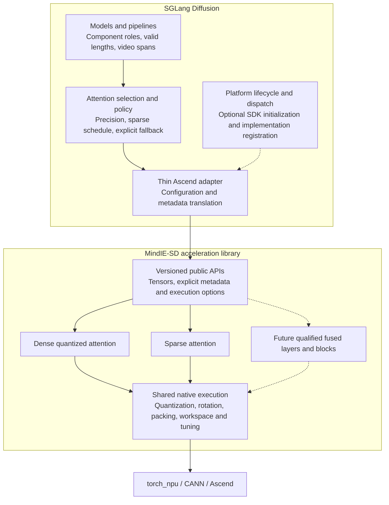
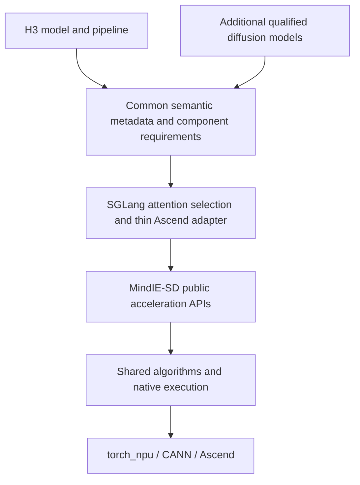
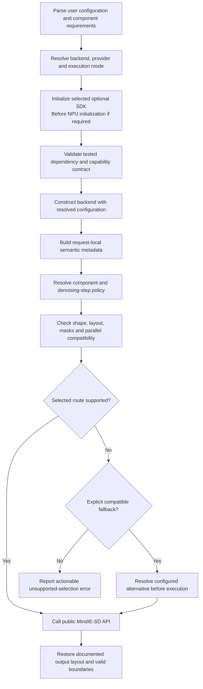
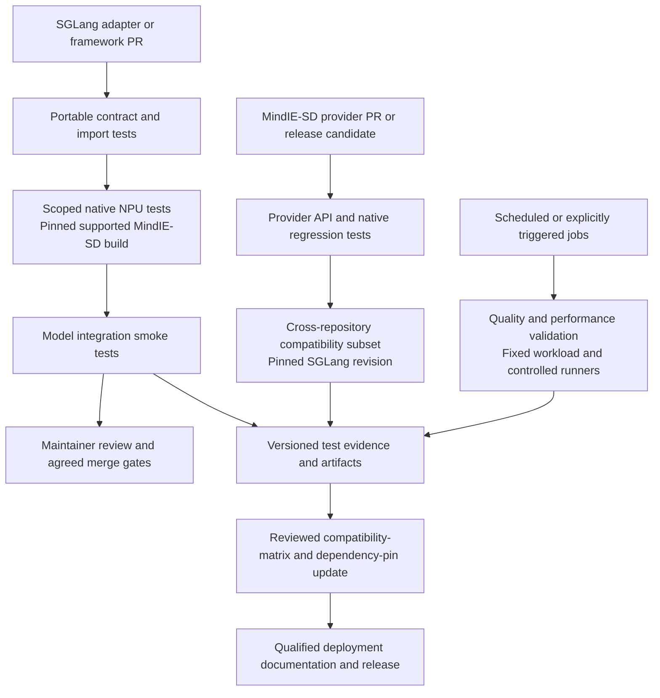

# sgl-project__sglang__issues-minimax-h3

Source: https://github.com/sgl-project/sglang/issues?q=minimax+h3
Fetched: 2026-11-28


---

# ISSUES in sgl-project/sglang matching "minimax h3" (top 25 by comments)


### #42752 [open] [CI] Flaky tests and CI infrastructure failures seen while babysitting PRs
URL: https://github.com/sgl-project/sglang/issues/42752  by nvpohanh 2026-10-06T10:42:20Z  comments: 318

[by Claude Code]

<!-- sglang-flaky-tracker:v1 -->

This issue tracks **flaky tests** and **recurring CI infrastructure failures** seen in NVIDIA `PR Test Base` / `PR Test Extra` runs while babysitting PRs with the `/sglang-pr-babysit` Claude Code workflow. It complements the CI tracker #17050. #17050 lists every failure signature by date. This issue records one row per flaky test, how often it was hit, and whether a rerun with no code change passed. Use it to pick the flakiest tests to debug.

A row is added only when triage found concrete evidence that the failure is **not caused by the PR** and **not a breakage on `main`**. PR-caused failures, `main` breakages, and uncertain cases are left out. Jobs that `github-actions[bot]` cancelled during a run of the maintainers' [Cancel Unfinished PR Runs](https://github.com/sgl-project/sglang/actions/workflows/cancel-unfinished-pr-tests.yml) workflow are also left out. Those are deliberate cancels, not flakes or infrastructure failures.

## Flaky tests

| ID | Test | Signature | Runner | Seen | Rerun passed | First seen | Last seen | Recent jobs | Status |
|---|---|---|---|---|---|---|---|---|---|
| T1 | `test/registered/lora/test_multi_lora_backend.py::TestMultiLoRABackend::test_ci_lora_models_multi_batch` | `AssertionError: ROUGE-L score <N> below tolerance 1.0` | `1-gpu-h100` | 9 | 6/9 | 2026-10-06 | 2026-10-08 | [#32947](https://github.com/sgl-project/sglang/actions/runs/37741919163/job/113345847472), [#41072](https://github.com/sgl-project/sglang/actions/runs/37738264988/job/113294449862), [#32947](https://github.com/sgl-project/sglang/actions/runs/37741919163/job/113273806955) | fixed (#43297) |
| T22 | `python/sglang/multimodal_gen/test/server/test_server_1_gpu.py::TestDiffusionServerOneGpu::test_diffusion_generation` | `PerformanceValidationError: Validation failed for '<METRIC>' (actual <N> > limit <N>)` (Load Latency, Average/Median Denoise Step, E2E over limits on `h100-computable-d`; runner-dependent, see #48311) | `1-gpu-h100` | 3 | 2/3 | 2026-11-11 | 2026-11-26 | [#51428](https://github.com/sgl-project/sglang/actions/runs/45758592016/job/139704145414), [#48267](https://github.com/sgl-project/sglang/actions/runs/44302403092/job/134795623507), [#49771](https://github.com/sgl-project/sglang/actions/runs/43016444180/job/130509110576) | investigating (#48311 runner-dependent, computable-d-gpu-1; fast_hunyuan_video fixed in #53483) |
| T10 | `test/registered/core/test_basic_sanity_dspark.py::TestBasicSanityDSpark::test_logprob_decode_match_prefill` | `AssertionError: <N> != <N> within 0.5 delta (<N> difference)` (decode vs prefill top-logprob mismatch on a tail token, DSpark spec decode) | `1-gpu-h100` | 3 | 0/3 | 2026-10-22 | 2026-10-22 | [#41968](https://github.com/sgl-project/sglang/actions/runs/39779897112/job/119834327377), [#45470](https://github.com/sgl-project/sglang/actions/runs/39775959045/job/119820817195), [#45678](https://github.com/sgl-project/sglang/actions/runs/39742586359/job/119709016108) | open |
| T5 | `test/registered/e2e/models/test_deepseek_v4_flash_fp4_h200.py::TestDSV4FlashFP4H200FlashInferCutlass::test_bs_1_speed` | `AssertionError: <N> not greater than 2.8` | `8-gpu-h200` | 3 | 2/3 | 2026-10-06 | 2026-10-08 | [#32947](https://github.com/sgl-project/sglang/actions/runs/37741919163/job/113506056482), [#34535](https://github.com/sgl-project/sglang/actions/runs/37472718685/job/112592256344), [#34535](https://github.com/sgl-project/sglang/actions/runs/37472718685/job/112465283691) | open |
| T25 | `test/registered/tokenizer/test_multi_tokenizer.py::TestMultiTokenizer::test_multi_tokenizer_ttft` | `AssertionError: <N> not less than 11000` (median e2e latency ms; slow runner `h100-novita6-gpu-01`, same failure there on #50874, #50983, and scheduled main; ~9 s on other H100 runners) | `2-gpu-h100` | 2 | 2/2 | 2026-11-17 | 2026-11-17 | [#48297](https://github.com/sgl-project/sglang/actions/runs/44089650881/job/134068060673), [#50021](https://github.com/sgl-project/sglang/actions/runs/43989492863/job/134190409137) | fixed (runner h100-novita6-gpu-01 drained 2026-11-18) |
| T13 | `test/registered/dllm/test_dllm_batching_fdfo.py::TestBatchingFDFO::test_bs_1_speed` | `AssertionError: <N> not greater than 250` (bs=1 decode throughput below threshold on a slow runner; built-in retry also below 250) | `1-gpu-h100` | 2 | 1/2 | 2026-10-24 | 2026-11-04 | [#47354](https://github.com/sgl-project/sglang/actions/runs/41452221893/job/126136157654), [#45796](https://github.com/sgl-project/sglang/actions/runs/40044082156/job/120725421348) | fixed (#47989) |
| T11 | `test/registered/unit/mem_cache/test_hicache_nixl_storage.py::TestNixlUnified::test_mla_mamba_round_trip_keeps_each_tp_rank` | `AssertionError: Lists differ: [False] != [True]` (NIXL POSIX `registerMem` failed: `/tmp/test_nixl_unified/...` deleted by a concurrent job's tearDown; see #44613) | `1-gpu-5090` | 2 | 1/2 | 2026-10-23 | 2026-10-28 | [#46851](https://github.com/sgl-project/sglang/actions/runs/40646112087/job/122796851579), [#45796](https://github.com/sgl-project/sglang/actions/runs/39962247821/job/120449370228) | fixed (#47197) |
| T14 | `test/registered/hicache/test_hicache_storage_file_backend.py::TestHiCacheStorageRandomFailure::test_basic_backup_and_prefetch` | `AssertionError: <N> not greater than 700 : Expected significant cached tokens for remote hit` (random backend failure injection) | `2-gpu-h100` | 2 | 2/2 | 2026-10-27 | 2026-10-27 | [#45470](https://github.com/sgl-project/sglang/actions/runs/40473220711/job/122115023492), [#42009](https://github.com/sgl-project/sglang/actions/runs/40487266050/job/122137737518) | fixed (#46821) |
| T29 | `test/registered/unit/models/test_inkling2.py::test_multiple_images_have_independent_attention` | `InductorError: CppCompileError: unknown value 'armv9-a+sve2+fp16fml+sha3+bf16+i8mm' for '-march'` (host `g++` on the re-provisioned GB300 runner predates armv9-a; torch inductor CPU compile) | `4-gpu-gb300` | 1 | 0/0 | 2026-11-26 | 2026-11-26 | [#51822](https://github.com/sgl-project/sglang/actions/runs/45380300979/job/139011182743) | open |
| T28 | `test/registered/e2e/cuda_graph/persistence/test_cuda_graph_persistence_multigpu.py::TestFoundryGraphPersistenceTP2::test_capture_state_is_built_before_capture` | `AssertionError: <N> not less than <N>` (log-order race: compares the first rank-0-only `Prebuilt capture state` line with the first `Capture ... CUDA graph begin.` line from any rank in the merged TP2 server log; TP1's begin line can land first) | `2-gpu-h100` | 1 | 1/1 | 2026-11-25 | 2026-11-25 | [#51588](https://github.com/sgl-project/sglang/actions/runs/45568814980/job/139089510349) | fixed (#53160) |
| T27 | `test/registered/kernels/ops/gemm/test_marlin_moe_gemv.py::TestMarlinMoeGemv::test_nvfp4_matches_gemm` | `AssertionError: <N> not less than 0.001 : (<N>, <N>)` (NVFP4 Marlin MoE GEMV vs Marlin GEMM relative error just over the bound, raw `(8, 0.00107)`; weights and activations come from the unseeded CUDA RNG) | `1-gpu-h100` | 1 | 1/1 | 2026-11-20 | 2026-11-20 | [#51312](https://github.com/sgl-project/sglang/actions/runs/44487788892/job/135812601709) | fixed (#51624) |
| T26 | `test/registered/kernels/ops/gemm/test_marlin_moe_gemv.py::TestMarlinMoeGemv::test_mxfp8_matches_gemm` | `AssertionError: <N> not less than 0.001 : (<N>, <N>)` (MXFP8 Marlin MoE GEMV vs Marlin GEMM relative error just over the bound, raw `(1, 0.00155)`; weights and activations come from the unseeded CUDA RNG) | `1-gpu-h100` | 1 | 1/1 | 2026-11-19 | 2026-11-19 | [#50962](https://github.com/sgl-project/sglang/actions/runs/44506725941/job/135505489499) | fixed (#51624) |
| T24 | `test/registered/openai_server/function_call/test_openai_function_calling.py::TestOpenAIFunctionCallingWithRust::test_function_calling_streaming_args_parsing` | `AssertionError: None != 'add' : Function name should be 'add'` (Llama-3.2-1B streamed no tool call at temperature 0.9 on the Rust server; built-in retry also failed) | `1-gpu-5090` | 1 | 1/1 | 2026-11-16 | 2026-11-16 | [#50051](https://github.com/sgl-project/sglang/actions/runs/43818031404/job/133142695064) | fixed (#50825) |
| T23 | `test/registered/disaggregation/test_disaggregation_rust_server.py::TestDisaggregationRustServer::setUpClass` | `binding HTTP listener on 127.0.0.1:<N> failed: Address already in use (os error 98)` (Mooncake transfer engine picks its handshake port at random from [15000, 17000], overlapping the PD fixture ports on runners whose first GPU is 2) | `2-gpu-large` | 1 | 0/0 | 2026-11-11 | 2026-11-11 | [#49908](https://github.com/sgl-project/sglang/actions/runs/43088414020/job/130777014559) | fixed (#49951) |
| T21 | `test/registered/profiling/test_diffusion_stage_profiler_sync.py::test_stage_entry_sync_excludes_previous_stage_tail` | `AssertionError: queued work not attributed to producer: {'producer': <N>, 'consumer': <N>}` (GPU-timing check; calibrated `torch.cuda._sleep` producer measured well under 250 ms; also listed in #17050) | `1-gpu-5090` | 1 | 1/1 | 2026-11-11 | 2026-11-11 | [#48456](https://github.com/sgl-project/sglang/actions/runs/42992936133/job/130430347148) | fixed (#49908) |
| T20 | `test/registered/kernels/ops/moe/test_marlin_moe.py` | `Run test step timed out after <N> minutes; file ran <N>s vs estimated <N>s` (shard stalled at file 13/23; every finished file passed) | `1-gpu-5090` | 1 | 1/1 | 2026-11-10 | 2026-11-10 | [#49335](https://github.com/sgl-project/sglang/actions/runs/42744192716/job/129597629333) | open |
| T19 | `test/registered/pp/test_pp_single_node.py::TestPPMixedChunk::setUpClass` | `[Errno 98] error while attempting to bind on address ('127.0.0.1', <N>): address already in use` (class hard-codes port 23338 while another runner shares the host; server torn down rc=-9, `[FIXTURE FAIL-FAST]` aborted `test_gsm8k`) | `4-gpu-h100` | 1 | 1/1 | 2026-11-09 | 2026-11-09 | [#48616](https://github.com/sgl-project/sglang/actions/runs/42591189061/job/129172989779) | fixed (#49335) |
| T18 | `test/registered/tokenizer/test_multi_tokenizer.py::TestMultiTokenizer::test_multi_tokenizer_ttft` | `File timeout after <N>s` (bench client stalled after `GET /v1/models`; server idle, no traceback; DP-attention multi-tokenizer server) | `2-gpu-h100` | 1 | 1/1 | 2026-11-06 | 2026-11-06 | [#47493](https://github.com/sgl-project/sglang/actions/runs/42186654582/job/127793540031) | fixed (#49573) |
| T17 | `test/registered/vlm/test_vision_openai_server_a.py::TestLlavaServer::setUpClass` | `TimeoutError: Server failed to start within the timeout period` (warmup HTTP 500 after `Replaced a broken multimodal CPU preprocess pool`, then `EADDRINUSE` on the relaunch; same sequence in scheduled `main` VLM runs; so far only on `h100-computable-*` runners) | `1-gpu-h100` | 1 | 0/1 | 2026-11-05 | 2026-11-05 | [#47493](https://github.com/sgl-project/sglang/actions/runs/41097580594/job/126709198594) | investigating (#48372) |
| T15 | `python/sglang/multimodal_gen/test/server/test_server_2_gpu.py::TestDiffusionServerTwoGpu::test_diffusion_generation` | `PerformanceValidationError: Validation failed for 'Runtime Peak VRAM (allocated)' (actual <N> > limit <N>)` (`ltx_2_two_stage_t2v`; bimodal peak just above the baseline limit) | `2-gpu-h100` | 1 | 1/1 | 2026-10-30 | 2026-10-30 | [#46926](https://github.com/sgl-project/sglang/actions/runs/40987455545/job/123842011452) | fixed (#47962) |
| T16 | `test/registered/e2e/quantization/test_awq.py::TestAWQ::test_mmlu` | `AssertionError: <N> not greater than 0.64` (Mixtral AWQ MMLU, 256 examples; built-in retry also below; main scores 0.64-0.67) | `1-gpu-h100` | 1 | 1/1 | 2026-10-30 | 2026-10-30 | [#46654](https://github.com/sgl-project/sglang/actions/runs/40872035803/job/123937039124) | fixed (#47957) |
| T12 | `test/registered/e2e/quantization/test_awq.py::TestAWQ::setUpClass` | `TimeoutError: Server failed to start within the timeout period` (Mixtral AWQ server hung at the first breakable prefill CUDA-graph shape; scheduler/tokenizer watchdog timeouts; so far only on `h100-computable-*` runners) | `1-gpu-h100` | 1 | 1/1 | 2026-10-24 | 2026-10-24 | [#45678](https://github.com/sgl-project/sglang/actions/runs/40033598784/job/120692624170) | open |
| T9 | `python/sglang/multimodal_gen/test/server/test_server_1_gpu_5090.py::TestDiffusionServerOneGpu5090::test_diffusion_generation` | `PerformanceValidationError: Validation failed for '<METRIC>' (actual <N> > limit <N>)` (DecodingStage, Load Latency, Load Peak Host Anon over limits) | `1-gpu-5090` | 1 | 0/0 | 2026-10-15 | 2026-10-15 | [#42760](https://github.com/sgl-project/sglang/actions/runs/38701620590/job/116355350410) | investigating (#48196) |
| T6 | `test/registered/disaggregation/test_disaggregation_different_tp.py::TestDisaggregationStagingRadixPrefillLargerTP::test_gsm8k` | `File timeout after <N>s; KVTransferError: Failed to get kvcache from prefill instance, it might be dead` | `8-gpu-h20` | 1 | 1/1 | 2026-10-13 | 2026-10-13 | [#42933](https://github.com/sgl-project/sglang/actions/runs/38254445684/job/114978198137) | investigating (#48206) |
| T7 | `python/sglang/multimodal_gen/test/unit/test_diffusion_decoder_tile_sharding.py::TestShardedDecode::test_three_ranks_agree_with_the_serial_decode` | `DistNetworkError: server socket failed to listen, port: <N>, EADDRINUSE` (gloo `init_process_group`) | `1-gpu-h100` | 1 | 1/1 | 2026-10-13 | 2026-10-13 | [#42760](https://github.com/sgl-project/sglang/actions/runs/38399661666/job/115303981993) | fixed (#47551) |
| T8 | `test/registered/kernels/ops/moe/test_moe_wna16_marlin.py::test_fused_marlin_moe_nvfp4_non_gated_matches_dequant_reference` | `AssertionError: Tensor-likes are not close! Mismatched elements: <N> / <N>; abs diff <N> (up to 0.25 allowed)` | `1-gpu-h100` | 1 | 1/1 | 2026-10-13 | 2026-10-13 | [#42803](https://github.com/sgl-project/sglang/actions/runs/38340318120/job/115119634287) | fixed (#47687) |
| T2 | `test/registered/core/test_basic_sanity.py` | `Run test step timed out after <N> minutes with no test output` | `1-gpu-5090` | 1 | 1/1 | 2026-10-06 | 2026-10-06 | [#34535](https://github.com/sgl-project/sglang/actions/runs/37472718685/job/112300624953) | fixed (#44729) |
| T3 | `test/registered/hicache/test_hicache_storage.py` | `Run test step timed out after <N> minutes; file ran <N>s vs estimated <N>s` | `1-gpu-5090` | 1 | 1/1 | 2026-10-06 | 2026-10-06 | [#36810](https://github.com/sgl-project/sglang/actions/runs/37454162206/job/112246794195) | fixed (#44729) |
| T4 | `test/registered/e2e/models/test_glm53_flash_b200.py::TestGLM53FlashB200LowLatency::test_gsm8k` | `AssertionError: np.float64(<N>) not greater than or equal to 0.93` | `4-gpu-b200` | 1 | 1/1 | 2026-10-06 | 2026-10-06 | [#33395](https://github.com/sgl-project/sglang/actions/runs/37454576286/job/112428464909) | fixed (#43975) |

## CI infrastructure failures

| ID | Job / step | Signature | Runner | Seen | Rerun passed | First seen | Last seen | Recent jobs | Status |
|---|---|---|---|---|---|---|---|---|---|
| I71 | `base-b-test-1-gpu-small` / `check-pr-test-health` | `RequestError [HttpError]: API rate limit exceeded for installation` (CI GitHub App token hit its API limit in the pre-test health check) | `1-gpu-5090` | 48 | 48/48 | 2026-11-20 | 2026-11-27 | [#51428](https://github.com/sgl-project/sglang/actions/runs/45952852320/job/140390189877), [#51428](https://github.com/sgl-project/sglang/actions/runs/45952852320/job/140390189851), [#51428](https://github.com/sgl-project/sglang/actions/runs/45952852320/job/140390189819) | open |
| I1 | `wait-for-base-b` / `wait-for-jobs` | `RequestError [HttpError]: Server Error` (GitHub jobs API 5xx) | `ubuntu-latest` | 47 | 13/47 | 2026-10-05 | 2026-11-17 | [#50741](https://github.com/sgl-project/sglang/actions/runs/43828644841/job/133756279948), [#48949](https://github.com/sgl-project/sglang/actions/runs/42984343667/job/130667011952), [#48949](https://github.com/sgl-project/sglang/actions/runs/42984343667/job/130579551429) | fixed (#42806) |
| I54 | `base-b-test-2-gpu-large` / `check-pr-test-health` | `RequestError [HttpError]: API rate limit exceeded for installation` (CI GitHub App token hit its API limit in the pre-test health check) | `2-gpu-h100` | 21 | 20/21 | 2026-11-02 | 2026-11-27 | [#51428](https://github.com/sgl-project/sglang/actions/runs/45952852320/job/140390189519), [#51428](https://github.com/sgl-project/sglang/actions/runs/45952852320/job/140390189500), [#51428](https://github.com/sgl-project/sglang/actions/runs/45952852320/job/140390189604) | open |
| I13 | `base-b-test-1-gpu-large` / `Run test` | `HfHubHTTPError: 429 Too Many Requests: you have reached your 'api' rate limit` (HF Hub download in a test) | `1-gpu-h100` | 9 | 7/9 | 2026-10-07 | 2026-10-08 | [#32947](https://github.com/sgl-project/sglang/actions/runs/37741919163/job/113470061063), [#41845](https://github.com/sgl-project/sglang/actions/runs/37738591702/job/113345368921), [#42987](https://github.com/sgl-project/sglang/actions/runs/37744383637/job/113335732751) | open |
| I17 | `base-b-test-1-gpu-large` / `check-pr-test-health` | `RequestError [HttpError]: Server Error` (GitHub jobs API 502 in the pre-test health check) | `1-gpu-h100` | 6 | 2/3 | 2026-10-08 | 2026-10-30 | [#46926](https://github.com/sgl-project/sglang/actions/runs/40987455545/job/123935909378), [#46926](https://github.com/sgl-project/sglang/actions/runs/40987455545/job/123935909248), [#44176](https://github.com/sgl-project/sglang/actions/runs/39393044159/job/118692076258) | open |
| I29 | `base-b-test-1-gpu-small` / `Install dependencies` | `error: Failed to install: <PKG> ... No space left on device (os error 28)` (runner disk full while installing the CI venv) | `1-gpu-5090` | 6 | 0/4 | 2026-10-15 | 2026-10-15 | [#42009](https://github.com/sgl-project/sglang/actions/runs/38700015934/job/116355964770), [#42760](https://github.com/sgl-project/sglang/actions/runs/38701620590/job/116358592959), [#44114](https://github.com/sgl-project/sglang/actions/runs/38684613088/job/116274550053) | open |
| I15 | `base-b-test-2-gpu-large` / `Run test` | `HfHubHTTPError: 429 Too Many Requests: you have reached your 'api' rate limit` (HF Hub download in a test) | `2-gpu-h100` | 6 | 6/6 | 2026-10-08 | 2026-10-08 | [#32947](https://github.com/sgl-project/sglang/actions/runs/37741919163/job/113345848037), [#41845](https://github.com/sgl-project/sglang/actions/runs/37738591702/job/113345369206), [#42987](https://github.com/sgl-project/sglang/actions/runs/37744383637/job/113228211223) | open |
| I70 | `base-b-test-1-gpu-small` / `Run test` | `torch.AcceleratorError: CUDA error: CUDA-capable device(s) is/are busy or unavailable` (`cudaErrorDevicesUnavailable` at `torch.cuda.set_device` during scheduler init; driver: `CUDA_ERROR_UNKNOWN` from `cuDevicePrimaryCtxRetain`; runner `5090-sm8-runner-6`) | `1-gpu-5090` | 5 | 5/5 | 2026-11-19 | 2026-11-20 | [#48247](https://github.com/sgl-project/sglang/actions/runs/44476674253/job/135758051327), [#48208](https://github.com/sgl-project/sglang/actions/runs/44513342349/job/135528221407), [#49535](https://github.com/sgl-project/sglang/actions/runs/44516827299/job/135540617921) | investigating (bad runner 5090-sm8-runner-6, see #42752 comment) |
| I19 | `base-c-test-8-gpu-h20` / `Run test` | `The self-hosted runner lost communication with the server` (after mooncake RDMA `Memory region not registered` errors) | `8-gpu-h20` | 5 | 5/5 | 2026-10-13 | 2026-10-27 | [#45889](https://github.com/sgl-project/sglang/actions/runs/40495599735/job/122357599615), [#44176](https://github.com/sgl-project/sglang/actions/runs/39536246450/job/119134885190), [#36652](https://github.com/sgl-project/sglang/actions/runs/39418515723/job/118719523868) | open |
| I28 | `base-a-test-1-gpu-small` / `Install dependencies` | `error: Failed to install: <PKG> ... No space left on device (os error 28)` (runner disk full while installing the CI venv) | `1-gpu-5090` | 5 | 3/5 | 2026-10-15 | 2026-10-15 | [#39694](https://github.com/sgl-project/sglang/actions/runs/38703705784/job/116370755806), [#39694](https://github.com/sgl-project/sglang/actions/runs/38703705784/job/116358810448), [#42746](https://github.com/sgl-project/sglang/actions/runs/38701364229/job/116358829449) | open |
| I82 | `base-b-test-1-gpu-large` / `check-pr-test-health` | `RequestError [HttpError]: API rate limit exceeded for installation` (CI GitHub App token hit its API limit in the pre-test health check) | `1-gpu-h100` | 4 | 4/4 | 2026-11-26 | 2026-11-27 | [#50021](https://github.com/sgl-project/sglang/actions/runs/45945396967/job/140332717005), [#53116](https://github.com/sgl-project/sglang/actions/runs/45945321309/job/140332552437), [#51822](https://github.com/sgl-project/sglang/actions/runs/45945362092/job/140333689806) | open |
| I78 | `base-b-test-4-gpu-b200` / `check-pr-test-health` | `RequestError [HttpError]: API rate limit exceeded for installation` (CI GitHub App token hit its API limit in the pre-test health check) | `4-gpu-b200` | 4 | 3/3 | 2026-11-25 | 2026-11-27 | [#51428](https://github.com/sgl-project/sglang/actions/runs/45952852320/job/140390189354), [#51822](https://github.com/sgl-project/sglang/actions/runs/45380300979/job/139011183091), [#51588](https://github.com/sgl-project/sglang/actions/runs/45568814980/job/139089510231) | open |
| I73 | `base-b-test-1-gpu-small` / `Run test` | `GatedRepoError: 401 Client Error: Cannot access gated repo for url <URL>` (HF Hub `model.safetensors.index.json` lookup for `meta-llama/Llama-3.2-1B-Instruct` rejected as unauthenticated while `test_rust_server_startup.py` launched a server without `HF_HUB_OFFLINE`; hit many PRs on all 5090 pools from 2026-11-25 00:52Z) | `1-gpu-5090` | 4 | 2/4 | 2026-11-25 | 2026-11-25 | [#51588](https://github.com/sgl-project/sglang/actions/runs/45395959754/job/138791380663), [#51690](https://github.com/sgl-project/sglang/actions/runs/45395942124/job/138789637369), [#51778](https://github.com/sgl-project/sglang/actions/runs/45380339526/job/138784995076) | open |
| I36 | `base-b-test-2-gpu-large` / `check-pr-test-health` | `RequestError [HttpError]: Server Error` (GitHub jobs API 502 in the pre-test health check) | `2-gpu-h100` | 4 | 2/4 | 2026-10-20 | 2026-10-30 | [#46926](https://github.com/sgl-project/sglang/actions/runs/40987455545/job/123935909409), [#44176](https://github.com/sgl-project/sglang/actions/runs/39393044159/job/118692075599), [#44176](https://github.com/sgl-project/sglang/actions/runs/39393044159/job/118675190265) | open |
| I74 | `base-a-test-1-gpu-small` / `check-pr-test-health` | `RequestError [HttpError]: API rate limit exceeded for installation` (CI GitHub App token hit its API limit in the pre-test health check) | `1-gpu-5090` | 3 | 3/3 | 2026-11-25 | 2026-11-25 | [#51958](https://github.com/sgl-project/sglang/actions/runs/45579346954/job/139086650960), [#49571](https://github.com/sgl-project/sglang/actions/runs/45579172021/job/139085110853), [#52551](https://github.com/sgl-project/sglang/actions/runs/45578888535/job/139085033942) | open |
| I56 | `base-c-test-4-gpu-h100` / `Run test` | `RuntimeError: Failed: JIT error <PATH>/dispatch_jit.cpp:<N> 'dispatch JIT launch failed ... compile failed: nvcc ... exit_code=127'` (Mooncake EP JIT `nvcc` not runnable during CUDA graph capture in `test_mooncake_ep_small.py`) | `4-gpu-h100` | 3 | 3/3 | 2026-11-04 | 2026-11-06 | [#47493](https://github.com/sgl-project/sglang/actions/runs/42186654582/job/128185365214), [#47930](https://github.com/sgl-project/sglang/actions/runs/42189509129/job/127963116965), [#47676](https://github.com/sgl-project/sglang/actions/runs/41787902058/job/126583191740) | investigating (fixed upstream in kvcache-ai/Mooncake#5356 + #5409; awaiting Mooncake release + bump) |
| I31 | `base-c-test-8-gpu-b300` / `check-pr-test-health` | `RequestError [HttpError]: Server Error` (GitHub jobs API 502 in the pre-test health check) | `8-gpu-b300` | 3 | 2/2 | 2026-10-15 | 2026-10-30 | [#46654](https://github.com/sgl-project/sglang/actions/runs/40872035803/job/124088577889), [#43838](https://github.com/sgl-project/sglang/actions/runs/39200872303/job/118202008190), [#43685](https://github.com/sgl-project/sglang/actions/runs/38653828803/job/116357270960) | open |
| I25 | `call-multimodal-gen-tests / multimodal-gen-test-4-gpu-b200` / `Run diffusion server tests` | `HfHubHTTPError: 429 Too Many Requests: you have reached your 'api' rate limit` (HF Hub `model_info` while loading a diffusion transformer) | `4-gpu-b200` | 3 | 2/2 | 2026-10-15 | 2026-10-21 | [#42760](https://github.com/sgl-project/sglang/actions/runs/39535409763/job/119011087191), [#42760](https://github.com/sgl-project/sglang/actions/runs/39122132737/job/117659803476), [#42760](https://github.com/sgl-project/sglang/actions/runs/38546620013/job/115794359001) | open |
| I11 | `base-b-test-2-gpu-large` / `check-pr-test-health` | `RequestError [HttpError]: status 500` (GitHub check-runs API in the pre-test health check) | `2-gpu-h100` | 3 | 3/3 | 2026-10-07 | 2026-10-07 | [#37958](https://github.com/sgl-project/sglang/actions/runs/37626997649/job/112831457722), [#39696](https://github.com/sgl-project/sglang/actions/runs/37626972221/job/112831246877), [#39696](https://github.com/sgl-project/sglang/actions/runs/37626972221/job/112831246780) | open |
| I72 | `base-b-test-1-gpu-small` / `Install dependencies` | `error: Failed to build sglang @ <PATH> ... Failed to extract archive: <PKG> ... No such file or directory (os error 2)` (uv lost a temp file while extracting a build-requirement wheel into the per-runner uv cache) | `1-gpu-5090` | 2 | 2/2 | 2026-11-24 | 2026-11-24 | [#51778](https://github.com/sgl-project/sglang/actions/runs/45380339526/job/138474834952), [#51958](https://github.com/sgl-project/sglang/actions/runs/45402047334/job/138595473185) | open |
| I65 | `call-multimodal-gen-tests / multimodal-gen-test-1-gpu` / `Install dependencies` | `error: Failed to download <PKG> ... No space left on device (os error 28)` (runner disk full while uv wrote its download cache) | `1-gpu-h100` | 2 | 2/2 | 2026-11-12 | 2026-11-12 | [#49872](https://github.com/sgl-project/sglang/actions/runs/43153865485/job/131001264920), [#49872](https://github.com/sgl-project/sglang/actions/runs/43153865485/job/131001264911) | open |
| I52 | `base-c-test-2-gpu-gb300` / `check-pr-test-health` | `RequestError [HttpError]: Server Error` (GitHub jobs API 502 in the pre-test health check) | `2-gpu-gb300` | 2 | 2/2 | 2026-10-30 | 2026-10-31 | [#47306](https://github.com/sgl-project/sglang/actions/runs/41006357954/job/124274104877), [#46654](https://github.com/sgl-project/sglang/actions/runs/40872035803/job/124088577183) | open |
| I35 | `base-c-test-8-gpu-b300` / `Run test` | `GatedRepoError: 403 Client Error: Cannot access gated repo for url <URL>` (HF Hub `chat_template.json` lookup in `get_processor`; fork PR runs without `HF_MUSE_SPARK_TOKEN`) | `8-gpu-b300` | 2 | 1/2 | 2026-10-20 | 2026-10-21 | [#44176](https://github.com/sgl-project/sglang/actions/runs/39536246450/job/119134884863), [#44124](https://github.com/sgl-project/sglang/actions/runs/39374134476/job/118550212730) | open |
| I32 | `call-multimodal-gen-tests / multimodal-gen-test-1-gpu` / `Run diffusion server tests` | `HfHubHTTPError: 429 Too Many Requests: you have reached your 'api' rate limit` (HF Hub `model_info` while resolving a diffusion LoRA adapter) | `1-gpu-h100` | 2 | 2/2 | 2026-10-18 | 2026-10-20 | [#42760](https://github.com/sgl-project/sglang/actions/runs/39348980625/job/118388654218), [#42760](https://github.com/sgl-project/sglang/actions/runs/39122132737/job/117659835813) | open |
| I33 | `base-c-test-4-gpu-b200` / `check-pr-test-health` | `RequestError [HttpError]: Server Error` (GitHub jobs API 502 in the pre-test health check) | `4-gpu-b200` | 2 | 1/1 | 2026-10-20 | 2026-10-20 | [#44124](https://github.com/sgl-project/sglang/actions/runs/39374134476/job/118676850083), [#43838](https://github.com/sgl-project/sglang/actions/runs/39200872303/job/118202008626) | open |
| I37 | `base-c-test-4-gpu-h100` / `check-pr-test-health` | `RequestError [HttpError]: Server Error` (GitHub jobs API 502 in the pre-test health check) | `4-gpu-h100` | 2 | 2/2 | 2026-10-20 | 2026-10-20 | [#31447](https://github.com/sgl-project/sglang/actions/runs/39393181957/job/118643688472), [#44124](https://github.com/sgl-project/sglang/actions/runs/39374134476/job/118676850424) | open |
| I22 | `base-b-test-1-gpu-small` / `Install dependencies` | `error: Failed to create virtual environment: A virtual environment already exists at: <PATH>` (runner instances on one host raced on the shared CI venv) | `1-gpu-5090` | 2 | 0/0 | 2026-10-15 | 2026-10-15 | [#43685](https://github.com/sgl-project/sglang/actions/runs/38653828803/job/116165434540), [#43685](https://github.com/sgl-project/sglang/actions/runs/38653828803/job/116165434494) | open |
| I18 | `base-c-test-4-gpu-h100` / `Run test` | `HfHubHTTPError: 429 Too Many Requests: you have reached your 'api' rate limit` (HF Hub download in a test) | `4-gpu-h100` | 2 | 2/2 | 2026-10-08 | 2026-10-08 | [#32947](https://github.com/sgl-project/sglang/actions/runs/37741919163/job/113506056529), [#41072](https://github.com/sgl-project/sglang/actions/runs/37738264988/job/113392620623) | open |
| I81 | `call-multimodal-gen-tests / multimodal-gen-test-4-gpu-b200` / `Run diffusion suite` | `GatedRepoError: 401 Client Error: Cannot access gated repo for url <URL>` (HF Hub `model_index.json` lookup for `black-forest-labs/FLUX.2-dev` and `ideogram-ai/ideogram-4-fp8` rejected as unauthenticated; `pull_request_target` runs get an empty `HF_TOKEN` and this suite has no model prefetch, so it depends on the runner's HF cache; seen on `b200-cirrascale3`) | `4-gpu-b200` | 1 | 1/1 | 2026-11-26 | 2026-11-26 | [#51428](https://github.com/sgl-project/sglang/actions/runs/45758592016/job/139704047353) | open |
| I80 | `base-c-test-4-gpu-b200` / `check-pr-test-health` | `RequestError [HttpError]: API rate limit exceeded for installation` (CI GitHub App token hit its API limit in the pre-test health check) | `4-gpu-b200` | 1 | 0/0 | 2026-11-26 | 2026-11-26 | [#51822](https://github.com/sgl-project/sglang/actions/runs/45380300979/job/139011182960) | open |
| I79 | `base-b-test-2-gpu-large` / `Run test` | `RuntimeError: Cannot find any model weights with <MODEL>` (HF Hub `429 Too Many Requests` 'api' rate limit while listing the repo; local snapshot had no weights) | `2-gpu-h100` | 1 | 1/1 | 2026-11-25 | 2026-11-25 | [#50032](https://github.com/sgl-project/sglang/actions/runs/45568840269/job/139090078340) | open |
| I75 | `call-multimodal-gen-tests / multimodal-gen-test-1-5090` / `Install dependencies` | `The self-hosted runner lost communication with the server` (`Install dependencies` never finished; job log blob missing; runner `5090-sm1-runner-6`; 3 runners on host `5090-sm1` dropped within 2 min) | `1-gpu-5090` | 1 | 1/1 | 2026-11-24 | 2026-11-24 | [#51428](https://github.com/sgl-project/sglang/actions/runs/45395974086/job/138456761058) | open |
| I76 | `call-jit-kernel-tests / jit-kernel-unit-test-1-gpu-small` / `Run test` | `The self-hosted runner lost communication with the server` (`Run test` never finished; job log blob missing; runner `5090-sm1-runner-5`; 3 runners on host `5090-sm1` dropped within 2 min) | `1-gpu-5090` | 1 | 1/1 | 2026-11-24 | 2026-11-24 | [#51428](https://github.com/sgl-project/sglang/actions/runs/45395974086/job/138461654428) | open |
| I77 | `call-jit-kernel-tests / jit-kernel-benchmark-test-1-gpu-small` / `Run test` | `The self-hosted runner lost communication with the server` (`Run test` never finished; job log blob missing; runner `5090-sm1-runner-0`; 3 runners on host `5090-sm1` dropped within 2 min) | `1-gpu-5090` | 1 | 1/1 | 2026-11-24 | 2026-11-24 | [#51428](https://github.com/sgl-project/sglang/actions/runs/45395974086/job/138461654578) | open |
| I61 | `call-multimodal-gen-tests / multimodal-gen-unit-test` / `Install dependencies` | `error: Failed to install: <PKG> ... No space left on device (os error 28)` (runner disk full while installing the CI venv) | `1-gpu-h100` | 1 | 0/1 | 2026-11-12 | 2026-11-12 | [#49872](https://github.com/sgl-project/sglang/actions/runs/43153865485/job/130969344544) | open |
| I62 | `call-multimodal-gen-tests / multimodal-gen-test-1-gpu` / `Run diffusion suite` | `System.IO.IOException: No space left on device : '<PATH>/_diag/Worker_<TS>.log'` (runner disk full; step never finished; job log blob missing) | `1-gpu-h100` | 1 | 0/1 | 2026-11-12 | 2026-11-12 | [#49872](https://github.com/sgl-project/sglang/actions/runs/43153865485/job/130969393761) | open |
| I63 | `base-b-test-1-gpu-large` / `Install dependencies` | `System.IO.IOException: No space left on device : '<PATH>'` (runner disk full; the runner could not write its own `_diag` worker log, and the job log was lost) | `1-gpu-h100` | 1 | 0/1 | 2026-11-12 | 2026-11-12 | [#48602](https://github.com/sgl-project/sglang/actions/runs/43157175119/job/130983476267) | open |
| I64 | `call-multimodal-gen-tests / multimodal-gen-unit-test` / `Install dependencies` | `OSError: [Errno 28] No space left on device` (pip download of `flashinfer-jit-cache` hit a full runner disk) | `1-gpu-h100` | 1 | 0/1 | 2026-11-12 | 2026-11-12 | [#49872](https://github.com/sgl-project/sglang/actions/runs/43153865485/job/131001264180) | open |
| I66 | `base-b-test-1-gpu-large` / `Install dependencies` | `error: Failed to install: <PKG> ... No space left on device (os error 28)` (runner disk full while uv installed the CI venv) | `1-gpu-h100` | 1 | 1/1 | 2026-11-12 | 2026-11-12 | [#48602](https://github.com/sgl-project/sglang/actions/runs/43157175119/job/131001508593) | open |
| I67 | `call-multimodal-gen-tests / multimodal-gen-unit-test` / `Install dependencies` | `error: Failed to build sglang @ <PATH> ... No space left on device (os error 28)` (runner disk full while uv built sglang into the CI venv) | `1-gpu-h100` | 1 | 1/1 | 2026-11-12 | 2026-11-12 | [#49872](https://github.com/sgl-project/sglang/actions/runs/43153865485/job/131016754947) | open |
| I68 | `call-multimodal-gen-tests / multimodal-gen-test-1-gpu` / `Install dependencies` | `error: Failed to build sglang @ <PATH> ... No space left on device (os error 28)` (runner disk full while uv built sglang into the CI venv) | `1-gpu-h100` | 1 | 1/1 | 2026-11-12 | 2026-11-12 | [#49872](https://github.com/sgl-project/sglang/actions/runs/43153865485/job/131016755599) | open |
| I69 | `call-multimodal-gen-tests / multimodal-gen-test-2-gpu` / `Run diffusion suite` | `ValueError: Model directory <PATH>/Ref2VA does not contain model_index.json or modular_model_index.json` (incomplete `MiniMaxAI/MiniMax-H3` HF cache snapshot on the runner; server never started) | `2-gpu-h100` | 1 | 1/1 | 2026-11-12 | 2026-11-12 | [#49872](https://github.com/sgl-project/sglang/actions/runs/43153865485/job/131040346949) | open |
| I60 | `pr-test-finish` / `runner acquisition` | `Run concluded failure while the job sat queued with no runner` (GitHub-hosted runner never assigned; no steps, no log; during a GitHub API 5xx window) | `ubuntu-latest` | 1 | 0/0 | 2026-11-11 | 2026-11-11 | [#48456](https://github.com/sgl-project/sglang/actions/runs/42992936133/job/130783310578) | open |
| I58 | `call-jit-kernel-tests / jit-kernel-unit-test-4-gpu-b200` / `Run test` | `The action 'Run test' has timed out after <N> minutes` (112-file suite ran ~2.8x slower than usual, likely JIT recompiles after shared JIT header change in main commit ff762d62f8; every finished file passed) | `4-gpu-b200` | 1 | 1/1 | 2026-11-09 | 2026-11-09 | [#48616](https://github.com/sgl-project/sglang/actions/runs/42591189061/job/129073246725) | fixed (#49577) |
| I59 | `base-a-test-cpu` / `Install dependencies` | `The hosted runner lost communication with the server` (GitHub-hosted runner died mid-install; job log blob missing) | `ubuntu-latest` | 1 | 1/1 | 2026-11-09 | 2026-11-09 | [#48613](https://github.com/sgl-project/sglang/actions/runs/42602892712/job/129112260078) | open |
| I57 | `base-c-test-4-gpu-b200` / `Install dependencies` | `The action 'Install dependencies' has timed out after <N> minutes` (`nvidia-smi` stalled for minutes in host detection and the GDRCopy check) | `4-gpu-b200` | 1 | 1/1 | 2026-11-06 | 2026-11-06 | [#48584](https://github.com/sgl-project/sglang/actions/runs/42213210310/job/128061074193) | open |
| I55 | `base-b-test-1-gpu-large` / `Run test` | `The self-hosted runner lost communication with the server` (`Run test` never finished; job log blob missing; runner `h100-novita-host1-gpu-2`) | `1-gpu-h100` | 1 | 0/0 | 2026-11-03 | 2026-11-03 | [#47354](https://github.com/sgl-project/sglang/actions/runs/41452221893/job/125307913166) | open |
| I53 | `wait-for-base-b` / `wait-for-jobs` | `RequestError [HttpError]: API rate limit exceeded for installation` (CI GitHub App token hit its API limit while polling stage-B jobs) | `ubuntu-latest` | 1 | 1/1 | 2026-11-02 | 2026-11-02 | [#46082](https://github.com/sgl-project/sglang/actions/runs/41408215617/job/125158310580) | open |
| I48 | `base-c-test-2-gpu-gb300` / `check-pr-test-health` | `RequestError [HttpError]: status 500` (GitHub check-runs API in the pre-test health check) | `2-gpu-gb300` | 1 | 0/1 | 2026-10-30 | 2026-10-30 | [#47306](https://github.com/sgl-project/sglang/actions/runs/41006357954/job/124037235783) | open |
| I46 | `call-jit-kernel-tests / jit-kernel-benchmark-test-1-gpu-large` / `Install dependencies` | `The action 'Install dependencies' has timed out after <N> minutes` (`uv pip install -e python[...]` stalled with no output) | `1-gpu-h100` | 1 | 0/1 | 2026-10-30 | 2026-10-30 | [#46926](https://github.com/sgl-project/sglang/actions/runs/40987455545/job/123847134651) | open |
| I47 | `call-jit-kernel-tests / jit-kernel-unit-test-1-gpu-large` / `check-pr-test-health` | `RequestError [HttpError]: Server Error` (GitHub API 5xx in the pre-test health check) | `1-gpu-h100` | 1 | 0/1 | 2026-10-30 | 2026-10-30 | [#46926](https://github.com/sgl-project/sglang/actions/runs/40987455545/job/123935909184) | open |
| I49 | `call-multimodal-gen-tests / multimodal-gen-test-1-gpu` / `check-pr-test-health` | `RequestError [HttpError]: Server Error` (GitHub API 5xx in the pre-test health check) | `1-gpu-h100` | 1 | 0/1 | 2026-10-30 | 2026-10-30 | [#46926](https://github.com/sgl-project/sglang/actions/runs/41074304323/job/124126710546) | open |
| I50 | `base-b-test-1-gpu-large` / `check-pr-test-health` | `Unhandled error: HttpError: terminated` (GitHub API request aborted in the pre-test health check) | `1-gpu-h100` | 1 | 0/1 | 2026-10-30 | 2026-10-30 | [#46926](https://github.com/sgl-project/sglang/actions/runs/41074304323/job/124295658927) | open |
| I51 | `base-c-test-8-gpu-h20` / `check-pr-test-health` | `RequestError [HttpError]: status 500` (GitHub check-runs API in the pre-test health check) | `8-gpu-h20` | 1 | 1/1 | 2026-10-30 | 2026-10-30 | [#46654](https://github.com/sgl-project/sglang/actions/runs/40872035803/job/124088577949) | open |
| I45 | `base-b-test-2-gpu-large` / `Install dependencies` | `error: Failed to build sglang @ <PATH> ... Timeout (<N>s) when waiting for lock on <PATH>/.lock` (runner instances on one host contended for the shared uv cache) | `2-gpu-h100` | 1 | 1/1 | 2026-10-29 | 2026-10-29 | [#44750](https://github.com/sgl-project/sglang/actions/runs/40874646529/job/123456489907) | investigating (#48944) |
| I44 | `base-b-test-1-gpu-small` / `Install dependencies` | `error: Failed to build sglang @ <PATH> ... Timeout (<N>s) when waiting for lock on <PATH>/.lock` (runner instances on one host contended for the shared uv cache) | `1-gpu-5090` | 1 | 0/1 | 2026-10-28 | 2026-10-28 | [#46851](https://github.com/sgl-project/sglang/actions/runs/40646112087/job/122684659242) | investigating (#48944) |
| I43 | `base-b-test-1-gpu-small` / `Run test` | `ModuleNotFoundError: No module named 'diffusers'` (`test_image_preprocessing.py` import; runner's persistent CI venv lacks the `diffusion` extra) | `1-gpu-5090` | 1 | 1/1 | 2026-10-27 | 2026-10-27 | [#46197](https://github.com/sgl-project/sglang/actions/runs/40494900569/job/122164976569) | open |
| I42 | `base-b-test-1-gpu-small` / `Run test` | `The self-hosted runner lost communication with the server` (log stopped mid-test with no error; runner `5090-sm1-runner-0`) | `1-gpu-5090` | 1 | 1/1 | 2026-10-24 | 2026-10-24 | [#45678](https://github.com/sgl-project/sglang/actions/runs/40033598784/job/120692624433) | open |
| I41 | `base-c-test-4-gpu-b200` / `check-pr-test-health` | `Unhandled error: HttpError: terminated` (GitHub API request aborted in the pre-test health check, after the lint and label checks) | `4-gpu-b200` | 1 | 1/1 | 2026-10-22 | 2026-10-22 | [#44176](https://github.com/sgl-project/sglang/actions/runs/39536246450/job/119479301243) | open |
| I38 | `base-c-test-8-gpu-h20` / `Run test` | `httpx.RemoteProtocolError: Server disconnected without sending a response` (dataset download via HTTP proxy in `sample_random_requests`) | `8-gpu-h20` | 1 | 0/1 | 2026-10-21 | 2026-10-21 | [#33250](https://github.com/sgl-project/sglang/actions/runs/39505508578/job/119004979325) | open |
| I39 | `base-c-test-8-gpu-h20` / `check-pr-test-health` | `RequestError [HttpError]: Unterminated string in JSON at position <N>` (GitHub jobs API 500 with a truncated body in the pre-test health check) | `8-gpu-h20` | 1 | 1/1 | 2026-10-21 | 2026-10-21 | [#33250](https://github.com/sgl-project/sglang/actions/runs/39505508578/job/119056416110) | open |
| I40 | `base-c-test-8-gpu-b300` / `Run test` | `torch.AcceleratorError: CUDA error: CUDA-capable device(s) is/are busy or unavailable` (`cudaErrorDevicesUnavailable` at `torch.cuda.set_device` during scheduler init; driver: `CUDA_ERROR_UNKNOWN` from `cuDevicePrimaryCtxRetain`) | `8-gpu-b300` | 1 | 1/1 | 2026-10-21 | 2026-10-21 | [#44176](https://github.com/sgl-project/sglang/actions/runs/39536246450/job/119262458758) | open |
| I34 | `base-c-test-8-gpu-h20` / `check-pr-test-health` | `RequestError [HttpError]: Server Error` (GitHub jobs API 502 in the pre-test health check) | `8-gpu-h20` | 1 | 0/1 | 2026-10-20 | 2026-10-20 | [#43838](https://github.com/sgl-project/sglang/actions/runs/39200872303/job/118202008128) | open |
| I21 | `wait-for-base-b` / `wait-for-jobs` | `The job has exceeded the maximum execution time of <N>h0m0s` (stage gate waited while a stage-B job sat queued for a runner) | `ubuntu-latest` | 1 | 1/1 | 2026-10-15 | 2026-10-15 | [#44114](https://github.com/sgl-project/sglang/actions/runs/38550294693/job/115871477534) | open |
| I23 | `base-b-test-1-gpu-small` / `Install dependencies` | `E: Could not get lock /var/lib/dpkg/lock-frontend. It is held by process <N> (apt-get)` (runner instances on one host ran apt-get at the same time) | `1-gpu-5090` | 1 | 0/0 | 2026-10-15 | 2026-10-15 | [#43685](https://github.com/sgl-project/sglang/actions/runs/38653828803/job/116165434383) | open |
| I24 | `base-a-test-1-gpu-small` / `Run test` | `The action 'Run test' has timed out after <N> minutes` (stalled HF download of the DFlash draft model in `test_basic_sanity_dflash.py`) | `1-gpu-5090` | 1 | 1/1 | 2026-10-15 | 2026-10-15 | [#42803](https://github.com/sgl-project/sglang/actions/runs/38684438559/job/116256202585) | open |
| I26 | `wait-for-base-b` / `wait-for-jobs` | `RequestError [HttpError]: We couldn't respond to your request in time` (GitHub API timeout while polling stage-B jobs) | `ubuntu-latest` | 1 | 0/1 | 2026-10-15 | 2026-10-15 | [#42746](https://github.com/sgl-project/sglang/actions/runs/38556647883/job/115857236682) | open |
| I27 | `call-multimodal-gen-tests / multimodal-gen-test-1-5090` / `Install dependencies` | `error: Failed to install: <PKG> ... No space left on device (os error 28)` (runner disk full while installing the CI venv) | `1-gpu-5090` | 1 | 0/1 | 2026-10-15 | 2026-10-15 | [#42760](https://github.com/sgl-project/sglang/actions/runs/38701620590/job/116311167799) | open |
| I30 | `base-b-test-1-gpu-small` / `Install dependencies` | `error: Failed to build sglang @ <PATH> ... No space left on device` (runner disk full while uv built sglang into the CI venv) | `1-gpu-5090` | 1 | 1/1 | 2026-10-15 | 2026-10-15 | [#33743](https://github.com/sgl-project/sglang/actions/runs/38702200270/job/116372768694) | open |
| I20 | `base-a-test-cpu` / `Run test` | `The action 'Run test' has timed out after <N> minutes` (slow GitHub-hosted runner; shard did not finish) | `ubuntu-latest` | 1 | 1/1 | 2026-10-14 | 2026-10-14 | [#44114](https://github.com/sgl-project/sglang/actions/runs/38550294693/job/115806695936) | open |
| I16 | `base-b-test-1-gpu-small` / `Run test` | `HfHubHTTPError: 429 Too Many Requests: you have reached your 'api' rate limit` (HF Hub download in a test) | `1-gpu-5090` | 1 | 1/1 | 2026-10-08 | 2026-10-08 | [#42987](https://github.com/sgl-project/sglang/actions/runs/37744383637/job/113228211134) | open |
| I12 | `base-b-test-2-gpu-large` / `runner acquisition` | `The job was not started because it repeatedly failed to be acquired (<N> attempts)` | `2-gpu-h100` | 1 | 1/1 | 2026-10-07 | 2026-10-07 | [#37958](https://github.com/sgl-project/sglang/actions/runs/37626997649/job/112831457523) | open |
| I14 | `base-b-test-1-gpu-large` / `check-pr-test-health` | `RequestError [HttpError]: status 500` (GitHub check-runs API in the pre-test health check) | `1-gpu-h100` | 1 | 1/1 | 2026-10-07 | 2026-10-07 | [#41865](https://github.com/sgl-project/sglang/actions/runs/37636098052/job/112851419405) | open |

## Format (v1)

Each row is one failure mode, keyed by **Test** (or **Job / step**) plus **Signature**. The same test failing with a different signature gets its own row.

- **ID**: `T<n>` for tests and `I<n>` for infra. IDs are never reused, even when a row is fixed or removed. Retired IDs: `I2`-`I10` (removed on 2026-10-08 because they were `Cancel Unfinished PR Runs` cancels).
- **Test**: `path::Class::method`, with the path relative to the repo root. Use `path` alone if the method is unknown.
- **Job / step**: the workflow job name, a slash, and the failing step or action.
- **Signature**: the exception type and message, with run-specific values (numbers, paths, hashes, ports, timestamps) replaced by `<N>`, `<PATH>`, and so on. At most about 100 characters.
- **Runner**: the runner label of the failing job, for example `1-gpu-h100` or `8-gpu-b300`.
- **Seen**: the number of failed job attempts recorded. Each failed attempt counts once, including a failed rerun.
- **Rerun passed**: `P/R`. `R` is the number of occurrences whose rerun has finished. `P` is how many of those reruns passed the same job with no code change.
- **First seen** / **Last seen**: UTC dates (`YYYY-MM-DD`).
- **Recent jobs**: links to the last 3 failing jobs, newest first. Each link is labeled with its PR number.
- **Status**: `open`; `investigating (@user or #issue)`; or `fixed (#PR)`. If a `fixed` row fails again after the fix merged, it returns to `open` with `regressed after #PR`.

Rows are sorted by **Seen**, highest first. Ties are broken by **Last seen**, newest first.

Every occurrence is also posted as a comment on this issue. The comment starts with `<!-- sglang-flaky-occurrence:v1 -->` and holds the entry ID, PR, job link, why the failure is unrelated to the PR, and the rerun result. The comments are the append-only record, and the tables above are their summary.

## For debugging agents

Start from the top of each table. A test row with a high **Seen** count and a high **Rerun passed** ratio is a confirmed flake, and it is worth fixing or stabilizing. When you take a row, set its **Status** to `investigating (@you)`. When the fix merges, set it to `fixed (#PR)`.

> **Comment by nvpohanh (2026-10-06T10:42:31Z):**

[by Claude Code]
<!-- sglang-flaky-occurrence:v1 -->

- **Entry:** I1 (new)
- **PR:** #42022 at `35a5d488cb`
- **Job:** [wait-for-base-b](https://github.com/sgl-project/sglang/actions/runs/37302243358/job/111742344870), run 37302243358, attempt 1, runner `ubuntu-latest`
- **Signature:** `RequestError [HttpError]: Server Error`
- **Why unrelated:** The `wait-for-jobs` github-script got an HTTP 500 from `GET /actions/runs/{id}/jobs`, and no test step failed. The same 500 hit an unrelated PR in run 37319494502.
- **Rerun:** failed, same signature (attempt 2)


> **Comment by nvpohanh (2026-10-06T10:42:32Z):**

[by Claude Code]
<!-- sglang-flaky-occurrence:v1 -->

- **Entry:** I1
- **PR:** #42022 at `35a5d488cb`
- **Job:** [wait-for-base-b](https://github.com/sgl-project/sglang/actions/runs/37302243358/job/111853982288), run 37302243358, attempt 2, runner `ubuntu-latest`
- **Signature:** `RequestError [HttpError]: Server Error`
- **Why unrelated:** It is the same GitHub jobs API 500 as the previous attempt, and no test step failed.
- **Rerun:** passed ([attempt 3 wait-for-base-b](https://github.com/sgl-project/sglang/actions/runs/37302243358/job/111880245153))


> **Comment by nvpohanh (2026-10-06T10:42:33Z):**

[by Claude Code]
<!-- sglang-flaky-occurrence:v1 -->

- **Entry:** T1 (new)
- **PR:** #42022 at `04d2b1ab45`
- **Job:** [base-b-test-1-gpu-large (2)](https://github.com/sgl-project/sglang/actions/runs/37419664027/job/112129365636), run 37419664027, attempt 1, runner `1-gpu-h100`
- **Signature:** `AssertionError: ROUGE-L score <N> below tolerance 1.0` (observed 0.9773755656108598, adapters `[winddude/wizardLM-LlaMA-LoRA-7B, RuterNorway/Llama-2-7b-chat-norwegian-LoRa, None]` on `meta-llama/Llama-2-7b-hf`)
- **Why unrelated:** The PR only changes the MoE / MegaMoE layers and the speculative draft build scope, and this dense Llama-2 LoRA test without speculative decoding exercises neither. The same test passed with ROUGE-L 1.0 in 4 unrelated PR runs against the same `main` (37425466791, 37423873875, 37422071549, 37421587444).
- **Rerun:** passed ([attempt 2](https://github.com/sgl-project/sglang/actions/runs/37419664027/job/112176129914))


> **Comment by nvpohanh (2026-10-06T14:14:37Z):**

[by Claude Code]
<!-- sglang-flaky-occurrence:v1 -->

- **Entry:** T2 (new)
- **PR:** #34535 at `44ee6987`
- **Job:** [base-a-test-1-gpu-small / base-a-test-1-gpu-small (0)](https://github.com/sgl-project/sglang/actions/runs/37472718685/job/112300624953), run 37472718685, attempt 1, runner `1-gpu-5090` (`5090-c-runner-5`)
- **Signature:** `Run test step timed out after <N> minutes with no test output` (10 min; `test_basic_sanity.py` printed nothing, not even server startup logs)
- **Why unrelated:** The same job passed on the PR's previous head ac631b65 with identical PR code. The only delta is a clean merge of 5 unrelated `main` commits. The job also passed on 14 of 14 other recent PR runs.
- **Rerun:** passed ([attempt 2](https://github.com/sgl-project/sglang/actions/runs/37472718685/job/112315753368))


> **Comment by nvpohanh (2026-10-06T15:57:49Z):**

[by Claude Code]
<!-- sglang-flaky-occurrence:v1 -->

- **Entry:** T1
- **PR:** #41593 at `6767a7a31c`
- **Job:** [base-b-test-1-gpu-large (2)](https://github.com/sgl-project/sglang/actions/runs/37454554618/job/112248451314), run 37454554618, attempt 1, runner `1-gpu-h100`
- **Signature:** `AssertionError: ROUGE-L score <N> below tolerance 1.0` (raw score 0.9773755656108598, `test_ci_lora_models_multi_batch`, base `meta-llama/Llama-2-7b-hf`)
- **Why unrelated:** The same PR code passed this exact test in two earlier runs (37251925412 and 37420426706); only `main` changed since. The PR touches scheduler prefix-cache residency, not LoRA kernels, and the failure is a near-exact HF-vs-SRT text mismatch consistent with numeric nondeterminism.
- **Rerun:** failed, same signature ([attempt 2](https://github.com/sgl-project/sglang/actions/runs/37454554618/job/112366109419))


> **Comment by nvpohanh (2026-10-06T16:13:06Z):**

[by Claude Code]
<!-- sglang-flaky-occurrence:v1 -->

- **Entry:** T3 (new)
- **PR:** #36810 at `6127c6b`
- **Job:** [base-b-test-1-gpu-small / base-b-test-1-gpu-small (7)](https://github.com/sgl-project/sglang/actions/runs/37454162206/job/112246794195), run 37454162206, attempt 1, runner `1-gpu-5090` (`5090-c-runner-3`)
- **Signature:** `Run test step timed out after <N> minutes; file ran <N>s vs estimated <N>s` (30 minutes; `test_hicache_storage.py` ran 886 s vs estimated 242 s, and 204 s / 210 s in the same shard on two other PRs that day)
- **Why unrelated:** No test failed; the step ran out of time because `test_hicache_storage.py` stalled (~5 min of `/health_generate` 503 before the first warmup prefill, then MMLU stalls of 2:46 and ~3 min with `--hicache-storage-backend file`), while every other file in the shard ran at normal speed. The PR's only runtime change is gated on Confidential Computing detection, which was absent from the log, and it does not touch HiCache.
- **Rerun:** passed ([attempt 2](https://github.com/sgl-project/sglang/actions/runs/37454162206/job/112373550807))


> **Comment by nvpohanh (2026-10-06T16:46:46Z):**

[by Claude Code]
<!-- sglang-flaky-occurrence:v1 -->

- **Entry:** T1
- **PR:** #33395 at `cbc4708`
- **Job:** [base-b-test-1-gpu-large / base-b-test-1-gpu-large (2)](https://github.com/sgl-project/sglang/actions/runs/37454576286/job/112248674725), run 37454576286, attempt 1, runner `1-gpu-h100`
- **Signature:** `AssertionError: ROUGE-L score <N> below tolerance 1.0` (score 0.9773755656108598; Llama-2-7b-hf batch 2, SRT ' the field.…' vs HF 'the field.…' leading-space divergence)
- **Why unrelated:** The PR only changes speculative-decoding code (spec_utils, EAGLE workers/CUDA-graph runners), and this LoRA test runs without speculative decoding; the other 31 files in the shard passed.
- **Rerun:** passed ([attempt 2](https://github.com/sgl-project/sglang/actions/runs/37454576286/job/112388436395))


> **Comment by nvpohanh (2026-10-06T16:46:47Z):**

[by Claude Code]
<!-- sglang-flaky-occurrence:v1 -->

- **Entry:** I1
- **PR:** #33395 at `cbc4708`
- **Job:** [wait-for-base-b](https://github.com/sgl-project/sglang/actions/runs/37454576286/job/112248674181), run 37454576286, attempt 1, runner `ubuntu-latest`
- **Signature:** `RequestError [HttpError]: Server Error` (status 502 from the GitHub jobs API in `wait-for-jobs`)
- **Why unrelated:** The gate job crashed on a GitHub API 502 while polling stage-B job status; no PR code runs in this step.
- **Rerun:** failed, same signature ([attempt 2](https://github.com/sgl-project/sglang/actions/runs/37454576286/job/112388430204))


> **Comment by nvpohanh (2026-10-06T17:59:10Z):**

[by Claude Code]
<!-- sglang-flaky-occurrence:v1 -->

- **Entry:** T1
- **PR:** #34535 at `44ee6987`
- **Job:** [base-b-test-1-gpu-large / base-b-test-1-gpu-large (2)](https://github.com/sgl-project/sglang/actions/runs/37472718685/job/112319479525), run 37472718685, attempt 2, runner `1-gpu-h100` (`h100-novita5-gpu-6`)
- **Signature:** `AssertionError: ROUGE-L score <N> below tolerance 1.0` (0.9773755656108598; base `meta-llama/Llama-2-7b-hf`, adaptors wizardLM-LlaMA-LoRA-7B / Llama-2-7b-chat-norwegian-LoRa)
- **Why unrelated:** The PR's only LoRA change clamps `max_bs` in `init_lora_cuda_graph_moe_buffers` (MoE-LoRA under DP), which dense Llama-2-7B without DP never exercises. The same signature hit unrelated PRs #42022, #41593 and #33395 today.
- **Rerun:** passed ([attempt 3](https://github.com/sgl-project/sglang/actions/runs/37472718685/job/112420649467))


> **Comment by nvpohanh (2026-10-06T18:16:25Z):**

[by Claude Code]
<!-- sglang-flaky-occurrence:v1 -->

- **Entry:** I1
- **PR:** #33395 at `cbc4708`
- **Job:** [wait-for-base-b](https://github.com/sgl-project/sglang/actions/runs/37454576286/job/112388430204), run 37454576286, attempt 2, runner `ubuntu-latest`
- **Signature:** `RequestError [HttpError]: Server Error` (status 502 from the GitHub jobs API in `wait-for-jobs`, second time in a row on this run)
- **Why unrelated:** The gate job crashed on a GitHub API 502 while polling stage-B job status; no PR code runs in this step, and the stage-B test it was waiting on passed.
- **Rerun:** passed ([attempt 3](https://github.com/sgl-project/sglang/actions/runs/37454576286/job/112428268709))


> **Comment by nvpohanh (2026-10-06T18:26:22Z):**

[by Claude Code]
<!-- sglang-flaky-occurrence:v1 -->

- **Entry:** T1
- **PR:** #41593 at `6767a7a31c`
- **Job:** [base-b-test-1-gpu-large (2)](https://github.com/sgl-project/sglang/actions/runs/37454554618/job/112366109419), run 37454554618, attempt 2, runner `1-gpu-h100`
- **Signature:** `AssertionError: ROUGE-L score <N> below tolerance 1.0` (raw score 0.9773755656108598, `test_ci_lora_models_multi_batch`, base `meta-llama/Llama-2-7b-hf`, runner h100-novita5-gpu-7)
- **Why unrelated:** The identical score 0.9773755656108598 appears on unrelated PRs (#42022, #33395, run 37469779164), and the job passes on rerun elsewhere at the same head (#42022), so the test is bimodal rather than broken by this PR.
- **Rerun:** passed ([attempt 3](https://github.com/sgl-project/sglang/actions/runs/37454554618/job/112433030130))


> **Comment by shashb27 (2026-10-06T20:26:43Z):**

Taking row I1 — @nvpohanh, could you flip its status to `investigating (@shashb27)`? From a first look, `fetchJobs()` in the wait-for-jobs action calls the GitHub jobs API with no retry, so a single transient 500/502 (runs 37302243358, 37454576286) kills the gate job even though the PR code never ran. I have a small bounded-retry fix ready and will send the PR shortly.


> **Comment by nvpohanh (2026-10-06T21:16:19Z):**

[by Claude Code]
<!-- sglang-flaky-occurrence:v1 -->

- **Entry:** T4 (new)
- **PR:** #33395 at `cbc4708`
- **Job:** [base-c-test-4-gpu-b200 / base-c-test-4-gpu-b200 (1)](https://github.com/sgl-project/sglang/actions/runs/37454576286/job/112428464909), run 37454576286, attempt 3, runner `4-gpu-b200`
- **Signature:** `AssertionError: np.float64(<N>) not greater than or equal to 0.93` (GSM8K 0.920 then 0.928 on retry; avg_spec_accept_length 4.14)
- **Why unrelated:** The PR's seeded draft-sampling path only activates with `--enable-deterministic-inference`, which this test does not set, so draft sampling is unchanged (accept length 4.14 vs 4.12 on main). In the same job the non-speculative `TestGLM53FlashB200HighThroughput` also scored 0.928, and main scored 0.926-0.953 on this file today.
- **Rerun:** passed ([attempt 4](https://github.com/sgl-project/sglang/actions/runs/37454576286/job/112505615451))


> **Comment by nvpohanh (2026-10-07T01:52:51Z):**

[by Claude Code]
<!-- sglang-flaky-occurrence:v1 -->

- **Entry:** T5 (new)
- **PR:** #34535 at `44ee6987`
- **Job:** [base-c-test-8-gpu-h200 / base-c-test-8-gpu-h200 (0)](https://github.com/sgl-project/sglang/actions/runs/37472718685/job/112465283691), run 37472718685, attempt 3, runner `8-gpu-h200` (`h200-gmi-wk01`)
- **Signature:** `AssertionError: <N> not greater than 2.8` (speculative accept length 2.790190735694823 vs threshold 2.8)
- **Why unrelated:** Stochastic threshold miss by ~0.4%. The same partition passed on unrelated #39595, whose head also contains main #42245, and the PR's hybrid-SSM DP-attention changes are no-ops at dp=1, which this test uses.
- **Rerun:** failed, same signature ([attempt 4](https://github.com/sgl-project/sglang/actions/runs/37472718685/job/112592256344))


> **Comment by nvpohanh (2026-10-07T03:58:38Z):**

[by Claude Code]
<!-- sglang-flaky-occurrence:v1 -->

- **Entry:** T5
- **PR:** #34535 at `44ee6987`
- **Job:** [base-c-test-8-gpu-h200 / base-c-test-8-gpu-h200 (0)](https://github.com/sgl-project/sglang/actions/runs/37472718685/job/112592256344), run 37472718685, attempt 4, runner `8-gpu-h200` (`h200-gmi-wk03`)
- **Signature:** `AssertionError: <N> not greater than 2.8` (`2.790190735694823`, identical to attempt 3 on `h200-gmi-wk01`)
- **Why unrelated:** In a scan of 80 completed `base-c-test-8-gpu-h200 (0)` jobs from 2026-10-06 to 2026-10-07, 18 failed with exactly `2.790190735694823 not greater than 2.8`. They span about 18 unrelated PRs and all three H200 runners (wk01 14, wk03 2, hyperbolic 2). The other 62 passed with an accept length of 2.80 to 2.96. At least 3 of the failing heads (`145a4e88`, `96f59a3d`, `0a0fe001`) passed on a plain rerun. The outcome is bimodal: some server launches produce the same deterministic greedy trajectory, which lands at 2.790. It is not caused by the PR's code.
- **Rerun:** passed ([attempt 5](https://github.com/sgl-project/sglang/actions/runs/37472718685/job/112623713759))


> **Comment by nvpohanh (2026-10-07T15:25:11Z):**

[by Claude Code]
<!-- sglang-flaky-occurrence:v1 -->

- **Entry:** I11 (new)
- **PR:** #39696 at `d9772bb7`
- **Job:** `base-b-test-2-gpu-large` shards [(3)](https://github.com/sgl-project/sglang/actions/runs/37626972221/job/112831246780), [(4)](https://github.com/sgl-project/sglang/actions/runs/37626972221/job/112831246877), run 37626972221, attempt 2, runner `2-gpu-h100` (`h100-novita2-gpu-67`, `h100-novita2-gpu-01`; 2 job attempts)
- **Signature:** `RequestError [HttpError]: status 500` (`GET /repos/sgl-project/sglang/commits/<SHA>/check-runs?check_name=lint` in `check-pr-test-health`, 15:12-15:15 UTC; then `Unhandled error: HttpError`)
- **Why unrelated:** Both jobs failed in the pre-test health-check step on a GitHub API 500 before any test ran. The other 14 stage-B jobs in the same attempt passed. The fail-fast skips of `1-gpu-large (2)`/`(3)` and the `wait-for-base-b` failure are cascades of these two.
- **Rerun:** shards (3), (4) passed (attempt 3: [(3)](https://github.com/sgl-project/sglang/actions/runs/37626972221/job/112868868992), [(4)](https://github.com/sgl-project/sglang/actions/runs/37626972221/job/112868868905))


> **Comment by nvpohanh (2026-10-07T15:30:08Z):**

[by Claude Code]
<!-- sglang-flaky-occurrence:v1 -->

- **Entry:** I12 (new)
- **PR:** #37958 at `29d1996`
- **Job:** [base-b-test-2-gpu-large / base-b-test-2-gpu-large (3)](https://github.com/sgl-project/sglang/actions/runs/37626997649/job/112831457523), run 37626997649, attempt 2, runner `2-gpu-h100`
- **Signature:** `The job was not started because it repeatedly failed to be acquired (<N> attempts)` (5 attempts; queued 13:58:58 to 15:14:05 UTC, no runner, no steps)
- **Why unrelated:** No runner ever picked up the job, so no PR code ran. In the same attempt, the other 3 `2-gpu-large` shards that started passed, along with all 8 `1-gpu-small` shards and `4-gpu-b200`.
- **Rerun:** passed ([attempt 3](https://github.com/sgl-project/sglang/actions/runs/37626997649/job/112871004041))


> **Comment by nvpohanh (2026-10-07T15:30:09Z):**

[by Claude Code]
<!-- sglang-flaky-occurrence:v1 -->

- **Entry:** I11
- **PR:** #37958 at `29d1996`
- **Job:** [base-b-test-2-gpu-large / base-b-test-2-gpu-large (4)](https://github.com/sgl-project/sglang/actions/runs/37626997649/job/112831457722), run 37626997649, attempt 2, runner `2-gpu-h100` (h100-novita2-gpu-23)
- **Signature:** `RequestError [HttpError]: status 500` (`GET /commits/29d1996.../check-runs?check_name=lint` at 15:14:44 UTC, in `check-pr-test-health` before any test ran)
- **Why unrelated:** The pre-test health check crashed on a GitHub API 500 while it was reading the lint check run, so no PR test executed. The lint check itself had passed.
- **Rerun:** passed ([attempt 3](https://github.com/sgl-project/sglang/actions/runs/37626997649/job/112871004214))


> **Comment by nvpohanh (2026-10-07T17:05:12Z):**

[by Claude Code]
<!-- sglang-flaky-occurrence:v1 -->

- **Entry:** I13 (new)
- **PR:** #37958 at `29d1996`
- **Job:** [base-b-test-1-gpu-large / base-b-test-1-gpu-large (3)](https://github.com/sgl-project/sglang/actions/runs/37626997649/job/112871003393), run 37626997649, attempt 3, runner `1-gpu-h100` (h100-novita-host3-gpu-7)
- **Signature:** `HfHubHTTPError: 429 Too Many Requests: you have reached your 'api' rate limit` (in `test/registered/e2e/models/test_inkling.py::TestInklingServer::test_unified_radix_cache_logprob_consistency`, from `kl_test_utils.get_input_ids` -> `huggingface_hub` `resolve_path`; the test's own retry hit the same 429)
- **Why unrelated:** The Hugging Face Hub rejected the test's input download because of an external API rate limit. The PR does not touch download code or this test, and the other 3 Inkling test methods on the same server passed.
- **Rerun:** passed ([attempt 4](https://github.com/sgl-project/sglang/actions/runs/37626997649/job/112912127293))


> **Comment by nvpohanh (2026-10-07T17:17:06Z):**

[by Claude Code]
<!-- sglang-flaky-occurrence:v1 -->

- **Entry:** I14 (new)
- **PR:** #41865 at `35d40fb`
- **Job:** [base-b-test-1-gpu-large / base-b-test-1-gpu-large (3)](https://github.com/sgl-project/sglang/actions/runs/37636098052/job/112851419405), run 37636098052, attempt 1, runner `1-gpu-h100` (h100-novita-host3-gpu-5)
- **Signature:** `RequestError [HttpError]: status 500` (`GET /repos/sgl-project/sglang/commits/<SHA>/check-runs?check_name=lint` in `check-pr-test-health`, 22 s into the job)
- **Why unrelated:** The health check's first GitHub API call returned HTTP 500 before any test ran. No other job in the run had failed (stage A 14/14, stage B 17/18 passed), and the same step and signature are already tracked as I11 on 2-gpu-large.
- **Rerun:** passed ([attempt 2](https://github.com/sgl-project/sglang/actions/runs/37636098052/job/112917061433))


> **Comment by nvpohanh (2026-10-07T17:36:24Z):**

[by Claude Code]
<!-- sglang-flaky-occurrence:v1 -->

- **Entry:** T1
- **PR:** #42746 at `a0c88258`
- **Job:** [base-b-test-1-gpu-large / base-b-test-1-gpu-large (2)](https://github.com/sgl-project/sglang/actions/runs/37626817362/job/112858958388), run 37626817362, attempt 2, runner `1-gpu-h100`
- **Signature:** `AssertionError: ROUGE-L score <N> below tolerance 1.0` (raw: ROUGE-L 0.9773755656108598 on Llama-2-7b-hf multi-LoRA batch 2; SRT "a massive amount" vs HF "massive amounts")
- **Why unrelated:** The test runs SRT with `attention_backend="torch_native"`, and #42746 only changes the `trtllm_mha` fmha_v2 workspace (SM90/SM120) and `test_trtllm_mha.py`. The same signature has hit unrelated PRs #41593, #34535, and #33395 and passed on rerun 4 of 5 times.
- **Rerun:** passed ([attempt 3](https://github.com/sgl-project/sglang/actions/runs/37626817362/job/112925680265))


> **Comment by nvpohanh (2026-10-07T19:05:42Z):**

[by Claude Code]
<!-- sglang-flaky-occurrence:v1 -->

- **Entry:** I1
- **PR:** #42746 at `a0c88258`
- **Job:** [wait-for-base-b](https://github.com/sgl-project/sglang/actions/runs/37626817362/job/112925676389), run 37626817362, attempt 3, runner `ubuntu-latest`
- **Signature:** `RequestError [HttpError]: Server Error` (GitHub jobs API 5xx; raw: `status: 502` at 17:48:59Z, after 12 normal polls showing "Progress: 15/18 jobs completed")
- **Why unrelated:** A GitHub API 502 inside the `wait-for-jobs` helper is an infrastructure error, not a test. Every stage-B test job in this attempt passed, but stage C was skipped because the helper failed.
- **Rerun:** passed ([attempt 4](https://github.com/sgl-project/sglang/actions/runs/37626817362/job/112965255961))


> **Comment by nvpohanh (2026-10-08T10:18:47Z):**

[by Claude Code]
<!-- sglang-flaky-occurrence:v1 -->

- **Entry:** I13
- **PR:** #41845 at `08c6b12`
- **Job:** [base-b-test-1-gpu-large / base-b-test-1-gpu-large (0)](https://github.com/sgl-project/sglang/actions/runs/37738591702/job/113187880524), run 37738591702, attempt 1, runner `1-gpu-h100`
- **Signature:** `HfHubHTTPError: 429 Too Many Requests: you have reached your 'api' rate limit` (in `test/registered/lora/test_lora_spec_decoding.py` `TestEagle3MultiLoRA.setUpClass`, fetching `lmsys/sglang-EAGLE3-LLaMA3.1-Instruct-8B`)
- **Why unrelated:** The server died during weight loading because the HF Hub API rate-limited the runner (3000 req/5 min quota). The PR only touches `model_config.py`, `radix_attention.py`, and a new unit test, and the failure happened before any model forward.
- **Rerun:** passed ([attempt 2](https://github.com/sgl-project/sglang/actions/runs/37738591702/job/113262531780))


> **Comment by nvpohanh (2026-10-08T10:50:34Z):**

[by Claude Code]
<!-- sglang-flaky-occurrence:v1 -->

- **Entry:** I13
- **PR:** #32947 at `e703d29`
- **Job:** [base-b-test-1-gpu-large / base-b-test-1-gpu-large (0)](https://github.com/sgl-project/sglang/actions/runs/37741919163/job/113203359039), run 37741919163, attempt 1, runner `1-gpu-h100`
- **Signature:** `HfHubHTTPError: 429 Too Many Requests: you have reached your 'api' rate limit` (in `test/registered/mla/test_mla_int8_deepseek_v3.py` setUpClass, HF API call for `lmsys/sglang-ci-dsv3-channel-int8-test-NextN`; runner `h100-novita5-gpu-7`)
- **Why unrelated:** The server died on an HF Hub API rate limit (3000 requests/5 min) while loading the draft model, before any inference; the PR only changes the DSA indexer (`dsa_indexer.py`, `dsa/utils.py`, `dsa_backend.py`), which this MLA int8 DeepSeek-V3 test does not use.
- **Rerun:** failed, different failure ([attempt 2](https://github.com/sgl-project/sglang/actions/runs/37741919163/job/113273806955)) — `test_mla_int8_deepseek_v3.py` passed this time; the job failed on T1 (`test_multi_lora_backend.py` ROUGE-L) instead


> **Comment by nvpohanh (2026-10-08T11:14:41Z):**

[by Claude Code]
<!-- sglang-flaky-occurrence:v1 -->

- **Entry:** I15 (new)
- **PR:** #32272 at `7003fc1`
- **Job:** [base-b-test-2-gpu-large / base-b-test-2-gpu-large (0)](https://github.com/sgl-project/sglang/actions/runs/37741995065/job/113204230902), run 37741995065, attempt 1, runner `2-gpu-h100`
- **Signature:** `HfHubHTTPError: 429 Too Many Requests: you have reached your 'api' rate limit` (HF Hub download in a test; `TestDisaggregationMooncakeSpec.setUpClass` in `test/registered/disaggregation/test_disaggregation_basic.py` failed fetching `lmsys/sglang-EAGLE3-LLaMA3.1-Instruct-8B` revision info, quota 3000 req / 5 min)
- **Why unrelated:** The server died before model code ran, because the HF Hub API rate-limited the EAGLE3 draft-model lookup; the PR only changes the fmha_v2 paged-KV prefill path. Same HF 429 signature as I13 on unrelated PRs.
- **Rerun:** passed ([attempt 2](https://github.com/sgl-project/sglang/actions/runs/37741995065/job/113282460271))


> **Comment by nvpohanh (2026-10-08T11:46:09Z):**

[by Claude Code]
<!-- sglang-flaky-occurrence:v1 -->

- **Entry:** I13
- **PR:** #41072 at `453fcae`
- **Job:** [base-b-test-1-gpu-large / base-b-test-1-gpu-large (1)](https://github.com/sgl-project/sglang/actions/runs/37738264988/job/113187694997), run 37738264988, attempt 2, runner `1-gpu-h100`
- **Signature:** `HfHubHTTPError: 429 Too Many Requests: you have reached your 'api' rate limit` (`test/registered/e2e/models/test_inkling_unified.py` `TestInklingUnifiedTriPool.setUpClass`; HF `model_info` for `thinkingmachines/Inkling` during weight load)
- **Why unrelated:** The server died fetching model metadata from the HF Hub API under a rate limit before any inference ran; the PR only changes the FlashInfer cutlass FP4 all-gather EP reduction in `python/sglang/srt/layers/moe/utils.py`, which this 1-GPU triton-attention Inkling test does not exercise. The other 4 test files in the shard passed.
- **Rerun:** passed ([attempt 3](https://github.com/sgl-project/sglang/actions/runs/37738264988/job/113294449710))


> **Comment by nvpohanh (2026-10-08T13:21:27Z):**

[by Claude Code]
<!-- sglang-flaky-occurrence:v1 -->

- **Entry:** I13
- **PR:** #41593 at `4a3d7f14a8`
- **Job:** [base-b-test-1-gpu-large / base-b-test-1-gpu-large (1)](https://github.com/sgl-project/sglang/actions/runs/37741723938/job/113202002035), run 37741723938, attempt 1, runner `1-gpu-h100`
- **Signature:** `HfHubHTTPError: 429 Too Many Requests: you have reached your 'api' rate limit` (server launch for `test_lora_spec_decoding.py::TestEagle3MultiLoRA` fetching `lmsys/sglang-EAGLE3-LLaMA3.1-Instruct-8B`)
- **Why unrelated:** The HF Hub API returned 429 (org quota of 3000 requests / 5 min exhausted) before any SGLang code under test ran; four jobs of this run hit the same 429 on different Novita H100 runners between 09:27 and 11:42 UTC.
- **Rerun:** passed ([attempt 2](https://github.com/sgl-project/sglang/actions/runs/37741723938/job/113332386695))


> **Comment by nvpohanh (2026-10-08T13:21:28Z):**

[by Claude Code]
<!-- sglang-flaky-occurrence:v1 -->

- **Entry:** I13
- **PR:** #41593 at `4a3d7f14a8`
- **Job:** [base-b-test-1-gpu-large / base-b-test-1-gpu-large (2)](https://github.com/sgl-project/sglang/actions/runs/37741723938/job/113202002100), run 37741723938, attempt 1, runner `1-gpu-h100`
- **Signature:** `HfHubHTTPError: 429 Too Many Requests: you have reached your 'api' rate limit` (server launch for `test_inkling.py::TestInklingServer` listing `thinkingmachines/Inkling` files)
- **Why unrelated:** The HF Hub API returned 429 (org quota of 3000 requests / 5 min exhausted) before any SGLang code under test ran; four jobs of this run hit the same 429 on different Novita H100 runners between 09:27 and 11:42 UTC.
- **Rerun:** passed ([attempt 2](https://github.com/sgl-project/sglang/actions/runs/37741723938/job/113332386594))


> **Comment by nvpohanh (2026-10-08T13:21:29Z):**

[by Claude Code]
<!-- sglang-flaky-occurrence:v1 -->

- **Entry:** I15
- **PR:** #41593 at `4a3d7f14a8`
- **Job:** [base-b-test-2-gpu-large / base-b-test-2-gpu-large (1)](https://github.com/sgl-project/sglang/actions/runs/37741723938/job/113202002236), run 37741723938, attempt 1, runner `2-gpu-h100`
- **Signature:** `HfHubHTTPError: 429 Too Many Requests: you have reached your 'api' rate limit` (`test_kimi_linear_models.py::TestKimiLinearExtraBuffer::test_input_output_logprobs_match_decode_cache_hit` loading dataset `THUDM/LongBench-v2`)
- **Why unrelated:** The HF Hub API returned 429 (org quota of 3000 requests / 5 min exhausted) before any SGLang code under test ran; four jobs of this run hit the same 429 on different Novita H100 runners between 09:27 and 11:42 UTC.
- **Rerun:** passed ([attempt 2](https://github.com/sgl-project/sglang/actions/runs/37741723938/job/113332386932))


> **Comment by nvpohanh (2026-10-08T13:21:31Z):**

[by Claude Code]
<!-- sglang-flaky-occurrence:v1 -->

- **Entry:** I15
- **PR:** #41593 at `4a3d7f14a8`
- **Job:** [base-b-test-2-gpu-large / base-b-test-2-gpu-large (2)](https://github.com/sgl-project/sglang/actions/runs/37741723938/job/113202002084), run 37741723938, attempt 1, runner `2-gpu-h100`
- **Signature:** `HfHubHTTPError: 429 Too Many Requests: you have reached your 'api' rate limit` (`test_unified_radix_cache_kl_swa.py::TestUnifiedSWARadixCache` setUpClass loading a dataset)
- **Why unrelated:** The HF Hub API returned 429 (org quota of 3000 requests / 5 min exhausted) before any SGLang code under test ran; four jobs of this run hit the same 429 on different Novita H100 runners between 09:27 and 11:42 UTC.
- **Rerun:** passed ([attempt 2](https://github.com/sgl-project/sglang/actions/runs/37741723938/job/113332386804))


> **Comment by nvpohanh (2026-10-08T13:27:47Z):**

[by Claude Code]
<!-- sglang-flaky-occurrence:v1 -->

- **Entry:** I15
- **PR:** #42987 at `5f6a996`
- **Job:** [base-b-test-2-gpu-large / base-b-test-2-gpu-large (1)](https://github.com/sgl-project/sglang/actions/runs/37744383637/job/113228211223), run 37744383637, attempt 2, runner `2-gpu-h100`
- **Signature:** `HfHubHTTPError: 429 Too Many Requests: you have reached your 'api' rate limit` (`load_dataset("THUDM/LongBench-v2")` in `test_kimi_linear_models.py::TestKimiLinearExtraBuffer::test_input_output_logprobs_match_decode_cache_hit`)
- **Why unrelated:** HF Hub API rate limit while fetching dataset metadata, before any model output is checked; the PR only changes the DSpark draft sampler, which this Kimi-Linear test does not use.
- **Rerun:** passed ([attempt 3](https://github.com/sgl-project/sglang/actions/runs/37744383637/job/113335733206))


> **Comment by nvpohanh (2026-10-08T13:27:48Z):**

[by Claude Code]
<!-- sglang-flaky-occurrence:v1 -->

- **Entry:** I16 (new)
- **PR:** #42987 at `5f6a996`
- **Job:** [base-b-test-1-gpu-small / base-b-test-1-gpu-small (2)](https://github.com/sgl-project/sglang/actions/runs/37744383637/job/113228211134), run 37744383637, attempt 2, runner `1-gpu-5090`
- **Signature:** `HfHubHTTPError: 429 Too Many Requests: you have reached your 'api' rate limit` (`/api/models/openai/whisper-large-v3` after an IncompleteSnapshotError; server died in `test_serving_transcription.py::TestServingTranscription::setUpClass`)
- **Why unrelated:** the Whisper server could not fetch model files because of an HF Hub API rate limit; the PR only changes the DSpark draft sampler, which the transcription server does not use.
- **Rerun:** passed ([attempt 3](https://github.com/sgl-project/sglang/actions/runs/37744383637/job/113335733521))


> **Comment by nvpohanh (2026-10-08T13:48:39Z):**

[by Claude Code]
<!-- sglang-flaky-occurrence:v1 -->

- **Entry:** I1
- **PR:** #41845 at `08c6b12`
- **Job:** [wait-for-base-b](https://github.com/sgl-project/sglang/actions/runs/37738591702/job/113262528511), run 37738591702, attempt 2, runner `ubuntu-latest`
- **Signature:** `RequestError [HttpError]: Server Error` (GitHub jobs API 5xx; raw: `Unhandled error: HttpError: Server Error` on `GET /actions/runs/37738591702/jobs` after ~76 min of polling)
- **Why unrelated:** The `wait-for-jobs` helper crashed on a GitHub REST 5xx while polling; no stage-B test job had failed at that point, and the PR only touches `model_config.py`, `radix_attention.py`, and a unit test.
- **Rerun:** failed, different failure ([attempt 3](https://github.com/sgl-project/sglang/actions/runs/37738591702/job/113345365285)): `wait-for-base-b` completed its polling this time and failed only because stage-B jobs failed on HF 429 rate limits


> **Comment by nvpohanh (2026-10-08T13:50:19Z):**

[by Claude Code]
<!-- sglang-flaky-occurrence:v1 -->

- **Entry:** T1
- **PR:** #32947 at `e703d29`
- **Job:** [base-b-test-1-gpu-large / base-b-test-1-gpu-large (0)](https://github.com/sgl-project/sglang/actions/runs/37741919163/job/113273806955), run 37741919163, attempt 2, runner `1-gpu-h100`
- **Signature:** `AssertionError: ROUGE-L score <N> below tolerance 1.0` (0.9773755656108598; base `meta-llama/Llama-2-7b-hf`, adaptors `winddude/wizardLM-LlaMA-LoRA-7B`, `RuterNorway/Llama-2-7b-chat-norwegian-LoRa`, None; SRT vs HF differ by one token, "trained on massive" vs "trained on a massive"; runner `h100-novita-host1-gpu-2`)
- **Why unrelated:** The PR only changes the DSA indexer (`dsa_indexer.py`, `dsa/utils.py`, `dsa_backend.py`) and its test; the Llama-2 multi-LoRA path does not use DSA, and the same test/signature is a known flake (T1, rerun passed 5/6).
- **Rerun:** failed, same signature ([attempt 3](https://github.com/sgl-project/sglang/actions/runs/37741919163/job/113345847472))


> **Comment by nvpohanh (2026-10-08T14:27:50Z):**

[by Claude Code]
<!-- sglang-flaky-occurrence:v1 -->

- **Entry:** I13
- **PR:** #42987 at `5f6a996`
- **Job:** [base-b-test-1-gpu-large / base-b-test-1-gpu-large (1)](https://github.com/sgl-project/sglang/actions/runs/37744383637/job/113335732751), run 37744383637, attempt 3, runner `1-gpu-h100`
- **Signature:** `HfHubHTTPError: 429 Too Many Requests: you have reached your 'api' rate limit` (`/api/models/thinkingmachines/Inkling/revision/test`; server exited -9 in `test_inkling_unified.py::TestInklingUnifiedFullPrefillGraph::setUpClass`)
- **Why unrelated:** the Inkling server could not resolve its model revision because of an HF Hub API rate limit; the PR only changes the DSpark draft sampler, which this test does not use.
- **Rerun:** passed ([attempt 4](https://github.com/sgl-project/sglang/actions/runs/37744383637/job/113364012215))


> **Comment by nvpohanh (2026-10-08T14:46:44Z):**

[by Claude Code]
<!-- sglang-flaky-occurrence:v1 -->

- **Entry:** T1
- **PR:** #41072 at `453fcae`
- **Job:** [base-b-test-1-gpu-large / base-b-test-1-gpu-large (3)](https://github.com/sgl-project/sglang/actions/runs/37738264988/job/113294449862), run 37738264988, attempt 3, runner `1-gpu-h100`
- **Signature:** `AssertionError: ROUGE-L score <N> below tolerance 1.0` (0.9773755656108598; base `meta-llama/Llama-2-7b-hf`, adaptors `winddude/wizardLM-LlaMA-LoRA-7B`, `RuterNorway/Llama-2-7b-chat-norwegian-LoRa`, None)
- **Why unrelated:** The PR only changes the FlashInfer cutlass FP4 all-gather EP reduction in `python/sglang/srt/layers/moe/utils.py`; this dense Llama-2 multi-LoRA test never reaches MoE code, and the same test+signature is a known flake (T1, rerun passed 5/6).
- **Rerun:** passed ([attempt 4](https://github.com/sgl-project/sglang/actions/runs/37738264988/job/113373092324))


> **Comment by nvpohanh (2026-10-08T15:18:39Z):**

[by Claude Code]
<!-- sglang-flaky-occurrence:v1 -->

- **Entry:** I13
- **PR:** #41845 at `08c6b12`
- **Job:** [base-b-test-1-gpu-large / base-b-test-1-gpu-large (1)](https://github.com/sgl-project/sglang/actions/runs/37738591702/job/113345368921), run 37738591702, attempt 3, runner `1-gpu-h100`
- **Signature:** `HfHubHTTPError: 429 Too Many Requests: you have reached your 'api' rate limit` (in `test/registered/e2e/models/test_inkling_unified.py` `TestInklingUnifiedTriPool.setUpClass`, fetching `thinkingmachines/Inkling` revision `test`)
- **Why unrelated:** The server died during model metadata fetch because the HF Hub API rate-limited the runner; the PR only touches `model_config.py`, `radix_attention.py`, and a unit test, and no model code ran.
- **Rerun:** failed, different failure ([attempt 4](https://github.com/sgl-project/sglang/actions/runs/37738591702/job/113388345332)): the pre-test health check hit a GitHub jobs API 502 before the test ran


> **Comment by nvpohanh (2026-10-08T15:18:59Z):**

[by Claude Code]
<!-- sglang-flaky-occurrence:v1 -->

- **Entry:** I15
- **PR:** #41845 at `08c6b12`
- **Job:** [base-b-test-2-gpu-large / base-b-test-2-gpu-large (2)](https://github.com/sgl-project/sglang/actions/runs/37738591702/job/113345369206), run 37738591702, attempt 3, runner `2-gpu-h100`
- **Signature:** `HfHubHTTPError: 429 Too Many Requests: you have reached your 'api' rate limit` (in `test/registered/radix_cache/unified_radix_tree/test_unified_radix_cache_kl_swa.py` `TestUnifiedSWARadixCache.setUpClass`)
- **Why unrelated:** The server failed during HF Hub model metadata fetch on a rate limit before any model code ran; the PR only touches `model_config.py`, `radix_attention.py`, and a unit test.
- **Rerun:** passed ([attempt 4](https://github.com/sgl-project/sglang/actions/runs/37738591702/job/113388345847))


> **Comment by nvpohanh (2026-10-08T15:49:20Z):**

[by Claude Code]
<!-- sglang-flaky-occurrence:v1 -->

- **Entry:** I1
- **PR:** #41845 at `08c6b12`
- **Job:** [wait-for-base-b](https://github.com/sgl-project/sglang/actions/runs/37738591702/job/113388337878), run 37738591702, attempt 4, runner `ubuntu-latest`
- **Signature:** `RequestError [HttpError]: Server Error` (GitHub jobs API 5xx; raw: `Unhandled error: HttpError: Server Error` on `GET /actions/runs/37738591702/jobs`)
- **Why unrelated:** The `wait-for-jobs` helper crashed on a GitHub REST 5xx while polling; the PR only touches `model_config.py`, `radix_attention.py`, and a unit test.
- **Rerun:** failed, same signature ([attempt 5](https://github.com/sgl-project/sglang/actions/runs/37738591702/job/113402934608))


> **Comment by nvpohanh (2026-10-08T15:49:22Z):**

[by Claude Code]
<!-- sglang-flaky-occurrence:v1 -->

- **Entry:** I17 (new)
- **PR:** #41845 at `08c6b12`
- **Job:** [base-b-test-1-gpu-large / base-b-test-1-gpu-large (1)](https://github.com/sgl-project/sglang/actions/runs/37738591702/job/113388345332), run 37738591702, attempt 4, runner `1-gpu-h100`
- **Signature:** `RequestError [HttpError]: Server Error` (status 502 on `GET /actions/runs/37738591702/jobs` in `./.github/actions/check-pr-test-health`)
- **Why unrelated:** The pre-test health check crashed on a GitHub REST 502 before any test ran; the PR does not touch CI workflows or actions.
- **Rerun:** passed ([attempt 5](https://github.com/sgl-project/sglang/actions/runs/37738591702/job/113402940203))


> **Comment by nvpohanh (2026-10-08T17:18:27Z):**

[by Claude Code]
<!-- sglang-flaky-occurrence:v1 -->

- **Entry:** I1
- **PR:** #41845 at `08c6b12`
- **Job:** [wait-for-base-b](https://github.com/sgl-project/sglang/actions/runs/37738591702/job/113402934608), run 37738591702, attempt 5, runner `ubuntu-latest`
- **Signature:** `RequestError [HttpError]: Server Error` (GitHub jobs API 502; raw: `Unhandled error: HttpError: Server Error` on `GET /actions/runs/37738591702/jobs`)
- **Why unrelated:** The `wait-for-jobs` helper crashed on a GitHub REST 502 while polling; no stage-B test job had failed, and the PR only touches `model_config.py`, `radix_attention.py`, and a unit test.
- **Rerun:** failed, same signature ([attempt 6](https://github.com/sgl-project/sglang/actions/runs/37738591702/job/113443223022))


> **Comment by nvpohanh (2026-10-08T17:46:05Z):**

[by Claude Code]
<!-- sglang-flaky-occurrence:v1 -->

- **Entry:** I18 (new)
- **PR:** #41072 at `453fcae`
- **Job:** [base-c-test-4-gpu-h100 / base-c-test-4-gpu-h100 (0)](https://github.com/sgl-project/sglang/actions/runs/37738264988/job/113392620623), run 37738264988, attempt 4, runner `4-gpu-h100`
- **Signature:** `HfHubHTTPError: 429 Too Many Requests: you have reached your 'api' rate limit` (`test/registered/lora/test_lora_qwen3_5_35b_a3b_logprob_diff.py`; HF `model_info` for `Qwen/Qwen3.5-35B-A3B` at scheduler startup, exit -9 after 38 s)
- **Why unrelated:** The server died fetching model metadata from the HF Hub API under a rate limit before any inference ran; the other 4 files in the shard passed, including `ep/test_deepep_small.py`, the EP/MoE test closest to the PR's change.
- **Rerun:** passed ([attempt 5](https://github.com/sgl-project/sglang/actions/runs/37738264988/job/113455350143))


> **Comment by nvpohanh (2026-10-08T18:20:16Z):**

[by Claude Code]
<!-- sglang-flaky-occurrence:v1 -->

- **Entry:** T1
- **PR:** #32947 at `e703d29`
- **Job:** [base-b-test-1-gpu-large / base-b-test-1-gpu-large (0)](https://github.com/sgl-project/sglang/actions/runs/37741919163/job/113345847472), run 37741919163, attempt 3, runner `1-gpu-h100`
- **Signature:** `AssertionError: ROUGE-L score <N> below tolerance 1.0` (0.9773755656108598 again, identical to attempt 2 and to every earlier T1 occurrence; runner `h100-novita-host3-gpu-4`)
- **Why unrelated:** The PR only changes the DSA indexer (`dsa_indexer.py`, `dsa/utils.py`, `dsa_backend.py`); the Llama-2 multi-LoRA path does not use DSA, and this exact score recurs on unrelated PRs whose reruns usually pass.
- **Rerun:** failed, different failure ([attempt 4](https://github.com/sgl-project/sglang/actions/runs/37741919163/job/113470061063)) — the job hit the HF 429 rate limit (I13) in `test_mla_int8_deepseek_v3.py` before reaching the LoRA test


> **Comment by nvpohanh (2026-10-08T18:20:16Z):**

[by Claude Code]
<!-- sglang-flaky-occurrence:v1 -->

- **Entry:** I15
- **PR:** #32947 at `e703d29`
- **Job:** [base-b-test-2-gpu-large / base-b-test-2-gpu-large (2)](https://github.com/sgl-project/sglang/actions/runs/37741919163/job/113345848037), run 37741919163, attempt 3, runner `2-gpu-h100`
- **Signature:** `HfHubHTTPError: 429 Too Many Requests: you have reached your 'api' rate limit` (in `test/registered/radix_cache/unified_radix_tree/test_unified_radix_cache_kl_full.py` setUpClass, `load_dataset("THUDM/LongBench-v2")`; runner `h100-novita8-gpu-01`)
- **Why unrelated:** HF Hub API rate limit (3000 requests/5 min) hit while loading a dataset, before any test ran; the PR only changes the DSA indexer, which this radix-cache KL test does not use.
- **Rerun:** passed ([attempt 4](https://github.com/sgl-project/sglang/actions/runs/37741919163/job/113470061618))


> **Comment by nvpohanh (2026-10-08T18:50:35Z):**

[by Claude Code]
<!-- sglang-flaky-occurrence:v1 -->

- **Entry:** I13
- **PR:** #32947 at `e703d29`
- **Job:** [base-b-test-1-gpu-large / base-b-test-1-gpu-large (0)](https://github.com/sgl-project/sglang/actions/runs/37741919163/job/113470061063), run 37741919163, attempt 4, runner `1-gpu-h100`
- **Signature:** `HfHubHTTPError: 429 Too Many Requests: you have reached your 'api' rate limit` (in `test/registered/mla/test_mla_int8_deepseek_v3.py` setUpClass, HF API call for `lmsys/sglang-ci-dsv3-channel-int8-test-NextN`; runner `h100-novita-host3-gpu-3`)
- **Why unrelated:** HF Hub API rate limit hit while loading the draft model, before any inference; the PR only changes the DSA indexer, which this MLA int8 DeepSeek-V3 test does not use. Same job/test passed in attempt 2.
- **Rerun:** passed ([attempt 5](https://github.com/sgl-project/sglang/actions/runs/37741919163/job/113483469454))


> **Comment by nvpohanh (2026-10-08T21:50:12Z):**

[by Claude Code]
<!-- sglang-flaky-occurrence:v1 -->

- **Entry:** T5
- **PR:** #32947 at `e703d29`
- **Job:** [base-c-test-8-gpu-h200 / base-c-test-8-gpu-h200 (0)](https://github.com/sgl-project/sglang/actions/runs/37741919163/job/113506056482), run 37741919163, attempt 5, runner `8-gpu-h200`
- **Signature:** `AssertionError: <N> not greater than 2.8` (2.790190735694823; runner `h200-gmi-wk01`)
- **Why unrelated:** Perf threshold missed by 0.35%. DSV4 uses its own `dsv4/indexer.py` and backend, not the `dsa_indexer`/`dsa_backend` paths the PR edits, and the PR's torch fallback is gated by `SGLANG_FP8_PAGED_MQA_LOGITS_TORCH` (default `False`), so the DeepGEMM calls are unchanged.
- **Rerun:** passed ([attempt 6](https://github.com/sgl-project/sglang/actions/runs/37741919163/job/113558504736))


> **Comment by nvpohanh (2026-10-08T21:50:13Z):**

[by Claude Code]
<!-- sglang-flaky-occurrence:v1 -->

- **Entry:** I18
- **PR:** #32947 at `e703d29`
- **Job:** [base-c-test-4-gpu-h100 / base-c-test-4-gpu-h100 (2)](https://github.com/sgl-project/sglang/actions/runs/37741919163/job/113506056529), run 37741919163, attempt 5, runner `4-gpu-h100`
- **Signature:** `HfHubHTTPError: 429 Too Many Requests: you have reached your 'api' rate limit` (in `test/registered/e2e/models/test_qwen3_next_models.py`, `TestQwen3NextLazyExtraBuffer`; runner `h100-novita-temp-gpu-4567`)
- **Why unrelated:** HF Hub API rate limit hit while loading the model, before any inference; Qwen3-Next does not use DSA, which is the only area the PR touches.
- **Rerun:** passed ([attempt 6](https://github.com/sgl-project/sglang/actions/runs/37741919163/job/113558504726))


> **Comment by nvpohanh (2026-10-13T01:54:13Z):**

[by Claude Code]
<!-- sglang-flaky-occurrence:v1 -->

- **Entry:** I19 (new)
- **PR:** #43054 at `0065f2f`
- **Job:** [base-c-test-8-gpu-h20 / base-c-test-8-gpu-h20 (0)](https://github.com/sgl-project/sglang/actions/runs/38254580606/job/114975035195), run 38254580606, attempt 1, runner `8-gpu-h20` (`h20-ydzf15`)
- **Signature:** `The self-hosted runner lost communication with the server` (preceded by mooncake `rdma_transport.cpp:955 Memory region not registered by any active device(s)` and `Session ... failed` in `test/registered/disaggregation/test_disaggregation_different_tp.py::TestDisaggregationGDNHybridHeteroTP::test_gsm8k`)
- **Why unrelated:** The PR only touches the speculative-verify custom-mask guard in `flashinfer_backend.py` and DFLASH mask-policy resolution in `dflash_utils.py`; the failing PD-disaggregation test (Qwen3.5-4B, no speculative decoding) does not exercise either, and the same shard passed on `h20-ydzf15` in several other PR runs the same day.
- **Rerun:** passed ([attempt 2](https://github.com/sgl-project/sglang/actions/runs/38254580606/job/115090756080))


> **Comment by nvpohanh (2026-10-13T01:54:52Z):**

[by Claude Code]
<!-- sglang-flaky-occurrence:v1 -->

- **Entry:** T6 (new)
- **PR:** #42933 at `7ad89c5`
- **Job:** [base-c-test-8-gpu-h20 / base-c-test-8-gpu-h20 (0)](https://github.com/sgl-project/sglang/actions/runs/38254445684/job/114978198137), run 38254445684, attempt 1, runner `8-gpu-h20`
- **Signature:** `File timeout after <N>s; KVTransferError: Failed to get kvcache from prefill instance, it might be dead` (file hit the 1200s timeout in `TestDisaggregationStagingRadixPrefillLargerTP.test_gsm8k` after a burst of PD `KVTransferError`s: `Failed to send aux data` on prefill, `Failed to get kvcache from prefill instance` on decode)
- **Why unrelated:** this is a text-only PD-disaggregation test (`DEFAULT_MODEL_NAME_FOR_TEST`), while the PR only changes Nemotron VL video-EVS code (`nano_nemotron_vl.py`, `evs_module.evs_video`) and unit tests, none of which this test exercises. The same h20 shard passed on `main` and on an unrelated PR near this PR's base earlier the same day.
- **Rerun:** passed ([attempt 2](https://github.com/sgl-project/sglang/actions/runs/38254445684/job/115090964878))


> **Comment by nvpohanh (2026-10-13T17:56:10Z):**

[by Claude Code]
<!-- sglang-flaky-occurrence:v1 -->

- **Entry:** T7 (new)
- **PR:** #42760 at `d115352`
- **Job:** [call-multimodal-gen-tests / multimodal-gen-unit-test](https://github.com/sgl-project/sglang/actions/runs/38399661666/job/115303981993), run 38399661666, attempt 1, runner `1-gpu-h100`
- **Signature:** `DistNetworkError: server socket failed to listen, port: <N>, EADDRINUSE` (raw: port 36095, `code: -98`, in gloo `init_process_group` of the spawned rank)
- **Why unrelated:** 1 of 5149 tests failed; the test's `_free_port()` binds port 0, closes the socket, then hands the number to `mp.spawn` workers, so another process can take the port in between. The test is unchanged since #36026 and the PR (a `torch.load` safety change) does not touch decoders, tiling, or distributed init.
- **Rerun:** passed ([attempt 2](https://github.com/sgl-project/sglang/actions/runs/38399661666/job/115452608011))


> **Comment by nvpohanh (2026-10-13T22:26:11Z):**

[by Claude Code]
<!-- sglang-flaky-occurrence:v1 -->

- **Entry:** I1
- **PR:** #42760 at `d115352`
- **Job:** [wait-for-base-b](https://github.com/sgl-project/sglang/actions/runs/38399661666/job/115452608082), run 38399661666, attempt 2, runner `ubuntu-latest`
- **Signature:** `RequestError [HttpError]: Server Error` (GitHub jobs API 502 while polling stage-B jobs)
- **Why unrelated:** The `wait-for-jobs` helper crashed on a GitHub API 502 after about 2.8 hours of polling; every stage-B test that had completed passed.
- **Rerun:** failed, same signature ([attempt 3](https://github.com/sgl-project/sglang/actions/runs/38399661666/job/115572356670))


> **Comment by nvpohanh (2026-10-13T22:26:12Z):**

[by Claude Code]
<!-- sglang-flaky-occurrence:v1 -->

- **Entry:** I17
- **PR:** #42760 at `d115352`
- **Job:** [base-b-test-1-gpu-large / base-b-test-1-gpu-large (2)](https://github.com/sgl-project/sglang/actions/runs/38399661666/job/115452610676), run 38399661666, attempt 2, runner `1-gpu-h100`
- **Signature:** `RequestError [HttpError]: Server Error` (GitHub jobs API 502 in the pre-test health check)
- **Why unrelated:** The job failed in `check-pr-test-health` on a GitHub API 502 before any test ran.
- **Rerun:** passed ([attempt 3](https://github.com/sgl-project/sglang/actions/runs/38399661666/job/115572360392))


> **Comment by nvpohanh (2026-10-14T00:25:26Z):**

[by Claude Code]
<!-- sglang-flaky-occurrence:v1 -->

- **Entry:** T8 (new)
- **PR:** #42803 at `c0f3f9cc`
- **Job:** [base-b-test-1-gpu-large / base-b-test-1-gpu-large (3)](https://github.com/sgl-project/sglang/actions/runs/38340318120/job/115119634287), run 38340318120, attempt 1, runner `1-gpu-h100`
- **Signature:** `AssertionError: Tensor-likes are not close! Mismatched elements: <N> / <N>; abs diff <N> (up to 0.25 allowed)` (raw: 1 / 4352 elements, greatest abs diff 0.2578125 at index (7, 195); runner `h100-novita-host1-gpu-5`)
- **Why unrelated:** The PR only changes EAGLE KV-index kernels, attention backends, `eagle_info.py`, and `kv_index_translator.py`, and doesn't touch Marlin MoE. The failure is 1 element just over the tolerance, and the same shard passed in 18 other runs since 2026-10-08.
- **Rerun:** passed ([attempt 2](https://github.com/sgl-project/sglang/actions/runs/38340318120/job/115612612141))


> **Comment by nvpohanh (2026-10-14T01:26:06Z):**

[by Claude Code]
<!-- sglang-flaky-occurrence:v1 -->

- **Entry:** I1
- **PR:** #42760 at `d115352`
- **Job:** [wait-for-base-b](https://github.com/sgl-project/sglang/actions/runs/38399661666/job/115572356670), run 38399661666, attempt 3, runner `ubuntu-latest`
- **Signature:** `RequestError [HttpError]: Server Error` (GitHub jobs API 502 while polling stage-B jobs)
- **Why unrelated:** The `wait-for-jobs` helper crashed on a GitHub API 502 after about 1.6 hours of polling; no stage-B test failed in this attempt.
- **Rerun:** failed, same signature ([attempt 4](https://github.com/sgl-project/sglang/actions/runs/38399661666/job/115630675836))


> **Comment by nvpohanh (2026-10-14T04:26:09Z):**

[by Claude Code]
<!-- sglang-flaky-occurrence:v1 -->

- **Entry:** I1
- **PR:** #42760 at `d115352`
- **Job:** [wait-for-base-b](https://github.com/sgl-project/sglang/actions/runs/38399661666/job/115630675836), run 38399661666, attempt 4, runner `ubuntu-latest`
- **Signature:** `RequestError [HttpError]: Server Error` (GitHub jobs API 502 while polling stage-B jobs)
- **Why unrelated:** The `wait-for-jobs` helper crashed on a GitHub API 502 after about 2.2 hours of polling while 4-gpu-b200 jobs were queued; no stage-B test failed in this attempt.
- **Rerun:** failed, different failure ([attempt 5](https://github.com/sgl-project/sglang/actions/runs/38399661666/job/115680270918): CI maintenance rebase gate)


> **Comment by nvpohanh (2026-10-14T12:57:43Z):**

[by Claude Code]
<!-- sglang-flaky-occurrence:v1 -->

- **Entry:** I20 (new)
- **PR:** #44114 at `a5854ff`
- **Job:** [base-a-test-cpu / base-a-test-cpu (8)](https://github.com/sgl-project/sglang/actions/runs/38550294693/job/115806695936), run 38550294693, attempt 1, runner `ubuntu-latest`
- **Signature:** `The action 'Run test' has timed out after <N> minutes` (15 minutes; reached file 44/59, `test/registered/unit/spec/test_suffix_attention_merge_dispatch.py`, 2 s before the timeout)
- **Why unrelated:** No test failed; all 43 completed files passed, but each took ~17–20 s against ~10 s estimated on this runner. The same shard passed in 15/15 other PR runs that day (9–15 min), and the PR only touches the QSA sparse-attention backend, which this CPU shard does not exercise.
- **Rerun:** passed ([attempt 2](https://github.com/sgl-project/sglang/actions/runs/38550294693/job/115864828593))


> **Comment by nvpohanh (2026-10-14T14:48:20Z):**

[by Claude Code]
<!-- sglang-flaky-occurrence:v1 -->

- **Entry:** I1
- **PR:** #43685 at `a760529`
- **Job:** [wait-for-base-b](https://github.com/sgl-project/sglang/actions/runs/38526042082/job/115753430328), run 38526042082, attempt 1, runner `ubuntu-latest`
- **Signature:** `RequestError [HttpError]: Server Error` (GitHub jobs API 5xx; raw: HTTP 502 on `GET /repos/sgl-project/sglang/actions/runs/38526042082/jobs?per_page=100` at 2026-10-14T11:13:00Z, after ~2h53m of polling)
- **Why unrelated:** The wait helper crashed on a GitHub API 502 while no stage-B test job had failed. The PR only changes Nemotron-H model code and its tests, not CI helpers. Every later failure in the run cascaded from this one.
- **Rerun:** failed, same signature ([attempt 2](https://github.com/sgl-project/sglang/actions/runs/38526042082/job/115919872733))


> **Comment by nvpohanh (2026-10-14T18:18:15Z):**

[by Claude Code]
<!-- sglang-flaky-occurrence:v1 -->

- **Entry:** I1
- **PR:** #43685 at `a760529`
- **Job:** [wait-for-base-b](https://github.com/sgl-project/sglang/actions/runs/38526042082/job/115919872733), run 38526042082, attempt 2, runner `ubuntu-latest`
- **Signature:** `RequestError [HttpError]: Server Error` (GitHub jobs API 5xx; raw: HTTP 502 at ~2026-10-14T15:12Z after ~25 min of polling. Read-only probes of this run's jobs endpoint around 15:48Z returned 502 for `per_page` ≥ 50 and succeeded at `per_page=20`, so the errors look size-related and intermittent.)
- **Why unrelated:** this is the same infrastructure failure as the attempt-1 occurrence: the wait helper crashed on a GitHub API 502, and no stage-B test job failed. The PR only changes Nemotron-H model code and tests, and every other failure in the attempt cascaded from this one.
- **Rerun:** failed, same signature ([attempt 3](https://github.com/sgl-project/sglang/actions/runs/38526042082/job/116024006237))


> **Comment by nvpohanh (2026-10-14T21:47:39Z):**

[by Claude Code]
<!-- sglang-flaky-occurrence:v1 -->

- **Entry:** I1
- **PR:** #43685 at `a760529`
- **Job:** [wait-for-base-b](https://github.com/sgl-project/sglang/actions/runs/38526042082/job/116024006237), run 38526042082, attempt 3, runner `ubuntu-latest`
- **Signature:** `RequestError [HttpError]: Server Error` (GitHub jobs API 5xx; raw: HTTP 502 at 2026-10-14T18:20:18Z, only ~2.5 min after the job started at 18:17:44Z)
- **Why unrelated:** This is the third time in a row that this run's wait helper has crashed on a GitHub API 502. The time to failure dropped from 2h53m to 25 min to 2.5 min. No stage-B test job failed, and the PR only changes Nemotron-H model code and tests. Read-only probes of the same endpoint at 18:47Z succeeded 3/3, so the 502s are intermittent, and the helper has no 5xx retry.
- **Rerun:** failed, different failure ([attempt 4](https://github.com/sgl-project/sglang/actions/runs/38526042082/job/116122628543)): no 502 this time; the helper ran ~70 min and failed fast on a real stage-B test failure (`test_unlimited_ocr_server.py`, HF repo update, fixed on `main` by #44235)


> **Comment by nvpohanh (2026-10-14T22:55:46Z):**

[by Claude Code]
<!-- sglang-flaky-occurrence:v1 -->

- **Entry:** I19
- **PR:** #42803 at `24ea2c4`
- **Job:** [base-c-test-8-gpu-h20 / base-c-test-8-gpu-h20 (0)](https://github.com/sgl-project/sglang/actions/runs/38547044563/job/115999194773), run 38547044563, attempt 1, runner `8-gpu-h20`
- **Signature:** `The self-hosted runner lost communication with the server` (runner `h20-ydzf15`, after mooncake RDMA `Memory region not registered` errors)
- **Why unrelated:** The runner process lost contact with GitHub mid-test; no test assertion or exception from the PR's code path failed, and the sibling shard `base-c-test-8-gpu-h20 (1)` plus all other stage-C jobs passed on the same head.
- **Rerun:** passed ([attempt 2](https://github.com/sgl-project/sglang/actions/runs/38547044563/job/116149010606))


> **Comment by nvpohanh (2026-10-15T02:28:02Z):**

[by Claude Code]
<!-- sglang-flaky-occurrence:v1 -->

- **Entry:** I21 (new)
- **PR:** #44114 at `a5854ff`
- **Job:** [wait-for-base-b](https://github.com/sgl-project/sglang/actions/runs/38550294693/job/115871477534), run 38550294693, attempt 2, runner `ubuntu-latest`
- **Signature:** `The job has exceeded the maximum execution time of <N>h0m0s` (6h0m0s; waited 13:11–19:11 UTC)
- **Why unrelated:** The stage gate timed out only because `base-b-test-1-gpu-large (3)` sat queued for a runner for ~6.5 h; that job and all 48 `base-*-test*` jobs in the attempt passed. `pr-test-finish` failed solely on the cancelled gate.
- **Rerun:** passed ([attempt 3](https://github.com/sgl-project/sglang/actions/runs/38550294693/job/116214122070))


> **Comment by nvpohanh (2026-10-15T02:49:05Z):**

[by Claude Code]
<!-- sglang-flaky-occurrence:v1 -->

- **Entry:** I22 (new)
- **PR:** #43685 at `35899ad`
- **Job:** [base-b-test-1-gpu-small / base-b-test-1-gpu-small (0)](https://github.com/sgl-project/sglang/actions/runs/38653828803/job/116165434494), run 38653828803, attempt 1, runner `1-gpu-5090` (`5090-vast2-runner-2`)
- **Signature:** `error: Failed to create virtual environment: A virtual environment already exists at: <PATH>` (`<PATH>` = `/opt/sglang-ci-py3.12`)
- **Why unrelated:** Failed in the CI setup script before any sglang code or test ran. Three runner instances on the same host (`5090-vast2`) started within seconds of each other and raced on the shared `/opt/sglang-ci-py3.12` venv and the dpkg lock. The PR touches only Nemotron-H model code and tests, and other stage-B jobs in this run passed setup on other hosts.
- **Rerun:** not rerun: attempt 2 was cancelled while still queued by a maintainer's `Cancel Unfinished PR Runs` ([run 38680297505](https://github.com/sgl-project/sglang/actions/runs/38680297505)); the job never ran


> **Comment by nvpohanh (2026-10-15T02:49:07Z):**

[by Claude Code]
<!-- sglang-flaky-occurrence:v1 -->

- **Entry:** I22
- **PR:** #43685 at `35899ad`
- **Job:** [base-b-test-1-gpu-small / base-b-test-1-gpu-small (2)](https://github.com/sgl-project/sglang/actions/runs/38653828803/job/116165434540), run 38653828803, attempt 1, runner `1-gpu-5090` (`5090-vast2-runner-4`)
- **Signature:** `error: Failed to create virtual environment: A virtual environment already exists at: <PATH>` (`<PATH>` = `/opt/sglang-ci-py3.12`)
- **Why unrelated:** Failed in the CI setup script before any sglang code or test ran. Three runner instances on the same host (`5090-vast2`) started within seconds of each other and raced on the shared `/opt/sglang-ci-py3.12` venv and the dpkg lock. The PR touches only Nemotron-H model code and tests, and other stage-B jobs in this run passed setup on other hosts.
- **Rerun:** not rerun: attempt 2 was cancelled while still queued by a maintainer's `Cancel Unfinished PR Runs` ([run 38680297505](https://github.com/sgl-project/sglang/actions/runs/38680297505)); the job never ran


> **Comment by nvpohanh (2026-10-15T02:49:08Z):**

[by Claude Code]
<!-- sglang-flaky-occurrence:v1 -->

- **Entry:** I23 (new)
- **PR:** #43685 at `35899ad`
- **Job:** [base-b-test-1-gpu-small / base-b-test-1-gpu-small (1)](https://github.com/sgl-project/sglang/actions/runs/38653828803/job/116165434383), run 38653828803, attempt 1, runner `1-gpu-5090` (`5090-vast2-runner-0`)
- **Signature:** `E: Could not get lock /var/lib/dpkg/lock-frontend. It is held by process <N> (apt-get)` (`<N>` = `8507`)
- **Why unrelated:** Failed in the CI setup script before any sglang code or test ran. Three runner instances on the same host (`5090-vast2`) started within seconds of each other and raced on the shared `/opt/sglang-ci-py3.12` venv and the dpkg lock. The PR touches only Nemotron-H model code and tests, and other stage-B jobs in this run passed setup on other hosts.
- **Rerun:** not rerun: attempt 2 was cancelled while still queued by a maintainer's `Cancel Unfinished PR Runs` ([run 38680297505](https://github.com/sgl-project/sglang/actions/runs/38680297505)); the job never ran


> **Comment by nvpohanh (2026-10-15T06:26:05Z):**

[by Claude Code]
<!-- sglang-flaky-occurrence:v1 -->

- **Entry:** I24 (new)
- **PR:** #42803 at `633b047`
- **Job:** [base-a-test-1-gpu-small / base-a-test-1-gpu-small (0)](https://github.com/sgl-project/sglang/actions/runs/38684438559/job/116256202585), run 38684438559, attempt 1, runner `1-gpu-5090`
- **Signature:** `The action 'Run test' has timed out after <N> minutes` (runner `5090-vast-hu-3`; `test_basic_sanity_dflash.py` stalled ~3 min after "[CI Download] ... ACQUIRED lock for z-lab/LLaMA3.1-8B-Instruct-DFlash-UltraChat" because the local HF snapshot had no matching weight files)
- **Why unrelated:** The step was killed during the draft-model weight download, before any server or test code ran; the two preceding tests in the shard (`test_basic_sanity_eagle3.py`, `test_basic_sanity.py`) passed.
- **Rerun:** passed ([attempt 2](https://github.com/sgl-project/sglang/actions/runs/38684438559/job/116280815476))


> **Comment by nvpohanh (2026-10-15T07:34:28Z):**

[by Claude Code]
<!-- sglang-flaky-occurrence:v1 -->

- **Entry:** I25 (new)
- **PR:** #42760 at `fbaf3a5`
- **Job:** [call-multimodal-gen-tests / multimodal-gen-test-4-gpu-b200](https://github.com/sgl-project/sglang/actions/runs/38546620013/job/115794359001), run 38546620013, attempt 1, runner `4-gpu-b200`
- **Signature:** `HfHubHTTPError: 429 Too Many Requests: you have reached your 'api' rate limit` (raised by `HfApi().model_info("black-forest-labs/FLUX.2-dev-NVFP4")` in `multimodal_gen/runtime/weights/source.py`; quota of 3000 API requests per 5 minutes; test `test_server_b200.py::TestDiffusionServerOneGpuB200::test_diffusion_generation[flux2_modelopt_nvfp4_t2i]`)
- **Why unrelated:** the server failed on an HF Hub metadata request that was rate-limited (HTTP 429) before any checkpoint was loaded. The PR only changes `torch.load` safety in the weight loaders, which this path never reached.
- **Rerun:** not rerun: attempt 2 ([job](https://github.com/sgl-project/sglang/actions/runs/38546620013/job/116304243159)) was cancelled by a new push (merge of main for the MIN_BASE_SHA rebase gate) before the job ran


> **Comment by nvpohanh (2026-10-15T07:38:40Z):**

[by Claude Code]
<!-- sglang-flaky-occurrence:v1 -->

- **Entry:** I26 (new)
- **PR:** #42746 at `182f291c`
- **Job:** [wait-for-base-b](https://github.com/sgl-project/sglang/actions/runs/38556647883/job/115857236682), run 38556647883, attempt 1, runner `ubuntu-latest`
- **Signature:** `RequestError [HttpError]: We couldn't respond to your request in time` (raised on poll attempt 73/480 at 2026-10-14T13:55:19Z; core rate limit not exhausted, 13491/15000 remaining)
- **Why unrelated:** The stage-B gate itself crashed on a GitHub API timeout; all stage-A jobs and all 19 stage-B GPU jobs of the same attempt passed, and stage C was skipped only because the gate failed. No test ran and failed.
- **Rerun:** failed, different failure ([attempt 2](https://github.com/sgl-project/sglang/actions/runs/38556647883/job/116305681373)): the rerun waiter hit the `check-maintenance` "Rebase Required" gate (MIN_BASE_SHA bumped at 2026-10-15T03:06Z), so the timeout itself was not retested


> **Comment by nvpohanh (2026-10-15T08:17:45Z):**

[by Claude Code]
<!-- sglang-flaky-occurrence:v1 -->

- **Entry:** I1
- **PR:** #43685 at `35899ad`
- **Job:** [wait-for-base-b](https://github.com/sgl-project/sglang/actions/runs/38653828803/job/116244572856), run 38653828803, attempt 3, runner `ubuntu-latest`
- **Signature:** `RequestError [HttpError]: Server Error` (HTTP 502 on `GET /repos/sgl-project/sglang/actions/runs/38653828803/jobs?per_page=100` at 07:50:24Z, poll 194/480, about 3 h 32 min into the wait)
- **Why unrelated:** The CI helper polling `api.github.com` died on a transient GitHub 502, and it does not retry 5xx errors. All 19 stage B test jobs in this attempt passed, and no PR code was involved.
- **Rerun:** passed ([attempt 4](https://github.com/sgl-project/sglang/actions/runs/38653828803/job/116320989039))


> **Comment by nvpohanh (2026-10-15T09:43:18Z):**

[by Claude Code]
<!-- sglang-flaky-occurrence:v1 -->

- **Entry:** I27 (new)
- **PR:** #42760 at `43dd5f7`
- **Job:** [call-multimodal-gen-tests / multimodal-gen-test-1-5090](https://github.com/sgl-project/sglang/actions/runs/38701620590/job/116311167799), run 38701620590, attempt 1, runner `1-gpu-5090` (host `5090-vast-no-0`)
- **Signature:** `error: Failed to install: <PKG> ... No space left on device (os error 28)` (raw: `jedi-0.20.1`, path `/opt/sglang-ci-py3.12/lib/python3.12/site-packages/jedi/...`)
- **Why unrelated:** the runner's disk filled up during `uv pip install` of the CI venv, before any test or PR code ran.
- **Rerun:** failed, different failure ([attempt 2](https://github.com/sgl-project/sglang/actions/runs/38701620590/job/116355350410)): dependencies installed, then `test_server_1_gpu_5090.py` failed performance thresholds on runner `5090-vast-ok-0`


> **Comment by nvpohanh (2026-10-15T09:51:55Z):**

[by Claude Code]
<!-- sglang-flaky-occurrence:v1 -->

- **Entry:** I28 (new)
- **PR:** #42746 at `54565034`
- **Job:** [base-a-test-1-gpu-small / base-a-test-1-gpu-small (0)](https://github.com/sgl-project/sglang/actions/runs/38701364229/job/116310399389), run 38701364229, attempt 1, runner `1-gpu-5090` (`5090-vast-no-0`)
- **Signature:** `error: Failed to install: <PKG> ... No space left on device (os error 28)` (`nvidia_cuda_cccl-13.3.4.3.1`, copying into `/opt/sglang-ci-py3.12/.../nvidia/cu13/include/cccl/...`)
- **Why unrelated:** The runner's disk filled up in `Install dependencies` before any test ran; the PR only changes `trtllm_mha_backend.py` and its unit test. Same signature as I27 on another 5090 job today.
- **Rerun:** failed, same signature ([attempt 2](https://github.com/sgl-project/sglang/actions/runs/38701364229/job/116358829449)) — landed on the same runner `5090-vast-no-0`, disk still full


> **Comment by nvpohanh (2026-10-15T09:56:10Z):**

[by Claude Code]
<!-- sglang-flaky-occurrence:v1 -->

- **Entry:** I29 (new)
- **PR:** #42803 at `633b047`
- **Job:** [base-b-test-1-gpu-small / base-b-test-1-gpu-small (1)](https://github.com/sgl-project/sglang/actions/runs/38684438559/job/116316486147), run 38684438559, attempt 2, runner `1-gpu-5090`
- **Signature:** `error: Failed to install: <PKG> ... No space left on device (os error 28)` (runner `5090-vast-no-0`; uv failed writing numba 0.65.1 into `/opt/sglang-ci-py3.12`)
- **Why unrelated:** The job failed in `Install dependencies` because the runner's disk was full, before any test ran; both failing shards ran on the same host `5090-vast-no-0`.
- **Rerun:** failed, different failure ([attempt 3](https://github.com/sgl-project/sglang/actions/runs/38684438559/job/116360515603): `Run test` hit the 30-minute shard timeout during `test_mamba_ssm_ssd.py`)


> **Comment by nvpohanh (2026-10-15T09:56:11Z):**

[by Claude Code]
<!-- sglang-flaky-occurrence:v1 -->

- **Entry:** I29
- **PR:** #42803 at `633b047`
- **Job:** [base-b-test-1-gpu-small / base-b-test-1-gpu-small (2)](https://github.com/sgl-project/sglang/actions/runs/38684438559/job/116316486166), run 38684438559, attempt 2, runner `1-gpu-5090`
- **Signature:** `error: Failed to install: <PKG> ... No space left on device (os error 28)` (runner `5090-vast-no-0`; uv failed writing numba 0.65.1 into `/opt/sglang-ci-py3.12`)
- **Why unrelated:** The job failed in `Install dependencies` because the runner's disk was full, before any test ran; both failing shards ran on the same host `5090-vast-no-0`.
- **Rerun:** failed, same signature ([attempt 3](https://github.com/sgl-project/sglang/actions/runs/38684438559/job/116360515807))


> **Comment by nvpohanh (2026-10-15T09:57:26Z):**

[by Claude Code]
<!-- sglang-flaky-occurrence:v1 -->

- **Entry:** I28
- **PR:** #33743 at `ca3c47f`
- **Job:** [base-a-test-1-gpu-small / base-a-test-1-gpu-small (0)](https://github.com/sgl-project/sglang/actions/runs/38702200270/job/116313151616), run 38702200270, attempt 1, runner `1-gpu-5090`
- **Signature:** `error: Failed to install: <PKG> ... No space left on device (os error 28)` (`numba==0.65.1`, copying into `/opt/sglang-ci-py3.12/.../site-packages`, runner `5090-vast-no-0`)
- **Why unrelated:** The job failed in `Install dependencies` before any test ran, because the runner's disk was full while uv installed the CI venv; the PR only changes MoE weight-reload code and a unit test.
- **Rerun:** passed ([attempt 2](https://github.com/sgl-project/sglang/actions/runs/38702200270/job/116360812885))


> **Comment by nvpohanh (2026-10-15T09:58:05Z):**

[by Claude Code]
<!-- sglang-flaky-occurrence:v1 -->

- **Entry:** I29
- **PR:** #44114 at `4ff27ff`
- **Job:** [base-b-test-1-gpu-small / base-b-test-1-gpu-small (3)](https://github.com/sgl-project/sglang/actions/runs/38684613088/job/116274550158), run 38684613088, attempt 1, runner `1-gpu-5090` (`5090-vast-no-0`)
- **Signature:** `error: Failed to install: <PKG> ... No space left on device (os error 28)` (raw: `nvidia_cuda_cccl-13.3.4.3.1` into `/opt/sglang-ci-py3.12/...`)
- **Why unrelated:** The runner's disk filled up during `Install dependencies`, before any test ran. The PR only touches the QSA sparse-attention backend and its tests.
- **Rerun:** failed, same signature ([attempt 2](https://github.com/sgl-project/sglang/actions/runs/38684613088/job/116361178310))


> **Comment by nvpohanh (2026-10-15T09:58:06Z):**

[by Claude Code]
<!-- sglang-flaky-occurrence:v1 -->

- **Entry:** I29
- **PR:** #44114 at `4ff27ff`
- **Job:** [base-b-test-1-gpu-small / base-b-test-1-gpu-small (4)](https://github.com/sgl-project/sglang/actions/runs/38684613088/job/116274550053), run 38684613088, attempt 1, runner `1-gpu-5090` (`5090-vast-no-0`)
- **Signature:** `error: Failed to install: <PKG> ... No space left on device (os error 28)` (raw: `nvidia_cuda_cccl-13.3.4.3.1` into `/opt/sglang-ci-py3.12/...`)
- **Why unrelated:** The runner's disk filled up during `Install dependencies`, before any test ran. The PR only touches the QSA sparse-attention backend and its tests.
- **Rerun:** failed, same signature ([attempt 2](https://github.com/sgl-project/sglang/actions/runs/38684613088/job/116361178338))


> **Comment by nvpohanh (2026-10-15T10:21:21Z):**

[by Claude Code]
<!-- sglang-flaky-occurrence:v1 -->

- **Entry:** I28
- **PR:** #39694 at `f804ab3b1f`
- **Job:** [base-a-test-1-gpu-small / base-a-test-1-gpu-small (0)](https://github.com/sgl-project/sglang/actions/runs/38703705784/job/116358810448), run 38703705784, attempt 2, runner `1-gpu-5090`
- **Signature:** `error: Failed to install: <PKG> ... No space left on device (os error 28)` (`numba-0.65.1` wheel copy into `/opt/sglang-ci-py3.12/...` on `5090-vast-no-0`)
- **Why unrelated:** The job failed in `Install dependencies` before any test ran, because the runner's disk was full. The PR only changes the SWA radix-cache path cap and does not touch CI dependencies.
- **Rerun:** failed, same signature ([attempt 3](https://github.com/sgl-project/sglang/actions/runs/38703705784/job/116370755806))


> **Comment by nvpohanh (2026-10-15T10:21:40Z):**

[by Claude Code]
<!-- sglang-flaky-occurrence:v1 -->

- **Entry:** I28
- **PR:** #42746 at `54565034`
- **Job:** [base-a-test-1-gpu-small / base-a-test-1-gpu-small (0)](https://github.com/sgl-project/sglang/actions/runs/38701364229/job/116358829449), run 38701364229, attempt 2, runner `1-gpu-5090` (`5090-vast-no-0`)
- **Signature:** `error: Failed to install: <PKG> ... No space left on device (os error 28)` (`numba==0.65.1`)
- **Why unrelated:** Same runner `5090-vast-no-0` as attempt 1 ran out of disk again in `Install dependencies` before any test ran; the runner's disk appears to stay full between jobs.
- **Rerun:** passed ([attempt 3](https://github.com/sgl-project/sglang/actions/runs/38701364229/job/116370869521)) on a different runner `5090-vast-hu-3`


> **Comment by nvpohanh (2026-10-15T10:53:03Z):**

[by Claude Code]
<!-- sglang-flaky-occurrence:v1 -->

- **Entry:** I28
- **PR:** #39694 at `f804ab3b1f`
- **Job:** [base-a-test-1-gpu-small / base-a-test-1-gpu-small (0)](https://github.com/sgl-project/sglang/actions/runs/38703705784/job/116370755806), run 38703705784, attempt 3, runner `1-gpu-5090`
- **Signature:** `error: Failed to install: <PKG> ... No space left on device (os error 28)` (`boto3-1.43.114` wheel install on `5090-vast-no-0`, the same runner as attempt 2)
- **Why unrelated:** The job failed in `Install dependencies` before any test ran, because the runner's disk was full. The PR only changes the SWA radix-cache path cap and does not touch CI dependencies. `5090-vast-no-0` has now failed this way twice in a row and may need disk cleanup.
- **Rerun:** passed ([attempt 4](https://github.com/sgl-project/sglang/actions/runs/38703705784/job/116383180309)) on a different runner `5090-vast-fi-0`


> **Comment by nvpohanh (2026-10-15T11:13:15Z):**

[by Claude Code]
<!-- sglang-flaky-occurrence:v1 -->

- **Entry:** I29
- **PR:** #42760 at `43dd5f7`
- **Job:** [base-b-test-1-gpu-small / base-b-test-1-gpu-small (2)](https://github.com/sgl-project/sglang/actions/runs/38701620590/job/116358592959), run 38701620590, attempt 2, runner `1-gpu-5090` (host `5090-vast-no-0`)
- **Signature:** `error: Failed to install: <PKG> ... No space left on device (os error 28)` (raw: `numba-0.65.1`)
- **Why unrelated:** the runner's disk filled up during `uv pip install` of the CI venv, before any test or PR code ran. It was the same host as the I27 disk-full failure in attempt 1.
- **Rerun:** not rerun: attempt 3 ([job](https://github.com/sgl-project/sglang/actions/runs/38701620590/job/116390810914)) was skipped by fail-fast (root cause: `base-b-test-1-gpu-small (0)` disk full again on host `5090-vast-no-0`, tracked in #44479)


> **Comment by nvpohanh (2026-10-15T11:13:17Z):**

[by Claude Code]
<!-- sglang-flaky-occurrence:v1 -->

- **Entry:** T9 (new)
- **PR:** #42760 at `43dd5f7`
- **Job:** [call-multimodal-gen-tests / multimodal-gen-test-1-5090](https://github.com/sgl-project/sglang/actions/runs/38701620590/job/116355350410), run 38701620590, attempt 2, runner `1-gpu-5090` (host `5090-vast-ok-0`)
- **Signature:** `PerformanceValidationError: Validation failed for '<METRIC>' (actual <N> > limit <N>)` (wan2_1_t2v_1.3b DecodingStage 1231.8ms > 945.0ms; flux_image_t2i_layerwise_cpu_offload_5090 Load Peak Host Anon 10882.9 > 10815.7 MiB; minimax_h3_t2va_consumer_budget_1gpu_5090 Load Latency 134236ms > 90647ms; failed all 7 pytest attempts)
- **Why unrelated:** the PR's only multimodal_gen change removes the `weights_only=False` fallback in `_load_pt_file`. That can't affect timings or host memory, and the same job passed on the PR's previous head ([job](https://github.com/sgl-project/sglang/actions/runs/38546620013/job/115794359087), host `5090-a-runner-1`).
- **Rerun:** not rerun: attempt 3 ([job](https://github.com/sgl-project/sglang/actions/runs/38701620590/job/116390806917)) was skipped by fail-fast (root cause: `base-b-test-1-gpu-small (0)` disk full on host `5090-vast-no-0`)


> **Comment by nvpohanh (2026-10-15T11:15:03Z):**

[by Claude Code]
<!-- sglang-flaky-occurrence:v1 -->

- **Entry:** I29
- **PR:** #42009 at `94bdef4`
- **Job:** [base-b-test-1-gpu-small / base-b-test-1-gpu-small (1)](https://github.com/sgl-project/sglang/actions/runs/38700015934/job/116355964770), run 38700015934, attempt 2, runner `1-gpu-5090` (`5090-vast-no-0`)
- **Signature:** `error: Failed to install: <PKG> ... No space left on device (os error 28)` (`numba-0.65.1`, `/opt/sglang-ci-py3.12/lib/python3.12/site-packages/numba/tests/...`)
- **Why unrelated:** The job failed in `Install dependencies` because the runner's disk was full while installing the CI venv, before any test ran; the PR (HiCache host dedup) does not touch CI dependencies or install scripts.
- **Rerun:** not rerun: stopped by fail-fast in [attempt 3](https://github.com/sgl-project/sglang/actions/runs/38700015934/job/116391486841) (`check-pr-test-health`) after `base-b-test-1-gpu-small (2)` hit a disk-full error on the same runner `5090-vast-no-0`


> **Comment by nvpohanh (2026-10-15T12:56:59Z):**

[by Claude Code]
<!-- sglang-flaky-occurrence:v1 -->

- **Entry:** I30 (new)
- **PR:** #33743 at `ca3c47f`
- **Job:** [base-b-test-1-gpu-small / base-b-test-1-gpu-small (2)](https://github.com/sgl-project/sglang/actions/runs/38702200270/job/116372768694), run 38702200270, attempt 2, runner `1-gpu-5090`
- **Signature:** `error: Failed to build sglang @ <PATH> ... No space left on device` (uv failed renaming a setuptools file in `/root/.cache/uv/builds-v0`, runner `5090-vast-cz-0`)
- **Why unrelated:** The job failed in `Install dependencies` before any test ran, because the runner's disk was full; the PR only changes MoE weight-reload code and a unit test.
- **Rerun:** passed ([attempt 3](https://github.com/sgl-project/sglang/actions/runs/38702200270/job/116433739856))


> **Comment by nvpohanh (2026-10-15T13:17:17Z):**

[by Claude Code]
<!-- sglang-flaky-occurrence:v1 -->

- **Entry:** I31 (new)
- **PR:** #43685 at `35899ad`
- **Job:** [base-c-test-8-gpu-b300 / base-c-test-8-gpu-b300 (0)](https://github.com/sgl-project/sglang/actions/runs/38653828803/job/116357270960), run 38653828803, attempt 5, runner `8-gpu-b300` (`b300-di-tor5-96`)
- **Signature:** `RequestError [HttpError]: Server Error` (HTTP 502 on `GET /repos/sgl-project/sglang/actions/runs/38653828803/jobs?per_page=100` at 11:04:22Z, in the health check's `listJobsForWorkflowRun`, 21 s into the job)
- **Why unrelated:** The pre-test health check hit a transient GitHub API 502 before `Run test` started, and it does not retry 5xx errors. The other 13 stage C jobs in this attempt passed, and no PR code ran in this job.
- **Rerun:** passed ([attempt 6](https://github.com/sgl-project/sglang/actions/runs/38653828803/job/116443800277))


> **Comment by nvpohanh (2026-10-19T03:54:17Z):**

[by Claude Code]
<!-- sglang-flaky-occurrence:v1 -->

- **Entry:** I25
- **PR:** #42760 at `9dd8934`
- **Job:** [call-multimodal-gen-tests / multimodal-gen-test-4-gpu-b200](https://github.com/sgl-project/sglang/actions/runs/39122132737/job/117659803476), run 39122132737, attempt 1, runner `4-gpu-b200`
- **Signature:** `HfHubHTTPError: 429 Too Many Requests: you have reached your 'api' rate limit` (`HfApi().model_info` for `black-forest-labs/FLUX.2-dev-NVFP4` in `flux2_modelopt_nvfp4_t2i`; server exited early)
- **Why unrelated:** The 429 is raised in `weights/source.py` `resolve_weight_inventory`, before any checkpoint is read. The PR only changes `torch.load`/`_load_pt_file`. The scheduled `main` run hit the same HF 429 at the same time ([job](https://github.com/sgl-project/sglang/actions/runs/39122059832/job/117659597449)).
- **Rerun:** passed ([attempt 2](https://github.com/sgl-project/sglang/actions/runs/39122132737/job/117881356389))


> **Comment by nvpohanh (2026-10-19T03:54:18Z):**

[by Claude Code]
<!-- sglang-flaky-occurrence:v1 -->

- **Entry:** I32 (new)
- **PR:** #42760 at `9dd8934`
- **Job:** [call-multimodal-gen-tests / multimodal-gen-test-1-gpu (3)](https://github.com/sgl-project/sglang/actions/runs/39122132737/job/117659835813), run 39122132737, attempt 1, runner `1-gpu-h100`
- **Signature:** `HfHubHTTPError: 429 Too Many Requests: you have reached your 'api' rate limit` (`HfApi().model_info` for LoRA `reverentelusarca/elusarca-anime-style-lora-z-image-turbo` in `zimage_image_t2i_multi_lora`; server exited early on both in-job attempts)
- **Why unrelated:** The 429 is raised in `maybe_download_lora` → `resolve_weight_inventory`, before any checkpoint is read. The PR only changes `torch.load`/`_load_pt_file`. The scheduled `main` run hit the same HF 429 on a diffusion LoRA at the same time ([job](https://github.com/sgl-project/sglang/actions/runs/39122059832/job/117659597449)).
- **Rerun:** passed ([attempt 2](https://github.com/sgl-project/sglang/actions/runs/39122132737/job/117881356987))


> **Comment by nvpohanh (2026-10-19T11:26:22Z):**

[by Claude Code]
<!-- sglang-flaky-occurrence:v1 -->

- **Entry:** I1
- **PR:** #43838 at `e4cb595`
- **Job:** [wait-for-base-b](https://github.com/sgl-project/sglang/actions/runs/39200872303/job/117900235339), run 39200872303, attempt 1, runner `ubuntu-latest`
- **Signature:** `RequestError [HttpError]: Server Error` (GitHub jobs API 5xx; the gate had already polled ~338 of its 350 min because `base-b-test-1-gpu-large (3)` sat queued for a runner)
- **Why unrelated:** the failing step is the stage-B wait gate itself, which only polls the GitHub jobs API; no test ran and failed, and every other stage A/B job of the PR passed.
- **Rerun:** failed, same signature ([attempt 2](https://github.com/sgl-project/sglang/actions/runs/39200872303/job/118033214297))


> **Comment by nvpohanh (2026-10-19T13:25:44Z):**

[by Claude Code]
<!-- sglang-flaky-occurrence:v1 -->

- **Entry:** I1
- **PR:** #43838 at `e4cb595`
- **Job:** [wait-for-base-b](https://github.com/sgl-project/sglang/actions/runs/39200872303/job/118033214297), run 39200872303, attempt 2, runner `ubuntu-latest`
- **Signature:** `RequestError [HttpError]: Server Error` (GitHub jobs API 5xx after ~70 min polling; `base-b-test-1-gpu-large (3)` again sat queued for a runner)
- **Why unrelated:** the failing step is the stage-B wait gate, which only polls the GitHub jobs API; no test ran and failed, and the only other failures are its fail-fast cascades.
- **Rerun:** failed, same signature ([attempt 3](https://github.com/sgl-project/sglang/actions/runs/39200872303/job/118084825150))


> **Comment by nvpohanh (2026-10-19T14:55:38Z):**

[by Claude Code]
<!-- sglang-flaky-occurrence:v1 -->

- **Entry:** I1
- **PR:** #43838 at `e4cb595`
- **Job:** [wait-for-base-b](https://github.com/sgl-project/sglang/actions/runs/39200872303/job/118084825150), run 39200872303, attempt 3, runner `ubuntu-latest`
- **Signature:** `RequestError [HttpError]: Server Error` (GitHub jobs API 5xx after ~22 min polling; `base-b-test-1-gpu-large (3)` again sat queued for a runner)
- **Why unrelated:** the failing step is the stage-B wait gate, which only polls the GitHub jobs API; no test ran and failed, and the only other failures are its fail-fast cascades.
- **Rerun:** failed, same signature ([attempt 4](https://github.com/sgl-project/sglang/actions/runs/39200872303/job/118131041226))


> **Comment by nvpohanh (2026-10-19T16:25:39Z):**

[by Claude Code]
<!-- sglang-flaky-occurrence:v1 -->

- **Entry:** I1
- **PR:** #43838 at `e4cb595`
- **Job:** [wait-for-base-b](https://github.com/sgl-project/sglang/actions/runs/39200872303/job/118131041226), run 39200872303, attempt 4, runner `ubuntu-latest`
- **Signature:** `RequestError [HttpError]: Server Error` (GitHub jobs API 5xx after ~16 min polling; `base-b-test-1-gpu-large (3)` again sat queued for a runner)
- **Why unrelated:** the failing step is the stage-B wait gate, which only polls the GitHub jobs API; no test ran and failed, and the only other failures are its fail-fast cascades.
- **Rerun:** failed, same signature ([attempt 5](https://github.com/sgl-project/sglang/actions/runs/39200872303/job/118169352922))


> **Comment by nvpohanh (2026-10-19T16:32:08Z):**

[by Claude Code]
<!-- sglang-flaky-occurrence:v1 -->

- **Entry:** I1
- **PR:** #42760 at `b462c1c`
- **Job:** [wait-for-base-b](https://github.com/sgl-project/sglang/actions/runs/39239074876/job/118026678423), run 39239074876, attempt 1, runner `ubuntu-latest`
- **Signature:** `RequestError [HttpError]: Server Error` (GitHub jobs API 502 in `fetchJobs`, poll attempt 245 with 97 of 350 min left)
- **Why unrelated:** The stage-B gate's own GitHub API call failed while 15/19 stage-B jobs had completed with none failed; no test or PR code was involved.
- **Rerun:** failed, same signature ([attempt 2](https://github.com/sgl-project/sglang/actions/runs/39239074876/job/118173119255))


> **Comment by nvpohanh (2026-10-19T17:26:05Z):**

[by Claude Code]
<!-- sglang-flaky-occurrence:v1 -->

- **Entry:** I1
- **PR:** #43838 at `e4cb595`
- **Job:** [wait-for-base-b](https://github.com/sgl-project/sglang/actions/runs/39200872303/job/118169352922), run 39200872303, attempt 5, runner `ubuntu-latest`
- **Signature:** `RequestError [HttpError]: Server Error` (GitHub jobs API 5xx after ~18 min polling; this time every stage-B shard, including `base-b-test-1-gpu-large (3)`, passed)
- **Why unrelated:** the failing step is the stage-B wait gate, which only polls the GitHub jobs API; no test ran and failed, and the only other failures are its fail-fast cascades.
- **Rerun:** passed ([attempt 6](https://github.com/sgl-project/sglang/actions/runs/39200872303/job/118201819853))


> **Comment by nvpohanh (2026-10-19T17:32:07Z):**

[by Claude Code]
<!-- sglang-flaky-occurrence:v1 -->

- **Entry:** I1
- **PR:** #42760 at `b462c1c`
- **Job:** [wait-for-base-b](https://github.com/sgl-project/sglang/actions/runs/39239074876/job/118173119255), run 39239074876, attempt 2, runner `ubuntu-latest`
- **Signature:** `RequestError [HttpError]: Server Error` (GitHub jobs API 502 in `fetchJobs`, ~10 min into the gate, `[base-b] Progress: 10/13`)
- **Why unrelated:** Same gate-side GitHub API failure as attempt 1 ([occurrence](https://github.com/sgl-project/sglang/issues/42752#issuecomment-6272079312)); stage-B test jobs kept passing and no PR code was involved.
- **Rerun:** failed, same signature ([attempt 3](https://github.com/sgl-project/sglang/actions/runs/39239074876/job/118205011160))


> **Comment by nvpohanh (2026-10-20T03:56:17Z):**

[by Claude Code]
<!-- sglang-flaky-occurrence:v1 -->

- **Entry:** I31
- **PR:** #43838 at `e4cb595`
- **Job:** [base-c-test-8-gpu-b300 / base-c-test-8-gpu-b300 (0)](https://github.com/sgl-project/sglang/actions/runs/39200872303/job/118202008190), run 39200872303, attempt 6, runner `8-gpu-b300`
- **Signature:** `RequestError [HttpError]: Server Error` (HTTP 502 from `GET /actions/runs/39200872303/jobs?per_page=100` in the pre-test health check)
- **Why unrelated:** the job failed about 20 seconds in, inside the `check-pr-test-health` step's GitHub API call, before any test ran; no PR code executed.
- **Rerun:** not rerun: attempt 7 job never got a runner and was cancelled when the PR merged ([attempt 7](https://github.com/sgl-project/sglang/actions/runs/39200872303/job/118445392132))


> **Comment by nvpohanh (2026-10-20T03:56:18Z):**

[by Claude Code]
<!-- sglang-flaky-occurrence:v1 -->

- **Entry:** I33 (new)
- **PR:** #43838 at `e4cb595`
- **Job:** [base-c-test-4-gpu-b200 / base-c-test-4-gpu-b200 (0)](https://github.com/sgl-project/sglang/actions/runs/39200872303/job/118202008626), run 39200872303, attempt 6, runner `4-gpu-b200`
- **Signature:** `RequestError [HttpError]: Server Error` (HTTP 502 from `GET /actions/runs/39200872303/jobs?per_page=100` in the pre-test health check)
- **Why unrelated:** the job failed about 20 seconds in, inside the `check-pr-test-health` step's GitHub API call, before any test ran; no PR code executed.
- **Rerun:** not rerun: attempt 7 job never got a runner and was cancelled when the PR merged ([attempt 7](https://github.com/sgl-project/sglang/actions/runs/39200872303/job/118445392688))


> **Comment by nvpohanh (2026-10-20T03:56:19Z):**

[by Claude Code]
<!-- sglang-flaky-occurrence:v1 -->

- **Entry:** I34 (new)
- **PR:** #43838 at `e4cb595`
- **Job:** [base-c-test-8-gpu-h20 / base-c-test-8-gpu-h20 (0)](https://github.com/sgl-project/sglang/actions/runs/39200872303/job/118202008128), run 39200872303, attempt 6, runner `8-gpu-h20`
- **Signature:** `RequestError [HttpError]: Server Error` (HTTP 502 from `GET /actions/runs/39200872303/jobs?per_page=100` in the pre-test health check)
- **Why unrelated:** the job failed about 20 seconds in, inside the `check-pr-test-health` step's GitHub API call, before any test ran; no PR code executed.
- **Rerun:** failed, same signature ([attempt 7](https://github.com/sgl-project/sglang/actions/runs/39200872303/job/118445392245))


> **Comment by nvpohanh (2026-10-20T04:03:33Z):**

[by Claude Code]
<!-- sglang-flaky-occurrence:v1 -->

- **Entry:** I32
- **PR:** #42760 at `f8d498b`
- **Job:** [call-multimodal-gen-tests / multimodal-gen-test-1-gpu (4)](https://github.com/sgl-project/sglang/actions/runs/39348980625/job/118388654218), run 39348980625, attempt 1, runner `1-gpu-h100`
- **Signature:** `HfHubHTTPError: 429 Too Many Requests: you have reached your 'api' rate limit` (HF Hub `model_info` for `Cseti/Wan-LoRA-Arcane-Jinx-v1` during `POST /v1/set_lora` in `test_server_1_gpu.py::TestDiffusionServerOneGpu::test_diffusion_generation[wan2_1_t2v_1_3b_lora_1gpu]`; quota 3000 req/5 min exhausted; failed again on the job's in-job retry)
- **Why unrelated:** The error is an HTTP 429 from the Hugging Face Hub API before any checkpoint is loaded. On one in-job retry the same LoRA loaded fine, and only a slow `TextEncodingStage` tripped a perf check. The PR only changes `torch.load` checkpoint deserialization.
- **Rerun:** passed ([attempt 3](https://github.com/sgl-project/sglang/actions/runs/39348980625/job/118472712341)); attempt 2 was cancelled mid-job by a maintainer's [Cancel Unfinished PR Runs](https://github.com/sgl-project/sglang/actions/runs/39373018625)


> **Comment by nvpohanh (2026-10-20T11:08:47Z):**

[by Claude Code]
<!-- sglang-flaky-occurrence:v1 -->

- **Entry:** I1
- **PR:** #44176 at `4aa678e`
- **Job:** [wait-for-base-b](https://github.com/sgl-project/sglang/actions/runs/39393044159/job/118535307868), run 39393044159, attempt 1, runner `ubuntu-latest`
- **Signature:** `RequestError [HttpError]: Server Error` (GitHub jobs API 5xx; raw `Unhandled error: HttpError: Server Error` on `GET .../actions/runs/39393044159/jobs`)
- **Why unrelated:** The `wait-for-jobs` helper crashed on a GitHub API 500 after ~58 min of polling; no stage-A or stage-B test job had failed, and the later stage-B failures were only the fail-fast `check-pr-test-health` cascade.
- **Rerun:** failed, same signature ([attempt 2](https://github.com/sgl-project/sglang/actions/runs/39393044159/job/118594466884))


> **Comment by nvpohanh (2026-10-20T13:08:39Z):**

[by Claude Code]
<!-- sglang-flaky-occurrence:v1 -->

- **Entry:** I1
- **PR:** #44176 at `4aa678e`
- **Job:** [wait-for-base-b](https://github.com/sgl-project/sglang/actions/runs/39393044159/job/118594466884), run 39393044159, attempt 2, runner `ubuntu-latest`
- **Signature:** `RequestError [HttpError]: Server Error` (GitHub jobs API 5xx; raw `Unhandled error: HttpError: Server Error` while polling stage-B jobs)
- **Why unrelated:** The `wait-for-jobs` helper crashed on a GitHub API 500 after ~39 min of polling; no stage-B test job failed (14 passed, the rest stopped at the fail-fast `check-pr-test-health` cascade). Same failure as attempt 1 on this PR.
- **Rerun:** failed, same signature ([attempt 3](https://github.com/sgl-project/sglang/actions/runs/39393044159/job/118644786477))


> **Comment by nvpohanh (2026-10-20T14:09:59Z):**

[by Claude Code]
<!-- sglang-flaky-occurrence:v1 -->

- **Entry:** I1
- **PR:** #44176 at `4aa678e`
- **Job:** [wait-for-base-b](https://github.com/sgl-project/sglang/actions/runs/39393044159/job/118644786477), run 39393044159, attempt 3, runner `ubuntu-latest`
- **Signature:** `RequestError [HttpError]: Server Error` (GitHub jobs API 5xx; raw `Unhandled error: HttpError: Server Error` while polling stage-B jobs)
- **Why unrelated:** The `wait-for-jobs` helper crashed on a GitHub API 500 after ~15 min of polling; every stage-B test job that ran passed, and the rest stopped at the fail-fast `check-pr-test-health` cascade. Third consecutive identical failure on this PR; open PR #42806 would add retries to this helper.
- **Rerun:** failed, same signature ([attempt 4](https://github.com/sgl-project/sglang/actions/runs/39393044159/job/118675183759))


> **Comment by nvpohanh (2026-10-20T14:13:03Z):**

[by Claude Code]
<!-- sglang-flaky-occurrence:v1 -->

- **Entry:** I35 (new)
- **PR:** #44124 at `b0fb69c`
- **Job:** [base-c-test-8-gpu-b300 / base-c-test-8-gpu-b300 (0)](https://github.com/sgl-project/sglang/actions/runs/39374134476/job/118550212730), run 39374134476, attempt 1, runner `8-gpu-b300`
- **Signature:** `GatedRepoError: 403 Client Error: Cannot access gated repo for url <URL>` (`meta-models/Muse-Spark-Open-816B-A42B-NVFP4/resolve/main/chat_template.json`, raised in `get_processor` on server rank TP3 of `test/registered/e2e/models/test_muse_spark_12_b300_pd.py`; `HF_MUSE_SPARK_TOKEN` is empty for this fork PR)
- **Why unrelated:** the PR only changes the `qwen3_coder` function-call detector, which this Muse Spark test does not use. Only one of the server's ranks hit the 403, and fork PR At1a8 passed the same test on the same runner (`b300-di-tor5-97`) with the same empty token at 09:05Z ([job](https://github.com/sgl-project/sglang/actions/runs/39361681432/job/118526563923)).
- **Rerun:** passed ([attempt 2](https://github.com/sgl-project/sglang/actions/runs/39374134476/job/118676849907))


> **Comment by nvpohanh (2026-10-20T14:42:42Z):**

[by Claude Code]
<!-- sglang-flaky-occurrence:v1 -->

- **Entry:** I1
- **PR:** #44176 at `4aa678e`
- **Job:** [wait-for-base-b](https://github.com/sgl-project/sglang/actions/runs/39393044159/job/118675183759), run 39393044159, attempt 4, runner `ubuntu-latest`
- **Signature:** `RequestError [HttpError]: Server Error` (GitHub jobs API 502 on `GET .../runs/39393044159/jobs?per_page=100`, failed after 22 s)
- **Why unrelated:** The GitHub Actions jobs API returned 502 to the CI helper before any test ran; the PR changes only model code, and the same API was returning 502 for unrelated runs at the same time. Fourth consecutive I1 failure on this PR; open PR #42806 would add retries.
- **Rerun:** failed, same signature ([attempt 5](https://github.com/sgl-project/sglang/actions/runs/39393044159/job/118692071195))


> **Comment by nvpohanh (2026-10-20T14:42:44Z):**

[by Claude Code]
<!-- sglang-flaky-occurrence:v1 -->

- **Entry:** I17
- **PR:** #44176 at `4aa678e`
- **Job:** [base-b-test-1-gpu-large / base-b-test-1-gpu-large (3)](https://github.com/sgl-project/sglang/actions/runs/39393044159/job/118675189423), run 39393044159, attempt 4, runner `1-gpu-h100`
- **Signature:** `RequestError [HttpError]: Server Error` (GitHub jobs API 502 on `GET .../runs/39393044159/jobs?per_page=100` in the pre-test health check)
- **Why unrelated:** The GitHub Actions jobs API returned 502 to the CI helper before any test ran; the PR changes only model code, and the same API was returning 502 for unrelated runs at the same time. Open PR #45169 would add retries to check-pr-test-health.
- **Rerun:** failed, same signature ([attempt 5](https://github.com/sgl-project/sglang/actions/runs/39393044159/job/118692076258))


> **Comment by nvpohanh (2026-10-20T14:42:45Z):**

[by Claude Code]
<!-- sglang-flaky-occurrence:v1 -->

- **Entry:** I36 (new)
- **PR:** #44176 at `4aa678e`
- **Job:** [base-b-test-2-gpu-large / base-b-test-2-gpu-large (3)](https://github.com/sgl-project/sglang/actions/runs/39393044159/job/118675189989), run 39393044159, attempt 4, runner `2-gpu-h100`
- **Signature:** `RequestError [HttpError]: Server Error` (GitHub jobs API 5xx in the pre-test health check, after lint and label checks passed)
- **Why unrelated:** The GitHub Actions jobs API returned 502 to the CI helper before any test ran; the PR changes only model code, and the same API was returning 502 for unrelated runs at the same time. Open PR #45169 would add retries to check-pr-test-health.
- **Rerun:** passed ([attempt 5](https://github.com/sgl-project/sglang/actions/runs/39393044159/job/118692075875))


> **Comment by nvpohanh (2026-10-20T14:42:46Z):**

[by Claude Code]
<!-- sglang-flaky-occurrence:v1 -->

- **Entry:** I36
- **PR:** #44176 at `4aa678e`
- **Job:** [base-b-test-2-gpu-large / base-b-test-2-gpu-large (4)](https://github.com/sgl-project/sglang/actions/runs/39393044159/job/118675190265), run 39393044159, attempt 4, runner `2-gpu-h100`
- **Signature:** `RequestError [HttpError]: Server Error` (GitHub jobs API 5xx in the pre-test health check, after lint and label checks passed)
- **Why unrelated:** The GitHub Actions jobs API returned 502 to the CI helper before any test ran; the PR changes only model code, and the same API was returning 502 for unrelated runs at the same time. Open PR #45169 would add retries to check-pr-test-health.
- **Rerun:** failed, same signature ([attempt 5](https://github.com/sgl-project/sglang/actions/runs/39393044159/job/118692075599))


> **Comment by nvpohanh (2026-10-20T15:09:56Z):**

[by Claude Code]
<!-- sglang-flaky-occurrence:v1 -->

- **Entry:** I1
- **PR:** #44176 at `4aa678e`
- **Job:** [wait-for-base-b](https://github.com/sgl-project/sglang/actions/runs/39393044159/job/118692071195), run 39393044159, attempt 5, runner `ubuntu-latest`
- **Signature:** `RequestError [HttpError]: Server Error` (GitHub jobs API 502 while polling stage-B jobs)
- **Why unrelated:** The GitHub Actions jobs API returned 502 to the CI helper on `GET .../runs/39393044159/jobs?per_page=100`; no test failed in this attempt, and every other stage-B test job passed. Fifth consecutive I1 failure on this PR; open PR #42806 would add retries.
- **Rerun:** failed, same signature ([attempt 6](https://github.com/sgl-project/sglang/actions/runs/39393044159/job/118706835782))


> **Comment by nvpohanh (2026-10-20T15:09:57Z):**

[by Claude Code]
<!-- sglang-flaky-occurrence:v1 -->

- **Entry:** I17
- **PR:** #44176 at `4aa678e`
- **Job:** [base-b-test-1-gpu-large / base-b-test-1-gpu-large (3)](https://github.com/sgl-project/sglang/actions/runs/39393044159/job/118692076258), run 39393044159, attempt 5, runner `1-gpu-h100`
- **Signature:** `RequestError [HttpError]: Server Error` (GitHub jobs API 502 in the pre-test health check)
- **Why unrelated:** The GitHub Actions jobs API returned 502 to the CI helper on `GET .../runs/39393044159/jobs?per_page=100`; no test failed in this attempt, and every other stage-B test job passed. Open PR #45169 would add retries to check-pr-test-health.
- **Rerun:** not rerun: attempt 6 job was stopped by the fail-fast cascade from wait-for-base-b ([job](https://github.com/sgl-project/sglang/actions/runs/39393044159/job/118706840798))


> **Comment by nvpohanh (2026-10-20T15:09:58Z):**

[by Claude Code]
<!-- sglang-flaky-occurrence:v1 -->

- **Entry:** I36
- **PR:** #44176 at `4aa678e`
- **Job:** [base-b-test-2-gpu-large / base-b-test-2-gpu-large (4)](https://github.com/sgl-project/sglang/actions/runs/39393044159/job/118692075599), run 39393044159, attempt 5, runner `2-gpu-h100`
- **Signature:** `RequestError [HttpError]: Server Error` (GitHub jobs API 502 in the pre-test health check)
- **Why unrelated:** The GitHub Actions jobs API returned 502 to the CI helper on `GET .../runs/39393044159/jobs?per_page=100`; no test failed in this attempt, and every other stage-B test job passed. Open PR #45169 would add retries to check-pr-test-health.
- **Rerun:** passed ([attempt 6](https://github.com/sgl-project/sglang/actions/runs/39393044159/job/118706840763))


> **Comment by nvpohanh (2026-10-20T15:32:33Z):**

[by Claude Code]
<!-- sglang-flaky-occurrence:v1 -->

- **Entry:** I1
- **PR:** #36652 at `d50f299`
- **Job:** [wait-for-base-b](https://github.com/sgl-project/sglang/actions/runs/39418515723/job/118618666209), run 39418515723, attempt 1, runner `ubuntu-latest`
- **Signature:** `RequestError [HttpError]: Server Error` (status 502 from the GitHub jobs API, after 154 polls)
- **Why unrelated:** The stage gate's own GitHub API call failed with a 502; every stage-B test job in the run passed, and the PR does not touch CI workflows or the wait-for-jobs action.
- **Rerun:** passed ([attempt 2](https://github.com/sgl-project/sglang/actions/runs/39418515723/job/118719305650))


> **Comment by nvpohanh (2026-10-20T17:42:59Z):**

[by Claude Code]
<!-- sglang-flaky-occurrence:v1 -->

- **Entry:** I33
- **PR:** #44124 at `b0fb69c`
- **Job:** [base-c-test-4-gpu-b200 / base-c-test-4-gpu-b200 (1)](https://github.com/sgl-project/sglang/actions/runs/39374134476/job/118676850083), run 39374134476, attempt 2, runner `4-gpu-b200`
- **Signature:** `RequestError [HttpError]: Server Error` (GitHub jobs API 5xx; `Unhandled error: HttpError: Server Error` right after `[health-check] PR labels: [run-ci]`)
- **Why unrelated:** the job died in `check-pr-test-health` before any test ran, on a GitHub API server error. The other re-run stage C jobs, including the original B300 failure, passed in the same attempt.
- **Rerun:** passed ([attempt 3](https://github.com/sgl-project/sglang/actions/runs/39374134476/job/118785688854))


> **Comment by nvpohanh (2026-10-20T17:43:00Z):**

[by Claude Code]
<!-- sglang-flaky-occurrence:v1 -->

- **Entry:** I37 (new)
- **PR:** #44124 at `b0fb69c`
- **Job:** [base-c-test-4-gpu-h100 / base-c-test-4-gpu-h100 (2)](https://github.com/sgl-project/sglang/actions/runs/39374134476/job/118676850424), run 39374134476, attempt 2, runner `4-gpu-h100`
- **Signature:** `RequestError [HttpError]: Server Error` (GitHub jobs API 5xx; `Unhandled error: HttpError: Server Error` right after `[health-check] PR labels: [run-ci]`)
- **Why unrelated:** the job died in `check-pr-test-health` before any test ran, on a GitHub API server error. The other re-run stage C jobs, including the original B300 failure, passed in the same attempt.
- **Rerun:** passed ([attempt 3](https://github.com/sgl-project/sglang/actions/runs/39374134476/job/118785688188))


> **Comment by nvpohanh (2026-10-20T18:38:01Z):**

[by Claude Code]
<!-- sglang-flaky-occurrence:v1 -->

- **Entry:** I37
- **PR:** #31447 at `58689da`
- **Job:** [base-c-test-4-gpu-h100 / base-c-test-4-gpu-h100 (1)](https://github.com/sgl-project/sglang/actions/runs/39393181957/job/118643688472), run 39393181957, attempt 1, runner `4-gpu-h100` (`h100-novita-temp-gpu-0123`)
- **Signature:** `RequestError [HttpError]: Server Error` (raw: `Unhandled error: HttpError: Server Error`)
- **Why unrelated:** The `check-pr-test-health` step crashed on a GitHub API 5xx right after lint passed and before it checked sibling jobs. The test step never ran, and no other root failure occurred in the run.
- **Rerun:** passed ([attempt 2](https://github.com/sgl-project/sglang/actions/runs/39393181957/job/118813371952))


> **Comment by nvpohanh (2026-10-20T20:32:25Z):**

[by Claude Code]
<!-- sglang-flaky-occurrence:v1 -->

- **Entry:** I19
- **PR:** #36652 at `d50f299`
- **Job:** [base-c-test-8-gpu-h20 / base-c-test-8-gpu-h20 (0)](https://github.com/sgl-project/sglang/actions/runs/39418515723/job/118719523868), run 39418515723, attempt 2, runner `8-gpu-h20`
- **Signature:** `The self-hosted runner lost communication with the server` (runner `h20-bfv8sr`; log ends mid-`test/registered/disaggregation/test_disaggregation_different_tp.py` after PD `KVTransferError: Failed to get kvcache from prefill instance, it might be dead`)
- **Why unrelated:** The runner dropped mid-test while running a PD-disaggregation test; the PR touches no disaggregation, mooncake, or KV-transfer files, and all other stage-C jobs passed.
- **Rerun:** passed ([attempt 3](https://github.com/sgl-project/sglang/actions/runs/39418515723/job/118869855496))


> **Comment by nvpohanh (2026-10-21T05:30:48Z):**

[by Claude Code]
<!-- sglang-flaky-occurrence:v1 -->

- **Entry:** I38 (new)
- **PR:** #33250 at `1cabe14779`
- **Job:** [base-c-test-8-gpu-h20 / base-c-test-8-gpu-h20 (1)](https://github.com/sgl-project/sglang/actions/runs/39505508578/job/119004979325), run 39505508578, attempt 1, runner `8-gpu-h20`
- **Signature:** `httpx.RemoteProtocolError: Server disconnected without sending a response` (raised in `download_and_cache_hf_file` via `sample_random_requests` in `test/registered/disaggregation/test_disaggregation_decode_radix_cache.py::TestDisaggregationDecodeRadixCacheMooncake::test_decode_radix_cache_hits_and_workers_stay_alive`; all 3 retries failed through `httpcore` `http_proxy`)
- **Why unrelated:** The prefill, decode, and mini-LB servers were healthy (`/health` and `/flush_cache` returned 200); the error came from downloading the benchmark dataset through the HTTP proxy, before any request reached the servers. The PR only changes DeepSeek-V4 non-EP TBO, and this test serves Llama-3.1-8B.
- **Rerun:** failed, different failure ([attempt 2](https://github.com/sgl-project/sglang/actions/runs/39505508578/job/119056416110))


> **Comment by nvpohanh (2026-10-21T06:00:58Z):**

[by Claude Code]
<!-- sglang-flaky-occurrence:v1 -->

- **Entry:** I39 (new)
- **PR:** #33250 at `1cabe14779`
- **Job:** [base-c-test-8-gpu-h20 / base-c-test-8-gpu-h20 (1)](https://github.com/sgl-project/sglang/actions/runs/39505508578/job/119056416110), run 39505508578, attempt 2, runner `8-gpu-h20`
- **Signature:** `RequestError [HttpError]: Unterminated string in JSON at position <N>` (raw: position 219264, `status: 500`, `GET /repos/sgl-project/sglang/actions/runs/39505508578/jobs?per_page=100` in `check-pr-test-health`)
- **Why unrelated:** The job failed in the pre-test health check's GitHub API call, which returned a 500 with a truncated JSON body; no test ran. The same job hit a different infra error (I38) on attempt 1.
- **Rerun:** passed ([attempt 3](https://github.com/sgl-project/sglang/actions/runs/39505508578/job/119065568819))


> **Comment by nvpohanh (2026-10-21T07:07:08Z):**

[by Claude Code]
<!-- sglang-flaky-occurrence:v1 -->

- **Entry:** I25
- **PR:** #42760 at `5a378cf`
- **Job:** [call-multimodal-gen-tests / multimodal-gen-test-4-gpu-b200](https://github.com/sgl-project/sglang/actions/runs/39535409763/job/119011087191), run 39535409763, attempt 1, runner `4-gpu-b200`
- **Signature:** `HfHubHTTPError: 429 Too Many Requests: you have reached your 'api' rate limit` (HF Hub `model_info` for `black-forest-labs/FLUX.2-dev-NVFP4` during server startup of `test_server_b200.py::TestDiffusionServerOneGpuB200::test_diffusion_generation[flux2_modelopt_nvfp4_t2i]`; "quota of 3000 api requests per 5 minutes", runner `b200-cirrascale1-4567`)
- **Why unrelated:** The PR only changes `torch.load` / pickle fallback in the model-loader `weight_utils.py` files. This is an account-level HF Hub rate limit on a metadata request before any weights load, and the other tests in the same job passed.
- **Rerun:** passed ([attempt 2](https://github.com/sgl-project/sglang/actions/runs/39535409763/job/119087707609))


> **Comment by nvpohanh (2026-10-21T13:53:18Z):**

[by Claude Code]
<!-- sglang-flaky-occurrence:v1 -->

- **Entry:** I19
- **PR:** #44176 at `610ddec`
- **Job:** [base-c-test-8-gpu-h20 / base-c-test-8-gpu-h20 (0)](https://github.com/sgl-project/sglang/actions/runs/39536246450/job/119134885190), run 39536246450, attempt 1, runner `8-gpu-h20`
- **Signature:** `The self-hosted runner lost communication with the server` (after mooncake `KVTransferError` in the disaggregation test)
- **Why unrelated:** The runner stopped responding mid-test with no test assertion failure; the PR only touches the DSA mixed-chunk FP8 KV path, which this H20 disaggregation job does not exercise.
- **Rerun:** passed ([attempt 2](https://github.com/sgl-project/sglang/actions/runs/39536246450/job/119262459153))


> **Comment by nvpohanh (2026-10-21T13:53:19Z):**

[by Claude Code]
<!-- sglang-flaky-occurrence:v1 -->

- **Entry:** I35
- **PR:** #44176 at `610ddec`
- **Job:** [base-c-test-8-gpu-b300 / base-c-test-8-gpu-b300 (0)](https://github.com/sgl-project/sglang/actions/runs/39536246450/job/119134884863), run 39536246450, attempt 1, runner `8-gpu-b300`
- **Signature:** `GatedRepoError: 403 Client Error: Cannot access gated repo for url <URL>` (HF Hub `chat_template.json` lookup in `get_processor`; fork PR runs without `HF_MUSE_SPARK_TOKEN`)
- **Why unrelated:** The test failed at model processor loading because the fork PR's CI has no HF token for the gated repo, before any code the PR changes runs.
- **Rerun:** failed, different failure ([attempt 2](https://github.com/sgl-project/sglang/actions/runs/39536246450/job/119262458758))


> **Comment by nvpohanh (2026-10-21T20:53:13Z):**

[by Claude Code]
<!-- sglang-flaky-occurrence:v1 -->

- **Entry:** I40 (new)
- **PR:** #44176 at `610ddec`
- **Job:** [base-c-test-8-gpu-b300 / base-c-test-8-gpu-b300 (0)](https://github.com/sgl-project/sglang/actions/runs/39536246450/job/119262458758), run 39536246450, attempt 2, runner `8-gpu-b300`
- **Signature:** `torch.AcceleratorError: CUDA error: CUDA-capable device(s) is/are busy or unavailable` (runner `b300-di-tor5-96`; `cudaErrorDevicesUnavailable` at `torch.cuda.set_device` during TP0 scheduler init in `test_kimi_k3_b300.py`; driver logged `CUDA_ERROR_UNKNOWN` from `cuDevicePrimaryCtxRetain`)
- **Why unrelated:** The server died while selecting its GPU at startup, before any model or PR code ran, even though the pre-test cleanup showed all 8 GPUs idle at 0 MiB; this points to a GPU or driver fault on the runner.
- **Rerun:** passed ([attempt 3](https://github.com/sgl-project/sglang/actions/runs/39536246450/job/119479300570))


> **Comment by nvpohanh (2026-10-22T00:23:11Z):**

[by Claude Code]
<!-- sglang-flaky-occurrence:v1 -->

- **Entry:** I41 (new)
- **PR:** #44176 at `610ddec`
- **Job:** [base-c-test-4-gpu-b200 / base-c-test-4-gpu-b200 (4)](https://github.com/sgl-project/sglang/actions/runs/39536246450/job/119479301243), run 39536246450, attempt 3, runner `4-gpu-b200`
- **Signature:** `Unhandled error: HttpError: terminated` (in `check-pr-test-health`; lint check passed and PR labels were fetched, then the next GitHub API call was aborted)
- **Why unrelated:** The job failed in the pre-test health-check helper before any test ran; the health check logged no root-cause jobs, and a GitHub API request was terminated mid-flight.
- **Rerun:** passed ([attempt 4](https://github.com/sgl-project/sglang/actions/runs/39536246450/job/119564422275))


> **Comment by nvpohanh (2026-10-22T15:26:49Z):**

[by Claude Code]
<!-- sglang-flaky-occurrence:v1 -->

- **Entry:** T10 (new)
- **PR:** #45678 at `ade5887`
- **Job:** [base-b-test-1-gpu-large / base-b-test-1-gpu-large (1)](https://github.com/sgl-project/sglang/actions/runs/39742586359/job/119709016108), run 39742586359, attempt 2, runner `1-gpu-h100` (`h100-novita-host3-gpu-1`)
- **Signature:** `AssertionError: <N> != <N> within 0.5 delta (<N> difference)` (raw: `-38.78274917602539 != -39.3125114440918 within 0.5 delta (0.5297622680664062 difference)` in the top-logprob comparison at `spec_server_kits.py:475`; chosen-token logprob max_diff was 0.059 and 0.063)
- **Why unrelated:** The PR only binds the PD KV-transfer threads (mooncake/mori) to their device. This test launches a single non-disaggregated DSpark server, so the changed code never runs. The same test passed on scheduled main run [39691544808](https://github.com/sgl-project/sglang/actions/runs/39691544808), which is newer than the PR's merge-base.
- **Rerun:** failed, same signature ([attempt 3](https://github.com/sgl-project/sglang/actions/runs/39742586359/job/119914902681))
- **Note:** attempt 3 ran on a different runner (`h100-novita-host3-gpu-6`) and reproduced bit-identical values: the same assertion numbers and the same chosen-token max_diff. The failure looks deterministic on the tested merge base (main `c64886f`), not flaky. It is being re-triaged as a suspected `main` change (leading suspect: #45631); see the babysit triage for PR #45678.


> **Comment by nvpohanh (2026-10-22T16:08:21Z):**

[by Claude Code]
<!-- sglang-flaky-occurrence:v1 -->

- **Entry:** T10
- **PR:** #45470 at `63face9`
- **Job:** [base-b-test-1-gpu-large / base-b-test-1-gpu-large (1)](https://github.com/sgl-project/sglang/actions/runs/39775959045/job/119820817195), run 39775959045, attempt 1, runner `1-gpu-h100`
- **Signature:** `AssertionError: <N> != <N> within 0.5 delta (<N> difference)` (raw: `-38.78274917602539 != -39.3125114440918 within 0.5 delta (0.5297622680664062 difference)`, round=1, prompt 'Explain quantum computing in simple terms:')
- **Why unrelated:** The PR only changes the Triton block-pointer compat code in the FLA and MiniMax sparse attention kernels. This test runs Qwen3-14B with DSPARK spec decode on fa3, and none of the dspark/dflash modules import those kernels. The same test and signature failed today on an unrelated disaggregation PR, #45678.
- **Rerun:** failed, same signature ([attempt 2](https://github.com/sgl-project/sglang/actions/runs/39775959045/job/119937327068)). The values were bit-identical (`-38.78274917602539 != -39.3125114440918`) on a different runner, so this is a deterministic breakage on `main`, tracked in #45846, not a flake.


> **Comment by nvpohanh (2026-10-22T16:17:45Z):**

[by Claude Code]
<!-- sglang-flaky-occurrence:v1 -->

- **Entry:** T10
- **PR:** #41968 at `2c685e1c`
- **Job:** [base-b-test-1-gpu-large / base-b-test-1-gpu-large (1)](https://github.com/sgl-project/sglang/actions/runs/39779897112/job/119834327377), run 39779897112, attempt 1, runner `1-gpu-h100`
- **Signature:** `AssertionError: <N> != <N> within 0.5 delta (<N> difference)` (`-38.78274917602539 != -39.3125114440918 within 0.5 delta (0.5297622680664062 difference)`, round 1, prompt 'Explain quantum computing in simple terms:')
- **Why unrelated:** The test serves dense Qwen3-14B with a DSpark draft on fa3, while every change in #41968 is gated behind `enable_mamba2_spec_replay` / `enable_linear_replayssm_spec` (NemotronH Mamba2 only); the same borderline logprob mismatch hit unrelated PRs #45470 and #45678 today.
- **Rerun:** failed, same signature ([attempt 2](https://github.com/sgl-project/sglang/actions/runs/39779897112/job/119957983358)). The values were bit-identical (`-38.78274917602539 != -39.3125114440918`) on a different runner, so this is the deterministic breakage on `main` tracked in #45846 (fix PR #45855), not a flake.


> **Comment by nvpohanh (2026-10-23T01:16:43Z):**

[by Claude Code]
<!-- sglang-flaky-occurrence:v1 -->

- **Entry:** I1
- **PR:** #41968 at `57ec6ed2`
- **Job:** [wait-for-base-b](https://github.com/sgl-project/sglang/actions/runs/39848170201/job/120120657817), run 39848170201, attempt 2, runner `ubuntu-latest`
- **Signature:** `RequestError [HttpError]: Server Error` (GitHub jobs API status 502 after ~2h of polling)
- **Why unrelated:** The failing step is the `wait-for-jobs` workflow helper hitting a GitHub API 502; no test job failed (stage A passed, all 19 stage-B jobs passed), so stage C was skipped only because the waiter crashed.
- **Rerun:** passed ([attempt 3](https://github.com/sgl-project/sglang/actions/runs/39848170201/job/120184681954))


> **Comment by nvpohanh (2026-10-23T21:10:03Z):**

[by Claude Code]
<!-- sglang-flaky-occurrence:v1 -->

- **Entry:** T11 (new)
- **PR:** #45796 at `28b7397`
- **Job:** [base-b-test-1-gpu-small / base-b-test-1-gpu-small (0)](https://github.com/sgl-project/sglang/actions/runs/39962247821/job/120449370228), run 39962247821, attempt 2, runner `1-gpu-5090`
- **Signature:** `AssertionError: Lists differ: [False] != [True]` (`test_mla_mamba_round_trip_keeps_each_tp_rank (zero_copy=False)`, preceded by `POSIX path-mode open failed: nixl::FileFd("/tmp/test_nixl_unified/72/same_prefix_False_test_model_0_2_mamba"): No such file or directory`)
- **Why unrelated:** The PR only changes DP-attention extend padding in `forward_batch_info.py` and its unit test; it does not touch hicache/NIXL. The test writes to the fixed directory `/tmp/test_nixl_unified` (still on `main`), so a concurrent job's `tearDown` on the same host can delete its files; the same signature was seen on unrelated #44533, and open #44613 fixes the race.
- **Rerun:** failed, different failure ([attempt 3](https://github.com/sgl-project/sglang/actions/runs/39962247821/job/120658000497)): the self-hosted runner lost communication with the server before this test ran


> **Comment by nvpohanh (2026-10-23T21:20:32Z):**

[by Claude Code]
<!-- sglang-flaky-occurrence:v1 -->

- **Entry:** I1
- **PR:** #45678 at `b5c815e`
- **Job:** [wait-for-base-b](https://github.com/sgl-project/sglang/actions/runs/39963987853/job/120455191258), run 39963987853, attempt 1, runner `ubuntu-latest`
- **Signature:** `RequestError [HttpError]: Server Error` (GitHub jobs API 5xx; then `Unhandled error: HttpError: Server Error` at 2026-10-23T16:31:02Z, poll attempt 147 with 200 of 350 minutes left)
- **Why unrelated:** The failing step is the `wait-for-jobs` stage gate polling the GitHub API, and no PR code runs in it. No stage-B test failed (13 passed). The run's own health check lists `wait-for-base-b` as the only root failure; the 6 large-GPU shards that failed stopped at `check-pr-test-health` (fail-fast cascade).
- **Rerun:** failed, same signature ([attempt 2](https://github.com/sgl-project/sglang/actions/runs/39963987853/job/120661769743))


> **Comment by nvpohanh (2026-10-24T01:19:43Z):**

[by Claude Code]
<!-- sglang-flaky-occurrence:v1 -->

- **Entry:** I42 (new)
- **PR:** #45678 at `4ecb3e3`
- **Job:** [base-b-test-1-gpu-small / base-b-test-1-gpu-small (3)](https://github.com/sgl-project/sglang/actions/runs/40033598784/job/120692624433), run 40033598784, attempt 1, runner `1-gpu-5090` (`5090-sm1-runner-0`)
- **Signature:** `The self-hosted runner lost communication with the server` (the log stops at 23:10:51Z mid `test/registered/scheduler/test_mixed_chunked_prefill.py` gsm8k at 166/200 with no error; job marked failed at 23:26:43Z with `Run test` still in progress)
- **Why unrelated:** The runner process lost its connection while a non-disaggregated server test was making normal progress, and no test reported a failure. The PR only changes PD disaggregation KV-transfer threads, which this test never creates.
- **Rerun:** passed ([attempt 2](https://github.com/sgl-project/sglang/actions/runs/40033598784/job/120737799456))


> **Comment by nvpohanh (2026-10-24T01:19:45Z):**

[by Claude Code]
<!-- sglang-flaky-occurrence:v1 -->

- **Entry:** T12 (new)
- **PR:** #45678 at `4ecb3e3`
- **Job:** [base-b-test-1-gpu-large / base-b-test-1-gpu-large (0)](https://github.com/sgl-project/sglang/actions/runs/40033598784/job/120692624170), run 40033598784, attempt 1, runner `1-gpu-h100` (`h100-computable-b-gpu-5`)
- **Signature:** `TimeoutError: Server failed to start within the timeout period` (`hugging-quants/Mixtral-8x7B-Instruct-v0.1-AWQ-INT4` loaded weights and KV cache, then hung at the first breakable prefill CUDA-graph shape `num_tokens=8192` (0/58); `TokenizerManager`/`Scheduler` watchdog timeouts at 300 s; `setUpClass` gave up after 600 s)
- **Why unrelated:** The PR only changes PD disaggregation KV-transfer threads. `test_awq.py` passed on the identical main base `f05ad5ec01` in [run 40032745209](https://github.com/sgl-project/sglang/actions/runs/40032745209) and in 4 other recent runs, all on `h100-novita-*` runners. The same hang hit PR #44503 ([run 40026484214](https://github.com/sgl-project/sglang/actions/runs/40026484214), `h100-computable-c-gpu-3`) and PR #45883 ([run 40005179179](https://github.com/sgl-project/sglang/actions/runs/40005179179), `h100-computable-a-gpu-7`), so it looks tied to the `h100-computable-*` runner pool.
- **Rerun:** passed ([attempt 2](https://github.com/sgl-project/sglang/actions/runs/40033598784/job/120737798855))


> **Comment by nvpohanh (2026-10-24T06:09:36Z):**

[by Claude Code]
<!-- sglang-flaky-occurrence:v1 -->

- **Entry:** T13 (new)
- **PR:** #45796 at `e122674`
- **Job:** [base-b-test-1-gpu-large / base-b-test-1-gpu-large (1)](https://github.com/sgl-project/sglang/actions/runs/40044082156/job/120725421348), run 40044082156, attempt 1, runner `1-gpu-h100`
- **Signature:** `AssertionError: <N> not greater than 250` (`test_bs_1_speed` measured 235.61, then 239.66 tok/s on the built-in retry; runner `h100-computable-a-gpu-4`)
- **Why unrelated:** The runner was slow across the whole shard (for example `test_fp8_blockwise_linear_backends.py` 333s vs 12s estimated). The test runs llada2-mini at TP=1 without DP attention, which never reaches the PR's only change, a rebind of three padding lists in `_pad_inputs_to_size`.
- **Rerun:** passed ([attempt 2](https://github.com/sgl-project/sglang/actions/runs/40044082156/job/120798439956))


> **Comment by nvpohanh (2026-10-27T14:09:54Z):**

[by Claude Code]
<!-- sglang-flaky-occurrence:v1 -->

- **Entry:** T14 (new)
- **PR:** #42009 at `689829d`
- **Job:** [base-b-test-2-gpu-large / base-b-test-2-gpu-large (1)](https://github.com/sgl-project/sglang/actions/runs/40487266050/job/122137737518), run 40487266050, attempt 1, runner `2-gpu-h100`
- **Signature:** `AssertionError: <N> not greater than 700 : Expected significant cached tokens for remote hit` (raw: `cached_tokens=0` on both tries)
- **Why unrelated:** The test class injects random backend failures (`SGLANG_TEST_HICACHE_BACKEND_RANDOM_FAILURE=0.05`) on a non-MLA Llama model, so the PR's opt-in MLA host dedup is never enabled; unrelated PR #46212 hit the identical assertion the same day ([job](https://github.com/sgl-project/sglang/actions/runs/40486029959/job/122133542110)) and passed on retry.
- **Rerun:** passed ([attempt 2](https://github.com/sgl-project/sglang/actions/runs/40487266050/job/122238058596))


> **Comment by nvpohanh (2026-10-27T15:07:45Z):**

[by Claude Code]
<!-- sglang-flaky-occurrence:v1 -->

- **Entry:** T14
- **PR:** #45470 at `890d066`
- **Job:** [base-b-test-2-gpu-large / base-b-test-2-gpu-large (1)](https://github.com/sgl-project/sglang/actions/runs/40473220711/job/122115023492), run 40473220711, attempt 2, runner `2-gpu-h100`
- **Signature:** `AssertionError: <N> not greater than 700 : Expected significant cached tokens for remote hit` (raw: `0 not greater than 700`, on both the first try and the built-in retry)
- **Why unrelated:** The PR only touches FLA/Triton block-pointer code (`fla/fused_norm_gate.py`, `fla/utils.py`, `triton_block_ptr_compat.py`), and none of it is on a HiCache path. The class sets `SGLANG_TEST_HICACHE_BACKEND_RANDOM_FAILURE=0.05`. The log shows injected faults (`Write page to storage: 2 pages failed`, `Prefetch operation ... failed to retrieve page`) that turned the inherited remote-hit assertion into a miss. The same class passed on run 40479040784.
- **Rerun:** passed ([attempt 3](https://github.com/sgl-project/sglang/actions/runs/40473220711/job/122271911584))


> **Comment by nvpohanh (2026-10-27T15:37:53Z):**

[by Claude Code]
<!-- sglang-flaky-occurrence:v1 -->

- **Entry:** I1
- **PR:** #45470 at `890d066`
- **Job:** [wait-for-base-b](https://github.com/sgl-project/sglang/actions/runs/40473220711/job/122271906115), run 40473220711, attempt 3, runner `ubuntu-latest`
- **Signature:** `RequestError [HttpError]: Server Error` (`Unhandled error: HttpError: Server Error` from the jobs API while polling stage B, at 15:12 UTC)
- **Why unrelated:** It is a GitHub API 5xx inside the stage gate's polling helper, not in any test. Every stage-B test job in this attempt passed, including the rerun of the HiCache job, so the gate failure only skipped stage C.
- **Rerun:** failed, same signature ([attempt 4](https://github.com/sgl-project/sglang/actions/runs/40473220711/job/122289832018))


> **Comment by nvpohanh (2026-10-27T15:56:26Z):**

[by Claude Code]
<!-- sglang-flaky-occurrence:v1 -->

- **Entry:** I43 (new)
- **PR:** #46197 at `02a98bb0`
- **Job:** [base-b-test-1-gpu-small / base-b-test-1-gpu-small (6)](https://github.com/sgl-project/sglang/actions/runs/40494900569/job/122164976569), run 40494900569, attempt 1, runner `1-gpu-5090` (`5090-sm4-runner-5`)
- **Signature:** `ModuleNotFoundError: No module named 'diffusers'` (raised at import of `test/registered/unit/multimodal_gen/test_image_preprocessing.py`)
- **Why unrelated:** The PR only changes the SM107 custom-all-reduce heuristic config and its test. The same test file passed today on five other 5090 runners (e.g. [sm6-runner-7](https://github.com/sgl-project/sglang/actions/runs/40486029959/job/122133542439)). `diffusers` is only in the `diffusion` extra, so the import depends on what this runner's persistent CI venv already holds.
- **Rerun:** passed ([attempt 2](https://github.com/sgl-project/sglang/actions/runs/40494900569/job/122301115167))


> **Comment by nvpohanh (2026-10-27T16:11:12Z):**

[by Claude Code]
<!-- sglang-flaky-occurrence:v1 -->

- **Entry:** I1
- **PR:** #45470 at `890d066`
- **Job:** [wait-for-base-b](https://github.com/sgl-project/sglang/actions/runs/40473220711/job/122294729146), run 40473220711, attempt 5, runner `ubuntu-latest`
- **Signature:** `RequestError [HttpError]: Server Error` (`Unhandled error: HttpError: Server Error`, 25 s after the gate started; attempt 4, from the author's rerun, failed the same way)
- **Why unrelated:** It is a GitHub API 5xx inside the stage gate's polling helper. Every stage-B test job had already passed. While this happened, `actions/runs/40473220711/jobs?filter=all` and `attempts/N/jobs` also returned 502 to direct queries (the run has 5+ attempts).
- **Rerun:** passed ([attempt 6](https://github.com/sgl-project/sglang/actions/runs/40473220711/job/122308515873))


> **Comment by nvpohanh (2026-10-27T19:55:16Z):**

[by Claude Code]
<!-- sglang-flaky-occurrence:v1 -->

- **Entry:** I19
- **PR:** #45889 at `7ffe75d`
- **Job:** [base-c-test-8-gpu-h20 / base-c-test-8-gpu-h20 (1)](https://github.com/sgl-project/sglang/actions/runs/40495599735/job/122357599615), run 40495599735, attempt 1, runner `8-gpu-h20` (`h20-bfv8sr`)
- **Signature:** `The self-hosted runner lost communication with the server` (job log blob unavailable afterwards; annotation only)
- **Why unrelated:** The runner process dropped mid-`Run test` with no test assertion or exception; this is the same runner-loss mode as I19, whose previous 4 reruns all passed. All other stage A/B/C jobs on this head passed.
- **Rerun:** passed ([attempt 2](https://github.com/sgl-project/sglang/actions/runs/40495599735/job/122432870083))


> **Comment by nvpohanh (2026-10-28T11:48:07Z):**

[by Claude Code]
<!-- sglang-flaky-occurrence:v1 -->

- **Entry:** I44 (new)
- **PR:** #46851 at `56bcac3`
- **Job:** [base-b-test-1-gpu-small / base-b-test-1-gpu-small (3)](https://github.com/sgl-project/sglang/actions/runs/40646112087/job/122684659242), run 40646112087, attempt 2, runner `1-gpu-5090`
- **Signature:** `error: Failed to build sglang @ <PATH> ... Timeout (<N>s) when waiting for lock on <PATH>/.lock` (raw: `Timeout (300s) when waiting for lock on /root/.cache/uv/sdists-v10/editable/aed8f55a082deb3c/.lock`, runner `5090-sm8-runner-1`)
- **Why unrelated:** The failure is in `Install dependencies` (`uv pip install -e python[...]`) before any test runs: uv waited 300s for the shared uv cache lock held by another process on the same host. The PR only changes `python/sglang/srt/speculative/dspark_components/dspark_worker_v2.py`.
- **Rerun:** failed, different failure ([attempt 3](https://github.com/sgl-project/sglang/actions/runs/40646112087/job/122796851579)): `Install dependencies` passed; the job then failed in `Run test` on flaky test T11


> **Comment by nvpohanh (2026-10-28T17:28:28Z):**

[by Claude Code]
<!-- sglang-flaky-occurrence:v1 -->

- **Entry:** T11
- **PR:** #46851 at `56bcac3`
- **Job:** [base-b-test-1-gpu-small / base-b-test-1-gpu-small (3)](https://github.com/sgl-project/sglang/actions/runs/40646112087/job/122796851579), run 40646112087, attempt 3, runner `1-gpu-5090`
- **Signature:** `AssertionError: Lists differ: [False] != [True]` (raw: NIXL POSIX `registerMem` failed on `/tmp/test_nixl_unified/72/same_prefix_False_test_model_0_2_mamba`: No such file or directory; runner `5090-sm6-runner-2`)
- **Why unrelated:** The PR only changes `python/sglang/srt/speculative/dspark_components/dspark_worker_v2.py` and does not touch hicache/NIXL; the failure is the known race on the fixed shared `/tmp/test_nixl_unified` dir between concurrent jobs on one host (open fix #44613).
- **Rerun:** passed ([attempt 4](https://github.com/sgl-project/sglang/actions/runs/40646112087/job/122984433166))


> **Comment by nvpohanh (2026-10-28T18:28:30Z):**

[by Claude Code]
<!-- sglang-flaky-occurrence:v1 -->

- **Entry:** I1
- **PR:** #46851 at `56bcac3`
- **Job:** [wait-for-base-b](https://github.com/sgl-project/sglang/actions/runs/40646112087/job/122984427798), run 40646112087, attempt 4, runner `ubuntu-latest`
- **Signature:** `RequestError [HttpError]: Server Error` (raw: `Unhandled error: HttpError: Server Error` in `./.github/actions/wait-for-jobs` after ~8 min of polling)
- **Why unrelated:** The stage gate crashed on a GitHub jobs API 5xx while polling; every stage-B test job in that attempt passed, and the PR only changes `dspark_worker_v2.py`.
- **Rerun:** passed ([attempt 5](https://github.com/sgl-project/sglang/actions/runs/40646112087/job/123017696272))


> **Comment by nvpohanh (2026-10-29T18:42:28Z):**

[by Claude Code]
<!-- sglang-flaky-occurrence:v1 -->

- **Entry:** I45 (new)
- **PR:** #44750 at `0a19480`
- **Job:** [base-b-test-2-gpu-large / base-b-test-2-gpu-large (3)](https://github.com/sgl-project/sglang/actions/runs/40874646529/job/123456489907), run 40874646529, attempt 1, runner `2-gpu-h100`
- **Signature:** `error: Failed to build sglang @ <PATH> ... Timeout (<N>s) when waiting for lock on <PATH>/.lock` (raw: `Timeout (300s) when waiting for lock on /root/.cache/uv/sdists-v10/editable/11e41a91b6f80421/.lock`, runner `h100-novita2-gpu-67`)
- **Why unrelated:** `uv pip install -e python[...]` in `Install dependencies` timed out on the shared uv cache lock before any test ran, so the PR's code (a Nemotron-H W4A16 MoE backend change) was never exercised. Same signature as I44 on a different job.
- **Rerun:** passed ([attempt 2](https://github.com/sgl-project/sglang/actions/runs/40874646529/job/123656874521))


> **Comment by nvpohanh (2026-10-29T21:01:41Z):**

[by Claude Code]
<!-- sglang-flaky-occurrence:v1 -->

- **Entry:** I1
- **PR:** #46654 at `a89afe5`
- **Job:** [wait-for-base-b](https://github.com/sgl-project/sglang/actions/runs/40872035803/job/123457022500), run 40872035803, attempt 2, runner `ubuntu-latest`
- **Signature:** `RequestError [HttpError]: Server Error` (`Unhandled error: HttpError: Server Error` at 14:15:32Z while polling stage-B jobs)
- **Why unrelated:** The stage gate's `wait-for-jobs` poller crashed on a GitHub jobs API 5xx while every stage-B test job had either passed (13) or was still queued for a runner. No test failed, and the other stage-B failures were fail-fast cascades whose health check names `wait-for-base-b` as the root cause.
- **Rerun:** failed, same signature ([attempt 3](https://github.com/sgl-project/sglang/actions/runs/40872035803/job/123729607732))


> **Comment by nvpohanh (2026-10-30T00:31:46Z):**

[by Claude Code]
<!-- sglang-flaky-occurrence:v1 -->

- **Entry:** I1
- **PR:** #46654 at `a89afe5`
- **Job:** [wait-for-base-b](https://github.com/sgl-project/sglang/actions/runs/40872035803/job/123729607732), run 40872035803, attempt 3, runner `ubuntu-latest`
- **Signature:** `RequestError [HttpError]: Server Error` (`Unhandled error: HttpError: Server Error` at 21:28:25Z while polling stage-B jobs)
- **Why unrelated:** Same stage-gate poller crash as attempt 2 on this PR: the GitHub jobs API returned a 5xx while every stage-B test job had passed or was still queued. No test failed, and the other stage-B failures were fail-fast cascades whose health check names `wait-for-base-b` as the root cause.
- **Rerun:** failed, same signature ([attempt 4](https://github.com/sgl-project/sglang/actions/runs/40872035803/job/123818136828))


> **Comment by nvpohanh (2026-10-30T06:58:21Z):**

[by Claude Code]
<!-- sglang-flaky-occurrence:v1 -->

- **Entry:** T15 (new)
- **PR:** #46926 at `687d0bea`
- **Job:** [call-multimodal-gen-tests / multimodal-gen-test-2-gpu (0)](https://github.com/sgl-project/sglang/actions/runs/40987455545/job/123842011452), run 40987455545, attempt 1, runner `2-gpu-h100`
- **Signature:** `PerformanceValidationError: Validation failed for 'Runtime Peak VRAM (allocated)' (actual <N> > limit <N>)` (case `ltx_2_two_stage_t2v`: actual 55831.69 MiB vs limit 55830.72 MiB, baseline 54736 MiB; all 6 retries identical)
- **Why unrelated:** main scheduled run [40785158774](https://github.com/sgl-project/sglang/actions/runs/40785158774/job/123156643004) (FlashInfer 0.7.2, without this PR) failed with the identical 55831.69 MiB value, while other main runs pass at 55808.43 MiB, so the metric is bimodal right at the limit. The same job later hit its 55-min timeout because `test_disagg_server.py::TestDisaggZImageTracing::test_disagg_spans_share_trace_id` never became healthy (server port reassigned, then `ZMQError: Address already in use`). That test passes on main.
- **Rerun:** passed ([attempt 2](https://github.com/sgl-project/sglang/actions/runs/40987455545/job/123935908184))


> **Comment by nvpohanh (2026-10-30T06:58:22Z):**

[by Claude Code]
<!-- sglang-flaky-occurrence:v1 -->

- **Entry:** I46 (new)
- **PR:** #46926 at `687d0bea`
- **Job:** [call-jit-kernel-tests / jit-kernel-benchmark-test-1-gpu-large](https://github.com/sgl-project/sglang/actions/runs/40987455545/job/123847134651), run 40987455545, attempt 1, runner `1-gpu-h100`
- **Signature:** `The action 'Install dependencies' has timed out after <N> minutes` (`uv pip install -e 'python[dev,runai,tracing,diffusion]'` printed nothing for 20 min)
- **Why unrelated:** other jobs in the same run installed the same extras, including flashinfer-python 0.7.2.post1, in about 10 s. This job stalled with no output and no error, which points to a hung package download or resolve on the runner.
- **Rerun:** attempt 2 was a fail-fast cascade; failed, different failure ([attempt 3](https://github.com/sgl-project/sglang/actions/runs/40987455545/job/124025306016): `check-pr-test-health` HttpError: Server Error)


> **Comment by nvpohanh (2026-10-30T07:01:36Z):**

[by Claude Code]
<!-- sglang-flaky-occurrence:v1 -->

- **Entry:** I1
- **PR:** #46654 at `a89afe5`
- **Job:** [wait-for-base-b](https://github.com/sgl-project/sglang/actions/runs/40872035803/job/123818136828), run 40872035803, attempt 4, runner `ubuntu-latest`
- **Signature:** `RequestError [HttpError]: Server Error` (`Unhandled error: HttpError: Server Error` at 04:13:13Z, after ~3.7h of polling while stage-B `1-gpu-large` jobs waited for runners)
- **Why unrelated:** Third consecutive stage-gate poller crash on this PR from a GitHub jobs API 5xx; every stage-B test job either passed (18) or was queued, and the remaining stage-B failures were fail-fast cascades naming `wait-for-base-b` as root cause.
- **Rerun:** failed, different failure ([attempt 5](https://github.com/sgl-project/sglang/actions/runs/40872035803/job/123937037157)): the poller completed without an API error, and `wait-for-base-b` failed only as a cascade of a `test_awq.py` failure in `base-b-test-1-gpu-large (3)` (T16)


> **Comment by nvpohanh (2026-10-30T10:42:07Z):**

[by Claude Code]
<!-- sglang-flaky-occurrence:v1 -->

- **Entry:** T16 (new)
- **PR:** #46654 at `a89afe5`
- **Job:** [base-b-test-1-gpu-large / base-b-test-1-gpu-large (3)](https://github.com/sgl-project/sglang/actions/runs/40872035803/job/123937039124), run 40872035803, attempt 5, runner `1-gpu-h100` (`h100-novita-host1-gpu-6`)
- **Signature:** `AssertionError: <N> not greater than 0.64` (MMLU score 0.63671875, then 0.6328125 on the built-in retry; Mixtral-8x7B-Instruct-v0.1-AWQ-INT4, 256 examples)
- **Why unrelated:** The PR only changes `Scheduler._should_defer_prefill`, and this server runs with `prefill_decode_interval=0`, so the interval is never armed and the function returns before the changed code. The last 10 scheduled `main` runs of the same test scored 0.640625-0.671875 (latest 0.640625), so the PR's 0.637/0.633 is one or two questions of eval variance below the threshold.
- **Rerun:** passed ([attempt 6](https://github.com/sgl-project/sglang/actions/runs/40872035803/job/124018706275))


> **Comment by nvpohanh (2026-10-30T10:58:24Z):**

[by Claude Code]
<!-- sglang-flaky-occurrence:v1 -->

- **Entry:** I1
- **PR:** #46926 at `687d0bea`
- **Job:** [wait-for-base-b](https://github.com/sgl-project/sglang/actions/runs/40987455545/job/123935907371), run 40987455545, attempt 2, runner `ubuntu-latest`
- **Signature:** `RequestError [HttpError]: Server Error` (raw: `Unhandled error: HttpError: Server Error` in `wait-for-jobs`)
- **Why unrelated:** the GitHub Actions API returned 5xx inside a CI helper action, before any test ran. Five jobs in the same attempt hit the same API error within minutes.
- **Rerun:** failed, different failure ([attempt 3](https://github.com/sgl-project/sglang/actions/runs/40987455545/job/124025301907): `Unhandled error: HttpError: terminated`)


> **Comment by nvpohanh (2026-10-30T10:58:25Z):**

[by Claude Code]
<!-- sglang-flaky-occurrence:v1 -->

- **Entry:** I36
- **PR:** #46926 at `687d0bea`
- **Job:** [base-b-test-2-gpu-large / base-b-test-2-gpu-large (3)](https://github.com/sgl-project/sglang/actions/runs/40987455545/job/123935909409), run 40987455545, attempt 2, runner `2-gpu-h100`
- **Signature:** `RequestError [HttpError]: Server Error` (raw: `Unhandled error: HttpError: Server Error` in `check-pr-test-health`)
- **Why unrelated:** the GitHub Actions API returned 5xx inside a CI helper action, before any test ran. Five jobs in the same attempt hit the same API error within minutes.
- **Rerun:** failed, same signature ([attempt 3](https://github.com/sgl-project/sglang/actions/runs/40987455545/job/124025306849))


> **Comment by nvpohanh (2026-10-30T10:58:26Z):**

[by Claude Code]
<!-- sglang-flaky-occurrence:v1 -->

- **Entry:** I17
- **PR:** #46926 at `687d0bea`
- **Job:** [base-b-test-1-gpu-large / base-b-test-1-gpu-large (2)](https://github.com/sgl-project/sglang/actions/runs/40987455545/job/123935909378), run 40987455545, attempt 2, runner `1-gpu-h100`
- **Signature:** `RequestError [HttpError]: Server Error` (raw: `Unhandled error: HttpError: Server Error` in `check-pr-test-health`)
- **Why unrelated:** the GitHub Actions API returned 5xx inside a CI helper action, before any test ran. Five jobs in the same attempt hit the same API error within minutes.
- **Rerun:** not rerun: attempt 3 job was cancelled while queued when the PR head changed (merge of main to escape a persistent jobs-API 502 on run 40987455545)


> **Comment by nvpohanh (2026-10-30T10:58:28Z):**

[by Claude Code]
<!-- sglang-flaky-occurrence:v1 -->

- **Entry:** I17
- **PR:** #46926 at `687d0bea`
- **Job:** [base-b-test-1-gpu-large / base-b-test-1-gpu-large (3)](https://github.com/sgl-project/sglang/actions/runs/40987455545/job/123935909248), run 40987455545, attempt 2, runner `1-gpu-h100`
- **Signature:** `RequestError [HttpError]: Server Error` (raw: `Unhandled error: HttpError: Server Error` in `check-pr-test-health`)
- **Why unrelated:** the GitHub Actions API returned 5xx inside a CI helper action, before any test ran. Five jobs in the same attempt hit the same API error within minutes.
- **Rerun:** not rerun: attempt 3 job was cancelled while queued when the PR head changed (merge of main to escape a persistent jobs-API 502 on run 40987455545)


> **Comment by nvpohanh (2026-10-30T10:58:29Z):**

[by Claude Code]
<!-- sglang-flaky-occurrence:v1 -->

- **Entry:** I47 (new)
- **PR:** #46926 at `687d0bea`
- **Job:** [call-jit-kernel-tests / jit-kernel-unit-test-1-gpu-large (1)](https://github.com/sgl-project/sglang/actions/runs/40987455545/job/123935909184), run 40987455545, attempt 2, runner `1-gpu-h100`
- **Signature:** `RequestError [HttpError]: Server Error` (raw: `Unhandled error: HttpError: Server Error` in `check-pr-test-health`)
- **Why unrelated:** the GitHub Actions API returned 5xx inside a CI helper action, before any test ran. Five jobs in the same attempt hit the same API error within minutes.
- **Rerun:** failed, same signature ([attempt 3](https://github.com/sgl-project/sglang/actions/runs/40987455545/job/124025306146))


> **Comment by nvpohanh (2026-10-30T19:41:11Z):**

[by Claude Code]
<!-- sglang-flaky-occurrence:v1 -->

- **Entry:** I48 (new)
- **PR:** #47306 at `7e249af`
- **Job:** [base-c-test-2-gpu-gb300 / base-c-test-2-gpu-gb300 (0)](https://github.com/sgl-project/sglang/actions/runs/41006357954/job/124037235783), run 41006357954, attempt 2, runner `2-gpu-gb300`
- **Signature:** `RequestError [HttpError]: status 500` (`GET /repos/sgl-project/sglang/commits/<SHA>/check-runs?check_name=lint` returned 500 inside `check-pr-test-health`; the helper died with `Unhandled error: HttpError`)
- **Why unrelated:** The job failed in the pre-test health-check helper on a GitHub API server error. It never reached `Run test`, no other job in the run had failed, and the other 50 jobs (including shards 1 and 2 of the same matrix) passed.
- **Rerun:** failed, different failure ([attempt 3](https://github.com/sgl-project/sglang/actions/runs/41006357954/job/124274104877))


> **Comment by nvpohanh (2026-10-30T20:29:23Z):**

[by Claude Code]
<!-- sglang-flaky-occurrence:v1 -->

- **Entry:** I1
- **PR:** #46926 at `505b7cd`
- **Job:** [wait-for-base-b](https://github.com/sgl-project/sglang/actions/runs/41074304323/job/124140790382), run 41074304323, attempt 1, runner `ubuntu-latest`
- **Signature:** `RequestError [HttpError]: Server Error` (GitHub jobs API 5xx)
- **Why unrelated:** The PR only bumps the FlashInfer version pins; `wait-for-jobs` failed on a GitHub API 5xx while polling job status, before evaluating any test result.
- **Rerun:** failed, different failure ([attempt 2](https://github.com/sgl-project/sglang/actions/runs/41074304323/job/124295656768))


> **Comment by nvpohanh (2026-10-30T20:29:25Z):**

[by Claude Code]
<!-- sglang-flaky-occurrence:v1 -->

- **Entry:** I49 (new)
- **PR:** #46926 at `505b7cd`
- **Job:** [call-multimodal-gen-tests / multimodal-gen-test-1-gpu (1)](https://github.com/sgl-project/sglang/actions/runs/41074304323/job/124126710546), run 41074304323, attempt 1, runner `1-gpu-h100`
- **Signature:** `RequestError [HttpError]: Server Error` (GitHub API 5xx in the pre-test health check)
- **Why unrelated:** The job failed in the `check-pr-test-health` step on a GitHub API 5xx before any test ran; the PR only bumps the FlashInfer version pins.
- **Rerun:** failed, different failure ([attempt 2](https://github.com/sgl-project/sglang/actions/runs/41074304323/job/124295658153))


> **Comment by nvpohanh (2026-10-30T21:28:14Z):**

[by Claude Code]
<!-- sglang-flaky-occurrence:v1 -->

- **Entry:** I50 (new)
- **PR:** #46926 at `505b7cd`
- **Job:** [base-b-test-1-gpu-large / base-b-test-1-gpu-large (1)](https://github.com/sgl-project/sglang/actions/runs/41074304323/job/124295658927), run 41074304323, attempt 2, runner `1-gpu-h100`
- **Signature:** `Unhandled error: HttpError: terminated` (`RequestError [HttpError]: terminated`)
- **Why unrelated:** The job failed in the `check-pr-test-health` step when a GitHub API request was aborted, before any test ran; the PR only bumps the FlashInfer version pins.
- **Rerun:** failed, different failure ([attempt 3](https://github.com/sgl-project/sglang/actions/runs/41074304323/job/124322183461))


> **Comment by nvpohanh (2026-10-30T21:59:49Z):**

[by Claude Code]
<!-- sglang-flaky-occurrence:v1 -->

- **Entry:** I1
- **PR:** #46926 at `505b7cd`
- **Job:** [wait-for-base-b](https://github.com/sgl-project/sglang/actions/runs/41074304323/job/124322178612), run 41074304323, attempt 3, runner `ubuntu-latest`
- **Signature:** `RequestError [HttpError]: Server Error` (GitHub jobs API 5xx; `Unhandled error: HttpError: Server Error` about 3 minutes into polling)
- **Why unrelated:** The PR only bumps the FlashInfer version pins; `wait-for-jobs` crashed on a GitHub jobs API 5xx while polling, before any base-b test result was available.
- **Rerun:** failed, same signature ([attempt 4](https://github.com/sgl-project/sglang/actions/runs/41074304323/job/124334990666))


> **Comment by nvpohanh (2026-10-30T22:02:06Z):**

[by Claude Code]
<!-- sglang-flaky-occurrence:v1 -->

- **Entry:** I51 (new)
- **PR:** #46654 at `a89afe5`
- **Job:** [base-c-test-8-gpu-h20 / base-c-test-8-gpu-h20 (0)](https://github.com/sgl-project/sglang/actions/runs/40872035803/job/124088577949), run 40872035803, attempt 6, runner `8-gpu-h20` (`h20-bfv8sr`)
- **Signature:** `RequestError [HttpError]: status 500` (`GET /repos/sgl-project/sglang/commits/<SHA>/check-runs?check_name=lint` returned HTTP 500 with an empty body)
- **Why unrelated:** The GitHub API call failed inside `check-pr-test-health` before any test ran; the PR only changes scheduler code, docs, and a unit test.
- **Rerun:** passed ([attempt 7](https://github.com/sgl-project/sglang/actions/runs/40872035803/job/124335847158))


> **Comment by nvpohanh (2026-10-30T22:02:07Z):**

[by Claude Code]
<!-- sglang-flaky-occurrence:v1 -->

- **Entry:** I31
- **PR:** #46654 at `a89afe5`
- **Job:** [base-c-test-8-gpu-b300 / base-c-test-8-gpu-b300 (0)](https://github.com/sgl-project/sglang/actions/runs/40872035803/job/124088577889), run 40872035803, attempt 6, runner `8-gpu-b300` (`b300-di-tor5-102`)
- **Signature:** `RequestError [HttpError]: Server Error` (`GET /repos/sgl-project/sglang/actions/runs/40872035803/jobs?per_page=100` returned HTTP 502 after about 10 s)
- **Why unrelated:** The GitHub jobs API failed inside `check-pr-test-health`, after the lint and label checks passed and before any test ran.
- **Rerun:** passed ([attempt 7](https://github.com/sgl-project/sglang/actions/runs/40872035803/job/124335846951))


> **Comment by nvpohanh (2026-10-30T22:02:08Z):**

[by Claude Code]
<!-- sglang-flaky-occurrence:v1 -->

- **Entry:** I52 (new)
- **PR:** #46654 at `a89afe5`
- **Job:** [base-c-test-2-gpu-gb300 / base-c-test-2-gpu-gb300 (0)](https://github.com/sgl-project/sglang/actions/runs/40872035803/job/124088577183), run 40872035803, attempt 6, runner `2-gpu-gb300` (`gb300-s3ptq4n4-a`)
- **Signature:** `RequestError [HttpError]: Server Error` (`GET /repos/sgl-project/sglang/actions/runs/40872035803/jobs?per_page=100` returned HTTP 502 after about 10 s)
- **Why unrelated:** The GitHub jobs API failed inside `check-pr-test-health`, after the lint and label checks passed and before any test ran.
- **Rerun:** passed ([attempt 7](https://github.com/sgl-project/sglang/actions/runs/40872035803/job/124335846805))


> **Comment by nvpohanh (2026-10-30T23:28:43Z):**

[by Claude Code]
<!-- sglang-flaky-occurrence:v1 -->

- **Entry:** I1
- **PR:** #46926 at `505b7cd`
- **Job:** [wait-for-base-b](https://github.com/sgl-project/sglang/actions/runs/41074304323/job/124334990666), run 41074304323, attempt 4, runner `ubuntu-latest`
- **Signature:** `RequestError [HttpError]: Server Error` (GitHub jobs API 5xx on poll 11, `GET runs/41074304323/jobs?per_page=100`; that call takes ~9 s on this run)
- **Why unrelated:** The PR only bumps the FlashInfer version pins; `wait-for-jobs` crashed on a GitHub jobs API 5xx while polling, with 16/19 base-b jobs already complete.
- **Rerun:** failed, same signature ([attempt 5](https://github.com/sgl-project/sglang/actions/runs/41074304323/job/124366772519))


> **Comment by leejnau (2026-10-30T23:55:59Z):**

[by Claude Code]

**T7 fix:** #47551

Root cause: `TestShardedDecode` probed a free port (bind to 0, read it, close), and rank 0's `TCPStore` only listened on it later, after `mp.spawn`. A concurrent job on the same runner can take the port in that window, which gives `DistNetworkError ... EADDRINUSE`.

The fix rendezvouses through a `file://` `FileStore` in a temp dir, so the test reserves no TCP port. Test-only change. A deterministic repro (port taken right after the probe) fails with the CI signature on the old pattern and passes with the fix; details are in the PR.


> **Comment by nvpohanh (2026-10-31T02:11:30Z):**

[by Claude Code]
<!-- sglang-flaky-occurrence:v1 -->

- **Entry:** I52
- **PR:** #47306 at `7e249af`
- **Job:** [base-c-test-2-gpu-gb300 / base-c-test-2-gpu-gb300 (0)](https://github.com/sgl-project/sglang/actions/runs/41006357954/job/124274104877), run 41006357954, attempt 3, runner `2-gpu-gb300`
- **Signature:** `RequestError [HttpError]: Server Error` (`GET /repos/sgl-project/sglang/actions/runs/<RUN>/jobs?per_page=100` returned 502 inside `check-pr-test-health`; the helper died with `Unhandled error: HttpError: Server Error`)
- **Why unrelated:** The job failed after 21 s in the pre-test health-check helper on a GitHub API server error and never reached `Run test`. It was the only job rerun in this attempt; every other job in the run had already passed.
- **Rerun:** passed ([attempt 4](https://github.com/sgl-project/sglang/actions/runs/41006357954/job/124411360822))


> **Comment by nvpohanh (2026-11-02T11:02:58Z):**

[by Claude Code]
<!-- sglang-flaky-occurrence:v1 -->

- **Entry:** I53 (new)
- **PR:** #46082 at `eea29f14c4`
- **Job:** [wait-for-base-b](https://github.com/sgl-project/sglang/actions/runs/41408215617/job/125158310580), run 41408215617, attempt 1, runner `ubuntu-latest`
- **Signature:** `RequestError [HttpError]: API rate limit exceeded for installation` (request ID `2CC0:3485A9:1DA4B84:62F10DE:6AE84D35`, 2026-11-02 08:43:33 UTC)
- **Why unrelated:** The stage-B gate's `wait-for-jobs` helper died while polling the GitHub jobs API because the CI GitHub App's installation token hit its API rate limit. No test ran in this job; the PR only changes the TRT-LLM MHA decode backend.
- **Rerun:** passed ([attempt 2](https://github.com/sgl-project/sglang/actions/runs/41408215617/job/125237046255))


> **Comment by nvpohanh (2026-11-02T11:02:59Z):**

[by Claude Code]
<!-- sglang-flaky-occurrence:v1 -->

- **Entry:** I54 (new)
- **PR:** #46082 at `eea29f14c4`
- **Job:** [base-b-test-2-gpu-large (1)](https://github.com/sgl-project/sglang/actions/runs/41408215617/job/125158311027), run 41408215617, attempt 1, runner `2-gpu-h100`
- **Signature:** `RequestError [HttpError]: API rate limit exceeded for installation` (request ID `8530:171C:15F097F:203B394:6AE84DE9`, 2026-11-02 08:46:33 UTC)
- **Why unrelated:** The pre-test `check-pr-test-health` step died on the CI GitHub App's API rate limit before any test ran (an unhandled API error, not a fail-fast skip). The PR only changes the TRT-LLM MHA decode backend.
- **Rerun:** passed ([attempt 2](https://github.com/sgl-project/sglang/actions/runs/41408215617/job/125237049683))


> **Comment by nvpohanh (2026-11-02T11:03:00Z):**

[by Claude Code]
<!-- sglang-flaky-occurrence:v1 -->

- **Entry:** I54
- **PR:** #46082 at `eea29f14c4`
- **Job:** [base-b-test-2-gpu-large (2)](https://github.com/sgl-project/sglang/actions/runs/41408215617/job/125158311055), run 41408215617, attempt 1, runner `2-gpu-h100`
- **Signature:** `RequestError [HttpError]: API rate limit exceeded for installation` (request ID `B250:83406:1CE3393:5F85F69:6AE84E1C`, 2026-11-02 08:47:24 UTC)
- **Why unrelated:** Same as the shard (1) occurrence: the pre-test `check-pr-test-health` step died on the CI GitHub App's API rate limit before any test ran. The PR only changes the TRT-LLM MHA decode backend.
- **Rerun:** passed ([attempt 2](https://github.com/sgl-project/sglang/actions/runs/41408215617/job/125237049563))


> **Comment by leejnau (2026-11-02T16:05:49Z):**

[by Claude Code]

**T8 fix:** #47687 (merged)

Root cause: on SM90 with bf16, `fused_marlin_moe` sums partial results with atomic adds, so the output changes from run to run. This test's outputs reach magnitudes of 32-64, where one bf16 ulp is 0.25, which equals the test's `atol`. A single rounding difference is enough to fail it.

The fix raises `atol` to 0.5 (two ulps). Test-only change. Measured on an H100 by calling the real test function: at `atol=0.25`, 179 of 1000 runs failed over seeds 0-49; at `atol=0.5`, 0 of 1000 did. A float32 reference doesn't fix it, since the variation comes from the kernel itself. Details are in the PR.


> **Comment by leejnau (2026-11-02T16:14:33Z):**

[by Claude Code]

**Status check on several open rows.** These are already handled elsewhere, so nobody needs to pick them up:

| Row | Status | Evidence |
|---|---|---|
| T1 `test_multi_lora_backend.py` ROUGE-L | Fixed by #43297 (merged 10-09) | An fp16 greedy tie on the base-model row; the tolerance became 0.9. All 9 hits were between 10-06 and 10-08. #45981's rewrite (`assert_lora_routes_match_hf`) keeps 0.9. |
| T14 `TestHiCacheStorageRandomFailure::test_basic_backup_and_prefetch` | Fixed by #46821 (merged 10-28) | The random-failure class no longer runs the inherited strict-hit test. Both hits were on 10-27, and #46821 cites the same job. |
| T10 `test_basic_sanity_dspark.py::test_logprob_decode_match_prefill` | Not a flake; a short regression on main, already resolved | All 3 hits fail identically (`-38.7827 != -39.3125 within 0.5 delta`). In main's scheduled runs the test passes at `3438ed660d` (10-21 23:09), fails with the same numbers at `d0a7565436` (10-22 11:10), and passes again from `535aeae2a7` (10-23 11:10) on, including 6/6 runs from 10-30 to 11-02. #45682 (merged 10-22 01:40) falls in the window that broke it; I didn't bisect for the commit that fixed it. |
| T11 `test_hicache_nixl_storage.py` | Has an open fix PR, #44613 | Gives each NIXL storage test its own temp directory. |

T7 (#47551) and T8 (#47687) are merged, per the comments above.


> **Comment by nvpohanh (2026-11-03T03:58:05Z):**

[by Claude Code]
<!-- sglang-flaky-occurrence:v1 -->

- **Entry:** I55 (new)
- **PR:** #47354 at `5bafeb30`
- **Job:** [base-b-test-1-gpu-large / base-b-test-1-gpu-large (0)](https://github.com/sgl-project/sglang/actions/runs/41452221893/job/125307913166), run 41452221893, attempt 2, runner `1-gpu-h100` (`h100-novita-host1-gpu-2`)
- **Signature:** `The self-hosted runner lost communication with the server` (job annotation; `Run test` was still in progress when the job failed, and the job log blob is missing)
- **Why unrelated:** the runner dropped mid-test with no test error, and the PR's changes only activate on SM107 (`device_sm == 107`), so its code paths are inactive on this H100 runner.
- **Rerun:** not rerun: [attempt 3](https://github.com/sgl-project/sglang/actions/runs/41452221893/job/125717138294) was cancelled while still queued by the maintainer `Cancel Unfinished PR Runs` run [41583431491](https://github.com/sgl-project/sglang/actions/runs/41583431491) (triggered by `hnyls2002`)


> **Comment by leejnau (2026-11-03T14:37:43Z):**

[by Claude Code]

**T16 fix:** #47957 (merged)

Not a regression. The AWQ Mixtral MMLU score just sits close to the threshold. On main's scheduled runs from 10-03 to 11-02 it scored 0.633-0.672 (mean 0.652, sd 0.0095 over 48 attempts). The old `> 0.64` bar was 1.3 sd below the mean, and 5 of the 48 attempts fell under it. The fix lowers the bar to 0.62. Test-only change.

**T15 fix:** #47962 (merged)

A stale baseline. #46105 (merged 10-24) keeps LTX-2's prompt K/V cached for the whole denoising loop. That's 1152 MiB per rank by calculation, and the runtime allocated peak on main stepped up by 1151 MiB that day. The run then landed at 55832 MiB, 0.97 MiB over the limit, on most attempts. The fix refreshes only `ltx_2_two_stage_t2v` in `perf_baselines/h100.json`. Since then a run on #46926 measured 55832 MiB and passed.


> **Comment by leejnau (2026-11-03T16:13:24Z):**

[by Claude Code]

**Status update (T12, T13, and a gap in `/rerun-test`)**

**T13: already fixed by #47989** (merged 11-02). It lowered the bs=1 limit from 250 to 200 because the 1-gpu-large hosts now have slower CPUs. Main's scheduled runs back this up: from 10-19 to 11-02 the test measured 254-269 tok/s on most hosts, and 237.5-241.5 on the 10-23 23:09 and 11-02 23:06 runs, where both attempts failed.

**T12: not actionable for now.** The AWQ Mixtral server stalls on the first breakable prefill CUDA-graph shape (`num_tokens=8192`) until the launch times out. On main's scheduled 1-gpu-large runs, this capture normally takes about 23 s. It has hung only twice, both on the night of 10-23, about 20 minutes apart, on two different `h100-computable` runners:
- main's 10-23 23:09 run, where the retry in the same job captured in 24.5 s;
- the #45678 run listed in the row.

Nothing in the capture or AWQ code lines up with it. The watchdog's py-spy dump failed both times ("Failed to copy Py_Version symbol"), so there is no stack to go on. Worth revisiting if it recurs.

**`/rerun-test` for diffusion skipped CI's retries.** It ran bare `pytest -x`, so one noisy timing check failed a rerun that the multimodal-gen CI job would have retried and passed. #48176 runs reruns through the same `run_pytest` retry. Background: on main's 2-GPU diffusion job since 10-12, at least one attempt failed a timing check in 37 of 45 runs, spread over 22 cases. CI's retries absorbed every one: none of that job's 6 final failures came from timing.


> **Comment by leejnau (2026-11-03T16:36:06Z):**

[by Claude Code]

**T9:** handed off to #48196. The original symptom (MiniMax H3 text encoding on the short-lived `5090-vast-*` hosts) is gone with those hosts. But since the `1-gpu-5090` lane moved to the `5090-sm*` runners on 10-17, the Wan 2.1 1.3B VAE decode spikes 2-10x on about half of attempts. `wan2_1_t2v_1.3b` DecodingStage and `turbo_wan2_1_t2v_1.3b` E2E now fail on about half of all attempts, and main's job failed outright 4 times since then. The cause looks host-side, so it isn't something a baseline change fixes. Data and job links are in #48196.


> **Comment by leejnau (2026-11-03T16:59:58Z):**

[by Claude Code]

**T5: not reproducing since 10-08, no fix needed for now.** Every failure (the 3 hits in the row, plus main's 10-06 and 10-07 scheduled runs) has the same acceptance length, exactly 2.7902 against the 2.8 threshold. That value is fixed within one server launch, so the test's own 3 tries can't escape it, but a new launch of the same commit can land higher. On 10-06 the job retry got 2.880. On main's scheduled runs since 10-09 (~55 runs) it hasn't failed, the lowest value was 2.844, and since 10-20 it's almost always 2.934. Worth lowering the threshold only if 2.79 shows up again.


> **Comment by leejnau (2026-11-03T17:28:59Z):**

[by Claude Code]

**T6:** handed off to #48206. The trigger is Mooncake's `Memory region not registered by any active device(s)`, which fails every KV transfer in one class from its first request. It has happened 3 times: the T6 PR run, plus 2 of 100 `main` scheduled jobs (10-16 and 10-30 on `h20-bfv8sr`). After 2 of those 3, the runner lost contact with GitHub, so a host or RDMA-port problem is the leading theory. #48206 has the job links, the evidence, and both the host and code theories.


> **Comment by leejnau (2026-11-03T18:12:47Z):**

[by Claude Code]

**T2 + T3: one root cause, already fixed by #44729** (merged 10-16). Both hits ran on 10-06 on runners of the same `5090-c` host, at overlapping times:
- **T3** (`5090-c-runner-3`): `test_hicache_storage.py` pinned a fixed 100 GB host KV pool at 13:53. It then stalled for 5 min before warmup and another 2m46s on its first MMLU batch, taking 886 s against about 200 s normally.
- **T2** (`5090-c-runner-5`): `test_basic_sanity.py` started a minute later and printed nothing until its 10-min step timeout.

Main shows the same thing. On 10-13 at 23:24, the same test pinned 100 GB on `5090-a-runner-7`, and the tests on four sibling runners of that host (vlm_serving, http2_server, gguf, reward_models) all ran 3-5x slow until it finished at 23:34. That was the only multi-runner host-wide stall in about 16k test-file runs on 5090 runners from 09-29 to 11-03, and there have been none since #44729 sized the pool to available memory (13.8 GB on today's `sm*` runners).


> **Comment by nvpohanh (2026-11-03T18:58:10Z):**

[by Claude Code]
<!-- sglang-flaky-occurrence:v1 -->

- **Entry:** I1
- **PR:** #47354 at `5bafeb30`
- **Job:** [wait-for-base-b](https://github.com/sgl-project/sglang/actions/runs/41452221893/job/125745390130), run 41452221893, attempt 4, runner `ubuntu-latest`
- **Signature:** `RequestError [HttpError]: Server Error` (`status: 502` from `GET /repos/sgl-project/sglang/actions/runs/41452221893/jobs?per_page=100` after octokit's 3 retries, while polling stage B at attempt 199 with 72 min left of its 350-min budget)
- **Why unrelated:** the stage gate's own GitHub API call returned a 502; no test ran or failed in this job, and `base-b-test-1-gpu-large (1)`/`(2)` failed only via fail-fast on this root cause.
- **Rerun:** passed ([attempt 5](https://github.com/sgl-project/sglang/actions/runs/41452221893/job/126136155177))


> **Comment by leejnau (2026-11-03T20:15:56Z):**

[by Claude Code]

**T4: already fixed by #43975** (merged 10-13). The old test ran about 200 GSM8K questions against a 0.93 limit, but scored a median of 0.934 on main. Before 10-13, `LowLatency` fell below 0.93 on 19 of 76 scheduled 4×B200 attempts, `DFlash2` on 11 of 70, and `HighThroughput` on 6 of 64. #43975 moved the test to sgl-eval with all 1,319 questions, thinking on, and a 0.96 limit. From 10-13 to 11-03 there were no failures: `LowLatency` scored 0.972 on average (lowest 0.966) over 42 attempts, and `HighThroughput` 0.972 (lowest 0.966) over 42.

With this, every row in the table has been triaged.


> **Comment by nvpohanh (2026-11-04T05:30:17Z):**

[by Claude Code]
<!-- sglang-flaky-occurrence:v1 -->

- **Entry:** T13
- **PR:** #47354 at `5bafeb30`
- **Job:** [base-b-test-1-gpu-large / base-b-test-1-gpu-large (2)](https://github.com/sgl-project/sglang/actions/runs/41452221893/job/126136157654), run 41452221893, attempt 5, runner `1-gpu-h100`
- **Signature:** `AssertionError: <N> not greater than 250` (`238.56729605276547` on the first try, `237.05926330984065` on the built-in retry; `inclusionAI/LLaDA2.0-mini` on `h100-computable-e-gpu-4`)
- **Why unrelated:** the PR only changes the CuteDSL BF16 split-K path behind `SGLANG_ENABLE_BF16_SPLITK_GEMM` and `device_sm == 107`, and leaves the non-SM107 tables unchanged, so the dLLM test on H100 runs no PR code. The miss is a ~5% throughput shortfall on a speed threshold, and every other job in the attempt passed.
- **Rerun:** failed, same signature ([attempt 6](https://github.com/sgl-project/sglang/actions/runs/41452221893/job/126407856800))
- **Note:** `main` relaxed this threshold to 200 in #47989 (the CPU-bound bs=1 dLLM decode is slow on some CI hosts). The PR head predated that change, so the babysit merged `main` into the PR instead of rerunning again.


> **Comment by nvpohanh (2026-11-04T16:21:34Z):**

[by Claude Code]
<!-- sglang-flaky-occurrence:v1 -->

- **Entry:** I56 (new)
- **PR:** #47676 at `b6cc023`
- **Job:** [base-c-test-4-gpu-h100 / base-c-test-4-gpu-h100 (0)](https://github.com/sgl-project/sglang/actions/runs/41787902058/job/126583191740), run 41787902058, attempt 1, runner `4-gpu-h100`
- **Signature:** `RuntimeError: Failed: JIT error <PATH>/dispatch_jit.cpp:<N> 'dispatch JIT launch failed ... compile failed: nvcc ... exit_code=127'` (raw: `dispatch_h2560_wg8x4_fp8`, nvcc_process_sec=0.07, runner `h100-novita5-gpu-4567`; `test/registered/ep/test_mooncake_ep_small.py` setUpClass, server died during CUDA graph capture)
- **Why unrelated:** The PR only changes DSV4 metadata-glue replay routing (gated on DSV4 glue flags and two-batch-overlap off), while this is a Mooncake EP JIT `nvcc` exit 127 at capture time for DeepSeek-V2-Lite with TBO; the same test passed on the same runner at 10:08Z and 12:23Z the same day on an unrelated PR.
- **Rerun:** passed ([attempt 2](https://github.com/sgl-project/sglang/actions/runs/41787902058/job/126686372243))


> **Comment by nvpohanh (2026-11-05T01:33:45Z):**

[by Claude Code]
<!-- sglang-flaky-occurrence:v1 -->

- **Entry:** T17 (new)
- **PR:** #47493 at `2a7cb6b`
- **Job:** [base-b-test-1-gpu-large / base-b-test-1-gpu-large (0)](https://github.com/sgl-project/sglang/actions/runs/41097580594/job/126709198594), run 41097580594, attempt 3, runner `1-gpu-h100` (`h100-computable-e-gpu-2`)
- **Signature:** `TimeoutError: Server failed to start within the timeout period` (`llava.py::_process_single_image` hit an `asyncio.wait_for` timeout, the server logged `Replaced a broken multimodal CPU preprocess pool`, warmup returned HTTP 500, and the relaunch failed with `[Errno 98] address already in use` on port 15000)
- **Why unrelated:** The server ran with `dp_size=1` and no DP attention, so the PR's only change (`post_forward_mlp_sync_batch` trimming) never runs; the failure is in tokenizer-side multimodal CPU preprocessing before any forward. The same sequence failed scheduled `main` VLM runs ([job 126536508726](https://github.com/sgl-project/sglang/actions/runs/41818760693/job/126536508726), [job 126266904021](https://github.com/sgl-project/sglang/actions/runs/41736410757/job/126266904021)), all on `h100-computable-*` runners.
- **Rerun:** failed, same signature ([attempt 4](https://github.com/sgl-project/sglang/actions/runs/41097580594/job/126989270916))
- **Update:** later triage reclassified this as a `main` breakage, not a flake: the fork-context multimodal CPU preprocess pool is sized by `os.cpu_count()`, so the first image request overruns the 10 s `REQUEST_TIMEOUT` (the same sequence failed 3 consecutive scheduled `main` runs). The proposed fix is #48372.


> **Comment by leejnau (2026-11-06T17:16:40Z):**

[by Claude Code]

**New flaky test: `test/registered/kv_canary/test_self_e2e_bench_speed.py`** (`extra-a-test-1-gpu-large`, H100). Fix: #48934.

- **Signature:** `AssertionError: <N> not less than <N> : [canary self-bench] qwen3-30b-a3b/decode_bs<N>_...: off=<N>s on=<N>s overhead=<N>% — exceeds <N>% budget`
- **Hits on scheduled `main`:** about 80 timed runs since 10-15. It failed on [10-28](https://github.com/sgl-project/sglang/actions/runs/40677591988/job/122780144730) (+51.5%), [10-31](https://github.com/sgl-project/sglang/actions/runs/41195425101/job/124520624166) (+62.2%), [11-03](https://github.com/sgl-project/sglang/actions/runs/41624885463/job/125880078570) (+42.3%) and [11-06](https://github.com/sgl-project/sglang/actions/runs/42207797310/job/127858990841) (+20.1% against a 1% budget). The next scheduled run passed each time, on four different hosts.
- **Cause:** the test times canary-off and canary-on with one run each. Sometimes the first prefill of a timed run stalls for 1-3 s (TTFT 1.9-2.7 s instead of 0.07-0.27 s) while decode speed stays normal. The same stall hit the canary-off run twice (10-23, 10-25), giving −12% overhead, so the canary isn't causing it. On the other runs the overhead is about 1.5% at bs1 and 0.8% at bs64, inside the 3% and 1% budgets.
- **Fix (#48934):** time each setting three times on the same server and compare the fastest runs.


> **Comment by leejnau (2026-11-06T17:42:41Z):**

[by Claude Code]

**I56 (Mooncake EP JIT `nvcc` exit_code=127): seen 3 times. The cause is in Mooncake, so it probably belongs in the flaky-test table rather than infrastructure.**

- **More hits on scheduled `main`:** [11-04 23:07](https://github.com/sgl-project/sglang/actions/runs/41931046936/job/126928003139) (`TestPureDP`, `h100-novita-temp-gpu-4567`) and [11-05 23:07](https://github.com/sgl-project/sglang/actions/runs/42127018428/job/127593970972) (`TestTP`, `h100-novita-temp-gpu-0123`), plus the original #47676 hit. The 11-04, 11-05 and 11-06 11:07 scheduled runs passed, including one on `h100-novita-temp-gpu-0123`.
- **Why it started on 11-04:** #48192 (Mooncake 0.3.14) re-enabled `test_mooncake_ep_small.py` and brought in Mooncake EP's new JIT (kvcache-ai/Mooncake#4581).
- **Cause:** Mooncake's JIT forks a child that calls `execvp(nvcc)`, and the child exits with `_exit(127)` without reporting `errno` if the exec fails. The failures show empty compiler output, `nvcc` confirmed to exist at `/usr/local/cuda/bin/nvcc`, and about 0.1 s of process time. So the exec of an existing `nvcc` is failing inside the scheduler process, and the reason is hidden.
- **Upstream:** kvcache-ai/Mooncake#5316 asks Mooncake to report the exec errno and to consider `posix_spawn` and a retry.
- **SGLang:** #48936 sets `MOONCAKE_EP_JIT_LOG=1` for this test, so CI logs show each compile and cache event while the upstream fix is pending.


> **Comment by nvpohanh (2026-11-06T18:41:52Z):**

[by Claude Code]
<!-- sglang-flaky-occurrence:v1 -->

- **Entry:** I1
- **PR:** #47493 at `0ea0566`
- **Job:** [wait-for-base-b](https://github.com/sgl-project/sglang/actions/runs/42186654582/job/127793539315), run 42186654582, attempt 1, runner `ubuntu-latest`
- **Signature:** `RequestError [HttpError]: Server Error` (HTTP 502 from `GET .../actions/runs/42186654582/jobs?per_page=100` after 3 octokit retries, about 3h36m into polling)
- **Why unrelated:** The failure is in the GitHub API call made by the `wait-for-jobs` helper, not in a test. No stage-B test job had failed when it fired; stage C was skipped as a cascade.
- **Rerun:** failed, same signature ([attempt 2](https://github.com/sgl-project/sglang/actions/runs/42186654582/job/128081485867))


> **Comment by nvpohanh (2026-11-06T18:41:53Z):**

[by Claude Code]
<!-- sglang-flaky-occurrence:v1 -->

- **Entry:** T18 (new)
- **PR:** #47493 at `0ea0566`
- **Job:** [base-b-test-2-gpu-large (1)](https://github.com/sgl-project/sglang/actions/runs/42186654582/job/127793540031), run 42186654582, attempt 1, runner `2-gpu-h100` (`h100-novita9-gpu-23`)
- **Signature:** `File timeout after <N>s` (1200s). `test_batch_input_ids_routing` and `test_mmlu` passed; `test_multi_tokenizer_ttft` then hung right after `GET /v1/models`. The server logged nothing for about 17 minutes until the kill, and there was no traceback.
- **Why unrelated:** The PR only changes extend-output slicing in `post_forward_mlp_sync_batch`, and that code is unchanged since PR head 78567ed. At that head this same file passed in 314s ([job](https://github.com/sgl-project/sglang/actions/runs/41999841978/job/127163602728)). The server never received a benchmark request, so the bench client stalled before sending anything.
- **Rerun:** passed ([attempt 2](https://github.com/sgl-project/sglang/actions/runs/42186654582/job/128081488978))


> **Comment by nvpohanh (2026-11-06T18:53:53Z):**

[by Claude Code]
<!-- sglang-flaky-occurrence:v1 -->

- **Entry:** I56
- **PR:** #47930 at `38af2b3`
- **Job:** [base-c-test-4-gpu-h100 / base-c-test-4-gpu-h100 (0)](https://github.com/sgl-project/sglang/actions/runs/42189509129/job/127963116965), run 42189509129, attempt 1, runner `4-gpu-h100` (`h100-novita5-gpu-0123`)
- **Signature:** `RuntimeError: Failed: JIT error <PATH>/dispatch_jit.cpp:<N> 'dispatch JIT launch failed ... compile failed: nvcc ... exit_code=127'` (in `test/registered/ep/test_mooncake_ep_small.py`, during CUDA graph capture)
- **Why unrelated:** The PR only changes the NVIDIA megakernel plugin (`spec.py`, `binding.py`, and a unit test), not Mooncake EP. `nvcc` exited with code 127 (command not runnable) on the runner. The same test passed today on this same runner at 09:43 and on other H100 runners.
- **Rerun:** passed ([attempt 2](https://github.com/sgl-project/sglang/actions/runs/42189509129/job/128087841935))


> **Comment by leejnau (2026-11-06T19:24:03Z):**

[by Claude Code]

Updates for three entries, from going through the jobs that failed and then passed on rerun across 102 rerun `pr-test.yml` runs (11-02 to 11-06):

**I44 / I45 (uv editable-build lock timeout): 13 more hits, now tracked in #48944.** They hit 10 runners across 7 hosts (mostly 5090, plus `h100-novita9-gpu-01`), and 12 of the 13 came between 11-05 23:14 and 11-06 01:05. The runners on a host share `/root/.cache/uv` and one checkout path, so every concurrent `uv pip install -e python` on a host waits on the same `sdists-v10/editable/<hash>/.lock`. Normally `install_sglang` takes about 12 s (median over 61 jobs), so a 300 s timeout means something held the lock far longer. I haven't found what. #48944 has the job list, the mechanism, and options (raise `UV_LOCK_TIMEOUT`, stop sharing the cache entry, or log the holder).

**Hangs with no traceback (e.g. T18): py-spy can't attach on NVIDIA runners. Fix: #48938.** Every watchdog and crash-time `py-spy dump` in the NVIDIA logs I checked failed with `Permission denied (os error 13)`: about 250 attempts in 18 jobs on 5090, B300 and H100 runners, with no successes. The watchdog runs py-spy as a child of the process it dumps, and TokenizerManager runs it as a sibling of the schedulers. Under Yama `ptrace_scope=1` without `CAP_SYS_PTRACE`, both are refused. #48938 opts watched processes in with `prctl(PR_SET_PTRACER_ANY)`, only when `SGLANG_IS_IN_CI` is set, and adds a test that passed on the CPU suite. Once it lands, hangs like T18 and the `test_disaggregation_basic.py` prefill servers that never became healthy (3 hits on novita, 11-06 01:15 to 02:25) should leave a stack.

**Possible new I-row: servers SIGKILLed on `5090-sm8-runner-2` / `-6`.** Between 11-05 23:00 and 11-06 00:25, setup failed with `Server process exited with code -9` in four unrelated test files on those two runners: `test_scheduler_control.py` (`TestAbort.test_memory_leak`, 4 jobs), `test_spec_eagle.py` (`TestEagle3NoOverlap`, 3), `test_basic_sanity_eagle3.py` (2) and `test_openai_server.py` (`TestOpenAIChatWithRust`, 2). That's 11 jobs, and all of them passed on rerun. It looks like host memory pressure on that host during the same window as the I44 cluster, not a test problem.


> **Comment by nvpohanh (2026-11-06T22:00:59Z):**

[by Claude Code]
<!-- sglang-flaky-occurrence:v1 -->

- **Entry:** I57 (new)
- **PR:** #48584 at `43cd2888f1`
- **Job:** [base-c-test-4-gpu-b200 / base-c-test-4-gpu-b200 (0)](https://github.com/sgl-project/sglang/actions/runs/42213210310/job/128061074193), run 42213210310, attempt 1, runner `4-gpu-b200` (`b200-fin03-4-4567`)
- **Signature:** `The action 'Install dependencies' has timed out after <N> minutes` (20 minutes; `nvidia-smi --query-gpu=compute_cap` took 537 s and `nvidia-smi --query-gpu=name` took 291 s, then `import inference, msa_v1` ran into the timeout)
- **Why unrelated:** no test ran; the job stalled in the CI install script on one host whose `nvidia-smi` hung for minutes. The same head's `base-b-test-4-gpu-b200` on another B200 host (`b200-cirrascale1-4567`) finished the whole install in 42 s.
- **Rerun:** passed ([attempt 2](https://github.com/sgl-project/sglang/actions/runs/42213210310/job/128179109329))


> **Comment by nvpohanh (2026-11-06T22:13:47Z):**

[by Claude Code]
<!-- sglang-flaky-occurrence:v1 -->

- **Entry:** I1
- **PR:** #47493 at `0ea0566`
- **Job:** [wait-for-base-b](https://github.com/sgl-project/sglang/actions/runs/42186654582/job/128081485867), run 42186654582, attempt 2, runner `ubuntu-latest`
- **Signature:** `RequestError [HttpError]: Server Error` (HTTP 502 from the jobs API about 25 min into polling)
- **Why unrelated:** The failure is in the GitHub API call made by the `wait-for-jobs` helper, not in a test. Every stage-B test job in this attempt passed, including the rerun of `test_multi_tokenizer` that the gate was waiting on.
- **Rerun:** passed ([attempt 3](https://github.com/sgl-project/sglang/actions/runs/42186654582/job/128185181900))


> **Comment by nvpohanh (2026-11-06T23:11:39Z):**

[by Claude Code]
<!-- sglang-flaky-occurrence:v1 -->

- **Entry:** I56
- **PR:** #47493 at `0ea0566`
- **Job:** [base-c-test-4-gpu-h100 (0)](https://github.com/sgl-project/sglang/actions/runs/42186654582/job/128185365214), run 42186654582, attempt 3, runner `4-gpu-h100` (`h100-novita10-gpu-4567`)
- **Signature:** `RuntimeError: Failed: JIT error <PATH>/dispatch_jit.cpp:<N> 'dispatch JIT launch failed ... compile failed: nvcc ... exit_code=127'` (`dispatch_h2560_wg8x4_fp8`, in `test/registered/ep/test_mooncake_ep_small.py`, 0/3 passed)
- **Why unrelated:** `nvcc` returned exit code 127, so the CUDA compiler could not be run on this runner; that is a runner environment problem. The PR only changes extend-output slicing in `forward_batch_info.py`, not Mooncake EP or JIT, and the same stage C job passed at this PR's previous head 78567ed.
- **Rerun:** passed ([attempt 4](https://github.com/sgl-project/sglang/actions/runs/42186654582/job/128209068907))


> **Comment by leejnau (2026-11-07T04:22:25Z):**

[by Claude Code]

Follow-ups since [my last update](https://github.com/sgl-project/sglang/issues/42752#issuecomment-6693448469):

**H100 diffusion perf on `h100-computable-*` (the `main` breakage cited on #48903, tracked in #48311): proposed fix in #49020.** Since the H100 1-GPU diffusion jobs moved to `h100-computable-d`/`-e` on 11-02, scheduled `main` jobs pass 0/11 on `-d` and 8/15 on `-e`, against 98/100 on `novita` before. The cause is `Load Latency`: typical load time is 1.67× / 1.34× the reference, and the guard allows 1.40×. All of server startup is slower there, not particular models. #49020 adds per-pool `runner_overrides` in `h100.json`, as #48256 did for B200, and the trade-off is spelled out in the PR. In a leave-one-run-out check, `-d` passes 11/12 jobs and `-e` 15/15. It's a `main` breakage, so I'm not proposing a row for it.

**py-spy on NVIDIA runners: #48938's fix works.** Its new test passed (not skipped) on `5090-sm3-runner-6` ([job](https://github.com/sgl-project/sglang/actions/runs/42267410134/job/128089969285)). That's the first successful py-spy dump of a parent process I've seen on an NVIDIA runner. It still needs a reviewer.

**I56 (Mooncake EP JIT `exit_code=127`):** a Mooncake maintainer has routed kvcache-ai/Mooncake#5316 to a developer. #48936 (JIT logging) is rerunning `base-c`.

**I57: one more occurrence** on #48936, [`base-b-test-4-gpu-b200 (0)`](https://github.com/sgl-project/sglang/actions/runs/42263667717/job/128089404373), on the same host `b200-fin03-4-4567`, 11-06 18:56. `nvidia-smi --query-gpu=compute_cap` took 302 s, and the job then stalled at `import inference, msa_v1` until the 20-minute step timeout. The rerun passed (attempt 3).

**Two single hits on #48934, an unrelated test-only PR (it only touches `test_self_e2e_bench_speed.py`).** Reruns are pending, so these aren't confirmed flakes yet:
- [`extra-a-test-1-gpu-small (1)`](https://github.com/sgl-project/sglang/actions/runs/42259659391/job/128041537888), `5090-sm6-runner-2`: `kv_canary/test_self_e2e_canary_info.py` exited 137. A CUDA coredump started during an EAGLE decode with CUDA graphs on, and scheduler_0 aborted (-6) while blocked in `resolve_seq_lens_cpu` → `synchronize`. The log doesn't name the GPU exception.
- [`extra-b-test-8-gpu-h200 (0)`](https://github.com/sgl-project/sglang/actions/runs/42259659391/job/128041538025), `h200-hyperbolic-112-89`: `dcp/test_reduce_scatter_along_dim.py[4]` and `[8]` hit `torchrun ... timed out after 120s`.


> **Comment by nvpohanh (2026-11-09T11:46:07Z):**

[by Claude Code]
<!-- sglang-flaky-occurrence:v1 -->

- **Entry:** I58 (new)
- **PR:** #48616 at `bb07c60`
- **Job:** [call-jit-kernel-tests / jit-kernel-unit-test-4-gpu-b200](https://github.com/sgl-project/sglang/actions/runs/42591189061/job/129073246725), run 42591189061, attempt 1, runner `4-gpu-b200` (`b200-cirrascale4-4567`)
- **Signature:** `The action 'Run test' has timed out after <N> minutes` (60 min, at file 110/112; suite elapsed 3597 s vs ~1273 s normally)
- **Why unrelated:** All 109 finished files passed, and the PR's own GEMM tests ran fast (37 s and 5 s). The same unrelated files (for example `test_compressed_tensors_fp4_numeric.py`: 12 s normally, 576-588 s) slowed down equally on PRs #47271 and #40585. All the slow runs, between 08:28 and 09:15 UTC, tested main after commit ff762d62f8, which edits shared JIT headers. Since 10:43 UTC the job is back to 22-25 min on the same runners.
- **Rerun:** passed ([attempt 2](https://github.com/sgl-project/sglang/actions/runs/42591189061/job/129140845137))


> **Comment by nvpohanh (2026-11-09T12:51:40Z):**

[by Claude Code]
<!-- sglang-flaky-occurrence:v1 -->

- **Entry:** I59 (new)
- **PR:** #48613 at `6f2bdc34ca`
- **Job:** [base-a-test-cpu / base-a-test-cpu (2)](https://github.com/sgl-project/sglang/actions/runs/42602892712/job/129112260078), run 42602892712, attempt 2, runner `ubuntu-latest`
- **Signature:** `The hosted runner lost communication with the server` (GitHub-hosted runner `GitHub Actions 1006095506`; died in `Install dependencies` after ~45 min; job log blob returns 404)
- **Why unrelated:** The runner was lost during `Install dependencies`, before `Run test` started, so no PR code ran. The other 9 `base-a-test-cpu` shards ran the same install on the same head and passed.
- **Rerun:** passed ([attempt 3](https://github.com/sgl-project/sglang/actions/runs/42602892712/job/129170833890))


> **Comment by nvpohanh (2026-11-09T13:17:51Z):**

[by Claude Code]
<!-- sglang-flaky-occurrence:v1 -->

- **Entry:** T19 (new)
- **PR:** #48616 at `bb07c60`
- **Job:** [base-c-test-4-gpu-h100 / base-c-test-4-gpu-h100 (0)](https://github.com/sgl-project/sglang/actions/runs/42591189061/job/129172989779), run 42591189061, attempt 2, runner `4-gpu-h100` (`h100-novita5-gpu-4567`)
- **Signature:** `[Errno 98] error while attempting to bind on address ('127.0.0.1', <N>): address already in use` (port 23338; then `scheduler_0 ... exit code -9` and `[FIXTURE FAIL-FAST] server (pid=<N>) exited rc=-9`; file exit code 137)
- **Why unrelated:** `TestPPMixedChunk` hard-codes port 23338, and no earlier server in the job used that port, so another process on the shared host held it. The PR only changes SM100 CuTe DSL GEMM kernels, and this test (Llama-3.1-8B PP on H100) does not reach them.
- **Rerun:** passed ([attempt 3](https://github.com/sgl-project/sglang/actions/runs/42591189061/job/129183586634))


> **Comment by leejnau (2026-11-09T17:55:24Z):**

[by Claude Code]

**T19:** fix proposed in #49335. The PP tests hard-coded ports 23333–23339, which fall inside the 22000–29999 range used for `nccl_port`, and those ports are shared across runner slots on the same host. The PR switches them to `DEFAULT_URL_FOR_TEST`, which is unique per slot. On the PR's CI, `test_pp_single_node.py` passed on `base-c-test-4-gpu-h100` with the server on port 11000.


> **Comment by nvpohanh (2026-11-10T05:04:00Z):**

[by Claude Code]
<!-- sglang-flaky-occurrence:v1 -->

- **Entry:** T20 (new)
- **PR:** #49335 at `f2dbaee`
- **Job:** [base-b-test-1-gpu-small / base-b-test-1-gpu-small (4)](https://github.com/sgl-project/sglang/actions/runs/42744192716/job/129597629333), run 42744192716, attempt 1, runner `1-gpu-5090`
- **Signature:** `Run test step timed out after <N> minutes; file ran <N>s vs estimated <N>s` (30 minutes; `test_marlin_moe.py` passed but ran 961s vs estimated 242s on `5090-sm5-runner-7`, so the shard stalled at file 13/23)
- **Why unrelated:** the PR changes only three `test/registered/pp/*` test files, and none of them ran in this shard. The same shard ran `test_marlin_moe.py` in 86s on another PR's run ([job](https://github.com/sgl-project/sglang/actions/runs/42747165487/job/129610005002)).
- **Rerun:** passed ([attempt 2](https://github.com/sgl-project/sglang/actions/runs/42744192716/job/129641945935))


> **Comment by nvpohanh (2026-11-11T14:20:15Z):**

[by Claude Code]
<!-- sglang-flaky-occurrence:v1 -->

- **Entry:** I1
- **PR:** #48949 at `5f7740b326`
- **Job:** [wait-for-base-b](https://github.com/sgl-project/sglang/actions/runs/42984343667/job/130411446026), run 42984343667, attempt 1, runner `ubuntu-latest`
- **Signature:** `RequestError [HttpError]: Server Error` (GitHub jobs API 5xx; `Unhandled error: HttpError: Server Error` at 13:06:36Z with 74 of 350 min remaining)
- **Why unrelated:** the stage-B gate's polling helper crashed on a GitHub API 500 while `base-b-test-2-gpu-large (2)` was still queued; no test failed and all 37 completed jobs passed.
- **Rerun:** failed, same signature ([attempt 2](https://github.com/sgl-project/sglang/actions/runs/42984343667/job/130579551429))


> **Comment by nvpohanh (2026-11-11T14:53:50Z):**

[by Claude Code]
<!-- sglang-flaky-occurrence:v1 -->

- **Entry:** T21 (new)
- **PR:** #48456 at `f04fe632a7`
- **Job:** [call-jit-kernel-tests / jit-kernel-unit-test-1-gpu-small (0)](https://github.com/sgl-project/sglang/actions/runs/42992936133/job/130430347148), run 42992936133, attempt 1, runner `1-gpu-5090`
- **Signature:** `AssertionError: queued work not attributed to producer: {'producer': <N>, 'consumer': <N>}` (producer 116.9 ms, consumer 0.25 ms)
- **Why unrelated:** the PR only changes the DeepSeek-V4 mHC mix (`mhc.py`, `deepseek_v4_mhc.py`); this is a GPU-timing check in multimodal_gen profiling. The same assertion is listed as intermittent in #17050, and 15 other recent `jit-kernel-unit-test-1-gpu-small` jobs passed.
- **Rerun:** passed ([attempt 2](https://github.com/sgl-project/sglang/actions/runs/42992936133/job/130598330269))


> **Comment by nvpohanh (2026-11-11T16:49:32Z):**

[by Claude Code]
<!-- sglang-flaky-occurrence:v1 -->

- **Entry:** I1
- **PR:** #48949 at `5f7740b326`
- **Job:** [wait-for-base-b](https://github.com/sgl-project/sglang/actions/runs/42984343667/job/130579551429), run 42984343667, attempt 2, runner `ubuntu-latest`
- **Signature:** `RequestError [HttpError]: Server Error` (GitHub jobs API 5xx; `Unhandled error: HttpError: Server Error` at 14:33:17Z with 339 of 350 min remaining)
- **Why unrelated:** second consecutive crash of the stage-B gate's polling helper on a GitHub API 500 while `base-b-test-2-gpu-large (2)` sat queued for a runner; no test failed.
- **Rerun:** failed, same signature ([attempt 3](https://github.com/sgl-project/sglang/actions/runs/42984343667/job/130667011952))


> **Comment by nvpohanh (2026-11-11T17:50:04Z):**

[by Claude Code]
<!-- sglang-flaky-occurrence:v1 -->

- **Entry:** I1
- **PR:** #48949 at `5f7740b326`
- **Job:** [wait-for-base-b](https://github.com/sgl-project/sglang/actions/runs/42984343667/job/130667011952), run 42984343667, attempt 3, runner `ubuntu-latest`
- **Signature:** `RequestError [HttpError]: Server Error` (GitHub jobs API 5xx; `Unhandled error: HttpError: Server Error` at 17:02:23Z)
- **Why unrelated:** third consecutive crash of the stage-B gate's polling helper on a GitHub API 500 in this run while `base-b-test-2-gpu-large (2)` sat queued; no test failed. The repeat on the same run suggests the jobs API persistently 5xx's for this run.
- **Rerun:** passed ([attempt 4](https://github.com/sgl-project/sglang/actions/runs/42984343667/job/130701512822))


> **Comment by nvpohanh (2026-11-11T18:15:31Z):**

[by Claude Code]
<!-- sglang-flaky-occurrence:v1 -->

- **Entry:** T22 (new)
- **PR:** #49771 at `4a125f788d`
- **Job:** [call-multimodal-gen-tests / multimodal-gen-test-1-gpu / diffusion-1-gpu-h100 (2)](https://github.com/sgl-project/sglang/actions/runs/43016444180/job/130509110576), run 43016444180, attempt 1, runner `1-gpu-h100`
- **Signature:** `PerformanceValidationError: Validation failed for '<METRIC>' (actual <N> > limit <N>)` (host `h100-computable-d-gpu-2`; `hunyuan3d_shape_gen` Average/Median Denoise Step 1.6-1.9x, `flux1_modelopt_fp8_t2i` Load Latency 2.1x, `ltx_2_3_hq_pipeline` 1.25x, plus E2E and stage-latency limits)
- **Why unrelated:** On `main` with flashinfer-python 0.7.3, the same shard failed 4 of the last 5 scheduled runs with the same kinds of violations (for example [job 130193986562](https://github.com/sgl-project/sglang/actions/runs/42920442894/job/130193986562) on `h100-computable-e-gpu-0`). This PR's earlier run on FlashInfer 0.7.4 had no denoise violations on this shard. This is the known runner-dependent H100 `computable-d`/`-e` perf issue #48311.
- **Rerun:** failed, same signature ([attempt 2](https://github.com/sgl-project/sglang/actions/runs/43016444180/job/130714396147), on `h100-computable-d-gpu-4`: `PerformanceValidationError` again for `hunyuan3d_shape_gen`, `ltx_2_3_hq_pipeline`, `flux1_modelopt_fp8_t2i`, `zimage_image_t2i_multi_lora`, `qwen_image_edit_modelopt_fp8_ti2i`). Both attempts also hit an unrelated `main` breakage in the same shard: `flux_2_t2i_customized_vae_path` failed at startup (`ComponentCheckpointUnsupportedError`, needs `--trust-remote-code` since #49552; fixed on `main` by #49564).


> **Comment by nvpohanh (2026-11-11T21:51:36Z):**

[by Claude Code]
<!-- sglang-flaky-occurrence:v1 -->

- **Entry:** I60 (new)
- **PR:** #48456 at `f04fe632a7`
- **Job:** [pr-test-finish](https://github.com/sgl-project/sglang/actions/runs/42992936133/job/130783310578), run 42992936133, attempt 2, runner `ubuntu-latest`
- **Signature:** `Run concluded failure while the job sat queued with no runner` (job never started: no steps, no log; run marked failure at 21:01Z)
- **Why unrelated:** every test job in attempt 2 passed; only the final aggregator job never got a GitHub-hosted runner during a GitHub API 5xx window, and PR #46386's run 43098395709 failed the same way at the same time.
- **Rerun:** not rerun: attempt 3 was cancelled when the PR merged at 22:39Z; [pr-test-finish](https://github.com/sgl-project/sglang/actions/runs/42992936133/job/130836045611) got a runner this time but only failed as a cascade of the cancel


> **Comment by nvpohanh (2026-11-12T05:33:40Z):**

[by Claude Code]
<!-- sglang-flaky-occurrence:v1 -->

- **Entry:** I61 (new)
- **PR:** #49872 at `84ba1b414e`
- **Job:** [call-multimodal-gen-tests / multimodal-gen-unit-test / diffusion-unit-1-gpu-h100 (0)](https://github.com/sgl-project/sglang/actions/runs/43153865485/job/130969344544), run 43153865485, attempt 1, runner `1-gpu-h100` (`h100-computable-e-gpu-7`)
- **Signature:** `error: Failed to install: <PKG> ... No space left on device (os error 28)` (`lm_eval-0.4.13-py3-none-any.whl`, copying from the uv cache into `/opt/sglang-ci-py3.12`)
- **Why unrelated:** The runner's disk filled up while `uv` installed the CI venv in `Install dependencies`, before any SGLang code or test ran. The PR head only changes `praxis_layers.py` and two numbers in `perf_baselines/h100.json`, and it adds no dependencies.
- **Rerun:** failed, same signature ([attempt 3](https://github.com/sgl-project/sglang/actions/runs/43153865485/job/131001264180)); attempt 2 only cascade-failed at `check-pr-test-health` after another runner on the same host failed `Set up job` with a full disk


> **Comment by nvpohanh (2026-11-12T05:33:41Z):**

[by Claude Code]
<!-- sglang-flaky-occurrence:v1 -->

- **Entry:** I62 (new)
- **PR:** #49872 at `84ba1b414e`
- **Job:** [call-multimodal-gen-tests / multimodal-gen-test-1-gpu / diffusion-1-gpu-h100 (0)](https://github.com/sgl-project/sglang/actions/runs/43153865485/job/130969393761), run 43153865485, attempt 1, runner `1-gpu-h100` (`h100-computable-e-gpu-2`)
- **Signature:** `System.IO.IOException: No space left on device : '<PATH>/_diag/Worker_<TS>.log'` (raw: `/actions-runner/_diag/Worker_20261112-042154-utc.log`)
- **Why unrelated:** The runner's disk filled up during `Run diffusion suite`. The runner worker could not write its own diagnostics log, so the step never finished and the job log blob is missing (404 `BlobNotFound`). This is a runner-host failure, not a test failure. It happened in the same run as I61, on another `h100-computable-e` host.
- **Rerun:** failed, different failure ([attempt 3](https://github.com/sgl-project/sglang/actions/runs/43153865485/job/131001264911): `Install dependencies` `No space left on device (os error 28)` on `h100-computable-e-gpu-1`, same full-disk root cause); attempt 2 only cascade-failed at `check-pr-test-health`


> **Comment by nvpohanh (2026-11-12T05:52:25Z):**

[by Claude Code]
<!-- sglang-flaky-occurrence:v1 -->

- **Entry:** I63 (new)
- **PR:** #48602 at `753d3be`
- **Job:** [base-b-test-1-gpu-large / base-b-test-1-gpu-large (0)](https://github.com/sgl-project/sglang/actions/runs/43157175119/job/130983476267), run 43157175119, attempt 2, runner `1-gpu-h100` (`h100-computable-e-gpu-6`)
- **Signature:** `System.IO.IOException: No space left on device : '<PATH>'` (`/actions-runner/_diag/Worker_20261112-045953-utc.log`, during `Install dependencies`; the job log blob was not saved)
- **Why unrelated:** the runner's own disk filled up while installing the CI venv; the PR changes no dependencies or CI config, and other H100 jobs in the same run installed the same venv fine.
- **Rerun:** failed, different failure ([attempt 3](https://github.com/sgl-project/sglang/actions/runs/43157175119/job/131001508593): `error: Failed to install: <PKG> ... No space left on device (os error 28)` on `h100-computable-e-gpu-3`)


> **Comment by nvpohanh (2026-11-12T06:32:18Z):**

[by Claude Code]
<!-- sglang-flaky-occurrence:v1 -->

- **Entry:** I64 (new)
- **PR:** #49872 at `84ba1b414e`
- **Job:** [call-multimodal-gen-tests / multimodal-gen-unit-test / diffusion-unit-1-gpu-h100 (0)](https://github.com/sgl-project/sglang/actions/runs/43153865485/job/131001264180), run 43153865485, attempt 3, runner `1-gpu-h100` (`h100-computable-e-gpu-4`)
- **Signature:** `OSError: [Errno 28] No space left on device` (pip downloading `flashinfer_jit_cache_sm100a-0.7.4+cu130`; also `error: incomplete-download`)
- **Why unrelated:** The runner's disk was full during `Install dependencies`, before any SGLang code or test ran. The same `h100-computable-e` host ran out of disk on gpu-0/1/2/3/4/6/7 across this PR and #48602. The PR head only touches `praxis_layers.py` and `perf_baselines/h100.json`, and it adds no dependencies.
- **Rerun:** failed, different failure ([attempt 4](https://github.com/sgl-project/sglang/actions/runs/43153865485/job/131016754947): `error: Failed to build sglang @ <PATH> ... No space left on device (os error 28)` on `h100-computable-e-gpu-7`, same full-disk host)


> **Comment by nvpohanh (2026-11-12T06:32:19Z):**

[by Claude Code]
<!-- sglang-flaky-occurrence:v1 -->

- **Entry:** I65 (new)
- **PR:** #49872 at `84ba1b414e`
- **Job:** [call-multimodal-gen-tests / multimodal-gen-test-1-gpu / diffusion-1-gpu-h100 (0)](https://github.com/sgl-project/sglang/actions/runs/43153865485/job/131001264911), run 43153865485, attempt 3, runner `1-gpu-h100` (`h100-computable-e-gpu-1`)
- **Signature:** `error: Failed to download <PKG> ... No space left on device (os error 28)` (`nvidia-nvvm==13.5.37` into `/root/.cache/uv/runners/h100-computable-e-gpu-1/`)
- **Why unrelated:** The runner's disk was full during `Install dependencies`, before any SGLang code or test ran. The same `h100-computable-e` host ran out of disk on gpu-0/1/2/3/4/6/7 across this PR and #48602. The PR head only touches `praxis_layers.py` and `perf_baselines/h100.json`, and it adds no dependencies.
- **Rerun:** passed ([attempt 4](https://github.com/sgl-project/sglang/actions/runs/43153865485/job/131016755713), on `h100-novita-temp-gpu-7`)


> **Comment by nvpohanh (2026-11-12T06:32:20Z):**

[by Claude Code]
<!-- sglang-flaky-occurrence:v1 -->

- **Entry:** I65
- **PR:** #49872 at `84ba1b414e`
- **Job:** [call-multimodal-gen-tests / multimodal-gen-test-1-gpu / diffusion-1-gpu-h100 (1)](https://github.com/sgl-project/sglang/actions/runs/43153865485/job/131001264920), run 43153865485, attempt 3, runner `1-gpu-h100` (`h100-computable-e-gpu-3`)
- **Signature:** `error: Failed to download <PKG> ... No space left on device (os error 28)` (`numpy==2.3.5` into `/root/.cache/uv/runners/h100-computable-e-gpu-3/`)
- **Why unrelated:** The runner's disk was full during `Install dependencies`, before any SGLang code or test ran. The same `h100-computable-e` host ran out of disk on gpu-0/1/2/3/4/6/7 across this PR and #48602. The PR head only touches `praxis_layers.py` and `perf_baselines/h100.json`, and it adds no dependencies.
- **Rerun:** passed ([attempt 4](https://github.com/sgl-project/sglang/actions/runs/43153865485/job/131016755657), on `h100-novita-temp-gpu-4`)


> **Comment by nvpohanh (2026-11-12T06:35:13Z):**

[by Claude Code]
<!-- sglang-flaky-occurrence:v1 -->

- **Entry:** I66 (new)
- **PR:** #48602 at `753d3be`
- **Job:** [base-b-test-1-gpu-large / base-b-test-1-gpu-large (0)](https://github.com/sgl-project/sglang/actions/runs/43157175119/job/131001508593), run 43157175119, attempt 3, runner `1-gpu-h100` (`h100-computable-e-gpu-3`)
- **Signature:** `error: Failed to install: <PKG> ... No space left on device (os error 28)` (`nvidia_cudnn_cu13-9.24.0.43`, copying `libcudnn_ext.so.9` into `/opt/sglang-ci-py3.12`)
- **Why unrelated:** the runner disk was full while uv installed the CI venv; the PR changes no dependencies or CI config. The previous attempt failed the same way on another runner of this pool (I63), and other `1-gpu-h100` jobs hit full disks today (I62, I64, I65 on #49872).
- **Rerun:** passed ([attempt 4](https://github.com/sgl-project/sglang/actions/runs/43157175119/job/131017683965), on `h100-computable-e-gpu-1`)


> **Comment by nvpohanh (2026-11-12T07:33:20Z):**

[by Claude Code]
<!-- sglang-flaky-occurrence:v1 -->

- **Entry:** I67 (new)
- **PR:** #49872 at `84ba1b414e`
- **Job:** [call-multimodal-gen-tests / multimodal-gen-unit-test / diffusion-unit-1-gpu-h100 (0)](https://github.com/sgl-project/sglang/actions/runs/43153865485/job/131016754947), run 43153865485, attempt 4, runner `1-gpu-h100` (`h100-computable-e-gpu-7`)
- **Signature:** `error: Failed to build sglang @ <PATH> ... No space left on device (os error 28)` (copying `nvidia/cu13/lib/libnvrtc.so.13` from the uv archive cache into `builds-v0`)
- **Why unrelated:** The runner's disk was full during `Install dependencies`, before any SGLang code or test ran. In the same attempt, the PR's Praxis cases passed on `h100-novita-temp` runners. The `h100-computable-e` host has been out of disk across this PR and #48602 since about 04:20Z.
- **Rerun:** passed ([attempt 5](https://github.com/sgl-project/sglang/actions/runs/43153865485/job/131040345709), on `h100-computable-d-gpu-4`)


> **Comment by nvpohanh (2026-11-12T07:33:21Z):**

[by Claude Code]
<!-- sglang-flaky-occurrence:v1 -->

- **Entry:** I68 (new)
- **PR:** #49872 at `84ba1b414e`
- **Job:** [call-multimodal-gen-tests / multimodal-gen-test-1-gpu / diffusion-1-gpu-h100 (2)](https://github.com/sgl-project/sglang/actions/runs/43153865485/job/131016755599), run 43153865485, attempt 4, runner `1-gpu-h100` (`h100-computable-e-gpu-2`)
- **Signature:** `error: Failed to build sglang @ <PATH> ... No space left on device (os error 28)` (copying `torch/distributed/optim/zero_redundancy_optimizer.py` from the uv archive cache into `builds-v0`)
- **Why unrelated:** The runner's disk was full during `Install dependencies`, before any SGLang code or test ran. In the same attempt, the PR's Praxis cases passed on `h100-novita-temp` runners. The `h100-computable-e` host has been out of disk across this PR and #48602 since about 04:20Z.
- **Rerun:** passed ([attempt 5](https://github.com/sgl-project/sglang/actions/runs/43153865485/job/131040346941), on the same `h100-computable-e-gpu-7` runner after its disk was freed)


> **Comment by nvpohanh (2026-11-12T11:47:18Z):**

[by Claude Code]
<!-- sglang-flaky-occurrence:v1 -->

- **Entry:** I69 (new)
- **PR:** #49872 at `84ba1b414e`
- **Job:** [call-multimodal-gen-tests / multimodal-gen-test-2-gpu / diffusion-2-gpu-h100 (2)](https://github.com/sgl-project/sglang/actions/runs/43153865485/job/131040346949), run 43153865485, attempt 5, runner `2-gpu-h100` (`h100-novita-temp-gpu-23`)
- **Signature:** `ValueError: Model directory <PATH>/Ref2VA does not contain model_index.json or modular_model_index.json` (case `minimax_h3_ref2va_video_audio_2gpu_h100`; path `/root/.cache/huggingface/hub/models--MiniMaxAI--MiniMax-H3/snapshots/42ed227.../Ref2VA`; the server failed to start on every in-job retry)
- **Why unrelated:** The traceback goes only through MiniMax and shared model-loading code (`minimax_h3_pipeline.py`, `composed_pipeline_base._load_config`, `hf_diffusers_utils.verify_model_config_and_directory`), which the PR does not touch. The PR's head commit changes only `praxis_layers.py` and `perf_baselines/h100.json`. The same case passed on this PR's previous head, on `h100-novita8-gpu-23`, and on `main` run 43117205989, so the cause is an incomplete Hugging Face cache snapshot on this runner.
- **Rerun:** passed ([attempt 6](https://github.com/sgl-project/sglang/actions/runs/43153865485/job/131160492270), on `h100-novita9-gpu-67`)


> **Comment by nvpohanh (2026-11-16T09:24:09Z):**

[by Claude Code]
<!-- sglang-flaky-occurrence:v1 -->

- **Entry:** T24 (new)
- **PR:** #50051 at `d8a9c8f7`
- **Job:** [base-b-test-1-gpu-small / base-b-test-1-gpu-small (9)](https://github.com/sgl-project/sglang/actions/runs/43818031404/job/133142695064), run 43818031404, attempt 1, runner `1-gpu-5090` (`5090-sm6-runner-0`)
- **Signature:** `AssertionError: None != 'add' : Function name should be 'add'` (`TestOpenAIFunctionCallingWithRust`; the built-in retry also failed)
- **Why unrelated:** The test samples Llama-3.2-1B-Instruct at temperature 0.9, and the streamed reply carried no tool call. The same signature hit unrelated PR #50587 ([job](https://github.com/sgl-project/sglang/actions/runs/43691441056/job/132744792318)), whose head does not contain this PR's changes, and that run passed on rerun with no code change. #50051 changes no tool-call parsing or Rust-server code.
- **Rerun:** passed ([attempt 2](https://github.com/sgl-project/sglang/actions/runs/43818031404/job/133203825529))


> **Comment by nvpohanh (2026-11-17T02:38:14Z):**

[by Claude Code]
<!-- sglang-flaky-occurrence:v1 -->

- **Entry:** I1
- **PR:** #50741 at `84685e7`
- **Job:** [wait-for-base-b](https://github.com/sgl-project/sglang/actions/runs/43828644841/job/133756279948), run 43828644841, attempt 3, runner `ubuntu-latest`
- **Signature:** `RequestError [HttpError]: Server Error` (log: `Unhandled error: HttpError: Server Error` from `GET /repos/sgl-project/sglang/actions/runs/43828644841/jobs` after 3 retries)
- **Why unrelated:** the GitHub Actions API returned 500 to the stage gate's job poll, after all 15 stage-B test jobs had passed. The PR only changes `tokenizer_manager.py` and a unit test.
- **Rerun:** passed ([attempt 4](https://github.com/sgl-project/sglang/actions/runs/43828644841/job/133775835838))


> **Comment by nvpohanh (2026-11-17T16:47:46Z):**

[by Claude Code]
<!-- sglang-flaky-occurrence:v1 -->

- **Entry:** T25 (new)
- **PR:** #48297 at `a144596`
- **Job:** [base-b-test-2-gpu-large / base-b-test-2-gpu-large (2)](https://github.com/sgl-project/sglang/actions/runs/44089650881/job/134068060673), run 44089650881, attempt 1, runner `2-gpu-h100` (`h100-novita6-gpu-01`)
- **Signature:** `AssertionError: <N> not less than 11000` (median e2e latency 21111.0 ms, then 22384.1 ms on the built-in retry)
- **Why unrelated:** The PR only changes the GPT-OSS Responses/Harmony parser, which this `/generate` latency benchmark never reaches. The same assertion failed on #50874, #50983, and the scheduled main run, all on `h100-novita6-gpu-01`, while 19 other recent runs of this test on other H100 runners passed at about 9.0 s.
- **Rerun:** passed ([attempt 2](https://github.com/sgl-project/sglang/actions/runs/44089650881/job/134202637216))


> **Comment by leejnau (2026-11-18T03:58:22Z):**

[by Claude Code]

**T25 (`test_multi_tokenizer_ttft`) looks like one slow runner slot, not a flaky test.**

Every failure ran on `h100-novita6-gpu-01`, and its latency is roughly double that of every other H100 slot:

| Runner | Median E2E latency (ms) |
|---|---|
| `h100-novita6-gpu-01` (failures) | 21111, 22384 ([job](https://github.com/sgl-project/sglang/actions/runs/44089650881/job/134068060673)); 19652, 21614 ([job](https://github.com/sgl-project/sglang/actions/runs/43989492863/job/134190409137)) |
| `h100-novita6-gpu-23` (same host, other GPUs) | 8952, 9065 |
| other `novita-temp` / `novita8` / `novita9` slots (21 runs on 11-17) | 9010 – 9423 |

The other slot on the same host is normal, so the problem appears to be GPUs 0–1 on that machine, not the test. Loosening the 11000 ms limit would hide a real 2x regression, so I'm not proposing a test change. I've marked T25 `no-fix (slow runner h100-novita6-gpu-01)`.

@nvpohanh could whoever manages the Novita runners check or drain `h100-novita6-gpu-01`? Possible causes include clocks, thermals, or PCIe link width on GPUs 0–1.


> **Comment by leejnau (2026-11-18T15:47:21Z):**

[by Claude Code]

@em-dreyer following up on the T25 note above (`test_multi_tokenizer_ttft`): could you check or drain runner slot `h100-novita6-gpu-01`? Its median E2E latency is about 20-22 s, against about 9 s on every other H100 slot, including `h100-novita6-gpu-23` on the same host. So the problem looks specific to GPUs 0-1 on that machine. Clocks, thermals, or PCIe link width would be the first things to check.

I've changed T25 back to `investigating` until that slot is fixed or drained.


> **Comment by leejnau (2026-11-18T19:59:22Z):**

[by Claude Code]

T25 update: @em-dreyer drained `h100-novita6-gpu-01`, thanks. None of the 63 H100 jobs in PR Test runs since 2026-11-18 03:00 UTC ran on a `novita6` slot. T25 is now marked `fixed (runner h100-novita6-gpu-01 drained 2026-11-18)`. If the slot comes back and the latency failures return, I'll reopen it.


> **Comment by nvpohanh (2026-11-18T21:23:16Z):**

[by Claude Code]
<!-- sglang-flaky-occurrence:v1 -->

- **Entry:** T22
- **PR:** #48267 at `0cb1566cc`
- **Job:** [call-multimodal-gen-tests / multimodal-gen-test-1-gpu / base-b-diffusion-test-1-gpu-large (2)](https://github.com/sgl-project/sglang/actions/runs/44302403092/job/134795623507), run 44302403092, attempt 1, runner `1-gpu-h100`
- **Signature:** `PerformanceValidationError: Validation failed for '<METRIC>' (actual <N> > limit <N>)` (host `h100-computable-d-gpu-5`. Every model ran about 18–25% slower than baseline, and 3 in-job retries all failed. Final failures were `fast_hunyuan_video`, `hunyuan3d_shape_gen`, and `flux_2_ti2i_multi_image_cache_dit`. Examples: an average denoise step of 573.1 ms vs a 554.0 ms limit, and Median Denoise Step and Load Latency over their limits)
- **Why unrelated:** The PR only changes the harmony dependency (`oss-harmony`) and `harmony_utils.py`, which the diffusion runtime never imports. On 2026-11-18, the same signature hit 5 unrelated PRs, always on `h100-computable-d-*` hosts, and those partitions passed on rerun on `computable-e` hosts (see #48311).
- **Rerun:** passed ([attempt 2](https://github.com/sgl-project/sglang/actions/runs/44302403092/job/135143180519))


> **Comment by nvpohanh (2026-11-19T17:43:30Z):**

[by Claude Code]
<!-- sglang-flaky-occurrence:v1 -->

- **Entry:** I70 (new)
- **PR:** #48247 at `6a577a5`
- **Job:** [base-b-test-1-gpu-small / base-b-test-1-gpu-small (3)](https://github.com/sgl-project/sglang/actions/runs/44476674253/job/135420515889), run 44476674253, attempt 2, runner `1-gpu-5090`
- **Signature:** `torch.AcceleratorError: CUDA error: CUDA-capable device(s) is/are busy or unavailable` (`cudaErrorDevicesUnavailable` at `torch.cuda.set_device` during scheduler init in `test/registered/scripted_runtime/test_scripted_runtime_core.py` setUpClass; driver: `Returning 999 (CUDA_ERROR_UNKNOWN) from cuDevicePrimaryCtxRetain`; runner `5090-sm8-runner-6`)
- **Why unrelated:** The GPU on the runner was unusable before any test code ran: the scheduler died in `torch.cuda.set_device`, so the HTTP server never connected. The server ran with `tokenizer_worker_num: 1`, which never reaches the PR's change (multi-worker uvicorn spawn only). The same signature on another runner is I40, whose rerun passed.
- **Rerun:** passed ([attempt 3](https://github.com/sgl-project/sglang/actions/runs/44476674253/job/135758051269))


> **Comment by nvpohanh (2026-11-19T19:11:22Z):**

[by Claude Code]
<!-- sglang-flaky-occurrence:v1 -->

- **Entry:** I70
- **PR:** #51312 at `4f1a532`
- **Job:** [base-b-test-1-gpu-small / base-b-test-1-gpu-small (2)](https://github.com/sgl-project/sglang/actions/runs/44487788892/job/135459799647), run 44487788892, attempt 2, runner `1-gpu-5090`
- **Signature:** `torch.AcceleratorError: CUDA error: CUDA-capable device(s) is/are busy or unavailable` (at `torch.cuda.set_device(0)` in `bootstrap.init_parallel_runtime`; driver: `CUDA_ERROR_UNKNOWN` from `cuDevicePrimaryCtxRetain`; runner `5090-sm8-runner-6`, the same host as the first I70 occurrence)
- **Why unrelated:** The GPU was unavailable at device selection, twice in a row (offline launch, then online retry), while the `test_spec_eagle.py` server was starting and before any model or weight loading. The PR only changes `_prefetch_all_checkpoints`, which runs only with `--weight-loader-prefetch-checkpoints`, plus its unit test.
- **Rerun:** passed ([attempt 3](https://github.com/sgl-project/sglang/actions/runs/44487788892/job/135812602285))


> **Comment by nvpohanh (2026-11-19T20:20:17Z):**

[by Claude Code]
<!-- sglang-flaky-occurrence:v1 -->

- **Entry:** I70
- **PR:** #49535 at `037bca8`
- **Job:** [base-b-test-1-gpu-small / base-b-test-1-gpu-small (3)](https://github.com/sgl-project/sglang/actions/runs/44516827299/job/135540617921), run 44516827299, attempt 2, runner `1-gpu-5090`
- **Signature:** `torch.AcceleratorError: CUDA error: CUDA-capable device(s) is/are busy or unavailable` (at `torch.cuda.set_device` in `bootstrap.init_parallel_runtime` during scheduler init of `test/registered/scripted_runtime/test_scripted_runtime_core.py`, `Qwen/Qwen3-0.6B`; driver: `Returning 999 (CUDA_ERROR_UNKNOWN) from cuDevicePrimaryCtxRetain`; runner `5090-sm8-runner-6`, the same host as the two earlier I70 occurrences)
- **Why unrelated:** The GPU was unusable at device selection, before any model code ran, even though `killall_sglang` had just shown GPU 0 at 2 MiB used. The PR only registers two text-only Qwen3.5 architectures for an SM100-only MoE override, which never runs on this SM120 (RTX 5090) runner or for Qwen3-0.6B.
- **Rerun:** passed ([attempt 3](https://github.com/sgl-project/sglang/actions/runs/44516827299/job/135854915959))


> **Comment by nvpohanh (2026-11-19T20:27:06Z):**

[by Claude Code]
<!-- sglang-flaky-occurrence:v1 -->

- **Entry:** T26 (new)
- **PR:** #50962 at `82049f2cb9`
- **Job:** [base-b-test-1-gpu-large / base-b-test-1-gpu-large (0)](https://github.com/sgl-project/sglang/actions/runs/44506725941/job/135505489499), run 44506725941, attempt 1, runner `1-gpu-h100`
- **Signature:** `AssertionError: <N> not less than 0.001 : (<N>, <N>)` (raw: `0.0015527950310559005 not less than 0.001 : (1, 0.0015527950310559005)`)
- **Why unrelated:** The PR only changes HiCache native-hash files, which this Marlin MoE GEMV kernel test never reaches. The same test file passed in #51302's own `PR Test Base` run ([job 135170553924](https://github.com/sgl-project/sglang/actions/runs/44406733438/job/135170553924)) with identical Marlin sources. Its MXFP8 weights and activations come from the unseeded CUDA RNG, so each run checks new data against a tight `1e-3` bound.
- **Rerun:** passed ([attempt 2](https://github.com/sgl-project/sglang/actions/runs/44506725941/job/135859377704))


> **Comment by nvpohanh (2026-11-19T20:34:07Z):**

[by Claude Code]
<!-- sglang-flaky-occurrence:v1 -->

- **Entry:** I70
- **PR:** #48208 at `e1daafb`
- **Job:** [base-b-test-1-gpu-small / base-b-test-1-gpu-small (0)](https://github.com/sgl-project/sglang/actions/runs/44513342349/job/135528221407), run 44513342349, attempt 1, runner `1-gpu-5090`
- **Signature:** `torch.AcceleratorError: CUDA error: CUDA-capable device(s) is/are busy or unavailable` (`cudaErrorDevicesUnavailable` at `torch.cuda.set_device` in `test_scheduler_control.py` scheduler init; runner `5090-sm8-runner-6`)
- **Why unrelated:** The failure happens at `torch.cuda.set_device` before any model code runs, and it is the same runner-level GPU-availability error already seen on unrelated PRs #49535, #51312, and #48247 on `5090-sm8-runner-6`. The PR only changes how spec-decoding top-logprobs are batched for the D2H copy.
- **Rerun:** passed ([attempt 2](https://github.com/sgl-project/sglang/actions/runs/44513342349/job/135862647791))


> **Comment by leejnau (2026-11-19T20:40:59Z):**

[by Claude Code]

@em-dreyer, I70 looks like one bad runner slot: `5090-sm8-runner-6`.

- Every job on it that I sampled on 2026-11-19 failed: 16 of 16, from 09:43Z to 18:20Z. Each one fails within 1–2 minutes with `torch.AcceleratorError: CUDA error: CUDA-capable device(s) is/are busy or unavailable` at `torch.cuda.set_device`. It's the same error across different suites (base-a, base-b, jit-kernel), for example [135780681543](https://github.com/sgl-project/sglang/actions/runs/44586252311/job/135780681543) and [135736334159](https://github.com/sgl-project/sglang/actions/runs/44573763322/job/135736334159).
- The other `5090-sm8` slots (runner-0 to runner-5 and runner-7) passed in the same window.

Since it fails fast, it keeps taking jobs from the queue. Could you drain it or reset the GPU? Its last job I can see ended at 18:20Z, so it may already be offline.


> **Comment by nvpohanh (2026-11-20T00:43:27Z):**

[by Claude Code]
<!-- sglang-flaky-occurrence:v1 -->

- **Entry:** I70
- **PR:** #48247 at `6a577a5`
- **Job:** [base-b-test-1-gpu-small / base-b-test-1-gpu-small (6)](https://github.com/sgl-project/sglang/actions/runs/44476674253/job/135758051327), run 44476674253, attempt 3, runner `1-gpu-5090`
- **Signature:** `torch.AcceleratorError: CUDA error: CUDA-capable device(s) is/are busy or unavailable` (first CUDA allocation, `torch.zeros` in `HybridReqToTokenPool.__init__` via the radix-cache test fixture, in `test/registered/unit/mem_cache/unified_radix_cache/test_unified_radix_cache_rust.py::TestMambaCheckpointGrid::test_grid_follows_the_widened_tree_page`; driver: `Returning 999 (CUDA_ERROR_UNKNOWN) from cuDevicePrimaryCtxRetain`; runner `5090-sm8-runner-6`)
- **Why unrelated:** Same runner (`5090-sm8-runner-6`) and same GPU-unavailable error as this PR's attempt-2 failure, which passed on rerun on another runner. This failing test is a pure mem-cache unit test with no HTTP server, so it never reaches the PR's change (multi-worker uvicorn spawn in `http_server.py`).
- **Rerun:** passed ([attempt 4](https://github.com/sgl-project/sglang/actions/runs/44476674253/job/135995414896))


> **Comment by nvpohanh (2026-11-20T03:09:18Z):**

Regarding I70:

> No, it isn't breaking CI right now. Runner slot 5090-sm8-runner-6 hasn't started a job since 18:20Z on Nov 19, about 8¾ hours ago, while the other 5090-sm8 slots ran 23–28 jobs each. The CUDA "busy or unavailable" error hasn't appeared on any other runner since then.
> 
> It's most likely drained or offline. I couldn't confirm that directly because the runners API returns a permission error (HTTP 403) for this account. The GPU itself isn't confirmed fixed, so if the slot comes back without a reset it will likely start failing again. I'd keep the tracker entry (I70) open until someone confirms a reset.


> **Comment by nvpohanh (2026-11-20T03:10:25Z):**

[by Claude Code]
<!-- sglang-flaky-occurrence:v1 -->

- **Entry:** T27 (new)
- **PR:** #51312 at `4f1a532`
- **Job:** [base-b-test-1-gpu-large / base-b-test-1-gpu-large (0)](https://github.com/sgl-project/sglang/actions/runs/44487788892/job/135812601709), run 44487788892, attempt 3, runner `1-gpu-h100`
- **Signature:** `AssertionError: <N> not less than 0.001 : (<N>, <N>)` (raw `0.0010683760683760685 not less than 0.001 : (8, 0.0010683760683760685)`; NVFP4 Marlin MoE GEMV vs Marlin GEMM, 8 tokens; runner `h100-computable-d-gpu-7`)
- **Why unrelated:** The test (added on `main` by #51302) calls the `inkling2_marlin_sm90` GEMM/GEMV kernels directly on weights and activations from the unseeded CUDA RNG; the PR only changes checkpoint prefetch in `weight_utils.py`. #51624's 200-seed sweep on `main` code shows this test fails the 1e-3 bound about 8% of the time (NVFP4, 8 tokens: 12/200, max 0.00214); sibling row T26 is the MXFP8 case.
- **Rerun:** passed ([attempt 5](https://github.com/sgl-project/sglang/actions/runs/44487788892/job/136131318190))


> **Comment by nvpohanh (2026-11-20T09:56:42Z):**

[by Claude Code]
<!-- sglang-flaky-occurrence:v1 -->

- **Entry:** I54
- **PR:** #51717 at `374ab98`
- **Job:** [base-b-test-2-gpu-large / base-b-test-2-gpu-large (2)](https://github.com/sgl-project/sglang/actions/runs/44697035059/job/136161358652), run 44697035059, attempt 1, runner `2-gpu-h100` (`h100-novita8-gpu-45`)
- **Signature:** `RequestError [HttpError]: API rate limit exceeded for installation` (at 2026-11-20 09:08:37 UTC)
- **Why unrelated:** The job failed in `check-pr-test-health` before any test ran, on the CI GitHub App's API rate limit; the PR only changes Gemma 4 video preprocessing and its CPU unit test.
- **Rerun:** passed ([attempt 2](https://github.com/sgl-project/sglang/actions/runs/44697035059/job/136214994337))


> **Comment by nvpohanh (2026-11-20T09:56:43Z):**

[by Claude Code]
<!-- sglang-flaky-occurrence:v1 -->

- **Entry:** I71 (new)
- **PR:** #51717 at `374ab98`
- **Job:** [base-b-test-1-gpu-small / base-b-test-1-gpu-small (8)](https://github.com/sgl-project/sglang/actions/runs/44697035059/job/136161358905), run 44697035059, attempt 1, runner `1-gpu-5090` (`5090-sm8-runner-0`)
- **Signature:** `RequestError [HttpError]: API rate limit exceeded for installation` (at 2026-11-20 09:09:12 UTC)
- **Why unrelated:** The job failed in `check-pr-test-health` before any test ran, on the CI GitHub App's API rate limit; the PR only changes Gemma 4 video preprocessing and its CPU unit test.
- **Rerun:** passed ([attempt 2](https://github.com/sgl-project/sglang/actions/runs/44697035059/job/136214996075))


> **Comment by nvpohanh (2026-11-20T10:01:32Z):**

[by Claude Code]
<!-- sglang-flaky-occurrence:v1 -->

- **Entry:** I54
- **PR:** #51616 at `d34258a`
- **Job:** [base-b-test-2-gpu-large / base-b-test-2-gpu-large (2)](https://github.com/sgl-project/sglang/actions/runs/44696623897/job/136161352713), run 44696623897, attempt 1, runner `2-gpu-h100`
- **Signature:** `RequestError [HttpError]: API rate limit exceeded for installation` (raised by `actions/github-script` in `check-pr-test-health` while checking Lint for the head SHA)
- **Why unrelated:** the job failed in the pre-test health check before any test ran; the CI GitHub App token hit its API limit, and the Lint run it was checking ([44696623596](https://github.com/sgl-project/sglang/actions/runs/44696623596)) had passed. The PR only changes the Gemma 4 tool-call parser.
- **Rerun:** passed ([attempt 2](https://github.com/sgl-project/sglang/actions/runs/44696623897/job/136217746285))


> **Comment by nvpohanh (2026-11-24T21:11:46Z):**

[by Claude Code]
<!-- sglang-flaky-occurrence:v1 -->

- **Entry:** I72 (new)
- **PR:** #51958 at `a1910d5`
- **Job:** [base-b-test-1-gpu-small / base-b-test-1-gpu-small (1)](https://github.com/sgl-project/sglang/actions/runs/45402047334/job/138595473185), run 45402047334, attempt 2, runner `1-gpu-5090` (`5090-sm6-runner-7`)
- **Signature:** `error: Failed to build sglang @ <PATH> ... Failed to extract archive: <PKG> ... No such file or directory (os error 2)` (raw: `Failed to download nvidia-cudnn-cu13==9.24.0.43` → `Failed to extract archive: nvidia_cudnn_cu13-9.24.0.43-py3-none-manylinux_2_27_x86_64.whl` → `I/O operation failed during extraction` → `failed to open file /root/.cache/uv/runners/5090-sm6-runner-7/.tmpZUwLp5/nvidia/cudnn/lib/libcudnn_ext.so.9`)
- **Why unrelated:** the job failed in `Install dependencies` before any test ran, while uv was extracting a build-requirement wheel into the runner's own uv cache; the same head passed the same install step on `base-b-test-1-gpu-large (0)` (H100) and in every stage A job.
- **Rerun:** passed ([attempt 3](https://github.com/sgl-project/sglang/actions/runs/45402047334/job/138779409996))


> **Comment by nvpohanh (2026-11-24T21:20:57Z):**

[by Claude Code]
<!-- sglang-flaky-occurrence:v1 -->

- **Entry:** I72
- **PR:** #51778 at `54c2dcf`
- **Job:** [base-b-test-1-gpu-small / base-b-test-1-gpu-small (3)](https://github.com/sgl-project/sglang/actions/runs/45380339526/job/138474834952), run 45380339526, attempt 2, runner `1-gpu-5090` (`5090-sm6-runner-1`)
- **Signature:** `error: Failed to build sglang @ <PATH> ... Failed to extract archive: <PKG> ... No such file or directory (os error 2)` (raw: `Failed to download sympy==1.14.0` / `Failed to extract archive: sympy-1.14.0-py3-none-any.whl` / `I/O operation failed during extraction` / `failed to open file /root/.cache/uv/runners/5090-sm6-runner-1/.tmpI5o1Yt/sympy/geometry/tests/test_geometrysets.py`)
- **Why unrelated:** The failure is in `Install dependencies` before any test runs; the PR only changes `triton_backend.py`, `gemma4_mm.py`, and a unit test, nothing that affects dependency resolution. 17 other jobs on the same head installed the same dependencies fine, and the identical signature hit unrelated PR #51958 on another 5090 runner the same day.
- **Rerun:** passed ([attempt 3](https://github.com/sgl-project/sglang/actions/runs/45380339526/job/138784994948))


> **Comment by nvpohanh (2026-11-25T02:42:45Z):**

[by Claude Code]
<!-- sglang-flaky-occurrence:v1 -->

- **Entry:** I73 (new)
- **PR:** #51958 at `a1910d5`
- **Job:** [base-b-test-1-gpu-small / base-b-test-1-gpu-small (5)](https://github.com/sgl-project/sglang/actions/runs/45402047334/job/138779409885), run 45402047334, attempt 3, runner `1-gpu-5090` (`5090-sm6-runner-6`)
- **Signature:** `GatedRepoError: 401 Client Error: Cannot access gated repo for url <URL>` (raw: `test/registered/core/test_rust_server_startup.py::TestRustServerStartupWarmupFailure::test_failed_warmup_exits_as_in_python` → `AssertionError: 'Initialization failed. warmup error' not found`, because the launched server died in `download_safetensors_index_file_from_hf` with `401 ... https://huggingface.co/meta-llama/Llama-3.2-1B-Instruct/resolve/main/model.safetensors.index.json`)
- **Why unrelated:** the failure is HF Hub rejecting unauthenticated access to a gated repo while weights load; the PR only changes HiCache staging defaults. The same 401 on `meta-llama/Llama-3.2-1B-Instruct` hit unrelated PRs #46268, #52304 (same test), #52410 and #52305 on `5090-sm1`/`sm2`/`sm8` runners between 2026-11-25 00:52Z and 01:35Z.
- **Rerun:** failed, same signature ([attempt 4](https://github.com/sgl-project/sglang/actions/runs/45402047334/job/138938369788))


> **Comment by nvpohanh (2026-11-25T02:50:06Z):**

[by Claude Code]
<!-- sglang-flaky-occurrence:v1 -->

- **Entry:** I73
- **PR:** #51778 at `54c2dcf`
- **Job:** [base-b-test-1-gpu-small / base-b-test-1-gpu-small (6)](https://github.com/sgl-project/sglang/actions/runs/45380339526/job/138784995076), run 45380339526, attempt 3, runner `1-gpu-5090` (`5090-sm8-runner-4`)
- **Signature:** `GatedRepoError: 401 Client Error: Cannot access gated repo for url <URL>` (raw: `test/registered/core/test_srt_engine.py::TestSRTEngine::test_1_engine_runtime_consistency` → `RuntimeError: Initialization failed`, because the detokenizer's `AutoTokenizer.from_pretrained` raised `OSError: You are trying to access a gated repo ... 401 Client Error` for `https://huggingface.co/meta-llama/Llama-3.2-1B-Instruct/resolve/<SHA>/tokenizer.model`; earlier `hf_quant_config.json` lookups got the same `GatedRepoError: 401`; both test retries failed the same way)
- **Why unrelated:** HF Hub rejected unauthenticated access to the gated `meta-llama/Llama-3.2-1B-Instruct` repo while the tokenizer loaded; the PR only changes `triton_backend.py`, `gemma4_mm.py`, and a unit test. The same 401 failed 14 `1-gpu-small` jobs across 8 unrelated PRs (5090-sm8/sm6/sm2 runners) between 2026-11-25 01:18Z and 02:13Z, with different tests each time, while other shards on those runners passed.
- **Rerun:** passed ([attempt 4](https://github.com/sgl-project/sglang/actions/runs/45380339526/job/138941472939))


> **Comment by nvpohanh (2026-11-25T02:58:32Z):**

[by Claude Code]
<!-- sglang-flaky-occurrence:v1 -->

- **Entry:** I73
- **PR:** #51690 at `d22208f`
- **Job:** [base-b-test-1-gpu-small / base-b-test-1-gpu-small (5)](https://github.com/sgl-project/sglang/actions/runs/45395942124/job/138789637369), run 45395942124, attempt 2, runner `1-gpu-5090` (`5090-sm1-runner-1`)
- **Signature:** `GatedRepoError: 401 Client Error: Cannot access gated repo for url <URL>` (raw: `test/registered/core/test_rust_server_startup.py::TestRustServerStartupWarmupFailure::test_failed_warmup_exits_as_in_python` failed with `AssertionError: 'Initialization failed. warmup error' not found`; the server died loading `meta-llama/Llama-3.2-1B-Instruct` after HF returned 401 for `hf_quant_config.json` and `model.safetensors.index.json`, at 2026-11-25 00:57Z)
- **Why unrelated:** The PR only changes `python/sglang/srt/kernel_plugins/nvidia/binding.py` (megakernel graph check). The same 401 on the same test hit several unrelated PRs' 5090 jobs between 00:53Z and 01:30Z on 2026-11-25 (#51958, #52304, #51967, among others).
- **Rerun:** failed, same signature ([attempt 3](https://github.com/sgl-project/sglang/actions/runs/45395942124/job/138944549907))


> **Comment by nvpohanh (2026-11-25T03:00:54Z):**

[by Claude Code]
<!-- sglang-flaky-occurrence:v1 -->

- **Entry:** I73
- **PR:** #51588 at `037dca8`
- **Job:** [base-b-test-1-gpu-small / base-b-test-1-gpu-small (5)](https://github.com/sgl-project/sglang/actions/runs/45395959754/job/138791380663), run 45395959754, attempt 2, runner `1-gpu-5090` (`5090-sm1-runner-6`)
- **Signature:** `GatedRepoError: 401 Client Error: Cannot access gated repo for url <URL>` (raw: `test/registered/core/test_rust_server_startup.py::TestRustServerStartupWarmupFailure::test_failed_warmup_exits_as_in_python` → `AssertionError: 'Initialization failed. warmup error' not found`; the launched server died at 01:10:17Z and 01:10:53Z fetching `https://huggingface.co/meta-llama/Llama-3.2-1B-Instruct/resolve/main/model.safetensors.index.json`)
- **Why unrelated:** The PR only adds 2 lines to `custom_all_reduce_v2.py` (unused at TP=1) plus a unit test, and the server failed at the HF download before model init; the same job served the same model successfully in `test_constrained_decoding.py` about 4 minutes earlier.
- **Rerun:** passed ([attempt 3](https://github.com/sgl-project/sglang/actions/runs/45395959754/job/138945298848))


> **Comment by nvpohanh (2026-11-25T09:24:49Z):**

[by Claude Code]
<!-- sglang-flaky-occurrence:v1 -->

- **Entry:** I74 (new)
- **PR:** #52551 at `02c1c11`
- **Job:** [base-a-test-1-gpu-small / base-a-test-1-gpu-small (0)](https://github.com/sgl-project/sglang/actions/runs/45578888535/job/139085033942), run 45578888535, attempt 2, runner `1-gpu-5090`
- **Signature:** `RequestError [HttpError]: API rate limit exceeded for installation` (403 on `checks.listForRef` at 09:06:06Z; `x-ratelimit-used` 15000/15000, reset 09:18:44Z, beyond the script's 120 s quota wait)
- **Why unrelated:** the pre-test health check crashed on the CI GitHub App's exhausted hourly API quota 18 s into the job, before any test ran. No sibling job had failed, and the PR touches no CI files.
- **Rerun:** passed ([attempt 3](https://github.com/sgl-project/sglang/actions/runs/45578888535/job/139104278629))


> **Comment by nvpohanh (2026-11-25T09:28:30Z):**

[by Claude Code]
<!-- sglang-flaky-occurrence:v1 -->

- **Entry:** I74
- **PR:** #49571 at `d72d3fd`
- **Job:** [base-a-test-1-gpu-small / base-a-test-1-gpu-small (0)](https://github.com/sgl-project/sglang/actions/runs/45579172021/job/139085110853), run 45579172021, attempt 1, runner `1-gpu-5090`
- **Signature:** `RequestError [HttpError]: API rate limit exceeded for installation` (HTTP 403 on `GET /commits/SHA/check-runs?check_name=lint`; `x-ratelimit-used: 15000`, `remaining: 0`, reset 09:18:44Z, more than the 120 s that `readWithQuotaReset` will wait)
- **Why unrelated:** The pre-test health check crashed on the CI GitHub App's exhausted API quota before any test ran, and every other job in stage A passed. The same job on unrelated PR #52551 failed with the identical error at 09:05:51Z.
- **Rerun:** passed ([attempt 2](https://github.com/sgl-project/sglang/actions/runs/45579172021/job/139106037966))


> **Comment by nvpohanh (2026-11-25T09:38:07Z):**

[by Claude Code]
<!-- sglang-flaky-occurrence:v1 -->

- **Entry:** I74
- **PR:** #51958 at `5698b72`
- **Job:** [base-a-test-1-gpu-small / base-a-test-1-gpu-small (0)](https://github.com/sgl-project/sglang/actions/runs/45579346954/job/139086650960), run 45579346954, attempt 2, runner `1-gpu-5090`
- **Signature:** `RequestError [HttpError]: API rate limit exceeded for installation` (403 on `GET commits/<SHA>/check-runs?check_name=lint`, `x-ratelimit-remaining: 0` of 15000, reset 09:18:44Z)
- **Why unrelated:** The health check failed before any test ran, because the CI GitHub App token had used up its API quota. The same error hit unrelated PRs #49571 and #52551 at the same time, and `wait-for-base-a` logged it while polling.
- **Rerun:** passed ([attempt 3](https://github.com/sgl-project/sglang/actions/runs/45579346954/job/139111749100))


> **Comment by nvpohanh (2026-11-25T11:21:57Z):**

[by Claude Code]
<!-- sglang-flaky-occurrence:v1 -->

- **Entry:** I75 (new)
- **PR:** #51428 at `31f4fe7`
- **Job:** [call-multimodal-gen-tests / multimodal-gen-test-1-5090 / diffusion-1-gpu-5090 (0)](https://github.com/sgl-project/sglang/actions/runs/45395974086/job/138456761058), run 45395974086, attempt 2, runner `1-gpu-5090`
- **Signature:** `The self-hosted runner lost communication with the server` (runner `5090-sm1-runner-6`; `Install dependencies` still in progress; job log blob missing)
- **Why unrelated:** Runner loss, not a test failure: three runners on the same host (`5090-sm1-runner-{0,5,6}`) dropped within 2 minutes (15:13–15:15Z) mid-step, while a concurrent 5090 job on another host passed. The PR only bumps the `fastokens` floor in `python/pyproject*.toml`.
- **Rerun:** passed ([attempt 3](https://github.com/sgl-project/sglang/actions/runs/45395974086/job/138784561001), runner `5090-sm2-runner-0`)


> **Comment by nvpohanh (2026-11-25T11:21:58Z):**

[by Claude Code]
<!-- sglang-flaky-occurrence:v1 -->

- **Entry:** I76 (new)
- **PR:** #51428 at `31f4fe7`
- **Job:** [call-jit-kernel-tests / jit-kernel-unit-test-1-gpu-small (2)](https://github.com/sgl-project/sglang/actions/runs/45395974086/job/138461654428), run 45395974086, attempt 2, runner `1-gpu-5090`
- **Signature:** `The self-hosted runner lost communication with the server` (runner `5090-sm1-runner-5`; `Run test` still in progress; job log blob missing)
- **Why unrelated:** Runner loss, not a test failure: three runners on the same host (`5090-sm1-runner-{0,5,6}`) dropped within 2 minutes (15:13–15:15Z) mid-step, while a concurrent 5090 job on another host passed. The PR only bumps the `fastokens` floor in `python/pyproject*.toml`.
- **Rerun:** passed ([attempt 3](https://github.com/sgl-project/sglang/actions/runs/45395974086/job/138784564020), runner `5090-sm6-runner-5`)


> **Comment by nvpohanh (2026-11-25T11:22:00Z):**

[by Claude Code]
<!-- sglang-flaky-occurrence:v1 -->

- **Entry:** I77 (new)
- **PR:** #51428 at `31f4fe7`
- **Job:** [call-jit-kernel-tests / jit-kernel-benchmark-test-1-gpu-small](https://github.com/sgl-project/sglang/actions/runs/45395974086/job/138461654578), run 45395974086, attempt 2, runner `1-gpu-5090`
- **Signature:** `The self-hosted runner lost communication with the server` (runner `5090-sm1-runner-0`; `Run test` still in progress; job log blob missing)
- **Why unrelated:** Runner loss, not a test failure: three runners on the same host (`5090-sm1-runner-{0,5,6}`) dropped within 2 minutes (15:13–15:15Z) mid-step, while a concurrent 5090 job on another host passed. The PR only bumps the `fastokens` floor in `python/pyproject*.toml`.
- **Rerun:** passed ([attempt 3](https://github.com/sgl-project/sglang/actions/runs/45395974086/job/138784564167), runner `5090-sm6-runner-0`)


> **Comment by nvpohanh (2026-11-25T14:24:26Z):**

[by Claude Code]

## Analysis: `API rate limit exceeded for installation` (rows I53, I54, I71, I74)

**Scope:** all 20,701 `PR Test Base` runs created from 2026-11-01 00:00 to 2026-11-25 12:00 UTC, the long-running `PR Test Extra`, `/rerun-test`, and nightly runs, and every failed run of any workflow created during each incident window. A job counts only when its failure annotation, or its log for shell steps, contains `API rate limit exceeded for installation`.

### Summary

1. **These rows undercount the problem by about 140×.** The four rows record 9 jobs. The scan found **4 outages** that failed **1,264 NVIDIA CI jobs** (1,259 `PR Test Base`, 5 `PR Test Extra`) in **270 runs of 253 PRs**. In the same windows, **661 runs of other workflows** failed with the same error. **Nov 25 was by far the worst:** the quota stayed empty for 20.6 minutes, and 984 jobs in 178 runs failed.
2. **It is not node-specific.** **149 different runners in 8 pools** were hit, including **80 jobs on GitHub-hosted `ubuntu-latest`**. The runner labels in these tracker rows are incidental.
3. **It is time-specific.** All 4 outages were on **weekdays between 08:13 and 09:18 UTC** (16:13–17:18 Beijing, 00:13–01:18 PST). In that hour the shared quota burns a median **~12.1k calls/h**, about twice the rate of any other hour (≤7.5k/h).
4. **Root cause: the shared `GITHUB_TOKEN` quota runs out.** Every workflow in the repository calls the API with the workflow `GITHUB_TOKEN`, and that token has one budget for the whole repository: **15,000 requests/hour**. The failing responses show `x-ratelimit-limit: 15000`, `x-ratelimit-used: 15000`, `x-ratelimit-remaining: 0`, and `x-ratelimit-resource: core`. Every job in an incident reports the same `x-ratelimit-reset`. Once the quota is empty, every API call from every workflow fails until the window resets.
5. **Main trigger: the daily Runner Utilization Report.** [`runner-utilization.yml`](https://github.com/sgl-project/sglang/blob/main/.github/workflows/runner-utilization.yml) has cron `0 8 * * *` and actually starts at ~08:12 UTC. It scans 24 h of runs and jobs with the same token: up to 400 run-list pages, then at least one jobs call per GPU run. It overlapped 3 of the 4 outages. On Nov 25 it fetched jobs for **8,038 runs**, about 3× the Nov 18–23 counts (2,131–2,757). The workflow's own comments say a 24 h scan is "~5000 API calls" and that runs "drain the shared 15k/hr installation token quota."
6. **It will likely recur on Nov 26 at ~08:15–09:20 UTC** unless that scan is moved, throttled, or given its own token.

### Incidents

All times are UTC. An outage runs from the first failure to the `x-ratelimit-reset` that GitHub returned.

| # | Day | Quota empty → reset | Outage | Failed NVIDIA CI jobs | Runs | PRs | Runners (pools) | Runner Utilization scan |
|---|---|---|---:|---:|---:|---:|---|---|
| 1 | Mon Nov 2 | 08:42:53 → 08:47:38 | 4.8 min | 178 | 55 | 54 | 58 (6; 42 jobs on `ubuntu-latest`) | [08:14–08:48](https://github.com/sgl-project/sglang/actions/runs/41411611050): 27,266 runs listed, then jobs for 3,557 runs. **The scan itself hit the limit at 08:43:27.** |
| 2 | Fri Nov 20 | 09:07:17 → 09:09:26 | 2.1 min | 47 (42 Base + 5 Extra) | 26 | 23+ | 9 (5) | [08:12–08:39](https://github.com/sgl-project/sglang/actions/runs/44700667185): 400-page cap (39,712 runs), then jobs for 2,514 runs, all inside the 08:09–09:09 window. That window burned ~15.5k/h. |
| 3 | Tue Nov 24 | 08:13:23 → 08:18:19 | 4.9 min | 55 | 17 | 17 | 39 (4; 31 jobs on `ubuntu-latest`) | [Started 08:12](https://github.com/sgl-project/sglang/actions/runs/45354114410) and **hit the limit itself at 08:13:16**. Here the scan was a victim: base load had already drained the 07:18–08:18 window. This was the `pull_request_target` migration day, with the most `PR Test Base` runs in the period (1,359). |
| 4 | Wed Nov 25 | 08:58:09 → 09:18:44 | **20.6 min** | **984** | **178** | **176** | 58 (7) | [08:12–08:54](https://github.com/sgl-project/sglang/actions/runs/45574277528): 400-page cap (39,801 runs), then **jobs for 8,038 runs** from 08:25 to 08:54. The quota fell from 14,274 (08:24) to 1,384 (08:52), ~27k/h. |

**Near misses** fell in the same hour:
- Nov 12: the 08:05–08:58 window bottomed out at 2,993 remaining.
- Nov 3: the 08:00 hour fell to 3,298.
- Nov 5: the 07:51–08:48 window fell to 4,272.
- Nov 25: the 07:18–08:18 window, just before incident 4, fell to 4,980.

<details><summary>Sample failing jobs</summary>

- **Nov 2:** [1-gpu-h100](https://github.com/sgl-project/sglang/actions/runs/41408551131/job/125159788145), [ubuntu-latest `wait-for-base-b`](https://github.com/sgl-project/sglang/actions/runs/41408753178/job/125159757518), [2-gpu-h100](https://github.com/sgl-project/sglang/actions/runs/41396142065/job/125166330829), [4-gpu-b200](https://github.com/sgl-project/sglang/actions/runs/41410348355/job/125170827780), [1-gpu-5090](https://github.com/sgl-project/sglang/actions/runs/41407547468/job/125157755816)
- **Nov 20:** [ubuntu-latest `check-changes`](https://github.com/sgl-project/sglang/actions/runs/44707970201/job/136192198360), [2-gpu-h100](https://github.com/sgl-project/sglang/actions/runs/44696623897/job/136161352713), [1-gpu-5090](https://github.com/sgl-project/sglang/actions/runs/44706672630/job/136188266928), [4-gpu-b200](https://github.com/sgl-project/sglang/actions/runs/44706672630/job/136188267097)
- **Nov 24:** [1-gpu-5090](https://github.com/sgl-project/sglang/actions/runs/45345135990/job/138278211435), [ubuntu-latest `base-a-test-cpu`](https://github.com/sgl-project/sglang/actions/runs/45352682893/job/138307897843), [2-gpu-h100](https://github.com/sgl-project/sglang/actions/runs/45348489249/job/138289307775), [1-gpu-h100](https://github.com/sgl-project/sglang/actions/runs/45346078068/job/138281230290)
- **Nov 25:** [1-gpu-h100](https://github.com/sgl-project/sglang/actions/runs/45356829641/job/138961944607), [4-gpu-b200](https://github.com/sgl-project/sglang/actions/runs/45344997118/job/138972864752), [ubuntu-latest `detect-changes`](https://github.com/sgl-project/sglang/actions/runs/45581005031/job/139090757015), [1-gpu-5090](https://github.com/sgl-project/sglang/actions/runs/45289836219/job/139016179163), [2-gpu-h100](https://github.com/sgl-project/sglang/actions/runs/45345152292/job/139006330982), [4-gpu-h100](https://github.com/sgl-project/sglang/actions/runs/45343590323/job/139089797666)

</details>

### Not node-specific

| Runner pool | Failed jobs | Distinct runners |
|---|---:|---:|
| `1-gpu-5090` | 545 | 32 |
| `2-gpu-h100` | 234 | 16 |
| `1-gpu-h100` | 216 | 13 |
| `4-gpu-b200` | 181 | 6 |
| `ubuntu-latest` (GitHub-hosted) | 80 | 80 |
| `4-gpu-b200-kernel` | 4 | 2 |
| `4-gpu-h100` | 2 | 1 |
| `8-gpu-b300` | 2 | 1 |
| **Total** | **1,264** | **149** |

- **Every site is affected.** The failures span self-hosted runners at the Novita, Computable, Cirrascale, and fin03 sites, the 5090 farm, and GitHub's hosted VMs.
- **No single runner dominates.** The top runner's share of an incident is 8% (Nov 2), 21% (Nov 20, a 47-job incident), 11% (Nov 24), and 7% (Nov 25). A different runner tops each incident.
- **Why some runners show long failure streaks.** During an outage, each GPU test job fails about 10–20 s after it starts, at `check-pr-test-health`, and the runner immediately takes the next queued job, which fails the same way. On Nov 25:
  - `b200-cirrascale3-4567` failed 71 jobs between 08:58 and 09:16.
  - `h100-computable-e-gpu-1` failed 55.
  - `5090-sm5-runner-1` failed 51.
  - The median failed job lasted 17 s.

  Per runner this looks like a broken node, but the shared quota is draining the whole queue.

The failed step shows where each job made its first API call, not what spent the quota:

| Failed step | Jobs |
|---|---:|
| `check-pr-test-health`: `GET /commits/SHA/check-runs?check_name=lint` | 1,214 |
| `wait-for-jobs`: Nov 2 only | 40 |
| `Detect file changes` | 7 |
| `Check run-ci approval` (`pr-gate`) | 2 |
| `Fetch latest PR info` | 1 |

### Time pattern

The quota curve below is rebuilt from the `[rate-limit] REMAINING/15000 remaining` lines that `wait-for-jobs` logs on every poll: 440 sampled logs, 6,516 samples, Nov 1–25. During Asia business hours on weekdays, the baseline already uses about half the quota (5.5–7.5k/h). The 08 UTC hour doubles that.

<details><summary>Median quota burn by UTC hour</summary>

| UTC | Beijing | PST | Weekday median calls/h (samples) | Weekend median calls/h |
|---|---|---|---:|---:|
| 00 | 08 | 16 | 6,529 (32) | n/a |
| 01 | 09 | 17 | 6,320 (20) | 1,694 |
| 02 | 10 | 18 | 6,397 (51) | 1,442 |
| 03 | 11 | 19 | 7,415 (49) | n/a |
| 04 | 12 | 20 | 5,527 (43) | 3,082 |
| 05 | 13 | 21 | 6,197 (40) | 2,673 |
| 06 | 14 | 22 | 6,992 (36) | 2,813 |
| 07 | 15 | 23 | 7,531 (48) | 3,008 |
| **08** | **16** | **00** | **12,119 (58)** | 4,426 |
| 09 | 17 | 01 | 6,501 (44) | n/a |
| 10 | 18 | 02 | 6,171 (48) | 5,426 |
| 11 | 19 | 03 | 4,374 (30) | 3,337 |
| 12 | 20 | 04 | 5,019 (22) | n/a |
| 13 | 21 | 05 | 4,458 (31) | 877 |
| 14 | 22 | 06 | 3,782 (18) | 3,447 |
| 15 | 23 | 07 | 2,737 (18) | 3,261 |
| 16 | 00 | 08 | 2,623 (27) | 4,266 |
| 17 | 01 | 09 | 2,523 (25) | 3,125 |
| 18 | 02 | 10 | 3,505 (26) | 2,267 |
| 19 | 03 | 11 | 3,781 (28) | n/a |
| 20 | 04 | 12 | 2,599 (20) | n/a |
| 21 | 05 | 13 | 4,969 (28) | n/a |
| 22 | 06 | 14 | 3,136 (35) | n/a |
| 23 | 07 | 15 | 3,959 (28) | n/a |

</details>

<details><summary>Quota remaining on Nov 25, around incident 4</summary>

| Time (UTC) | Remaining | Note |
|---|---:|---|
| 08:15:47 | 4,980 | Previous window nearly empty from base load alone. |
| 08:18:44 | 15,000 | Window resets. |
| 08:24:22 | 14,274 | Runner Utilization is still listing runs. |
| 08:30:07 | 11,240 | Its jobs fetch for 8,038 runs started at 08:25. |
| 08:39:25 | 6,593 | |
| 08:47:12 | 3,576 | |
| 08:52:09 | 1,384 | |
| 08:58:09 | 0 | First failure. The outage lasts until 09:18:44. |

</details>

### Why it is getting worse

<details><summary>Runner Utilization scan size per day</summary>

| Day | 24 h runs listed | GPU runs whose jobs were fetched | Scan end (UTC) | Outage? |
|---|---:|---:|---|---|
| Nov 2 (Mon) | 27,266 | 3,557 | 08:48 | **yes (#1)** |
| Nov 3–13 (weekdays) | 24.9k–39.9k (usually the 400-page cap) | 2,217–5,121 | 08:35–08:57 | no; near misses on Nov 3, 5, and 12 |
| Nov 17 (Tue) | 39,819 (cap) | 4,281 | 08:52 | no |
| Nov 18 (Wed) | 39,796 (cap) | 2,757 | 08:42 | no |
| Nov 19 (Thu) | 39,758 (cap) | 2,702 | 08:38 | no |
| Nov 20 (Fri) | 39,712 (cap) | 2,514 | 08:39 | **yes (#2)** |
| Nov 23 (Mon) | 32,651 | 2,131 | 08:40 | no |
| Nov 24 (Tue) | n/a (scan failed at 08:13) | n/a | 08:15 | **yes (#3), from base load** |
| Nov 25 (Wed) | 39,801 (cap) | **8,038** | 08:54 | **yes (#4)** |

</details>

- **The scan more than tripled on Nov 25.** It fetched 8,038 GPU runs, against 2.1k–2.8k on Nov 18–23. That followed the Nov 23–24 CI migration to `pull_request_target` with per-commit approval (#52652). If run volume stays this high, every weekday scan will exhaust the quota.
- **The baseline is high as well.** From Nov 25 00:00 to 06:00 UTC, the repo created ~2,300 workflow runs per hour, and most of them are bookkeeping workflows that call the API:
  - **`pr-states.yml`** runs ~5,000–8,600 times per weekday. Each run calls `pulls.get` and `listWorkflowRuns` for three workflows, with retries. Since #50874 (Nov 17), it also paginates `listJobsForWorkflowRun` for up to three runs.
  - **`pr-check-comment.yml`** runs 1,000–3,100 times per day.
  - **`cuda-coredump-tracker.yml`** (new on Nov 24) ran ~3,200 times on its first full day. It lists artifacts whenever a `PR Test Base` run fails, which includes every gate-skipped run.
  - **Each GPU test job** calls `check-pr-test-health`, which makes about 4 calls: lint check runs, PR labels, and two pages of jobs. On top of that, `wait-for-jobs` polls every 60 s.

  These per-run costs are read from the code. GitHub does not report quota use per workflow.

<details><summary>Other workflows that failed with the same error inside the incident windows (661 runs)</summary>

| Workflow | Nov 2 | Nov 20 | Nov 24 | Nov 25 | Total |
|---|---:|---:|---:|---:|---:|
| `pr-states.yml` | 5 | 16 | 65 | 200 | 286 |
| `pr-check-comment.yml` | 4 | 4 | 21 | 71 | 100 |
| `cuda-coredump-tracker.yml` ¹ | 0 | 0 | 0 | 75 | 75 |
| `pr-test-sgl-router.yml` | 2 | 2 | 10 | 27 | 41 |
| `labeler.yml` | 1 | 1 | 7 | 17 | 26 |
| `pr-test-sgl-processor.yml` | 2 | 3 | 4 | 12 | 21 |
| `pr-test-arm64.yml` | 2 | 2 | 4 | 5 | 13 |
| `pr-test-mlx.yml` | 2 | 2 | 4 | 5 | 13 |
| `pr-test-musa.yml` | 2 | 2 | 4 | 5 | 13 |
| `pr-test-ppu.yml` | 2 | 2 | 4 | 5 | 13 |
| `pr-test-xeon.yml` | 2 | 2 | 4 | 5 | 13 |
| `pr-test-xpu.yml` | 2 | 2 | 4 | 5 | 13 |
| `pr-test-npu.yml` | 2 | 1 | 4 | 5 | 12 |
| `pr-test-extra.yml` ² | 2 | 2 | 2 | 2 | 8 |
| `pr-test-amd.yml` | 4 | 0 | 1 | 0 | 5 |
| `pr-test-mlu.yml` | 1 | 0 | 3 | 1 | 5 |
| `pr-title.yml` | 0 | 0 | 1 | 2 | 3 |
| `pr-test-amd-extra.yml` | 0 | 1 | 0 | 0 | 1 |
| **Total** | **35** | **42** | **142** | **442** | **661** |

¹ `cuda-coredump-tracker` calls `gh api` in a shell step, so its annotation says only `exit code 1`. All 75 failures fell between 08:58 and 09:17 UTC on Nov 25, and all 5 sampled logs contain `gh: API rate limit exceeded for installation`. [Example](https://github.com/sgl-project/sglang/actions/runs/45581002741/job/139090740346).

² Excludes the 2 `PR Test Extra` runs already counted among the NVIDIA CI jobs.

</details>

### Why the existing mitigations do not help

- **`check-pr-test-health`:** its `readWithQuotaReset` (#50931) waits only when the reset is at most 120 s away, and rethrows when `waitMs > 120_000`. In these outages the reset was 2–20 minutes away. For example, this [Nov 25 log](https://github.com/sgl-project/sglang/actions/runs/45578888535/job/139085033942) shows a 403 at 09:06:06 with the reset at 09:18:44. Its `retries: 3` setting does not retry 403.
- **`wait-for-jobs`:** ETag caching saves calls only while nothing changes, and the action still fails on 403.
- **`runner-utilization.yml`:** its concurrency group and `run-ci` gate limit PR-triggered scans. They do not touch the daily scheduled 24 h scan.

### Suggested fixes

| Priority | Change | Effect |
|---|---|---|
| P0 | Take the Runner Utilization scan off the shared quota. Either give it a separate GitHub App installation token, which has its own budget, or move `0 8 * * *` to a quiet hour such as `0 17 * * *` (01:00 Beijing, 09:00 PST, weekday median ~2.5k/h) **and** cap its request rate. | Removes the daily 08 UTC spike, which triggered 3 of the 4 outages. The cron change is one line. |
| P0 | Make `check-pr-test-health` fail open when the quota is exhausted (403 or 429 with `x-ratelimit-remaining: 0`): log a warning and skip the fail-fast check. Lint remains a required check. | An outage would no longer fail jobs that would otherwise pass. This covers 1,214 of the 1,264 jobs. |
| P1 | In `wait-for-jobs`, `pr-gate`, and `detect-changes`, sleep until `x-ratelimit-reset` (≤60 min, within `max-wait-minutes`) instead of failing. | Stage gates and new runs survive an outage. |
| P1 | Cut baseline use. Debounce `pr-states` with `cancel-in-progress`, and skip its `listJobs` calls unless they are needed. Run `cuda-coredump-tracker` only for runs whose GPU tests actually ran. | Leaves headroom during Asia business hours, when the baseline already uses ~50% of the quota. |
| P2 | Alert when any `wait-for-jobs` poll sees `x-ratelimit-remaining` below 2,000. | Earlier warning. The data is already in the logs. |

**Tracker note:** I53, I54, I71, and I74 have a single root cause, repo-wide `GITHUB_TOKEN` quota exhaustion, and can fail any runner.

**Out of scope:** in the same scan, 271 jobs failed with GitHub 5xx errors (`Unhandled error: HttpError: Server Error`). That is a separate, GitHub-side problem.

<details><summary>Method and coverage</summary>

- **`PR Test Base`:** all 20,701 runs created from Nov 1 00:00 to Nov 25 12:00 UTC were listed. For each of the 18,682 runs that was not a first-attempt success, every failed check run from every attempt was fetched with its failure annotations through GraphQL. Suites with more than 30 failed checks were fetched again with full pagination.
- **`PR Test Extra`, `/rerun-test`, nightly:** failed runs longer than 10 minutes were scanned. Short Extra runs, which are gate skips, were scanned only inside the incident windows.
- **Other workflows:** only failed runs created inside the 4 incident windows were scanned. Failures outside those windows are not counted.
- **Runner data:** runner names, labels, and groups come from the Jobs API for every counted job.
- **Logs sampled:**
  - 440 logs of failing jobs: all jobs from Nov 2, 20, and 24, plus 160 random Nov 25 jobs. These give the reset times and quota headers.
  - 440 `wait-for-jobs` logs, one long run per 3 hours. These give the quota curve.
- **PR mapping:** 2 runs from Nov 20 could not be mapped to a PR number.

</details>


> **Comment by nvpohanh (2026-11-25T15:12:32Z):**

[by Claude Code]
<!-- sglang-flaky-occurrence:v1 -->

- **Entry:** I71
- **PR:** #50032 at `57a194d`
- **Job:** [base-b-test-1-gpu-small / base-b-test-1-gpu-small (0)](https://github.com/sgl-project/sglang/actions/runs/45568840269/job/139090078527), run 45568840269, attempt 1, runner `1-gpu-5090`
- **Signature:** `RequestError [HttpError]: API rate limit exceeded for installation` (runner `5090-sm1-runner-7`, 09:07:37Z)
- **Why unrelated:** Pre-test health check failed before any test ran: the repo-wide `GITHUB_TOKEN` quota (15,000/h) was exhausted during the Nov 25 08:58–09:18 UTC outage described in the analysis above (the error came from the first API call, the lint lookup, before the fail-fast sibling check, so this is not a cascade). The PR only changes scheduler / speculative-decoding host code.
- **Rerun:** passed ([attempt 2](https://github.com/sgl-project/sglang/actions/runs/45568840269/job/139302661224), runner `5090-sm8-runner-2`)


> **Comment by nvpohanh (2026-11-25T15:12:34Z):**

[by Claude Code]
<!-- sglang-flaky-occurrence:v1 -->

- **Entry:** I71
- **PR:** #50032 at `57a194d`
- **Job:** [base-b-test-1-gpu-small / base-b-test-1-gpu-small (1)](https://github.com/sgl-project/sglang/actions/runs/45568840269/job/139090078383), run 45568840269, attempt 1, runner `1-gpu-5090`
- **Signature:** `RequestError [HttpError]: API rate limit exceeded for installation` (runner `5090-sm6-runner-3`, 09:07:13Z)
- **Why unrelated:** Pre-test health check failed before any test ran: the repo-wide `GITHUB_TOKEN` quota (15,000/h) was exhausted during the Nov 25 08:58–09:18 UTC outage described in the analysis above (the error came from the first API call, the lint lookup, before the fail-fast sibling check, so this is not a cascade). The PR only changes scheduler / speculative-decoding host code.
- **Rerun:** passed ([attempt 2](https://github.com/sgl-project/sglang/actions/runs/45568840269/job/139302661060), runner `5090-sm2-runner-3`)


> **Comment by nvpohanh (2026-11-25T15:12:36Z):**

[by Claude Code]
<!-- sglang-flaky-occurrence:v1 -->

- **Entry:** I71
- **PR:** #50032 at `57a194d`
- **Job:** [base-b-test-1-gpu-small / base-b-test-1-gpu-small (2)](https://github.com/sgl-project/sglang/actions/runs/45568840269/job/139090078619), run 45568840269, attempt 1, runner `1-gpu-5090`
- **Signature:** `RequestError [HttpError]: API rate limit exceeded for installation` (runner `5090-sm8-runner-7`, 09:07:14Z)
- **Why unrelated:** Pre-test health check failed before any test ran: the repo-wide `GITHUB_TOKEN` quota (15,000/h) was exhausted during the Nov 25 08:58–09:18 UTC outage described in the analysis above (the error came from the first API call, the lint lookup, before the fail-fast sibling check, so this is not a cascade). The PR only changes scheduler / speculative-decoding host code.
- **Rerun:** passed ([attempt 2](https://github.com/sgl-project/sglang/actions/runs/45568840269/job/139302661123), runner `5090-sm2-runner-0`)


> **Comment by nvpohanh (2026-11-25T15:12:38Z):**

[by Claude Code]
<!-- sglang-flaky-occurrence:v1 -->

- **Entry:** I71
- **PR:** #50032 at `57a194d`
- **Job:** [base-b-test-1-gpu-small / base-b-test-1-gpu-small (3)](https://github.com/sgl-project/sglang/actions/runs/45568840269/job/139090078541), run 45568840269, attempt 1, runner `1-gpu-5090`
- **Signature:** `RequestError [HttpError]: API rate limit exceeded for installation` (runner `5090-sm1-runner-1`, 09:10:28Z)
- **Why unrelated:** Pre-test health check failed before any test ran: the repo-wide `GITHUB_TOKEN` quota (15,000/h) was exhausted during the Nov 25 08:58–09:18 UTC outage described in the analysis above (the error came from the first API call, the lint lookup, before the fail-fast sibling check, so this is not a cascade). The PR only changes scheduler / speculative-decoding host code.
- **Rerun:** passed ([attempt 2](https://github.com/sgl-project/sglang/actions/runs/45568840269/job/139302661203), runner `5090-sm6-runner-6`)


> **Comment by nvpohanh (2026-11-25T15:12:41Z):**

[by Claude Code]
<!-- sglang-flaky-occurrence:v1 -->

- **Entry:** I71
- **PR:** #50032 at `57a194d`
- **Job:** [base-b-test-1-gpu-small / base-b-test-1-gpu-small (4)](https://github.com/sgl-project/sglang/actions/runs/45568840269/job/139090078485), run 45568840269, attempt 1, runner `1-gpu-5090`
- **Signature:** `RequestError [HttpError]: API rate limit exceeded for installation` (runner `5090-sm6-runner-7`, 09:10:30Z)
- **Why unrelated:** Pre-test health check failed before any test ran: the repo-wide `GITHUB_TOKEN` quota (15,000/h) was exhausted during the Nov 25 08:58–09:18 UTC outage described in the analysis above (the error came from the first API call, the lint lookup, before the fail-fast sibling check, so this is not a cascade). The PR only changes scheduler / speculative-decoding host code.
- **Rerun:** passed ([attempt 2](https://github.com/sgl-project/sglang/actions/runs/45568840269/job/139302661275), runner `5090-sm6-runner-3`)


> **Comment by nvpohanh (2026-11-25T15:12:43Z):**

[by Claude Code]
<!-- sglang-flaky-occurrence:v1 -->

- **Entry:** I71
- **PR:** #50032 at `57a194d`
- **Job:** [base-b-test-1-gpu-small / base-b-test-1-gpu-small (5)](https://github.com/sgl-project/sglang/actions/runs/45568840269/job/139090078436), run 45568840269, attempt 1, runner `1-gpu-5090`
- **Signature:** `RequestError [HttpError]: API rate limit exceeded for installation` (runner `5090-sm6-runner-3`, 09:10:37Z)
- **Why unrelated:** Pre-test health check failed before any test ran: the repo-wide `GITHUB_TOKEN` quota (15,000/h) was exhausted during the Nov 25 08:58–09:18 UTC outage described in the analysis above (the error came from the first API call, the lint lookup, before the fail-fast sibling check, so this is not a cascade). The PR only changes scheduler / speculative-decoding host code.
- **Rerun:** passed ([attempt 2](https://github.com/sgl-project/sglang/actions/runs/45568840269/job/139302661298), runner `5090-sm1-runner-0`)


> **Comment by nvpohanh (2026-11-25T15:12:45Z):**

[by Claude Code]
<!-- sglang-flaky-occurrence:v1 -->

- **Entry:** I71
- **PR:** #50032 at `57a194d`
- **Job:** [base-b-test-1-gpu-small / base-b-test-1-gpu-small (6)](https://github.com/sgl-project/sglang/actions/runs/45568840269/job/139090078547), run 45568840269, attempt 1, runner `1-gpu-5090`
- **Signature:** `RequestError [HttpError]: API rate limit exceeded for installation` (runner `5090-sm6-runner-0`, 09:12:01Z)
- **Why unrelated:** Pre-test health check failed before any test ran: the repo-wide `GITHUB_TOKEN` quota (15,000/h) was exhausted during the Nov 25 08:58–09:18 UTC outage described in the analysis above (the error came from the first API call, the lint lookup, before the fail-fast sibling check, so this is not a cascade). The PR only changes scheduler / speculative-decoding host code.
- **Rerun:** passed ([attempt 2](https://github.com/sgl-project/sglang/actions/runs/45568840269/job/139302661289), runner `5090-sm8-runner-1`)


> **Comment by nvpohanh (2026-11-25T15:12:47Z):**

[by Claude Code]
<!-- sglang-flaky-occurrence:v1 -->

- **Entry:** I71
- **PR:** #50032 at `57a194d`
- **Job:** [base-b-test-1-gpu-small / base-b-test-1-gpu-small (7)](https://github.com/sgl-project/sglang/actions/runs/45568840269/job/139090078604), run 45568840269, attempt 1, runner `1-gpu-5090`
- **Signature:** `RequestError [HttpError]: API rate limit exceeded for installation` (runner `5090-sm2-runner-6`, 09:12:30Z)
- **Why unrelated:** Pre-test health check failed before any test ran: the repo-wide `GITHUB_TOKEN` quota (15,000/h) was exhausted during the Nov 25 08:58–09:18 UTC outage described in the analysis above (the error came from the first API call, the lint lookup, before the fail-fast sibling check, so this is not a cascade). The PR only changes scheduler / speculative-decoding host code.
- **Rerun:** passed ([attempt 2](https://github.com/sgl-project/sglang/actions/runs/45568840269/job/139302661194), runner `5090-sm8-runner-0`)


> **Comment by nvpohanh (2026-11-25T15:12:50Z):**

[by Claude Code]
<!-- sglang-flaky-occurrence:v1 -->

- **Entry:** I71
- **PR:** #50032 at `57a194d`
- **Job:** [base-b-test-1-gpu-small / base-b-test-1-gpu-small (8)](https://github.com/sgl-project/sglang/actions/runs/45568840269/job/139090078491), run 45568840269, attempt 1, runner `1-gpu-5090`
- **Signature:** `RequestError [HttpError]: API rate limit exceeded for installation` (runner `5090-sm1-runner-4`, 09:12:05Z)
- **Why unrelated:** Pre-test health check failed before any test ran: the repo-wide `GITHUB_TOKEN` quota (15,000/h) was exhausted during the Nov 25 08:58–09:18 UTC outage described in the analysis above (the error came from the first API call, the lint lookup, before the fail-fast sibling check, so this is not a cascade). The PR only changes scheduler / speculative-decoding host code.
- **Rerun:** passed ([attempt 2](https://github.com/sgl-project/sglang/actions/runs/45568840269/job/139302661392), runner `5090-sm1-runner-6`)


> **Comment by nvpohanh (2026-11-25T15:12:52Z):**

[by Claude Code]
<!-- sglang-flaky-occurrence:v1 -->

- **Entry:** I71
- **PR:** #50032 at `57a194d`
- **Job:** [base-b-test-1-gpu-small / base-b-test-1-gpu-small (9)](https://github.com/sgl-project/sglang/actions/runs/45568840269/job/139090078498), run 45568840269, attempt 1, runner `1-gpu-5090`
- **Signature:** `RequestError [HttpError]: API rate limit exceeded for installation` (runner `5090-sm2-runner-7`, 09:12:41Z)
- **Why unrelated:** Pre-test health check failed before any test ran: the repo-wide `GITHUB_TOKEN` quota (15,000/h) was exhausted during the Nov 25 08:58–09:18 UTC outage described in the analysis above (the error came from the first API call, the lint lookup, before the fail-fast sibling check, so this is not a cascade). The PR only changes scheduler / speculative-decoding host code.
- **Rerun:** passed ([attempt 2](https://github.com/sgl-project/sglang/actions/runs/45568840269/job/139302661175), runner `5090-sm8-runner-2`)


> **Comment by nvpohanh (2026-11-25T15:12:54Z):**

[by Claude Code]
<!-- sglang-flaky-occurrence:v1 -->

- **Entry:** I71
- **PR:** #50032 at `57a194d`
- **Job:** [base-b-test-1-gpu-small / base-b-test-1-gpu-small (10)](https://github.com/sgl-project/sglang/actions/runs/45568840269/job/139090078505), run 45568840269, attempt 1, runner `1-gpu-5090`
- **Signature:** `RequestError [HttpError]: API rate limit exceeded for installation` (runner `5090-sm1-runner-4`, 09:12:42Z)
- **Why unrelated:** Pre-test health check failed before any test ran: the repo-wide `GITHUB_TOKEN` quota (15,000/h) was exhausted during the Nov 25 08:58–09:18 UTC outage described in the analysis above (the error came from the first API call, the lint lookup, before the fail-fast sibling check, so this is not a cascade). The PR only changes scheduler / speculative-decoding host code.
- **Rerun:** passed ([attempt 2](https://github.com/sgl-project/sglang/actions/runs/45568840269/job/139302661241), runner `5090-sm1-runner-4`)


> **Comment by nvpohanh (2026-11-25T15:12:57Z):**

[by Claude Code]
<!-- sglang-flaky-occurrence:v1 -->

- **Entry:** I78 (new)
- **PR:** #50032 at `57a194d`
- **Job:** [base-b-test-4-gpu-b200 / base-b-test-4-gpu-b200 (0)](https://github.com/sgl-project/sglang/actions/runs/45568840269/job/139090078309), run 45568840269, attempt 1, runner `4-gpu-b200`
- **Signature:** `RequestError [HttpError]: API rate limit exceeded for installation` (runner `b200-cirrascale4-0123`, 09:14:28Z)
- **Why unrelated:** Pre-test health check failed before any test ran: the repo-wide `GITHUB_TOKEN` quota (15,000/h) was exhausted during the Nov 25 08:58–09:18 UTC outage described in the analysis above (the error came from the first API call, the lint lookup, before the fail-fast sibling check, so this is not a cascade). The PR only changes scheduler / speculative-decoding host code.
- **Rerun:** passed ([attempt 2](https://github.com/sgl-project/sglang/actions/runs/45568840269/job/139302660324), runner `b200-cirrascale4-4567`)


> **Comment by nvpohanh (2026-11-25T15:12:59Z):**

[by Claude Code]
<!-- sglang-flaky-occurrence:v1 -->

- **Entry:** I79 (new)
- **PR:** #50032 at `57a194d`
- **Job:** [base-b-test-2-gpu-large / base-b-test-2-gpu-large (0)](https://github.com/sgl-project/sglang/actions/runs/45568840269/job/139090078340), run 45568840269, attempt 1, runner `2-gpu-h100`
- **Signature:** `RuntimeError: Cannot find any model weights with <MODEL>` (`Qwen/Qwen3-30B-A3B-Instruct-2507` in `test/registered/cuda_graph/breakable/test_bcg_with_speculative_decoding.py::TestBCGWithEAGLE3::setUpClass`; runner `h100-novita9-gpu-01`)
- **Why unrelated:** The runner's local HF snapshot had no `*.safetensors`, and listing the repo on the Hub returned `429 Too Many Requests` ('api' rate limit, 3000 requests / 5 min), so the server died while loading weights, before any speculative-decoding code ran. The PR does not touch model loading or HF download code; the other file in this shard (`test_disaggregation_basic.py`) passed.
- **Rerun:** passed ([attempt 2](https://github.com/sgl-project/sglang/actions/runs/45568840269/job/139302660889), runner `h100-novita9-gpu-01`)


> **Comment by nvpohanh (2026-11-25T15:32:27Z):**

[by Claude Code]
<!-- sglang-flaky-occurrence:v1 -->

- **Entry:** I71
- **PR:** #51588 at `feda022`
- **Job:** [base-b-test-1-gpu-small / base-b-test-1-gpu-small (0)](https://github.com/sgl-project/sglang/actions/runs/45568814980/job/139089510326), run 45568814980, attempt 1, runner `1-gpu-5090`
- **Signature:** `RequestError [HttpError]: API rate limit exceeded for installation` (runner `5090-sm6-runner-3`, 09:06:54Z)
- **Why unrelated:** Pre-test health check failed before any test ran: `Unhandled error: HttpError: API rate limit exceeded for installation`, during the Nov 25 ~08:58–09:18 UTC API rate-limit outage that hit other PRs in the same window (see the analysis in https://github.com/sgl-project/sglang/issues/42752#issuecomment-7165229436 and #50032 run 45568840269). The PR only builds the custom all-reduce v2 communicator earlier (in `CustomAllReduceV2.capture()`).
- **Rerun:** passed ([attempt 2](https://github.com/sgl-project/sglang/actions/runs/45568814980/job/139316435094))


> **Comment by nvpohanh (2026-11-25T15:32:29Z):**

[by Claude Code]
<!-- sglang-flaky-occurrence:v1 -->

- **Entry:** I71
- **PR:** #51588 at `feda022`
- **Job:** [base-b-test-1-gpu-small / base-b-test-1-gpu-small (1)](https://github.com/sgl-project/sglang/actions/runs/45568814980/job/139089510309), run 45568814980, attempt 1, runner `1-gpu-5090`
- **Signature:** `RequestError [HttpError]: API rate limit exceeded for installation` (runner `5090-sm5-runner-1`, 09:06:43Z)
- **Why unrelated:** Pre-test health check failed before any test ran: `Unhandled error: HttpError: API rate limit exceeded for installation`, during the Nov 25 ~08:58–09:18 UTC API rate-limit outage that hit other PRs in the same window (see the analysis in https://github.com/sgl-project/sglang/issues/42752#issuecomment-7165229436 and #50032 run 45568840269). The PR only builds the custom all-reduce v2 communicator earlier (in `CustomAllReduceV2.capture()`).
- **Rerun:** passed ([attempt 2](https://github.com/sgl-project/sglang/actions/runs/45568814980/job/139316434087))


> **Comment by nvpohanh (2026-11-25T15:32:32Z):**

[by Claude Code]
<!-- sglang-flaky-occurrence:v1 -->

- **Entry:** I71
- **PR:** #51588 at `feda022`
- **Job:** [base-b-test-1-gpu-small / base-b-test-1-gpu-small (2)](https://github.com/sgl-project/sglang/actions/runs/45568814980/job/139089510412), run 45568814980, attempt 1, runner `1-gpu-5090`
- **Signature:** `RequestError [HttpError]: API rate limit exceeded for installation` (runner `5090-sm6-runner-0`, 09:06:54Z)
- **Why unrelated:** Pre-test health check failed before any test ran: `Unhandled error: HttpError: API rate limit exceeded for installation`, during the Nov 25 ~08:58–09:18 UTC API rate-limit outage that hit other PRs in the same window (see the analysis in https://github.com/sgl-project/sglang/issues/42752#issuecomment-7165229436 and #50032 run 45568840269). The PR only builds the custom all-reduce v2 communicator earlier (in `CustomAllReduceV2.capture()`).
- **Rerun:** passed ([attempt 2](https://github.com/sgl-project/sglang/actions/runs/45568814980/job/139316434048))


> **Comment by nvpohanh (2026-11-25T15:32:34Z):**

[by Claude Code]
<!-- sglang-flaky-occurrence:v1 -->

- **Entry:** I71
- **PR:** #51588 at `feda022`
- **Job:** [base-b-test-1-gpu-small / base-b-test-1-gpu-small (3)](https://github.com/sgl-project/sglang/actions/runs/45568814980/job/139089510339), run 45568814980, attempt 1, runner `1-gpu-5090`
- **Signature:** `RequestError [HttpError]: API rate limit exceeded for installation` (runner `5090-sm8-runner-2`, 09:10:17Z)
- **Why unrelated:** Pre-test health check failed before any test ran: `Unhandled error: HttpError: API rate limit exceeded for installation`, during the Nov 25 ~08:58–09:18 UTC API rate-limit outage that hit other PRs in the same window (see the analysis in https://github.com/sgl-project/sglang/issues/42752#issuecomment-7165229436 and #50032 run 45568840269). The PR only builds the custom all-reduce v2 communicator earlier (in `CustomAllReduceV2.capture()`).
- **Rerun:** passed ([attempt 2](https://github.com/sgl-project/sglang/actions/runs/45568814980/job/139316434153))


> **Comment by nvpohanh (2026-11-25T15:32:36Z):**

[by Claude Code]
<!-- sglang-flaky-occurrence:v1 -->

- **Entry:** I71
- **PR:** #51588 at `feda022`
- **Job:** [base-b-test-1-gpu-small / base-b-test-1-gpu-small (4)](https://github.com/sgl-project/sglang/actions/runs/45568814980/job/139089510305), run 45568814980, attempt 1, runner `1-gpu-5090`
- **Signature:** `RequestError [HttpError]: API rate limit exceeded for installation` (runner `5090-sm5-runner-2`, 09:10:17Z)
- **Why unrelated:** Pre-test health check failed before any test ran: `Unhandled error: HttpError: API rate limit exceeded for installation`, during the Nov 25 ~08:58–09:18 UTC API rate-limit outage that hit other PRs in the same window (see the analysis in https://github.com/sgl-project/sglang/issues/42752#issuecomment-7165229436 and #50032 run 45568840269). The PR only builds the custom all-reduce v2 communicator earlier (in `CustomAllReduceV2.capture()`).
- **Rerun:** passed ([attempt 2](https://github.com/sgl-project/sglang/actions/runs/45568814980/job/139316434096))


> **Comment by nvpohanh (2026-11-25T15:32:39Z):**

[by Claude Code]
<!-- sglang-flaky-occurrence:v1 -->

- **Entry:** I71
- **PR:** #51588 at `feda022`
- **Job:** [base-b-test-1-gpu-small / base-b-test-1-gpu-small (5)](https://github.com/sgl-project/sglang/actions/runs/45568814980/job/139089510331), run 45568814980, attempt 1, runner `1-gpu-5090`
- **Signature:** `RequestError [HttpError]: API rate limit exceeded for installation` (runner `5090-sm6-runner-3`, 09:10:19Z)
- **Why unrelated:** Pre-test health check failed before any test ran: `Unhandled error: HttpError: API rate limit exceeded for installation`, during the Nov 25 ~08:58–09:18 UTC API rate-limit outage that hit other PRs in the same window (see the analysis in https://github.com/sgl-project/sglang/issues/42752#issuecomment-7165229436 and #50032 run 45568840269). The PR only builds the custom all-reduce v2 communicator earlier (in `CustomAllReduceV2.capture()`).
- **Rerun:** passed ([attempt 2](https://github.com/sgl-project/sglang/actions/runs/45568814980/job/139316434156))


> **Comment by nvpohanh (2026-11-25T15:32:41Z):**

[by Claude Code]
<!-- sglang-flaky-occurrence:v1 -->

- **Entry:** I71
- **PR:** #51588 at `feda022`
- **Job:** [base-b-test-1-gpu-small / base-b-test-1-gpu-small (6)](https://github.com/sgl-project/sglang/actions/runs/45568814980/job/139089510347), run 45568814980, attempt 1, runner `1-gpu-5090`
- **Signature:** `RequestError [HttpError]: API rate limit exceeded for installation` (runner `5090-sm1-runner-2`, 09:12:19Z)
- **Why unrelated:** Pre-test health check failed before any test ran: `Unhandled error: HttpError: API rate limit exceeded for installation`, during the Nov 25 ~08:58–09:18 UTC API rate-limit outage that hit other PRs in the same window (see the analysis in https://github.com/sgl-project/sglang/issues/42752#issuecomment-7165229436 and #50032 run 45568840269). The PR only builds the custom all-reduce v2 communicator earlier (in `CustomAllReduceV2.capture()`).
- **Rerun:** passed ([attempt 2](https://github.com/sgl-project/sglang/actions/runs/45568814980/job/139316434197))


> **Comment by nvpohanh (2026-11-25T15:32:44Z):**

[by Claude Code]
<!-- sglang-flaky-occurrence:v1 -->

- **Entry:** I71
- **PR:** #51588 at `feda022`
- **Job:** [base-b-test-1-gpu-small / base-b-test-1-gpu-small (7)](https://github.com/sgl-project/sglang/actions/runs/45568814980/job/139089510736), run 45568814980, attempt 1, runner `1-gpu-5090`
- **Signature:** `RequestError [HttpError]: API rate limit exceeded for installation` (runner `5090-sm8-runner-2`, 09:11:53Z)
- **Why unrelated:** Pre-test health check failed before any test ran: `Unhandled error: HttpError: API rate limit exceeded for installation`, during the Nov 25 ~08:58–09:18 UTC API rate-limit outage that hit other PRs in the same window (see the analysis in https://github.com/sgl-project/sglang/issues/42752#issuecomment-7165229436 and #50032 run 45568840269). The PR only builds the custom all-reduce v2 communicator earlier (in `CustomAllReduceV2.capture()`).
- **Rerun:** passed ([attempt 2](https://github.com/sgl-project/sglang/actions/runs/45568814980/job/139316434180))


> **Comment by nvpohanh (2026-11-25T15:32:46Z):**

[by Claude Code]
<!-- sglang-flaky-occurrence:v1 -->

- **Entry:** I71
- **PR:** #51588 at `feda022`
- **Job:** [base-b-test-1-gpu-small / base-b-test-1-gpu-small (8)](https://github.com/sgl-project/sglang/actions/runs/45568814980/job/139089510453), run 45568814980, attempt 1, runner `1-gpu-5090`
- **Signature:** `RequestError [HttpError]: API rate limit exceeded for installation` (runner `5090-sm1-runner-7`, 09:11:51Z)
- **Why unrelated:** Pre-test health check failed before any test ran: `Unhandled error: HttpError: API rate limit exceeded for installation`, during the Nov 25 ~08:58–09:18 UTC API rate-limit outage that hit other PRs in the same window (see the analysis in https://github.com/sgl-project/sglang/issues/42752#issuecomment-7165229436 and #50032 run 45568840269). The PR only builds the custom all-reduce v2 communicator earlier (in `CustomAllReduceV2.capture()`).
- **Rerun:** passed ([attempt 2](https://github.com/sgl-project/sglang/actions/runs/45568814980/job/139316434306))


> **Comment by nvpohanh (2026-11-25T15:32:48Z):**

[by Claude Code]
<!-- sglang-flaky-occurrence:v1 -->

- **Entry:** I71
- **PR:** #51588 at `feda022`
- **Job:** [base-b-test-1-gpu-small / base-b-test-1-gpu-small (9)](https://github.com/sgl-project/sglang/actions/runs/45568814980/job/139089510415), run 45568814980, attempt 1, runner `1-gpu-5090`
- **Signature:** `RequestError [HttpError]: API rate limit exceeded for installation` (runner `5090-sm5-runner-1`, 09:12:28Z)
- **Why unrelated:** Pre-test health check failed before any test ran: `Unhandled error: HttpError: API rate limit exceeded for installation`, during the Nov 25 ~08:58–09:18 UTC API rate-limit outage that hit other PRs in the same window (see the analysis in https://github.com/sgl-project/sglang/issues/42752#issuecomment-7165229436 and #50032 run 45568840269). The PR only builds the custom all-reduce v2 communicator earlier (in `CustomAllReduceV2.capture()`).
- **Rerun:** passed ([attempt 2](https://github.com/sgl-project/sglang/actions/runs/45568814980/job/139316434167))


> **Comment by nvpohanh (2026-11-25T15:32:51Z):**

[by Claude Code]
<!-- sglang-flaky-occurrence:v1 -->

- **Entry:** I71
- **PR:** #51588 at `feda022`
- **Job:** [base-b-test-1-gpu-small / base-b-test-1-gpu-small (10)](https://github.com/sgl-project/sglang/actions/runs/45568814980/job/139089510281), run 45568814980, attempt 1, runner `1-gpu-5090`
- **Signature:** `RequestError [HttpError]: API rate limit exceeded for installation` (runner `5090-sm8-runner-0`, 09:12:36Z)
- **Why unrelated:** Pre-test health check failed before any test ran: `Unhandled error: HttpError: API rate limit exceeded for installation`, during the Nov 25 ~08:58–09:18 UTC API rate-limit outage that hit other PRs in the same window (see the analysis in https://github.com/sgl-project/sglang/issues/42752#issuecomment-7165229436 and #50032 run 45568840269). The PR only builds the custom all-reduce v2 communicator earlier (in `CustomAllReduceV2.capture()`).
- **Rerun:** passed ([attempt 2](https://github.com/sgl-project/sglang/actions/runs/45568814980/job/139316434149))


> **Comment by nvpohanh (2026-11-25T15:32:53Z):**

[by Claude Code]
<!-- sglang-flaky-occurrence:v1 -->

- **Entry:** I54
- **PR:** #51588 at `feda022`
- **Job:** [base-b-test-2-gpu-large / base-b-test-2-gpu-large (0)](https://github.com/sgl-project/sglang/actions/runs/45568814980/job/139089510219), run 45568814980, attempt 1, runner `2-gpu-h100`
- **Signature:** `RequestError [HttpError]: API rate limit exceeded for installation` (runner `h100-novita9-gpu-67`, 09:16:37Z)
- **Why unrelated:** Pre-test health check failed before any test ran: `Unhandled error: HttpError: API rate limit exceeded for installation`, during the Nov 25 ~08:58–09:18 UTC API rate-limit outage that hit other PRs in the same window (see the analysis in https://github.com/sgl-project/sglang/issues/42752#issuecomment-7165229436 and #50032 run 45568840269). The PR only builds the custom all-reduce v2 communicator earlier (in `CustomAllReduceV2.capture()`).
- **Rerun:** passed ([attempt 2](https://github.com/sgl-project/sglang/actions/runs/45568814980/job/139316433773))


> **Comment by nvpohanh (2026-11-25T15:32:55Z):**

[by Claude Code]
<!-- sglang-flaky-occurrence:v1 -->

- **Entry:** I78
- **PR:** #51588 at `feda022`
- **Job:** [base-b-test-4-gpu-b200 / base-b-test-4-gpu-b200 (0)](https://github.com/sgl-project/sglang/actions/runs/45568814980/job/139089510231), run 45568814980, attempt 1, runner `4-gpu-b200`
- **Signature:** `RequestError [HttpError]: API rate limit exceeded for installation` (runner `b200-cirrascale4-0123`, 09:14:11Z)
- **Why unrelated:** Pre-test health check failed before any test ran: `Unhandled error: HttpError: API rate limit exceeded for installation`, during the Nov 25 ~08:58–09:18 UTC API rate-limit outage that hit other PRs in the same window (see the analysis in https://github.com/sgl-project/sglang/issues/42752#issuecomment-7165229436 and #50032 run 45568840269). The PR only builds the custom all-reduce v2 communicator earlier (in `CustomAllReduceV2.capture()`).
- **Rerun:** passed ([attempt 2](https://github.com/sgl-project/sglang/actions/runs/45568814980/job/139316433876))


> **Comment by nvpohanh (2026-11-25T15:32:58Z):**

[by Claude Code]
<!-- sglang-flaky-occurrence:v1 -->

- **Entry:** T28 (new)
- **PR:** #51588 at `feda022`
- **Job:** [base-b-test-2-gpu-large / base-b-test-2-gpu-large (1)](https://github.com/sgl-project/sglang/actions/runs/45568814980/job/139089510349), run 45568814980, attempt 1, runner `2-gpu-h100`
- **Signature:** `AssertionError: <N> not less than <N>` (raw `35070 not less than 34939`, subtest `engine='load'`, runner `h100-novita8-gpu-23`)
- **Why unrelated:** The test compares the first rank-0-only `Prebuilt capture state` log line (`log_info_on_rank0` in `capture_state.py`) with the first `Capture ... CUDA graph begin.` line from any rank in the merged TP2 server log; in this job TP1 wrote its begin line ~2 ms before TP0 wrote the prebuilt line, while on TP0 the prebuild still preceded its own capture. The PR's only runtime change runs inside `GroupCoordinator.graph_capture()`, after both lines, so it cannot reorder them; the same test passed on scheduled `main` runs (jobs 137016933037, 138229267123).
- **Rerun:** passed ([attempt 2](https://github.com/sgl-project/sglang/actions/runs/45568814980/job/139316434044))


> **Comment by nvpohanh (2026-11-26T02:54:24Z):**

[by Claude Code]
<!-- sglang-flaky-occurrence:v1 -->

- **Entry:** I78
- **PR:** #51822 at `89c1acf`
- **Job:** [base-b-test-4-gpu-b200 / base-b-test-4-gpu-b200 (0)](https://github.com/sgl-project/sglang/actions/runs/45380300979/job/139011183091), run 45380300979, attempt 4, runner `4-gpu-b200`
- **Signature:** `RequestError [HttpError]: API rate limit exceeded for installation`
- **Why unrelated:** The pre-test health-check helper crashed on the CI GitHub App token's API rate limit before any test ran; the same error hit about 108 runs repo-wide between 09:00 and 09:20Z on 2026-11-25. The PR only changes CUDA JPEG decoding in `python/sglang/srt/multimodal/media_io.py`.
- **Rerun:** not rerun: the attempt-5 rerun was cancelled before this job started, because the babysit pushed a merge of `main` (2e3ac6e) to pick up #53132 for an unrelated `main` breakage


> **Comment by nvpohanh (2026-11-26T02:54:25Z):**

[by Claude Code]
<!-- sglang-flaky-occurrence:v1 -->

- **Entry:** I54
- **PR:** #51822 at `89c1acf`
- **Job:** [base-b-test-2-gpu-large / base-b-test-2-gpu-large (2)](https://github.com/sgl-project/sglang/actions/runs/45380300979/job/139011183543), run 45380300979, attempt 4, runner `2-gpu-h100`
- **Signature:** `RequestError [HttpError]: API rate limit exceeded for installation`
- **Why unrelated:** The pre-test health-check helper crashed on the CI GitHub App token's API rate limit before any test ran; the same error hit about 108 runs repo-wide between 09:00 and 09:20Z on 2026-11-25. The PR only changes CUDA JPEG decoding in `python/sglang/srt/multimodal/media_io.py`.
- **Rerun:** failed, different failure ([attempt 5](https://github.com/sgl-project/sglang/actions/runs/45380300979/job/139658291974))


> **Comment by nvpohanh (2026-11-26T02:54:26Z):**

[by Claude Code]
<!-- sglang-flaky-occurrence:v1 -->

- **Entry:** I80 (new)
- **PR:** #51822 at `89c1acf`
- **Job:** [base-c-test-4-gpu-b200 / base-c-test-4-gpu-b200 (0)](https://github.com/sgl-project/sglang/actions/runs/45380300979/job/139011182960), run 45380300979, attempt 4, runner `4-gpu-b200`
- **Signature:** `RequestError [HttpError]: API rate limit exceeded for installation`
- **Why unrelated:** The pre-test health-check helper crashed on the CI GitHub App token's API rate limit before any test ran; the same error hit about 108 runs repo-wide between 09:00 and 09:20Z on 2026-11-25. The PR only changes CUDA JPEG decoding in `python/sglang/srt/multimodal/media_io.py`.
- **Rerun:** not rerun: the attempt-5 rerun was cancelled before this job started, because the babysit pushed a merge of `main` (2e3ac6e) to pick up #53132 for an unrelated `main` breakage


> **Comment by nvpohanh (2026-11-26T02:54:27Z):**

[by Claude Code]
<!-- sglang-flaky-occurrence:v1 -->

- **Entry:** T29 (new)
- **PR:** #51822 at `89c1acf`
- **Job:** [base-c-test-4-gpu-gb300 / base-c-test-4-gpu-gb300 (0)](https://github.com/sgl-project/sglang/actions/runs/45380300979/job/139011182743), run 45380300979, attempt 4, runner `4-gpu-gb300`
- **Signature:** `InductorError: CppCompileError: unknown value 'armv9-a+sve2+fp16fml+sha3+bf16+i8mm' for '-march'` (`cc1plus` lists valid values only up to `armv8.6-a`; runner `gb300-shhq3nb4`, machine `gb300-shhq3nb4-0`)
- **Why unrelated:** The PR only changes CUDA JPEG decoding in `media_io.py`, which this CPU-side `torch.compile` test never reaches. The same runner name passed this exact test through 2026-11-22 (for example [job 137243140040](https://github.com/sgl-project/sglang/actions/runs/44988371235/job/137243140040), machine `mmangkad-gb300-ci-shhq3nb4`, same `torch==2.14.1`); this job ran on the re-provisioned machine `gb300-shhq3nb4-0`, whose `g++` predates `armv9-a`.
- **Rerun:** not rerun: the attempt-5 rerun was cancelled before this job started, because the babysit pushed a merge of `main` (2e3ac6e) to pick up #53132 for an unrelated `main` breakage


> **Comment by nvpohanh (2026-11-26T09:21:16Z):**

[by Claude Code]
<!-- sglang-flaky-occurrence:v1 -->

- **Entry:** T22 (status reset to `open (regressed after #51594)`: head `30ce7c8` contains #51594)
- **PR:** #51428 at `30ce7c8`
- **Job:** [call-multimodal-gen-tests / multimodal-gen-test-1-gpu / diffusion-1-gpu-h100 (0)](https://github.com/sgl-project/sglang/actions/runs/45758592016/job/139704145414), run 45758592016, attempt 2, runner `1-gpu-h100`
- **Signature:** `PerformanceValidationError: Validation failed for '<METRIC>' (actual <N> > limit <N>)` (`fast_hunyuan_video` E2E Latency: actual 11532.56ms, expected 9123.68ms, limit 11404.60ms at rel_tol 25%; every in-job retry measured 11.4–11.6s; runner `h100-computable-d-gpu-6`)
- **Why unrelated:** the PR only raises the `fastokens` tokenizer floor, and `TextEncodingStage` took 38ms; the extra time is in denoise and VAE decode. Scheduled `main` run 45506984589 (`a676d077a3`, which also contains #51594) failed the same check on the same runner `h100-computable-d-gpu-6` with 11551.01ms against the same limit ([job](https://github.com/sgl-project/sglang/actions/runs/45506984589/job/138933227987)). The latest scheduled `main` run passed it on `h100-computable-e-gpu-3` with 10627.89ms.
- **Rerun:** passed ([attempt 3](https://github.com/sgl-project/sglang/actions/runs/45758592016/job/139809394970))


> **Comment by nvpohanh (2026-11-26T09:21:18Z):**

[by Claude Code]
<!-- sglang-flaky-occurrence:v1 -->

- **Entry:** I81 (new)
- **PR:** #51428 at `30ce7c8`
- **Job:** [call-multimodal-gen-tests / multimodal-gen-test-4-gpu-b200 / diffusion-4-gpu-b200 (0)](https://github.com/sgl-project/sglang/actions/runs/45758592016/job/139704047353), run 45758592016, attempt 2, runner `4-gpu-b200`
- **Signature:** `GatedRepoError: 401 Client Error: Cannot access gated repo for url <URL>` (`model_index.json` for `black-forest-labs/FLUX.2-dev` and `ideogram-ai/ideogram-4-fp8`; `test_server_b200.py::TestDiffusionServerOneGpuB200::test_diffusion_generation[flux2_modelopt_nvfp4_t2i]` and others ended with `RuntimeError: Server exited early (code 1)`; runner `b200-cirrascale3-4567`)
- **Why unrelated:** the PR only changes a tokenizer dependency floor. Under `pull_request_target`, `_diffusion-pr-test-stage.yml` passes an empty `HF_TOKEN`, and the model prefetch step runs only for suites with a `partition_plan` (1-gpu and 2-gpu), so the B200 suite can load gated models only from the runner's local HF cache. Scheduled `main` (token set) passed this job, and PR #53106 passed it with an empty token on `b200-cirrascale1-0123`, where the models were cached.
- **Rerun:** passed ([attempt 3](https://github.com/sgl-project/sglang/actions/runs/45758592016/job/139809392688))


> **Comment by nvpohanh (2026-11-26T09:29:28Z):**

[by Claude Code]
<!-- sglang-flaky-occurrence:v1 -->

- **Entry:** I71
- **PR:** #51822 at `2e3ac6e`
- **Job:** [base-b-test-1-gpu-small / base-b-test-1-gpu-small (10)](https://github.com/sgl-project/sglang/actions/runs/45756386947/job/139718470112), run 45756386947, attempt 2, runner `1-gpu-5090` (`5090-sm2-runner-6`)
- **Signature:** `RequestError [HttpError]: API rate limit exceeded for installation` (at 2026-11-26 09:03:43 UTC)
- **Why unrelated:** The pre-test health-check helper crashed on the CI GitHub App token's API rate limit before any test ran; five stage-B jobs of this run hit it between 09:02 and 09:09Z, the same daily ~09:00Z burst seen on 2026-11-25. The PR only changes CUDA JPEG decoding in `python/sglang/srt/multimodal/media_io.py`.
- **Rerun:** passed ([attempt 3](https://github.com/sgl-project/sglang/actions/runs/45756386947/job/139812777219))


> **Comment by nvpohanh (2026-11-26T09:29:29Z):**

[by Claude Code]
<!-- sglang-flaky-occurrence:v1 -->

- **Entry:** I71
- **PR:** #51822 at `2e3ac6e`
- **Job:** [base-b-test-1-gpu-small / base-b-test-1-gpu-small (9)](https://github.com/sgl-project/sglang/actions/runs/45756386947/job/139718470150), run 45756386947, attempt 2, runner `1-gpu-5090` (`5090-sm8-runner-3`)
- **Signature:** `RequestError [HttpError]: API rate limit exceeded for installation` (at 2026-11-26 09:02:15 UTC)
- **Why unrelated:** The pre-test health-check helper crashed on the CI GitHub App token's API rate limit before any test ran; five stage-B jobs of this run hit it between 09:02 and 09:09Z, the same daily ~09:00Z burst seen on 2026-11-25. The PR only changes CUDA JPEG decoding in `python/sglang/srt/multimodal/media_io.py`.
- **Rerun:** passed ([attempt 3](https://github.com/sgl-project/sglang/actions/runs/45756386947/job/139812777239))


> **Comment by nvpohanh (2026-11-26T09:29:30Z):**

[by Claude Code]
<!-- sglang-flaky-occurrence:v1 -->

- **Entry:** I54
- **PR:** #51822 at `2e3ac6e`
- **Job:** [base-b-test-2-gpu-large / base-b-test-2-gpu-large (3)](https://github.com/sgl-project/sglang/actions/runs/45756386947/job/139718470046), run 45756386947, attempt 2, runner `2-gpu-h100` (`h100-novita6-gpu-67`)
- **Signature:** `RequestError [HttpError]: API rate limit exceeded for installation` (at 2026-11-26 09:05:00 UTC)
- **Why unrelated:** The pre-test health-check helper crashed on the CI GitHub App token's API rate limit before any test ran; five stage-B jobs of this run hit it between 09:02 and 09:09Z, the same daily ~09:00Z burst seen on 2026-11-25. The PR only changes CUDA JPEG decoding in `python/sglang/srt/multimodal/media_io.py`.
- **Rerun:** passed ([attempt 3](https://github.com/sgl-project/sglang/actions/runs/45756386947/job/139812775798))


> **Comment by nvpohanh (2026-11-26T09:29:31Z):**

[by Claude Code]
<!-- sglang-flaky-occurrence:v1 -->

- **Entry:** I54
- **PR:** #51822 at `2e3ac6e`
- **Job:** [base-b-test-2-gpu-large / base-b-test-2-gpu-large (2)](https://github.com/sgl-project/sglang/actions/runs/45756386947/job/139718470041), run 45756386947, attempt 2, runner `2-gpu-h100` (`h100-novita9-gpu-45`)
- **Signature:** `RequestError [HttpError]: API rate limit exceeded for installation` (at 2026-11-26 09:04:31 UTC)
- **Why unrelated:** The pre-test health-check helper crashed on the CI GitHub App token's API rate limit before any test ran; five stage-B jobs of this run hit it between 09:02 and 09:09Z, the same daily ~09:00Z burst seen on 2026-11-25. The PR only changes CUDA JPEG decoding in `python/sglang/srt/multimodal/media_io.py`.
- **Rerun:** passed ([attempt 3](https://github.com/sgl-project/sglang/actions/runs/45756386947/job/139812775748))


> **Comment by nvpohanh (2026-11-26T09:29:33Z):**

[by Claude Code]
<!-- sglang-flaky-occurrence:v1 -->

- **Entry:** I82 (new)
- **PR:** #51822 at `2e3ac6e`
- **Job:** [base-b-test-1-gpu-large / base-b-test-1-gpu-large (1)](https://github.com/sgl-project/sglang/actions/runs/45756386947/job/139718469959), run 45756386947, attempt 2, runner `1-gpu-h100` (`h100-computable-d-gpu-7`)
- **Signature:** `RequestError [HttpError]: API rate limit exceeded for installation` (at 2026-11-26 09:08:34 UTC)
- **Why unrelated:** The pre-test health-check helper crashed on the CI GitHub App token's API rate limit before any test ran; five stage-B jobs of this run hit it between 09:02 and 09:09Z, the same daily ~09:00Z burst seen on 2026-11-25. The PR only changes CUDA JPEG decoding in `python/sglang/srt/multimodal/media_io.py`.
- **Rerun:** passed ([attempt 3](https://github.com/sgl-project/sglang/actions/runs/45756386947/job/139812775457))


> **Comment by nvpohanh (2026-11-27T09:26:05Z):**

[by Claude Code]
<!-- sglang-flaky-occurrence:v1 -->

- **Entry:** I54
- **PR:** #51822 at `54e3ea3`
- **Job:** [base-b-test-2-gpu-large / base-b-test-2-gpu-large (3)](https://github.com/sgl-project/sglang/actions/runs/45945362092/job/140333689777), run 45945362092, attempt 2, runner `2-gpu-h100`
- **Signature:** `RequestError [HttpError]: API rate limit exceeded for installation`
- **Why unrelated:** The pre-test health-check helper crashed on the CI GitHub App token's API rate limit while looking up the head's `lint` check run, before any test ran; four stage-B jobs of this run hit the same error between 09:03 and 09:08Z. The PR only changes CUDA JPEG decoding in `python/sglang/srt/multimodal/media_io.py`.
- **Rerun:** passed ([attempt 3](https://github.com/sgl-project/sglang/actions/runs/45945362092/job/140419522881))


> **Comment by nvpohanh (2026-11-27T09:26:06Z):**

[by Claude Code]
<!-- sglang-flaky-occurrence:v1 -->

- **Entry:** I71
- **PR:** #51822 at `54e3ea3`
- **Job:** [base-b-test-1-gpu-small / base-b-test-1-gpu-small (9)](https://github.com/sgl-project/sglang/actions/runs/45945362092/job/140333689898), run 45945362092, attempt 2, runner `1-gpu-5090`
- **Signature:** `RequestError [HttpError]: API rate limit exceeded for installation`
- **Why unrelated:** The pre-test health-check helper crashed on the CI GitHub App token's API rate limit while looking up the head's `lint` check run, before any test ran; four stage-B jobs of this run hit the same error between 09:03 and 09:08Z. The PR only changes CUDA JPEG decoding in `python/sglang/srt/multimodal/media_io.py`.
- **Rerun:** passed ([attempt 3](https://github.com/sgl-project/sglang/actions/runs/45945362092/job/140419523708))


> **Comment by nvpohanh (2026-11-27T09:26:07Z):**

[by Claude Code]
<!-- sglang-flaky-occurrence:v1 -->

- **Entry:** I82
- **PR:** #51822 at `54e3ea3`
- **Job:** [base-b-test-1-gpu-large / base-b-test-1-gpu-large (1)](https://github.com/sgl-project/sglang/actions/runs/45945362092/job/140333689806), run 45945362092, attempt 2, runner `1-gpu-h100`
- **Signature:** `RequestError [HttpError]: API rate limit exceeded for installation`
- **Why unrelated:** The pre-test health-check helper crashed on the CI GitHub App token's API rate limit while looking up the head's `lint` check run, before any test ran; four stage-B jobs of this run hit the same error between 09:03 and 09:08Z. The PR only changes CUDA JPEG decoding in `python/sglang/srt/multimodal/media_io.py`.
- **Rerun:** passed ([attempt 3](https://github.com/sgl-project/sglang/actions/runs/45945362092/job/140419522559))


> **Comment by nvpohanh (2026-11-27T09:26:08Z):**

[by Claude Code]
<!-- sglang-flaky-occurrence:v1 -->

- **Entry:** I71
- **PR:** #51822 at `54e3ea3`
- **Job:** [base-b-test-1-gpu-small / base-b-test-1-gpu-small (10)](https://github.com/sgl-project/sglang/actions/runs/45945362092/job/140333689957), run 45945362092, attempt 2, runner `1-gpu-5090`
- **Signature:** `RequestError [HttpError]: API rate limit exceeded for installation`
- **Why unrelated:** The pre-test health-check helper crashed on the CI GitHub App token's API rate limit while looking up the head's `lint` check run, before any test ran; four stage-B jobs of this run hit the same error between 09:03 and 09:08Z. The PR only changes CUDA JPEG decoding in `python/sglang/srt/multimodal/media_io.py`.
- **Rerun:** passed ([attempt 3](https://github.com/sgl-project/sglang/actions/runs/45945362092/job/140419523777))


> **Comment by nvpohanh (2026-11-27T09:32:37Z):**

[by Claude Code]
<!-- sglang-flaky-occurrence:v1 -->

- **Entry:** I71
- **PR:** #53116 at `3c9c442a32`
- **Job:** [base-b-test-1-gpu-small / base-b-test-1-gpu-small (10)](https://github.com/sgl-project/sglang/actions/runs/45945321309/job/140332552535), run 45945321309, attempt 1, runner `1-gpu-5090`
- **Signature:** `RequestError [HttpError]: API rate limit exceeded for installation` (HTTP 403 on the lint check-runs read, request ID 13BC:BA6DF:26A2625:7A000E7:6B094650)
- **Why unrelated:** The pre-test `check-pr-test-health` action hit the CI GitHub App's installation API quota on its first API read, before any test ran. This is independent of the PR's diff. In the same run, stage A passed and 15 stage-B jobs passed.
- **Rerun:** passed ([attempt 2](https://github.com/sgl-project/sglang/actions/runs/45945321309/job/140422801639))


> **Comment by nvpohanh (2026-11-27T09:32:39Z):**

[by Claude Code]
<!-- sglang-flaky-occurrence:v1 -->

- **Entry:** I82
- **PR:** #53116 at `3c9c442a32`
- **Job:** [base-b-test-1-gpu-large / base-b-test-1-gpu-large (1)](https://github.com/sgl-project/sglang/actions/runs/45945321309/job/140332552437), run 45945321309, attempt 1, runner `1-gpu-h100`
- **Signature:** `RequestError [HttpError]: API rate limit exceeded for installation` (HTTP 403 on the lint check-runs read, request ID CD86:2C0C99:A413FE:B10863:6B0946C3)
- **Why unrelated:** The pre-test `check-pr-test-health` action hit the CI GitHub App's installation API quota on its first API read, before any test ran. This is independent of the PR's diff. In the same run, stage A passed and 15 stage-B jobs passed.
- **Rerun:** passed ([attempt 2](https://github.com/sgl-project/sglang/actions/runs/45945321309/job/140422800053))


> **Comment by nvpohanh (2026-11-27T09:32:40Z):**

[by Claude Code]
<!-- sglang-flaky-occurrence:v1 -->

- **Entry:** I54
- **PR:** #53116 at `3c9c442a32`
- **Job:** [base-b-test-2-gpu-large / base-b-test-2-gpu-large (3)](https://github.com/sgl-project/sglang/actions/runs/45945321309/job/140332552374), run 45945321309, attempt 1, runner `2-gpu-h100`
- **Signature:** `RequestError [HttpError]: API rate limit exceeded for installation` (HTTP 403 on the lint check-runs read, request ID AC90:36343D:8CDB998:D2DB588:6B094728)
- **Why unrelated:** The pre-test `check-pr-test-health` action hit the CI GitHub App's installation API quota on its first API read, before any test ran. This is independent of the PR's diff. In the same run, stage A passed and 15 stage-B jobs passed.
- **Rerun:** passed ([attempt 2](https://github.com/sgl-project/sglang/actions/runs/45945321309/job/140422800367))


> **Comment by nvpohanh (2026-11-27T09:33:25Z):**

[by Claude Code]
<!-- sglang-flaky-occurrence:v1 -->

- **Entry:** I54
- **PR:** #51967 at `7629b73`
- **Job:** [base-b-test-2-gpu-large / base-b-test-2-gpu-large (3)](https://github.com/sgl-project/sglang/actions/runs/45945345642/job/140332266187), run 45945345642, attempt 1, runner `2-gpu-h100`
- **Signature:** `RequestError [HttpError]: API rate limit exceeded for installation` (in `check-pr-test-health` at 09:02:10Z, runner h100-novita9-gpu-01)
- **Why unrelated:** The CI GitHub App token hit its API rate limit in the pre-test health check, before any test ran. The 17 other stage-B jobs passed, and #51822 and #53116 failed the same step the same way at the same time.
- **Rerun:** passed ([attempt 2](https://github.com/sgl-project/sglang/actions/runs/45945345642/job/140422639789))


> **Comment by nvpohanh (2026-11-27T09:36:15Z):**

[by Claude Code]
<!-- sglang-flaky-occurrence:v1 -->

- **Entry:** I82
- **PR:** #50021 at `d507179e`
- **Job:** [base-b-test-1-gpu-large (1)](https://github.com/sgl-project/sglang/actions/runs/45945396967/job/140332717005), run 45945396967, attempt 1, runner `1-gpu-h100`
- **Signature:** `RequestError [HttpError]: API rate limit exceeded for installation` (HTTP 403 on the lint check-runs lookup in `check-pr-test-health`)
- **Why unrelated:** the pre-test health check crashed on its first GitHub API call with the CI app's installation rate limit, before any test ran; Lint had passed for this head, and four stage-B jobs on different runners failed the same way within five minutes.
- **Rerun:** passed ([attempt 2](https://github.com/sgl-project/sglang/actions/runs/45945396967/job/140424192224))


> **Comment by nvpohanh (2026-11-27T09:36:17Z):**

[by Claude Code]
<!-- sglang-flaky-occurrence:v1 -->

- **Entry:** I54
- **PR:** #50021 at `d507179e`
- **Job:** [base-b-test-2-gpu-large (3)](https://github.com/sgl-project/sglang/actions/runs/45945396967/job/140332717017), run 45945396967, attempt 1, runner `2-gpu-h100`
- **Signature:** `RequestError [HttpError]: API rate limit exceeded for installation` (HTTP 403 on the lint check-runs lookup in `check-pr-test-health`)
- **Why unrelated:** the pre-test health check crashed on its first GitHub API call with the CI app's installation rate limit, before any test ran; Lint had passed for this head, and four stage-B jobs on different runners failed the same way within five minutes.
- **Rerun:** passed ([attempt 2](https://github.com/sgl-project/sglang/actions/runs/45945396967/job/140424192835))


> **Comment by nvpohanh (2026-11-27T09:36:18Z):**

[by Claude Code]
<!-- sglang-flaky-occurrence:v1 -->

- **Entry:** I71
- **PR:** #50021 at `d507179e`
- **Job:** [base-b-test-1-gpu-small (9)](https://github.com/sgl-project/sglang/actions/runs/45945396967/job/140332717385), run 45945396967, attempt 1, runner `1-gpu-5090`
- **Signature:** `RequestError [HttpError]: API rate limit exceeded for installation` (HTTP 403 on the lint check-runs lookup in `check-pr-test-health`)
- **Why unrelated:** the pre-test health check crashed on its first GitHub API call with the CI app's installation rate limit, before any test ran; Lint had passed for this head, and four stage-B jobs on different runners failed the same way within five minutes.
- **Rerun:** passed ([attempt 2](https://github.com/sgl-project/sglang/actions/runs/45945396967/job/))


> **Comment by nvpohanh (2026-11-27T09:36:19Z):**

[by Claude Code]
<!-- sglang-flaky-occurrence:v1 -->

- **Entry:** I71
- **PR:** #50021 at `d507179e`
- **Job:** [base-b-test-1-gpu-small (10)](https://github.com/sgl-project/sglang/actions/runs/45945396967/job/140332717322), run 45945396967, attempt 1, runner `1-gpu-5090`
- **Signature:** `RequestError [HttpError]: API rate limit exceeded for installation` (HTTP 403 on the lint check-runs lookup in `check-pr-test-health`)
- **Why unrelated:** the pre-test health check crashed on its first GitHub API call with the CI app's installation rate limit, before any test ran; Lint had passed for this head, and four stage-B jobs on different runners failed the same way within five minutes.
- **Rerun:** passed ([attempt 2](https://github.com/sgl-project/sglang/actions/runs/45945396967/job/))


> **Comment by nvpohanh (2026-11-27T09:56:48Z):**

[by Claude Code]
<!-- sglang-flaky-occurrence:v1 -->

- **Entry:** I54
- **PR:** #51690 at `b4b353a2`
- **Job:** [base-b-test-2-gpu-large / base-b-test-2-gpu-large (3)](https://github.com/sgl-project/sglang/actions/runs/45946607995/job/140339389498), run 45946607995, attempt 1, runner `2-gpu-h100`
- **Signature:** `RequestError [HttpError]: API rate limit exceeded for installation` (logged as `Unhandled error: HttpError: API rate limit exceeded for installation` on the health check's first API read, the lint lookup)
- **Why unrelated:** The step is the pre-test GitHub-script health check, and it crashed on the shared CI GitHub App installation quota before any test ran. The PR only changes `python/sglang/srt/kernel_plugins/nvidia/binding.py`. Three stage-B jobs on different runners hit the same error between 09:06Z and 09:16Z.
- **Rerun:** passed ([attempt 2](https://github.com/sgl-project/sglang/actions/runs/45946607995/job/140433870398))


> **Comment by nvpohanh (2026-11-27T09:56:50Z):**

[by Claude Code]
<!-- sglang-flaky-occurrence:v1 -->

- **Entry:** I71
- **PR:** #51690 at `b4b353a2`
- **Job:** [base-b-test-1-gpu-small / base-b-test-1-gpu-small (9)](https://github.com/sgl-project/sglang/actions/runs/45946607995/job/140339389705), run 45946607995, attempt 1, runner `1-gpu-5090`
- **Signature:** `RequestError [HttpError]: API rate limit exceeded for installation` (logged as `Unhandled error: HttpError: API rate limit exceeded for installation` on the health check's first API read, the lint lookup)
- **Why unrelated:** The step is the pre-test GitHub-script health check, and it crashed on the shared CI GitHub App installation quota before any test ran. The PR only changes `python/sglang/srt/kernel_plugins/nvidia/binding.py`. Three stage-B jobs on different runners hit the same error between 09:06Z and 09:16Z.
- **Rerun:** passed ([attempt 2](https://github.com/sgl-project/sglang/actions/runs/45946607995/job/140433871472))


> **Comment by nvpohanh (2026-11-27T09:56:51Z):**

[by Claude Code]
<!-- sglang-flaky-occurrence:v1 -->

- **Entry:** I71
- **PR:** #51690 at `b4b353a2`
- **Job:** [base-b-test-1-gpu-small / base-b-test-1-gpu-small (10)](https://github.com/sgl-project/sglang/actions/runs/45946607995/job/140339389665), run 45946607995, attempt 1, runner `1-gpu-5090`
- **Signature:** `RequestError [HttpError]: API rate limit exceeded for installation` (logged as `Unhandled error: HttpError: API rate limit exceeded for installation` on the health check's first API read, the lint lookup)
- **Why unrelated:** The step is the pre-test GitHub-script health check, and it crashed on the shared CI GitHub App installation quota before any test ran. The PR only changes `python/sglang/srt/kernel_plugins/nvidia/binding.py`. Three stage-B jobs on different runners hit the same error between 09:06Z and 09:16Z.
- **Rerun:** passed ([attempt 2](https://github.com/sgl-project/sglang/actions/runs/45946607995/job/140433871859))


> **Comment by nvpohanh (2026-11-27T11:10:41Z):**

[by Claude Code]
<!-- sglang-flaky-occurrence:v1 -->

- **Entry:** I54
- **PR:** #52551 at `3492e3b8`
- **Job:** [base-b-test-2-gpu-large / base-b-test-2-gpu-large (2)](https://github.com/sgl-project/sglang/actions/runs/45945351271/job/140344396554), run 45945351271, attempt 2, runner `2-gpu-h100`
- **Signature:** `RequestError [HttpError]: API rate limit exceeded for installation` (logged as `Unhandled error: HttpError: API rate limit exceeded for installation` in the pre-test health check)
- **Why unrelated:** The step is the pre-test GitHub-script health check, and it crashed on the shared CI GitHub App installation quota before any test ran. The PR only changes speculative/disaggregation code and its unit tests (`python/sglang/srt/speculative/`, `python/sglang/srt/disaggregation/decode.py`). Seven stage-B jobs on four runner pools hit the same error between 09:02Z and 09:15Z.
- **Rerun:** passed ([attempt 3](https://github.com/sgl-project/sglang/actions/runs/45945351271/job/140468915128))


> **Comment by nvpohanh (2026-11-27T11:10:43Z):**

[by Claude Code]
<!-- sglang-flaky-occurrence:v1 -->

- **Entry:** I71
- **PR:** #52551 at `3492e3b8`
- **Job:** [base-b-test-1-gpu-small / base-b-test-1-gpu-small (6)](https://github.com/sgl-project/sglang/actions/runs/45945351271/job/140344396673), run 45945351271, attempt 2, runner `1-gpu-5090`
- **Signature:** `RequestError [HttpError]: API rate limit exceeded for installation` (logged as `Unhandled error: HttpError: API rate limit exceeded for installation` in the pre-test health check)
- **Why unrelated:** The step is the pre-test GitHub-script health check, and it crashed on the shared CI GitHub App installation quota before any test ran. The PR only changes speculative/disaggregation code and its unit tests (`python/sglang/srt/speculative/`, `python/sglang/srt/disaggregation/decode.py`). Seven stage-B jobs on four runner pools hit the same error between 09:02Z and 09:15Z.
- **Rerun:** passed ([attempt 3](https://github.com/sgl-project/sglang/actions/runs/45945351271/job/140468916232))


> **Comment by nvpohanh (2026-11-27T11:10:44Z):**

[by Claude Code]
<!-- sglang-flaky-occurrence:v1 -->

- **Entry:** I71
- **PR:** #52551 at `3492e3b8`
- **Job:** [base-b-test-1-gpu-small / base-b-test-1-gpu-small (8)](https://github.com/sgl-project/sglang/actions/runs/45945351271/job/140344396617), run 45945351271, attempt 2, runner `1-gpu-5090`
- **Signature:** `RequestError [HttpError]: API rate limit exceeded for installation` (logged as `Unhandled error: HttpError: API rate limit exceeded for installation` in the pre-test health check)
- **Why unrelated:** The step is the pre-test GitHub-script health check, and it crashed on the shared CI GitHub App installation quota before any test ran. The PR only changes speculative/disaggregation code and its unit tests (`python/sglang/srt/speculative/`, `python/sglang/srt/disaggregation/decode.py`). Seven stage-B jobs on four runner pools hit the same error between 09:02Z and 09:15Z.
- **Rerun:** passed ([attempt 3](https://github.com/sgl-project/sglang/actions/runs/45945351271/job/140468916273))


> **Comment by nvpohanh (2026-11-27T11:10:45Z):**

[by Claude Code]
<!-- sglang-flaky-occurrence:v1 -->

- **Entry:** I71
- **PR:** #52551 at `3492e3b8`
- **Job:** [base-b-test-1-gpu-small / base-b-test-1-gpu-small (7)](https://github.com/sgl-project/sglang/actions/runs/45945351271/job/140344396676), run 45945351271, attempt 2, runner `1-gpu-5090`
- **Signature:** `RequestError [HttpError]: API rate limit exceeded for installation` (logged as `Unhandled error: HttpError: API rate limit exceeded for installation` in the pre-test health check)
- **Why unrelated:** The step is the pre-test GitHub-script health check, and it crashed on the shared CI GitHub App installation quota before any test ran. The PR only changes speculative/disaggregation code and its unit tests (`python/sglang/srt/speculative/`, `python/sglang/srt/disaggregation/decode.py`). Seven stage-B jobs on four runner pools hit the same error between 09:02Z and 09:15Z.
- **Rerun:** passed ([attempt 3](https://github.com/sgl-project/sglang/actions/runs/45945351271/job/140468916403))


> **Comment by nvpohanh (2026-11-27T11:10:46Z):**

[by Claude Code]
<!-- sglang-flaky-occurrence:v1 -->

- **Entry:** I54
- **PR:** #52551 at `3492e3b8`
- **Job:** [base-b-test-2-gpu-large / base-b-test-2-gpu-large (3)](https://github.com/sgl-project/sglang/actions/runs/45945351271/job/140344396593), run 45945351271, attempt 2, runner `2-gpu-h100`
- **Signature:** `RequestError [HttpError]: API rate limit exceeded for installation` (logged as `Unhandled error: HttpError: API rate limit exceeded for installation` in the pre-test health check)
- **Why unrelated:** The step is the pre-test GitHub-script health check, and it crashed on the shared CI GitHub App installation quota before any test ran. The PR only changes speculative/disaggregation code and its unit tests (`python/sglang/srt/speculative/`, `python/sglang/srt/disaggregation/decode.py`). Seven stage-B jobs on four runner pools hit the same error between 09:02Z and 09:15Z.
- **Rerun:** passed ([attempt 3](https://github.com/sgl-project/sglang/actions/runs/45945351271/job/140468915192))


> **Comment by nvpohanh (2026-11-27T11:10:47Z):**

[by Claude Code]
<!-- sglang-flaky-occurrence:v1 -->

- **Entry:** I71
- **PR:** #52551 at `3492e3b8`
- **Job:** [base-b-test-1-gpu-small / base-b-test-1-gpu-small (9)](https://github.com/sgl-project/sglang/actions/runs/45945351271/job/140344396655), run 45945351271, attempt 2, runner `1-gpu-5090`
- **Signature:** `RequestError [HttpError]: API rate limit exceeded for installation` (logged as `Unhandled error: HttpError: API rate limit exceeded for installation` in the pre-test health check)
- **Why unrelated:** The step is the pre-test GitHub-script health check, and it crashed on the shared CI GitHub App installation quota before any test ran. The PR only changes speculative/disaggregation code and its unit tests (`python/sglang/srt/speculative/`, `python/sglang/srt/disaggregation/decode.py`). Seven stage-B jobs on four runner pools hit the same error between 09:02Z and 09:15Z.
- **Rerun:** passed ([attempt 3](https://github.com/sgl-project/sglang/actions/runs/45945351271/job/140468916239))


> **Comment by nvpohanh (2026-11-27T11:10:48Z):**

[by Claude Code]
<!-- sglang-flaky-occurrence:v1 -->

- **Entry:** I71
- **PR:** #52551 at `3492e3b8`
- **Job:** [base-b-test-1-gpu-small / base-b-test-1-gpu-small (10)](https://github.com/sgl-project/sglang/actions/runs/45945351271/job/140344396626), run 45945351271, attempt 2, runner `1-gpu-5090`
- **Signature:** `RequestError [HttpError]: API rate limit exceeded for installation` (logged as `Unhandled error: HttpError: API rate limit exceeded for installation` in the pre-test health check)
- **Why unrelated:** The step is the pre-test GitHub-script health check, and it crashed on the shared CI GitHub App installation quota before any test ran. The PR only changes speculative/disaggregation code and its unit tests (`python/sglang/srt/speculative/`, `python/sglang/srt/disaggregation/decode.py`). Seven stage-B jobs on four runner pools hit the same error between 09:02Z and 09:15Z.
- **Rerun:** passed ([attempt 3](https://github.com/sgl-project/sglang/actions/runs/45945351271/job/140468916190))


> **Comment by nvpohanh (2026-11-27T11:43:22Z):**

[by Claude Code]
<!-- sglang-flaky-occurrence:v1 -->

- **Entry:** I54
- **PR:** #51778 at `56ef2c36`
- **Job:** [base-b-test-2-gpu-large / base-b-test-2-gpu-large (2)](https://github.com/sgl-project/sglang/actions/runs/45945371030/job/140345759534), run 45945371030, attempt 2, runner `2-gpu-h100`
- **Signature:** `RequestError [HttpError]: API rate limit exceeded for installation` (logged as `Unhandled error: HttpError: API rate limit exceeded for installation` in the pre-test health check)
- **Why unrelated:** The step is the pre-test GitHub-script health check, and it crashed on the shared CI GitHub App installation quota (its quota-reset retry gives up when the reset is over 120 s away) before any test ran. The PR only changes `python/sglang/srt/layers/attention/triton_backend.py`, `python/sglang/srt/models/gemma4_mm.py`, and a Triton unit test. Seven stage-B jobs in this run hit the same error between 09:03Z and 09:16Z, as did concurrent runs on #52551.
- **Rerun:** passed ([attempt 3](https://github.com/sgl-project/sglang/actions/runs/45945371030/job/140484377747))


> **Comment by nvpohanh (2026-11-27T11:43:23Z):**

[by Claude Code]
<!-- sglang-flaky-occurrence:v1 -->

- **Entry:** I54
- **PR:** #51778 at `56ef2c36`
- **Job:** [base-b-test-2-gpu-large / base-b-test-2-gpu-large (3)](https://github.com/sgl-project/sglang/actions/runs/45945371030/job/140345759536), run 45945371030, attempt 2, runner `2-gpu-h100`
- **Signature:** `RequestError [HttpError]: API rate limit exceeded for installation` (logged as `Unhandled error: HttpError: API rate limit exceeded for installation` in the pre-test health check)
- **Why unrelated:** The step is the pre-test GitHub-script health check, and it crashed on the shared CI GitHub App installation quota (its quota-reset retry gives up when the reset is over 120 s away) before any test ran. The PR only changes `python/sglang/srt/layers/attention/triton_backend.py`, `python/sglang/srt/models/gemma4_mm.py`, and a Triton unit test. Seven stage-B jobs in this run hit the same error between 09:03Z and 09:16Z, as did concurrent runs on #52551.
- **Rerun:** passed ([attempt 3](https://github.com/sgl-project/sglang/actions/runs/45945371030/job/140484377705))


> **Comment by nvpohanh (2026-11-27T11:43:25Z):**

[by Claude Code]
<!-- sglang-flaky-occurrence:v1 -->

- **Entry:** I71
- **PR:** #51778 at `56ef2c36`
- **Job:** [base-b-test-1-gpu-small / base-b-test-1-gpu-small (6)](https://github.com/sgl-project/sglang/actions/runs/45945371030/job/140345759708), run 45945371030, attempt 2, runner `1-gpu-5090`
- **Signature:** `RequestError [HttpError]: API rate limit exceeded for installation` (logged as `Unhandled error: HttpError: API rate limit exceeded for installation` in the pre-test health check)
- **Why unrelated:** The step is the pre-test GitHub-script health check, and it crashed on the shared CI GitHub App installation quota (its quota-reset retry gives up when the reset is over 120 s away) before any test ran. The PR only changes `python/sglang/srt/layers/attention/triton_backend.py`, `python/sglang/srt/models/gemma4_mm.py`, and a Triton unit test. Seven stage-B jobs in this run hit the same error between 09:03Z and 09:16Z, as did concurrent runs on #52551.
- **Rerun:** passed ([attempt 3](https://github.com/sgl-project/sglang/actions/runs/45945371030/job/140484378693))


> **Comment by nvpohanh (2026-11-27T11:43:26Z):**

[by Claude Code]
<!-- sglang-flaky-occurrence:v1 -->

- **Entry:** I71
- **PR:** #51778 at `56ef2c36`
- **Job:** [base-b-test-1-gpu-small / base-b-test-1-gpu-small (7)](https://github.com/sgl-project/sglang/actions/runs/45945371030/job/140345759722), run 45945371030, attempt 2, runner `1-gpu-5090`
- **Signature:** `RequestError [HttpError]: API rate limit exceeded for installation` (logged as `Unhandled error: HttpError: API rate limit exceeded for installation` in the pre-test health check)
- **Why unrelated:** The step is the pre-test GitHub-script health check, and it crashed on the shared CI GitHub App installation quota (its quota-reset retry gives up when the reset is over 120 s away) before any test ran. The PR only changes `python/sglang/srt/layers/attention/triton_backend.py`, `python/sglang/srt/models/gemma4_mm.py`, and a Triton unit test. Seven stage-B jobs in this run hit the same error between 09:03Z and 09:16Z, as did concurrent runs on #52551.
- **Rerun:** passed ([attempt 3](https://github.com/sgl-project/sglang/actions/runs/45945371030/job/140484378798))


> **Comment by nvpohanh (2026-11-27T11:43:28Z):**

[by Claude Code]
<!-- sglang-flaky-occurrence:v1 -->

- **Entry:** I71
- **PR:** #51778 at `56ef2c36`
- **Job:** [base-b-test-1-gpu-small / base-b-test-1-gpu-small (8)](https://github.com/sgl-project/sglang/actions/runs/45945371030/job/140345759765), run 45945371030, attempt 2, runner `1-gpu-5090`
- **Signature:** `RequestError [HttpError]: API rate limit exceeded for installation` (logged as `Unhandled error: HttpError: API rate limit exceeded for installation` in the pre-test health check)
- **Why unrelated:** The step is the pre-test GitHub-script health check, and it crashed on the shared CI GitHub App installation quota (its quota-reset retry gives up when the reset is over 120 s away) before any test ran. The PR only changes `python/sglang/srt/layers/attention/triton_backend.py`, `python/sglang/srt/models/gemma4_mm.py`, and a Triton unit test. Seven stage-B jobs in this run hit the same error between 09:03Z and 09:16Z, as did concurrent runs on #52551.
- **Rerun:** passed ([attempt 3](https://github.com/sgl-project/sglang/actions/runs/45945371030/job/140484378756))


> **Comment by nvpohanh (2026-11-27T11:43:29Z):**

[by Claude Code]
<!-- sglang-flaky-occurrence:v1 -->

- **Entry:** I71
- **PR:** #51778 at `56ef2c36`
- **Job:** [base-b-test-1-gpu-small / base-b-test-1-gpu-small (9)](https://github.com/sgl-project/sglang/actions/runs/45945371030/job/140345759752), run 45945371030, attempt 2, runner `1-gpu-5090`
- **Signature:** `RequestError [HttpError]: API rate limit exceeded for installation` (logged as `Unhandled error: HttpError: API rate limit exceeded for installation` in the pre-test health check)
- **Why unrelated:** The step is the pre-test GitHub-script health check, and it crashed on the shared CI GitHub App installation quota (its quota-reset retry gives up when the reset is over 120 s away) before any test ran. The PR only changes `python/sglang/srt/layers/attention/triton_backend.py`, `python/sglang/srt/models/gemma4_mm.py`, and a Triton unit test. Seven stage-B jobs in this run hit the same error between 09:03Z and 09:16Z, as did concurrent runs on #52551.
- **Rerun:** passed ([attempt 3](https://github.com/sgl-project/sglang/actions/runs/45945371030/job/140484378652))


> **Comment by nvpohanh (2026-11-27T11:43:30Z):**

[by Claude Code]
<!-- sglang-flaky-occurrence:v1 -->

- **Entry:** I71
- **PR:** #51778 at `56ef2c36`
- **Job:** [base-b-test-1-gpu-small / base-b-test-1-gpu-small (10)](https://github.com/sgl-project/sglang/actions/runs/45945371030/job/140345759663), run 45945371030, attempt 2, runner `1-gpu-5090`
- **Signature:** `RequestError [HttpError]: API rate limit exceeded for installation` (logged as `Unhandled error: HttpError: API rate limit exceeded for installation` in the pre-test health check)
- **Why unrelated:** The step is the pre-test GitHub-script health check, and it crashed on the shared CI GitHub App installation quota (its quota-reset retry gives up when the reset is over 120 s away) before any test ran. The PR only changes `python/sglang/srt/layers/attention/triton_backend.py`, `python/sglang/srt/models/gemma4_mm.py`, and a Triton unit test. Seven stage-B jobs in this run hit the same error between 09:03Z and 09:16Z, as did concurrent runs on #52551.
- **Rerun:** passed ([attempt 3](https://github.com/sgl-project/sglang/actions/runs/45945371030/job/140484378776))


> **Comment by nvpohanh (2026-11-27T16:33:09Z):**

[by Claude Code]
<!-- sglang-flaky-occurrence:v1 -->

- **Entry:** I78
- **PR:** #51428 at `2ece61d`
- **Job:** [base-b-test-4-gpu-b200 / base-b-test-4-gpu-b200 (0)](https://github.com/sgl-project/sglang/actions/runs/45952852320/job/140390189354), run 45952852320, attempt 2, runner `4-gpu-b200`
- **Signature:** `RequestError [HttpError]: API rate limit exceeded for installation`
- **Why unrelated:** The job failed in the pre-test `check-pr-test-health` step before any test ran, because the CI GitHub App's installation API quota was exhausted. The PR only raises the `fastokens` floor in two pyproject files, and the same error hit other PRs at the same time (#51967, #53116, #51822).
- **Rerun:** passed ([attempt 3](https://github.com/sgl-project/sglang/actions/runs/45952852320/job/140625611315))


> **Comment by nvpohanh (2026-11-27T16:33:10Z):**

[by Claude Code]
<!-- sglang-flaky-occurrence:v1 -->

- **Entry:** I54
- **PR:** #51428 at `2ece61d`
- **Job:** [base-b-test-2-gpu-large / base-b-test-2-gpu-large (0)](https://github.com/sgl-project/sglang/actions/runs/45952852320/job/140390189535), run 45952852320, attempt 2, runner `2-gpu-h100`
- **Signature:** `RequestError [HttpError]: API rate limit exceeded for installation`
- **Why unrelated:** The job failed in the pre-test `check-pr-test-health` step before any test ran, because the CI GitHub App's installation API quota was exhausted. The PR only raises the `fastokens` floor in two pyproject files, and the same error hit other PRs at the same time (#51967, #53116, #51822).
- **Rerun:** passed ([attempt 3](https://github.com/sgl-project/sglang/actions/runs/45952852320/job/140625612000))


> **Comment by nvpohanh (2026-11-27T16:33:11Z):**

[by Claude Code]
<!-- sglang-flaky-occurrence:v1 -->

- **Entry:** I54
- **PR:** #51428 at `2ece61d`
- **Job:** [base-b-test-2-gpu-large / base-b-test-2-gpu-large (1)](https://github.com/sgl-project/sglang/actions/runs/45952852320/job/140390189604), run 45952852320, attempt 2, runner `2-gpu-h100`
- **Signature:** `RequestError [HttpError]: API rate limit exceeded for installation`
- **Why unrelated:** The job failed in the pre-test `check-pr-test-health` step before any test ran, because the CI GitHub App's installation API quota was exhausted. The PR only raises the `fastokens` floor in two pyproject files, and the same error hit other PRs at the same time (#51967, #53116, #51822).
- **Rerun:** passed ([attempt 3](https://github.com/sgl-project/sglang/actions/runs/45952852320/job/140625611393))


> **Comment by nvpohanh (2026-11-27T16:33:13Z):**

[by Claude Code]
<!-- sglang-flaky-occurrence:v1 -->

- **Entry:** I54
- **PR:** #51428 at `2ece61d`
- **Job:** [base-b-test-2-gpu-large / base-b-test-2-gpu-large (2)](https://github.com/sgl-project/sglang/actions/runs/45952852320/job/140390189500), run 45952852320, attempt 2, runner `2-gpu-h100`
- **Signature:** `RequestError [HttpError]: API rate limit exceeded for installation`
- **Why unrelated:** The job failed in the pre-test `check-pr-test-health` step before any test ran, because the CI GitHub App's installation API quota was exhausted. The PR only raises the `fastokens` floor in two pyproject files, and the same error hit other PRs at the same time (#51967, #53116, #51822).
- **Rerun:** passed ([attempt 3](https://github.com/sgl-project/sglang/actions/runs/45952852320/job/140625611316))


> **Comment by nvpohanh (2026-11-27T16:33:14Z):**

[by Claude Code]
<!-- sglang-flaky-occurrence:v1 -->

- **Entry:** I54
- **PR:** #51428 at `2ece61d`
- **Job:** [base-b-test-2-gpu-large / base-b-test-2-gpu-large (3)](https://github.com/sgl-project/sglang/actions/runs/45952852320/job/140390189519), run 45952852320, attempt 2, runner `2-gpu-h100`
- **Signature:** `RequestError [HttpError]: API rate limit exceeded for installation`
- **Why unrelated:** The job failed in the pre-test `check-pr-test-health` step before any test ran, because the CI GitHub App's installation API quota was exhausted. The PR only raises the `fastokens` floor in two pyproject files, and the same error hit other PRs at the same time (#51967, #53116, #51822).
- **Rerun:** passed ([attempt 3](https://github.com/sgl-project/sglang/actions/runs/45952852320/job/140625611400))


> **Comment by nvpohanh (2026-11-27T16:33:16Z):**

[by Claude Code]
<!-- sglang-flaky-occurrence:v1 -->

- **Entry:** I71
- **PR:** #51428 at `2ece61d`
- **Job:** [base-b-test-1-gpu-small / base-b-test-1-gpu-small (0)](https://github.com/sgl-project/sglang/actions/runs/45952852320/job/140390190000), run 45952852320, attempt 2, runner `1-gpu-5090`
- **Signature:** `RequestError [HttpError]: API rate limit exceeded for installation`
- **Why unrelated:** The job failed in the pre-test `check-pr-test-health` step before any test ran, because the CI GitHub App's installation API quota was exhausted. The PR only raises the `fastokens` floor in two pyproject files, and the same error hit other PRs at the same time (#51967, #53116, #51822).
- **Rerun:** passed ([attempt 3](https://github.com/sgl-project/sglang/actions/runs/45952852320/job/140625612354))


> **Comment by nvpohanh (2026-11-27T16:33:17Z):**

[by Claude Code]
<!-- sglang-flaky-occurrence:v1 -->

- **Entry:** I71
- **PR:** #51428 at `2ece61d`
- **Job:** [base-b-test-1-gpu-small / base-b-test-1-gpu-small (1)](https://github.com/sgl-project/sglang/actions/runs/45952852320/job/140390189991), run 45952852320, attempt 2, runner `1-gpu-5090`
- **Signature:** `RequestError [HttpError]: API rate limit exceeded for installation`
- **Why unrelated:** The job failed in the pre-test `check-pr-test-health` step before any test ran, because the CI GitHub App's installation API quota was exhausted. The PR only raises the `fastokens` floor in two pyproject files, and the same error hit other PRs at the same time (#51967, #53116, #51822).
- **Rerun:** passed ([attempt 3](https://github.com/sgl-project/sglang/actions/runs/45952852320/job/140625612278))


> **Comment by nvpohanh (2026-11-27T16:33:19Z):**

[by Claude Code]
<!-- sglang-flaky-occurrence:v1 -->

- **Entry:** I71
- **PR:** #51428 at `2ece61d`
- **Job:** [base-b-test-1-gpu-small / base-b-test-1-gpu-small (2)](https://github.com/sgl-project/sglang/actions/runs/45952852320/job/140390189821), run 45952852320, attempt 2, runner `1-gpu-5090`
- **Signature:** `RequestError [HttpError]: API rate limit exceeded for installation`
- **Why unrelated:** The job failed in the pre-test `check-pr-test-health` step before any test ran, because the CI GitHub App's installation API quota was exhausted. The PR only raises the `fastokens` floor in two pyproject files, and the same error hit other PRs at the same time (#51967, #53116, #51822).
- **Rerun:** passed ([attempt 3](https://github.com/sgl-project/sglang/actions/runs/45952852320/job/140625612488))


> **Comment by nvpohanh (2026-11-27T16:33:21Z):**

[by Claude Code]
<!-- sglang-flaky-occurrence:v1 -->

- **Entry:** I71
- **PR:** #51428 at `2ece61d`
- **Job:** [base-b-test-1-gpu-small / base-b-test-1-gpu-small (3)](https://github.com/sgl-project/sglang/actions/runs/45952852320/job/140390189819), run 45952852320, attempt 2, runner `1-gpu-5090`
- **Signature:** `RequestError [HttpError]: API rate limit exceeded for installation`
- **Why unrelated:** The job failed in the pre-test `check-pr-test-health` step before any test ran, because the CI GitHub App's installation API quota was exhausted. The PR only raises the `fastokens` floor in two pyproject files, and the same error hit other PRs at the same time (#51967, #53116, #51822).
- **Rerun:** passed ([attempt 3](https://github.com/sgl-project/sglang/actions/runs/45952852320/job/140625612362))


> **Comment by nvpohanh (2026-11-27T16:33:23Z):**

[by Claude Code]
<!-- sglang-flaky-occurrence:v1 -->

- **Entry:** I71
- **PR:** #51428 at `2ece61d`
- **Job:** [base-b-test-1-gpu-small / base-b-test-1-gpu-small (4)](https://github.com/sgl-project/sglang/actions/runs/45952852320/job/140390189851), run 45952852320, attempt 2, runner `1-gpu-5090`
- **Signature:** `RequestError [HttpError]: API rate limit exceeded for installation`
- **Why unrelated:** The job failed in the pre-test `check-pr-test-health` step before any test ran, because the CI GitHub App's installation API quota was exhausted. The PR only raises the `fastokens` floor in two pyproject files, and the same error hit other PRs at the same time (#51967, #53116, #51822).
- **Rerun:** passed ([attempt 3](https://github.com/sgl-project/sglang/actions/runs/45952852320/job/140625612330))


> **Comment by nvpohanh (2026-11-27T16:33:24Z):**

[by Claude Code]
<!-- sglang-flaky-occurrence:v1 -->

- **Entry:** I71
- **PR:** #51428 at `2ece61d`
- **Job:** [base-b-test-1-gpu-small / base-b-test-1-gpu-small (5)](https://github.com/sgl-project/sglang/actions/runs/45952852320/job/140390189877), run 45952852320, attempt 2, runner `1-gpu-5090`
- **Signature:** `RequestError [HttpError]: API rate limit exceeded for installation`
- **Why unrelated:** The job failed in the pre-test `check-pr-test-health` step before any test ran, because the CI GitHub App's installation API quota was exhausted. The PR only raises the `fastokens` floor in two pyproject files, and the same error hit other PRs at the same time (#51967, #53116, #51822).
- **Rerun:** passed ([attempt 3](https://github.com/sgl-project/sglang/actions/runs/45952852320/job/140625612407))


### #17050 [open] [Tracking] CI Test Failures and Fixes
URL: https://github.com/sgl-project/sglang/issues/17050  by alisonshao 2026-01-14T01:49:31Z  comments: 15

# [Tracking] CI Test Failures and Fixes

This issue tracks CI test failures, flaky tests, and infrastructure issues across SGLang's CI pipeline.

**Note:** We mainly focus on scheduled CI on the `main` branch.

**Last auto-update:** 2026-11-28 10:56 UTC — 5 broken, 22 flaky, 933 recently fixed

## Quick Links

- **[CI Coverage Overview](https://github.com/sgl-project/sglang/actions/workflows/ci-coverage-overview.yml)** - Check which tests are covered, by which backend/suite, and whether they are disabled
- **[CI Failure Monitor](https://github.com/sgl-project/sglang/actions/workflows/ci-failure-monitor.yml)** - Automated failure analysis

---

## Ongoing Issues

### NV CI

| Date | Test | Backend | Error | Notes | CI Status | Assignee | Related |
|------|------|---------|-------|-------|-----------|----------|---------|
| 2026-11-26 | `test_custom_all_reduce.py` | call-pr-test-extra / extra-b-test-8-gpu-h200 / extra-b-test-8-gpu-h200 (1) | TypeError: _init_hier_comm_once.<locals>.<lambda>() got an unexpected keyword... | environment (2% fail, 3/173) | Enabled | - | [Failure](https://github.com/sgl-project/sglang/actions/runs/45908961442/job/140276116404) |
| 2026-11-22 | `test_deepep_small_extra.py` | call-pr-test-extra / extra-b-test-4-gpu-h100 / extra-b-test-4-gpu-h100 (2) | RuntimeError: GPU(s) still not idle after waiting 30s before setUpClass: GPU ... | unknown (1% fail, 1/166) | Enabled | - | [Failure](https://github.com/sgl-project/sglang/actions/runs/45015614351/job/137187341386) |
| 2026-11-28 | `test_diffusion_1_gpu_b200.py` | call-multimodal-gen-tests / multimodal-gen-test-1-b200 | sglang.multimodal_gen.test.server.test_server_common.PerformanceValidationErr... | unknown (14% fail, 226/1577) | Enabled | - | [Failure](https://github.com/sgl-project/sglang/actions/runs/46123055975/job/140911905279) |
| 2026-11-28 | `test_diffusion_unit.py` | call-multimodal-gen-tests / multimodal-gen-unit-test | AssertionError: Regex pattern did not match. | assertion (8% fail, 150/1818) | Enabled | - | [Failure](https://github.com/sgl-project/sglang/actions/runs/46120225894/job/140903129960) |
| 2026-11-22 | `test_disaggregation_decode_radix_linker.py` | call-pr-test-extra / extra-b-test-4-gpu-h100 / extra-b-test-4-gpu-h100 (3) | RuntimeError: GPU(s) still not idle after waiting 30s before setUpClass: GPU ... | unknown (2% fail, 1/45) | Enabled | - | [Failure](https://github.com/sgl-project/sglang/actions/runs/45015614351/job/137187341437) |
| 2026-11-22 | `test_disaggregation_swa_different_tp.py` | call-pr-test-extra / extra-b-test-4-gpu-h100 / extra-b-test-4-gpu-h100 (3) | RuntimeError: GPU(s) still not idle after waiting 30s before setUpClass: GPU ... | unknown (2% fail, 1/45) | Enabled | - | [Failure](https://github.com/sgl-project/sglang/actions/runs/45015614351/job/137187341437) |
| 2026-11-22 | `test_dp_attention_local_control_broadcast.py` | base-c-test-4-gpu-h100 / base-c-test-4-gpu-h100 (2) | RuntimeError: GPU(s) still not idle after waiting 30s before setUpClass: GPU ... | unknown (0% fail, 2/1162) | Enabled | - | [Failure](https://github.com/sgl-project/sglang/actions/runs/45015614351/job/137187341377) |
| 2026-11-22 | `test_dspark_dp_spec_prefill_coordination.py` | call-pr-test-extra / extra-b-test-4-gpu-h100 / extra-b-test-4-gpu-h100 (3) | RuntimeError: GPU(s) still not idle after waiting 30s before setUpClass: GPU ... | unknown (2% fail, 1/45) | Enabled | - | [Failure](https://github.com/sgl-project/sglang/actions/runs/45015614351/job/137187341437) |
| 2026-11-28 | `test_forward_pass_metrics.py` | base-a-test-cpu / base-a-test-cpu (1) | AttributeError: 'types.SimpleNamespace' object has no attribute 'disagg_decod... | environment (0% fail, 6/10918) | Enabled | - | [Failure](https://github.com/sgl-project/sglang/actions/runs/46133453626/job/140943781359) |
| 2026-11-26 | `test_kimi_k31_low_latency_b300.py` | call-pr-test-extra / extra-b-test-8-gpu-b300 / extra-b-test-8-gpu-b300 (0) |  | unknown (2% fail, 3/123) | Enabled | - | [Failure](https://github.com/sgl-project/sglang/actions/runs/45908961442/job/140276116492) |
| 2026-11-22 | `test_page_unified_storage.py` | call-pr-test-extra / extra-b-test-4-gpu-h100 / extra-b-test-4-gpu-h100 (3) | RuntimeError: GPU(s) still not idle after waiting 30s before setUpClass: GPU ... | unknown (2% fail, 1/45) | Enabled | - | [Failure](https://github.com/sgl-project/sglang/actions/runs/45015614351/job/137187341437) |
| 2026-11-28 | `test_parity.py` | base-a-test-cpu / base-a-test-cpu (1) | AssertionError: {'return_flat_raw_sampling_mask_b64', 're[800 chars]_id'} != ... | correctness (0% fail, 10/8028) | Enabled | - | [Failure](https://github.com/sgl-project/sglang/actions/runs/46133453626/job/140943781339) |
| 2026-11-22 | `test_pp_parallel_compat.py` | call-pr-test-extra / extra-b-test-4-gpu-h100 / extra-b-test-4-gpu-h100 (2) | RuntimeError: GPU(s) still not idle after waiting 30s before setUpClass: GPU ... | unknown (1% fail, 1/166) | Enabled | - | [Failure](https://github.com/sgl-project/sglang/actions/runs/45015614351/job/137187341386) |
| 2026-11-22 | `test_pp_spec.py` | call-pr-test-extra / extra-b-test-4-gpu-h100 / extra-b-test-4-gpu-h100 (2) | RuntimeError: GPU(s) still not idle after waiting 30s before setUpClass: GPU ... | unknown (1% fail, 1/166) | Enabled | - | [Failure](https://github.com/sgl-project/sglang/actions/runs/45015614351/job/137187341386) |
| 2026-11-26 | `test_qwen35_deterministic.py` | call-pr-test-extra / extra-b-test-4-gpu-h100 / extra-b-test-4-gpu-h100 (1) | AssertionError | assertion (1% fail, 2/173) | Enabled | - | [Failure](https://github.com/sgl-project/sglang/actions/runs/45908961442/job/140276116450) |
| 2026-11-22 | `test_qwen35_hicache.py` | call-pr-test-extra / extra-b-test-4-gpu-h100 / extra-b-test-4-gpu-h100 (1) | RuntimeError: GPU(s) still not idle after waiting 30s before setUpClass: GPU ... | unknown (1% fail, 2/173) | Enabled | - | [Failure](https://github.com/sgl-project/sglang/actions/runs/45015614351/job/137187341386) |
| 2026-11-26 | `test_reduce_scatter_along_dim.py` | call-pr-test-extra / extra-b-test-8-gpu-h200 / extra-b-test-8-gpu-h200 (0) | RuntimeError: torchrun (nproc=8) timed out after 120s | timeout (2% fail, 4/173) | Enabled | - | [Failure](https://github.com/sgl-project/sglang/actions/runs/45908961442/job/140276116347) |
| 2026-11-22 | `test_return_routed_experts.py` | call-pr-test-extra / extra-b-test-4-gpu-h100 / extra-b-test-4-gpu-h100 (3) | RuntimeError: GPU(s) still not idle after waiting 30s before setUpClass: GPU ... | unknown (2% fail, 1/45) | Enabled | - | [Failure](https://github.com/sgl-project/sglang/actions/runs/45015614351/job/137187341437) |
| 2026-11-22 | `test_scripted_core_4gpu.py` | call-pr-test-extra / extra-b-test-4-gpu-h100 / extra-b-test-4-gpu-h100 (2) | RuntimeError: GPU(s) still not idle after waiting 30s before setUpClass: GPU ... | unknown (1% fail, 1/166) | Enabled | - | [Failure](https://github.com/sgl-project/sglang/actions/runs/45015614351/job/137187341386) |
| 2026-11-22 | `test_unified_cache_linker_kl_dsv4.py` | call-pr-test-extra / extra-b-test-4-gpu-h100 / extra-b-test-4-gpu-h100 (1) | RuntimeError: GPU(s) still not idle after waiting 30s before setUpClass: GPU ... | unknown (2% fail, 4/173) | Enabled | - | [Failure](https://github.com/sgl-project/sglang/actions/runs/45015614351/job/137187341386) |
| 2026-11-26 | `test_unified_cache_linker_kl_dsv41.py` | call-pr-test-extra / extra-b-test-8-gpu-h200 / extra-b-test-8-gpu-h200 (0) |  | unknown (4% fail, 7/173) | Enabled | - | [Failure](https://github.com/sgl-project/sglang/actions/runs/45908961442/job/140276116347) |
| 2026-11-26 | `test_unified_cache_linker_kl_glm52.py` | call-pr-test-extra / extra-b-test-8-gpu-h200 / extra-b-test-8-gpu-h200 (0) |  | unknown (4% fail, 10/289) | Enabled | - | [Failure](https://github.com/sgl-project/sglang/actions/runs/45908961442/job/140276116347) |
| 2026-11-22 | `test_unified_cache_linker_kl_inkling.py` | call-pr-test-extra / extra-b-test-4-gpu-h100 / extra-b-test-4-gpu-h100 (1) | RuntimeError: GPU(s) still not idle after waiting 30s before setUpClass: GPU ... | unknown (2% fail, 3/173) | Enabled | - | [Failure](https://github.com/sgl-project/sglang/actions/runs/45015614351/job/137187341386) |
| 2026-11-22 | `test_unified_radix_cache_kl_cp.py` | call-pr-test-extra / extra-b-test-4-gpu-h100 / extra-b-test-4-gpu-h100 (1) | RuntimeError: GPU(s) still not idle after waiting 30s before setUpClass: GPU ... | unknown (2% fail, 4/173) | Enabled | - | [Failure](https://github.com/sgl-project/sglang/actions/runs/45015614351/job/137187341437) |
| 2026-11-22 | `test_unified_radix_cache_kl_dsv4.py` | call-pr-test-extra / extra-b-test-4-gpu-h100 / extra-b-test-4-gpu-h100 (0) | RuntimeError: GPU(s) still not idle after waiting 30s before setUpClass: GPU ... | unknown (2% fail, 4/173) | Enabled | - | [Failure](https://github.com/sgl-project/sglang/actions/runs/45015614351/job/137187341377) |
| 2026-11-25 | `test_unified_radix_cache_kl_mamba.py` | call-pr-test-extra / extra-b-test-4-gpu-h100 / extra-b-test-4-gpu-h100 (1) | AssertionError: avg_kl_div=0.005089489663772895 > threshold=0.005 for Qwen/Qw... | assertion (1% fail, 2/173) | Enabled | - | [Failure](https://github.com/sgl-project/sglang/actions/runs/45718782809/job/139651477535) |
| 2026-11-04 | `test_uno.py` | base-b-test-1-gpu-large / base-b-test-1-gpu-large (2) | Job timed out while running this test | timeout (1% fail, 24/2407) | Enabled | - | [Failure](https://github.com/sgl-project/sglang/actions/runs/41931046936/job/126928003215) |


---

<details>
<summary><h2>Recently Fixed (click to expand)</h2></summary>


| Date | Issue | Fix |
|------|-------|-----|
| 2026-11-28 | `test_awq.py` — timeout after 1200s | - |
| 2026-11-28 | `test_basic_sanity_dflash.py` —  | - |
| 2026-11-28 | `test_diffusion_1_gpu.py` — sglang.multimodal_gen.test.server.test_server_common.Perf... | - |
| 2026-11-28 | `test_diffusion_1_gpu_5090.py` — Failed: [request 1/2] Diffusion testcase 'minimax_h3_t2va... | - |
| 2026-11-28 | `test_diffusion_2_gpu.py` — Failed: [request 1/2] Diffusion testcase 'qwen_image21_t2... | - |
| 2026-11-28 | `test_flashinfer_window_verify.py` — AttributeError: 'BatchPrefillWithPagedKVCacheWrapper' obj... | - |
| 2026-11-28 | `test_kimi_k31_prefill_cp.py` — AttributeError: 'AscendAttnBackend' object has no attribu... | - |
| 2026-11-28 | `test_npu_kv_capability.py` — AttributeError: 'types.SimpleNamespace' object has no att... | - |
| 2026-11-28 | `test_pool_configurator.py` — AssertionError: 62094 != 72048 | - |
| 2026-11-28 | `test_registry.py` — AttributeError: 'UnifiedRadixCache' object has no attribu... | - |
| 2026-11-28 | `test_rust_server_startup.py` — AssertionError: 'Initialization failed. warmup error' not... | - |
| 2026-11-28 | `test_trtllm_mha_paged_kv.py` — AttributeError: 'types.SimpleNamespace' object has no att... | - |
| 2026-11-27 | `test_collectives.py` — assert None is not None | - |
| 2026-11-27 | `test_cuda_graph_persistence.py` — AssertionError: 6.42 not less than 3.47 | - |
| 2026-11-27 | `test_embedding_models.py` — AttributeError: 'EmbeddingReqInput' object has no attribu... | - |
| 2026-11-27 | `test_flashmla_sched_meta.py` — exit code 1 | - |
| 2026-11-27 | `test_full_cuda_graph_prefill.py` —  | - |
| 2026-11-27 | `test_kimi_k31_b300.py` —  | - |
| 2026-11-27 | `test_openai_server.py` —  | - |
| 2026-11-27 | `test_page_interleave_shard.py` — AttributeError: '_GraftReq' object has no attribute 'bidi... | - |
| 2026-11-27 | `test_prefill_answers_alone.py` — AttributeError: 'types.SimpleNamespace' object has no att... | - |
| 2026-11-27 | `test_prefill_cuda_graph_padding.py` — AttributeError: 'types.SimpleNamespace' object has no att... | - |
| 2026-11-27 | `test_rust_server_shutdown.py` — AssertionError: the straggler's kill read as a crash | - |
| 2026-11-27 | `test_scheduler_recv_skipper.py` — AttributeError: 'Scheduler' object has no attribute 'serv... | - |
| 2026-11-27 | `test_server_args.py` — AssertionError: 'elastic_ep_retiree_lifecycle' != 'enable... | - |
| 2026-11-27 | `test_spec_eagle_parity.py` — Job timed out while running this test | - |
| 2026-11-26 | `test_cp_model_interfaces.py` — AttributeError: 'PrefillCudaGraphRunner' object has no at... | - |
| 2026-11-26 | `test_cuda_graph_persistence_multigpu.py` — AssertionError: 4.11 not less than 3.0975 | - |
| 2026-11-26 | `test_decode_hicache_l2.py` — AttributeError: 'types.SimpleNamespace' object has no att... | - |
| 2026-11-26 | `test_decode_req_to_token_pool.py` — TypeError: HybridMambaDecodeReqToTokenPool.__init__() got... | - |
| 2026-11-26 | `test_dflash_logits.py` — AttributeError: module 'sglang.srt.speculative.dflash_wor... | - |
| 2026-11-26 | `test_dflash_ragged_verify.py` — AttributeError: 'types.SimpleNamespace' object has no att... | - |
| 2026-11-26 | `test_dp_attn.py` — exit code 1 | - |
| 2026-11-26 | `test_flashinfer_managed_autotune_cache.py` — exit code 1 | - |
| 2026-11-26 | `test_flux3_swiglu_fp8.py` — RuntimeError: GPU(s) still not idle after waiting 30s bef... | - |
| 2026-11-26 | `test_fused_shared_expert_scaling.py` — exit code 1 | - |
| 2026-11-26 | `test_hicache_pp_sync_drain.py` — NameError: name '_is_hip' is not defined | - |
| 2026-11-26 | `test_hicache_staged_write_back_dispatch.py` — AttributeError: 'MHATokenToKVPoolHost' object has no attr... | - |
| 2026-11-26 | `test_humming_runner_gpu.py` — RuntimeError: GPU(s) still not idle after waiting 30s bef... | - |
| 2026-11-26 | `test_inkling2.py` — torch._inductor.exc.InductorError: CppCompileError: C++ c... | - |
| 2026-11-26 | `test_kv_events.py` —  | - |
| 2026-11-26 | `test_mistral3_vision_feature.py` — exit code 1 | - |
| 2026-11-26 | `test_mm_shm_error_consensus.py` — exit code 1 | - |
| 2026-11-26 | `test_npu_mamba_state_transfer.py` — AttributeError: <module 'sglang.srt.mem_cache.pool_host.m... | - |
| 2026-11-26 | `test_prefill_result_polling.py` — AttributeError: 'MetadataBlockedScheduler' object has no ... | - |
| 2026-11-26 | `test_qsa.py` — AttributeError: 'types.SimpleNamespace' object has no att... | - |
| 2026-11-26 | `test_qwen_processor_bitwise.py` — huggingface_hub.errors.HfHubHTTPError: (Request ID: Root=... | - |
| 2026-11-26 | `test_scheduler_held_row_admission.py` — AttributeError: '_Req' object has no attribute 'seqlen' | - |
| 2026-11-26 | `test_scheduler_sampling_mask_validation.py` — ValueError: config namespace 'disagg' not published | - |
| 2026-11-26 | `test_serving_chat.py` — NameError: name '_is_hip' is not defined | - |
| 2026-11-26 | `test_serving_decisions.py` — NameError: name '_is_hip' is not defined | - |
| 2026-11-26 | `test_shm_tag_exchange.py` — AttributeError: 'types.SimpleNamespace' object has no att... | - |
| 2026-11-26 | `test_streaming_chunk_boundaries.py` — AssertionError: Items in the second set but not the first: | - |
| 2026-11-26 | `test_unified_chain_realize.py` — NameError: name '_is_hip' is not defined | - |
| 2026-11-26 | `test_vsa_block_sparse_sm100.py` — Job timed out while running this test | - |
| 2026-11-25 | `test_audio_container_decode.py` — ValueError: ValueError | - |
| 2026-11-25 | `test_base_processor_image_decode.py` — ValueError: Could not decode image | - |
| 2026-11-25 | `test_declared_env_reads.py` — AssertionError: Lists differ: ['quantization/compressed_t... | - |
| 2026-11-25 | `test_deepseek_v4_unified_fp8_q_pair.py` — AttributeError: '_Harness' object has no attribute 'use_f... | - |
| 2026-11-25 | `test_flashinfer_fa2_attention.py` — exit code 1 | - |
| 2026-11-25 | `test_gdn_chunk_output_dispatch.py` — NameError: name 'is_batch_invariant_mode_enabled' is not ... | - |
| 2026-11-25 | `test_gdn_replayssm_direct_commit.py` — AttributeError: 'GDNAttnBackend' object has no attribute ... | - |
| 2026-11-25 | `test_locate_anything.py` — NotImplementedError | - |
| 2026-11-25 | `test_lora_spec_decoding.py` —  | - |
| 2026-11-25 | `test_media_admission.py` — ModuleNotFoundError: No module named 'imageio' | - |
| 2026-11-25 | `test_metrics.py` —  | - |
| 2026-11-25 | `test_mm_token_expansion.py` — AssertionError: Tuples differ: (['media.example.com'], 7,... | - |
| 2026-11-25 | `test_original_logprobs.py` — exit code -9 | - |
| 2026-11-25 | `test_page_interleave_gather_multi_gpu.py` — AssertionError: (0, 15) | - |
| 2026-11-25 | `test_prefill_draft_extend_split_kv.py` — AssertionError: 'error' unexpectedly found in {'error': '... | - |
| 2026-11-25 | `test_rocm_ulysses_head_group_pipeline_gate.py` — exit code 1 | - |
| 2026-11-25 | `test_server_args_docs_coverage.py` — AssertionError: ['--allowed-local-media-paths'] is not fa... | - |
| 2026-11-25 | `test_spec_registry.py` — TypeError: CustomSpecAlgo is missing duck-typed methods f... | - |
| 2026-11-25 | `test_srt_engine.py` — RuntimeError: Initialization failed. Please see the error... | - |
| 2026-11-25 | `test_unified_stage_capacity.py` — AttributeError: 'types.SimpleNamespace' object has no att... | - |
| 2026-11-25 | `test_utils_update_weights.py` — exit code -9 | - |
| 2026-11-24 | `test_cohere_embedding.py` — exit code 1 | - |
| 2026-11-24 | `test_deepep_small.py` — RuntimeError: GPU(s) still not idle after waiting 30s bef... | - |
| 2026-11-24 | `test_disaggregation_basic.py` — RuntimeError: GPU(s) still not idle after waiting 30s bef... | - |
| 2026-11-24 | `test_eagle_dp_attention.py` — RuntimeError: GPU(s) still not idle after waiting 30s bef... | - |
| 2026-11-24 | `test_flashinfer.py` — RuntimeError: GPU(s) still not idle after waiting 30s bef... | - |
| 2026-11-24 | `test_gemma4_cuda_graph.py` — AttributeError: 'types.SimpleNamespace' object has no att... | - |
| 2026-11-24 | `test_hunyuan_v4_vl.py` — AttributeError: torch._dynamo.config.disable does not exist | - |
| 2026-11-24 | `test_ipc_a2a_jit_recovery.py` — RuntimeError: GPU(s) still not idle after waiting 30s bef... | - |
| 2026-11-24 | `test_model_overrides.py` — AssertionError: Items in the first set but not the second: | - |
| 2026-11-24 | `test_pp_single_node.py` — RuntimeError: GPU(s) still not idle after waiting 30s bef... | - |
| 2026-11-24 | `test_priority_scheduling_disaggregation.py` — AttributeError: 'Scheduler' object has no attribute 'draf... | - |
| 2026-11-24 | `test_processor_async_call_sites.py` — AssertionError: these processors reach preprocessing with... | - |
| 2026-11-24 | `test_routed_experts_dp_readback.py` — RuntimeError: GPU(s) still not idle after waiting 30s bef... | - |
| 2026-11-24 | `test_serve_backends.py` — AssertionError: SystemExit not raised | - |
| 2026-11-23 | `test_append_stages.py` — AttributeError: 'Flags' object has no attribute 'set' | - |
| 2026-11-23 | `test_ascend_ops.py` — AttributeError: 'AscendOpsDispatcher' object has no attri... | - |
| 2026-11-23 | `test_declared_attention_cp.py` — AttributeError: 'Flags' object has no attribute 'set' | - |
| 2026-11-23 | `test_declared_decoder_boundary.py` — AttributeError: 'Flags' object has no attribute 'set' | - |
| 2026-11-22 | `test_activation_jit_vector_gate.py` — AssertionError: True != False | - |
| 2026-11-22 | `test_cosmos3_edge.py` — exit code 1 | - |
| 2026-11-22 | `test_deepseek_quark_block_fp8_loading.py` — AttributeError: 'types.SimpleNamespace' object has no att... | - |
| 2026-11-22 | `test_disaggregation_wire.py` — AttributeError: 'MooncakeKVManager' object has no attribu... | - |
| 2026-11-22 | `test_dp_spec_prefill_coordination.py` — RuntimeError: GPU(s) still not idle after waiting 30s bef... | - |
| 2026-11-22 | `test_draft_construction_isolation.py` — AttributeError: 'types.SimpleNamespace' object has no att... | - |
| 2026-11-22 | `test_entry_class_runner_hooks.py` — AttributeError: 'types.SimpleNamespace' object has no att... | - |
| 2026-11-22 | `test_hunyuan3d_gpu_grid.py` — RuntimeError: GPU(s) still not idle after waiting 30s bef... | - |
| 2026-11-22 | `test_hy_v4_vl_processor.py` — huggingface_hub.errors.StrictDataclassClassValidationErro... | - |
| 2026-11-22 | `test_mega_moe_deepgemm_api.py` — AttributeError: 'types.SimpleNamespace' object has no att... | - |
| 2026-11-22 | `test_mooncake_direct_linker_session.py` — AssertionError: Expected 'fail' to not have been called. ... | - |
| 2026-11-22 | `test_multi_tokenizer.py` — AssertionError: 47576.4301160234 not less than 11000 | - |
| 2026-11-22 | `test_prefill_cuda_graph_runner.py` — AttributeError: 'types.SimpleNamespace' object has no att... | - |
| 2026-11-22 | `test_prefill_cuda_graph_runner_helpers.py` — AttributeError: 'types.SimpleNamespace' object has no att... | - |
| 2026-11-22 | `test_qwen3_qk_norm_rope.py` — ValueError: Mismatched Tensor on argument #1 when calling... | - |
| 2026-11-22 | `test_receiver_connection_pool.py` — AssertionError: 0 is not None | - |
| 2026-11-22 | `test_spec_eagle_fa3.py` — RuntimeError: GPU(s) still not idle after waiting 30s bef... | - |
| 2026-11-22 | `test_spec_mixed_chunk.py` — RuntimeError: GPU(s) still not idle after waiting 30s bef... | - |
| 2026-11-21 | `test_async_video_serving.py` — AssertionError: ('/v1/videos', '{"detail":"output_path mu... | - |
| 2026-11-21 | `test_bounded_lpm.py` — AttributeError: 'types.SimpleNamespace' object has no att... | - |
| 2026-11-21 | `test_draft_entry_hook_parity.py` — AssertionError: Lists differ: [] != ['HYV4FlashForConditi... | - |
| 2026-11-21 | `test_dsa_flashmla_head_padding.py` — AttributeError: 'types.SimpleNamespace' object has no att... | - |
| 2026-11-21 | `test_fetch.py` — ValueError: Media URL host resolves to a non-public IP ad... | - |
| 2026-11-21 | `test_iteration_ids.py` — AssertionError: False is not true | - |
| 2026-11-21 | `test_mamba_prefill_track_metadata.py` — AttributeError: 'NoneType' object has no attribute 'penal... | - |
| 2026-11-21 | `test_model_config_shapes.py` — TypeError: KVCacheConfigurator._build_token_to_kv_pool() ... | - |
| 2026-11-21 | `test_mxfp4_aiter_runner_selection.py` — ValueError: No MoeA2ABackend member for value flashinfer | - |
| 2026-11-21 | `test_mxfp4_sm100_trtllm_gen.py` — ValueError: config namespace 'disagg' not published | - |
| 2026-11-21 | `test_scheduler_hicache_events.py` — AttributeError: 'types.SimpleNamespace' object has no att... | - |
| 2026-11-21 | `test_stage_producers_leave_sums.py` — AssertionError: {'kimi_k3.py': ['1768: k3_ar_fusion.moe_f... | - |
| 2026-11-21 | `test_weight_cache_protocol.py` — AttributeError: 'types.SimpleNamespace' object has no att... | - |
| 2026-11-21 | `test_weight_update_tensor_rank.py` — RuntimeError: derived parallel width 'attn_dp_enabled' is... | - |
| 2026-11-20 | `test_admission_abort_not_enqueued.py` — AttributeError: 'types.SimpleNamespace' object has no att... | - |
| 2026-11-20 | `test_crash_dump.py` — AttributeError: 'types.SimpleNamespace' object has no att... | - |
| 2026-11-20 | `test_deepseek_v41_flash_gb300_tp2ep2.py` — AssertionError: 0.735 not greater than or equal to 0.75 | - |
| 2026-11-20 | `test_disaggregation_dp_attention.py` — RuntimeError: Server process exited with code -9 | - |
| 2026-11-20 | `test_eagle_worker_v2_topk1_fastpath.py` — AttributeError: ParallelContext has no 'enable_dp_attention' | - |
| 2026-11-20 | `test_hicache_dcp_host_pool.py` — AttributeError: 'HybridCacheController' object has no att... | - |
| 2026-11-20 | `test_hicache_storage_registration_hook.py` — AttributeError: 'HybridCacheController' object has no att... | - |
| 2026-11-20 | `test_inkling2_loop.py` — AssertionError: (0, 0.001979136373847723) | - |
| 2026-11-20 | `test_kimi_k3_bfa_overlap.py` — AttributeError: 'types.SimpleNamespace' object has no att... | - |
| 2026-11-20 | `test_marlin_moe_gemv.py` — AssertionError: 0.0014285714285714286 not less than 0.001... | - |
| 2026-11-20 | `test_mem_pool_host.py` — AttributeError: module 'torch' has no attribute 'npu' | - |
| 2026-11-20 | `test_moe_wna16_marlin.py` — Job timed out while running this test | - |
| 2026-11-20 | `test_npu_hicache_sparse_dispatch.py` — NameError: name 'is_npu' is not defined. Did you mean: '_... | - |
| 2026-11-20 | `test_npu_paged_mtp.py` — TypeError: _run_forward() got an unexpected keyword argum... | - |
| 2026-11-20 | `test_pp_prefetch_ticket.py` — AttributeError: 'HybridCacheController' object has no att... | - |
| 2026-11-20 | `test_scheduler_running_reqs.py` — AttributeError: '_Scheduler' object has no attribute 'spe... | - |
| 2026-11-20 | `test_simulated_acc_len_ranks.py` — AttributeError: 'types.SimpleNamespace' object has no att... | - |
| 2026-11-20 | `test_uniboost_policy.py` — AttributeError: 'FakeReq' object has no attribute 'refres... | - |
| 2026-11-19 | `bench_activation.py` — exit code 1 | - |
| 2026-11-19 | `test_basic_sanity.py` —  | - |
| 2026-11-19 | `test_breakable_cuda_graph.py` —  | - |
| 2026-11-19 | `test_compressed_tensors_wna16_moe_reload.py` —  | - |
| 2026-11-19 | `test_custom_logit_processor.py` —  | - |
| 2026-11-19 | `test_data_parallel_controller.py` — AttributeError: <module 'sglang.srt.managers.scheduler_co... | - |
| 2026-11-19 | `test_diffusion_component_accuracy.py` — ValueError: Model or revision not found at black-forest-l... | - |
| 2026-11-19 | `test_dsa_token_shard_plan.py` — AttributeError: 'types.SimpleNamespace' object has no att... | - |
| 2026-11-19 | `test_eagle_post_verify_graphs.py` — ImportError: | - |
| 2026-11-19 | `test_flash_attention_4_sm120.py` — torch.AcceleratorError: CUDA error: CUDA-capable device(s... | - |
| 2026-11-19 | `test_flashinfer_comm_fusion.py` —  | - |
| 2026-11-19 | `test_flux3_video_qknorm_rope.py` — AssertionError: k | - |
| 2026-11-19 | `test_gdn_mis_metadata.py` — AttributeError: 'GDNAttnBackend' object has no attribute ... | - |
| 2026-11-19 | `test_gdn_prefill_backend_policy.py` — AttributeError: 'types.SimpleNamespace' object has no att... | - |
| 2026-11-19 | `test_glm53_cp_bcg_dflash.py` — exit code 137 | - |
| 2026-11-19 | `test_graph_pool_borrow.py` — AssertionError: 33900032 not less than or equal to 3145728 | - |
| 2026-11-19 | `test_hidden_states.py` — exit code -9 | - |
| 2026-11-19 | `test_linker_pool_assembler.py` — AttributeError: 'MooncakeStore' object has no attribute '... | - |
| 2026-11-19 | `test_mamba_extra_buffer_spec_grammar.py` —  | - |
| 2026-11-19 | `test_mamba_ssm_ssd.py` — torch.AcceleratorError: CUDA error: CUDA-capable device(s... | - |
| 2026-11-19 | `test_mamba_track_states_triton.py` —  | - |
| 2026-11-19 | `test_mhc_bf16x3_sm120.py` — torch.AcceleratorError: CUDA error: CUDA-capable device(s... | - |
| 2026-11-19 | `test_moe_lora_info.py` — torch.AcceleratorError: CUDA error: CUDA-capable device(s... | - |
| 2026-11-19 | `test_multi_tokenizer_sigterm_drain.py` —  | - |
| 2026-11-19 | `test_mxfp8_host_allocation.py` —  | - |
| 2026-11-19 | `test_openai_embedding.py` —  | - |
| 2026-11-19 | `test_page_sharded_dsa_attention.py` — AttributeError: 'types.SimpleNamespace' object has no att... | - |
| 2026-11-19 | `test_pp_cp_rank_offsets.py` — AttributeError: <module 'sglang.srt.managers.scheduler_co... | - |
| 2026-11-19 | `test_prefill_kv_backoff.py` — AttributeError: Mock object has no attribute 'beam_group' | - |
| 2026-11-19 | `test_presharded_loader.py` —  | - |
| 2026-11-19 | `test_qsa_cp_paged_prefill.py` — AttributeError: 'types.SimpleNamespace' object has no att... | - |
| 2026-11-19 | `test_qwen4_exp_ple_table.py` — RuntimeError: CUDART error: CUDA-capable device(s) is/are... | - |
| 2026-11-19 | `test_request_list.py` — AssertionError: {'test/registered/unit/disaggregation/tes... | - |
| 2026-11-19 | `test_rmsnorm.py` — torch.AcceleratorError: CUDA error: CUDA-capable device(s... | - |
| 2026-11-19 | `test_rocm_mla_absorb_dispatch.py` — ValueError: config namespace 'exec' not published | - |
| 2026-11-19 | `test_sail_deepgemm_fused_api.py` — RuntimeError: 0 active drivers ([]). There should only be... | - |
| 2026-11-19 | `test_scheduler_chunked_req_gate.py` — AttributeError: 'Scheduler' object has no attribute 'pref... | - |
| 2026-11-19 | `test_scheduler_control.py` —  | - |
| 2026-11-19 | `test_scheduler_pause_generation.py` — AttributeError: 'types.SimpleNamespace' object has no att... | - |
| 2026-11-19 | `test_scheduler_prefill_decode_interval.py` — AttributeError: 'Scheduler' object has no attribute 'pref... | - |
| 2026-11-19 | `test_scripted_runtime_core.py` — TimeoutError: ScriptedHttpServer: HTTP server did not con... | - |
| 2026-11-19 | `test_spec_eagle.py` —  | - |
| 2026-11-19 | `test_spec_eagle_page.py` —  | - |
| 2026-11-19 | `test_srt_endpoint.py` —  | - |
| 2026-11-19 | `test_tilelang_dsa_bf16_small_tile.py` —  | - |
| 2026-11-19 | `test_tokenizer_manager_rid_cleanup.py` — TimeoutError | - |
| 2026-11-19 | `test_torch_native.py` —  | - |
| 2026-11-19 | `test_transformers_models.py` —  | - |
| 2026-11-19 | `test_triton.py` —  | - |
| 2026-11-19 | `test_unified_buffer_window_repair.py` — Job timed out while running this test | - |
| 2026-11-19 | `test_unified_radix_cache_hicache.py` —  | - |
| 2026-11-19 | `test_unified_radix_cache_rust.py` —  | - |
| 2026-11-19 | `test_unified_radix_cache_storage.py` —  | - |
| 2026-11-19 | `test_verify_splitkv.py` —  | - |
| 2026-11-19 | `test_verify_target_probs.py` — torch.AcceleratorError: CUDA error: CUDA-capable device(s... | - |
| 2026-11-18 | `test_aiter_gluon_h12_fp8.py` —  | - |
| 2026-11-18 | `test_declared_parts.py` — AttributeError: 'KVCacheConfigurator' object has no attri... | - |
| 2026-11-18 | `test_decode_retraction_transfer_progress.py` — AttributeError: 'types.SimpleNamespace' object has no att... | - |
| 2026-11-18 | `test_dllm_batching_fdfo.py` — AssertionError: 141.85133804597868 not greater than 200 | - |
| 2026-11-18 | `test_dsa_aiter_paged_padding.py` — AssertionError: assert {'preshuffle'...hedule': None} == ... | - |
| 2026-11-18 | `test_dsa_index_cache_move.py` — ValueError: config namespace 'exec' not published | - |
| 2026-11-18 | `test_dsa_index_k_page_stride.py` — ValueError: config namespace 'exec' not published | - |
| 2026-11-18 | `test_flashattention_return_lse.py` — RuntimeError: rel_bias (sheared bias) is only supported b... | - |
| 2026-11-18 | `test_gdn_prefill_graph.py` — ValueError: config namespace 'exec' not published | - |
| 2026-11-18 | `test_global_config_read_ratchet.py` — AssertionError: ['srt/models/kimi_k3.py:3405: get_server_... | - |
| 2026-11-18 | `test_hicache_l3_object_layout.py` — AttributeError: 'types.SimpleNamespace' object has no att... | - |
| 2026-11-18 | `test_kda_helion.py` — triton.compiler.errors.CompilationError: at 35:35: | - |
| 2026-11-18 | `test_kernels_namespace.py` — AssertionError: assert {'activation'...eddings', ...} == ... | - |
| 2026-11-18 | `test_mm_transport_2node_cpu.py` — AssertionError: 400 != 200 : {"error":{"message":"media f... | - |
| 2026-11-18 | `test_paged_experts.py` — ImportError: cannot import name 'handle_deprecated_dp_att... | - |
| 2026-11-18 | `test_qwen3_5_gdn_gptq_unquant_fallback.py` — AssertionError: None is not an instance of <class 'sglang... | - |
| 2026-11-18 | `test_qwen_tokenized_media.py` — TypeError: Unexpected keyword argument 'disable_fast_imag... | - |
| 2026-11-18 | `test_runai_model_streamer_loader.py` — ModuleNotFoundError: No module named 'runai_model_streamer' | - |
| 2026-11-18 | `test_rust_request_log.py` — AssertionError: {'lev[1031 chars]], ['stream', 'False'], ... | - |
| 2026-11-17 | `test_basic_sanity_eagle3.py` —  | - |
| 2026-11-17 | `test_dflash_confidence_verify.py` — AttributeError: 'types.SimpleNamespace' object has no att... | - |
| 2026-11-17 | `test_dflash_dp_attention.py` — AttributeError: 'types.SimpleNamespace' object has no att... | - |
| 2026-11-17 | `test_disaggregation_decode_radix_cache.py` — RuntimeError: Server process exited with code -9 | - |
| 2026-11-17 | `test_disaggregation_different_tp.py` — RuntimeError: Server process exited with code -9 | - |
| 2026-11-17 | `test_disaggregation_different_tp_deepseek_v3.py` — RuntimeError: Server process exited with code -9 | - |
| 2026-11-17 | `test_disaggregation_nixl.py` — RuntimeError: Server process exited with code -9 | - |
| 2026-11-17 | `test_disaggregation_pp.py` — RuntimeError: Server process exited with code -9 | - |
| 2026-11-17 | `test_dsa_indexer.py` — AttributeError: 'DeepseekSparseAttnBackend' object has no... | - |
| 2026-11-17 | `test_forward_state_slots.py` — ModuleNotFoundError: No module named 'sgl_kernel_npu' | - |
| 2026-11-17 | `test_gemma4_ar_fusion.py` — exit code 1 | - |
| 2026-11-17 | `test_hicache_dsa_dcp_gate.py` — AttributeError: 'types.SimpleNamespace' object has no att... | - |
| 2026-11-17 | `test_hicache_storage_worker_liveness.py` — exit code 1 | - |
| 2026-11-17 | `test_hisparse_hicache_buffer.py` — ValueError: config namespace 'exec' not published | - |
| 2026-11-17 | `test_hisparse_retract_rebootstrap.py` — TypeError: RequestRetirer.retract() missing 1 required ke... | - |
| 2026-11-17 | `test_http_server_port_reservation.py` — AttributeError: 'types.SimpleNamespace' object has no att... | - |
| 2026-11-17 | `test_kv_cache_configurator_npu_indexer.py` — ValueError: config namespace 'parallel' not published | - |
| 2026-11-17 | `test_llguidance_accept_token.py` — exit code 1 | - |
| 2026-11-17 | `test_mamba_checkpoint_depth.py` — ValueError: config namespace 'exec' not published | - |
| 2026-11-17 | `test_mrope_axis_map.py` — NameError: name 'split_qkv_rmsnorm_mrope' is not defined | - |
| 2026-11-17 | `test_output_streamer_customized_info.py` — AttributeError: 'types.SimpleNamespace' object has no att... | - |
| 2026-11-17 | `test_physical_write_loc.py` — SyntaxError: '(' was never closed | - |
| 2026-11-17 | `test_prefill_reservation_budget.py` — AttributeError: '_Req' object has no attribute 'beam_group' | - |
| 2026-11-17 | `test_req_finish_state.py` — SyntaxError: '(' was never closed | - |
| 2026-11-17 | `test_req_kv_lengths.py` — SyntaxError: '(' was never closed | - |
| 2026-11-17 | `test_request_retirer.py` — SyntaxError: '(' was never closed | - |
| 2026-11-17 | `test_rust_server_extension.py` — AttributeError: 'types.SimpleNamespace' object has no att... | - |
| 2026-11-17 | `test_schedule_policy.py` — AssertionError: Lists differ: [Req(rid=cached, input_ids=... | - |
| 2026-11-17 | `test_state_admission_limits.py` — exit code 1 | - |
| 2026-11-17 | `test_storage_prefetch_lifecycle.py` — exit code 1 | - |
| 2026-11-17 | `test_trtllm_mla_family_dcp_metadata.py` — AttributeError: 'CuteDslMLABackend' object has no attribu... | - |
| 2026-11-17 | `test_ubtree.py` — AssertionError: True is not false | - |
| 2026-11-16 | `test_batch_result_processor_spec_grammar.py` — AssertionError: False is not true | - |
| 2026-11-16 | `test_decode_retraction_backup.py` — TypeError: TestDecodeRetractionBackup.test_resumed_restor... | - |
| 2026-11-16 | `test_deepseek_v4_platform_dispatch.py` — ModuleNotFoundError: No module named 'sgl_kernel_npu' | - |
| 2026-11-16 | `test_dflash_model_config.py` — TypeError: test_gemma_attention_and_npu_context_preparati... | - |
| 2026-11-16 | `test_eagle3_reject_sampling_reduced_vocab.py` —  | - |
| 2026-11-16 | `test_eagle_binding.py` — exit code 1 | - |
| 2026-11-16 | `test_eagle_draft_embed_share.py` — AttributeError: 'EagleDraftWorker' object has no attribut... | - |
| 2026-11-16 | `test_fa4.py` — AttributeError: 'EAGLEDraftCudaGraphRunner' object has no... | - |
| 2026-11-16 | `test_hicache_storage_format_tag.py` — ValueError: config namespace 'memory' not published | - |
| 2026-11-16 | `test_hicache_unified_key_scheme.py` — ValueError: config namespace 'memory' not published | - |
| 2026-11-16 | `test_http_server_auth_levels.py` — AssertionError: {'/v1/unmerge_lora_weights', '/dumper/{me... | - |
| 2026-11-16 | `test_imports.py` — Job timed out while running this test | - |
| 2026-11-16 | `test_inkling_checkpoint_indices.py` — AttributeError: 'types.SimpleNamespace' object has no att... | - |
| 2026-11-16 | `test_kda_gate_beta_cumsum.py` — AssertionError: Tensor-likes are not equal! | - |
| 2026-11-16 | `test_layernorm_sp.py` — NotImplementedError | - |
| 2026-11-16 | `test_mamba_track_state_dtype.py` — exit code 1 | - |
| 2026-11-16 | `test_npu_flash_mla.py` — TypeError: KVCacheConfigurator._build_ascend_mla_kv_pool(... | - |
| 2026-11-16 | `test_npu_hybrid_mla_kv_args.py` — ValueError: config namespace 'spec' not published | - |
| 2026-11-16 | `test_npu_index_k_elision.py` — TypeError: KVCacheConfigurator._build_ascend_mla_kv_pool(... | - |
| 2026-11-16 | `test_openai_function_calling.py` — AssertionError: None != 'add' : Function name should be '... | - |
| 2026-11-16 | `test_platform_interface.py` — RuntimeError: Cannot execute emptyCache() without MPS bac... | - |
| 2026-11-16 | `test_qwen3_vl_video.py` — RuntimeError: Could not load libtorchcodec. Likely causes: | - |
| 2026-11-16 | `test_radix_attention.py` — AttributeError: 'types.SimpleNamespace' object has no att... | - |
| 2026-11-16 | `test_radix_attention_padded_extend.py` — AssertionError: no forward context active â^@^T call forwar... | - |
| 2026-11-16 | `test_server_args_namespaces.py` — SyntaxError: unmatched '}' | - |
| 2026-11-16 | `test_write_back_eviction_batching.py` — AttributeError: 'InstantWriteBackController' object has n... | - |
| 2026-11-16 | `test_write_back_eviction_parity.py` — AttributeError: 'InstantWriteBackController' object has n... | - |
| 2026-11-15 | `test_base_grammar_backend.py` — NameError: name 'List' is not defined. Did you mean: 'list'? | - |
| 2026-11-15 | `test_dflash_draft_graph_eligibility.py` — AttributeError: 'types.SimpleNamespace' object has no att... | - |
| 2026-11-15 | `test_dsa_ragged_verify.py` — RuntimeError: Assertion error (/flashmla/csrc_legacy/kern... | - |
| 2026-11-15 | `test_dspark_dp_tier.py` — AttributeError: 'DraftBlockProposer' object has no attrib... | - |
| 2026-11-15 | `test_dspark_scheduler.py` — AttributeError: 'DSparkVerifyPlanner' object has no attri... | - |
| 2026-11-15 | `test_host_layout.py` — Job timed out while running this test | - |
| 2026-11-15 | `test_json_schema_validation.py` — exit code 1 | - |
| 2026-11-15 | `test_qwen_image21_cuda.py` — Job timed out while running this test | - |
| 2026-11-15 | `test_reasoner_grammar_backend.py` — NameError: name 'List' is not defined. Did you mean: 'list'? | - |
| 2026-11-15 | `test_rust_tree_core_integration.py` — assert [(5, (1, 2, 3..., 5, 6, ...))] == [(<ComponentT...... | - |
| 2026-11-15 | `test_scheduler_weight_version_tracking.py` — AttributeError: 'types.SimpleNamespace' object has no att... | - |
| 2026-11-15 | `test_unified_radix_cache_kl_swa.py` —  | - |
| 2026-11-14 | `test_aiter_triton_mla_decode.py` — AttributeError: 'AiterAttnBackend' object has no attribut... | - |
| 2026-11-14 | `test_aiter_verify_metadata.py` — AttributeError: 'AiterAttnBackend' object has no attribut... | - |
| 2026-11-14 | `test_disaggregation_decode_radix_linker_dsv41.py` — RuntimeError: Mooncake store service exited with code -6;... | - |
| 2026-11-14 | `test_io_struct.py` — AssertionError: Items in the first set but not the second: | - |
| 2026-11-14 | `test_lora_pp.py` — TypeError: 'Mock' object is not iterable | - |
| 2026-11-14 | `test_mooncake_ep_small.py` —  | - |
| 2026-11-14 | `test_multiwindow_placement.py` — AttributeError: 'types.SimpleNamespace' object has no att... | - |
| 2026-11-14 | `test_mxfp8_moe_runner_backend.py` — AssertionError: 'none' != 'deepep' | - |
| 2026-11-14 | `test_prefill_demand_agreement.py` — TypeError: '>' not supported between instances of 'MagicM... | - |
| 2026-11-14 | `test_resolution_hook_registry.py` — AssertionError: Tuples differ: ([], ['handle_admin_api_ke... | - |
| 2026-11-14 | `test_scheduler_chunked_abort_race.py` — AttributeError: 'Scheduler' object has no attribute 'sche... | - |
| 2026-11-14 | `test_trtllm_mha.py` — AttributeError: '_EagleDraftWorkerHarness' object has no ... | - |
| 2026-11-13 | `test_dsv41_shared_prefill_kv.py` — AttributeError: 'types.SimpleNamespace' object has no att... | - |
| 2026-11-13 | `test_multi_instance_release_memory_occupation.py` — Job timed out while running this test | - |
| 2026-11-13 | `test_platform_kv_cache_dtype.py` — TypeError: configure_kv_cache_dtype() got an unexpected k... | - |
| 2026-11-13 | `test_prefill_adder.py` — TypeError: _cache_actions_from_tagged() missing 1 require... | - |
| 2026-11-13 | `test_prefill_mm_release.py` — AssertionError: Lists differ: [namespace(rid='done', disa... | - |
| 2026-11-13 | `test_sail_mxfp4_w4a16.py` — AttributeError: <module 'sglang.srt.layers.quantization.m... | - |
| 2026-11-13 | `test_unified_hicache_transfer_lifecycle.py` — TypeError: _cache_actions_from_tagged() missing 1 require... | - |
| 2026-11-13 | `test_unified_reclaim_victim_loop.py` — TypeError: _cache_actions_from_tagged() missing 1 require... | - |
| 2026-11-13 | `test_unified_release_after_forward.py` — TypeError: _cache_actions_from_tagged() missing 1 require... | - |
| 2026-11-13 | `test_unified_tri_joint_reclaim.py` — TypeError: _cache_actions_from_tagged() missing 1 require... | - |
| 2026-11-13 | `test_unified_window_lengths.py` — AttributeError: 'types.SimpleNamespace' object has no att... | - |
| 2026-11-12 | `test_basic_sanity_dspark.py` — Job timed out while running this test | - |
| 2026-11-12 | `test_benchmark_datasets_api.py` — NameError: name 'args' is not defined | - |
| 2026-11-12 | `test_dcp_pack.py` — AttributeError: 'types.SimpleNamespace' object has no att... | - |
| 2026-11-12 | `test_decode_queue_cleanup.py` — AttributeError: 'types.SimpleNamespace' object has no att... | - |
| 2026-11-12 | `test_deepseek_v41_cp_bounded_replay.py` — AttributeError: 'types.SimpleNamespace' object has no att... | - |
| 2026-11-12 | `test_disagg_idle_step_counters.py` — AttributeError: 'NoneType' object has no attribute 'record' | - |
| 2026-11-12 | `test_dsa_eager_metadata_no_host_sync.py` — AttributeError: 'types.SimpleNamespace' object has no att... | - |
| 2026-11-12 | `test_dsv41_indexer_tp_shard.py` — AttributeError: 'DeepseekV4AttnBackend' object has no att... | - |
| 2026-11-12 | `test_dsv41_request_window_copy.py` — ValueError: dsv41_main_kv_e2m1_block16_rope_bf16_v1 uses ... | - |
| 2026-11-12 | `test_flash_attention_4.py` — exit code 1 | - |
| 2026-11-12 | `test_gpu_feature_transport.py` — AttributeError: 'Scheduler' object has no attribute 'chec... | - |
| 2026-11-12 | `test_hisparse_max_token_pool_size.py` — AttributeError: '_Req' object has no attribute 'kv' | - |
| 2026-11-12 | `test_page_unified_host_pool.py` — RuntimeError: Tensor match failed for Tensor<2>[strides=<... | - |
| 2026-11-12 | `test_post_capture_kv_sizing.py` — Job timed out while running this test | - |
| 2026-11-12 | `test_prefill_send_protection.py` — AssertionError | - |
| 2026-11-12 | `test_split_attention_backend_decisions.py` — AttributeError: 'types.SimpleNamespace' object has no att... | - |
| 2026-11-12 | `test_unified_cache_linker.py` — Exception: retry() exceed maximum number of retries. | - |
| 2026-11-12 | `test_unified_row_state_reset.py` — ValueError: GDN speculative ring needs a power-of-two len... | - |
| 2026-11-11 | `test_dflash_mla.py` — Job timed out while running this test | - |
| 2026-11-11 | `test_unified_post_capture_sizing.py` — AttributeError: 'FlashInferMLAAttnBackend' object has no ... | - |
| 2026-11-09 | `test_disaggregation_decode_radix_cache_swa.py` — AssertionError: 0.030000000000000027 not less than or equ... | - |
| 2026-11-08 | `test_muse_spark_12_b300_pd.py` — Job timed out while running this test | - |
| 2026-11-08 | `test_qwen4_exp_models.py` — exit code 137 | - |
| 2026-11-08 | `test_qwen_output_bias_absorption.py` — exit code 1 | - |
| 2026-11-08 | `test_self_e2e_bench_speed.py` — AssertionError: 1.785317572704894 not less than 1.0 : [ca... | - |
| 2026-11-08 | `test_self_e2e_pd_perturb.py` — AssertionError: No canary violation matching launch_tag_p... | - |
| 2026-11-07 | `test_deep_select.py` — Job timed out while running this test | - |
| 2026-11-07 | `test_moe_lora_nvfp4_provider_numerics.py` — Job timed out while running this test | - |
| 2026-11-06 | `test_batch_result_processor_mamba_boundary.py` — AttributeError: 'Scheduler' object has no attribute 'inva... | - |
| 2026-11-06 | `test_canary_info_hand.py` — torch.AcceleratorError: CUDA error: CUDA-capable device(s... | - |
| 2026-11-06 | `test_dcp_target_verify_backend.py` — AttributeError: 'types.SimpleNamespace' object has no att... | - |
| 2026-11-06 | `test_dflash.py` —  | - |
| 2026-11-06 | `test_dflash_domino.py` — ValueError: Draft config: intermediate_size is required f... | - |
| 2026-11-06 | `test_diffusion_stage_profiler_sync.py` — AssertionError: queued work not attributed to producer: {... | - |
| 2026-11-06 | `test_draft_ffn.py` — exit code 1 | - |
| 2026-11-06 | `test_dsa_backend_dp_padding.py` — AttributeError: 'DeepseekSparseAttnBackend' object has no... | - |
| 2026-11-06 | `test_dsa_metadata_replay.py` — AttributeError: 'DeepseekSparseAttnBackend' object has no... | - |
| 2026-11-06 | `test_dsa_q8kv8_bf16_prefill_routing.py` — AttributeError: 'DeepseekSparseAttnBackend' object has no... | - |
| 2026-11-06 | `test_dspark_draft_path_default.py` — ValueError: DSPARK drafts with MoE layers do not support ... | - |
| 2026-11-06 | `test_dspark_target_hidden_projection.py` — exit code 1 | - |
| 2026-11-06 | `test_dsv4_indexer_quant.py` — Job timed out while running this test | - |
| 2026-11-06 | `test_encoder_swa_replay.py` —  | - |
| 2026-11-06 | `test_extend_init_contract.py` —  | - |
| 2026-11-06 | `test_flashinfer_autotune_sync.py` — exit code 1 | - |
| 2026-11-06 | `test_grpc_bridge.py` — exit code 1 | - |
| 2026-11-06 | `test_hicache_controller_request_id_unit.py` — AttributeError: 'types.SimpleNamespace' object has no att... | - |
| 2026-11-06 | `test_http_server_reuseport.py` — exit code 1 | - |
| 2026-11-06 | `test_kimi_k3_b300_low_latency.py` — AssertionError: 3.4594594594594597 not greater than 4.0 | - |
| 2026-11-06 | `test_kimi_k3_encoder_mode.py` — exit code 1 | - |
| 2026-11-06 | `test_mamba_selective_backup.py` — AttributeError: property 'page_size' of 'RustUnifiedTreeC... | - |
| 2026-11-06 | `test_minimax_m31_model.py` — ValueError: Draft config: intermediate_size is required f... | - |
| 2026-11-06 | `test_mori_deferred_kv_release.py` — NameError: name 'types' is not defined. Did you mean: 'ty... | - |
| 2026-11-06 | `test_nemotron3_embedding.py` — exit code -9 | - |
| 2026-11-06 | `test_parallel_consumers.py` — exit code 1 | - |
| 2026-11-06 | `test_qwen35_gdn_multi_item_scoring.py` — exit code -9 | - |
| 2026-11-06 | `test_request_class_override_points.py` — exit code 1 | - |
| 2026-11-06 | `test_self_e2e_baseline.py` —  | - |
| 2026-11-06 | `test_self_e2e_canary_info.py` — exit code 137 | - |
| 2026-11-06 | `test_self_e2e_perturb_next_token_swap.py` —  | - |
| 2026-11-06 | `test_self_e2e_perturb_raise.py` —  | - |
| 2026-11-06 | `test_self_e2e_perturb_req_to_token.py` —  | - |
| 2026-11-06 | `test_self_e2e_pr_25015.py` —  | - |
| 2026-11-06 | `test_self_unit_runner_swa_divergence.py` — exit code 1 | - |
| 2026-11-06 | `test_self_unit_runner_sweep.py` —  | - |
| 2026-11-06 | `test_serving_transcription.py` — exit code 1 | - |
| 2026-11-06 | `test_spec_eagle_topk_page.py` —  | - |
| 2026-11-06 | `test_startup_weight_load.py` — TypeError: StartupWeightLoadOptions.__init__() missing 1 ... | - |
| 2026-11-06 | `test_triton_sparse_mla_prefill.py` — AttributeError: 'DeepseekSparseAttnBackend' object has no... | - |
| 2026-11-06 | `test_unified_hicache_regressions.py` —  | - |
| 2026-11-06 | `test_unified_memory_deterministic.py` —  | - |
| 2026-11-06 | `test_unified_pricing_property.py` —  | - |
| 2026-11-06 | `test_watermark.py` — exit code 1 | - |
| 2026-11-05 | `test_all_reduce_residual_norm.py` — AssertionError: Tensor-likes are not close! | - |
| 2026-11-05 | `test_disaggregation_chunked_prefill_abort.py` — TimeoutError: Endpoint http://127.0.0.1:11200/health did ... | - |
| 2026-11-05 | `test_dsa.py` — RuntimeError: Failed to build JIT module sgl_kernel_jit_d... | - |
| 2026-11-05 | `test_dsv41_prefill_sparse_indexer.py` — RuntimeError: Failed to build JIT module sgl_kernel_jit_d... | - |
| 2026-11-05 | `test_flashinfer_host_plan.py` — TypeError: Mismatched number of arguments when calling: `... | - |
| 2026-11-05 | `test_gemma4_diffusion.py` — AttributeError: 'NoneType' object has no attribute 'config' | - |
| 2026-11-05 | `test_gluon_moe_backend.py` — RuntimeError: Quark MXFP4 MoE weight post-processing requ... | - |
| 2026-11-05 | `test_minimax_m31_nvfp4.py` — AssertionError: assert False | - |
| 2026-11-05 | `test_minimax_m31_nvfp4_trtllm_moe.py` — ValueError: config namespace 'exec' not published | - |
| 2026-11-05 | `test_openai_server_hidden_states.py` —  | - |
| 2026-11-05 | `test_parallel_state.py` — TypeError: initialize_model_parallel() got an unexpected ... | - |
| 2026-11-05 | `test_platform_prefill_cp_deprecation.py` — AttributeError: 'types.SimpleNamespace' object has no att... | - |
| 2026-11-05 | `test_prefill_bootstrap_rid_align.py` — TypeError: unhashable type: 'types.SimpleNamespace' | - |
| 2026-11-04 | `test_aiter_megamoe_rank_sync.py` — AttributeError: 'types.SimpleNamespace' object has no att... | - |
| 2026-11-04 | `test_deepseek_v4_mega_mhc_hip.py` — ValueError: config namespace 'parallel' not published | - |
| 2026-11-04 | `test_dllm_fdfo_joint_threshold.py` — Job timed out while running this test | - |
| 2026-11-04 | `test_dsv4_cutedsl_h16_dispatch.py` — AttributeError: 'types.SimpleNamespace' object has no att... | - |
| 2026-11-04 | `test_hybrid_pool_assembler.py` — AttributeError: 'types.SimpleNamespace' object has no att... | - |
| 2026-11-04 | `test_idle_batch_stats_lines.py` — AttributeError: 'types.SimpleNamespace' object has no att... | - |
| 2026-11-04 | `test_mla_fp8.py` — Job timed out while running this test | - |
| 2026-11-03 | `test_dspark_step_inputs_once.py` — AttributeError: 'FutureMap' object has no attribute 'draf... | - |
| 2026-11-03 | `test_oot_eagle_hooks.py` — AttributeError: 'types.SimpleNamespace' object has no att... | - |
| 2026-11-03 | `test_overlap_uocr_decode.py` — ValueError: config namespace 'exec' not published | - |
| 2026-11-02 | `test_cp_decode_attn_tp_server.py` — AssertionError: | - |
| 2026-11-01 | `test_prefill_cuda_graph_dcp.py` — AttributeError: 'types.SimpleNamespace' object has no att... | - |
| 2026-10-31 | `test_dsa_glm52_nvfp4_tp_mtp.py` —  | - |
| 2026-10-31 | `test_torch_compile_moe.py` — AssertionError: 22.82606156632084 not greater than or equ... | - |
| 2026-10-30 | `test_image_preprocessing.py` — exit code 1 | - |
| 2026-10-30 | `test_vlm_serving_flashinfer.py` — AssertionError: np.float64(84.07899911981076) not less th... | - |
| 2026-10-29 | `test_hicache_nixl_storage.py` — AssertionError: Lists differ: [False] != [True] | - |
| 2026-10-29 | `test_hicache_unified_memory.py` —  | - |
| 2026-10-28 | `test_deepseek_v4_flash_fp4_b200_trtllm.py` — Job timed out while running this test | - |
| 2026-10-28 | `test_score_api.py` — AssertionError: 32.24323105812073 not less than or equal ... | - |
| 2026-10-24 | `test_inkling_unified.py` —  | - |
| 2026-10-23 | `test_flux2_xpu_norm_fusions.py` — exit code 1 | - |
| 2026-10-22 | `test_bcg_with_lora.py` — AssertionError: 0.03407645225524902 not less than 0.01 : ... | - |
| 2026-10-22 | `test_fp32_lm_head.py` — AssertionError: Tensor-likes are not close! | - |
| 2026-10-22 | `test_lora_update.py` — AssertionError: 0.7759036144578313 not greater than or eq... | - |
| 2026-10-22 | `test_moe_throughput.py` — AssertionError: 2657.2030098197 not greater than or equal... | - |
| 2026-10-20 | `test_deepseek_v41_flash_gb300_tp4ep4.py` — AssertionError: 0.745 not greater than or equal to 0.75 | - |
| 2026-10-20 | `test_kda_prefill_graph.py` — AttributeError: 'types.SimpleNamespace' object has no att... | - |
| 2026-10-20 | `test_per_token_group_quant.py` — ImportError: cannot import name 'silu_and_mul_contig_post... | - |
| 2026-10-20 | `test_shared_expert_routing_extra.py` — ValueError: parallel topology is inconsistent (set by ove... | - |
| 2026-10-18 | `test_deepseek_v4.py` — AttributeError: 'DeepseekV4AttnBackend' object has no att... | - |
| 2026-10-18 | `test_deepseek_v41_flash_gb300_dp4ep4.py` — RuntimeError: mmmu_pro evaluation had request errors (err... | - |
| 2026-10-18 | `test_deepseek_v41_flash_gb300_trtllm_bounded_bcg.py` — RuntimeError: mmmu_pro evaluation had request errors (err... | - |
| 2026-10-16 | `test_deepseek_v41_flash_gb300.py` — Job timed out while running this test | - |
| 2026-10-16 | `test_hicache_storage.py` —  | - |
| 2026-10-16 | `test_nvfp4_scaled_mm.py` — AssertionError: assert False | - |
| 2026-10-16 | `test_request_queue_validation.py` — Job timed out while running this test | - |
| 2026-10-15 | `test_lora_hf_sgl_logprob_diff.py` — exit code -9 | - |
| 2026-10-15 | `test_self_e2e_perturb_real_kv_used.py` — Job timed out while running this test | - |
| 2026-10-14 | `test_dsa_glm52_hisparse.py` — exit code 137 | - |
| 2026-10-13 | `test_bailing_modality_metadata.py` — exit code 1 | - |
| 2026-10-13 | `test_cp_strategy_unit.py` — AttributeError: 'PrefillCudaGraphRunner' object has no at... | - |
| 2026-10-13 | `test_decode_bookkeeping_ownership.py` — AssertionError: ["New bookkeeping mutation(s) beyond the ... | - |
| 2026-10-13 | `test_deepseek_v41_multimodal_cp.py` — exit code 1 | - |
| 2026-10-13 | `test_deepseek_v41_pd_cp_dspark.py` — AssertionError: np.float64(0.745) not greater than or equ... | - |
| 2026-10-13 | `test_deepseek_v4_shared_expert_fusion.py` — AssertionError: ValueError not raised | - |
| 2026-10-13 | `test_full_loc_fast_path.py` — TypeError: TestHybridLinearMLARouting.test_get_mla_kv_buf... | - |
| 2026-10-13 | `test_gated_launch.py` — exit code 1 | - |
| 2026-10-13 | `test_glm53_flash_b200.py` — AssertionError: np.float64(0.928) not greater than or equ... | - |
| 2026-10-13 | `test_inkling.py` — exit code -9 | - |
| 2026-10-13 | `test_llava_processor_pool.py` — Job timed out while running this test | - |
| 2026-10-13 | `test_ministral4_models.py` — AssertionError: 0.43333 not greater than or equal to 0.45... | - |
| 2026-10-13 | `test_ngram_mamba_verify_update.py` — exit code 1 | - |
| 2026-10-13 | `test_pi05_modelopt_fp8_cuda.py` — exit code 1 | - |
| 2026-10-13 | `test_prepare_attn_steps.py` — NameError: name 'dsa_needs_bf16' is not defined. Did you ... | - |
| 2026-10-13 | `test_rust_server_dp_ports.py` — AttributeError: 'types.SimpleNamespace' object has no att... | - |
| 2026-10-13 | `test_serving.py` — AssertionError: {'typ[35 chars]ge': "'_FakeNonStreamingEr... | - |
| 2026-10-13 | `test_shared_experts_fusion_gates.py` — exit code 1 | - |
| 2026-10-13 | `test_swa_path_window_cap.py` — exit code -6 | - |
| 2026-10-13 | `test_unified_out_cache_loc_rebind.py` — RuntimeError: derived parallel width 'dcp_enabled' is not... | - |
| 2026-10-12 | `test_buffer_mode_sidecar.py` — AttributeError: 'types.SimpleNamespace' object has no att... | - |
| 2026-10-12 | `test_dllm_fdfo_kv_reuse.py` — AttributeError: 'types.SimpleNamespace' object has no att... | - |
| 2026-10-12 | `test_dsa_host_release.py` — RuntimeError: derived parallel width 'attn_dcp_size' is n... | - |
| 2026-10-12 | `test_dsa_pool_host_unit.py` — RuntimeError: derived parallel width 'attn_dcp_size' is n... | - |
| 2026-10-12 | `test_gemma4_uniform_lifecycle.py` — AttributeError: 'Scheduler' object has no attribute 'kv_e... | - |
| 2026-10-12 | `test_hidden_state_graph_recapture.py` — AttributeError: 'PrefillCudaGraphRunner' object has no at... | - |
| 2026-10-12 | `test_matched_stop.py` — RuntimeError: kill_process_tree: 1 process(es) not reaped... | - |
| 2026-10-12 | `test_model_fast_paths.py` — Exception: retry() exceed maximum number of retries. | - |
| 2026-10-12 | `test_multimodal_piecewise_cuda_graph.py` — AttributeError: 'PrefillCudaGraphRunner' object has no at... | - |
| 2026-10-12 | `test_pcie_ipc_ar.py` — AttributeError: 'GroupCoordinator' object has no attribut... | - |
| 2026-10-12 | `test_priority_scheduling.py` — AssertionError | - |
| 2026-10-12 | `test_quantized_reload_scale_layout.py` —  | - |
| 2026-10-12 | `test_rocm_mla_absorb_fusion_gate.py` — AttributeError: 'types.SimpleNamespace' object has no att... | - |
| 2026-10-12 | `test_scheduler_ft_mixin.py` — AssertionError: Expected 'mock' to be called once. Called... | - |
| 2026-10-12 | `test_scheduler_stage_metrics.py` — ModuleNotFoundError: No module named 'sglang.srt.utils.de... | - |
| 2026-10-12 | `test_serving_completions.py` — AssertionError: unexpectedly None : Error chunk not found... | - |
| 2026-10-12 | `test_sp_kv_gather_contiguous.py` — exit code 1 | - |
| 2026-10-12 | `test_tbo_children_dummy_token_mask.py` —  | - |
| 2026-10-12 | `test_tbo_filter_batch_marker.py` —  | - |
| 2026-10-11 | `test_auxiliary_output.py` — AttributeError: 'types.SimpleNamespace' object has no att... | - |
| 2026-10-11 | `test_deepseek_nextn_mm_embed.py` — AssertionError: False is not true : embed_tokens should b... | - |
| 2026-10-11 | `test_disaggregation_kimi_linear.py` —  | - |
| 2026-10-11 | `test_fp8_blockwise_linear_backends.py` — timeout after 1200s | - |
| 2026-10-11 | `test_hisparse_allocator.py` — TypeError: SchedulerPoolStatsObserver.__init__() got an u... | - |
| 2026-10-11 | `test_scheduler_dp_converted_batch_full.py` — TypeError: _RunningBatch.filter_batch() got an unexpected... | - |
| 2026-10-10 | `test_boundary_output_policy.py` — TypeError: ReadFacts does not set completing_fusions, gat... | - |
| 2026-10-10 | `test_deepseek_v4_flash_fp4_h200.py` — AssertionError: 2.790190735694823 not greater than 2.8 | - |
| 2026-10-10 | `test_dp_attention.py` —  | - |
| 2026-10-10 | `test_dp_attention_cp_gather.py` — TypeError: ReadFacts does not set completing_fusions, gat... | - |
| 2026-10-10 | `test_dsv41_prefill_candidates.py` — exit code 4 | - |
| 2026-10-10 | `test_flashinfer_a2a.py` —  | - |
| 2026-10-10 | `test_gated_residual_ops.py` — TypeError: ReadFacts does not set completing_fusions, gat... | - |
| 2026-10-10 | `test_inkling_small_nvfp4.py` — AssertionError: avg_kl_div=0.021723103527305512 > thresho... | - |
| 2026-10-10 | `test_mm_chunked_embedding_unit.py` — exit code 1 | - |
| 2026-10-10 | `test_nemotron_h_aux_capture.py` — TypeError: ReadFacts does not set completing_fusions, gat... | - |
| 2026-10-10 | `test_nemotron_h_mtp_reduction.py` — TypeError: ReadFacts does not set completing_fusions, gat... | - |
| 2026-10-10 | `test_prefill_complete_integration.py` — AssertionError: 0 != 2 | - |
| 2026-10-10 | `test_retract_decode.py` —  | - |
| 2026-10-10 | `test_rust_unified_radix_cache_unittest.py` — NotImplementedError: RustUnifiedTreeCoreInspector does no... | - |
| 2026-10-10 | `test_sampling_mask.py` — AttributeError: 'types.SimpleNamespace' object has no att... | - |
| 2026-10-10 | `test_scheduler_timeouts.py` — AttributeError: '_FakeReq' object has no attribute 'relea... | - |
| 2026-10-10 | `test_spec_eagle_topk.py` —  | - |
| 2026-10-10 | `test_unified_radix_cache_kl_full.py` —  | - |
| 2026-10-09 | `test_convrot_int8.py` — RuntimeError: Failed to build JIT module sgl_kernel_jit_c... | - |
| 2026-10-09 | `test_dsv4_prefill_cp_bcg.py` — ValueError: config namespace 'parallel' not published | - |
| 2026-10-09 | `test_hicache_seaweedfs_storage.py` — AttributeError: 'types.SimpleNamespace' object has no att... | - |
| 2026-10-09 | `test_jinja_template_utils.py` — AssertionError: [{'type': 'text', 'text': 'Hello world'}]... | - |
| 2026-10-09 | `test_json_contract.py` — AssertionError: {'tex[267 chars] 0.01, 'cached_tokens_det... | - |
| 2026-10-09 | `test_mamba_donated_alloc_ratio.py` — TypeError: UnifiedTreeCore._assert_receipt_anchor() missi... | - |
| 2026-10-09 | `test_multi_lora_backend.py` — AssertionError: ROUGE-L score 0.9773755656108598 below to... | - |
| 2026-10-09 | `test_publish_diffusion_gt.py` — exit code 1 | - |
| 2026-10-09 | `test_swa_radix_cache_kl.py` —  | - |
| 2026-10-09 | `test_trtllm_mha_graph_metadata.py` — AttributeError: 'NoneType' object has no attribute 'dim' | - |
| 2026-10-09 | `test_vision_openai_server_a.py` —  | - |
| 2026-10-08 | `test_adaptive_speculative.py` — AssertionError: 3 != 1 : Never downshifted: {'model_path'... | - |
| 2026-10-08 | `test_bcg_with_speculative_decoding.py` —  | - |
| 2026-10-08 | `test_constrained_decoding_spec_reasoning.py` —  | - |
| 2026-10-08 | `test_disaggregation_rust_server.py` — KeyError: 'finish_reason' | - |
| 2026-10-08 | `test_disaggregation_unified_memory.py` — RuntimeError: Server process exited with code -9 | - |
| 2026-10-08 | `test_dual_gemm.py` — TypeError: LlamaMLP.__init__() got an unexpected keyword ... | - |
| 2026-10-08 | `test_fcfs_waiting_prefix_refresh.py` — AttributeError: 'MatchResult' object has no attribute 'de... | - |
| 2026-10-08 | `test_flexkv_checkpoint.py` — ValueError: config namespace 'spec' not published | - |
| 2026-10-08 | `test_glm53_flash_h200.py` — AssertionError: 0.926 not greater than or equal to 0.93 | - |
| 2026-10-08 | `test_kimi_linear_models.py` —  | - |
| 2026-10-08 | `test_kv_loc_plan.py` — TypeError: _HostStreamGather.__call__() got an unexpected... | - |
| 2026-10-08 | `test_lora_overlap_loading.py` — Job timed out while running this test | - |
| 2026-10-08 | `test_minimax_m25_basic.py` —  | - |
| 2026-10-08 | `test_mla_int8_deepseek_v3.py` —  | - |
| 2026-10-08 | `test_mm_transport_1node_cuda_ipc.py` — AssertionError: 400 != 200 : {"error":{"message":"media f... | - |
| 2026-10-08 | `test_mm_transport_1node_tp2_shm.py` — AssertionError: 400 != 200 : {"error":{"message":"media f... | - |
| 2026-10-08 | `test_modelopt_nvfp4_moe_dispatch.py` — AttributeError: 'types.SimpleNamespace' object has no att... | - |
| 2026-10-08 | `test_moe_output_reduction.py` — NameError: name '_is_hip' is not defined | - |
| 2026-10-08 | `test_npu_cudagraph_backend.py` — RuntimeError: parallel name 'tp_group' has not been writt... | - |
| 2026-10-08 | `test_npu_graph_runner.py` — AttributeError: 'NPUGraphRunner' object has no attribute ... | - |
| 2026-10-08 | `test_prefill_abort_result_cleanup.py` — AttributeError: 'types.SimpleNamespace' object has no att... | - |
| 2026-10-08 | `test_schedule_batch_prepare_for_decode.py` — AttributeError: 'types.SimpleNamespace' object has no att... | - |
| 2026-10-08 | `test_streaming_session_swa.py` — AssertionError: 19 not found in {20} : Turn 2: inherited ... | - |
| 2026-10-08 | `test_throughput_aware_controller.py` — ImportError: cannot import name 'get_tensor_model_paralle... | - |
| 2026-10-07 | `test_decode_radix_lock_ref.py` — AttributeError: 'MockReq' object has no attribute 'finish... | - |
| 2026-10-07 | `test_hicache_storage_mooncake_backend.py` —  | - |
| 2026-10-07 | `test_qwen3_next_models_mtp.py` —  | - |
| 2026-10-07 | `test_reasoning.py` — AssertionError: '' is not None | - |
| 2026-10-07 | `test_rust_extension.py` — AssertionError: Tuples differ: () != (PosixPath('/home/ru... | - |
| 2026-10-07 | `test_sampling_params.py` — ValueError: substring not found | - |
| 2026-10-07 | `test_tree_speculative_sampling_triton.py` — ImportError: cannot import name 'tree_speculative_samplin... | - |
| 2026-10-07 | `test_unified_radix_cache_unittest.py` — AssertionError | - |
| 2026-10-07 | `test_unified_radix_lock_ref.py` — AttributeError: 'types.SimpleNamespace' object has no att... | - |
| 2026-10-07 | `test_vision_parallel_groups.py` — AssertionError: Tuples differ: (1, 2) != (3, 4) | - |
| 2026-10-07 | `test_vit_npu_graph_runner.py` — AttributeError: module 'sglang.srt.hardware_backend.npu.g... | - |
| 2026-10-06 | `test_attention_projection_parallel_groups.py` — ModuleNotFoundError: No module named 'vllm' | - |
| 2026-10-06 | `test_attn_tp_reduce_rejection.py` — ValueError: The attn_tp group must exist before construction | - |
| 2026-10-06 | `test_auxiliary_loader_layouts.py` — exit code 1 | - |
| 2026-10-06 | `test_block_verification_args.py` — AssertionError: ValueError not raised | - |
| 2026-10-06 | `test_deepseek_v4_rope_policy.py` — ValueError: config namespace 'exec' not published | - |
| 2026-10-06 | `test_default_model_loader.py` — AssertionError: Lists differ: [('lo[18 chars])]), ('load'... | - |
| 2026-10-06 | `test_external_models.py` — Job timed out while running this test | - |
| 2026-10-06 | `test_glm53_kda_ptpc.py` — ValueError: SGLANG_OPT_GLM53_KDA_PTPC_MODULES requires AI... | - |
| 2026-10-06 | `test_glm5_next_bfg_fusion.py` — ValueError: The attn_tp group must exist before construction | - |
| 2026-10-06 | `test_hicache_kv_integrity.py` — AssertionError: req 7 could not allocate 32 slots (availa... | - |
| 2026-10-06 | `test_mamba2.py` — AttributeError: 'MergedColumnParallelLinear' object has n... | - |
| 2026-10-06 | `test_minicpm_sparse_cache.py` — AttributeError: 'types.SimpleNamespace' object has no att... | - |
| 2026-10-06 | `test_mla_parallel_groups.py` — ModuleNotFoundError: No module named 'vllm' | - |
| 2026-10-06 | `test_mooncake_transfer_batching.py` — AttributeError: 'types.SimpleNamespace' object has no att... | - |
| 2026-10-06 | `test_npu_dcp.py` — AttributeError: 'types.SimpleNamespace' object has no att... | - |
| 2026-10-06 | `test_qwen_vision_wrapper_parallel_groups.py` — ModuleNotFoundError: No module named 'imageio' | - |
| 2026-10-06 | `test_replicated_attention_parallel_groups.py` — ModuleNotFoundError: No module named 'vllm' | - |
| 2026-10-06 | `test_resolution_is_reproducible.py` — Job timed out while running this test | - |
| 2026-10-06 | `test_rust_mm_processor.py` — Job timed out while running this test | - |
| 2026-10-06 | `test_sharded_loader_parallel_groups.py` — ImportError: cannot import name 'causal_conv1d_fn' from '... | - |
| 2026-10-06 | `test_specv2_kvcache_offloading.py` — AssertionError: Expected 'unpin' to be called once. Calle... | - |
| 2026-10-06 | `test_stat_loggers_di.py` — AttributeError: 'types.SimpleNamespace' object has no att... | - |
| 2026-10-06 | `test_vlm_serving_fa3.py` — OSError: Not enough disk space. Needed: Unknown size (dow... | - |
| 2026-10-05 | `test_encoder_scheduler.py` — exit code 1 | - |
| 2026-10-05 | `test_hisparse_unit.py` — AttributeError: 'types.SimpleNamespace' object has no att... | - |
| 2026-10-05 | `test_kimi_k3_b300.py` —  | - |
| 2026-10-05 | `test_nixl_backend_basic.py` — AssertionError: 0 != 4 | - |
| 2026-10-05 | `test_prefill_memory_budget.py` — ValueError: config namespace 'exec' not published | - |
| 2026-10-05 | `test_qwen3_5_modelopt_fp4.py` — exit code 1 | - |
| 2026-10-05 | `test_qwen3_5_mtp_quant_config.py` — exit code 1 | - |
| 2026-10-05 | `test_qwen3_5_pipeline_parallel.py` — exit code 1 | - |
| 2026-10-05 | `test_rust_native_mm_mmmu.py` — RuntimeError: Failed to load MMMU datasets | - |
| 2026-10-05 | `test_server_1_gpu_5090.py` — Job timed out while running this test | - |
| 2026-10-05 | `test_stage_boundaries_built_once.py` — SyntaxError: invalid syntax. Perhaps you forgot a comma? | - |
| 2026-10-05 | `test_stage_layers_built_in_a_stack.py` — SyntaxError: invalid syntax. Perhaps you forgot a comma? | - |
| 2026-10-05 | `test_unified_radix_allocation_eviction.py` — Job timed out while running this test | - |
| 2026-10-05 | `test_weight_loader_v2_e2e.py` — Job timed out while running this test | - |
| 2026-10-04 | `test_block_verification.py` — AssertionError: Tensor-likes are not equal! | - |
| 2026-10-04 | `test_ffn_exit.py` —  | - |
| 2026-10-04 | `test_fused_store_index_cache.py` — AssertionError: FP8 code difference exceeds 1-ULP: max re... | - |
| 2026-10-04 | `test_register_to_bootstrap.py` — TypeError: CommonKVSender.__init__() got an unexpected ke... | - |
| 2026-10-04 | `test_streaming_session.py` — ConnectionRefusedError: [Errno 111] Connection refused | - |
| 2026-10-03 | `test_aux_capture_deferred_allreduce.py` — exit code 1 | - |
| 2026-10-03 | `test_batch_result_processor_hidden_states.py` — AttributeError: <module 'sglang.srt.managers.scheduler_co... | - |
| 2026-10-03 | `test_dsa_mqa_logits_chunking.py` — exit code 1 | - |
| 2026-10-03 | `test_gpt_oss_4gpu_mxfp4.py` — Job timed out while running this test | - |
| 2026-10-03 | `test_hicache_host_register.py` — AttributeError: 'MambaPoolHost' object has no attribute '... | - |
| 2026-10-03 | `test_hicache_storage_3fs_backend.py` — AssertionError: 0.0 not greater than 0.6 : Initial accura... | - |
| 2026-10-03 | `test_kimi_k25.py` — exit code 1 | - |
| 2026-10-03 | `test_kimi_k3_gpu_preprocess.py` — exit code 1 | - |
| 2026-10-03 | `test_kimi_k3_rocm_quant.py` — exit code 1 | - |
| 2026-10-03 | `test_kimi_k3_vision.py` — ImportError: cannot import name 'MultiPlatformOp' from 's... | - |
| 2026-10-03 | `test_kimi_vl.py` — exit code 1 | - |
| 2026-10-03 | `test_mla_host_dedup_primitives.py` — AttributeError: 'types.SimpleNamespace' object has no att... | - |
| 2026-10-03 | `test_q8kv8_sparse_prefill_backend.py` — exit code 1 | - |
| 2026-10-03 | `test_qsa_cp_unit.py` — exit code 1 | - |
| 2026-10-03 | `test_qsa_indexer.py` — exit code 1 | - |
| 2026-10-03 | `test_qwen2_moe_cp.py` — AttributeError: 'TestQwen2MoeCp' object has no attribute ... | - |
| 2026-10-03 | `test_terminal_stages.py` — ImportError: cannot import name 'MultiPlatformOp' from 's... | - |
| 2026-10-03 | `test_transformers_backend_eval.py` — AssertionError: 0.23333333333333334 not greater than or e... | - |
| 2026-10-02 | `test_async_d2h_copy_worker_server.py` — AssertionError: 2 != 1 : greedy decode diverged: {' Paris... | - |
| 2026-10-02 | `test_deepseek_v3_fp4.py` — Job timed out while running this test | - |
| 2026-10-02 | `test_disaggregation_lora.py` — AssertionError: {"object":"error","message":"Decode trans... | - |
| 2026-10-02 | `test_disaggregation_optimistic_prefill.py` — RuntimeError: gsm8k evaluation had request errors (error_... | - |
| 2026-10-02 | `test_eagle_draft_sampling.py` — AttributeError: 'types.SimpleNamespace' object has no att... | - |
| 2026-10-02 | `test_hicache_variants.py` — RuntimeError: kill_process_tree: 1 process(es) not reaped... | - |
| 2026-10-01 | `test_customized_info_streaming.py` — exit code -9 | - |
| 2026-10-01 | `test_dsa_head_gate_guard.py` — SyntaxError: '(' was never closed | - |
| 2026-10-01 | `test_e2e_parity.py` — exit code 1 | - |
| 2026-10-01 | `test_parallel_prompt_encode.py` — AttributeError: 'TestGatesAndArgumentAllowlist' object ha... | - |
| 2026-10-01 | `test_qsa_fused_kv_prepare.py` — AttributeError: 'types.SimpleNamespace' object has no att... | - |
| 2026-10-01 | `test_qwen_qkv_epilogue.py` — AttributeError: 'QwenImageCrossAttention' object has no a... | - |
| 2026-09-30 | `test_compressed_dsa_checkpoint_roundtrip.py` — ValueError: only the [Full], [Full, Swa], [Full, Mamba], ... | - |
| 2026-09-30 | `test_decode_cuda_graph_shared_read_fence.py` — AttributeError: 'DecodeCudaGraphRunner' object has no att... | - |
| 2026-09-30 | `test_deepstack_deferred_allreduce.py` — ImportError: cannot import name 'get_world_group' from 's... | - |
| 2026-09-30 | `test_disaggregation_decode_offload.py` — TimeoutError: Endpoint http://127.0.0.1:11200/health did ... | - |
| 2026-09-30 | `test_flux2_gated_resnorm.py` — exit code 1 | - |
| 2026-09-30 | `test_glm4_moe_models.py` — Job timed out while running this test | - |
| 2026-09-30 | `test_llama8b_nvfp4_kv_cache_sm120.py` — AssertionError: np.float64(0.60882800608828) not greater ... | - |
| 2026-09-30 | `test_minicpm_sparse_metadata.py` — exit code 1 | - |
| 2026-09-30 | `test_pixtral_processor.py` — exit code 1 | - |
| 2026-09-30 | `test_run_rust_tests.py` — AssertionError: 101 != 0 : `cargo test --workspace` faile... | - |
| 2026-09-30 | `test_server_warmup.py` — exit code 1 | - |
| 2026-09-30 | `test_tbo_unreduced_input.py` — exit code 1 | - |
| 2026-09-30 | `test_unified_radix_eviction_heap.py` — NotImplementedError: node_by_id: not yet ported to the Ru... | - |
| 2026-09-29 | `test_asymmetric_mha_pool_host_unit.py` — AttributeError: 'AsymmetricMHATokenToKVPoolHost' object h... | - |
| 2026-09-29 | `test_data_parallelism.py` — Job timed out while running this test | - |
| 2026-09-29 | `test_dflash_selector_walk_nan_row.py` — RuntimeError: Cannot call @triton.jit'd outside of the sc... | - |
| 2026-09-29 | `test_disaggregation_aarch64.py` — RuntimeError: Active RDMA devices are listed in /sys/clas... | - |
| 2026-09-29 | `test_disaggregation_dwdp_gpt_oss.py` — RuntimeError: Active RDMA devices are listed in /sys/clas... | - |
| 2026-09-29 | `test_disaggregation_inkling_mxfp8.py` — RuntimeError: Active RDMA devices are listed in /sys/clas... | - |
| 2026-09-29 | `test_dsa_glm52_pd_mtp_cp_layersplit.py` — RuntimeError: Active RDMA devices are listed in /sys/clas... | - |
| 2026-09-29 | `test_hicache_storage_lora.py` — TimeoutError: timed out | - |
| 2026-09-29 | `test_kda_ptx.py` — AssertionError: native-eligible batch unexpectedly fell b... | - |
| 2026-09-29 | `test_lora_qwen3_vl_30b_a3b_instruct_logprob_diff.py` — exit code -9 | - |
| 2026-09-29 | `test_mimo_v2_flash.py` —  | - |
| 2026-09-29 | `test_moe_ep.py` — Job timed out while running this test | - |
| 2026-09-29 | `test_num_token_non_padded_localization.py` — AttributeError: no communicator module has '_gathers_over... | - |
| 2026-09-28 | `test_dsv4_hicache_l2.py` — AttributeError: 'types.SimpleNamespace' object has no att... | - |
| 2026-09-28 | `test_encoder_decoder_varlen_gather.py` — AttributeError: 'XPUAttentionBackend' object has no attri... | - |
| 2026-09-28 | `test_iquest_q1.py` — AttributeError: 'types.SimpleNamespace' object has no att... | - |
| 2026-09-28 | `test_last_layer_communicator.py` — NameError: name 'get_pp_group' is not defined | - |
| 2026-09-28 | `test_renorm.py` — ValueError: config namespace 'exec' not published | - |
| 2026-09-28 | `test_subagent_keepalive.py` — AttributeError: 'UnifiedRadixCache' object has no attribu... | - |
| 2026-09-27 | `test_driver.py` — ValueError: native parity API requires input_ids | - |
| 2026-09-27 | `test_qwen_image21_vae_fast_paths.py` — AssertionError: assert False | - |
| 2026-09-27 | `test_scheduler_internal_state_env_vars.py` — AttributeError: 'Scheduler' object has no attribute 'rust... | - |
| 2026-09-27 | `test_scheduler_internal_state_world_size.py` — AttributeError: 'Scheduler' object has no attribute 'rust... | - |
| 2026-09-26 | `test_dense_prefill_indexer.py` — AssertionError: 5000135168 not less than 4294967296 | - |
| 2026-09-26 | `test_kpool_topk_transform.py` — exit code 1 | - |
| 2026-09-26 | `test_triton_attention_kernels.py` — AssertionError: False is not true | - |
| 2026-09-25 | `test_kimi_k3_gguf.py` — exit code 1 | - |
| 2026-09-25 | `test_scheduler_flush_cache_after_retract.py` — AttributeError: 'Scheduler' object has no attribute 'enab... | - |
| 2026-09-25 | `test_vlm_tp4.py` — AssertionError: 0.625 not greater than or equal to 0.65 :... | - |
| 2026-09-24 | `test_encdec_paged_kv_page_accounting.py` — AssertionError: 0 != 777 | - |
| 2026-09-24 | `test_glmmoedsa_correction_bias_fp32.py` — NameError: name 'rocm_router_max_tokens' is not defined | - |
| 2026-09-24 | `test_hicache_mtp_state.py` — exit code 4 | - |
| 2026-09-24 | `test_hicache_spec_mooncake_storage.py` —  | - |
| 2026-09-24 | `test_hicache_storage_file_backend.py` — TimeoutError: timed out | - |
| 2026-09-24 | `test_mlp_sync_hybrid_target_verify.py` — AttributeError: <module 'sglang.srt.model_executor.forwar... | - |
| 2026-09-24 | `test_mlp_sync_pad_unpad.py` — RuntimeError: Found no NVIDIA driver on your system. Plea... | - |
| 2026-09-24 | `test_mtp_hicache.py` — exit code 4 | - |
| 2026-09-24 | `test_multi_item_scoring.py` — ValueError: label_token_ids must not contain duplicate to... | - |
| 2026-09-24 | `test_server_info.py` — AssertionError: Lists differ: [{'lo[45 chars]ora_path': '... | - |
| 2026-09-24 | `test_spec_standalone.py` — ConnectionRefusedError: [Errno 111] Connection refused | - |
| 2026-09-24 | `test_tracing_disaggregation.py` — RuntimeError: Server process exited with code -9 | - |
| 2026-09-23 | `test_compensated_mhc_update_guard.py` — AttributeError: type object 'WeightUpdater' has no attrib... | - |
| 2026-09-23 | `test_distributed_weight_update_spec_worker.py` — AttributeError: 'NoneType' object has no attribute 'recor... | - |
| 2026-09-23 | `test_radix_cache_unit.py` — Job timed out while running this test | - |
| 2026-09-23 | `test_weight_update_runners.py` — exit code 1 | - |
| 2026-09-22 | `test_dp_attention_bcg_kl.py` — RuntimeError: GPU(s) still not idle after waiting 30s bef... | - |
| 2026-09-22 | `test_hicache_file_storage_path_unit.py` — TypeError: must be called with a dataclass type or instance | - |
| 2026-09-22 | `test_minimax_h3_pdd_offline.py` — exit code 1 | - |
| 2026-09-22 | `test_pd_role_switch.py` — AttributeError: 'types.SimpleNamespace' object has no att... | - |
| 2026-09-22 | `test_qwen3_next_models.py` — AssertionError: avg_kl_div=0.002339888076802288 > thresho... | - |
| 2026-09-21 | `test_abort_request_prefix.py` — AssertionError: Expected 'mock' to have been called once.... | - |
| 2026-09-21 | `test_dcp_logical_capacity.py` — AttributeError: 'TestDcpLogicalCapacity' object has no at... | - |
| 2026-09-21 | `test_draft_per_runner_config.py` — AttributeError: config namespace 'device' has no leaf/sub... | - |
| 2026-09-21 | `test_dsv4_compressed_pools.py` — AttributeError: 'DeepSeekV4TokenToKVPool' object has no a... | - |
| 2026-09-21 | `test_eagle_reject_sampling.py` — RuntimeError: GPU(s) still not idle after waiting 30s bef... | - |
| 2026-09-21 | `test_embed_overrides.py` — ValueError: embeds length (1) != positions length (0) | - |
| 2026-09-21 | `test_flashinfer_trtllm_bf16_moe_reload.py` — TypeError: TestRepackRunsOnFailedUpdate.test_repack_runs_... | - |
| 2026-09-21 | `test_function_call_parser.py` — AssertionError: Lists differ: ['ape[131 chars]', 'glm', '... | - |
| 2026-09-21 | `test_gpt_oss_sm120.py` — RuntimeError: sgl-eval failed with exit code 1: sgl-eval ... | - |
| 2026-09-21 | `test_hiradix_pp_sync_drain.py` — AssertionError: expected call not found. | - |
| 2026-09-21 | `test_kda_fused_verify_backend.py` — AttributeError: 'types.SimpleNamespace' object has no att... | - |
| 2026-09-21 | `test_kv_index_translator.py` — AttributeError: 'NoneType' object has no attribute 'host_... | - |
| 2026-09-21 | `test_kv_translate_ownership.py` — AttributeError: '_Inner' object has no attribute '_loc_ma... | - |
| 2026-09-21 | `test_lora_lease.py` — AssertionError: 'a' unexpectedly found in {'a': LoRARef(l... | - |
| 2026-09-21 | `test_minicpm_config.py` — ValueError: Global server args is not set yet! | - |
| 2026-09-21 | `test_reasoning_parser.py` — AssertionError: Lists differ: ['ape[106 chars]', 'glm45',... | - |
| 2026-09-21 | `test_resolution_reads_the_declarations.py` — AssertionError: Lists differ: ['server_args.py:512 Server... | - |
| 2026-09-21 | `test_tp_invariant_ops.py` — exit code 1 | - |
| 2026-09-20 | `test_deepep_v2_wire_dtype.py` — AssertionError: True != False | - |
| 2026-09-20 | `test_disaggregation_hisparse.py` — RuntimeError: Server process exited with code -9 | - |
| 2026-09-20 | `test_dsa_glm52_dp_mtp.py` —  | - |
| 2026-09-20 | `test_dsa_glm52_nvfp4_dp_mtp.py` —  | - |
| 2026-09-20 | `test_dsv4_nonpaged_indexer.py` — AssertionError: <sglang.srt.layers.attention.dsv4.candida... | - |
| 2026-09-20 | `test_lingbot_modulation.py` — AssertionError: False is not true | - |
| 2026-09-20 | `test_oot_dflash_hooks.py` —  | - |
| 2026-09-20 | `test_pp_hybrid_kv_transfer.py` — AttributeError: 'HybridLinearKVPool' object has no attrib... | - |
| 2026-09-20 | `test_unified_mha_views.py` — RuntimeError: parallel name 'attn_dcp_rank' has not been ... | - |
| 2026-09-19 | `bench_hicache.py` — exit code 1 | - |
| 2026-09-19 | `test_bench_serving_1gpu_part2.py` — AssertionError: 59.510242191099394 not greater than 60 | - |
| 2026-09-19 | `test_bench_serving_2gpu.py` — AssertionError: 898.7451790242978 not greater than 2200 | - |
| 2026-09-19 | `test_cosmos3_edge_fusions.py` — AssertionError: assert False | - |
| 2026-09-19 | `test_deepseek_v4_flash_fp4_b200.py` —  | - |
| 2026-09-19 | `test_dsa_glm52_tp_mtp.py` —  | - |
| 2026-09-19 | `test_e2e_pd.py` — RuntimeError: Server process exited with code 1 | - |
| 2026-09-19 | `test_eagle_draft_extend_shared_read_fence.py` — AttributeError: 'types.SimpleNamespace' object has no att... | - |
| 2026-09-19 | `test_encode_server.py` — AssertionError: tensor model parallel group is not initia... | - |
| 2026-09-19 | `test_engine_multi_tokenizer.py` — RuntimeError: There is no current event loop in thread 'M... | - |
| 2026-09-19 | `test_finish_length_speculative.py` — AttributeError: 'Req' object has no attribute 'effective_... | - |
| 2026-09-19 | `test_hicache_tma.py` — RuntimeError: Failed to build JIT module sgl_kernel_jit_h... | - |
| 2026-09-19 | `test_kv_canary_headroom.py` — AssertionError: world group is not initialized | - |
| 2026-09-19 | `test_layer_communicator_fusion_gate.py` — AttributeError: <module 'sglang.srt.layers.flashinfer_com... | - |
| 2026-09-19 | `test_loadstat_wire.py` — TypeError: Unexpected keyword argument 'attn_dp_size' | - |
| 2026-09-19 | `test_mxfp4_trtllm_padding.py` — AttributeError: <module 'sglang.srt.layers.quantization.m... | - |
| 2026-09-19 | `test_qwen35_fp4_mtp.py` —  | - |
| 2026-09-19 | `test_reward_models.py` — exit code -9 | - |
| 2026-09-19 | `test_transformers_fallback.py` — AssertionError: pipeline model parallel group is not init... | - |
| 2026-09-19 | `test_unified_radix_cache_hicache_pp_kl.py` —  | - |
| 2026-09-19 | `test_unified_radix_cache_kl_glm52.py` —  | - |
| 2026-09-19 | `test_vit_cuda_graph_runner.py` — AssertionError: tensor model parallel group is not initia... | - |
| 2026-09-18 | `test_attention_backend_setup.py` — exit code 1 | - |
| 2026-09-18 | `test_fp4_kv_cache_quant_method.py` — ImportError: cannot import name 'get_availabl_cpu_memory'... | - |
| 2026-09-18 | `test_fp8_utils.py` — RuntimeError: Expected a 'cuda' device type for generator... | - |
| 2026-09-18 | `test_fused_moe.py` — AssertionError: Tensor-likes are not close! | - |
| 2026-09-18 | `test_mxfp4_sm120_cutlass.py` — AssertionError: tensor model parallel group is not initia... | - |
| 2026-09-18 | `test_mxfp4_sm90_cutlass.py` — AssertionError: tensor model parallel group is not initia... | - |
| 2026-09-18 | `test_nano_nemotron_vl.py` — exit code 1 | - |
| 2026-09-18 | `test_nemotron_h_shared_add.py` — exit code 1 | - |
| 2026-09-18 | `test_numa_utils.py` — AssertionError: 2 != 1 : Expected all visible 4-GPU B200 ... | - |
| 2026-09-17 | `test_benchmark_endpoint.py` — exit code 1 | - |
| 2026-09-17 | `test_block_fp8_dispatch.py` — RuntimeError: DeepGEMM backend requested via --fp8-gemm-b... | - |
| 2026-09-17 | `test_complex_rope.py` — assert (False) | - |
| 2026-09-17 | `test_disaggregation_dsv4.py` — RuntimeError: Server process exited with code -9 | - |
| 2026-09-17 | `test_flux2_fp8_norm_quant_gate.py` — exit code 1 | - |
| 2026-09-17 | `test_mamba2_track_ssm_indices.py` — AttributeError: 'types.SimpleNamespace' object has no att... | - |
| 2026-09-17 | `test_minimax_quant_scatter.py` — TypeError: 'module' object is not callable | - |
| 2026-09-17 | `test_ngram_corpus.py` — SyntaxError: '(' was never closed | - |
| 2026-09-17 | `test_npu_mamba_async_layout.py` — NameError: name 'transfer_mamba_state' is not defined | - |
| 2026-09-17 | `test_pp_pd_consensus.py` — AttributeError: 'types.SimpleNamespace' object has no att... | - |
| 2026-09-17 | `test_qwen_image_fp8_norm_quant.py` — exit code 1 | - |
| 2026-09-17 | `test_req_time_stats.py` — AssertionError: 4.599999904632568 != 4.6 within 7 places ... | - |
| 2026-09-17 | `test_run_sglang_radix_tree_rust_tests.py` — exit code 1 | - |
| 2026-09-17 | `test_sampling_batch_info.py` — exit code 1 | - |
| 2026-09-17 | `test_server_args_cli_metadata.py` — AssertionError: Lists differ: ['lpm[39 chars]', 'priority... | - |
| 2026-09-17 | `test_spec_eagle_triton.py` —  | - |
| 2026-09-16 | `test_block_fp8_as_mxfp8.py` — ModuleNotFoundError: No module named 'sglang.kernels.ops.... | - |
| 2026-09-16 | `test_constrained_decoding.py` — KeyError: 'text' | - |
| 2026-09-16 | `test_deepep_v2_expand_kernels.py` — AssertionError: Lists differ: [0, 0[591 chars], 0, 0, 0, ... | - |
| 2026-09-16 | `test_deepseek_v3_mtp.py` —  | - |
| 2026-09-16 | `test_dsv41_verify_candidate_graph.py` — AssertionError: False is not true | - |
| 2026-09-16 | `test_fp8_bpreshuffle_scale.py` — ModuleNotFoundError: No module named 'sglang.kernels.ops.... | - |
| 2026-09-16 | `test_fused_moe_native.py` — exit code 1 | - |
| 2026-09-16 | `test_laguna_hidden_dim_unit.py` — exit code 1 | - |
| 2026-09-16 | `test_nemotron_h_weight_loading.py` — exit code 1 | - |
| 2026-09-16 | `test_npu_mxfp8_deepep_dispatch.py` — AttributeError: '_DeepEPDispatcherImplLowLatency' object ... | - |
| 2026-09-16 | `test_pair_pool_decode.py` — ModuleNotFoundError: No module named 'sglang.kernels.ops.... | - |
| 2026-09-16 | `test_pooler_score_and_pool.py` — exit code 1 | - |
| 2026-09-16 | `test_trace.py` — AssertionError: '[PP 1]' not found in '[TP 2] [PP 0] [DP ... | - |
| 2026-09-16 | `test_unified_radix_finished_req.py` — AttributeError: 'types.SimpleNamespace' object has no att... | - |
| 2026-09-16 | `test_vision_seqlens.py` — exit code 1 | - |
| 2026-09-15 | `test_checkpoint_prefix.py` — ModuleNotFoundError: No module named 'vllm' | - |
| 2026-09-15 | `test_diffusion_bcg.py` — Exception: retry() exceed maximum number of retries. | - |
| 2026-09-15 | `test_epd_disaggregation.py` — TimeoutError: Endpoint http://127.0.0.1:11200/health did ... | - |
| 2026-09-15 | `test_ffn_model_loaders.py` — ModuleNotFoundError: No module named 'vllm' | - |
| 2026-09-15 | `test_generation_auxiliary_output.py` — AttributeError: 'types.SimpleNamespace' object has no att... | - |
| 2026-09-15 | `test_hicache.py` — ImportError: cannot import name 'get_device_accessible_pt... | - |
| 2026-09-15 | `test_hicache_page_first_write_back.py` — ImportError: cannot import name 'get_device_accessible_pt... | - |
| 2026-09-15 | `test_hicache_spec_file_storage.py` —  | - |
| 2026-09-15 | `test_hicache_storage_runtime_attach_detach.py` —  | - |
| 2026-09-15 | `test_hiradix_cache_unit.py` — TypeError: cudaGetErrorString(): incompatible function ar... | - |
| 2026-09-15 | `test_kda_fused_verify_dispatch.py` — TypeError: KDAAttnBackend._can_run_fused_chain_verify() m... | - |
| 2026-09-15 | `test_mamba_path_state_cap.py` — TypeError: cudaGetErrorString(): incompatible function ar... | - |
| 2026-09-15 | `test_mimo_v2.py` —  | - |
| 2026-09-15 | `test_minimax_sparse_pool_host_unit.py` — ImportError: cannot import name 'get_device_accessible_pt... | - |
| 2026-09-15 | `test_pp_with_hicache.py` —  | - |
| 2026-09-15 | `test_quantized_kv_pool.py` — AttributeError: '_FakeQuantMethod' object has no attribut... | - |
| 2026-09-15 | `test_self_e2e_pd_baseline.py` — RuntimeError: Server process exited with code -9 | - |
| 2026-09-15 | `test_unified_radix_cache_kl_dcp.py` —  | - |
| 2026-09-15 | `test_unified_radix_cache_kl_hybrid_bitexact.py` —  | - |
| 2026-09-15 | `test_vision_chunked_prefill.py` —  | - |
| 2026-09-14 | `test_fused_kda_conv_recurrent_verify.py` — AssertionError: assert False | - |
| 2026-09-14 | `test_model_config.py` — AttributeError: 'TestExternalModelConfig' object has no a... | - |
| 2026-09-14 | `test_native_grpc_tokenize.py` —  | - |
| 2026-09-14 | `test_supplied_instance_exposure_ratchet.py` — AssertionError: Tuples differ: ([], []) != ([('eplb/exper... | - |
| 2026-09-13 | `test_deterministic.py` — AssertionError | - |
| 2026-09-13 | `test_flashattention_graph_metadata.py` — AttributeError: 'NoneType' object has no attribute 'is_tr... | - |
| 2026-09-13 | `test_glm5_next_modelopt.py` — AssertionError: False is not true | - |
| 2026-09-13 | `test_linear_replayssm_decode.py` — AssertionError: is_kda=True L=8 step=28 state(flush) | - |
| 2026-09-12 | `bench_topk.py` — exit code 1 | - |
| 2026-09-12 | `test_deepseek_v4_amd_fused_mhc.py` — ValueError: config namespace 'parallel' not published | - |
| 2026-09-12 | `test_draft_decode_window.py` — AssertionError('initial value for `positions` is of type ... | - |
| 2026-09-12 | `test_mem_pool_ep_unit.py` — AssertionError: True != False | - |
| 2026-09-12 | `test_setwise_scoring.py` — AssertionError: 0.01171875 not less than or equal to 0.01... | - |
| 2026-09-12 | `test_spec_kv_indices_grid.py` — AssertionError('initial value for `positions` is of type ... | - |
| 2026-09-12 | `test_topk_v2.py` — RuntimeError: sglang::dsv4_topk_transform_paged_v2() expe... | - |
| 2026-09-11 | `test_dspark_stacked_ctx_kv_parity.py` — AttributeError: 'types.SimpleNamespace' object has no att... | - |
| 2026-09-11 | `test_eagle_draft_cuda_graph_runner.py` — AttributeError: 'types.SimpleNamespace' object has no att... | - |
| 2026-09-11 | `test_frozen_kv_mtp.py` — AssertionError: 0.505 not greater than or equal to 0.65 | - |
| 2026-09-11 | `test_fused_moe_common_utils.py` — AssertionError: assert {'num_experts...e': 2816, ...} == ... | - |
| 2026-09-11 | `test_gemma4_unified_swa_virtual_ids.py` — AssertionError: 0.81 not greater than or equal to 0.82 | - |
| 2026-09-11 | `test_pp_gemma4.py` — AssertionError: 0.63 not greater than or equal to 0.8 | - |
| 2026-09-11 | `test_serving_responses.py` — AttributeError: type object 'Mock' has no attribute '__ae... | - |
| 2026-09-10 | `test_aiter_fp8_asm_gqa.py` — exit code 1 | - |
| 2026-09-10 | `test_bailing_mrope_shape.py` — ModuleNotFoundError: No module named 'vllm' | - |
| 2026-09-10 | `test_bailing_vl_loader.py` — exit code 1 | - |
| 2026-09-10 | `test_expert_pack_mxfp4.py` — Job timed out while running this test | - |
| 2026-09-10 | `test_gptqmodel_dynamic.py` —  | - |
| 2026-09-10 | `test_mamba_unittest.py` — timeout after 1200s | - |
| 2026-09-10 | `test_swa_unittest.py` — exit code -6 | - |
| 2026-09-10 | `test_template_manager.py` — TypeError: can't apply this __setattr__ to ServerArgs object | - |
| 2026-09-10 | `test_waterfill_eplb.py` — AttributeError: 'types.SimpleNamespace' object has no att... | - |
| 2026-09-09 | `test_bailing_mm_processor.py` — exit code 1 | - |
| 2026-09-09 | `test_dspark_kernel_parity.py` — Job timed out while running this test | - |
| 2026-09-09 | `test_dspark_sps_profiler.py` — exit code 1 | - |
| 2026-09-09 | `test_kda_track_state.py` — exit code 1 | - |
| 2026-09-09 | `test_mamba_state_transfer_buffers.py` — AttributeError: 'MambaPool' object has no attribute 'mamb... | - |
| 2026-09-09 | `test_modelopt_loader.py` — Job timed out while running this test | - |
| 2026-09-09 | `test_openai_completion_rust.py` — AssertionError: Lists differ: [-0.3[16 chars] -0.86671811... | - |
| 2026-09-09 | `test_rust_native_mm_e2e.py` — AssertionError: 400 != 200 : {"error":{"message":"media f... | - |
| 2026-09-08 | `test_background_http_poster.py` — AttributeError: '_FakeResponse' object has no attribute '... | - |
| 2026-09-08 | `test_chain_read_ratchet.py` — AssertionError: Lists differ: ['multimodal_gen/test/unit/... | - |
| 2026-09-08 | `test_dsv4_fp8_trtllm_backend.py` —  | - |
| 2026-09-08 | `test_gptq_scheme_attach.py` — RuntimeError: The non-Marlin GPTQ CUDA kernel has been re... | - |
| 2026-09-08 | `test_rust_tree_core.py` — TypeError: Can't instantiate abstract class RustUnifiedTr... | - |
| 2026-09-08 | `test_scheduler_uno_request_validation.py` — AttributeError: 'Scheduler' object has no attribute 'tree... | - |
| 2026-09-08 | `test_server_args_migration.py` — AssertionError: Tuples differ: (False, 'full', 'tc_piecew... | - |
| 2026-09-07 | `test_chunked_sgmv_cuda_graph.py` — ValueError: config namespace 'lora' not published | - |
| 2026-09-07 | `test_cuda_graph_setup.py` — NameError: name 'Optional' is not defined | - |
| 2026-09-07 | `test_declared_fallbacks.py` — NameError: name 'Optional' is not defined | - |
| 2026-09-07 | `test_mla_gluon_h12_fp8.py` — ImportError: cannot import name 'reset_mla_gluon_state_fo... | - |
| 2026-09-07 | `test_qwen35_flashinfer_fusion.py` — ValueError: config namespace 'exec' not published | - |
| 2026-09-07 | `test_server_1_gpu.py` — Job timed out while running this test | - |
| 2026-09-07 | `test_server_2_gpu.py` — Job timed out while running this test | - |
| 2026-09-07 | `test_text_encoder_loader.py` — Job timed out while running this test | - |
| 2026-09-06 | `test_component_accuracy_2_gpu.py` — Job timed out while running this test | - |
| 2026-09-06 | `test_fused_op_dispatch.py` — ImportError: | - |
| 2026-09-06 | `test_glm4v_mixed_offsets.py` — exit code 1 | - |
| 2026-09-06 | `test_kimi_linear_dcp4.py` —  | - |
| 2026-09-06 | `test_kimi_linear_dcp_dspark4.py` —  | - |
| 2026-09-06 | `test_mm_process_config.py` — ImportError: | - |
| 2026-09-06 | `test_model_config_reads_resolved_input.py` — AssertionError: opaque return in _kimi_k3_fp4_dispatch_ov... | - |
| 2026-09-06 | `test_paddleocr_vl_vision.py` — exit code 1 | - |
| 2026-09-06 | `test_plain_component_loader.py` — Job timed out while running this test | - |
| 2026-09-06 | `test_qwen3_vl_feature_materialization.py` — ValueError: config namespace 'mm' not published | - |
| 2026-09-06 | `test_vision_max_seqlen.py` — exit code 1 | - |
| 2026-09-05 | `test_import_surface.py` — AssertionError: import from sglang.kernels.ops.diffusion ... | - |
| 2026-09-05 | `test_index_topk_share.py` — AttributeError: 'types.SimpleNamespace' object has no att... | - |
| 2026-09-05 | `test_input_embeds_chunked.py` — Job timed out while running this test | - |
| 2026-09-05 | `test_priority_metrics.py` — RuntimeError: kill_process_tree: 1 process(es) not reaped... | - |
| 2026-09-05 | `test_skip_tokenizer_init.py` — Job timed out while running this test | - |
| 2026-09-04 | `test_compute.py` — exit code 1 | - |
| 2026-09-04 | `test_deepseek_v3_cutedsl_4gpu.py` —  | - |
| 2026-09-04 | `test_encoder_server_metrics.py` — Job timed out while running this test | - |
| 2026-09-04 | `test_future_map_npu_d2h.py` — assert 0 == 2 | - |
| 2026-09-04 | `test_kda_helion_dispatcher.py` — exit code 1 | - |
| 2026-09-04 | `test_legacy_global_ratchet.py` — AssertionError: get_global_server_args call-sites grew: 2... | - |
| 2026-09-04 | `test_mooncake_group_semantics.py` — ModuleNotFoundError: No module named 'sglang.srt.mem_cach... | - |
| 2026-09-04 | `test_parallel_adoption_ratchet.py` — AssertionError: ['models/nanbeige.py:107'] is not false :... | - |
| 2026-09-04 | `test_pooled_hidden_states.py` — Job timed out while running this test | - |
| 2026-09-04 | `test_qwen4_ple_offload_tp4.py` — torch.multiprocessing.spawn.ProcessRaisedException: | - |
| 2026-09-04 | `test_resolution_reads_no_bag.py` — AssertionError: pass '_attention_backend_dual_chunk' is h... | - |
| 2026-09-04 | `test_spec_eagle_stress.py` —  | - |
| 2026-09-04 | `test_unified_free_no_host_sync.py` — AssertionError: ('MultiEndedAllocator', 'free_physical') ... | - |
| 2026-09-04 | `test_watermark_config.py` — RuntimeError: No accelerator (CUDA, XPU, HPU, NPU, MUSA, ... | - |
| 2026-09-04 | `test_weight_versions.py` — AttributeError: 'types.SimpleNamespace' object has no att... | - |
| 2026-09-03 | `bench_qsa_indexer.py` — exit code 1 | - |
| 2026-09-03 | `test_component_accuracy_1_gpu.py` — Job timed out while running this test | - |
| 2026-09-03 | `test_dcp_layout_unit.py` — exit code 1 | - |
| 2026-09-03 | `test_draft_runner_skips_lora.py` — AttributeError: 'ModelRunner' object has no attribute 'sp... | - |
| 2026-09-03 | `test_fusion_gate_coverage.py` — AssertionError: Lists differ: [] != ['Qwen4ExpForConditio... | - |
| 2026-09-03 | `test_hisparse_pool_configurator.py` — AttributeError: 'types.SimpleNamespace' object has no att... | - |
| 2026-09-03 | `test_server_b200.py` — Job timed out while running this test | - |
| 2026-09-03 | `test_suffix_attention_merge_dispatch.py` — exit code 1 | - |
| 2026-09-02 | `test_deepseek_mla_dispatch.py` — exit code 1 | - |
| 2026-09-02 | `test_dots_note_omni.py` — exit code 1 | - |
| 2026-09-02 | `test_fa3.py` — Job timed out while running this test | - |
| 2026-09-02 | `test_gdn_flashinfer_alignment.py` — AssertionError: Tensor-likes are not close! | - |
| 2026-09-02 | `test_hopper_bf16_gemv.py` — Job timed out while running this test | - |
| 2026-09-02 | `test_inkling_sconv_strided_conv_state.py` — AssertionError: 0 not greater than or equal to 1 : update... | - |
| 2026-09-02 | `test_kernel_inventory.py` — AssertionError: Missing JIT sources: | - |
| 2026-09-02 | `test_kimi_k25_mm_projection.py` — exit code 1 | - |
| 2026-09-02 | `test_paddleocr_vl_serving_defaults.py` — exit code 1 | - |
| 2026-09-02 | `test_qprep_bf16_fp8_sm90.py` — RuntimeError: Failed to build JIT module sgl_kernel_jit_q... | - |
| 2026-09-02 | `test_record_member_calls_resolve.py` — AssertionError: {} != {'get_attention_backends': ['test_s... | - |
| 2026-09-02 | `test_score_engine.py` — Job timed out while running this test | - |
| 2026-09-02 | `test_tekken_tokenizer_routing.py` —  | - |
| 2026-09-02 | `test_unified_memory_move_gate.py` — AttributeError: '_Peer' object has no attribute '_pending... | - |
| 2026-09-01 | `test_dflash_overlap_hostsync.py` — AttributeError: 'types.SimpleNamespace' object has no att... | - |
| 2026-09-01 | `test_dsv4_c4_state_lifecycle.py` — AttributeError: 'types.SimpleNamespace' object has no att... | - |
| 2026-09-01 | `test_flashinfer_megamoe.py` — AttributeError: 'Mega' object has no attribute '_fleet_pa... | - |
| 2026-09-01 | `test_hybrid_controller.py` —  | - |
| 2026-09-01 | `test_nvfp4_marlin.py` — Job timed out while running this test | - |
| 2026-09-01 | `test_resolution_declarations.py` — AssertionError: Lists differ: ['arg_groups/deepseek_v4_ho... | - |
| 2026-09-01 | `test_scheduler_on_idle_load.py` — AttributeError: 'Scheduler' object has no attribute 'metr... | - |
| 2026-09-01 | `test_slash_command_handler.py` — AssertionError: False is not true : [{'spec': 'registered... | - |
| 2026-09-01 | `test_verify_mask.py` — AttributeError: 'types.SimpleNamespace' object has no att... | - |
| 2026-08-31 | `test_adaptive_spec_params.py` — AssertionError: Lists differ: [1, 3, 5, 7] != [1, 3, 7] | - |
| 2026-08-31 | `test_dsa_trtllm_fp8_cp.py` — exit code 1 | - |
| 2026-08-31 | `test_dspark_info_dumper.py` — exit code 1 | - |
| 2026-08-31 | `test_eagle_reject_sampling_deterministic.py` — AssertionError: Lists differ: [2] != [1] | - |
| 2026-08-31 | `test_effective_state_surfaces.py` — exit code 1 | - |
| 2026-08-31 | `test_flashinfer_cutedsl_dispatch.py` — AttributeError: 'types.SimpleNamespace' object has no att... | - |
| 2026-08-31 | `test_flashinfer_dispatcher.py` — assert [torch.bfloat...torch.float32] == [torch.float8...... | - |
| 2026-08-31 | `test_fp8_moe_runner_ownership.py` — AttributeError: <module 'sglang.srt.layers.quantization.f... | - |
| 2026-08-31 | `test_http2_server_config.py` — exit code 1 | - |
| 2026-08-31 | `test_kda_kernels.py` — AssertionError: False is not true | - |
| 2026-08-31 | `test_kimi_k3_prerequisite_ops.py` — AssertionError: 4803787.0 not less than 0.001 | - |
| 2026-08-31 | `test_model_file_verifier.py` — AssertionError: 'model.safetensors' not found in '/home/r... | - |
| 2026-08-31 | `test_publish_precedes_bag_reads.py` — exit code 1 | - |
| 2026-08-31 | `test_responses_protocol.py` — exit code 1 | - |
| 2026-08-31 | `test_run_mem_cache_rust_tests.py` — exit code 1 | - |
| 2026-08-31 | `test_schedule_batch_req_pool_indices.py` — exit code 1 | - |
| 2026-08-31 | `test_scheduler_decision_batch_params.py` — AssertionError: 'self.running_batch' unexpectedly found i... | - |
| 2026-08-31 | `test_serving_responses_stream.py` — exit code 1 | - |
| 2026-08-31 | `test_streaming_session_unit.py` — AttributeError: '_FakeReq' object has no attribute 'mamba... | - |
| 2026-08-31 | `test_tbo.py` — AttributeError: 'types.SimpleNamespace' object has no att... | - |
| 2026-08-31 | `test_token_id_retokenize_e2e.py` — Job timed out while running this test | - |
| 2026-08-31 | `test_tree_core_registry.py` — exit code 1 | - |
| 2026-08-30 | `bench_qwen_image_norm_fp8_quant.py` — exit code 1 | - |
| 2026-08-30 | `test_dead_server_args_parameter_ratchet.py` — AssertionError: 0 != 1 : these functions take `server_arg... | - |
| 2026-08-30 | `test_paddleocr_vl_server.py` — Job timed out while running this test | - |
| 2026-08-30 | `test_qwen_image_fused_qkv.py` — exit code 1 | - |
| 2026-08-30 | `test_triton_kernel_layout.py` — ValueError: unexpected KV buffer ndim=4, shape=torch.Size... | - |


</details>

> **Comment by alphabetc1 (2026-01-14T10:58:30Z):**

`unit-test-deepep-8-gpu` seems to be a machine issue. Multiple jobs on this machine have failed:
https://github.com/sgl-project/sglang/actions/runs/20984370111/job/60335369521?pr=16403
https://github.com/sgl-project/sglang/actions/runs/20984370111/job/60335369598?pr=16403
https://github.com/sgl-project/sglang/actions/runs/20984370111/job/60335369619?pr=16403

machine: runner-l6a-gpu-01234567


update: the `unit-test-deepep-8-gpu` test has already passed when run on another machine.


> **Comment by alisonshao (2026-01-17T00:45:21Z):**

> `unit-test-deepep-8-gpu` seems to be a machine issue. Multiple jobs on this machine have failed: https://github.com/sgl-project/sglang/actions/runs/20984370111/job/60335369521?pr=16403 https://github.com/sgl-project/sglang/actions/runs/20984370111/job/60335369598?pr=16403 https://github.com/sgl-project/sglang/actions/runs/20984370111/job/60335369619?pr=16403
> 
> machine: runner-l6a-gpu-01234567
> 
> 
> update: the `unit-test-deepep-8-gpu` test has already passed when run on another machine.

I temporarily disabled this test. needs further investigation.


> **Comment by alphabetc1 (2026-01-20T09:33:11Z):**

test_vlm_models.py fixed by https://github.com/sgl-project/sglang/pull/17049 @alisonshao 


> **Comment by alisonshao (2026-01-21T21:41:47Z):**

Adding #17527 - Flaky test: test_gpt_oss_4gpu.py on B200 runners (temporarily disabled in #17528)


> **Comment by alisonshao (2026-01-26T22:29:28Z):**

## 1/26 - test_completion_stream Failure (Stage-B Small 1-GPU 5090)

**Test:** `test_openai_server.py::test_completion_stream`
**Backend:** Stage-B Small 1-GPU (5090)
**Error:** `IndexError: list index out of range` - `logprobs.tokens[0]` is empty

**Details:**
The test failed because `response.choices[0].logprobs.tokens` returned an empty list. A debug log earlier in the run shows:
```
[DEBUG TEST] Empty tokens list in logprobs! response.id=4d292b876c3847bdbfa4c8ed89c16abc, choice.index=1, choice.text='el', finish_reason=None, logprobs.tokens=[], echo=False, is_first=False
```

This appears to be a flaky test where the streaming response sometimes has empty logprobs tokens.


> **Comment by alisonshao (2026-01-26T22:30:44Z):**

##1/26 test_penalty.py Failure (Stage-B Small 1-GPU 5090)

**Test:** `test_penalty.py::test_frequency_penalty_reduces_word_repetition`
**Backend:** Stage-B Small 1-GPU (5090)
**Error:** `AssertionError: 4.0 not less than 4.0 : Penalty should reduce 'data' repetition: 4.0 → 4.0`
**Link:** https://github.com/sgl-project/sglang/actions/runs/21346509744/job/61504650346

**Analysis:**
The test compares average word repetition counts between baseline and penalty runs (5 iterations each). The assertion expects penalty to strictly reduce repetition (`avg_penalty < avg_baseline`), but both averaged to 4.0, causing the assertion to fail.

This is a **flaky test** due to the non-deterministic nature of LLM outputs - penalty settings don't always guarantee strictly fewer repetitions, especially when averaged over only 5 iterations.


> **Comment by alisonshao (2026-02-02T23:01:56Z):**

## New CI Failures Observed (2/2)

Two timeout failures observed in PR #17787 CI run. Analysis confirms these are **not related to PR #17787** (which only adds file-based locking for model downloads). Both failures occur after successful model loading.

### 1. `test_deepseek_v3_fp4_4gpu.py` - FlashInfer Autotune Hang

**CI Link:** https://github.com/sgl-project/sglang/actions/runs/21576108015/job/62241544481?pr=17787

**Error:** Timeout after 1800s - server hangs during FlashInfer autotune

**Logs:**
```
[TP0-3] Load weight end. elapsed=116-123s  # Model loaded successfully
[TP0-3] Running FlashInfer autotune...
[Autotuner]: Autotuning process starts ...
# Hangs here for >5 minutes
Scheduler watchdog timeout (self.watchdog_timeout=300, self.soft=True)
```

**Analysis:** Model downloading and loading completed successfully on all 4 TP ranks. The hang occurs during FlashInfer kernel autotuning phase, which is unrelated to model downloads.

---

### 2. `test_disaggregation_different_tp.py` - Scheduler Startup Hang

**CI Link:** https://github.com/sgl-project/sglang/actions/runs/21576108015/job/62241544627?pr=17787

**Error:** Timeout after 1200s - server hangs waiting for scheduler to become ready

**Stack trace:**
```
_wait_for_scheduler_ready (engine.py:847)
_launch_subprocesses (engine.py:1013)
launch_server (http_server.py:1844)
```

**Analysis:** The main thread is blocked waiting for the scheduler subprocess. This is a disaggregation server initialization issue, not a download issue.

---

Both failures appear to be pre-existing flaky tests or infrastructure issues.


> **Comment by alisonshao (2026-02-03T00:37:38Z):**

## LoRA Overlap Loading Test Investigation Update

Investigation of the `test_lora_overlap_loading.py` failure revealed two separate issues:

### 1. Adapter Contamination (Attempt at #18133)
- **Root cause**: HFRunner was calling `PeftModel.from_pretrained()` multiple times on the same base model, causing adapter contamination
- **Symptom**: Warning "Already found a `peft_config` attribute in the model"
- **Fix**: Track `self.peft_model` instance and use `load_adapter()`/`set_adapter()` for subsequent adapters

### 2. SRT vs HF Output Differences (Separate Issue)
- **Finding**: Even with pristine base model (no LoRA adapters), SRT and HF produce different outputs for the same prompt
- **Example**:
  - SRT: "building smart machines capable of performing tasks..."
  - HF: "the creation of intelligent machines that work and react like humans..."
- **Impact**: `test_ci_lora_models_multi_batch` fails with ROUGE-L tolerance of 1.0 (exact match)
- **Status**: This is a known flakiness issue (see #17683, #18047)

The fix in #18133 addresses the adapter contamination issue. The SRT vs HF output difference is a separate issue that may require adjusting test tolerances or investigating model implementation differences.


> **Comment by blazingbhavneek (2026-02-12T20:34:10Z):**

Hi! I added a PR to support IBM Granite model, but the tests failing in the ci are related to some other models/tasks
Should I make a new issue for these? Or we can temp disable these as they are not related to the PR? @alisonshao 

https://github.com/sgl-project/sglang/actions/runs/21546806600/job/62402982224?pr=18040
https://github.com/sgl-project/sglang/actions/runs/21546806600/job/62402982210?pr=18040
https://github.com/sgl-project/sglang/actions/runs/21546806600/job/62402982086?pr=18040

```
CI_OFFLINE: Launching server HF_HUB_OFFLINE=1 model=Qwen/Qwen2.5-7B-Instruct
sys:1: DeprecationWarning: builtin type swigvarlink has no __module__ attribute
.
.
End (2/7):
filename='registered/openai_server/function_call/test_tool_choice.py', elapsed=309, estimated_time=120.0
.
.


✗ FAILED: registered/openai_server/function_call/test_tool_choice.py returned exit code 1
```


```
.
End (3/5):
filename='registered/lora/test_multi_lora_backend.py', elapsed=147, estimated_time=100.0
.
.


✗ FAILED: registered/lora/test_multi_lora_backend.py returned exit code 1
```

```
Writing report to /tmp/mmlu_mistralai_Mixtral-8x7B-Instruct-v0.1.html
{'other': 0.7199312714776632, 'other:std': 0.4490325554191125, 'score:std': 0.4796483712054071, 'stem': 0.6311030741410488, 'stem:std': 0.4825059418813064, 'humanities': 0.5436081242532855, 'humanities:std': 0.4980947013361114, 'social_sciences': 0.7196969696969697, 'social_sciences:std': 0.44914723811459506, 'score': 0.6412}
Writing results to /tmp/mmlu_mistralai_Mixtral-8x7B-Instruct-v0.1.json
.
.
End (0/4):
filename='registered/eval/test_moe_eval_accuracy_large.py', elapsed=348, estimated_time=500.0
.
.


✗ FAILED: registered/eval/test_moe_eval_accuracy_large.py returned exit code 1
```


> **Comment by alisonshao (2026-02-14T03:00:05Z):**

> Hi! I added a PR to support IBM Granite model, but the tests failing in the ci are related to some other models/tasks Should I make a new issue for these? Or we can temp disable these as they are not related to the PR? [@alisonshao](https://github.com/alisonshao)
> 
> https://github.com/sgl-project/sglang/actions/runs/21546806600/job/62402982224?pr=18040 https://github.com/sgl-project/sglang/actions/runs/21546806600/job/62402982210?pr=18040 https://github.com/sgl-project/sglang/actions/runs/21546806600/job/62402982086?pr=18040
> 
> ```
> CI_OFFLINE: Launching server HF_HUB_OFFLINE=1 model=Qwen/Qwen2.5-7B-Instruct
> sys:1: DeprecationWarning: builtin type swigvarlink has no __module__ attribute
> .
> .
> End (2/7):
> filename='registered/openai_server/function_call/test_tool_choice.py', elapsed=309, estimated_time=120.0
> .
> .
> 
> 
> ✗ FAILED: registered/openai_server/function_call/test_tool_choice.py returned exit code 1
> ```
> 
> ```
> .
> End (3/5):
> filename='registered/lora/test_multi_lora_backend.py', elapsed=147, estimated_time=100.0
> .
> .
> 
> 
> ✗ FAILED: registered/lora/test_multi_lora_backend.py returned exit code 1
> ```
> 
> ```
> Writing report to /tmp/mmlu_mistralai_Mixtral-8x7B-Instruct-v0.1.html
> {'other': 0.7199312714776632, 'other:std': 0.4490325554191125, 'score:std': 0.4796483712054071, 'stem': 0.6311030741410488, 'stem:std': 0.4825059418813064, 'humanities': 0.5436081242532855, 'humanities:std': 0.4980947013361114, 'social_sciences': 0.7196969696969697, 'social_sciences:std': 0.44914723811459506, 'score': 0.6412}
> Writing results to /tmp/mmlu_mistralai_Mixtral-8x7B-Instruct-v0.1.json
> .
> .
> End (0/4):
> filename='registered/eval/test_moe_eval_accuracy_large.py', elapsed=348, estimated_time=500.0
> .
> .
> 
> 
> ✗ FAILED: registered/eval/test_moe_eval_accuracy_large.py returned exit code 1
> ```

Hi, test_tool_choice.py and test_multi_lora_backend.py have been fixed. test_moe_eval_accuracy_large.py may need further investigation. please rebase main to try ci again.


> **Comment by alisonshao (2026-03-12T02:29:27Z):**

## Historical Fixed Issues (Pre-Automation Archive)

These entries were manually tracked before the automated CI failure tracker was set up. Preserved here for reference.

| Date | Issue | Fix |
|------|-------|-----|
| 3/2 | `multimodal-gen-test-1-gpu (0)` on `h200-sci-n04-gpu-4` — `Free space left: 0 MB`, all jobs on n04 failing | Root filesystem 100% full (878G). `/var/lib/containerd` grew to 832G from accumulated container layers (8 runner containers × 57-99GB each + unused dev images). **Fix**: Removed stopped containers + unused images (freed 756G), moved containerd root to `/data/containerd` (14TB disk) to prevent recurrence, recreated all 8 runners. ([Failure](https://github.com/sgl-project/sglang/actions/runs/22602301064/job/65486740653?pr=17784)) |
| 2/2 | `test_eagle_infer_beta.py` — Stage-B Large 1-GPU spec v2 data race | [PR #18958](https://github.com/sgl-project/sglang/pull/18958) — torch GC reclaimed `future_indices` tensor on default stream while forward stream still reading it. Fix: `indices.record_stream(current_stream)` |
| 2/15 | `test_eagle_infer_beta_dp_attention.py` failing with `401 Unauthorized` on DGX020 B200 runners — private repo `lmsys/sglang-ci-dsv3-test` inaccessible | **Root cause**: `HF_TOKEN` was never set in the DGX020 runner containers. **Fix**: Added `HF_TOKEN` to `.env` and restarted runner processes. ([Failure](https://github.com/sgl-project/sglang/actions/runs/22033355222/job/63672091698?pr=18856#step:1:2)) |
| 2/15 | `b200-novita-1` runner offline — CUDA error 999 (`cuInit` fails) in container, then GPU 7 missing after machine reboot | **Fix**: Removed old container, created new runner with `NVIDIA_VISIBLE_DEVICES=all` (7 available GPUs). GPU 7 needs physical intervention. |
| 2/13 | `test_penalty.py` — Stage-B Small 1-GPU flaky AssertionError | [PR #18380](https://github.com/sgl-project/sglang/pull/18380) ([Failure](https://github.com/sgl-project/sglang/actions/runs/21533207781/job/62053697584?pr=17787)) |
| 2/13 | `test_vision_openai_server_a.py` video tests deterministically failing on Novita radixark runners with `ConnectionRefusedError` — server crashes during video processing | **Root cause**: Docker containers had default 64MB `/dev/shm`. **Fix**: Recreated all 16 containers with `--shm-size=1g`. ([Failure](https://github.com/sgl-project/sglang/actions/runs/21975320720/job/63486794398)) |
| 2/5 | `test_glm4_moe_models.py` — Model file not found | [PR #18328](https://github.com/sgl-project/sglang/pull/18328) |
| 2/4 | `test_return_routed_experts.py` | [PR #18274](https://github.com/sgl-project/sglang/pull/18274) ([Failure](https://github.com/sgl-project/sglang/actions/runs/21653054987/job/62421861711)) |
| 2/4 | Merge `stage-c-test-large-4-gpu-b200` / `stage-c-test-large-4-gpu-h100` with existing stages | [PR #18325](https://github.com/sgl-project/sglang/pull/18325) |
| 2/3, 2/6 | `test_multi_lora_backend.py` — Stage-B Large 1-GPU | Fixed by baizhou |
| 2/12 | `multimodal-gen-test-1-gpu` failing — `from python.sglang...` bad import in `glm_image.py` (introduced by #18704) | [PR #18757](https://github.com/sgl-project/sglang/pull/18757) ([Failure](https://github.com/sgl-project/sglang/actions/runs/21969599115/job/63467788436)) |
| 2/11 | 5090 runners: pip race conditions, shared Python contamination across 8 bare-metal runners | Containerized each runner in Docker with isolated Python env. All 16 runners deployed. |
| 2/11 | Stage-B runners missing python3/pip on fresh runners — ci_install_dependency.sh exit 127 | Guard python3 call with command -v check. [PR #18609](https://github.com/sgl-project/sglang/pull/18609) |
| 2/11 | Fresh runners missing python3-dev — Triton JIT fails with Python.h not found | Install python3-dev in CI script. [PR #18644](https://github.com/sgl-project/sglang/pull/18644) |
| 2/10 | 5090 runners: all failing after reboot — CUDA 12.4 in PATH but RTX 5090 needs 12.8+ | Updated `/usr/local/cuda` symlink, nvcc wrapper, and systemd PATH from cuda-12.4 to cuda-12.8 on both machines. [PR #18593](https://github.com/sgl-project/sglang/pull/18593) |
| 2/2 | `test_lora_overlap_loading.py` - Stage-B Large 1-GPU ROUGE-L score mismatch | [PR #18140](https://github.com/sgl-project/sglang/pull/18140) |
| 2/2 | H200 runner version issue | Fixed on machine ([Link](https://github.com/sgl-project/sglang/actions/runs/21525834810/job/62029103132)) |
| 2/2 | `test_utils_update_weights.py` - Lib version error on new runner | Fixed on machine ([Link](https://github.com/sgl-project/sglang/actions/runs/21525834810/job/62029103036)) |
| 2/1 | Weight file not found (HF hub race condition) | [PR #17787](https://github.com/sgl-project/sglang/pull/17787) ([Link](https://github.com/sgl-project/sglang/actions/runs/21499940568/job/61980590058?pr=17787)) |
| 1/21 | `test_gptqmodel_dynamic.py` - ImportError: UnquantizedLinearMethod | [PR #17529](https://github.com/sgl-project/sglang/pull/17529) ([Link](https://github.com/sgl-project/sglang/actions/runs/21220673438/job/61074323528)) |
| 1/16 | `test_encoder_embedding_models.py` (5090) - BAAI/bge-m3 legacy .tar format | Cleared corrupted model cache on both 5090 machines ([Link](https://github.com/sgl-project/sglang/actions/runs/21085951896/job/60649348271?pr=17177)) |
| 1/15 | 5090 flashinfer race condition | Pre-install flashinfer before main pip install [PR #16826](https://github.com/sgl-project/sglang/pull/16826) |
| 1/14 | 5090 "tar: command not found" | GitHub runner auto-updated, broke PATH in systemd. Added explicit PATH to service files |
| 1/12 | Stage-B 1-GPU install dependencies failure | Disabled erroneous runner |
| 1/9 | Stage-B Test Small 1-GPU timeout | [PR #16835](https://github.com/sgl-project/sglang/pull/16835) |
| 1/8 | Error code issue | [PR #16681](https://github.com/sgl-project/sglang/pull/16681) |
| 1/8 | `test_qwen3_next_models` 4-GPU timeout | Fixed by hanming |
| 1/6 | AMD stage name mismatch (1-GPU & 2-GPU) | Fixed |
| 1/6 | `external_models` import path | [PR #16458](https://github.com/sgl-project/sglang/pull/16458) |
| 1/6 | `gpt_oss_common` import path | [PR #16426](https://github.com/sgl-project/sglang/pull/16426) |
| 1/6 | Intermittent `test_eagle_infer_b.py` | Fixed |
| 1/5 | Model loading timeout on 8-GPU H200 | Fixed |
| 1/5 | VLM tests in wrong location | [PR #16415](https://github.com/sgl-project/sglang/pull/16415) |
| 1/5 | HIP device ordinal error on AMD | [PR #16522](https://github.com/sgl-project/sglang/pull/16522), [PR #15663](https://github.com/sgl-project/sglang/pull/15663) |
| - | `test_triton_sliding_window.py` | [PR #16507](https://github.com/sgl-project/sglang/pull/16507) |
| - | `test_hidden_states` | Fixed |
| - | DeepEP 4-GPU IMA | Fixed |


> **Comment by alisonshao (2026-03-12T02:32:30Z):**

## Historical Ongoing Issues (Pre-Automation Archive)

These NV CI entries were manually tracked before the automated CI failure tracker was set up. Entries that overlap with the auto-tracked table above are superseded; others (nightly tests, tests with assignees/detailed notes) are preserved here.

| Date | Test | Backend | Error | Notes | CI Status | Assignee | Related |
|------|------|---------|-------|-------|-----------|----------|---------|
| 1/12, 2/18 | `test_eagle_infer_b.py` | - | CUDA device-side assert | - | Enabled | - | [Link](https://github.com/sgl-project/sglang/actions/runs/20939619686/job/60170876215) https://github.com/sgl-project/sglang/pull/18984 |
| 2/15 | `test_dpsk_r1_fp4_4gpu_perf.py` | Nightly B200 4-GPU | CUDA illegal memory access in TRT-LLM fused MoE routing kernel | Crash in `trtllm_fused_moe_routing_deepseek.cu:632` during flashinfer autotuning on SM100 (B200). Kernel-level bug. | Enabled | - | [Link](https://github.com/sgl-project/sglang/actions/runs/22026980777/job/63645203255) |
| 2/15 | `test_vlms_mmmu_eval.py` | Nightly VLM accuracy 2-GPU | GLM-4.1V + GLM-4.5V "Model not evaluated"; gemma-3-4b-it latency regression | GLM models: `glm_ocr` import breaks entire glm4v processor registration. Latency: 11.57s > 10.9s threshold. | Enabled | - | [Link](https://github.com/sgl-project/sglang/actions/runs/22026980777), [PR #18885](https://github.com/sgl-project/sglang/pull/18885) |
| 2/15 | `test_text_models_gsm8k_eval.py`, `test_text_models_perf.py` | Nightly text 2-GPU | `Qwen/Qwen2-57B-A14B-Instruct` "Model not evaluated" | 17-26 of 29 weight shards missing from CI cache; download timeout. | Enabled | - | [Link](https://github.com/sgl-project/sglang/actions/runs/22026980777/job/63645203204), [PR #18886](https://github.com/sgl-project/sglang/pull/18886) |
| 2/15 | `test_lora_qwen3.py` | Nightly 1-GPU | LoRA adapter with added_tokens rejected | PR #18046 added validation rejecting adapters with `added_tokens.json`. | Enabled | - | [Link](https://github.com/sgl-project/sglang/actions/runs/22026980777/job/63645203194), [PR #18884](https://github.com/sgl-project/sglang/pull/18884) |
| 2/15 | `test_encoder_dp.py` | Nightly 4-GPU H100 | GLM-4.1V processor not registered; Qwen3-VL-32B warmup hang | GLM: same glm_ocr import issue. Qwen3-VL: warmup hangs with `--mm-enable-dp-encoder --tp=4`. | Enabled | - | [Link](https://github.com/sgl-project/sglang/actions/runs/22026980777), [PR #18885](https://github.com/sgl-project/sglang/pull/18885) |
| 2/15 | `test_tool_choice.py` | Stage-B Small 1-GPU (5) | exit code 1 | Ran 314s vs estimated 120s on `5090-b-runner-0` | Enabled | - | [Link](https://github.com/sgl-project/sglang/actions/runs/22021304301/job/63679261788) |
| 2/14 | `test_hicache_storage_3fs_backend.py` | Stage-B Large 2-GPU (2) | AssertionError: 0.0 not greater than 0.6 | Non-deterministic flaky test. | Enabled | - | [Link](https://github.com/sgl-project/sglang/actions/runs/22012521950/job/63608904042), [PR #18846](https://github.com/sgl-project/sglang/pull/18846) |
| 2/13 | `test_deepseek_v3_fp4_4gpu.py` (`TestDeepseekV3FP4SymmetricMemory`) | B200 4-GPU | Low accuracy (0.91 < 0.935) | Caused by [PR #18500](https://github.com/sgl-project/sglang/pull/18500) removing `.flatten()`. Only affects `--enable-symm-mem` variant. Testing revert in [PR #18772](https://github.com/sgl-project/sglang/pull/18772). | Enabled | - | [Failure](https://github.com/sgl-project/sglang/actions/runs/21969599115/job/63467788648) |
| 2/13 | `test_autoround.py` | Stage-B Large 1-GPU (6) | flaky accuracy | Moved to large-1-gpu; still recurring | Enabled | - | [2/13 Link](https://github.com/sgl-project/sglang/actions/runs/22008407747/job/63598071108?pr=18823), #17336 |
| 2/5, 2/13 | `test_deepep_small.py` | Stage-C DeepEP 4-GPU | Deepgemm warmup timeout | - | Enabled | - | [Link](https://github.com/sgl-project/sglang/actions/runs/21723606146/job/62660029783), [PR #18111](https://github.com/sgl-project/sglang/pull/18111), [PR #18823](https://github.com/sgl-project/sglang/pull/18823) |
| 2/12 | `test_lora_load_from_tensor.py` | Stage-B Small 1-GPU (0) | - | - | Enabled | - | - |
| 2/6 | `test_fp8_blockwise_gemm.py` | - | - | - | Enabled | - | - |
| 2/4, 2/6 | `test_mooncake_ep_small.py` | Stage-C DeepEP 4-GPU | - | - | Enabled | - | - |
| 2/4 | `test_multi_tokenizer.py` | - | - | - | Enabled | - | [Link](https://github.com/sgl-project/sglang/actions/runs/21683051792/job/62522522698) |
| 2/3, 2/5 | `test_openai_server.py` | Stage-B Small 1-GPU | IndexError: list index out of range | - | Enabled | - | [PR #17543](https://github.com/sgl-project/sglang/pull/17543) |
| 2/3 | `test_lora_eviction.py` | Stage-B Small 1-GPU | - | - | Enabled | - | - |
| 2/1 | `test_tool_choice.py` | Stage-C 4-GPU H100 | - | - | Enabled | - | [Link](https://github.com/sgl-project/sglang/actions/runs/21499583055/job/61942670749) |
| 2/1 | `test_bench_serving_1gpu_part1.py` | Stage-C 4-GPU B200 | - | - | Enabled | - | [Link](https://github.com/sgl-project/sglang/actions/runs/21499583055/job/61942670787) |
| 2/2 | `test_deepseek_v3_fp4_4gpu.py` | B200 4-GPU | Timeout (FlashInfer autotune hang) | Hangs during FlashInfer autotuning after successful model load | Enabled | - | [Link](https://github.com/sgl-project/sglang/actions/runs/21576108015/job/62241544481?pr=17787) |
| 2/2 | `test_disaggregation_different_tp.py` | H20 8-GPU | Timeout (scheduler startup hang) | Hangs at _wait_for_scheduler_ready | Enabled | - | [Link](https://github.com/sgl-project/sglang/actions/runs/21576108015/job/62241544627?pr=17787) |
| 1/21, 2/6 | `test_gpt_oss_4gpu.py` | B200 4-GPU | Low accuracy (0.38 < 0.6) | Flaky - output lengths vary 2-3x | Disabled | - | #17527, #17528 |
| 1/15 | `test_srt_backend.py` (test_hellaswag_select, test_tool_use) | Stage-A 1-GPU | Low accuracy (0.48 < 0.6), tool_use assertion | Flaky - passed 17min before failing | Enabled | - | [Link](https://github.com/sgl-project/sglang/actions/runs/21021534014/job/60437135853) |
| 1/15 | `test_tensor_dump_forward_hook.py` | 1-GPU | Ran 0 tests (exit code 5) | pytest-style function without TestCase class | Disabled | - | #17145 |
| 1/15 | `test_disaggregation_hybrid_attention_mamba` | H200 8-GPU | Low accuracy (0.495 < 0.93) | May be corrupted weights | Disabled | shangming | [Link](https://github.com/sgl-project/sglang/actions/runs/21004710651/job/60399031190#step:5:1423), disabled at #17099 |
| 1/15 | unit-test-backend-8-gpu-h200 | H200 8-GPU | RDMA permission error | Failed to register memory | Enabled | cheng wan | - |
| 1/13 | DeepEP 8-GPU | 8-GPU | Timeout | Job level | Disabled | cheng | - |
| 1/12 | `test_disaggregation_hybrid_attention.py` | H200 8-GPU | - | - | Enabled | - | [Link](https://github.com/sgl-project/sglang/actions/runs/20929884099/job/60168346490) |
| 1/12 | `test_eagle_infer_a.py` | Stage-B Small 1-GPU | `DistNetworkError: Ping failed` | Flaky | Enabled | - | [Link](https://github.com/sgl-project/sglang/actions/runs/20929884099/job/60160791442) |
| 1/12 | `test_deepep_large.py` | DeepEP 8-GPU | IBGDA/cudaHostRegister error | Environment issue | Disabled | Cheng | #17175, [PR #17176](https://github.com/sgl-project/sglang/pull/17176) |
| 1/12 | `test_qwen3_next_models` | 4-GPU | Timeout due to retry | - | Disabled | - | #17039, [PR #16989](https://github.com/sgl-project/sglang/pull/16989) |
| 1/9-1/13 | `test_piecewise_cuda_graph_small_1_gpu` | 1-GPU | - | Flaky | Enabled | yuwei | [Link](https://github.com/sgl-project/sglang/actions/runs/20967347925/job/60275328098) |
| 1/9 | Multimodal Tests | - | - | - | Enabled | tao, mick | - |
| 1/9 | `test_hicache_variants.py` | - | Low accuracy | Flaky | Enabled | - | [Link](https://github.com/sgl-project/sglang/actions/runs/20861026466/job/59943121230) |
| 1/6 | `test_piecewise_cuda_graph_2_gpu` | 2-GPU | Accuracy assertion | Flaky | Disabled | - | [PR #16609](https://github.com/sgl-project/sglang/pull/16609) |
| - | `test_disaggregation_basic.py` | H200 8-GPU | Might be ROCEv2 vs IB | - | Enabled | shangming, yanbo | [Link](https://github.com/sgl-project/sglang/actions/runs/20791503059/job/59726669271), [PR #16663](https://github.com/sgl-project/sglang/pull/16663) |
| - | `test_pp_single_node` | - | - | Flaky | Enabled | shangming | - |
| - | `test_vlm_models.py` | - | Hangs for 14 min | Flaky | Enabled | - | [Link](https://github.com/sgl-project/sglang/actions/runs/20807325460/job/59770147215) |
| - | Triton kernel `causal_conv1d_update` | - | Bug | - | Disabled | - | [Issue #16714](https://github.com/sgl-project/sglang/issues/16714), [Temp fix #16715](https://github.com/sgl-project/sglang/issues/16715), [Fix attempt #16899](https://github.com/sgl-project/sglang/pull/16899) |


> **Comment by nvpohanh (2026-07-08T11:37:55Z):**

[by Codex]

Documenting another occurrence of the `test_disaggregation_dsv4.py` failure already listed in this tracker:

- PR: #29151
- CI job: https://github.com/sgl-project/sglang/actions/runs/28922432859/job/85835613816
- Lane: `base-c-test-deepep-8-gpu-h200 (0)`
- Test: `test/registered/disaggregation/test_disaggregation_dsv4.py::TestDisaggregationDSV4::test_bs_1_speed`

The preceding `test_deepseek_v4_flash_fp4_h200.py` completed successfully. The disaggregation test then failed during Mooncake RDMA connection setup, before a valid generation result could be produced:

```text
[Handshake] Failed to modify QP to RTR ... Network is unreachable [101]
received packet mismatch ... mlx5_bond_0 / mlx5_bond_4
Failed to send kv chunk ...
Decode transfer failed ... Failed to get kvcache from prefill instance
POST /generate ... 500 Internal Server Error
AssertionError: 0 not greater than 1.8
```

The retry failed through the same transfer path.

This is unrelated to #29151, which only changes `python/sglang/srt/layers/linear.py` ModelOpt NVFP4 merged-linear scale handling and adds `test_modelopt_nvfp4.py`. Current `main` (`3d96bb9721`) has no disaggregation/RDMA change after the PR's merge base that addresses this failure, and the open RDMA-related PRs found are not fixes for this H200 CI QP-routing/configuration failure.


> **Comment by MrigankKumawat (2026-10-09T17:36:40Z):**

Hey @alisonshao, I came across this while looking into intermittent test failures. Tests that pass individually or sequentially but fail under parallel execution or worker concurrency usually point to shared state or resource contention between workers. I'm building an open-source tool called Flaky-Repro that focuses on reproducing intermittent test failures by systematically varying execution conditions. If you're still actively debugging this, I'd be curious whether stress-testing under varied concurrency and ordering conditions helps isolate the trigger.


> **Comment by alisonshao (2026-10-13T18:19:11Z):**

> 28\. Hey [@alisonshao](https://github.com/alisonshao), I came across this while looking into intermittent test failures. Tests that pass individually or sequentially but fail under parallel execution or worker concurrency usually point to shared state or resource contention between workers. I'm building an open-source tool called Flaky-Repro that focuses on reproducing intermittent test failures by systematically varying execution conditions. If you're still actively debugging this, I'd be curious whether stress-testing under varied concurrency and ordering conditions helps isolate the trigger.

can you send an example failure link? 


### #43313 [open] SGLang-Diffusion Roadmap (2026 Q4)
URL: https://github.com/sgl-project/sglang/issues/43313  by mickqian 2026-10-09T06:57:46Z  comments: 9

Center Q4 on MiniMax-H3 as the stress test; most of the work is model-agnostic.
   - Lossless performance: overlap TP/Ulysses communication with compute, fuse kernels under the bit-exact contract, and ship validated GB200/GB300 recipes.
   - Lossy `high` tier: extend the quality gate to all Blackwell GPUs and to substituted (LoRA) weights, then combine sparse attention, few-step distillation (PDD, Turbo LoRA, on top of FastH3 V2) and FP8/NVFP4 for at least 2x over `exact`.
   - Community H3 variants: run at least 90% of the top-50 Hugging Face derivatives (GGUF, quantized, LoRA, component repos) with a plain `sglang serve`, fail before downloading otherwise, and keep distilled LoRAs effective when merged.  
   - Serving and platforms: batching for audio-video outputs and disaggregated serving; ROCm, NPU, DGX Spark, Apple MPS and consumer GPUs.
   - Consumer GPUs (RTX 4090, RTX 5090, RTX PRO 6000): default commands that run without OOM on 24–32 GB of VRAM and 32–64 GB of host memory, with weight residency planned from measured memory (layerwise streaming, decode-scoped VAE, evicting idle encoders) and faster weight streaming from host memory and disk; FP8/NVFP4 GEMMs, FP8 attention and INT8 W8A8 on SM89/SM120; at least ComfyUI's speed with the same weights.  

> **Comment by JackZeng0208 (2026-10-09T23:56:30Z):**

@mickqian Are there any specific tasks/PR I could work on?


> **Comment by DaniilKurlovich (2026-10-12T14:01:13Z):**

@mickqian I'd like to take the SM89 half of the consumer-GPU item ("FP8 attention ... on SM89/SM120").

**What I found.** `fp8_fa_sm120` is gated to compute capability `(12, 0)` exactly, in three places:
`_FP8FlashAttentionSM120BackendResolver.resolve` in `runtime/platforms/cuda.py`, the `"device is not SM120"`
fallback in `FP8FlashAttentionSM120Impl`, and the backend docs. The kernel itself
(`kernels/ops/attention/fp8_fa_sm120/kernel.py`) has nothing SM120-only in it:

- one 128-thread CTA per 128 queries, grid `ceil(S/128) x H`;
- 32 KB of static smem per CTA: Q 128x128 E4M3 (16 KB) plus two-stage K and V^T rings for a 32-key tile (8 KB each);
- `cute.nvgpu.warp.MmaFP8Op` m16n8k32 with FP32 accumulate, i.e. `mma.sync.m16n8k32` E4M3, and `cp.async` loads — no TMA, no tcgen05.

All of that exists on sm_89, and 32 KB is below the 48 KB static limit, so RTX 4090 / L4 should be able to run this
kernel today; instead the resolver sends them to cuDNN SDPA.

**Proposed scope.**
1. Admit sm_89 in the resolver and the impl gate (keep the exact-match style: `{(8, 9), (12, 0)}`), compile the CuTe
   kernel for it, and extend `test_fp8_fa_sm120_attn.py` to run on both architectures.
2. Measure on L4 and RTX 4090 against the BF16 path the resolver picks there today: per-call latency at MiniMax-H3
   shapes (S ≈ 30k–110k, H = 56/TP, head_dim 128), and the SSIM/PSNR-vs-BF16 check from #43433 with its
   `bf16_layers` list.
3. I expect the port to be the gate change plus validation. Occupancy on sm_89 is bounded by registers, not smem
   (3 CTAs/SM fit in 100 KB), so I'll only touch the K/V stage depth or the 32-key tile if the sm_89 profile shows
   the two-stage ring exposing load latency. Everything stays behind the existing `--attention-backend fp8_fa_sm120`
   opt-in; default backends are untouched.

**Not in scope:** SM90 (`subblock_sage_fp8_sm90` already covers it), INT8 W8A8 tuning for SM89 (happy to take
that as a follow-up once this lands), and the `quality="high"` audit.

I have L4 and 4090 access and a Modal harness I already use for VSA-H3 microbenchmarks. If this scope works for you
I'll open a PR within a week; if someone already has it, tell me and I'll pick another item.


> **Comment by DongqingZhang (2026-10-26T17:40:27Z):**

@mickqian hello Mick, a new dev for SGlang here. Would like to know if there are task breakdowns/PRs that I can work on directly? Specifically, you mentioned potential OOM w.r.t. running on consumer GPUs, is there something I can replicate and work on fixing? Appreciate it a lot for your guidance!


> **Comment by DongqingZhang (2026-10-27T22:14:49Z):**

Did some investigation: searched top variants, and run sglang serve. Some preliminary results on a RTX pro 6000:
### #1 Comfy-Org/MiniMax-H3 (single-file, 525.19 GB in repo)

**baseline:** not run

**fixed:** startup_failed -> **clean_early_fail**; startup 95.0 s; downloaded 0.0 GB; weight files fetched 0; backend diffusion; log `h3_survey_fix/logs/Comfy-Org__MiniMax-H3.log`

```bash
FLASHINFER_DISABLE_VERSION_CHECK=1 HF_HUB_DISABLE_SHARED_BLOBS=1 PYTHONPATH=/home/zhangdq/sgl/sglang/python /home/zhangdq/.venv/bin/sglang serve --model-path Comfy-Org/MiniMax-H3 --port 30010 --performance-mode memory --layerwise-offload-components dit,text_encoder --dit-offload-prefetch-size 1 --enable-torch-compile false
```

```text
ValueError: Model directory /home/zhangdq/.cache/huggingface/hub/models--Comfy-Org--MiniMax-H3/snapshots/e5eb578a89295337b8ff433a035929ce0279e0b6/FL2VA does not contain model_index.json or modular_model_index.json. Only HuggingFace diffusers format is supported.
```

### #2 unsloth/MiniMax-H3-GGUF (gguf, 218.05 GB in repo)

**baseline:** not run

**fixed:** startup_failed -> **clean_early_fail**; startup 15.0 s; downloaded 0.0 GB; weight files fetched 0; backend diffusion; log `h3_survey_fix/logs/unsloth__MiniMax-H3-GGUF.log`

```bash
FLASHINFER_DISABLE_VERSION_CHECK=1 HF_HUB_DISABLE_SHARED_BLOBS=1 PYTHONPATH=/home/zhangdq/sgl/sglang/python /home/zhangdq/.venv/bin/sglang serve --model-path unsloth/MiniMax-H3-GGUF --port 30010 --performance-mode memory --layerwise-offload-components dit,text_encoder --dit-offload-prefetch-size 1 --enable-torch-compile false
```

```text
ValueError: unsloth/MiniMax-H3-GGUF is not a diffusion pipeline repo: it has no model_index.json or diffusers config.json, only weight files (minimax_h3_fl2va_pruned-Q2_K.gguf, minimax_h3_fl2va_pruned-Q3_K.gguf, minimax_h3_fl2va_pruned-Q4_K.gguf, minimax_h3_fl2va_pruned-Q5_0.gguf, minimax_h3_fl2va_pruned-Q6_K.gguf, minimax_h3_fl2va_pruned-Q8_0.gguf, minimax_h3_fl2va_pruned-UD-Q2_K_XL.gguf, minimax_h3_fl2va_pruned-UD-Q3_K_XL.gguf, ... (20 total)). Serve its base model and pass one file explicitly
```

### #3 lightx2v/Minimax-h3-Turbo (lora, 72.15 GB in repo)

**baseline:** not run

**fixed:** startup_failed -> **clean_early_fail**; startup 15.0 s; downloaded 0.0 GB; weight files fetched 0; backend diffusion; log `h3_survey_fix/logs/lightx2v__Minimax-h3-Turbo.log`

```bash
FLASHINFER_DISABLE_VERSION_CHECK=1 HF_HUB_DISABLE_SHARED_BLOBS=1 PYTHONPATH=/home/zhangdq/sgl/sglang/python /home/zhangdq/.venv/bin/sglang serve --model-path lightx2v/Minimax-h3-Turbo --port 30010 --performance-mode memory --layerwise-offload-components dit,text_encoder --dit-offload-prefetch-size 1 --enable-torch-compile false
```

```text
ValueError: lightx2v/Minimax-h3-Turbo is not a diffusion pipeline repo: it has no model_index.json or diffusers config.json, only weight files (minimax_h3_fl2v_turbo_4step_v0.1.safetensors, minimax_h3_fl2v_turbo_4step_v1.0_768p_bf16.safetensors, minimax_h3_fl2v_turbo_4step_v1.0_768p_comfyui_bf16.safetensors, minimax_h3_fl2v_turbo_4step_v1.1_768p_bf16.safetensors, minimax_h3_fl2v_turbo_4step_v1.1_768p_comfyui_bf16.safetensors, minimax_h3_fl2v_turbo_4step_v1.1_768p_fp8.safetensors, minimax_h3_fl2v
```

### #4 DeepBeepMeep/MiniMax-H3 (gguf, 828.16 GB in repo)

**baseline:** not run

**fixed:** startup_failed -> **clean_early_fail**; startup 25.0 s; downloaded 0.0 GB; weight files fetched 0; backend diffusion; log `h3_survey_fix/logs/DeepBeepMeep__MiniMax-H3.log`

```bash
FLASHINFER_DISABLE_VERSION_CHECK=1 HF_HUB_DISABLE_SHARED_BLOBS=1 PYTHONPATH=/home/zhangdq/sgl/sglang/python /home/zhangdq/.venv/bin/sglang serve --model-path DeepBeepMeep/MiniMax-H3 --port 30010 --performance-mode memory --layerwise-offload-components dit,text_encoder --dit-offload-prefetch-size 1 --enable-torch-compile false
```

```text
ValueError: Model directory /home/zhangdq/.cache/huggingface/hub/models--DeepBeepMeep--MiniMax-H3/snapshots/de1028e84b0fd5e7f15b2684b704d8c7289b02be/FL2VA does not contain model_index.json or modular_model_index.json. Only HuggingFace diffusers format is supported.
```

### #5 WarmBloodAban/Minimax-h3_Singularity (single-file, 187.99 GB in repo)

**baseline:** not run

**fixed:** startup_failed -> **clean_early_fail**; startup 15.0 s; downloaded 0.0 GB; weight files fetched 0; backend diffusion; log `h3_survey_fix/logs/WarmBloodAban__Minimax-h3_Singularity.log`

```bash
FLASHINFER_DISABLE_VERSION_CHECK=1 HF_HUB_DISABLE_SHARED_BLOBS=1 PYTHONPATH=/home/zhangdq/sgl/sglang/python /home/zhangdq/.venv/bin/sglang serve --model-path WarmBloodAban/Minimax-h3_Singularity --port 30010 --performance-mode memory --layerwise-offload-components dit,text_encoder --dit-offload-prefetch-size 1 --enable-torch-compile false
```
In total, 48/50 result in a early failure before downloading. Could this be remediated by some easy fix (or i missed something in the setup)?


> **Comment by ruiling-smartbear (2026-11-04T03:02:56Z):**

@mickqian I'd like to work on H3 LoRA support for `quality="high"`.

I plan to start with one pinned style LoRA on the existing 4xH200 configuration: make admission account for the active adapter state (including strength and merge mode), cover switching/unloading, and validate video/audio quality and latency against `exact` with the same adapter. Blackwell and distilled LoRAs could follow in separate PRs.

If no one is working on this, I'd be happy to take it. If someone has already started, I'm happy to collaborate or pick up follow-up work. Does this initial scope work for you, and what quality acceptance criteria would you expect?


> **Comment by yiwen-cai (2026-11-08T03:24:33Z):**

@mickqian I'd like to take the Ulysses communication-compute overlap item for **`subblock_sparse_attn` (and `video_sparse_attn_h3`) on Hopper (H100/H200)** under the `Lossless performance` / `Lossy high tier` tracks.

**What I found.**
Currently on `main`, the copy-engine head-group pipeline (`ulysses_pipelined_attention` in `ipc_a2a_multi.py` + `_minimax_h3_qknorm_rope_pipelined_attention` in `minimax_h3.py:971`) is gated to `PIPELINED_ATTENTION_BACKENDS = (AttentionBackendEnum.FA, AttentionBackendEnum.DYNAMIC_CUDNN_SDPA)` (`layer.py:102`, `minimax_h3.py:851`).

As a result, when running MiniMax-H3 with `--attention-backend subblock_sparse_attn`:
1. **Even during the first `skip_first_steps` (10) dense warmup steps** (`subblock_sparse_attn.py:544`), the enum check at `minimax_h3.py:851` rejects the layer, losing both the out-of-place `fused_qknorm_rope_out_of_place` `fill` pass and the copy-engine IPC overlap.
2. **During the sparse steps (`current_timestep >= skip_first_steps`)**, `SubBlockSparseAttentionImpl.forward_varlen` (`subblock_sparse_attn.py:685`) is stateless across calls and already routes/executes heads independently (`_sparse_attention_heads`, `L568-586`), yet `minimax_h3.py:1075-1186` falls back to in-place QK-norm/RoPE + blocking NCCL `_usp_input_all_to_all_packed_qkv` + `_usp_output_all_to_all`.

**Proposed scope.**
1. Plumbing `subblock_sparse_query_block_mask` through `_minimax_h3_qknorm_rope_pipelined_attention` / `_minimax_h3_pipelined_dense_attention` / `_minimax_h3_group_attend` and admitting `SUBBLOCK_SPARSE_ATTN` into the copy-engine head-group pipeline (preserving the bit-exact sequential equivalence check on the first call of each shape/mode).
2. Scaling the wave floor in `_auto_pipeline_groups` (`_MIN_GROUP_WAVES`) by the active block density on sparse steps so head groups do not over-split into under-occupied partial waves on SM90.
3. Validating bit-exactness against the sequential exchange path in multi-GPU tests and benchmarking per-layer / E2E latency on H100/H200 at Ulysses 2 and 4.

If this scope works for you, I'll put up a PR with the multi-GPU accuracy and H100/H200 latency numbers.


> **Comment by WellyXY (2026-11-18T07:36:27Z):**

**Consumer-GPU data point: MiniMax-H3 on a physical RTX 4090 24 GB with host memory capped at 32 GiB**

Measured 2026-11-18. Host memory was capped with a nested cgroup v2 (`memory.max=32G`, swap 0), and page cache was evicted before each launch. Disk is NVMe at 5.3 GiB/s. Weights are unpruned bf16. Full report and harness: https://gist.github.com/WellyXY/2319863ae5398d2d7448e39259a44966

**1. The default command OOMs at the 32 GB end of the target. Filed as #51188.**
- The layerwise-offload pin budget (memfd shmem) leaves no page cache for the mmap-streamed weights.
- The worker is OOM-killed during the synthetic warmup, and the server still reports ready and returns 503.
- On 0.5.23 it is state-dependent: the same command pinned 1 layer and succeeded, then pinned 12 layers and failed.
- On `main` (b085beba3) it fails every time, which looks related to #48418.
- `--pin-cpu-memory false --warmup-mode off` avoids it.

**2. SGLang 0.5.23 with `--pin-cpu-memory false --warmup-mode off`, seconds per clip (20 steps):**

| | 480p 5 s | 480p 10 s | 768p 5 s |
|---|---:|---:|---:|
| T2V | 190.5 | 360.8 | 493.1 |
| I2V (first frame) | 196.5 | 381.0 | 543.2 |
| Ref2VA (5 s reference video) | 860.0 | — | — |

Peak host usage was 21.2 GiB anon plus 3.9 GiB shmem. No OOM.

**3. vs ComfyUI master, same pod, same cap, same bf16 weights, default launch, 768p 5 s:**

| | SGLang | ComfyUI | Speedup |
|---|---:|---:|---:|
| T2V per clip | 493.1 s | 685.5 s | 1.39× |
| I2V per clip | 543.2 s | 737.7 s | 1.36× |
| Per denoise step | 23.7 / 25.8 s | 29.7 / 31.9 s | ~1.25× |

ComfyUI's anon peak was 30.4 GiB, right at the cap, but it was not OOM-killed.

With pinning disabled these SGLang numbers are conservative. On the same pod, a capped pin of about 5 GiB was about 11% faster (186.5 s vs 208.6 s at 480p 5 s on `main`).

**Caveat:** the 32 GiB cap applied only to the server process. A real 32 GB desktop has less headroom once the OS and desktop apps are counted.


> **Comment by WellyXY (2026-11-24T07:13:11Z):**

@mickqian Proposal for the consumer-GPU item: **fast MiniMax-H3 image ↔ video switching on one 24 GB card**. Details, numbers and options are in #52762.

Measured on an RTX 4090 with 32 GiB of host memory available (emulated), `main` at `30e076fa`, 8-step 480p video, 2048×2048 image:

| | Time to first output after switching | Extra over a running server |
|---|---:|---:|
| video → image | 99 s | about 75 s |
| image → video | 214–220 s | about 130 s |

- The main blocker for keeping two models loaded on a 32 GiB host is that H3's per-head interleaved QKV weights are reordered into an anonymous copy: **11.2 GiB per DiT**. Keeping them mapped would help every layerwise H3 deployment, not only switching (not implemented or measured yet).
- Found along the way: H3-Image does not start on this setup with the plain command or the derived 4090 recipe (#52761), and it downloads 64 GiB it never loads (#52760, PR).

Would you consider adding this to the Q4 list? I can help with measurements and testing, and work on the QKV part if you agree on the approach.


> **Comment by WellyXY (2026-11-24T23:16:11Z):**

Update on the image ↔ video switching proposal (#52762), measured on an RTX 4090 24 GB with a real 32 GiB cgroup cap and, on a faster pod, with 28 and 32 GiB of host memory left:

- **Native-layout QKV plus two servers makes switching about free**: image + video in 105–106 s per round instead of 234 s to the first video (restart, warmup on). No OOM kill in any run, simultaneous image and video included, and all outputs are byte-identical to the originals.
- **Keeping QKV mapped saves about 10.5 GiB of host memory per server.** Costs: images were about 30% slower on a fast disk (video about 20% faster). By itself it does not fix the default-pin OOM; that still needs #52058.
- Grouped weights: two servers do not fit 32 GiB. They work with 57 GiB of host memory today, no code change (#52931, docs PR).

Details and corrections to my first post: https://github.com/sgl-project/sglang/issues/52762#issuecomment-7147050327


### #34389 [closed] [Bug] [Diffusion] Attention backend fallback change introduced errors on most models
URL: https://github.com/sgl-project/sglang/issues/34389  by avjves 2026-08-11T08:31:46Z  comments: 9

### Checklist

- [x] I searched related issues but found no solution.
- [x] The bug persists in the latest version.
- [x] Issues without environment info and a minimal reproducible demo are hard to resolve and may receive no feedback.
- [x] If this is not a bug report but a general question, please start a discussion at https://github.com/sgl-project/sglang/discussions. Otherwise, it will be closed.
- [x] Please use English. Otherwise, it will be closed.

### Describe the bug

Hi!

Previously, if the desired attention backend was not part of any of the supported attention backends for the component, it defaulted to SDPA. PR #33707 changed the behavior so that it raises an error instead.

Most text encoders (and some other components) have attention in them, but it's only supported via FAv3 or SDPA due to the input tensor dimensions. On ROCm, the default requested attention backend is AITER, so this now raises an error for pretty much all models. Most models don't outright crash entirely, they just revert to the diffusers version of the component instead of using the optimized sgl-d version, though MiniMax-H3 crashes fully (diffusers versions are not allowed). This is not limited to ROCm only - any desired backend that is not FA or SDPA will run into this issue (SageAttention, NPU etc).

While it is possible to overcome this by adding `--component-attention-backends.text_encoder torch_sdpa`, this is not signaled to the user nor is it really that nice UX.

I made this into a ticket instead of PR, as I'm not sure what's the best fix instead of just reverting it. It seems there's currently some attention backend related refactoring going on, maybe this is included in it.

Thanks!
@mickqian 

### Reproduction

```
sglang generate --model-path black-forest-labs/FLUX.2-dev --height 1024 --width 1024 --ulysses-degree 8 --ring-degree 1 --num-gpus 8 --num-inference-steps 50 --guidance-scale 4.0 --prompt "Add a cool hat to the cat" --dit-cpu-offload False --dit-layerwise-offload False --text-encoder-cpu-offload False --image-encoder-cpu-offload False --offload-during-compile False --vae-cpu-offload False --warmup-mode request --warmup-steps 2 --vae-precision bf16 --image-encoder-precision bf16 --output-path /outputs/flux2.default --seed 42 --image-path /app/data/flux_cat.png --enable-torch-compile
```

### Environment

```
Python: 3.12.3 (main, Mar 23 2026, 19:04:32) [GCC 13.3.0]
ROCM available: True
GPU 0,1,2,3,4,5,6,7: AMD Instinct MI355X
GPU 0,1,2,3,4,5,6,7 Compute Capability: 9.5
ROCM_HOME: /opt/rocm
HIPCC: HIP version: 7.13.26183-444cadec35
ROCM Driver Version: 6.16.2
PyTorch: 2.9.1+gitff65f5b
sglang: 0.0.0.dev13302+g6bf4c6714.d20260805
sglang-kernel: 0.4.3
flashinfer_python: Module Not Found
flashinfer_cubin: Module Not Found
flashinfer_jit_cache: Module Not Found
triton: 3.5.1
transformers: 5.12.1
torchao: 0.18.0+git92dcc9616
numpy: 2.1.3
aiohttp: 3.13.5
fastapi: 0.136.3
huggingface_hub: 1.14.0
interegular: 0.3.3
modelscope: 1.37.1
orjson: 3.11.9
outlines: 0.1.11
packaging: 26.2
psutil: 7.2.2
pydantic: 2.13.4
python-multipart: 0.0.30
pyzmq: 27.1.0
uvicorn: 0.48.0
uvloop: 0.22.1
vllm: 0.21.0+rocm713
xgrammar: 0.2.1
openai: 2.6.1
tiktoken: 0.13.0
anthropic: 0.105.2
litellm: Module Not Found
torchcodec: 0.9.1
AMD Topology:


============================ ROCm System Management Interface ============================
=============================== Link Type between two GPUs ===============================
       GPU0         GPU1         GPU2         GPU3         GPU4         GPU5         GPU6         GPU7
GPU0   0            XGMI         XGMI         XGMI         XGMI         XGMI         XGMI         XGMI
GPU1   XGMI         0            XGMI         XGMI         XGMI         XGMI         XGMI         XGMI
GPU2   XGMI         XGMI         0            XGMI         XGMI         XGMI         XGMI         XGMI
GPU3   XGMI         XGMI         XGMI         0            XGMI         XGMI         XGMI         XGMI
GPU4   XGMI         XGMI         XGMI         XGMI         0            XGMI         XGMI         XGMI
GPU5   XGMI         XGMI         XGMI         XGMI         XGMI         0            XGMI         XGMI
GPU6   XGMI         XGMI         XGMI         XGMI         XGMI         XGMI         0            XGMI
GPU7   XGMI         XGMI         XGMI         XGMI         XGMI         XGMI         XGMI         0
================================== End of ROCm SMI Log ===================================

ulimit soft: 1024
```

> **Comment by mickqian (2026-08-11T09:37:47Z):**

hey, I understand your concern about the attention backend fallback behavior on ROCm.

In principle, an error should only be raised when an explicitly requested attention backend is incompatible with the current component. For implicit platform defaults, fallback should remain allowed.

After a quick look at the ROCm path, setting `attention_backend` to `"aiter"` as the default may not be the best design. It makes an implicit platform preference (should allow fallback) indistinguishable from an explicit user selection (should abort).

A cleaner selection flow would be:

```
selected_backend=None (explicit)
  -> ROCm prefers AITER (platform preference)
  -> the current component does not support AITER
  -> select a compatible backend, such as FA or Torch SDPA, from the component's supported backends (best of the supported backends)
```

This preserves strict validation for explicit overrides while allowing platform-level defaults to fall back normally.


> **Comment by avjves (2026-08-11T14:16:42Z):**

Hmm, makes sense!
Do you want me to look into this?

Btw, how do you see it working with other backends, like SageAttention, Sparse attention etc? Is it just expected that if one uses `--attention-backend X`, they should also then add the `--component-attention-backends.text_encoder torch_sdpa`? If so, should the error message say something about it? Currently it just sort of feels like the backend is not supported as a whole when you see the error.


> **Comment by mickqian (2026-08-11T15:42:02Z):**

Overall:
* the `--attention-backend` specifies global attention backends
* the `--component-attention-backends.` specifies and overrides component-specific attention backends

if any of the explicitly-specified attention backend cannot be satisfied (for dit), an error should be raised.

WDYT?


> **Comment by avjves (2026-08-11T19:44:17Z):**

Right, yeah that does sound reasonable :)


> **Comment by Napkin-AI (2026-08-14T15:23:02Z):**

Hi!

Currently, for example, WanVideo can use a sparse attention mechanism in self-attention mode, but cross-attention requires a non-sparse attention mechanism. This will cause a ValueError error every time.
```
ValueError(
    f"Attention backend '{backend_name}' does not implement "
    f"{', '.join(unsupported_requirements)}"
)
```
Because of this change, the previous code from the documentation no longer works. Here's an example command to run:
```
sglang serve \
  --model-path Wan-AI/Wan2.2-T2V-A14B-Diffusers \
  --tp-size 2 \
  --sp-degree 4 \
  --num-gpus 8 \
  --attention-backend laser_attn
```

Output:
```
ValueError: Attention backend 'laser_attn' is not supported by this attention layer; supported backends: ['sage_attn_3', 'torch_sdpa', 'aiter', 'sage_attn', 'fa', 'aiter_sage']
```
But without this exception everything works. This error is not related with Laser Attention backend or hardware.

@mickqian  Could you, please, clarify how such backends are supposed to be used in this case? 


> **Comment by mickqian (2026-08-15T01:09:24Z):**

@Napkin-AI 
this is unintentional, the laser backend should work in your provided command: Laser for self-attention, cross-attention would choose the compatible dense backend automatically
fixed in #34891

also, do you think we need a new knob for controlling the cross-attention backend?


> **Comment by avjves (2026-08-15T02:12:41Z):**

+1 for a knob to control the cross-attention backend - when using quantized backends, the quantization overhead can make it so that the lighter cross-attention is just slower compared to using a bf16 backend. This is something we have noticed before, at least :)


> **Comment by mickqian (2026-08-15T08:00:24Z):**

@avjves great. would you mind helping with that? would love this


> **Comment by avjves (2026-08-15T10:33:41Z):**

> [@avjves](https://github.com/avjves) great. would you mind helping with that? would love this

Sure, I'll take a look next week!


### #33466 [closed] [Bug] MiniMax-H3 occurs args error
URL: https://github.com/sgl-project/sglang/issues/33466  by dacai-academic 2026-08-04T02:58:55Z  comments: 8

### Checklist

- [x] I searched related issues but found no solution.
- [x] The bug persists in the latest version.
- [x] Issues without environment info and a minimal reproducible demo are hard to resolve and may receive no feedback.
- [x] If this is not a bug report but a general question, please start a discussion at https://github.com/sgl-project/sglang/discussions. Otherwise, it will be closed.
- [x] Please use English. Otherwise, it will be closed.

### Describe the bug

I'm using the Docker method to deploy Cookbook, but I'm getting an error message saying there are no relevant parameters. I only changed the GPU count.
error is below:
`sglang serve: error: unrecognized arguments: --num-gpus 2 --ulysses-degree 1 --performance-mode memory --layerwise-offload-components dit,text_encoder,vae --dit-offload-prefetch-size 1 --dit-layerwise-resident-layers 20 false --model-variant fl2va`

### Reproduction

docker run --gpus all \
  --shm-size 64g \
  -p 30010:30010 \
  -v /ssd/model_checkpoints/MiniMax-H3:/mnt/models/MiniMax-H3 \
  -v /data/minimax-h3:/data/minimax-h3:ro \
  --env "HF_TOKEN=<your-hf-token>" \
  --ipc=host \
  lmsysorg/sglang:dev \
  bash -lc 'python -m pip install -e "/sgl-workspace/sglang/python[diffusion]" && exec sglang serve "$@"' -- \
    --model-path /mnt/models/MiniMax-H3 \
    --num-gpus 2 \
    --tp-size 2 \
    --ulysses-degree 1 \
    --performance-mode memory \
    --layerwise-offload-components dit,text_encoder,vae \
    --dit-offload-prefetch-size 1 \
    --dit-layerwise-resident-layers 20 \
    --enable-torch-compile false \
    --host 0.0.0.0 \
    --port 30010 \
    --model-variant fl2va


### Environment

Python: 3.12.0 | packaged by Anaconda, Inc. | (main, Oct  2 2023, 17:29:18) [GCC 11.2.0]
CUDA available: True
GPU 0,1,2,3: NVIDIA GeForce RTX 3090
GPU 0,1,2,3 Compute Capability: 8.6
CUDA_HOME: /usr/local/cuda-13.1
NVCC: Cuda compilation tools, release 13.1, V13.1.115
CUDA Driver Version: 595.45.04
PyTorch: 2.11.0+cu130
sglang: 0.0.0.dev0
sglang-kernel: 0.4.5
flashinfer_python: 0.6.15.post1
flashinfer_cubin: Module Not Found
flashinfer_jit_cache: Module Not Found
triton: 3.6.0
transformers: 5.12.1
torchao: 0.17.0
numpy: 2.3.5
aiohttp: 3.14.3
fastapi: 0.141.1
huggingface_hub: 1.26.0
interegular: 0.3.3
modelscope: 1.39.0
orjson: 3.11.9
outlines: 0.1.11
packaging: 26.0
psutil: 7.2.2
pydantic: 2.13.4
python-multipart: 0.0.32
pyzmq: 27.1.0
uvicorn: 0.52.1
uvloop: 0.22.1
vllm: Module Not Found
xgrammar: 0.2.1
openai: 2.6.1
tiktoken: 0.13.0
anthropic: 0.120.2
litellm: Module Not Found
torchcodec: 0.11.1
NVIDIA Topology: 
	GPU0	GPU1	GPU2	GPU3	CPU Affinity	NUMA Affinity	GPU NUMA ID
GPU0	 X 	NODE	NODE	NODE	0-47	0		N/A
GPU1	NODE	 X 	NODE	NODE	0-47	0		N/A
GPU2	NODE	NODE	 X 	NODE	0-47	0		N/A
GPU3	NODE	NODE	NODE	 X 	0-47	0		N/A

Legend:

  X    = Self
  SYS  = Connection traversing PCIe as well as the SMP interconnect between NUMA nodes (e.g., QPI/UPI)
  NODE = Connection traversing PCIe as well as the interconnect between PCIe Host Bridges within a NUMA node
  PHB  = Connection traversing PCIe as well as a PCIe Host Bridge (typically the CPU)
  PXB  = Connection traversing multiple PCIe bridges (without traversing the PCIe Host Bridge)
  PIX  = Connection traversing at most a single PCIe bridge
  NV#  = Connection traversing a bonded set of # NVLinks

ulimit soft: 1024


> **Comment by dszpr (2026-08-04T03:12:37Z):**

I encountered same error. Fixed by adding a para: --model-type diffusion 


> **Comment by dacai-academic (2026-08-04T03:25:18Z):**

> I encountered same error. Fixed by adding a para: --model-type diffusion

thanks


> **Comment by dszpr (2026-08-04T09:35:15Z):**

Hi, have you successfully deployed minimaxh3 using sglang-diffusion? I encountered an error while loading the model. 


It seems that both sglang and diffusers have compatibility issues with minimaxh3. 

In the end, I switched to vllm and deployed it successfully.


> **Comment by LvHW1997 (2026-08-05T02:42:19Z):**

You may need to pay attention to this issue, as the current image may not include it yet. The image we built ourselves is already running. The parameters are as follows:
sglang serve
--model-path /mnt/models/MiniMaxAI/MiniMax-H3
--model-variant fl2va
--num-gpus 8
--ulysses-degree 8
--performance-mode speed
--host 0.0.0.0
--port 8080
It should be noted that the path of the model must have MiniMax-H3 or minimax-h3. Our initial model path was not like this and also reported errors.
ref: https://github.com/sgl-project/sglang/pull/33365


> **Comment by dacai-academic (2026-08-06T01:12:45Z):**

I do not have such mem.


> **Comment by surbanqq (2026-08-07T10:04:51Z):**

I use "uv pip install "sglang[diffusion]" --prerelease=allow" to install sglang, it has the same error. 
then I compare the sglang version in docker images; change to install from source code:

```
git clone https://github.com/sgl-project/sglang.git
cd sglang/
git checkout f01f70696
uv pip install -e "python[diffusion]"  
```

then can use these args.


> **Comment by Jayleejia (2026-08-09T13:08:36Z):**

update sglang to the latest version:
```bash
uv pip install -U "sglang[diffusion]"
```
It works for me :)


> **Comment by github-actions[bot] (2026-10-09T00:32:32Z):**

This issue has been automatically closed due to inactivity. Please feel free to reopen it if needed.


### #33501 [closed] [Bug] MiniMax H3 failed to run。
URL: https://github.com/sgl-project/sglang/issues/33501  by liloewe 2026-08-04T06:44:37Z  comments: 8

### Checklist

- [x] I searched related issues but found no solution.
- [x] The bug persists in the latest version.
- [x] Issues without environment info and a minimal reproducible demo are hard to resolve and may receive no feedback.
- [x] If this is not a bug report but a general question, please start a discussion at https://github.com/sgl-project/sglang/discussions. Otherwise, it will be closed.
- [ ] Please use English. Otherwise, it will be closed.

### Describe the bug


(sglang5.16) tianzhi@rtxpro-6000-5:~/app/vdh/minimaxH3$ sglang serve \
  --model-type diffusion \
  --model-path MiniMaxAI/MiniMax-H3 \
  --num-gpus 8 \
  --ulysses-degree 8 \
  --performance-mode speed \
  --host 0.0.0.0 \
  --port 30010 \
  --model-variant fl2va

error: unrecognized arguments: --model-variant fl2va


### Reproduction

 sglang serve \
  --model-type diffusion \
  --model-path MiniMaxAI/MiniMax-H3 \
  --num-gpus 8 \
  --ulysses-degree 8 \
  --performance-mode speed \
  --host 0.0.0.0 \
  --port 30010 \
  --model-variant fl2va

### Environment

error: unrecognized arguments: --model-variant fl2va

> **Comment by lipeng1109 (2026-08-04T09:23:37Z):**

me too


> **Comment by manish-baghel (2026-08-05T02:17:18Z):**

@liloewe @lipeng1109 

Have you installed the pre-release version?


ref: https://docs.sglang.io/cookbook/diffusion/MiniMax/MiniMax-H3#2-installation


> **Comment by LvHW1997 (2026-08-05T02:41:01Z):**

You may need to pay attention to this issue, as the current image may not include it yet. The image we built ourselves is already running. The parameters are as follows:
sglang serve \
    --model-path /mnt/models/MiniMaxAI/MiniMax-H3 \
    --model-variant fl2va \
    --num-gpus 8 \
    --ulysses-degree 8 \
    --performance-mode speed \
    --host 0.0.0.0 \
    --port 8080
It should be noted that the path of the model must have MiniMax-H3 or minimax-h3. Our initial model path was not like this and also reported errors.
ref: https://github.com/sgl-project/sglang/pull/33365


> **Comment by zengkaiya (2026-08-05T06:44:15Z):**

> You may need to pay attention to this issue, as the current image may not include it yet. The image we built ourselves is already running. The parameters are as follows: sglang serve --model-path /mnt/models/MiniMaxAI/MiniMax-H3 --model-variant fl2va --num-gpus 8 --ulysses-degree 8 --performance-mode speed --host 0.0.0.0 --port 8080 It should be noted that the path of the model must have MiniMax-H3 or minimax-h3. Our initial model path was not like this and also reported errors. ref: [#33365](https://github.com/sgl-project/sglang/pull/33365)

It seems that I still can't recognize it,
sglang serve \
--model-path /mnt/xxx/Ckpt/huggingface/MiniMaxAI/MiniMax-H3 \
--model-variant ref2va \
--num-gpus 4 \
--tp-size 2 \
--ulysses-degree 2 \
--performance-mode speed \
--port 30010 \
error: unrecognized arguments: --model-variant ref2va


> **Comment by LvHW1997 (2026-08-05T07:21:15Z):**

> > You may need to pay attention to this issue, as the current image may not include it yet. The image we built ourselves is already running. The parameters are as follows: sglang serve --model-path /mnt/models/MiniMaxAI/MiniMax-H3 --model-variant fl2va --num-gpus 8 --ulysses-degree 8 --performance-mode speed --host 0.0.0.0 --port 8080 It should be noted that the path of the model must have MiniMax-H3 or minimax-h3. Our initial model path was not like this and also reported errors. ref: [#33365](https://github.com/sgl-project/sglang/pull/33365)
> 
> It seems that I still can't recognize it, sglang serve --model-path /mnt/xxx/Ckpt/huggingface/MiniMaxAI/MiniMax-H3 --model-variant ref2va --num-gpus 4 --tp-size 2 --ulysses-degree 2 --performance-mode speed --port 30010 error: unrecognized arguments: --model-variant ref2va

It may be an issue with the image. You can try building the image using the dev version


> **Comment by zengkaiya (2026-08-05T07:23:27Z):**

> > > You may need to pay attention to this issue, as the current image may not include it yet. The image we built ourselves is already running. The parameters are as follows: sglang serve --model-path /mnt/models/MiniMaxAI/MiniMax-H3 --model-variant fl2va --num-gpus 8 --ulysses-degree 8 --performance-mode speed --host 0.0.0.0 --port 8080 It should be noted that the path of the model must have MiniMax-H3 or minimax-h3. Our initial model path was not like this and also reported errors. ref: [#33365](https://github.com/sgl-project/sglang/pull/33365)
> > 
> > 
> > It seems that I still can't recognize it, sglang serve --model-path /mnt/xxx/Ckpt/huggingface/MiniMaxAI/MiniMax-H3 --model-variant ref2va --num-gpus 4 --tp-size 2 --ulysses-degree 2 --performance-mode speed --port 30010 error: unrecognized arguments: --model-variant ref2va
> 
> It may be an issue with the image. You can try building the image using the dev version

It has been resolved. I found that it is necessary to install it using the source code.


> **Comment by LvHW1997 (2026-08-05T07:25:46Z):**

> > > > You may need to pay attention to this issue, as the current image may not include it yet. The image we built ourselves is already running. The parameters are as follows: sglang serve --model-path /mnt/models/MiniMaxAI/MiniMax-H3 --model-variant fl2va --num-gpus 8 --ulysses-degree 8 --performance-mode speed --host 0.0.0.0 --port 8080 It should be noted that the path of the model must have MiniMax-H3 or minimax-h3. Our initial model path was not like this and also reported errors. ref: [#33365](https://github.com/sgl-project/sglang/pull/33365)
> > > 
> > > 
> > > It seems that I still can't recognize it, sglang serve --model-path /mnt/xxx/Ckpt/huggingface/MiniMaxAI/MiniMax-H3 --model-variant ref2va --num-gpus 4 --tp-size 2 --ulysses-degree 2 --performance-mode speed --port 30010 error: unrecognized arguments: --model-variant ref2va
> > 
> > 
> > It may be an issue with the image. You can try building the image using the dev version
> 
> It has been resolved. I found that it is necessary to install it using the source code.
> 
> 

The official image may not have been updated yet. During the practical process, it was found that the image still requires installation of ffmpeg


> **Comment by github-actions[bot] (2026-10-05T00:33:25Z):**

This issue has been automatically closed due to inactivity. Please feel free to reopen it if needed.


### #51188 [open] [Bug] [Diffusion] Host pin budget OOM-kills MiniMax-H3 on a 24 GB GPU + 32 GB host; server still reports ready and returns 503
URL: https://github.com/sgl-project/sglang/issues/51188  by WellyXY 2026-11-18T07:36:12Z  comments: 7


### Checklist

- [x] I searched related issues but found no solution. Closest is #40562 (Wan2.2 warmup OOM, closed), which has a different cause.
- [x] The bug persists in the latest version (`main` @ b085beba3, 2026-11-18). It also reproduces intermittently on 0.5.23.
- [x] Environment info and a minimal reproduction are included below.
- [x] This is a bug report, not a question.
- [x] English.

### Describe the bug

On an RTX 4090 (24 GB) with host memory capped at 32 GiB, the default MiniMax-H3 command dies during the synthetic server warmup. The cookbook 24 GB recipe dies the same way.

What happens:
- The scheduler worker is OOM-killed by the cgroup (`memory.events: oom_kill 1`).
- The server logs `Synthetic server warmup failed; continuing startup`, then serves `/v1/models` normally.
- Every `POST /v1/videos` returns `503 Service Unavailable`. Nothing in the log says the worker was OOM-killed.

At the moment of the kill, the cgroup held about 12–14 GiB anon plus **19.5–19.6 GiB shmem**, which is the full 32 GiB. The shmem is the layerwise-offload pinned store: `layerwise_offload._shared_storage` → `memfd_create("sglang-pinned-store")`. Without swap the kernel cannot reclaim it.

The planner pinned 12 of 50 DiT layers (14.43 GiB of a 15.48 GiB "spendable" budget). Everything else streams from mmap: DiT about 37.5 GB mapped, text encoder 46.9 GB mapped, plus the VAE decoder. Once the pins are in place there is essentially no room left for the page cache that streaming needs, or for activations. With warmup disabled the request finishes denoising, then thrashes the disk during decode (more than 985 GB read) and is OOM-killed.

**Why it is intermittent on 0.5.23 and deterministic on `main`:**
- `HostPinBudget` spends `cap − (usage − file LRU) − max(5%, 2 GiB)`.
- On 0.5.23 the result depends on how much file cache the cgroup happens to hold at planning time. The same command, minutes apart on the same pod, got:
  - a 3.43 GiB budget → pinned 1 layer → OK;
  - a 14.75 GiB budget → pinned 12 layers → OOM.
- On `main`, #48418 ("Count reclaimable page cache as available inside a cgroup cap") counts all page cache as available, so the budget always reads at its maximum and the failure is deterministic.
- This is inferred from the code and the runs below; I did not bisect.

### Reproduction

Host memory capped at 32 GiB with cgroup v2 (nested cgroup, `memory.max=32G`, `memory.swap.max=0`). Page cache was evicted before each launch (`memory.reclaim`). An equivalent such as `docker run --memory=32g --memory-swap=32g` should behave the same, but I have not tested it.

```bash
# default command (also fails with the cookbook 24 GB recipe)
PYTORCH_CUDA_ALLOC_CONF=expandable_segments:True \
sglang serve --model-path MiniMaxAI/MiniMax-H3 --model-variant fl2va --port 30010

# then any request, e.g.
curl -sS -X POST http://127.0.0.1:30010/v1/videos -H "Content-Type: application/json" -d '{
  "model": "MiniMaxAI/MiniMax-H3", "prompt": "A cat walking on a sunny beach.", "seconds": 5, "task": "t2va",
  "conditions": [], "target": {"short_edge": 480, "aspect_ratio": "16:9", "duration_seconds": 5.0},
  "num_inference_steps": 20, "flow_shift": 12.0, "audio_flow_shift": 3.0, "seed": 42}'
# -> 503 Service Unavailable
```

Diagnostic runs (480p, 5 s T2VA, 20 steps, same pod, 32 GiB cap):

| Version | Flags | DiT pinned | Result |
|---|---|---|---|
| main | default | 12 layers / 14.43 GiB (budget 15.48) | warmup OOM-killed, then 503 |
| main | cookbook 24 GB recipe | 12 layers / 14.43 GiB | same |
| main | `--warmup-mode off` | 12 layers / 14.43 GiB | denoise done (169.5 s); decode thrashes, `oom_kill 1` |
| main | `--warmup-mode off --pin-cpu-memory false` | 0 | **208.6 s**, no OOM |
| main | `--warmup-mode off`, `SGLANG_DIFFUSION_TEST_FORCE_HOST_AVAILABLE_GIB=22` | 4 layers / 4.81 GiB | **186.5 s**, no OOM |
| 0.5.23 | default | 1 layer / 1.20 GiB (budget 3.43) | **184.4 s**, no OOM |
| 0.5.23 | default (rerun minutes later) | 12 layers / 14.43 GiB (budget 14.75) | warmup OOM-killed, then 503 |

With pinning off, the full matrix completes on 0.5.23 (480p/768p, 5 s/10 s, T2V/I2V/Ref). Peak usage was 21.2 GiB anon plus 3.9 GiB shmem.

### Expected behavior / suggested fix

1. **Leave room for streaming and activations in the pin budget.**
   - Subtract the page cache the mmap-streamed components need: at least prefetch size × courier slots per stepped component.
   - Subtract an activation reserve sized from the warmup or request shape.
   - The E4 row shows that about 5 GiB of pins is safe and about 11% faster than no pinning. The capped budget wins whenever it leaves that headroom.
   - Alternatively, back off pinning under `memory.high` or PSI pressure.
2. **Fail loudly when the worker dies during warmup.** Abort startup, or mark `/health` unhealthy, and log that the worker was OOM-killed (cgroup `memory.max`) instead of serving 503s.
3. **Fix the `--pin-cpu-memory` help text.** It says the flag exists only for a CUDA "invalid argument" error. It is currently the only user-facing way out of this OOM.

### Environment

`python3 -m sglang.check_env` could not be captured; the pod was released. Versions recorded from the run logs:

- GPU: 1× NVIDIA GeForce RTX 4090 24 GB (24,564 MiB), driver 595.112.07, CUDA 13.0
- Host: RunPod container on a 1 TB host. Host memory capped at 32 GiB via nested cgroup v2, swap 0.
- Disk: local NVMe, about 5.3 GiB/s sequential read (fio, 1 job, QD32)
- SGLang:
  - `main` @ b085beba3dbf35e499df7dd99e367fcf096a6a1a (0.5.24.dev1727), installed from source.
  - `sglang[diffusion]==0.5.23` from PyPI.
- torch 2.14.1+cu130, Python 3.12.3
- Model: `MiniMaxAI/MiniMax-H3`, `--model-variant fl2va` (Ref2VA behaves the same), unpruned bf16 weights

Full report, monitor CSVs and server logs: https://gist.github.com/WellyXY/2319863ae5398d2d7448e39259a44966

Related: #48418 (budget change), #43313 (Q4 roadmap: consumer GPUs with a 32–64 GB host shouldn't OOM by default), #40562 (an earlier, different warmup OOM).


> **Comment by Dyslex7c (2026-11-18T09:55:13Z):**

can I work on this and open a pr? I'll reserve mmap streaming headroom in Host pin budget and ensure the server aborts cleanly if warmup fails.


> **Comment by WellyXY (2026-11-19T07:08:19Z):**

Thanks, go for it! Happy to validate your PR on the same setup (RTX 4090 + 32 GiB cgroup cap). The harness in the gist reproduces the OOM deterministically on `main`, so I can rerun the 480p/768p cases against your branch and report pin counts, peak shmem/anon and timings. One data point that may help with sizing: a ~5 GiB pin (E4) was safe and ~11% faster than no pinning at 480p 5 s.


> **Comment by mickqian (2026-11-21T07:40:36Z):**

Keeping this issue open. #51260 now fixes false readiness after worker death; it does not change the host pin budget.

@Dyslex7c Yes, please take the separate budget PR you proposed and link it here. I would avoid a global 50% / 12 GiB reserve: keep reclaimable page cache in the availability calculation, but account for staging, allocator growth and mmap working headroom before spending it on unevictable pins. Count shared headroom once per host/cgroup, not once per rank. #37917 has useful budgeting helpers, but the OOM fix should work before the first synthetic warmup; it need not wait for the whole planner stack.

@WellyXY Thanks for offering to test. Once the budget PR has a candidate SHA, could you compare main vs that SHA on the same RTX 4090 / 32 GiB cgroup / no-swap setup, at 480p and 768p, with the default synthetic warmup and no forced budget? Pin count/bytes, peak anon/shmem, the oom_kill counter delta, and first and steady request latency would be ideal. On the PR side, we should also check one roomy host so we do not fix this by disabling useful pinning everywhere. The warmup-off measurements are a useful control, not proof of the default path.


> **Comment by Dyslex7c (2026-11-21T08:49:58Z):**

Opened the separate host pin budget PR in #52058. The candidate is `a76f2831e9006b987d9b135b40e7971473f48feb`, based on main at `a3f5175144bb27a16511b52c2e111be80801cf52`. It accounts for the courier buffers, runtime growth and an active mmap window before the first synthetic warmup. The simulated 256 GiB case still grants all 50 requested pins.

@WellyXY, could you compare those two SHAs on your RTX 4090 with the 32 GiB no-swap cgroup at 480p and 768p? Please keep the default synthetic warmup, leave the budget unforced, and use the same cache state for both runs. Pin count and bytes, peak cgroup anon and shmem, the `oom_kill` delta, and first and steady request latency would let us check both survival and the cost of streaming. The PR also tracks the roomy-host hardware comparison. Thanks for offering to run the reproducer.


> **Comment by WellyXY (2026-11-23T07:35:44Z):**

@Dyslex7c @mickqian I compared the two SHAs. **The base OOMs in the default warmup. The candidate (`a76f283`) completes 480p and 768p with no OOM kill.** On this pod I measured no speed benefit from the 5 pinned layers.

**Setup**
- RTX 4090 24 GB, EPYC 7K62, no swap, NVMe at 3.1 GiB/s (fio, 1 job, QD32; the same with 2 and 4 jobs).
- Default command (`--model-variant fl2va`, `PYTORCH_CUDA_ALLOC_CONF=expandable_segments:True`), default synthetic warmup, budget not forced. T2VA, 5 s, 20 steps.
- Same checkout and venv; only the SHA changed. Checkpoint pages were evicted before every launch.
- **This is not a real 32 GiB cgroup.** RunPod gave me cgroup v1 pods where I cannot set a limit. The container cap is 38.2 GiB, so I held about 5.7 GiB in a separate process until `limit - (usage - file LRU)` read 31.98 GiB, which is the value `physical_host_memory_available_bytes()` uses. The base reproduces #51188 this way (12 layers / 14.43 GiB pinned, 15.29 GiB spendable, against 15.48 GiB in my original report).

**Default command, base vs candidate**

| | base `a3f5175` | candidate `a76f283` |
|---|---|---|
| DiT pinned | 12 of 50 layers / 14.43 GiB | 5 of 50 layers / 6.01 GiB (6.38 GiB spendable) |
| Default synthetic warmup | worker OOM-killed | passed |
| `oom_kill` delta | 1 | 0 (480p), 0 (768p) |
| Peak shmem | 19.4 GiB | 11.5 GiB |
| Peak anon | 18.9 GiB | 14.4–14.5 GiB |
| Peak unreclaimable (usage − file LRU) | 32.5 GiB | 26.1–26.4 GiB |
| 480p requests | 503 | first 428.9 s, then 414.9 s and 420.9 s |
| 768p requests | not run, the base dies before any request | first 529.0 s, then 529.1 s |

Shmem and unreclaimable exclude the memory I held. Peaks are 1 Hz samples. Before the base run the pod had one earlier `oom_kill` from the model download, so I report deltas. `a3f5175` predates #51260, which is why the base still answers 503.

**Cost of streaming: pinned vs `--pin-cpu-memory false`, candidate only**

| Run, in order | DiT pinned | First | Steady | Disk read per steady request |
|---|---|---:|---:|---:|
| 480p | 5 layers | 428.9 s | 414.9 s, 420.9 s | not recorded |
| 480p | 0 | 378.8 s | 362.8 s, 362.8 s | not recorded |
| 480p repeat | 5 layers | 380.7 s | 368.8 s | 954 GB at 2.7 GB/s |
| 480p repeat | 0 | 378.8 s | 364.7 s | 1059 GB at 3.0 GB/s |
| 768p | 5 layers | 529.0 s | 529.1 s | not recorded |
| 768p | 0 | 515.1 s | 483.0 s | 1056 GB at 2.3 GB/s |

- The two pinned 480p runs differ by about 12% on identical settings, so I would not read anything into the first pinned run. In the repeats, pinned and unpinned are within about 1%.
- The pinned repeat read about 10% less but at a lower rate, and took the same time. I do not know why. The 768p pair was run once each and the disk is shared, so please do not treat the 768p gap as a result either.
- The unpinned 480p runs are close to the disk limit (3.0 of about 3.2 GB/s), so these 480p timings are mostly a measurement of this disk. They are not comparable with the timings in my original report, which came from a 5.3 GiB/s disk.
- **Correction to my earlier comment:** I said a ~5 GiB pin was about 11% faster. That was one run per setting, and it did not reproduce here.
- "Steady" repeats the same prompt, and its text encoding takes 0.1–0.2 s against 16–20 s on the first request. Steady therefore leaves out text-encoder streaming; a new prompt would cost about 17 s more.
- `--pin-cpu-memory false` disables all pinning, including about 0.4 GiB in the text encoder's visual blocks, so it is not exactly "0 DiT layers".
- The 480p first clip is byte-identical across the pinned, unpinned and pinned-repeat runs.

**Not covered:** a roomy host, a real 32 GiB cgroup, and I2V/Ref on the candidate. Logs, monitor CSVs and scripts are available if useful.

**Addendum (2026-11-23): expected vs measured pin benefit, 480p**

When the disk is the bottleneck, step time is roughly bytes read per step divided by the read rate, so each pinned layer should save up to 1.29 GB (1.2 GiB) per step. Once the GPU is the bottleneck, more pins should not help.

| Pod | DiT pinned | Read per step | Read rate while denoising | Denoise |
|---|---|---:|---:|---:|
| Original pod, `main` b085beba3 | 0 | 53.0 GB | 5.7 GB/s | 185.7 s |
| Original pod, `main` b085beba3 (forced 22 GiB budget) | 4 layers | 49.8 GB | 6.1 GB/s | 162.7 s |
| This pod, candidate repeat, steady | 0 | 53.0 GB | 3.0 GB/s | 353.1 s |
| This pod, candidate repeat, steady | 5 layers | 47.7 GB | 2.7 GB/s | 360.3 s |

- Bytes read fell as expected on both pods. The read rate did not stay constant: on the original pod it was 7% higher with pins, here it was 12% lower. That difference is why one pod shows a gain and the other does not.
- I cannot separate disk variation from an effect of pinning on readahead. The original-pod rows are one run each, with warmup off; this pod's repeat is one run per setting.
- At 768p on this pod, 53 GB per step at 3.0 GB/s is about 17.6 s, below the 23 s step, so I would expect little gain from pinning there.


> **Comment by WellyXY (2026-11-23T08:25:05Z):**

@Dyslex7c @mickqian the results for `a3f5175` vs `a76f283` are in [my comment above](https://github.com/sgl-project/sglang/issues/51188#issuecomment-7094496016). I have since edited in an addendum on how much pinning helps at 480p. Short version: #52058 fixes the OOM on this setup (0 `oom_kill` at 480p and 768p). The pin speedup I quoted earlier is not established, so please do not size the reserve around it. A roomy host is still untested.


> **Comment by Dyslex7c (2026-11-23T08:52:56Z):**

@WellyXY Thank you for the thorough benchmarking and detailed breakdown! I will update the hardware validation table in #52058 with these numbers.


### #44479 [closed] [CI] Runner 5090-vast-no-0 is out of disk: every job fails in Install dependencies with 'No space left on device'
URL: https://github.com/sgl-project/sglang/issues/44479  by nvpohanh 2026-10-15T11:44:22Z  comments: 5

[by Claude Code]

## Summary

The self-hosted runner **`5090-vast-no-0`** (label `1-gpu-5090`) is out of disk space. Since about **2026-10-15 08:50 UTC**, every job it picked up has failed in the `Install dependencies` step with `No space left on device (os error 28)`, about one minute after starting.

A failed job frees the runner within a minute, so it immediately takes the next queued `1-gpu-5090` job. It has been absorbing a large share of the 1-GPU-small jobs across many PRs, and reruns keep landing on it. Every failing job we checked ran on this one host. Jobs on other 5090 hosts (for example `5090-vast-hu-0`, `5090-vast-hu-3`) install fine.

## Failing jobs (all on `5090-vast-no-0`)

| PR | Job | Completed (UTC) |
|---|---|---|
| #44114 | [base-b-test-1-gpu-small (3)](https://github.com/sgl-project/sglang/actions/runs/38684613088/job/116274550158) | 08:53 |
| #44114 | [base-b-test-1-gpu-small (4)](https://github.com/sgl-project/sglang/actions/runs/38684613088/job/116274550053) | 09:19 |
| #42760 | [multimodal-gen-test-1-5090](https://github.com/sgl-project/sglang/actions/runs/38701620590/job/116311167799) | 09:33 |
| #42803 | [base-b-test-1-gpu-small (1)](https://github.com/sgl-project/sglang/actions/runs/38684438559/job/116316486147) | 09:37 |
| #42803 | [base-b-test-1-gpu-small (2)](https://github.com/sgl-project/sglang/actions/runs/38684438559/job/116316486166) | 09:36 |
| #42009 | [base-b-test-1-gpu-small (1)](https://github.com/sgl-project/sglang/actions/runs/38700015934/job/116355964770) | 09:56 |
| #42760 | [base-b-test-1-gpu-small (2)](https://github.com/sgl-project/sglang/actions/runs/38701620590/job/116358592959) | 10:03 |
| #42746 | [base-a-test-1-gpu-small (0)](https://github.com/sgl-project/sglang/actions/runs/38701364229/job/116358829449) | 10:04 |
| #39694 | [base-a-test-1-gpu-small (0)](https://github.com/sgl-project/sglang/actions/runs/38703705784/job/116358810448) | 10:13 |
| #39694 | [base-a-test-1-gpu-small (0)](https://github.com/sgl-project/sglang/actions/runs/38703705784/job/116370755806) | 10:40 |
| #42803 | [base-b-test-1-gpu-small (2)](https://github.com/sgl-project/sglang/actions/runs/38684438559/job/116360515807) | 10:21 |
| #42803 | [base-b-test-1-gpu-small (3)](https://github.com/sgl-project/sglang/actions/runs/38684438559/job/116360515687) | 10:42 |
| #42803 | [base-b-test-1-gpu-small (4)](https://github.com/sgl-project/sglang/actions/runs/38684438559/job/116360515677) | 10:59 |
| #42803 | [base-b-test-1-gpu-small (6)](https://github.com/sgl-project/sglang/actions/runs/38684438559/job/116360515774) | 11:17 |
| #42803 | [base-b-test-1-gpu-small (7)](https://github.com/sgl-project/sglang/actions/runs/38684438559/job/116360515716) | 11:24 |

These are also tracked in the flaky tracker #42752 as rows I27, I28, and I29.

## Failure signature

`uv` fails while installing the CI venv into `/opt/sglang-ci-py3.12` (usually while unpacking `numba`), or while writing into `/root/.cache/uv`:

```
error: Failed to install: numba-0.65.1-cp312-cp312-manylinux2014_x86_64.manylinux_2_17_x86_64.whl (numba==0.65.1)
  cause: Failed to copy to `/opt/sglang-ci-py3.12/lib/python3.12/site-packages/numba/tests/test_parfors.py`
  cause: No space left on device (os error 28)
##[error]Process completed with exit code 2.
```

```
cause: failed to write to file `/root/.cache/uv/.tmpSb5MIP/sgl_kernel/sm90/common_ops.abi3.so`: No space left on device (os error 28)
```

## Root cause

**Confirmed:** the filesystem that holds `/opt/sglang-ci-py3.12` and `/root/.cache/uv` on `5090-vast-no-0` is full. The failure is specific to this host and does not depend on the PR.

**Not confirmed:** what filled it. Likely candidates are a growing uv or Hugging Face cache, leftover CI venvs, or core dumps (`SGLANG_CUDA_COREDUMP=1` is set in CI). This needs someone with access to the host.

## Proposed fix

1. Take `5090-vast-no-0` out of the `1-gpu-5090` pool (or stop its runner service) right away, so it stops absorbing jobs.
2. Free disk space on the host (uv cache, HF cache, stale venvs, core dumps), then put it back in the pool.
3. Optionally, add a free-disk-space check before `Install dependencies` that fails fast with a clear message, or have the runner deregister itself when the disk is nearly full, so a full host can't keep taking jobs.


> **Comment by nvpohanh (2026-10-15T11:45:41Z):**

cc @mmangkad 


> **Comment by nvpohanh (2026-10-16T07:15:11Z):**

[by Claude Code]

## Update as of 2026-10-16 07:15 UTC

This is still an issue, and it is no longer limited to `5090-vast-no-0`. I checked every job that ran on, or is queued for, `1-gpu-5090` in `PR Test Base` and `rerun-test` since 2026-10-15 08:00 UTC, and confirmed each disk-full failure in its job log.

### 1. `5090-vast-no-0` partly recovered, then filled up again

Around 18:00 UTC on 10-15 it started passing jobs again: 27 of the next 42 passed. It then ran out of disk 6 more times:

| Time (UTC) | Job | Where it failed |
|---|---|---|
| 10-15 23:41 | [base-b-test-1-gpu-small (5), `main` push](https://github.com/sgl-project/sglang/actions/runs/38821753958/job/116719959134) | `Install dependencies` (`/root/.cache/uv/builds-v0`) |
| 10-15 23:46 | [multimodal-gen-test-1-5090](https://github.com/sgl-project/sglang/actions/runs/38824136906/job/116731491166) | canary, downloading `MiniMaxAI/MiniMax-H3` |
| 10-16 00:02 | [base-b-test-1-gpu-small (1)](https://github.com/sgl-project/sglang/actions/runs/38818818698/job/116734074822) | `Install dependencies` |
| 10-16 01:58 | [multimodal-gen-test-1-5090](https://github.com/sgl-project/sglang/actions/runs/38835063340/job/116762397058) | canary, downloading `MiniMaxAI/MiniMax-H3` |
| 10-16 02:14 | [base-b-test-1-gpu-small (0)](https://github.com/sgl-project/sglang/actions/runs/38833170627/job/116765817812) | `Install dependencies` |
| 10-16 02:18 | [multimodal-gen-test-1-5090](https://github.com/sgl-project/sglang/actions/runs/38837316279/job/116769391356) | canary, downloading `MiniMaxAI/MiniMax-H3` |

The canary failures look like this:

```
ValueError: Could not find model at MiniMaxAI/MiniMax-H3 and failed to download from Hugging Face Hub: Task error: File reconstruction error: IO Error: No space left on device (os error 28)
```

### 2. Eight other 5090 hosts hit the same `No space left on device (os error 28)`

| Runner | Jobs failed with disk full | Latest (UTC) |
|---|---:|---|
| `5090-vast-ok-0` | 30 | [10-16 01:55](https://github.com/sgl-project/sglang/actions/runs/38833054706/job/116761710003) |
| `5090-vast-cz-0` | 28 | [10-15 18:19](https://github.com/sgl-project/sglang/actions/runs/38777499642/job/116582684150) |
| `5090-vast-hu-1` | 7 | 10-15 17:55 |
| `5090-vast-hu-2` | 3 | 10-15 17:53 |
| `5090-vast-ab-0` | 2 | [10-15 23:32](https://github.com/sgl-project/sglang/actions/runs/38770869179/job/116717328462) |
| `5090-vast-hu-4` | 2 | [10-15 21:43](https://github.com/sgl-project/sglang/actions/runs/38755083996/job/116687215761) |
| `5090-vast-hu-0` | 1 | [10-16 01:56](https://github.com/sgl-project/sglang/actions/runs/38697200634/job/116761814341) |
| `5090-vast-fi-1` | 1 | [10-16 00:23](https://github.com/sgl-project/sglang/actions/runs/38828166307/job/116742473969) |

Each failure is either in `Install dependencies` (uv writing to `/opt/sglang-ci-py3.12` or `/root/.cache/uv`) or in the 5090 diffusion canary's MiniMax-H3 download.

### 3. The 5090 pool is down to 9 of 21 runners

Since about 03:05 UTC on 10-16, 12 runners have not picked up any job: `no-0`, `ab-0`, `cz-0`, `fi-1`, `hu-0`, `hu-1`, `hu-2`, `hu-3`, `hu-4`, `nl-0`, `ok-0`, and `tx-0`. That includes every host above. The only runners still taking jobs are `es-0`–`es-4`, `fl-0`, `hu-5`, `de-0`, and `fi-0`. As of 07:05 UTC, about 290 `1-gpu-5090` jobs were queued, the oldest since 01:02 UTC.

I can't see runner status from my side, so I don't know whether these hosts were drained on purpose or went offline.

### Suggested next steps

1. Before returning each affected host to the pool, free its uv cache, HF cache (MiniMax-H3 is large), and stale CI venvs.
2. Add a free-disk check before `Install dependencies` that fails fast with a clear message, so a full host stops taking jobs.
3. After the hosts are healthy, PRs whose 5090 jobs failed with this error only need `/rerun-failed-ci`.

Note: the 5090 diffusion canary also fails on the healthy runners (`es-*`, `fl-0`, `fi-0`), with peak-memory and performance validation errors rather than disk errors. That is a separate problem from this issue.


> **Comment by nvpohanh (2026-10-16T07:54:16Z):**

[by Claude Code]

## When it started and why

I traced when these failures began. As far as I can tell, no PR or new test caused them. They started when `1-gpu-5090` traffic moved to new vast.ai hosts that begin with empty caches and too little disk for the existing 5090 jobs.

cc @em-dreyer, since you are onboarding these hosts (#44383).

### Timeline (UTC)

| Time | What happened |
|---|---|
| 10-14 until 23:44 | The old pool, `5090-{a,b,c}-runner-0..7`, runs about 50–120 jobs an hour. No disk errors. Its last job starts on `5090-b-runner-7` at 23:44. |
| 10-15 00:00–02:00 | No 5090 job starts. |
| 10-15 ~02:00–03:00 | Two trial hosts with 8 runners each (`5090-vast1-runner-*`, `5090-vast2-runner-*`) take regular `1-gpu-5090` jobs. All 39 installs fail, mostly on dpkg-lock and cargo contention. |
| **10-15 02:17** | **First disk-full failure**, on `5090-vast1-runner-0`: [job](https://github.com/sgl-project/sglang/actions/runs/38670042555/job/116210969925), writing under `/root/.cache/uv/builds-v0`. Five more follow at 02:58, including one writing to the per-runner venv `/opt/sglang-ci-runners/5090-vast1-runner-5/venv-py3.12`. |
| 10-15 03:28–04:57 | 13 single-runner vast hosts are onboarded with manual `test_basic_sanity.py` smoke runs, then start taking all `1-gpu-5090` jobs. |
| 10-15 06:39 → 08:30 | `5090-vast-no-0`'s cleanup step reports disk usage of **88%** after only 4 jobs, then 95% at 07:32 and 100% at 08:30. |
| 10-15 08:50 | `no-0` starts failing every install (the start of this issue). |
| 10-15 10:09 → 10-16 01:56 | Other first-batch hosts fill up one at a time, after 12–51 jobs each: `cz-0`, `hu-4`, `ok-0`, `hu-1`/`hu-2`, `ab-0`, `fi-1`, `hu-0`. `tx-0`, `hu-3`, `nl-0`, and `fi-0` never fill, and neither does any host in the second batch (`es-*`, `fl-0`, `hu-5`, `de-0`). |

#44383 says: "The trial machines have 32 GB of disk, so `No space left on device` failures are expected". Those trial machines were taking production `1-gpu-5090` jobs.

### Why I don't think a PR caused it

- The old pool ran the same suites on the same `main` with no disk errors, right up to the handover.
- `no-0` filled from fresh to 100% in about 4.5 hours, running only regular `base-a`/`base-b-test-1-gpu-small` partitions. It never ran the diffusion canary.
- Merges to `main` from 10-08 to 10-16 add very little disk usage on a 5090 host:
  - #37577 adds `Qwen/Qwen2.5-0.5B-Instruct`, about 1 GB.
  - #43021 (Python 3.12 venv) and #43494 (FlashInfer 0.7.1) add a few GB at most, and the old pool absorbed them.

### What uses the space on a fresh host

These are long-standing settings, not new changes, but an empty host has to download all of it:

- **Hugging Face models are never evicted.** `no-0`'s first jobs loaded `meta-llama/Llama-3.1-8B-Instruct` (about 16 GB), `Qwen2.5-VL-3B-Instruct`, `SmolLM3-3B`, `gte-Qwen2-1.5B-instruct`, `Llama-3.2-1B-Instruct`, and `Qwen3-0.6B`.
- **The 5090 diffusion canary downloads 134 GiB on an empty host.** Its `minimax_h3_t2va_consumer_budget_1gpu_5090` case pulls the whole `MiniMaxAI/MiniMax-H3` `FL2VA` folder (81 files, 134.2 GiB) when it isn't cached.
- **The Python packages are stored twice.** CI installs with `UV_LINK_MODE=copy`, so the CUDA torch stack is kept in full in both the uv cache and the venv. Because `torch` is a build requirement, every editable sglang install also copies torch into `/root/.cache/uv/builds-v0`. That is where the first failures happened.

### Suggestions for whoever manages the 5090 runners

1. Give each host enough disk, or mount a pre-filled shared cache like the old pool's `/opt/ci-cache`. It needs room for the CUDA venv, the uv cache, and the HF models for all 1-gpu-small tests. Hosts that run the diffusion canary also need at least 134 GiB for MiniMax-H3.
2. Keep hosts that are still on trial on a separate label, such as `1-gpu-5090-vast`, until they pass a full suite, instead of putting them on `1-gpu-5090`.
3. Check one full host with `du -sh /root/.cache/huggingface /root/.cache/uv /opt/sglang-ci-* /root/.cache/flashinfer-wheels`. I can't see the hosts, so how the space splits between these is still unconfirmed.


> **Comment by em-dreyer (2026-10-16T18:18:06Z):**

The analysis here is correct. We had to onboard some vast hosts to cover shortage of 5090s. The bad hosts had 512GB disk which was all that was available, but they were too small. I have since removed those hosts. The remaining hosts have sufficient disk.


> **Comment by nvpohanh (2026-10-18T10:59:45Z):**

[by Claude Code]

## Closing: fixed as of 2026-10-18 10:45 UTC

I checked every `1-gpu-5090` job in `PR Test Base`, `Rerun Test`, `PR Test - Multimodal Gen`, and the uv-venv canary that started after @em-dreyer removed the small-disk vast hosts. I read the logs of every failure in `Install dependencies`, `Run test`, or the 5090 diffusion canary.

- **No vast host from this issue has taken a job since then.** The last job on any `5090-vast-*` runner started at 10-17 03:16 UTC. The pool is now `5090-sm{1..8}-runner-*`.
- **The last `No space left on device` error was at 10-16 22:54 UTC.** It was a short burst on one other host, `5090-sm4`: [runner-6](https://github.com/sgl-project/sglang/actions/runs/38972142929/job/117218020354), [runner-2](https://github.com/sgl-project/sglang/actions/runs/38976738311/job/117228654842), and [runner-5](https://github.com/sgl-project/sglang/actions/runs/38974187423/job/117229565770), all while installing `flashinfer-cubin` into `/opt/sglang-ci-py3.12`. `sm4` recovered: it has passed 280 of 314 jobs since then, and none failed on disk.
- **Since 10-16 22:54 UTC, 1,961 jobs have run on 64 5090 runners: 1,707 passed and none failed on disk.**

Recent passing `1-gpu-small` jobs on 5090 runners:

- [base-a-test-1-gpu-small (0)](https://github.com/sgl-project/sglang/actions/runs/39119889492/job/117653300812) on `5090-sm8-runner-6`, 10-18 10:43 UTC
- [base-b-test-1-gpu-small (2)](https://github.com/sgl-project/sglang/actions/runs/39117130862/job/117649008683) on `5090-sm2-runner-7`, 10-18 10:36 UTC
- [base-b-test-1-gpu-small (1)](https://github.com/sgl-project/sglang/actions/runs/39117130862/job/117649008639) on `5090-sm4-runner-5`, 10-18 10:34 UTC (this runner hit the disk error on 10-16)
- [base-b-test-1-gpu-small (6)](https://github.com/sgl-project/sglang/actions/runs/39113780356/job/117635694259) on `5090-sm5-runner-0`, 10-18 10:02 UTC

The 5090 diffusion canary still fails on `Performance validation failed` (for example `wan2_1_t2v_1.3b`). That is not a disk error and is separate from this issue.

PRs whose 5090 jobs failed with this disk error only need `/rerun-failed-ci`. Please reopen this issue if the disk error comes back.


### #47734 [open] [Perf] sglang-kernel FA3 picks MmaPV_is_RS=false for hdim 128 non-causal on H200 (1.5-3% slower than flash-attn's hopper build)
URL: https://github.com/sgl-project/sglang/issues/47734  by niehen6174 2026-11-01T09:11:11Z  comments: 3

## Summary

On H200, `sglang.kernels.ops.attention.flash_attention.flash_attn_varlen_func(..., ver=3)` resolved to `sgl_kernel.flash_attn` (sglang-kernel 0.4.10; the `kernels-community/sgl-flash-attn3` path was not loaded on this host) and launches the FA3 forward kernel for head_dim 128, non-causal, bf16 with the 128x176 tile and `MmaPV_is_RS = false`. flash-attn's own hopper build (`flash_attn_interface.flash_attn_func`) launches the same 128x176 tile with `MmaPV_is_RS = true` (P stays in registers for the PV GEMM) and is 1.5-3% faster on the same shapes. The outputs agree; only the speed differs.

## Repro (H200, 56 heads, head_dim 128, bf16, non-causal, one sequence)

| tokens | sglang-kernel FA3, batch call (`cu_seqlens=None`) | flash-attn hopper `flash_attn_func` |
| --- | --- | --- |
| 18000 | 13.52 ms | 13.16 ms (-2.7%) |
| 37742 | 60.33 ms | 59.46 ms (-1.4%) |

Same GPU, same inputs, 20 timed iterations after 3 warmups (CUDA events).

In a diffusion model (Wan2.2-A14B, 720p, 81 frames, CFG-parallel on 2x H200, nsys) the FA3 forward averages 87.99 ms per call through sglang-kernel and 86.31 ms through the hopper build (-1.9%).

## The two template instantiations (nsys, demangled)

sglang-kernel 0.4.10:

```
flash::enable_sm90_or_later<flash::FlashAttnFwdSm90<flash::CollectiveMainloopFwdSm90<2, (1,1,1), (128,176,128), 128,
  bf16, float, Sm90, Is_causal=0, Is_local=0, Has_softcap=0, Varlen=0, PagedKVNonTMA=0, AppendKV=0, HasQv=0,
  MmaPV_is_RS=0, IntraWGOverlap=1, PackGQA=1, Split=0, V_colmajor=0, ...
```

flash-attn hopper build:

```
flash::enable_sm90<flash::FlashAttnFwdSm90<flash::CollectiveMainloopFwdSm90<2, (1,1,1), (128,176,128), 128,
  bf16, float, Sm90, Is_causal=0, Is_local=0, Has_softcap=0, Varlen=0, PagedKVNonTMA=0, AppendKV=0, HasQv=0,
  MmaPV_is_RS=1, IntraWGOverlap=1, PackGQA=0, Split=0, V_colmajor=0>
```

(Positional booleans read against the `CollectiveMainloopFwdSm90` parameter list; the sglang-kernel build also carries three extra trailing parameters.)

So for this shape the two builds differ in `MmaPV_is_RS` (0 vs 1) and `PackGQA` (1 vs 0; with as many KV heads as Q heads it should make no difference). The tile is the same.

## Where it matters

Every Hopper user of the diffusion FA backend: MiniMax-H3 (the FA forward is about 38% of an H200 step), Wan2.2 (about 72%), Qwen-Image, Z-Image. A 1.5-3% faster attention kernel is a 0.6-1.5% faster denoise step for these models. The LLM prefill path shares the kernel, so the change would need checking there too.

## Question

Is `MmaPV_is_RS = false` for hdim 128 / 176-wide tiles intentional in the sglang-kernel FA3 heuristics (sgl-project/sgl-flash-attn) (for example, register pressure with the extra template parameters), or a divergence from upstream's `tile_size_fwd_sm90`? If it is not intentional, matching upstream for the non-causal, non-paged case looks like a free 1.5-3% on these shapes.

<details><summary>Microbenchmark script</summary>

Run with `python fa3_bench.py sglang` in an SGLang environment and `python fa3_bench.py hopper` where flash-attn's hopper build (`flash_attn_interface`) is installed.

```python
"""FA3 at H3's single-sequence shape: varlen vs dense entry points (H200)."""
import sys, torch
which = sys.argv[1]
H, D = 56, 128
def bench(fn, iters=20):
    for _ in range(3): fn()
    torch.cuda.synchronize(); a = torch.cuda.Event(True); b = torch.cuda.Event(True)
    a.record()
    for _ in range(iters): fn()
    b.record(); torch.cuda.synchronize(); return a.elapsed_time(b) / iters
for S in (18000, 37742):
    q, k, v = (torch.randn(S, H, D, device="cuda", dtype=torch.bfloat16) for _ in range(3))
    cu = torch.tensor([0, S], device="cuda", dtype=torch.int32)
    res = {}
    if which == "sglang":
        from sglang.kernels.ops.attention.flash_attention import flash_attn_varlen_func, flash_attn_with_kvcache
        res["varlen"] = bench(lambda: flash_attn_varlen_func(q, k, v, cu_seqlens_q=cu, cu_seqlens_k=cu, max_seqlen_q=S, max_seqlen_k=S, softmax_scale=D**-0.5, causal=False, ver=3))
        o1 = flash_attn_varlen_func(q, k, v, cu_seqlens_q=cu, cu_seqlens_k=cu, max_seqlen_q=S, max_seqlen_k=S, softmax_scale=D**-0.5, causal=False, ver=3)
        o1 = o1[0] if isinstance(o1, tuple) else o1
        bf = lambda: flash_attn_varlen_func(q=q[None], k=k[None], v=v[None], cu_seqlens_q=None, cu_seqlens_k=None, max_seqlen_q=S, max_seqlen_k=S, softmax_scale=D**-0.5, causal=False, ver=3)
        res["batch(cu=None)"] = bench(bf)
        o3 = bf(); o3 = o3[0] if isinstance(o3, tuple) else o3
        res["batch max|diff|"] = (o1 - o3[0]).abs().max().item()
        try:
            res["dense(kvcache)"] = bench(lambda: flash_attn_with_kvcache(q[None], k[None], v[None], softmax_scale=D**-0.5, causal=False, ver=3))
            o2 = flash_attn_with_kvcache(q[None], k[None], v[None], softmax_scale=D**-0.5, causal=False, ver=3)
            o2 = o2[0] if isinstance(o2, tuple) else o2
            res["max|diff|"] = (o1 - o2[0]).abs().max().item()
        except Exception as e:
            res["dense(kvcache)"] = f"ERR {e}"[:120]
    else:
        from flash_attn_interface import flash_attn_func, flash_attn_varlen_func
        res["dense"] = bench(lambda: flash_attn_func(q[None], k[None], v[None], softmax_scale=D**-0.5, causal=False))
        res["varlen"] = bench(lambda: flash_attn_varlen_func(q, k, v, cu, cu, S, S, softmax_scale=D**-0.5, causal=False))
    print(which, S, {kk: (round(vv, 3) if isinstance(vv, float) else vv) for kk, vv in res.items()}, flush=True)
```

</details>


> **Comment by sunho (2026-11-07T09:55:52Z):**

Hello @niehen6174! Took a look at this. `MmaPV_is_RS = true` is actually picked up correctly for hdim 128 in sglang-kernel: the branch in `tile_size_fwd_sm90` returns {128, 176, true(MmaPV_is_RS), true} ([hopper/tile_size.h#L35-L41](https://github.com/sgl-project/sgl-flash-attn/blob/f89bc2306632d1ec5f97b014dded4254f5b4a907/hopper/tile_size.h#L36)), same as upstream.

Also, with `!MmaPV_is_RS`, 128x176 tile [will not fit to shared memory](https://github.com/sgl-project/sgl-flash-attn/blob/f89bc2306632d1ec5f97b014dded4254f5b4a907/hopper/tile_size.h#L43) because of additional smen P buffer needed, which indicates that this is an illegal combo.

The MmaPV_is_RS=0 in your nsys dump looks like an off-by-one when decoding the template. sgl-attn adds an OnlyQv param right before MmaPV_is_RS ([flash_fwd_launch_template.h#L56](https://github.com/sgl-project/sgl-attn/blob/f89bc2306632d1ec5f97b014dded4254f5b4a907/hopper/flash_fwd_launch_template.h#L56)), so everything after HasQv shifts by one position. Read against sgl-attn's own list, your 0,0,0,0,0,0,0,0,1,1,0,0 is OnlyQv=0, MmaPV_is_RS=1, IntraWGOverlap=1, PackGQA=0, which is exactly the upstream kernel.

Could you check the symbol on your side?


> **Comment by sunho (2026-11-07T10:27:03Z):**

Meanwhile, I'm trying to reproduce the slow-up in my H100 machine and trace into other possible cause for the slow-up in your benchmark case.


> **Comment by sunho (2026-11-08T11:56:02Z):**

Hi @niehen6174! I dug deep into this and it turned out the performance regression was actually happening because of sglang only change related to supporting attention sink models that was adding few state to the hot-path in KV loop. `MmaPV_is_RS` is very likely irrelevant here as I discussed above (so we should change the title of the issue) 

I have a patch that fixes it with a template switch: https://github.com/sgl-project/sgl-flash-attn/pull/52.

Here is a new benchmark table for the patch for dense path on my H100 machine.
| seqlen | sgl-attn `sgl-kernel` | new PR | upstream FA3 |
|---|---|---|---|
| 18000 | 13.42 ms | 13.11 ms | 13.16 ms |
| 37742 | 58.72 ms | 57.02 ms | 57.37 ms |

For varlen, building with CUDA 13.1 instead of 13.0 (what the wheel uses) brings it to upstream level as well. But, this requires bumping the toolchain and I'm not too sure we're ready to bump it now.


### #48196 [open] [CI] diffusion: Wan VAE decode time spikes on the 1-gpu-5090 sm* runners
URL: https://github.com/sgl-project/sglang/issues/48196  by leejnau 2026-11-03T16:34:28Z  comments: 3

[by Claude Code]

## Summary

Since the `1-gpu-5090` diffusion job moved to the `5090-sm*` runners on 2026-10-17, the Wan 2.1 1.3B VAE decode (`DecodingStage`) often takes 2-10x its usual time. Two perf checks in `multimodal-gen-test-1-5090` now fail on about half of all attempts:

| Check | Limit | Over limit before 10-17 (a/b/c/vast pools) | Over limit since 10-17 (`sm*` pools) |
|---|---|---|---|
| `wan2_1_t2v_1.3b`, `Stage 'DecodingStage'` | 945 ms (baseline 495) | 10 / 60 attempts | **45 / 78** |
| `turbo_wan2_1_t2v_1.3b`, `E2E Latency` | 2694 ms (baseline 2156) | 9 / 65 | **44 / 85** |

The job's in-runner retry (up to 6 retries of failed items) hides most of this, but not all of it. On `main`'s scheduled runs the job failed outright 4 times since 10-17 because of it. On PRs, every failure turns a job red or costs retries, and `/rerun-test` (which has no retry until #48176 lands) fails outright.

I don't think a baseline refresh fixes this, and I don't think code caused it. The evidence points at something about the `sm*` hosts. Details below.

cc @em-dreyer (5090 runner hosts), @mickqian (diffusion CI and the 5090 baselines), @mmangkad (CI), @nvpohanh (#42752, row T9)

## Evidence

Data: every attempt of `multimodal-gen-test-1-5090` in `main`'s scheduled `PR Test` runs from 2026-09-29 to 2026-11-03 (70 runs, 82 jobs). Each value comes from the per-attempt "Performance Data JSON" block in the job log.

### 1. It's the decode step, and nothing else

`turbo_wan2_1_t2v_1.3b` attempts since 10-17, split by whether `E2E Latency` passed (medians, ms):

| | n | E2E | DecodingStage | DmdDenoisingStage | TextEncodingStage |
|---|---|---|---|---|---|
| within limit | 41 | 1943 | 796 | 619 | 323 |
| over limit | 44 | 4070 | **2786** | 621 | 324 |

Denoising and text encoding don't move. The whole overrun is decode. `wan2_1_t2v_1.3b` shows the same: `DenoisingStage` stays at about 21 s while `DecodingStage` ranges from 0.8 to 9.9 s.

### 2. It's bimodal and random from one attempt to the next

`wan2_1_t2v_1.3b` `DecodingStage` since 10-17 (n=78): p10 821, p25 848, **p50 1359**, p75 2939, p90 4400 ms. Attempts land either near 820-950 ms (normal) or anywhere from 1.3 to 10 s. Repeating the same case on the same runner within one job gives both. Values in attempt order:

| Run | Runner | `DecodingStage` per attempt (ms) | Job |
|---|---|---|---|
| [10-29 11:07](https://github.com/sgl-project/sglang/actions/runs/40862967996/job/123410715514) | `5090-sm4-runner-6` | 1990, 5888, 1003, 2632, 967, 9891, **819** | passed on attempt 7 |
| [10-29 23:07](https://github.com/sgl-project/sglang/actions/runs/40970965852/job/123787449415) | `5090-sm6-runner-0` | 2406, 1798, 2436, 5541, 1301, 2281, **835** | passed on attempt 7 |
| [10-31 23:06](https://github.com/sgl-project/sglang/actions/runs/41251070653/job/124684593583) | `5090-sm5-runner-2` | 2761, 2591, 1961, 3218, 4623, 5752, **951** | **failed**: retries exhausted, last attempt 6 ms over |
| [11-03 11:07](https://github.com/sgl-project/sglang/actions/runs/41624885463/job/125879877207) | `5090-sm8-runner-3` | **818** | passed first time |

The normal cluster on `sm*` (820-950 ms) also sits right at the 945 ms limit. The old `a`/`b` pools ran this step at about 760 ms, and the `c` pool at about 320 ms.

### 3. It started with the runner change, not a code change

Per pool, `wan2_1_t2v_1.3b` `DecodingStage`:

| Pool | Period | n | Over 945 ms | Median | p90 | Max |
|---|---|---|---|---|---|---|
| `5090-a` | before 10-17 | 16 | 1 | 762 | 865 | 3478 |
| `5090-b` | before 10-17 | 21 | 7 | 767 | 2049 | 17644 |
| `5090-c` | before 10-17 | 18 | 1 | 319 | 818 | 1328 |
| `5090-sm1` | since 10-17 | 2 | 1 | 2623 | 4400 | 4400 |
| `5090-sm2` | since 10-17 | 7 | 5 | 2199 | 4194 | 4194 |
| `5090-sm4` | since 10-17 | 24 | 15 | 1218 | 5888 | 9891 |
| `5090-sm5` | since 10-17 | 18 | 12 | 2387 | 4623 | 5752 |
| `5090-sm6` | since 10-17 | 23 | 12 | 947 | 3414 | 5541 |
| `5090-sm8` | since 10-17 | 4 | 0 | 843 | 860 | 860 |

The first scheduled run on an `sm*` runner, [10-17 11:08](https://github.com/sgl-project/sglang/actions/runs/39027561441) on `5090-sm6-runner-5`, already shows it (829, 947, 3103 ms). That run's commit (`5fcb07da34`) contains none of the diffusion PRs merged later that day (#39475, #44634, #43732, #44606). I found no VAE, decode, or offload change around 10-16/17. `5090-b` had some spikes before, but nothing like this rate.

### 4. A baseline refresh doesn't help

Setting `wan2_1_t2v_1.3b`'s `DecodingStage` baseline to the `sm*` normal level only moves the failure count from 45/78 to 36/78 (baseline 950, limit 1805). Shifting `turbo_wan`'s E2E baseline doesn't help either: 41-47 of 85 over for baselines from 2000 to 2300. Covering the spikes would take a tolerance of about 10x, which makes the check meaningless.

## Job-level failures on `main` since 10-17

| Run | Runner | Cause |
|---|---|---|
| [10-21 11:10](https://github.com/sgl-project/sglang/actions/runs/39590001492/job/119188460029) | `5090-sm2-runner-1` | `wan2_1_t2v_1.3b` DecodingStage 2199-4194 ms; `turbo_wan` E2E up to 3613 ms |
| [10-24 23:08](https://github.com/sgl-project/sglang/actions/runs/40141510690/job/121014115966) | `5090-sm1-runner-2` | runner fault: "The NVIDIA driver does not expose a usable CUDA device" (unrelated) |
| [10-26 23:09](https://github.com/sgl-project/sglang/actions/runs/40417752787/job/121904342820) | `5090-sm6-runner-6` | `turbo_wan` E2E 2880-6438 ms |
| [10-31 23:06](https://github.com/sgl-project/sglang/actions/runs/41251070653/job/124684593583) | `5090-sm5-runner-2` | `wan2_1_t2v_1.3b` DecodingStage; final attempt 951 ms vs 945 ms limit |
| [11-02 23:06](https://github.com/sgl-project/sglang/actions/runs/41542824410/job/125611238013) | `5090-sm4-runner-6` | `wan2_1_t2v_1.3b` DecodingStage 3857 ms; `turbo_wan` E2E up to 6616 ms |

That's 4 of 35 `sm*`-era jobs failing on this, against 0 of the 44 jobs on the `a`/`b`/`c` pools from 09-29 to 10-14.

## What might be going on (unverified)

- **Shared hosts.** The runner names (`5090-smN-runner-0..7`) suggest up to 8 runners per host. If they share host CPU, memory bandwidth or PCIe, a concurrent job on a sibling GPU could slow any step that touches the host.
- **Host transfers in this case.** `wan2_1_t2v_1.3b` runs with `dit_cpu_offload=true` and `pin_cpu_memory=true` (`vae_cpu_offload=false`). Its load-time GPU allocation is about 0.9 GB against a 6.9 GB runtime peak (`5090.json`), so weights move between host and GPU during a request. Contention would show up there first.
- **What I couldn't explain.** The decode work itself should be GPU work. Something in or around that stage (a sync, a host copy, the DiT offload, frame post-processing) is waiting on the host or on another device user. I haven't confirmed which.

## Suggested next steps

1. @em-dreyer: are the `5090-sm*` hosts shared by several runners, and do they differ from the old `5090-a/b/c` hosts in CPU, host memory, PCIe topology or GPU power/clock settings? `sm8` looks clean in a small sample (4 attempts), which could help narrow it down.
2. @mickqian: is there a quick way to break `DecodingStage` down (VAE decode vs. post-processing vs. offload) in the 5090 CI logs, so the next spike shows where the time goes?
3. Depending on the answer, either fix or pin the hosts, or give these two Wan checks a host-aware tolerance on 5090. Until then, PR authors will keep seeing `multimodal-gen-test-1-5090` failures on these two cases that have nothing to do with their change.

## Related

- #42752, row **T9**. The original T9 failure (10-15, PR #42760, runner `5090-vast-ok-0`) was a different symptom: `minimax_h3_t2va_consumer_budget_1gpu_5090` `MiniMaxH3TextEncodingStage` at 7.3-8.2 s vs a 3469 ms limit, on all 7 attempts. `main` failed the same way on the short-lived `5090-vast-*` hosts on [10-15](https://github.com/sgl-project/sglang/actions/runs/38725436953/job/116390150385) and [10-16](https://github.com/sgl-project/sglang/actions/runs/38892070702/job/116943839474). Those hosts are gone (#44479), and on `sm*` that stage takes 1.0-3.2 s and never goes over.
- Also seen twice (10-15 PR #42760, 10-26 `main`): `flux_image_t2i_layerwise_cpu_offload_5090` `Load Peak Host Anon` at about 10.87 GB vs a 10.82 GB limit. It's small, and may or may not be related.
- #48176 makes `/rerun-test` apply the same retry policy as CI. That limits the PR-side damage but doesn't fix this.


> **Comment by leejnau (2026-11-03T18:12:49Z):**

[by Claude Code]

One theory checked and ruled out, to save someone the time: **these spikes don't look like the shared-host memory stall that broke the 5090 lane before 10-16** (#42752 T2/T3, fixed by #44729, where `test_hicache_storage` pinning 100 GB stalled every runner on its host).

I matched each of the 163 Wan decodes since 10-17 against what main's scheduled jobs were running on the other runners of the same `5090-smN` host at that moment:
- **No sibling test stands out.** `test_hicache_storage` (now 13.8 GB) isn't in the top 15 by slow-vs-fast difference.
- **Neighbor count doesn't predict it.** 58% of decodes were slow even when no other scheduled job shared the host, against 40-73% with 1 to 4+ neighbors.
- **No host-wide stall clusters since 10-17.** I looked for several runners on one host slowing down together and found none.

Caveats: I can only see main's scheduled jobs, not PR jobs sharing these hosts, and a 2-5 s spike is too short to show in file-level durations. So this weakens the noisy-neighbor idea without fully ruling it out. Host-side data from the runner owners is still the best next step.


> **Comment by leejnau (2026-11-03T23:08:21Z):**

[by Claude Code]

Correction to suggested step 1: `sm8` isn't clean. A PR run on `5090-sm8-runner-3` ([job](https://github.com/sgl-project/sglang/actions/runs/41730713528/job/126247726069)) failed all 7 attempts the same way. `wan2_1_t2v_1.3b` `DecodingStage` was 2297–7278 ms, and turbo Wan's decode 830–5503 ms, while `DenoisingStage` stayed at about 21.2 s / 0.63 s. Every `sm*` host we've sampled (sm1, sm2, sm4, sm5, sm6, sm8) shows the spikes.


> **Comment by leejnau (2026-11-04T03:52:04Z):**

[by Claude Code]

@mickqian two questions on this one, since you own the 5090 diffusion baselines:

1. Is there a quick way to break `DecodingStage` down in the CI logs (VAE decode vs. post-processing vs. DiT offload transfers)? The spikes only affect that stage, so knowing which part grows would show whether the host or the GPU is the bottleneck.
2. Until the `sm*` hosts are understood, would you accept making the `wan2_1_t2v_1.3b` `DecodingStage` check and the `turbo_wan2_1_t2v_1.3b` E2E check warn instead of fail on 5090? They currently fail on about half of all attempts, for reasons unrelated to the PR under test.

The cross-runner side of this (a slow host stays slow through every retry) is now tracked together with a B200 case in #48311.


### #33720 [closed] [diffusion] MiniMax-H3 quality=high (Cache-DiT tier) topology-locked to 4xH200 — request 8xB300 audit
URL: https://github.com/sgl-project/sglang/issues/33720  by patraxo 2026-08-05T14:08:22Z  comments: 3

## TL;DR
The `quality=high` (Cache-DiT) tier for MiniMax-H3 video generation is topology-locked to 4×H200 (sm_90), rejecting 8×B300 (sm_103) deployments. Since B300 is 7.4× faster at the same task, operators cannot access this speedup lever without bypassing validation.

## Repro
**Environment**: sglang nightly `12eadf86` + `20260805-211ee642` (designintelai/minimax-h3 Modal app)

**Steps**:
1. Provision 8×NVIDIA B300 SXM6 AC
2. Serve: `sglang serve --model-path MiniMaxAI/MiniMax-H3 --model-variant fl2va --num-gpus 8 --tp-size 1 --ulysses-degree 8`
3. POST `/v1/videos` with:
```json
{
  "prompt": "A test video",
  "num_frames": 96,
  "quality": "high"
}
```

**Response** (HTTP 500):
```
MiniMax-H3 quality="high" is validated only for the strict 4xH200 fl2va deployment;
mismatches:
  num_gpus:        expected=4  actual=8
  sp_degree:       expected=4  actual=8
  ulysses_degree:  expected=4  actual=8
  device:          expected=NVIDIA H200 (compute capability 9.0)
                   actual=NVIDIA B300 SXM6 AC (compute capability 103)
```

## Expected
Cache-DiT `MINIMAX_H3_HIGH_QUALITY_CACHE_DIT_CONFIG = (4, 0.04, 1)` applied; denoise inference ~1.40× faster (per PR #33453 measurements).

## Actual
Topology mismatch validation blocks all non-4×H200 deployments with 500 error. No override or fallback provided.

## Analysis
The validation guard in `python/sglang/multimodal_gen/runtime/pipelines_core/stages/model_specific_stages/minimax_h3/stages/denoising.py` (or equivalent) restricts `quality=high` to:
- `num_gpus=4, sp_degree=4, ulysses_degree=4, device=H200 (sm_90)`

This blocks 8×B300 (sm_103), which is now the reference Blackwell recipe in the MiniMax-H3 cookbook and our production workload topology per measured 7.4× speedup vs H200.

## Request
Audit `MINIMAX_H3_HIGH_QUALITY_CACHE_DIT_CONFIG` coefficients on 8×B300 sm_103 topology and expand the guard to include it. Alternatively, expose an environment override (`SGLANG_MINIMAX_H3_QUALITY_HIGH_UNSAFE=1` or similar) with explicit "unaudited" warning.

**Quality target**: Maintain PSNR ≥28.16 dB / SSIM ≥0.931 (PR #33453 baseline on 4×H200).

## Related
- PR #33453: Cache-DiT integration (established 1.40× denoise speedup for 4×H200)
- PR #33398: H200 recipe in MiniMax-H3 cookbook
- HANDOFF.md (designintelai minimax-deploy): 8×B300 topology benchmarks (1.60× steps-only baseline, 7.4× vs H200)
- MiniMax model card: implies `--num-gpus 4` as reference (H200 was target); 8-GPU B300 is downstream community recipe

## Compatibility Note
Current workaround (quality defaults to `"default"` tier, steps=30 vs steps=60) delivers ~1.60× speedup without Cache-DiT. Composing Cache-DiT on B300 could reach ~2.24× if audit succeeds. No danger to existing 4×H200 deployments; guard simply needs conditional logic for B300.

---

**[USER REMINDER — do NOT include in issue]**

After CIN1 benchmark completes, stop the idle-warm Modal app to prevent budget burn on your $40 remaining allocation:

```bash
MODAL_PROFILE=designintelai modal app stop minimax-h3
```

This prevents the 8×B300 container from running idle charges (~$0.50/hr).


> **Comment by patraxo (2026-08-06T05:15:59Z):**

Follow-up with a likely root-cause finding that affects the audited numbers themselves, discovered while porting a FirstBlockCache variant against the H3 blocks.

**The H3 Cache-DiT path appears to never actually cache on current main, because the block kernels are in-place.**

- `MiniMaxH3DiTBlock.forward` mutates its input via `indexed_gate_bf16_` (Triton kernel writes to the input pointer, `kernels/ops/diffusion/triton/indexed_modulation.py:119-143`) and returns the same tensor object.
- cache-dit's Pattern_3 residual capture (`cache_blocks/pattern_3_4_5.py:99` in v1.3.0, the pinned release) stores `original_hidden_states = hidden_states` — a plain alias, no clone. With an in-place block, `hidden_states - original_hidden_states` is identically zero.
- `CachedContextManager.similarity` then computes `0/0 = nan`, `nan < threshold` is False, so `can_cache` never fires — every step full-computes, silently.

Two observations consistent with this:
1. On our 8xB300 and RTX PRO 6000 runs, enabling `SGLANG_CACHE_DIT_*` was slightly *slower* than baseline (bookkeeping overhead) with bit-identical output — exactly what nan-fail-closed predicts.
2. The in-place kernels landed with #33275 (2026-08-02), i.e. before the 4xH200 audit PR merged. If the audited 1.40x / SSIM 0.931 numbers were measured on a pre-in-place branch (or the diffusers stack, whose blocks are out-of-place), they would not reproduce on current main — SSIM vs baseline should now be exactly 1.0 there too, which is a quick check on the audited rig.

Fix directions if useful: clone the pre-image before the Fn blocks in the Pattern_3 capture (one bf16 clone per gated step), or short-circuit `can_cache` to False with a warning when the residual-diff denominator is zero so the failure is at least visible. Happy to test any patch on 8xB300.


> **Comment by BBuf (2026-08-06T15:42:17Z):**

It should be fixed in https://github.com/sgl-project/sglang/pull/33827


> **Comment by github-actions[bot] (2026-10-06T00:31:18Z):**

This issue has been automatically closed due to inactivity. Please feel free to reopen it if needed.


### #52762 [open] [Feature] diffusion: Q4 roadmap proposal: fast MiniMax-H3 image ↔ video switching on consumer GPUs
URL: https://github.com/sgl-project/sglang/issues/52762  by WellyXY 2026-11-24T06:34:26Z  comments: 2

### Checklist

- [x] This is a feature request, not a general question.
- [x] English.

### Motivation

@mickqian I would like to propose adding **fast MiniMax-H3 image ↔ video switching on consumer GPUs** to the Q4 roadmap (#43313). With H3-Image and #52023 in, the natural workflow is: make or edit a keyframe with H3-Image, then animate it with `fl2va`. On a 24 GB card with a 32 GiB host, that means stopping one server and starting the other each time.

### Measurements

RTX 4090 24 GB, `main` at `30e076fa`, NVMe 7.9 GiB/s, no swap. 32 GiB of host memory was available (container cap 57.7 GiB on cgroup v1; a separate process held the rest). Both servers used `--pin-cpu-memory false`; H3-Image used the derived 4090 recipe. Video: 480p, 5 s, **8 steps**. Image: 2048×2048. Two cycles each way; each video's first frame is the image from the step before.

| Direction | Stop | Start to ready | First output | **Total** | New prompt on a running server | **Extra** |
|---|---:|---:|---:|---:|---:|---:|
| video → image | 8.7, 8.3 s | 67.8, 67.9 s | 22.7, 22.8 s | **99.1, 99.1 s** | 22.7, 26.7 s | **about 75 s** |
| image → video | 8.6, 8.3 s | 118.1, 117.1 s | 93.4, 88.4 s | **220.2, 213.9 s** | 87.3, 89.4 s | **about 130 s** |

Where one image → video switch goes: stop 8.6 s, launcher and imports 27 s, weight load 7 s, layerwise setup 9 s, **default warmup 74 s**.

**Keeping both DiTs loaded does not fit this host today.** `fl2va+ref2va` was OOM-killed at startup with all three layerwise placements I tried, with pinning off (`dit=layerwise-offload`, which the startup error suggests; `--layerwise-offload-components dit,text_encoder,image_encoder,vae`; `all=layerwise-offload`). Peak unreclaimable was 32.2–32.3 GiB. A fourth run with online AdaLN segfaulted (exit code -11); I did not debug it.

**Why: the fused QKV weights cannot stay mapped.** Each DiT loads as 50.53 GB mapped plus **11.20 GB host pageable**. The checkpoint interleaves Q, K and V rows per head, and `_install_qkv_weight_loader` sets `checkpoint_mapping_unsafe`, so the rows are reordered into an anonymous copy. 52 layers × 21504 × 5376 × 2 bytes = **11.197 GiB**, which matches the log. Two DiTs need 22.4 GiB before any staging buffers.

The text encoder is not the problem: all 23 `text_encoder` files and all 11 tokenizer and processor files are identical between `FL2VA/` (`1cc7549f`) and H3-Image (`8ced6006`), 62.1 GiB.

### Options

They are not exclusive. **1, 2 and 3 can proceed in parallel**; 4 and 5 are two ways to use the result. The times are my estimates from the logs unless marked as measured.

| | Change | Image → video extra | Notes |
|---|---|---|---|
| 1 | **Keep QKV mapped.** Reorder on the GPU after the copy, or let the model read the interleaved layout | none by itself | Saves 11.2 GiB of host memory per DiT for **every** layerwise H3 user, so it may also help #51188. A GGUF, Diffusers-layout or ComfyUI checkpoint is already treated as native layout and skips the reorder; I have not tested one |
| 2 | **Warmup off while switching** (`--warmup-mode off`, document it) | about 56–76 s | No code, but the first request gets slower, and an OOM shows up on the first request instead of at startup |
| 3 | **Faster cold start** (#51383) | not estimated | In progress elsewhere |
| 4 | **Two servers at once, one per model** | about 0 | Needs no new routing. Host today: 25.6 + 22.2 GiB peak unreclaimable, so a 64 GB host. With (1) I estimate about 25 GiB, which would fit 32 GiB. Open: GPU peaks are 13,651 + 11,029 MiB against 24,564 MiB, so both cannot peak at the same time |
| 5 | **In-place swap in one server.** Keep the text encoder; load one DiT and its VAE at a time | about 12–15 s | One DiT load took 3–7 s and its layerwise setup 4.3–5.5 s. Needs per-task contracts, a second VAE slot, and `/v1/images` and `/v1/videos` to stop sharing one `pipeline_config`. This also helps `fl2va` ↔ `ref2va` on cards #52023 cannot serve |

**What I would do:** (1) first, because it stands alone and helps beyond this workflow. Then measure (4) with (1) on a 32 GiB host. Only if that does not fit, do (5), starting with `fl2va` ↔ `ref2va`.

**Limits.** One GPU model, emulated host memory, 8 video steps, two cycles. The disk is faster than a typical consumer SSD, so reloading would take longer on a slower one. Nothing in (1), (4) or (5) is implemented or measured.

### Questions

1. Would you accept this as a Q4 item? Is any of it already in progress?
2. For (1), which do you prefer: reorder on the device, or an interleaved-layout forward? The bit-exact contract seems to matter more for the second.
3. Does the per-head interleaving in the released checkpoint have a reason to stay, or could a native-layout conversion be published?

I can take the measurements on a 4090 with a 32 GiB host and test candidate SHAs. If you agree on the approach, I would also be glad to work on (1).

### Related resources

#43313, #52023, #51383, #51188 / #52058, #52761 (H3-Image does not start on this setup), #52760 (H3-Image downloads 64 GiB it never loads).


> **Comment by WellyXY (2026-11-24T23:07:57Z):**

@mickqian I tested option 1 and option 4. **Short version: keeping QKV mapped plus two servers makes image ↔ video switching about free on 32 GiB of host memory, with byte-identical output. But it is not free for images, and it does not fix the default-pin OOM by itself.** Corrections to my first post are at the end.

**How I tested.** `main` at `ba76f34b`. I rewrote the transformer shards offline with native QKV rows (same permutation as `_reorder_grouped_qkv_to_qkv`, checked against it) and set `checkpoint_qkv_layout: native` in `transformer/config.json`. No SGLang code changed. RTX 4090 24 GB, 480p 5 s 8-step video, 2048×2048 image, `--pin-cpu-memory false`, H3-Image with the derived 4090 recipe. Two pods:
- **A**: a real 32 GiB cgroup v2 cap, no swap, 2.3 GiB/s disk.
- **B**: 8.0 GiB/s disk, cgroup v1, so a separate process held memory until 31.9 GiB was left.

**1. Host memory and output (one server)**

| | grouped (today) | native QKV |
|---|---:|---:|
| DiT, host pageable: video / image | 11.20 / 12.35 GB | 0 / 1.16 GB |
| Peak unreclaimable, video: A / B | 25.2 / 25.8 GiB | **14.5 / 15.3 GiB** |
| Peak unreclaimable, image: A / B | 21.5 / 22.3 GiB | **11.0 / 11.7 GiB** |
| Output (4 files) | reference | **byte-identical** |

**2. Two servers on one 4090, native QKV, B.** Video then image server; image → video, twice; then one request each way; then one image and one video at the same time.

| Host memory left | Image | Video (first frame from that image) | Image → video round | OOM kills | Peak unreclaimable |
|---|---:|---:|---:|---:|---:|
| 31.9 GiB | 33–34 s | 71–72 s | 105.5, 106.1 s | 0 | 26.0 GiB |
| 27.9 GiB | 29–30 s | 74–75 s | 104.7, 105.2 s | 0 | 25.4 GiB |
| Pod A, real 32 GiB cap | 149–150 s | 304–306 s | 454 s | 0 | 25.7 GiB |

- With restarts instead (grouped, warmup on, B), image → video took 234 s and video → image 110 s to the first output, against 106 s for both with two servers.
- Simultaneous image and video both completed on A and B (no OOM kill). GPU use read when the image finished was 22,340–22,962 MiB (B) and 21,100 MiB (A). I did not try higher resolutions.
- Grouped weights, two servers: at 32 GiB (B) the image server never became ready in over 30 minutes while the pod thrashed. At 57 GiB it works today with no code change (124–126 s per round, idle use about 46 GiB).

**3. The cost.** With one server on B, native QKV made images slower and video faster: image 23–24 → 30 s, video 90–94 → 75 s. On A (2.3 GiB/s disk) image denoise was 13–24% slower and video was the same. Native layout reads about 11 GiB more per step from disk for the same DiT, which I think explains the image result. **I do not know why video got faster on the fast disk.**

**4. It does not fix the default pin OOM.** With native QKV and default pinning, the budget grew to 26.7 GiB and pinned 20 of 50 DiT layers, and the worker was OOM-killed in the warmup on both pods. It needs #52058 (or `--pin-cpu-memory false`).

**5. `--warmup-mode off` (option 2).** Restart switching, grouped, B: image → video 234 → 144 s (two cycles), video → image 110 → 98 and 91 s. **The first video after a warmup-off start was not byte-identical to the warm one in both cycles**; later requests were. Images were identical. I have not compared the frames.

**Corrections to the original post**
- Keeping QKV mapped trades disk reads for host memory. It should depend on host memory, not always be on.
- "May also help #51188": by itself it does not. It helps only together with a smaller pin budget.
- My estimate of "about 0" for two servers is now measured (about 0 to 6 s extra per switch); I no longer think option 5 is needed for this card.

**Not tested:** other resolutions or 10 s clips, I2V/edit in two-server mode, a real 32 GB desktop (the OS uses part of it; 27.9 GiB worked, below that is untested), 26 GiB, and starting the video server while the image server is already up. The native video warmup peaked at 23,973 MiB on B, so that order may not fit. Also this is a file conversion, not an SGLang code change.

**Question:** would you take a change that keeps QKV mapped when host memory is tight, with the reorder done on the device (or a native-layout conversion tool)? I can rerun all of this on a candidate SHA.


> **Comment by WellyXY (2026-11-24T23:21:40Z):**

Two PRs from this: #52931 (docs: two servers on one 4090, 57 GiB host, no code change) and the QKV converter as a tool (option 1 without runtime changes, works with the existing `checkpoint_qkv_layout: native`). @mickqian if you would rather have the runtime keep QKV mapped when host memory is tight, I can do that instead or after.


### #49517 [open] [Bug] diffusion_num_queue_reqs does not reflect requests pending in the ZMQ transport
URL: https://github.com/sgl-project/sglang/issues/49517  by zphwowwow 2026-11-10T09:12:05Z  comments: 2

### Checklist

- [x] I searched related issues but found no solution.
- [ ] The bug persists in the latest version.
- [ ] Issues without environment info and a minimal reproducible demo are hard to resolve and may receive no feedback.
- [ ] If this is not a bug report but a general question, please start a discussion at https://github.com/sgl-project/sglang/discussions. Otherwise, it will be closed.
- [ ] Please use English. Otherwise, it will be closed.

### Describe the bug

For diffusion/video generation workloads, the Prometheus metric:

`sglang:diffusion_num_queue_reqs`

does not immediately reflect all requests that are already accepted by the
HTTP server and waiting for execution.

When the Scheduler is executing a long-running diffusion request, subsequent
requests can remain pending between `AsyncSchedulerClient` and the Scheduler's
ZMQ receiver.

These requests are not counted until the Scheduler returns to `recv_reqs()`
and inserts them into `waiting_queue`.

As a result, the queue metric may remain at zero, or report a value lower than
the number of requests actually waiting from the client's perspective.

### Reproduction

1. Start an SGLang diffusion/video generation service with metrics enabled.
2. Configure the service to execute one generation request at a time.
3. Submit one long-running video generation request.
4. While the first request is running, submit three additional requests.
5. Query /metrics immediately:
curl http://127.0.0.1:30000/metrics | grep diffusion_num

### Environment

Environment
- SGLang commit: b2616cabbf
- Runtime: SGLang multimodal/diffusion
- Model: MiniMax H3
- Deployment: single node, 8 GPUs
- Metrics enabled: yes

> **Comment by GoyalIshaan (2026-11-10T10:04:06Z):**

Could I work on counting requests waiting in the ZMQ transport, with CPU-only scheduler/client tests for queue transitions and cancellation?


> **Comment by zphwowwow (2026-11-10T10:23:34Z):**

> Could I work on counting requests waiting in the ZMQ transport, with CPU-only scheduler/client tests for queue transitions and cancellation?

Yes, thank you! That direction matches the issue we observed.

One concern is that the metric should clearly distinguish requests pending in
the ZMQ transport from requests already accepted into the scheduler waiting
queue, so they are not double-counted.

If the ZMQ queue depth cannot be observed directly, an application-level
transition counter (sent by client -> received by scheduler) also sounds
reasonable. It would be helpful to cover cancellation, send/receive failures,
timeouts, and multi-replica behavior in the tests.


### #48582 [open] [RFC] Integrate MindIE-SD as an Acceleration Library for SGLang Diffusion
URL: https://github.com/sgl-project/sglang/issues/48582  by lynxxxi 2026-11-05T07:17:05Z  comments: 2

## Summary and motivation

This RFC proposes integrating MindIE-SD as an optional Ascend acceleration library in SGLang Diffusion, starting with dense quantized attention and sparse attention through the existing attention architecture.

The intended role is comparable to FlashInfer at the library/inference-framework boundary: MindIE-SD provides reusable accelerated computation and execution APIs, while SGLang owns serving and framework orchestration. This comparison describes the integration model, not API compatibility or feature parity. The goal is broader than copying individual kernels into SGLang.

Initial implementation discussions are in #46029 and #40580. This RFC asks maintainers to agree on ownership, dependency boundaries, validation and maintenance before expanding the integration. It does not imply those PRs or any particular SDK mode are already qualified or accepted.

## 1. Library positioning and scope

MindIE-SD should provide public, versioned APIs for accelerated diffusion computation on Ascend. Initial scope:

- Dense attention with explicitly qualified FP8/MXFP8/MXFP4 modes.
- Sparse attention with independently configured sparse algorithm and numerical precision.
- Quantization, Q/K rotation, packing, rearrangement and native execution required by those APIs.
- Capability and compatibility information sufficient for integration-time selection.

Potential follow-ups include fused layers/blocks and reusable execution planning where profiling demonstrates value. They require separate proposals and validation; this RFC does not enable them by default.

SGLang remains responsible for model loading, request scheduling, denoising orchestration, distributed communication and user-facing configuration. MindIE-SD is not a replacement serving runtime.

## 2. Proposed ownership and loose coupling

### Integration architecture (proposed)



Solid arrows show the proposed initial call path. Dashed arrows show lifecycle registration or future extensions; they do not indicate that future fused APIs are already available. The SGLang-facing entry may use a thin sgl-kernel-npu wrapper if agreed with maintainers.

### Reuse within SGLang (proposed)



Model-specific semantics stay in SGLang. The adapter translates them into a stable library contract so that qualified acceleration implementations can be reused across SGLang models.

| Area | SGLang responsibility | MindIE-SD responsibility |
| --- | --- | --- |
| Model semantics | Component roles, valid lengths, packed-document boundaries, video geometry | Consume explicitly documented inputs |
| Selection | User policy, component routing, compatible backend resolution | Expose native capabilities and constraints |
| Numerical policy | Choose precision and dense/sparse schedules | Implement selected mode and its numerical behavior |
| Execution | Streams/context and distributed orchestration at agreed boundaries | Native computation, workspace needs and execution implementation |
| Maintenance | Thin adapter, configuration/docs and integration regressions | Public API compatibility, native fixes and provider regression tests |

### Decoupling rules

1. Reuse existing backend, platform and component-routing mechanisms. Avoid a parallel registry or a second model runtime.
2. The provider API takes tensors, explicit metadata and documented options. It must not depend on SGLang ServerArgs, forward-context objects, request classes or internal backend enums.
3. Resolve user configuration in SGLang and pass an immutable execution configuration to the adapter. Avoid reading process-global arguments from provider computation.
4. Keep H3 input semantics in common modeling/pipeline code: video spans, text/audio regions, valid lengths and component requirements are useful beyond one vendor backend.
5. Prefer role/capability-based routing over model checks against each new vendor backend name. For example, a token refiner can require dense attention; selection decides the concrete implementation.
6. Put genuinely NPU-specific fused model/block implementations behind explicit platform registration or dispatch. Avoid maintaining a complete duplicate H3 model.
7. Keep the numerical policy explicit: online/offline Q/K rotation must not be applied twice; dense execution does not automatically mean BF16.

Keep reusable computation behind MindIE-SD's public APIs, while SGLang retains its own configuration, metadata and lifecycle. The library must not import SGLang internals; the adapter should follow SGLang's existing extension mechanisms.

## 3. Optional dependencies, initialization and backend selection

- Preserve existing behavior when MindIE-SD is not selected; non-NPU imports must not require the package.
- Reuse existing Ascend dense and sparse integration points where their contracts fit. Separate provider identity, precision and sparse algorithm internally, even if current CLI syntax is retained for compatibility.
- Validate the actual provider/mode combination, including causal/mask support, layout, valid lengths, output dtype, LSE/Ring, graph capture and parallelism. A capability of the outer FA backend must not automatically apply to every delegated implementation.
- Where a tested SDK requires loading custom operators before device initialization, provide a deliberate platform lifecycle hook. Lazy optional loading must still respect that ordering.
- Pin and document a tested MindIE-SD / CANN / PyTorch / torch_npu / device matrix. API-symbol presence alone does not qualify native execution.
- Unsupported selections should fail clearly before execution, unless the user explicitly configured a compatible fallback. Do not catch native execution failures and silently retry another precision.
- Keep quantization fallback separate from sparse eligibility. A floating-point precision fallback may remain sparse, and dense warmup may remain quantized.

The proposed capability interface is an integration requirement to agree with MindIE-SD maintainers, not a claim that a specific query API already exists.

## Integration design

### Code boundaries and entry points

The initial series should extend existing code paths rather than introduce a new model runtime. The following maps the proposed responsibilities to current integration points; individual helper names and exact locations remain reviewable.

| Integration point | Proposed change |
| --- | --- |
| `runtime/platforms/npu.py` | Resolve optional provider initialization before device initialization where required; expose only tested Ascend routes |
| `runtime/layers/attention/backends/ascend_fa.py` | Keep the existing FA entry and native path; delegate explicitly selected SD quantized execution to a provider adapter |
| `runtime/layers/attention/backends/rain_fusion_attn_v2.py` | Translate sparse metadata and dense-step selection into public SD calls; keep packed documents isolated |
| Existing attention selector and component routing | Resolve component requirements against provider/mode capabilities and explicit user choices |
| Existing server arguments/configuration | Parse and normalize options once; pass resolved configuration to backend instances |
| H3 modeling and packed-sequence stages | Publish component roles, valid lengths and video spans; preserve text/audio/reference semantics |
| Existing unit and NPU test registrations | Add adapter contracts and native/model qualification through the established test dispatch |

### Configuration and compatibility

Retain the existing user-facing integration points in the initial PRs. For example, the current dense proposal uses:

```bash
--attention-backend fa \
--attention-backend-config '{"precision":"mxfp8","head_chunk_size":4}'
```

The sparse proposal uses:

```bash
--attention-backend rain_fusion_attn_v2 \
--attention-backend-config '{"sparse_type":"rf_v3","precision":"mix","sparsity":0.2,"skip_first_steps":10,"dense_last_steps":2,"dense_precision":"mxfp8"}'
```

These illustrate PR configuration, not a guarantee that every device/SDK combination is supported. Omitting the opt-in SD dense configuration preserves the existing native FA behavior. Attention precision remains independent of linear-weight quantization.

Internally, normalize configuration into separate fields for provider, component role, precision, sparse algorithm, step policy and execution options. This is a conceptual execution contract, not a new CLI schema. Provider identity should be explicit after resolution; avoid repeatedly inferring it in each forward from the presence of an arbitrary precision key.

### Provider contract and metadata

SGLang supplies Q/K/V, scale, layout, original valid lengths and independent packed-document boundaries. Sparse execution additionally receives explicit video spans/geometry and the resolved step policy. Document the output layout/dtype and whether LSE is available.

MindIE-SD translates this public contract into its packing, scale representation, rotation and native operator calls. Its public computation layer must not recover missing information by inspecting SGLang globals or model classes.

Model semantic metadata stays separate from provider-specific execution metadata. Construct request-local metadata without mutating shared configuration. Native workspaces or cached plans, if introduced later, need explicit ownership, device/stream compatibility and invalidation rules.

### Initialization and forward execution



The alternative route may be a native framework backend; the API-call box represents the SD route only. Native execution exceptions propagate and do not re-enter fallback selection.

Dense-versus-sparse selection and precision selection are separate decisions. Step indices describe the actual request denoising iteration, not the scheduler's numerical timestep value; define zero-based boundaries consistently for warmup and final dense steps. Existing refiner/text-encoder routing must remain component-specific.

### Initial support and qualification

Start from exact, pinned H3 configurations exercised by the two PRs. Qualify dense and sparse modes independently; enable additional precision/device combinations only with native evidence. Establish single-device behavior first and qualify Ulysses separately. SD routes requiring LSE/Ring support remain disabled until that contract is implemented and tested.

The first acceptance cases should cover ordinary and packed H3 inputs, unaligned valid lengths, preserved text/audio/reference regions, dense prefix/tail boundaries, online/offline rotation interaction, successive requests, selected operator/precision logging and a clean process exit. Graph capture, cache acceleration and offload combinations require separate qualification rather than being inferred from eager execution.

## 4. Relationship with sgl-kernel-npu

We would like to discuss the review feedback on #46029 requesting a sgl-kernel-npu entry point.

Our preference is a thin, maintainable integration with MindIE-SD's public acceleration APIs, preserving one maintained implementation of shared algorithms and native execution. Depending on maintainer preference, the SGLang-facing entry can live in its existing attention adapter or behind a thin sgl-kernel-npu wrapper.

This boundary needs agreement on packaging, dependency policy, licensing/distribution, versioning and debugging. A wrapper should not create two independently maintained implementations or conceal the provider dependency. Individual kernels can be upstreamed where appropriate, but kernel-only integration would not cover the intended library-level reuse and maintenance model.

## 5. Joint CI/CD and maintenance proposal

The following is a proposed collaboration model, subject to agreement on owners, runner availability and cost.

| Tier | Coverage | Suggested cadence |
| --- | --- | --- |
| Portable contracts | Config, capability routing, optional imports, metadata translation, exception propagation, isolation | Relevant PRs; CPU where sufficient |
| Native NPU operators | Real public APIs and native ops; aligned/unaligned lengths, supported precisions, reference comparisons | Scoped NPU PR jobs |
| Model integration | H3 dense/sparse paths, packed inputs, role routing, consecutive requests, clean process exit; qualified Ulysses separately | Relevant changes and nightly subset |
| Quality/performance | Fixed prompts/seeds, paired floating-point baselines, end-to-end latency, operator latency and peak memory | Scheduled or explicitly triggered |
| Release compatibility | Supported dependency matrix, installation and startup smoke, rollback/deprecation checks | Provider and SGLang release candidates |

Implementation principles:

- Integrate with SGLang's existing registered-test discovery and diffusion dispatch rather than adding a standalone CI system.
- Keep backend-independent scenarios shared and register the appropriate hardware execution.
- Use mocks for adapter contracts only. Native and model qualification must execute real provider code; mocked tests are not numerical evidence.
- Provider CI should test its public APIs independently and run an agreed SGLang compatibility subset against pinned revisions. SGLang should test its supported pinned provider version; a periodic candidate-version job can detect upcoming incompatibilities.
- Record exact SGLang commit, provider revision/build or artifact digest, device, CANN, torch/torch_npu, model and run configuration with artifacts.
- Separate fast correctness gates from expensive quality/performance jobs. Compare performance on controlled runners; do not treat infrastructure variability as a kernel regression.
- Agree quality metrics and thresholds before enabling new modes. Assess quantization and sparsification separately; do not equate successful video generation with quality acceptance.
- Propose named adapter/provider owners and regression triage responsibilities before promoting coverage to required gates. Hardware provision and response expectations must be explicitly agreed.
- Publish tested compatibility and deployment examples. Upgrade provider pins through reviewed PRs with evidence; retain a documented previous supported configuration for rollback.

No CI resources, service levels or quality thresholds are committed by this RFC.

### CI and release collaboration (proposed)



Runner resources, required gates and release ownership are to be agreed. Candidate-provider checks detect upcoming incompatibilities; they do not automatically replace SGLang's supported dependency pin.

## 6. Incremental delivery and acceptance

1. **Agree the boundary:** provider packaging, public API contracts, component routing, capability checks and CI ownership.
2. **Dense integration:** refine #46029 with optional dependency lifecycle, configuration isolation, rotation semantics and native evidence.
3. **Sparse integration:** refine #40580 with semantic metadata, packed-document isolation and explicit sparse/dense and precision policies.
4. **Qualify and document:** rerun exact PR heads with pinned dependencies; publish supported modes, limitations and reproducible model/quality/performance evidence.
5. **Extend after evidence:** validate a second SGLang diffusion model and shared acceleration API reuse, then consider fused layers or blocks through separate proposals.

Keep existing non-selected paths working. No performance improvement or broad model/precision support is claimed by this RFC. Historical development benchmarks are not acceptance evidence for a newer PR head.

## 7. Questions for maintainers

1. Is an optional acceleration-library integration the preferred direction, and where should its SGLang-facing entry live relative to sgl-kernel-npu?
2. Which existing component-role/capability interfaces should carry dense requirements, packed boundaries and video geometry?
3. What dependency distribution and compatibility policy is acceptable for maintained upstream support?
4. Which NPU CI registrations, runners and test tiers should we start with, and who should own integration/provider triage?
5. Which model cases, paired baselines and quality criteria should gate the initial supported configuration?
6. Should this RFC track both existing PRs, with dense and sparse delivery kept separately reviewable?

## Related resources

- [SGLang-Diffusion Roadmap (2026 Q4) #43313](https://github.com/sgl-project/sglang/issues/43313)
- [MindIE-SD README](https://github.com/Ascend/MindIE-SD/blob/dev/README.en.md)
- [Dense attention integration PR #46029](https://github.com/sgl-project/sglang/pull/46029)
- [Sparse attention integration PR #40580](https://github.com/sgl-project/sglang/pull/40580)

This is a proposal for community feedback; the library boundary, dependency policy and CI collaboration remain to be agreed.


> **Comment by Napkin-AI (2026-11-06T16:22:23Z):**

Hello! As an SGLang contributor, I'd like to discuss the MindIE-SD integration to make it user-friendly, maintainable, and consistent with the existing SGLang Diffusion architecture.

### **1. Library positioning and scope**

I agree with the proposed scope. SGLang should remain responsible for models, inference orchestration, and parallelism, while MindIE-SD provides optimized kernels and public execution APIs.

The APIs should be extended when necessary. For example, `mindiesd.sparse_attention()` currently does not explicitly expose `q_rot` and `k_rot`. Its internal rotation behavior may conflict with matrices from offline ModelSlim quantization, potentially affecting quality.

Future fused layers and execution planning should be discussed separately. In particular, USP/Ulysses attention and distributed communication should remain on the SGLang side.

### **2. Proposed ownership and loose coupling**

I agree with keeping a thin adapter and reusing the existing attention infrastructure.

One important architectural question is how to share dense attention between #46029 and #40580. SparseAttention should reuse `AscendFAImpl` for dense steps rather than duplicate MindIE-SD dense attention calls.

I currently prefer reusing the existing metadata mechanism, potentially with nested `AscendFAMetadata` inside sparse metadata, rather than introducing additional backend configuration plumbing.

### **3. Optional dependencies, initialization and backend selection**

MindIE-SD must remain optional, but it should be available in docker environment to make it user-friendly and GitHub Actions to make it maintainable.

However, compatibility is a major concern. The current prebuilt wheels cover limited Python/platform combinations, and MindIE-SD's dependency requirements may conflict with SGLang's torch, torch_npu, and CANN versions. Before merging, we should establish a tested compatibility matrix and ensure installation does not require replacing SGLang's existing dependencies.


### **4. Relationship with sgl-kernel-npu**

We should avoid duplicating existing implementations or introducing unnecessary dependencies. MindIE-SD kernels should not be used through sgl_kernels_npu.

### **6. Incremental delivery and acceptance**

I agree with keeping #46029 and #40580 as separate PRs while coordinating their architecture through this RFC.

In particular, I suggest resolving the shared dense attention interface before merging both PRs.

- #46029 provides native and quantized AscendFA execution.
- #40580 provides sparse attention, reuses AscendFA for dense steps.

### **7. Questions for maintainers**

1. MindIE-SD should remain optional, but compatible packages should be available in SGLang's NPU Docker environment for easier deployment and in GitHub Actions for CI. I would prefer integrating MindIE-SD directly through its public APIs, without placing MindIE-SD kernels or wrappers in `sgl-kernel-npu`. 

To install MindIE-SD in CI, please see https://github.com/sgl-project/sglang/blob/main/scripts/ci/npu/npu_ci_install_dependency.sh
And for Docker https://github.com/sgl-project/sglang/blob/main/docker/npu.Dockerfile

2. Packed sequence boundaries should be passed through the existing forward_varlen() interface, while video geometry, spans, and denoising-step information should remain in runtime attention metadata. Quantized attention should be scoped to supported DiT self-attention layers, with native precision elsewhere. Opt-in optimization, as as attention quantization or sparse attentions should be used only in self attention layers.

3. We need a tested compatibility matrix covering Python, torch/torch_npu, CANN, and Ascend hardware for MindIE-SD features. MindIE-SD installation should not force incompatible dependency upgrades or affect users who do not enable it. Currently mostly focused on CANN >= 9.1.0, torch 2.10.0, torch_npu 2.10.0. For example, we should metion in docs if mxfp4 rf_v3 requires `aclnnBlockSparseAttentionV3` in CANN>=9.2.0

4. Start with the existing SGLang NPU CI infrastructure: CPU API tests, native kernel correctness tests, and end-to-end model tests on supported A3 hardware. Currently, A5 server is not available for diffusion CI. SGLang should own integration tests, while MindIE-SD maintainers should own provider-level issues, with joint regression triage.

I offer to add the test `minimax_h3_ref2va_2npu` with bf16 rf_v3 and dense fallback on the first steps. Check how to add a test case: 
https://github.com/sgl-project/sglang/blob/main/python/sglang/multimodal_gen/test/server/ascend/testcase_configs_npu.py

5.  Firstly we need to support these models for both Ascend 910 and Ascend 950: MiniMax-H3, Wan2.2, Flux. 

- Ascend 910 
    - **AscendFA.** Native flash attention impl is selected, MindIE-SD is not required.
    - **Sparse attention.** rf_v3 with precision bf16 works with dense fallback.
- Ascend 950
    - **AscendFA.** quantization is supported with MindIE-SD installed, checks for required CANN version with selected configuration; Native implementation is selected outside of DiT self attention.
    - **Sparse attention.** rf_v3 with quantization is supported with MindIE-SD installed, checks for required CANN version with selected configuration; Dense AscendFA used with selected configuration. If dense_kwargs.presicion is not set, using native fa path.

As this optimizations are optional, quality degradation is expected but it shouldn't be too noticeable.
Ideally, we should compare the quality with vllm-omni or MindIE, it needs to be considered on a case-by-case basis.

6. Yes, this RFC should coordinate #46029 and #40580 while keeping them separately reviewable. In particular, sparse attention should reuse `AscendFAImpl` for dense attention instead of duplicating its execution logic. We should agree on the configuration/metadata interface before merging both PRs.


> **Comment by Napkin-AI (2026-11-06T16:57:22Z):**

### My suggestion for merging these two PRs: Nested Attention Metadata

I propose reusing the existing SGLang attention metadata mechanism rather than introducing additional backend configuration plumbing at this stage.

Currently, #46029 reads the global `attention_backend_config` inside `AscendFAImpl.__init__()`. This makes it difficult to use the same implementation with different precision modes, for example native BF16 in the text refiner and quantized attention in DiT.

My proposal is to introduce a fully configurable `AscendFAMetadata` and reuse it inside the sparse attention metadata.

**1. Metadata structure**

```python
@dataclass
class AscendFAMetadata(AttentionMetadata):
    precision: str = "bf16"
    fp8_fa_mode: str | None = None
    head_chunk_size: int = 4
```
```python
@dataclass
class AscendSparseAttentionMetadata(AttentionMetadata):
    dense_metadata: AscendFAMetadata = field(
        default_factory=AscendFAMetadata
    )
    # sparse_type, precision, sparsity,
    # current step, video_spans, etc.
```

The existing metadata builders would construct these objects from `attention_backend_config` and the current denoising context.

**2. Execution flow**

```text
DiT self-attention
├── Selected backend: FA
│   └── AscendFAMetadata
│       ├── BF16 → Native AscendFA
│       └── FP8/MXFP8/MXFP4 → Quantized FA
│
└── Selected backend: AscendSparseAttention
    └── AscendSparseAttentionMetadata
        ├── Sparse steps → mindiesd.sparse_attention()
        └── Dense steps → AscendFAImpl
            └── metadata.dense_metadata
                ├── BF16 → Native AscendFA
                └── FP8/MXFP8/MXFP4 → Quantized FA

DiT cross-attention → Native AscendFA
Text refiner       → Native AscendFA
Text encoder       → Native FA/SDPA
```

Quantized attention should be opt-in for supported DiT self-attention layers. Even when `AscendFAMetadata` is shared within a DiT forward pass, cross-attention must remain native unless explicitly enabled and validated.

Outside DiT, no quantized FA metadata is normally constructed, so the native attention path is used by default.

**3. Reusing AscendFA inside SparseAttention**

SparseAttention should initialize and reuse an `AscendFAImpl` instance for dense steps instead of calling `mindiesd.quant_attention()` directly.

```python
# SparseAttentionImpl.forward()

if use_dense_step(metadata):
    return self.dense_impl.forward(
        q, k, v,
        attn_metadata=metadata.dense_metadata,
    )

return self.sparse_attention(q, k, v, metadata)
```

For MiniMax-H3, `forward_varlen()` can accept an optional `attn_metadata` parameter. If none is provided, it can retrieve the current metadata from `ForwardContext`.

`AscendFAImpl` should use the metadata only when it is an instance of `AscendFAMetadata`; unrelated metadata must not enable attention quantization.

This also means that both the standard and MiniMax-H3-specific denoising stages must construct the correct metadata for the selected DiT backend.

**4. Initialization and compatibility**

Since the execution mode is selected from metadata, quantized executors can be initialized lazily and cached by configuration.

However, any required MindIE-SD custom operators must be registered before CANN initialization, and all required execution modes should be prepared before NPU graph capture.

Unsupported precision/hardware combinations should fail explicitly rather than silently falling back to BF16.
```python
# AscendFAImpl
def forward_varlen(self, q, k, v, ..., attn_metadata=None):
    if attn_metadata is None:
        attn_metadata = get_forward_context().attn_metadata

    if (
        not isinstance(attn_metadata, AscendFAMetadata)
        or attn_metadata.precision == "bf16"
    ):
        return self._native_forward_varlen(q, k, v, ...)  # BF16, MindIE-SD is not required.

    return self._forward_varlen_with_metadata(q, k, v, attn_metadata, ...)
```
```python
# SparseAttentionImpl: explicit metadata for nested dense FA
self.dense_impl.forward_varlen(
    q, k, v, ..., attn_metadata=metadata.dense_metadata
)

```
**5. Future backend configuration**

For now, Nested Metadata seems to require fewer changes to the existing SGLang attention infrastructure. 

In the future, we will introduce explicit per-instance configuration through `backend_kwargs` / `extra_impl_args`, especially if different attention layers need independent static configurations or if other components start using quantized attention. An additional PR should handle q_rot and k_rot.  

I would prefer discussing such a framework-level change separately instead of making it a prerequisite for these two PRs.

### 6. Discussion

What do you think about the proposed architecture, particularly reusing `AscendFAImpl` for dense steps through nested attention metadata?

I also have a few questions for MindIE-SD contributors:

1. **Sparse attention API:** Are there plans to extend `mindiesd.sparse_attention()` to accept external `q_rot` and `k_rot` matrices? This is important for supporting offline ModelSlim quantization without replacing checkpoint-provided rotations with internally generated ones.

2. **Compatibility and releases:** Could you provide a verified MindIE-SD release compatible with SGLang's current PyTorch, torch_npu, and CANN environment, along with a supported hardware/precision compatibility matrix? Currently, MindIE-SD requirements.txt  conflicts with SGLang. 

3. **Docker and CI:** Would MindIE-SD contributors be able to help integrate the dependency into SGLang's NPU Docker image and CI installation scripts?

These points would help us make the integration reproducible and maintainable across both projects.


### #34954 [closed] [diffusion] MiniMax-H3 quality="high" runs on Turbo-LoRA-merged weights — the audit gate has no adapter field
URL: https://github.com/sgl-project/sglang/issues/34954  by Raymondlol 2026-08-15T14:10:56Z  comments: 2

The LoRA recipes section of the MiniMax-H3 cookbook says not to stack a distilled
adapter with `quality: "high"`: "both alter denoising, and that combination has not been
quality-validated". Nothing enforces that. A server launched with the cookbook's own
recommended Turbo-LoRA recipe, on the exact audited 4×H200 deployment, accepts and
completes `quality: "high"` requests.

Measured on `lmsysorg/sglang:nightly-dev-cu13-20260814-c4271c3f`, 4×H200, with
`larryvrh/MiniMax-H3-Turbo-Lora` (`minimax_h3_turbo_v4_step600_ema.safetensors`,
scale 1.0, `--lora-merge-mode auto`):

| request | result |
|---|---|
| `quality: "high"`, 50 steps, 124 frames (the audited shape) | completed, `inference_time_s` 42.98 s |
| `quality: "high"`, 9 steps (the adapter's documented schedule) | task failed after ~3 s: request signature wants `num_inference_steps: 50` |
| `quality: "lossless"`, 9 steps | completed, 13.46 s |

The second row shows the gate firing on this very server; the first row is the
combination it cannot see. And it is genuinely the accelerated path, not a silent
fallback: lossless at this shape measures 75.93 s, while 42.98 s with the adapter merged
matches the 43.28 s the tier does without it (merge mode adds no per-step cost, so
timing offers no hint that anything is different).

`validate_quality_deployment` (`configs/pipeline_configs/minimax_h3.py`) fails closed on
sixteen server-arg fields plus the device, and the request gate pins the exact workload,
but none of it covers adapter state. So the response still carries `quality: "high"`,
whose documentation promises "Quality is guaranteed (the audited Cache-DiT configuration
measures SSIM 0.931 / PSNR 28.16 dB against lossless)" — a guarantee measured on base
weights. I didn't measure whether the merged output is actually degraded; per the docs
nobody has, which is what a fail-closed gate is for.

Repro:

```bash
sglang serve --model-path /path/to/MiniMax-H3 --model-type diffusion \
  --model-variant fl2va --num-gpus 4 --tp-size 1 --ulysses-degree 4 \
  --performance-mode speed \
  --lora-path larryvrh/MiniMax-H3-Turbo-Lora \
  --lora-weight-name minimax_h3_turbo_v4_step600_ema.safetensors \
  --lora-scale 1.0 --lora-merge-mode auto --port 30010
```

```bash
curl -X POST http://127.0.0.1:30010/v1/videos -H 'Content-Type: application/json' -d '{
  "task": "t2va", "prompt": "<any>", "quality": "high", "seed": 0,
  "num_inference_steps": 50,
  "target": {"short_edge": 768, "aspect_ratio": "16:9", "duration_seconds": 5.1667}}'
```

Suggested fix: include adapter state in the expected signature — `server_args` already
carries `lora_path` / `lora_weight_name` / `lora_merge_mode`, so a `"lora_path": None`
entry matches the existing one-line-per-field shape. Happy to send a PR. If the
combination is instead meant to be allowed, the LoRA-recipes warning and the quality
guarantee need reconciling.

Related: #33720 (same validator, topology axis), and #34841, which widens the same
expected dict to B300 and also carries no adapter field — the gap carries over as the
gate grows.


> **Comment by 200lz (2026-08-15T15:18:48Z):**

This seems like a deployment-identity issue more than just one missing flag. Would it be worth making the audited signature include the effective model state — base model revision plus adapter identity/weight digest, scale, and merge mode — so a quality guarantee can only be reused when the actual executed weights match the configuration that was evaluated?


> **Comment by Raymondlol (2026-08-15T20:16:22Z):**

Deployment identity is the right frame.

Three levers change the weights the DiT runs and the expected dict sees none of
them: the lora args, `model_path`, and `transformer_weights_path`. I'd assumed
`quantization: None` covered the last one. It doesn't. That field only holds the
explicit CLI override, nothing writes the auto-detected method back onto it, and
`resolve_transformer_safetensors_to_load` swaps the whole transformer weight set
whenever the path is set. With no quant config resolved the loader warns and
proceeds.

#34978 gates the two that need no policy decision. Base-model identity is the
harder one: the cookbook gives a root model ID per hub, and a repo ID on its own
doesn't fix the content without a pinned revision, so digesting the weights at
load is the only check that actually ties the guarantee to what ran.


### #33927 [closed] [Bug][NPU][Diffusion] Missing ffprobe in the community image causes completed MiniMax-H3 T2VA outputs to be deleted
URL: https://github.com/sgl-project/sglang/issues/33927  by syd520zy 2026-08-07T02:24:23Z  comments: 2

### Checklist

- [x] I searched related issues but found no solution.
- [x] The bug persists in the latest version.
- [x] Issues without environment info and a minimal reproducible demo are hard to resolve and may receive no feedback.
- [x] If this is not a bug report but a general question, please start a discussion at https://github.com/sgl-project/sglang/discussions. Otherwise, it will be closed.
- [x] Please use English. Otherwise, it will be closed.

### Describe the bug

The SGLang Ascend NPU community image does not include the `ffprobe` executable in `PATH`.

When running a MiniMax-H3 T2VA request, model inference completes successfully, including denoising, VAE decoding, and MP4 encoding. The server reports that the output has been saved:

```text
[MiniMaxH3DenoisingStage] finished in 1119.3624 seconds
[MiniMaxH3DecodingStage] finished in 20.4546 seconds
Output saved to outputs/9707537d-aba8-458e-ba49-c93454bdf428.mp4
Pixel data generated successfully in 1147.25 seconds
Peak memory usage: 51898.00 MB
```

Immediately afterward, final-output validation fails:

```text
ffprobe is required to validate final MiniMax H3 output
```

MiniMax-H3 invokes `ffprobe` as a mandatory external executable during final-output validation:

https://github.com/sgl-project/sglang/blob/main/python/sglang/multimodal_gen/runtime/pipelines_core/stages/model_specific_stages/minimax_h3/video_adapter.py

When validation raises an exception, `_dispatch_job_async()` deletes the generated output files:

https://github.com/sgl-project/sglang/blob/main/python/sglang/multimodal_gen/runtime/entrypoints/openai/video_api.py

Therefore, the complete T2VA inference runs successfully for approximately 19 minutes, but the generated MP4 is deleted and the job is marked as failed only because `ffprobe` is missing from the community image.

Expected behavior:

1. The Ascend NPU/Diffusion community image should include `ffprobe` and expose it through `PATH`.
2. The generated MP4 should remain available after successful inference.
3. If `ffprobe` is a mandatory dependency, SGLang should check for it during server startup or request admission instead of failing after expensive inference has completed.
4. The community image CI should include the following smoke check:

```bash
command -v ffprobe
ffprobe -version
```

Manually copying an architecture-compatible `ffprobe` executable to `/usr/local/bin` is the current workaround.

### Reproduction

1. Start a shell in the SGLang Ascend NPU community container.

2. Verify that `ffprobe` is missing:

```bash
command -v ffprobe || echo "ffprobe is missing"
ffprobe -version
```

Observed result:

```text
ffprobe is missing
bash: ffprobe: command not found
```

3. Start MiniMax-H3:

```bash
sglang serve \
  --model-path /nas/disk1/MiniMax-H3/minimax-h3 \
  --model-variant fl2va \
  --num-gpus 4 \
  --sp-degree 4 \
  --ulysses-degree 4 \
  --performance-mode memory \
  --layerwise-offload-components dit text_encoder vae \
  --dit-offload-prefetch-size 1 \
  --dit-layerwise-resident-layers 20 \
  --enable-torch-compile false \
  --trust-remote-code \
  --warmup-mode off \
  --host 0.0.0.0 \
  --port 8898
```

4. Submit a T2VA request:

```bash
curl -sS -X POST http://127.0.0.1:8898/v1/videos \
  -H "Content-Type: application/json" \
  -d '{
    "model": "MiniMax-H3",
    "prompt": "At night, three cats march while playing tiny brass instruments.",
    "seconds": 5,
    "task": "t2va",
    "conditions": [],
    "target": {
      "short_edge": 768,
      "aspect_ratio": "16:9",
      "duration_seconds": 5.0
    },
    "num_outputs_per_prompt": 1,
    "num_inference_steps": 50,
    "flow_shift": 12.0,
    "audio_flow_shift": 3.0,
    "seed": 1101
  }'
```

5. Wait for denoising and decoding to finish.

The server first reports:

```text
Output saved to outputs/<request-id>.mp4
Pixel data generated successfully
```

It then reports:

```text
ffprobe is required to validate final MiniMax H3 output
```

6. Check the output directory:

```bash
find outputs -type f -name '*.mp4'
```

No corresponding MP4 exists because the validation error causes the generated file to be deleted.

### Environment

Hardware:

```text
2 x Ascend NPU 910C
```

Model and task:

```text
Model: MiniMax-H3
Model variant: fl2va
Task: t2va
NPU count: 4
SP degree: 4
Ulysses degree: 4
```

Community image:

```text
Image name and tag: <fill in the exact community image name and tag>
Image digest: <fill in the image digest>
```

Get the image digest with:

```bash
docker image inspect \
  --format='{{json .RepoDigests}}' \
  <image-name:tag>
```

Verify the missing dependency inside the container:

```bash
command -v ffprobe || echo "ffprobe is missing"
ffprobe -version
```

Platform information:

```bash
uname -m
cat /etc/os-release
getconf GNU_LIBC_VERSION
python3 --version
python3 -c "import torch; print(torch.__version__)"
python3 -c "import torch_npu; print(torch_npu.__version__)"
npu-smi info
```

SGLang environment information:

```bash
python3 -m sglang.check_env
```

Complete output of `python3 -m sglang.check_env`:

```text
<paste the complete output here>
```

> **Comment by OrangeRedeng (2026-08-07T09:18:43Z):**

Hello! Thank you for detailed description! Fixed in https://github.com/sgl-project/sglang/pull/33569 by updating docker dependencies and adding early fail if ffmpeg are not installed. 


> **Comment by github-actions[bot] (2026-10-07T00:31:50Z):**

This issue has been automatically closed due to inactivity. Please feel free to reopen it if needed.


### #41892 [closed] [diffusion] LTX-2: overlap MP4 encode with VAE decode (follow-up to #41819)
URL: https://github.com/sgl-project/sglang/issues/41892  by mickqian 2026-09-30T13:21:02Z  comments: 2

**Problem.** On short LTX-2 clips, the MP4 (+audio) encode and save after the last pipeline stage takes 20–40% of client latency, and it runs serially. diffusion-bench on 2×B200 (2026-09-25): server compute was ~4.3 s and client latency 5.4–5.7 s. With the host CPU busy, the same config read 8.77 s with identical per-stage times and a 4 s save.

#41819 overlaps the encode with the decode for MiniMax-H3 and, through the generic `DecodingStage`, for Wan: finished frames go to the encoder as the VAE produces them, and the MP4 is byte-identical to the one-shot save. On 4×GB300, turning on only that overlap for H3 took the request from 7.634 s to 6.622 s (−1.01 s), and the overlap by itself accounted for the H3 latency gap to vLLM-Omni. LTX-2 is not covered. `LTX2AVDecodingStage` overrides `forward`, so LTX-2 still saves serially.

**What looks possible.** `ltx_2_vae.py::_temporal_tiled_decode` decodes the temporal tiles in one loop and blends them in a second. Each tile's kept frames are final once the tile has been blended with its predecessor. A single loop could pass those frames to the encoder in order, under the same `on_frames` contract as H3's `decode_base`.

**Check first:**
- Does the default serving config decode LTX-2 through `_temporal_tiled_decode`, or in a single call? If it is a single call, overlap needs a different approach. Making temporal tiling the default would change the output, so it is not an option here.
- Audio: ffmpeg needs the WAV when the encode starts. #41819 decodes H3's audio before the video for this reason.

**Acceptance.** The MP4 is byte-identical to the serial path. Latency is compared with an end-to-end A/B measured to the last response byte; for H3 in #41819, sub-segment timing underestimated the tail by 3–4×.


> **Comment by xikronz (2026-10-02T19:58:03Z):**

psst hello mick.. can i take a shot at this 👀


> **Comment by mickqian (2026-10-11T13:16:19Z):**

implemented in #43656


### #33719 [closed] MiniMax-H3: /health bypasses warmup_done.wait() middleware causing ~264s POST blackhole
URL: https://github.com/sgl-project/sglang/issues/33719  by patraxo 2026-08-05T14:08:12Z  comments: 2

### TL;DR
The `/health` endpoint is accessible before `warmup_done.wait()` completes in the request middleware, allowing health checks to pass green while subsequent inference POSTs block for 264s waiting for warmup initialization.

### Reproduction
- Pinned commit: `12eadf86`
- Diagnosis code paths:
  - `h3_server.py:195-225` — middleware gate logic (where `warmup_done.wait()` is called)
  - `configs/sample/minimax_h3.py:148-152` — warmup request configuration
  - `runtime/warmup_request_builder.py:401` — warmup completion event
  - `http_server.py:88` — health endpoint registration (bypasses middleware)

### Measurement
On 1×B300 deployment:
- Total boot time to first accepted inference: 674s
- `POST` requests blocked by middleware: 264s
- `/health` green at ~410s (before warmup_done event fires)

Timeline:
```
0s    — server starts
410s  — /health 200 OK (no warmup check)
420s  — first inference POST arrives → blocks in middleware
674s  — warmup_done fires, POST unblocked and accepted
```

### Impact
- Orchestrators (Kubernetes, Modal, cloud platforms) treat `/health 200` as "ready"
- Load balancers route inference traffic immediately
- Middleware serializes all requests behind `warmup_done.wait()`, causing 264s latency cliff
- Production deployments see catastrophic POST blackhole despite green health checks

### Proposed fixes (in priority order)

**Option 1 (Recommended):** Don't bypass middleware for `/health` during warmup
- Gate `/health` endpoint behind `warmup_done` event
- Return 503 Service Unavailable until warmup completes
- Cleanest semantics: `/health 200` ⟺ "ready for inference"

**Option 2:** Add timeout + fail-open to `warmup_done.wait()` in middleware
- Timeout after N seconds (e.g., 10s)
- Return 503 if timeout exceeded (don't silently unblock)
- Prevents infinite hangs while still avoiding false-positive /health

**Option 3:** Expose separate `/warmup/status` endpoint
- Returns `{progress: 0.0-1.0, estimated_remaining_seconds: int, stage: "init|loading|compiling|ready"}`
- Leave `/health` as-is; operators poll `/warmup/status` before sending traffic
- More verbose; requires orchestrator-side logic changes

### Workaround (shipped by MiniMax operators)
MiniMax deployment layer includes:
- `H3_WARMUP_PROBE_STEPS` env var (probe iterations; default: 5)
- `_warmup_probe` method in runtime (real inference probe during boot)
- Delays `/health` green until probe passes

**Production-proven but not viable for open-source users** — requires internal MiniMax coordinator.

### Related issues (context; different root causes)
- PR #33552 — sigma off-by-one in batch construction
- PR #33036 — OOM leak in cache layer
- PR #33501 — argparse config loading regression
- PR #33466 — argument validation in runtime init


> **Comment by Lenoplus42 (2026-08-05T18:51:59Z):**

Seems like `wait_for_server_warmup` middleware only skips its wait for paths in a bypass list, but `/health` and `/health_generate` don't check the warmup state themselves, basically always return {"status": "ok"} regardless of whether warmup pass is finished. Check the code path reference below.

Furthermore, /model_info and /server_info are in the same bypass list but only return static config (model path, tp/dp size, etc.), not a readiness signal, so those look fine, only the two health endpoints need to change.

Proposed fix (Option1): have` /health//health_generate` check the warmup event's state directly, return 503 until it's set, 200 after. Still keep warmup in the bypass list so the check itself doesn't hang (and can return 503 while waiting). Small changes and testable without a real model, as it is some plain ASGI logic. 
e.g. a test can spin up the app with a mock unset event and assert 503, then set it and assert 200.

Gonna open a PR on this; tell me if this direction sounds right.

Reference
bypass list: python/sglang/multimodal_gen/runtime/entrypoints/http_server.py, ~line 51
middleware gate: same file, ~line 385
health handlers that skip the check: same file, ~line 143 (/health) and ~line 235 (/health_generate)
warmup event actually set here (backend scheduler warmup completes): same file, ~line 94


> **Comment by patraxo (2026-08-06T17:27:56Z):**

Independent confirmation, with a measurement.

We hit exactly this and measured **264 s of blocked POSTs after `/health` returned 200** on a single-GPU container. The middleware bypass means `/health` goes green the moment the HTTP server starts listening, so anything gating readiness on it is lied to for the entire warmup window — the caller believes the server is ready and every request it sends is silently queued behind warmup.

We worked around it by dropping `/health`-gating entirely and using a real conditioned generation as the readiness probe, which is the only signal that actually implies the pipeline is warm.

Option 1 (have `/health` and `/health_generate` check the warmup event and return 503 until it is set) would remove the need for that workaround, and it is the behaviour every orchestrator already expects from a health endpoint. Worth emphasising that today's failure mode is silent and expensive rather than a hard error — that is what makes it worth fixing in code rather than documenting.


### #34902 [closed] [diffusion] MiniMax-H3 resident serving stages a full DiT copy per rank through host RAM (114.3 GiB @ 2 ranks, 233.5 @ 4; silent SIGKILL below); only the RTX 5090 recipe documents a host-memory requirement
URL: https://github.com/sgl-project/sglang/issues/34902  by Raymondlol 2026-08-15T03:43:21Z  comments: 2

## Summary

On the resident (non-FSDP) path, each rank stages the complete 61.7 GiB DiT checkpoint
through host RAM during load. Measured at two scales, 3 s sampling, isolated to the DiT
load: **114.3 GiB on 2 ranks, 233.5 GiB on 4** — 57.2 and 58.4 GiB per rank, i.e. linear
in rank count. Container-wide usage peaked at **~377 GiB** during the 4-rank load
(1024→647.5 GiB available), which is why a 384 GiB host dies: it misses by single-digit
GiB. The death is an OOM kill mid-load with no sglang-level error — the last log line is
`Loading safetensors with Run:ai Model Streamer to cpu`, then SIGKILL (exit 137).

The docs state a host-memory requirement in exactly two places, both for the RTX 5090
recipe — *"validated on 2× RTX 5090 (32 GB each) and a 377 GiB host; use a 384 GiB-class
machine"* (mdx §3, line 168) and *"with a 384 GiB-class host"* (picker jsx, rtx5090 cell
warn, line 638). No datacenter recipe carries one, in either file, and every benchmark
table reports Peak/GPU only. So the convention of stating host memory where it binds
already exists; this asks for it to be applied to the recipes where the number is larger
and the failure is silent.

This is a docs request plus one optional loader-observability suggestion, not a report of
a malfunction.

*Doc citations below reference `docs/cookbook/diffusion/MiniMax/MiniMax-H3.mdx` (rev
`a86edcdc`) and the picker config it imports at its line 74,
`docs/src/snippets/configs/MiniMaxAI/minimax-h3.jsx` (rev `a25c330e`). Both files were
read end to end; every citation carries the quoted phrase so it survives line drift.*

## Mechanism, from the streamer's own logs

One full-checkpoint CPU stream **per rank** — four of them on the recommended 4-GPU
recipe:

```
[08-15 03:30:47] [RunAI Streamer] Overall time to stream 61.7 GiB of all files to cpu: 26.78s, 2.3 GiB/s
[08-15 03:30:47] [RunAI Streamer] Overall time to stream 61.7 GiB of all files to cpu: 26.92s, 2.3 GiB/s
[08-15 03:30:47] [RunAI Streamer] Overall time to stream 61.7 GiB of all files to cpu: 26.97s, 2.3 GiB/s
[08-15 03:30:47] [RunAI Streamer] Overall time to stream 61.7 GiB of all files to cpu: 26.94s, 2.3 GiB/s
[08-15 03:32:20] Loaded transformer: MiniMaxH3DiTModel ... model size: 61.73 GB
```

(Timestamps UTC.) Ulysses shards the sequence, not the weights, so at `tp_size=1` each
rank ends up holding — and first staging through CPU — a full DiT copy. The docs
themselves name this property, in the RTX 5090 context: *"TP2 avoids the full per-rank
DiT replication observed with Ulysses2 on PCIe"* (picker jsx, rtx5090 warn, line 638).
That sentence speaks to the offload/PCIe recipe rather than the resident datacenter path,
so I cite it only as evidence that per-rank replication under Ulysses is a known
property — the host-staging consequence on the resident path is what goes unstated.

The text encoder in the same load sequence streams straight to each device
(`... to cuda:0`, `to cuda:1`) and is genuinely sharded: 25.26 GB resident on 2 ranks vs
13.91 GB on 4.

## Measurements

| build | GPUs | topology | RAM limit | host RAM for the DiT load | outcome |
|---|---|---|---|---|---|
| nightly `c4271c3f` | 2 | `tp=1 u=2` | 1024 GiB | **114.3 GiB** (945.5→831.2 avail) | ✅ 67.6 s |
| nightly `c4271c3f` | 4 | `tp=1 u=4` | 1024 GiB | **233.5 GiB** (881.0→647.5 avail) | ✅ 43.1 s |
| nightly `c4271c3f` | 2 | `tp=1 u=2` + FSDP | 1024 GiB | **12.8 GiB**, no `to cpu` streams | ✅ 30.6 s |
| 0.5.17 | 4 | `tp=1 u=4` | 384 GiB | — (353→22 avail, then froze) | died |
| 0.5.17 | 4 | `tp=2 u=2` | 384 GiB | — (372→59 avail) | **SIGKILL, exit 137** |

The nightly rows use 3 s sampling isolated to the DiT load. `MemAvailable` sampling
bounds the peak from below. `tp_size=2` does not reduce the
staging — the full checkpoint is read into CPU before sharding. `--pin-cpu-memory false`
only changes the failure mode (with the default `true`, pinning a buffer this size under
a sandboxed runtime stalled 16+ min without completing).

## Why the missing line bites

1. **Resident is the documented default and the picker's recommendation.** The mdx: *"For
   a four-card H200 host, keep the full BF16/FP32 model resident by default. The model
   fits without FSDP"* (lines 89–91) — "fits" meaning GPU memory. The picker's FSDP cells
   steer back: *"Prefer Resident when the full pipeline fits"* (jsx lines 502, 518).
2. **The resident-vs-FSDP trade is framed GPU-only everywhere.** *"FSDP reduces DiT
   weight residency at the cost of per-block parameter collectives"* (mdx lines 66–71;
   similarly line 760 and the jsx warns). The host-RAM axis — 114.3 vs 12.8 GiB at
   2 ranks — appears nowhere, and on smaller hosts it is the deciding axis.
3. **Users of `quality: "high"` cannot take the FSDP escape.** Cache-DiT *"cannot be
   combined with FSDP inference"* (mdx lines 645–646), and the audited serve command pins
   `--use-fsdp-inference false` (mdx line 557). For them the per-rank staging path is
   mandatory.
4. **The failure is illegible.** No error, no warning; the container is killed by the OS
   mid-load. Diagnosing this from scratch cost three 4×H200 runs (~$11).

For completeness, FSDP measured as a strictly better *loader* on every axis we checked:
byte-identical MP4 to the resident path (same seed/prompt, sha256 equal), +0.5% inference
latency, 57.8 vs 98.8 GB/card peak, faster startup, 12.8 vs 114.3 GiB host staging.

## Asks

1. **Add a host-memory line to the datacenter recipes**, following the existing RTX 5090
   convention (mdx line 168 / jsx line 638). Suggested wording: *"host RAM during load
   scales with rank count — about 58 GiB per rank for the DiT alone (measured 114.3 GiB
   on 2 ranks, 233.5 GiB on 4), with container-wide usage peaking near 380 GiB on the
   4-GPU resident recipe; use a 512 GiB-class host, or the FSDP profile, which removes
   the staging entirely."*
2. **Add the host-RAM axis to the FSDP framing** (mdx lines 66–71 and 760; jsx FSDP cell
   warns): FSDP does not only reduce GPU residency, it removes the per-rank CPU staging.
3. **Surface `--direct-gpu-weight-loading` in the recipes.** Nightly has grown exactly
   the escape this report would otherwise ask for: the DiT loader
   (`runtime/loader/component_loaders/transformer_loader.py:222`) passes
   `load_full_state_dict_on_device=direct_gpu_weight_loading` into its `WeightLoadPlan`,
   and the flag's tests show it is scoped to the unquantized, non-FSDP, non-offload,
   `tp=1` path — i.e. precisely the resident recipes above. It defaults to off and is
   mentioned nowhere in either cookbook file. (I have not yet measured it; the staging
   numbers above are with the default off.)
4. *Optional, code:* make the default path's failure legible. When the CPU staging path
   is chosen, log the expected staging size — the loader knows the checkpoint size and
   the runtime knows the rank count — or warn when it exceeds available RAM. Staging
   path: `safetensors_weights_iterator` (`runtime/loader/weight_utils.py:189`), whose
   `to_cpu` parameter defaults to `True` and whose CPU branch additionally clones each
   tensor; the DiT takes this default while the text encoder passes `to_cpu=False`.

Happy to open the docs PR for (1)/(2)/(3) myself.

## Environment

- `lmsysorg/sglang:nightly-dev-cu13-20260814-c4271c3f` (all measured rows), sglang
  0.5.17 via pip (the two 384 GiB failure rows only); torch 2.11.0+cu130
- 2×/4× NVIDIA H200 (141 GB), CUDA 13.0.3, containerized (Modal), 16 vCPU; cgroup memory
  limits per table (`/proc/meminfo` inside the container reports the cgroup limit)
- `MiniMaxAI/MiniMax-H3`, FL2VA checkpoint, local volume

## Repro (cheap)

2 GPUs suffice; kill after the DiT finishes loading (no warmup or generation needed):

```bash
sglang serve --model-path /path/to/MiniMax-H3 --model-type diffusion \
  --model-variant fl2va --num-gpus 2 --tp-size 1 --ulysses-degree 2 \
  --performance-mode speed --pin-cpu-memory false --port 30010
```

Watch for two `Overall time to stream 61.7 GiB of all files to cpu` lines, or sample
`MemAvailable` between `Loading transformer from` and `Loaded transformer`. To see the
kill: cap the container below ~130 GiB (2 ranks) / ~350 GiB (4 ranks).

## Related

- #19092 — lists *"Monitor Peak CPU memory usage when loading multiple state dicts into
  RAM simultaneously"* as a follow-up item and asks whether weights load through pageable
  memory. This is a measured instance of that concern (numbers above are with pageable
  memory, `--pin-cpu-memory false`).
- #34772 — diffusion component-loading OOM, opposite direction (offload decisions dropped
  → GPU OOM on the fallback path). Distinct.
- #33720 — the `quality="high"` deployment gate; context for "Why the missing line
  bites" item 3 (that tier pins the non-FSDP path).


> **Comment by Raymondlol (2026-08-15T05:06:57Z):**

Follow-up on Ask 3 (`--direct-gpu-weight-loading`): now measured, and it should **not** be surfaced in the H3 recipes as-is.

On 2×H200 (nightly `c4271c3f`, `tp=1 ulysses=2`, otherwise the resident recipe), the flag does eliminate the host staging — 1.4 GiB host RAM for the DiT load, no `... to cpu` streams — but the load then CUDA-OOMs:

```
torch.OutOfMemoryError: CUDA out of memory. Tried to allocate 294.00 MiB. GPU 1 has a total capacity of 139.80 GiB of which 161.19 MiB is free. ... 131.27 GiB is allocated by PyTorch
RuntimeError: Failed to load customized transformer; native fallback is disabled for this component configuration.
```

With `load_full_state_dict_on_device=True` the full state dict (61.7 GB) and the materializing model (61.7 GB) coexist on the device, plus the already-resident text encoder (25.4 GB at 2 ranks) ≈ 149 GB > 141 GB. At 4 ranks the encoder share drops to ~13.9 GB, putting the total near ~137 GB — marginal, untested.

So the practical escapes for H3 remain FSDP (12.8 GiB host staging, byte-identical output) or a big-host resident load, and Ask 3 is better read as "have the flag consume the state dict incrementally before recommending it at this model size". Asks 1/2 are unaffected — docs PR: #34909.


> **Comment by mickqian (2026-10-11T02:06:33Z):**

Thanks for the analysis! Since #36051, weights loaded to CPU are memory-mapped from the safetensors files, so ranks share the page cache instead of each staging an anonymous copy. Closing; please reopen if you still see per-rank host-memory growth on current main.


### #51383 [open] [Feature] [RFC] diffusion: Cold start in about 20 s for diffusion models (MiniMax-H3 80 → 20 s; same PRs on Wan 2.1 and LTX-2.5)
URL: https://github.com/sgl-project/sglang/issues/51383  by weiyan-creatify 2026-11-19T00:12:45Z  comments: 1

### Checklist

- [x] If this is not a feature request but a general question, please start a discussion at https://github.com/sgl-project/sglang/discussions. Otherwise, it will be closed.
- [x] Please use English. Otherwise, it will be closed.

### Motivation


I would like every diffusion model to cold start in about 20 s. This is a proposal for how to get there, measured on one and on two GPUs.

A fresh MiniMax-H3 server on `main` reaches its first DiT forward 80 s after `sglang serve` starts. With the changes below it takes 20 s. Very little of the 80 s is GPU work: the launcher finishes importing before the worker starts, the worker then reads 129 GB of weights one component at a time, and the first request compiles kernels.

The same changes, with nothing added for either model, also bring Wan 2.1 and LTX-2.5 to about 20 s. On two GPUs the three models start in 25 to 29 s.

I have this as 14 small PRs; three are open: #51501, #51774 and #53295. Each can be reviewed on its own, with its own numbers; here I would like your view on the direction and the order before I open the rest a few at a time. It also relies on two kernel-cache fixes:  #46177 (merged) and #35621 .

Some background: in [native-video-inference](https://github.com/creatify-ai/native-video-inference) I brought the MiniMax-H3 cold start under 10 s (6.0 s P50, 9.0 s P90 to the first DiT step), with SGLang as my gold reference throughout. I am grateful for that, and would be glad to bring what I learned there back to SGLang.

Related: #19087 (asks for a breakdown of launch time), #19092 and its open PR #48036 (overlaps the DiT and text encoder loads).

## Setup

- 1×B200, 16 CPU, 192 GiB, cold containers on Modal, checkpoint and caches on network volumes. `main` at 2456e0beab.
- Each model runs its cookbook command with `--warmup-mode off` and its cookbook request: MiniMax-H3 FL2VA (768×768, 124 frames), Wan 2.1 I2V-14B-720P, LTX-2.5 text to video (960×544, 121 frames).
- Clock: from the start of the serving container's handler to the entry of the first DiT forward of the first request.
- Medians over fast hosts, 2 to 8 containers per cell.

## Results on three models

Seconds to the first DiT forward:

| Model | `main`, cookbook command | All PRs, cookbook command | All PRs, DiT kept on the GPU |
| --- | ---: | ---: | ---: |
| MiniMax-H3 | 80.0 | **20.3** | |
| Wan 2.1 I2V-14B | 89.0 | 40.9 | **21.0** |
| LTX-2.5 | 59.5 | **20.3** | |

- **Wan 2.1.** Its cookbook command sets `--dit-layerwise-offload true`, which adds about 20 s of setup after the loads and excludes the direct-GPU path for the DiT. With the DiT kept on the GPU, `main` takes 68.7 s and the PRs 21.0 s.
- **LTX-2.5.** Its cookbook command passes `--pipeline-class-name`. The registry PR resolves a named pipeline without importing it, so the flag costs nothing: 20.3 s with it, 20.0 s without.

## Where the time goes

`main` → all PRs, in seconds. Wan 2.1 is with the DiT kept on the GPU, LTX-2.5 without `--pipeline-class-name`.

| Phase | MiniMax-H3 | Wan 2.1 | LTX-2.5 |
| --- | ---: | ---: | ---: |
| Launcher, before the worker starts | 26.5 → 0.5 | 26.1 → 0.6 | 26.8 → 0.6 |
| Worker imports | 8.6 → 14.0 | 9.0 → 14.4 | 8.9 → 14.0 |
| Init, load weights, start HTTP | 31.8 → 4.4 | 29.8 → 2.8 | 23.4 → 4.9 |
| First request until the first DiT forward | 13.1 → 1.4 | 3.8 → 3.2 | 0.4 → 0.5 |
| **First DiT forward** | **80.0 → 20.3** | **68.7 → 21.0** | **59.5 → 20.0** |

- **Launcher.** The worker starts at 0.6 s instead of 26 s and no longer waits for the launcher, which also imports less.
- **Worker imports.** They take longer than before, because the worker now imports beside the launcher and the readers and is the first to load modules the launcher used to load ahead of it. Bytecode in the image and the metadata cache take part of that back.
- **Weights.** Helper processes read the checkpoint and upload it to the GPU during the imports, and the loads go straight to the GPU.
- **First request.** On H3 the compiled kernels are kept on a volume (#46177, #35621). Wan compiles no SGLang JIT kernel; LTX compiles its kernels after the first DiT forward starts.

After the PRs the three profiles look alike: about 14 s of worker imports, then 3 to 5 s of loads. The worker's imports are what is left.

<details>
<summary>Timelines of the three models</summary>


</details>


## Two GPUs

The same PRs on 2×B200 with `--num-gpus 2` (3 or 4 containers per cell):

| Model | `main` | All PRs | All PRs, DiT kept on the GPU |
| --- | ---: | ---: | ---: |
| MiniMax-H3 | 95.5 | **28.7** | |
| Wan 2.1 I2V-14B | 135.2 | 58.6 | **27.9** |
| LTX-2.5 | 71.2 | **25.2** | |

Prestart starts both workers and one prefetch serves both ranks. Four parts of the PRs only matter here, and each PR will carry its own test and numbers for them:

- **Weight upload** starts one helper per GPU.
- **Pinned reader.** A device-bound load uses it even when the Run:ai streamer is installed (H3 DiT 9.0 → 2.5 s per rank).
- **Process groups.** A sequence or VAE-decode group that spans every rank reuses the world group's communicators (distributed init −1.1 s, about 2 GB less per GPU).
- **Registry.** A pipeline named with `--pipeline-class-name` is not imported when its source shows it sets no config classes; this is what LTX-2.5 needed.

H3 takes 8 s longer than on one GPU. About 4 s are worker imports, which slow down when more processes import at once: file system calls do not scale inside the gVisor sandbox these containers run in, and I have not measured a host without it. The rest is distributed initialisation and two ranks loading at once. Wan's cookbook recipe keeps the DiT on the CPU, and its layerwise offload setup (about 27 s) is untouched. With the DiT kept on the GPU, `main` takes 104.5 s and the PRs 27.9 s; that is one container, the only one of four whose volume read was timely.

## PRs

Each line is one PR and what it gains on H3 in the phase it targets, measured by adding one PR at a time.

Kernel caches, already open and not mine:

- [ ] #46177 and #35621: the JIT cache verifies behind a symlinked mount and follows `SGLANG_CACHE_DIR`. First request 13.1 → 1.5 s

Weights:

- [ ] #51774: the launcher reads the checkpoint into the page cache while the worker imports. Loads −15.5 s
- [ ] `[Perf] diffusion/loader: Read device-bound loads through pinned parallel buffers instead of the mapping`: DiT −8.0 s
- [ ] #51501: a VAE with non-persistent buffers loads directly on the GPU (a bug fix). Video VAE −1.9 s
- [ ] `[Feat] diffusion/loader: Support direct GPU weight loading for text encoders`: text encoder −3.1 s
- [ ] `[Perf] diffusion/loader: Upload prefetched weights to the GPU while the worker starts`: loads 6.3 → 3.4 s

Launcher:
- [ ] `[Perf] cli: Detect a Diffusers checkpoint before importing the diffusion registry`: launcher −1.7 s
- [ ] `[Perf] diffusion/registry: Resolve a pipeline without importing every pipeline`: 13.5 s with everything else in， #52218 (merged) covers the model-path and config lookups; what remains is importing only the named pipeline, which H3's launcher still needs. Not remeasured on top of #52218 yet.
- [ ] `[Perf] diffusion: Keep optional imports off the launcher's path to its workers`: about 3 s with everything else in
- [ ] `[Perf] diffusion: Start single-node workers before resolving server arguments`: 3 to 5 s

More than one GPU:

- [ ] `[Perf] diffusion/distributed: Reuse the world group's communicators for groups that span every rank`: −1.1 s and about 2 GB per GPU on two GPUs

Worker imports:

- [ ] #53295  `[Perf] diffusion: Answer package-metadata probes once per worker`: −1.2 s
- [ ] `[Perf] docker: Ship Python bytecode in the final image layer`: −7.1 s

Docs: the Cold Start section of the deployment docs, and a recipe on the MiniMax-H3 cookbook page.

## Order

Eleven of them stand alone on `main`. Worker prestart builds on the launcher-import and metadata PRs; the upload on the prefetch, the prestart and the pinned reader; the cookbook comes last. The VAE fix is open as #51501 and the prefetch as #51774 and the metadata cache as #53295 ; I would open the rest two or three at a time, starting with the registry change.

The weight features are off by default behind flags. Worker prestart only applies to single-node `sglang serve`.

## Not measured yet

- Models other than these three, and more than two GPUs. Three small pieces are specific to H3: a text-encoder filter for the upload helper (18 lines), lazy stage exports for H3's stage package (43 lines) and its static registry entry (3 lines). The rest is model-independent.
- Direct GPU loading for text encoders: an opt-in in the pattern of #34064 and #37004, which reads on the device what #46241 moved to the CPU. Its PR will bring what #46241 measured: startup, loading peak allocated and reserved, and pixel identity.
- The image size with bytecode.
- Each PR will come with its own before/after numbers and a full-run output comparison against `main`.

## Questions

For each of these I assumed an answer from the code and the PR history. The plan line is what I will do unless you correct it.

1. **Worker prestart.** The CLI starts the workers before `ServerArgs` exists: each worker initializes its platform, plugins and hooks, imports the runtime, then receives its arguments. The LLM side is going the same way as a stack of small PRs: #40201 is merged, and #40596 is open and opt-in behind a variable.
   - **Plan:** no separate RFC, and prestart on by default for single-node `sglang serve`. I will put it behind a variable if you prefer.
2. **Upload helper and #40230.** #40230 keeps weights on the GPU for a restarted worker and leaves the first load as it is; the helper here covers the first load. The helper shares tensors through torch's CUDA IPC over a `multiprocessing` connection, not through `sglang.srt.weight_cache.transport`.
   - **Plan:** keep the two separate, not wait for #40230, and keep the plain connection for a helper that exits after startup. I will move it onto that transport if you want a single path.
3. **Bytecode in the image**, for the `/docker` owners. The Dockerfile removes `__pycache__` from site-packages on purpose, to keep the layer small (#22160). Shipping bytecode saves 7.1 s of worker imports on H3, and #46703 kept the venv's bytecode in AMD CI for about 6 s per job.
   - **Plan:** open the PR with the image size both ways. If the image should stay as it is, I will document the compile step in the deployment docs instead.
4. **Pinned reader and the Run:ai streamer.** The `diffusion` extra installs the streamer and `SGLANG_USE_RUNAI_MODEL_STREAMER` defaults to true, so putting the pinned reader first changes the default reader of every device-bound load. `weight_utils.py` already takes host-bound loads off the streamer for a measured reason, #35668 measured pinned memory as the fastest source for host-to-device copies, and in #13836 a Run:ai maintainer noted that its direct-to-GPU streaming is meant for object storage, not local paths.
   - **Plan:** put the pinned reader first for device-bound loads (H3 DiT 9.0 → 2.5 s per rank from the page cache) and keep the streamer for loads that ask for it by name. If the streamer should stay the default, the pinned reader goes behind a flag.

Happy to split this differently, rebase, or start with whichever part is most useful.


### Related resources

_No response_


> **Comment by weiyan-creatify (2026-11-19T00:17:40Z):**

cc @rwang5203 


### #43007 [open] MiniMax-H3: blocky moving face in pre-encode RGB at 32 steps / short_edge 768 (evidence pack; exact prompt withheld)
URL: https://github.com/sgl-project/sglang/issues/43007  by Krux-ai-official 2026-10-07T18:11:12Z  comments: 1

## Summary

On MiniMax-H3 (FL2VA) via SGLang multimodal diffusion, a salon-style t2va job at **32 requested steps** and **short_edge 768** shows a **blocky / patchy moving face in pre-encode RGB** (raw frames before H.264). Encode and playback do not appear to introduce a new grid.

This issue attaches a **sanitized evidence pack**. It is **not** a self-contained exact reproducer: the **exact prompt is withheld**. Seed and numeric settings alone cannot reproduce the same output. The original prompt can be shared privately with maintainer approval if needed.

**We do not claim a root cause or a validated quality fix.**

## Request

Please assess whether this is a known H3/SGLang generation issue and identify a **supported** code/configuration correction compatible with **32 requested steps** and a **768-pixel short edge**.

## Environment

| Item | Value |
|------|--------|
| Container image | `lmsysorg/sglang@sha256:d9e4917808cfaa4b3be033a0c85a3a73d71eb93c17accbfa2ac3e96f551f3a33` |
| SGLang | `0.0.0.dev1+g81f27fb3a` |
| Pipeline | `MiniMaxH3Pipeline` (partition `fl2va`, task `t2va`) |
| Torch / CUDA | `2.13.0+cu130` / `13.0` |
| Topology | 4 GPUs, `tp-size 2`, `ulysses-degree 2`; DiT `bf16` |
| Hardware | 4× NVIDIA RTX PRO 6000 Blackwell Server Edition (driver `580.178.04`) |
| Launch LoRA | `minimax_h3_turbo_v4_step600_ema.safetensors` (`h3-turbo-v4`), scale `1.0`, merge mode `dynamic` |

## Numeric settings (prompt withheld)

- `seed`: `2139622924`
- `num_inference_steps`: `32`
- `target`: `duration_seconds=7.29`, `short_edge=768`, `aspect_ratio=9:16`
- Observed: **175** frames at **768×1344**
- `flow_shift`: `12.0`, `audio_flow_shift`: `3.0`, `enable_audio`: true
- Cache-DiT when enabled: `Fn=1`, `Bn=0`, `max_warmup_steps=4`, `residual_diff_threshold=0.12`, `max_continuous_cached_steps=3`, TaylorSeer order `1`
- Face crop used in stills: `y=400 x=264 h=320 w=240` on pre-encode RGB

## Observed results and limits

| Turbo effective | Cache-DiT | Result |
|-----------------|-----------|--------|
| ON | ON | Blocky moving face in pre-encode RGB |
| ON | OFF | Face still blocky |
| OFF | ON | Adapter isolation confirmed (`/v1/list_loras` → `active: {}`); operator clip review: **no clear whole-clip improvement** |
| OFF | OFF | **Untested — do not infer** |

Notes:

- Single-toggle trials do **not** establish a clean base-model result or eliminate Turbo × Cache-DiT interactions.
- **The affected saved latents produce the defect through both tested decoder implementations; these tests cannot distinguish generated-latent defects from shared VAE reconstruction limitations.**
- Turbo-off vs Turbo-on **selected stills are NOT_ALIGNED** (different poses/framing). A Turbo-off still can look smoother/less patchy than a Turbo-on still, but that does **not** establish a whole-clip fix. Operator clip review remains the authority for “no clear improvement.”
- Face stills in the pack include recovered **native 240×320** crops next to labeled **3× nearest-neighbor** zooms; `*_full*` previews are **half-size (384×672)**, not native display.

## Configuration note (separate from quality root cause)

Server launch activates the Turbo LoRA in dynamic mode. Finals did not disable it via the video request path (`lora_name` is not a supported video sampling field; `merged=false` / `mode=unmerged` still applies deltas).

A worker-side isolation path (finals: `POST /v1/unmerge_lora_weights` which sets `disable_lora=True`; drafts: `POST /v1/set_lora`) was deployed and verified once with Cache-DiT on. That addresses **adapter leakage into finals**; it is **not** a demonstrated complete visual remedy for this face defect.

## Attachment

Attached evidence pack (only file): [`h3-salon-maintainer-report-public.zip`](https://github.com/Krux-ai-official/h3-salon-evidence-public/releases/download/evidence-v1/h3-salon-maintainer-report-public.zip)

Sanitized evidence pack (`MAINTAINER_REPORT.md`, redacted `versions.txt`, stills with captions, matrix notes). Infrastructure identifiers and the prompt body are not included. SHA-256 of the attached ZIP: `6a609be63757a40dcf0f8b95ceafdbcd012652c60eafc640a873398dee57ec88`.

## Explicit non-claims

- No root cause asserted  
- No validated quality fix asserted  
- Not an exact reproducer without the withheld prompt  
- Turbo-off ∧ Cache-off not tested


> **Comment by Krux-ai-official (2026-10-07T18:14:46Z):**

**Attachment confirmation**

Only file attached for this report:

- [`h3-salon-maintainer-report-public.zip`](https://github.com/Krux-ai-official/h3-salon-evidence-public/releases/download/evidence-v1/h3-salon-maintainer-report-public.zip)
- SHA-256: `6a609be63757a40dcf0f8b95ceafdbcd012652c60eafc640a873398dee57ec88`
- Size: 3674793 bytes

No other attachments. Exact prompt remains withheld. No GPU runs or production changes were performed for this publication.


### #44674 [open] [Roadmap] Intel GPU (XPU) Backend Optimization (2026Q4)
URL: https://github.com/sgl-project/sglang/issues/44674  by mingfeima 2026-10-16T05:30:01Z  comments: 1


### Motivation

In 2026Q4, we will focus on improving the serving performance of emerging flash LLM models and diffusion models on Intel GPUs. These workloads place different demands on the XPU backend: Flash LLMs require efficient sparse and linear attention, quantized GEMM, and MoE execution, while diffusion models require high-throughput attention and reliable multimodal execution.

Alongside model and kernel optimization, we will close key upstream feature gaps and begin enabling the Intel Data Center GPU code-named Crescent Island (CRI). We will track feature enablement, kernel performance, and model readiness separately: functional support is the first milestone, not the definition of serving readiness.

### Backend Features

- [ ] Target >95% parity with applicable upstream NVIDIA backend features.
- [ ] Enable sequence parallelism (SP) for diffusion model serving.
- [ ] Enable LoRA serving on XPU.
- [ ] Support graph mode for multimodal encoders.
- [ ] Enable deterministic inference for supported XPU configurations.

### Hardware Enablement

- [ ] Bring up initial SGLang XPU support for Intel Data Center GPU code-named Crescent Island (CRI).

### Priority Kernel Optimization

- **Sparse attention — DSA, QSA, and related paths**
  - [ ] Optimize sparse attention prefill and decode on XPU, including indexing, gather, and attention computation.
  - [ ] Reduce sparse-metadata and memory-access overhead, particularly for long-context workloads.
  - [ ] Validate correctness and end-to-end gains on prioritized Flash LLM models.

- **Linear attention — GDN**
  - [ ] Optimize GDN prefill and decode for hybrid-attention models.
  - [ ] Reduce intermediate memory traffic and kernel-launch overhead where fusion is beneficial.
  - [ ] Evaluate performance across prompt lengths, batch sizes, and prefill/decode mixes.

- **Dense GEMM and MoE — MXFP4/MXFP8**
  - [ ] Optimize MXFP4 and MXFP8 dense GEMM, including scale handling and representative matrix shapes.
  - [ ] Optimize MXFP4 and MXFP8 MoE execution, including expert routing, grouped GEMM, and activation movement.
  - [ ] Measure accuracy and end-to-end performance against BF16 and other supported quantization paths.

- **Experimental — packed-layout GEMM and MoE**
  - [ ] Explore packed weight and activation layouts for GEMM and MoE to improve data locality and reduce memory-access overhead.
  - [ ] Evaluate layout conversion costs, supported shapes, and interactions with MXFP4/MXFP8 execution.
  - [ ] Adopt the approach only where it delivers reproducible end-to-end gains on prioritized models.

- **long context attention optimization**
  - [ ] Optimize attention for representative diffusion workloads, including the sequence lengths and shapes used by Wan2.2.
  - [ ] Validate improvements with end-to-end generation benchmarks, not kernel-only measurements.

For each priority kernel, report both operator-level results and model-level latency or throughput. Performance comparisons should specify hardware, precision, workload, and baseline.

### Prioritized Model Support

- [ ] DeepSeek V4.1 Flash
- [ ] Qwen3.8 Flash Next
- [ ] Qwen3.8 27B
- [ ] MiniMax H3
- [ ] Muse Spark Open
- [ ] Wan2.2

**Additional model coverage from the Q4 planning scope**

- [ ] Nemotron-3 series
- [ ] Mistral-Large-3
- [ ] InternVL-3.5

For each model, track functional correctness, supported precision and parallelism configurations, and performance separately. Identify dependencies on new features or kernels where applicable.

### Testing and Performance

- [ ] Raise the XPU unit-test pass rate to >90%.
- [ ] Extend CI coverage for new backend features, kernel paths, and prioritized models.
- [ ] Maintain end-to-end latency and throughput benchmarks for representative Flash LLM, long-context, MoE, multimodal, and diffusion workloads.
- [ ] Track regressions against clearly specified hardware, precision, model, and workload baselines.

### Related Resources

- Intel XPU roadmap (2026Q2): https://github.com/sgl-project/sglang/issues/24922
- Intel XPU roadmap (2025Q4): https://github.com/sgl-project/sglang/issues/12806
- Intel's public Crescent Island announcement: https://www.intel.com/content/www/us/en/newsroom/news/artificial-intelligence/intel-to-expand-ai-accelerator-portfolio-with-new-gpu.html

> **Comment by wu1ff (2026-11-27T05:22:33Z):**

I got Qwen3.8-Flash-Next (W4A16) running on four Arc Pro B70s with SGLang and DFlash2. In two BetterBench runs, I got just under 200 tok/s for weighted single-stream decode.

I put the patches, tuning notes, and benchmark results here:
https://github.com/wu1ff/B70-LLM-Controller/tree/main/model-packs/Qwen3.8-Flash-Next-SGLang


### #45847 [open] [Failure Tracker] PR Test (AMD)
URL: https://github.com/sgl-project/sglang/issues/45847  by bingxche 2026-10-22T16:44:47Z  comments: 1

<!-- ci-failure-tracker:start -->
<!-- ci-failure-tracker-state:
{"version":3,"active":{"test/registered/amd/test_fp8_moe_triton_runner_with_aiter.py::TestFp8MoeTritonRunnerWithAiter.test_the_triton_runner_computes_what_it_computes_without_aiter":{"test_file":"test/registered/amd/test_fp8_moe_triton_runner_with_aiter.py","test_function":"TestFp8MoeTritonRunnerWithAiter.test_the_triton_runner_computes_what_it_computes_without_aiter","cluster":"Python 3.10 AttributeError: enterContext in a unittest setUp (rocm720 image)","error":"AttributeError: 'TestFp8MoeTritonRunnerWithAiter' object has no attribute 'enterContext' (setUp, line 101)","job_url":"https://github.com/sgl-project/sglang/actions/runs/44983803910/job/137089926182","job_id":137089926182,"detail_url":"https://github.com/bingxche/sglang-ci-bot/issues/313#job-137089926182","last_seen":"2026-11-23","first_seen":"2026-10-21","fix_pr":"[#49963](https://github.com/sgl-project/sglang/pull/49963)","fail_runs":["43488877570","43083898191","42679924010","42404409019","42090469922","41699877406","41339864292","41232451025","40936986035","40737272167","40552180703","40370710650","40116883159","39996824937","39824494364","39645674470","43750346082","44594542679","44983803910"],"job_name":"base-b-test-1-gpu-small-amd (rocm720, linux-mi300-1gpu-sglang, 3)","variants":["rocm720","rocm724"],"failed":19,"observed":31,"streak":1},"test/registered/unit/models/test_deepseek_v4_amd_tp4.py::test_engram_eager_and_graph_reconstruction":{"test_file":"test/registered/unit/models/test_deepseek_v4_amd_tp4.py","test_function":"test_engram_eager_and_graph_reconstruction","cluster":"HIP stream-capture abort in Engram int32 all-reduce during graph capture","error":"Fatal Python error: Aborted (hipErrorStreamCaptureUnsupported: operation not permitted when stream is capturi…","job_url":"https://github.com/sgl-project/sglang/actions/runs/43286003276/job/131419652765","job_id":131419652765,"detail_url":"https://github.com/bingxche/sglang-ci-bot/issues/287#job-131419652765","last_seen":"2026-11-12","first_seen":"2026-10-21","fix_pr":"","fail_runs":["41893051175","41506219333","41232451025","40552180703","40217267267","39996824937","39645674470","43286003276"],"variants":["rocm720","rocm724"],"failed":8,"observed":30,"streak":0},"python/sglang/multimodal_gen/test/server/test_server_2_gpu.py::TestDiffusionServerTwoGpu.test_diffusion_generation[minimax_h3_t2va_2gpu_h100]":{"test_file":"python/sglang/multimodal_gen/test/server/test_server_2_gpu.py","test_function":"TestDiffusionServerTwoGpu.test_diffusion_generation[minimax_h3_t2va_2gpu_h100]","cluster":"ffprobe fails to load: torch/lib/libtinfo.so.6 shadows system libtinfo (rocm724 image)","error":"AssertionError: Unable to inspect audio stream: ffprobe symbol lookup error in libncursesw.so.6 (_nc_safe_fop…","job_url":"https://github.com/sgl-project/sglang/actions/runs/46106401334/job/140860058818","job_id":140860058818,"detail_url":"https://github.com/bingxche/sglang-ci-bot/issues/318#job-140860058818","last_seen":"2026-11-28","first_seen":"2026-10-21","fix_pr":"","fail_runs":["43286003276","42881201765","42512952879","42276057133","41893051175","41506219333","41111886937","40737272167","40552180703","39824494364","39645674470","43629835467","43935119227","44376151673","44864927880","46106401334"],"variants":["rocm724"],"failed":16,"observed":18,"streak":14,"job_name":"multimodal-gen-test-2-gpu-amd (rocm724, linux-mi300-2gpu-sglang, 1)"},"python/sglang/multimodal_gen/test/server/test_server_2_gpu.py::TestDiffusionServerTwoGpu.test_diffusion_generation[minimax_h3_ref2va_video_audio_2gpu_h100]":{"test_file":"python/sglang/multimodal_gen/test/server/test_server_2_gpu.py","test_function":"TestDiffusionServerTwoGpu.test_diffusion_generation[minimax_h3_ref2va_video_audio_2gpu_h100]","cluster":"ffprobe broken in the rocm724 image (torch/lib libtinfo shadowing): MiniMax-H3 media admission fails","error":"Error code: 400 - MiniMax H3 media material is invalid","job_url":"https://github.com/sgl-project/sglang/actions/runs/46106401334/job/140860058747","job_id":140860058747,"detail_url":"https://github.com/bingxche/sglang-ci-bot/issues/318#job-140860058747","last_seen":"2026-11-28","first_seen":"2026-10-21","fix_pr":"","fail_runs":["43286003276","42881201765","42512952879","42276057133","41893051175","41506219333","41111886937","40737272167","40552180703","39824494364","39645674470","43629835467","43935119227","44376151673","44864927880","46106401334"],"variants":["rocm724"],"failed":16,"observed":18,"streak":14,"job_name":"multimodal-gen-test-2-gpu-amd (rocm724, linux-mi300-2gpu-sglang, 0)"},"python/sglang/multimodal_gen/test/unit/test_minimax_h3_output_validation.py::test_each_fixture_trips_its_check":{"test_file":"python/sglang/multimodal_gen/test/unit/test_minimax_h3_output_validation.py","test_function":"test_each_fixture_trips_its_check","cluster":"ffmpeg/ffprobe exit 127 in the rocm724 image","error":"subprocess.CalledProcessError: ffmpeg ... returned non-zero exit status 127 in outputs fixture (setup error)","job_url":"https://github.com/sgl-project/sglang/actions/runs/44864927880/job/136726437535","job_id":136726437535,"detail_url":"https://github.com/bingxche/sglang-ci-bot/issues/312#job-136726437535","last_seen":"2026-11-22","first_seen":"2026-10-22","fix_pr":"","fail_runs":["43286003276","41893051175","43629835467","43935119227","44376151673","44864927880"],"variants":["rocm724"],"failed":6,"observed":9,"streak":5,"job_name":"multimodal-gen-test-1-gpu-amd (rocm724, linux-mi300-1gpu-sglang, 0)"},"python/sglang/multimodal_gen/test/unit/test_minimax_h3_output_validation.py::test_in_process_read_matches_ffprobe":{"test_file":"python/sglang/multimodal_gen/test/unit/test_minimax_h3_output_validation.py","test_function":"test_in_process_read_matches_ffprobe","cluster":"ffmpeg/ffprobe exit 127 in the rocm724 image","error":"subprocess.CalledProcessError: ffmpeg ... returned non-zero exit status 127 in outputs fixture (setup error)","job_url":"https://github.com/sgl-project/sglang/actions/runs/44864927880/job/136726437535","job_id":136726437535,"detail_url":"https://github.com/bingxche/sglang-ci-bot/issues/312#job-136726437535","last_seen":"2026-11-22","first_seen":"2026-10-22","fix_pr":"","fail_runs":["43286003276","41893051175","43629835467","43935119227","44376151673","44864927880"],"variants":["rocm724"],"failed":6,"observed":9,"streak":5,"job_name":"multimodal-gen-test-1-gpu-amd (rocm724, linux-mi300-1gpu-sglang, 0)"},"python/sglang/multimodal_gen/test/unit/test_minimax_h3_output_validation.py::test_validation_spawns_no_process":{"test_file":"python/sglang/multimodal_gen/test/unit/test_minimax_h3_output_validation.py","test_function":"test_validation_spawns_no_process","cluster":"ffmpeg/ffprobe exit 127 in the rocm724 image","error":"subprocess.CalledProcessError: ffmpeg ... returned non-zero exit status 127 in outputs fixture (setup error)","job_url":"https://github.com/sgl-project/sglang/actions/runs/44864927880/job/136726437535","job_id":136726437535,"detail_url":"https://github.com/bingxche/sglang-ci-bot/issues/312#job-136726437535","last_seen":"2026-11-22","first_seen":"2026-10-21","fix_pr":"","fail_runs":["43286003276","41893051175","41506219333","41111886937","39996824937","39645674470","43629835467","43935119227","44376151673","44864927880"],"variants":["rocm724"],"failed":10,"observed":16,"streak":5,"job_name":"multimodal-gen-test-1-gpu-amd (rocm724, linux-mi300-1gpu-sglang, 0)"},"python/sglang/multimodal_gen/test/unit/test_minimax_h3_output_validation.py::test_falls_back_to_ffprobe_without_pyav":{"test_file":"python/sglang/multimodal_gen/test/unit/test_minimax_h3_output_validation.py","test_function":"test_falls_back_to_ffprobe_without_pyav","cluster":"ffmpeg/ffprobe exit 127 in the rocm724 image","error":"subprocess.CalledProcessError: ffmpeg ... returned non-zero exit status 127 in outputs fixture (setup error)","job_url":"https://github.com/sgl-project/sglang/actions/runs/44864927880/job/136726437535","job_id":136726437535,"detail_url":"https://github.com/bingxche/sglang-ci-bot/issues/312#job-136726437535","last_seen":"2026-11-22","first_seen":"2026-10-21","fix_pr":"","fail_runs":["43286003276","41893051175","41506219333","41111886937","39996824937","39645674470","43629835467","43935119227","44376151673","44864927880"],"variants":["rocm724"],"failed":10,"observed":16,"streak":5,"job_name":"multimodal-gen-test-1-gpu-amd (rocm724, linux-mi300-1gpu-sglang, 0)"},"python/sglang/multimodal_gen/test/unit/test_qwen3_5_encoder.py::test_native_hybrid_encoder_matches_hf":{"test_file":"python/sglang/multimodal_gen/test/unit/test_qwen3_5_encoder.py","test_function":"test_native_hybrid_encoder_matches_hf","cluster":"Qwen3.5 encoder numerical mismatch on the rocm720 diffusion unit suite","error":"AssertionError: Tensor-likes are not close! 456/768 mismatched, max abs diff 1.2578 (allowed 0.04), line 156","job_url":"https://github.com/sgl-project/sglang/actions/runs/44983803910/job/137089925843","job_id":137089925843,"detail_url":"https://github.com/bingxche/sglang-ci-bot/issues/313#job-137089925843","last_seen":"2026-11-23","first_seen":"2026-10-22","fix_pr":"","fail_runs":["43488877570","44376151673","44594542679","44864927880","44983803910"],"variants":["rocm720","rocm724"],"failed":5,"observed":8,"streak":4,"job_name":"multimodal-gen-test-1-gpu-amd (rocm720, linux-mi300-1gpu-sglang, 3)"},"python/sglang/multimodal_gen/test/unit/test_mxfp8_online_gemm.py::test_pre_blackwell_aligned_layer_falls_back_to_channelwise":{"test_file":"python/sglang/multimodal_gen/test/unit/test_mxfp8_online_gemm.py","test_function":"test_pre_blackwell_aligned_layer_falls_back_to_channelwise","cluster":"torch 2.9.1 API gaps in diffusion unit tests on the ROCm 7.2.0 image","error":"ImportError: cannot import name 'ScalingType' from 'torch.nn.functional' (mxfp8_online.py:17)","job_url":"https://github.com/sgl-project/sglang/actions/runs/44983803910/job/137089925820","job_id":137089925820,"detail_url":"https://github.com/bingxche/sglang-ci-bot/issues/313#job-137089925820","last_seen":"2026-11-23","first_seen":"2026-10-21","fix_pr":"","fail_runs":["43488877570","43083898191","42679924010","42404409019","42090469922","41699877406","41339864292","41232451025","40737272167","40552180703","39996824937","39824494364","39645674470","43750346082","44594542679","44983803910"],"job_name":"multimodal-gen-test-1-gpu-amd (rocm720, linux-mi300-1gpu-sglang, 0)","variants":["rocm720","rocm724"],"failed":16,"observed":31,"streak":1},"python/sglang/multimodal_gen/test/unit/test_mxfp8_online_gemm.py::test_fp16_layer_falls_back_to_channelwise":{"test_file":"python/sglang/multimodal_gen/test/unit/test_mxfp8_online_gemm.py","test_function":"test_fp16_layer_falls_back_to_channelwise","cluster":"torch 2.9.1 API gaps in diffusion unit tests on the ROCm 7.2.0 image","error":"ImportError: cannot import name 'ScalingType' from 'torch.nn.functional' (mxfp8_online.py:17)","job_url":"https://github.com/sgl-project/sglang/actions/runs/44983803910/job/137089925820","job_id":137089925820,"detail_url":"https://github.com/bingxche/sglang-ci-bot/issues/313#job-137089925820","last_seen":"2026-11-23","first_seen":"2026-10-21","fix_pr":"","fail_runs":["43488877570","43083898191","42679924010","42404409019","42090469922","41699877406","41339864292","41232451025","40737272167","40552180703","39996824937","39824494364","39645674470","43750346082","44594542679","44983803910"],"job_name":"multimodal-gen-test-1-gpu-amd (rocm720, linux-mi300-1gpu-sglang, 0)","variants":["rocm720","rocm724"],"failed":16,"observed":31,"streak":1},"python/sglang/multimodal_gen/test/unit/test_mxfp8_online_gemm.py::test_unaligned_layer_falls_back_to_channelwise":{"test_file":"python/sglang/multimodal_gen/test/unit/test_mxfp8_online_gemm.py","test_function":"test_unaligned_layer_falls_back_to_channelwise","cluster":"torch 2.9.1 API gaps in diffusion unit tests on the ROCm 7.2.0 image","error":"ImportError: cannot import name 'ScalingType' from 'torch.nn.functional' (mxfp8_online.py:17)","job_url":"https://github.com/sgl-project/sglang/actions/runs/44983803910/job/137089925820","job_id":137089925820,"detail_url":"https://github.com/bingxche/sglang-ci-bot/issues/313#job-137089925820","last_seen":"2026-11-23","first_seen":"2026-10-21","fix_pr":"","fail_runs":["43488877570","43083898191","42679924010","42404409019","42090469922","41699877406","41339864292","41232451025","40737272167","40552180703","39996824937","39824494364","39645674470","43750346082","44594542679","44983803910"],"job_name":"multimodal-gen-test-1-gpu-amd (rocm720, linux-mi300-1gpu-sglang, 0)","variants":["rocm720","rocm724"],"failed":16,"observed":31,"streak":1},"python/sglang/multimodal_gen/test/unit/test_cosmos3_multiview.py::TestPaddedFlexAttention.test_cuda_triton_kernel_matches_dense_oracle":{"test_file":"python/sglang/multimodal_gen/test/unit/test_cosmos3_multiview.py","test_function":"TestPaddedFlexAttention.test_cuda_triton_kernel_matches_dense_oracle","cluster":"torch 2.9.1 API gaps in diffusion unit tests on the ROCm 7.2.0 image","error":"InductorError: LoweringException: CompilationError — NameError('TRITON is not defined')","job_url":"https://github.com/sgl-project/sglang/actions/runs/44983803910/job/137089925820","job_id":137089925820,"detail_url":"https://github.com/bingxche/sglang-ci-bot/issues/313#job-137089925820","last_seen":"2026-11-23","first_seen":"2026-10-21","fix_pr":"","fail_runs":["43488877570","43083898191","42404409019","42090469922","41699877406","41339864292","41232451025","40936986035","40737272167","40552180703","39996824937","39824494364","39645674470","43750346082","44594542679","44651595578","44741917659","44983803910"],"job_name":"multimodal-gen-test-1-gpu-amd (rocm720, linux-mi300-1gpu-sglang, 0)","variants":["rocm10","rocm720","rocm724"],"failed":18,"observed":104,"streak":0},"step: Run diffusion server tests (2-GPU)::":{"test_file":"step: Run diffusion server tests (2-GPU)","test_function":"","cluster":"Per-job analysis did not complete (manual triage required)","error":"Run diffusion server tests (2-GPU) step failed; per-job analysis produced no output","job_url":"https://github.com/sgl-project/sglang/actions/runs/43935119227/job/133537751981","job_id":133537751981,"detail_url":"https://github.com/bingxche/sglang-ci-bot/issues/301#job-133537751981","last_seen":"2026-11-16","first_seen":"2026-10-21","fail_runs":["39879522486","39777958482","39599109770","39701015338","39645674470","39996824937","43935119227"],"variants":["rocm10","rocm724"],"failed":7,"observed":90,"streak":0,"job_name":"multimodal-gen-test-2-gpu-amd (rocm724, linux-mi300-2gpu-sglang, 0)"},"python/sglang/multimodal_gen/test/unit/test_qwen3_5_encoder.py::test_native_hybrid_encoder_matches_hf[*-17]":{"test_file":"python/sglang/multimodal_gen/test/unit/test_qwen3_5_encoder.py","test_function":"test_native_hybrid_encoder_matches_hf[*-17]","cluster":"Qwen3.5 native hybrid encoder mismatch vs HF on ROCm 7.2.x (padded length 17)","error":"AssertionError: Tensor-likes are not close! (up to 59.4% mismatched, max abs diff 1.26, atol 0.04)","job_url":"https://github.com/sgl-project/sglang/actions/runs/43286003276/job/131419649819","job_id":131419649819,"detail_url":"https://github.com/bingxche/sglang-ci-bot/issues/292#job-131419649819","last_seen":"2026-11-13","first_seen":"2026-10-22","fix_pr":"","fail_runs":["43286003276"],"variants":["rocm724"],"failed":1,"observed":5,"streak":0},"test/registered/unit/models/test_deepseek_v4_amd_tp4.py::test_engram_eager_and_graph_reconstruction[1]":{"test_file":"test/registered/unit/models/test_deepseek_v4_amd_tp4.py","test_function":"test_engram_eager_and_graph_reconstruction[1]","cluster":"HIP stream-capture abort in Engram all-reduce during CUDA graph capture","error":"Fatal Python error: Aborted (hipErrorStreamCaptureUnsupported: operation not permitted when stream is capturi…","job_url":"https://github.com/sgl-project/sglang/actions/runs/43286003276/job/131419652765","job_id":131419652765,"detail_url":"https://github.com/bingxche/sglang-ci-bot/issues/292#job-131419652765","last_seen":"2026-11-13","first_seen":"2026-10-22","fix_pr":"","fail_runs":["43286003276","42404409019","40370710650","39824494364"],"variants":["rocm720","rocm724"],"failed":4,"observed":29,"streak":0},"python/sglang/multimodal_gen/test/unit/test_video_encode_preset.py::test_saved_video_carries_the_configured_preset":{"test_file":"python/sglang/multimodal_gen/test/unit/test_video_encode_preset.py","test_function":"test_saved_video_carries_the_configured_preset","cluster":"ffmpeg symbol lookup error: torch-bundled libtinfo.so.6 on rocm724 image","error":"CalledProcessError: ffmpeg exit status 127","job_url":"https://github.com/sgl-project/sglang/actions/runs/46106401334/job/140860058770","job_id":140860058770,"detail_url":"https://github.com/bingxche/sglang-ci-bot/issues/318#job-140860058770","last_seen":"2026-11-28","first_seen":"2026-10-22","fix_pr":"","fail_runs":["43286003276","42881201765","42276057133","41893051175","41111886937","40737272167","39996824937","39824494364","43935119227","44376151673","44864927880","46106401334"],"variants":["rocm724"],"failed":12,"observed":17,"streak":4,"job_name":"multimodal-gen-test-1-gpu-amd (rocm724, linux-mi300-1gpu-sglang, 3)"},"python/sglang/multimodal_gen/test/unit/test_video_encode_preset.py::test_request_preset_reaches_the_encoder":{"test_file":"python/sglang/multimodal_gen/test/unit/test_video_encode_preset.py","test_function":"test_request_preset_reaches_the_encoder","cluster":"ffmpeg symbol lookup error: torch-bundled libtinfo.so.6 on rocm724 image","error":"CalledProcessError: ffmpeg exit status 127","job_url":"https://github.com/sgl-project/sglang/actions/runs/46106401334/job/140860058770","job_id":140860058770,"detail_url":"https://github.com/bingxche/sglang-ci-bot/issues/318#job-140860058770","last_seen":"2026-11-28","first_seen":"2026-10-23","fix_pr":"","fail_runs":["43286003276","43935119227","44376151673","44864927880","46106401334"],"variants":["rocm724"],"failed":5,"observed":6,"streak":4,"job_name":"multimodal-gen-test-1-gpu-amd (rocm724, linux-mi300-1gpu-sglang, 3)"},"python/sglang/multimodal_gen/test/unit/test_video_encode_preset.py::test_saved_video_decodes_to_every_frame":{"test_file":"python/sglang/multimodal_gen/test/unit/test_video_encode_preset.py","test_function":"test_saved_video_decodes_to_every_frame","cluster":"ffmpeg symbol lookup error: torch-bundled libtinfo.so.6 on rocm724 image","error":"CalledProcessError: ffprobe exit status 127","job_url":"https://github.com/sgl-project/sglang/actions/runs/46106401334/job/140860058770","job_id":140860058770,"detail_url":"https://github.com/bingxche/sglang-ci-bot/issues/318#job-140860058770","last_seen":"2026-11-28","first_seen":"2026-10-22","fix_pr":"","fail_runs":["43286003276","42881201765","42276057133","41111886937","40737272167","39996824937","39824494364","43935119227","44376151673","44864927880","46106401334"],"variants":["rocm724"],"failed":11,"observed":17,"streak":4,"job_name":"multimodal-gen-test-1-gpu-amd (rocm724, linux-mi300-1gpu-sglang, 3)"},"python/sglang/multimodal_gen/test/unit/test_video_encode_preset.py::test_materialized_video_uses_ffmpeg":{"test_file":"python/sglang/multimodal_gen/test/unit/test_video_encode_preset.py","test_function":"test_materialized_video_uses_ffmpeg","cluster":"ffmpeg symbol lookup error: torch-bundled libtinfo.so.6 on rocm724 image","error":"CalledProcessError: ffprobe exit status 127","job_url":"https://github.com/sgl-project/sglang/actions/runs/46106401334/job/140860058770","job_id":140860058770,"detail_url":"https://github.com/bingxche/sglang-ci-bot/issues/318#job-140860058770","last_seen":"2026-11-28","first_seen":"2026-10-23","fix_pr":"","fail_runs":["43286003276","43935119227","44376151673","44864927880","46106401334"],"variants":["rocm724"],"failed":5,"observed":6,"streak":4,"job_name":"multimodal-gen-test-1-gpu-amd (rocm724, linux-mi300-1gpu-sglang, 3)"},"python/sglang/multimodal_gen/test/unit/test_qwen3_5_encoder.py::test_native_hybrid_encoder_matches_hf[1-left-17]":{"test_file":"python/sglang/multimodal_gen/test/unit/test_qwen3_5_encoder.py","test_function":"test_native_hybrid_encoder_matches_hf[1-left-17]","cluster":"Python 3.10 / torch 2.9.1 API gaps and Qwen3.5 encoder numerical mismatch on the rocm720 diffusion unit suite","error":"AssertionError: Tensor-likes are not close! 456/768 mismatched, max abs diff 1.2578 (allowed 0.04), line 156","job_url":"https://github.com/sgl-project/sglang/actions/runs/44983803910/job/137089925843","job_id":137089925843,"detail_url":"https://github.com/bingxche/sglang-ci-bot/issues/313#job-137089925843","last_seen":"2026-11-23","first_seen":"2026-10-21","fix_pr":"","fail_runs":["43488877570","43286003276","43083898191","42881201765","42679924010","42512952879","42404409019","42090469922","41893051175","41699877406","41506219333","41339864292","41232451025","41111886937","40936986035","40737272167","40552180703","40370710650","40217267267","39996824937","39824494364","39645674470","43629835467","43750346082","43935119227","44376151673","44594542679","44864927880","44983803910"],"job_name":"multimodal-gen-test-1-gpu-amd (rocm720, linux-mi300-1gpu-sglang, 3)","variants":["rocm720","rocm724"],"failed":29,"observed":31,"streak":14},"python/sglang/multimodal_gen/test/unit/test_qwen3_5_encoder.py::test_native_hybrid_encoder_matches_hf[1-right-17]":{"test_file":"python/sglang/multimodal_gen/test/unit/test_qwen3_5_encoder.py","test_function":"test_native_hybrid_encoder_matches_hf[1-right-17]","cluster":"Python 3.10 / torch 2.9.1 API gaps and Qwen3.5 encoder numerical mismatch on the rocm720 diffusion unit suite","error":"AssertionError: Tensor-likes are not close! 456/768 mismatched, max abs diff 1.2578 (allowed 0.04), line 156","job_url":"https://github.com/sgl-project/sglang/actions/runs/44983803910/job/137089925843","job_id":137089925843,"detail_url":"https://github.com/bingxche/sglang-ci-bot/issues/313#job-137089925843","last_seen":"2026-11-23","first_seen":"2026-10-21","fix_pr":"","fail_runs":["43488877570","43286003276","43083898191","42881201765","42679924010","42512952879","42404409019","42090469922","41893051175","41699877406","41506219333","41339864292","41232451025","41111886937","40936986035","40737272167","40552180703","40370710650","40217267267","39996824937","39824494364","39645674470","43629835467","43750346082","43935119227","44376151673","44594542679","44864927880","44983803910"],"job_name":"multimodal-gen-test-1-gpu-amd (rocm720, linux-mi300-1gpu-sglang, 3)","variants":["rocm720","rocm724"],"failed":29,"observed":31,"streak":14},"python/sglang/multimodal_gen/test/unit/test_qwen3_5_encoder.py::test_native_hybrid_encoder_matches_hf[2-left-17]":{"test_file":"python/sglang/multimodal_gen/test/unit/test_qwen3_5_encoder.py","test_function":"test_native_hybrid_encoder_matches_hf[2-left-17]","cluster":"Python 3.10 / torch 2.9.1 API gaps and Qwen3.5 encoder numerical mismatch on the rocm720 diffusion unit suite","error":"AssertionError: Tensor-likes are not close! 456/768 mismatched, max abs diff 1.2578 (allowed 0.04), line 156","job_url":"https://github.com/sgl-project/sglang/actions/runs/44983803910/job/137089925843","job_id":137089925843,"detail_url":"https://github.com/bingxche/sglang-ci-bot/issues/313#job-137089925843","last_seen":"2026-11-23","first_seen":"2026-10-21","fix_pr":"","fail_runs":["43488877570","43286003276","43083898191","42881201765","42679924010","42512952879","42404409019","42090469922","41893051175","41699877406","41506219333","41339864292","41232451025","41111886937","40936986035","40737272167","40552180703","40370710650","40217267267","39996824937","39824494364","39645674470","43629835467","43750346082","43935119227","44376151673","44594542679","44864927880","44983803910"],"job_name":"multimodal-gen-test-1-gpu-amd (rocm720, linux-mi300-1gpu-sglang, 3)","variants":["rocm720","rocm724"],"failed":29,"observed":31,"streak":14},"python/sglang/multimodal_gen/test/unit/test_qwen3_5_encoder.py::test_native_hybrid_encoder_matches_hf[2-right-17]":{"test_file":"python/sglang/multimodal_gen/test/unit/test_qwen3_5_encoder.py","test_function":"test_native_hybrid_encoder_matches_hf[2-right-17]","cluster":"Python 3.10 / torch 2.9.1 API gaps and Qwen3.5 encoder numerical mismatch on the rocm720 diffusion unit suite","error":"AssertionError: Tensor-likes are not close! 456/768 mismatched, max abs diff 1.2578 (allowed 0.04), line 156","job_url":"https://github.com/sgl-project/sglang/actions/runs/44983803910/job/137089925843","job_id":137089925843,"detail_url":"https://github.com/bingxche/sglang-ci-bot/issues/313#job-137089925843","last_seen":"2026-11-23","first_seen":"2026-10-21","fix_pr":"","fail_runs":["43488877570","43286003276","43083898191","42881201765","42679924010","42512952879","42404409019","42090469922","41893051175","41699877406","41506219333","41339864292","41232451025","41111886937","40936986035","40737272167","40552180703","40370710650","40217267267","39996824937","39824494364","39645674470","43629835467","43750346082","43935119227","44376151673","44594542679","44864927880","44983803910"],"job_name":"multimodal-gen-test-1-gpu-amd (rocm720, linux-mi300-1gpu-sglang, 3)","variants":["rocm720","rocm724"],"failed":29,"observed":31,"streak":14},"python/sglang/multimodal_gen/test/unit/test_video_encode_preset.py::test_request_preset_reaches_the_encoder[ultrafast-cpu]":{"test_file":"python/sglang/multimodal_gen/test/unit/test_video_encode_preset.py","test_function":"test_request_preset_reaches_the_encoder[ultrafast-cpu]","cluster":"ffmpeg symbol lookup error: torch-bundled libtinfo.so.6 on rocm724 image","error":"CalledProcessError: ffmpeg exit status 127","job_url":"https://github.com/sgl-project/sglang/actions/runs/46106401334/job/140860058770","job_id":140860058770,"detail_url":"https://github.com/bingxche/sglang-ci-bot/issues/318#job-140860058770","last_seen":"2026-11-28","first_seen":"2026-10-22","fix_pr":"","fail_runs":["43286003276","42881201765","42276057133","41111886937","39824494364","43935119227","44864927880","46106401334"],"variants":["rocm724"],"failed":8,"observed":16,"streak":2,"job_name":"multimodal-gen-test-1-gpu-amd (rocm724, linux-mi300-1gpu-sglang, 3)"},"python/sglang/multimodal_gen/test/unit/test_video_encode_preset.py::test_request_preset_reaches_the_encoder[ultrafast-cuda]":{"test_file":"python/sglang/multimodal_gen/test/unit/test_video_encode_preset.py","test_function":"test_request_preset_reaches_the_encoder[ultrafast-cuda]","cluster":"ffmpeg symbol lookup error: torch-bundled libtinfo.so.6 on rocm724 image","error":"CalledProcessError: ffmpeg exit status 127","job_url":"https://github.com/sgl-project/sglang/actions/runs/46106401334/job/140860058770","job_id":140860058770,"detail_url":"https://github.com/bingxche/sglang-ci-bot/issues/318#job-140860058770","last_seen":"2026-11-28","first_seen":"2026-10-22","fix_pr":"","fail_runs":["43286003276","42881201765","42276057133","41111886937","39824494364","43935119227","46106401334"],"variants":["rocm724"],"failed":7,"observed":16,"streak":1,"job_name":"multimodal-gen-test-1-gpu-amd (rocm724, linux-mi300-1gpu-sglang, 3)"},"python/sglang/multimodal_gen/test/unit/test_video_encode_preset.py::test_request_preset_reaches_the_encoder[slow-cpu]":{"test_file":"python/sglang/multimodal_gen/test/unit/test_video_encode_preset.py","test_function":"test_request_preset_reaches_the_encoder[slow-cpu]","cluster":"ffmpeg symbol lookup error: torch-bundled libtinfo.so.6 on rocm724 image","error":"CalledProcessError: ffmpeg exit status 127","job_url":"https://github.com/sgl-project/sglang/actions/runs/46106401334/job/140860058770","job_id":140860058770,"detail_url":"https://github.com/bingxche/sglang-ci-bot/issues/318#job-140860058770","last_seen":"2026-11-28","first_seen":"2026-10-22","fix_pr":"","fail_runs":["43286003276","42881201765","42276057133","41111886937","39824494364","43935119227","46106401334"],"variants":["rocm724"],"failed":7,"observed":16,"streak":1,"job_name":"multimodal-gen-test-1-gpu-amd (rocm724, linux-mi300-1gpu-sglang, 3)"},"python/sglang/multimodal_gen/test/unit/test_video_encode_preset.py::test_request_preset_reaches_the_encoder[slow-cuda]":{"test_file":"python/sglang/multimodal_gen/test/unit/test_video_encode_preset.py","test_function":"test_request_preset_reaches_the_encoder[slow-cuda]","cluster":"ffmpeg symbol lookup error: torch-bundled libtinfo.so.6 on rocm724 image","error":"CalledProcessError: ffmpeg exit status 127","job_url":"https://github.com/sgl-project/sglang/actions/runs/46106401334/job/140860058770","job_id":140860058770,"detail_url":"https://github.com/bingxche/sglang-ci-bot/issues/318#job-140860058770","last_seen":"2026-11-28","first_seen":"2026-10-22","fix_pr":"","fail_runs":["43286003276","42881201765","42276057133","41111886937","39824494364","43935119227","46106401334"],"variants":["rocm724"],"failed":7,"observed":16,"streak":1,"job_name":"multimodal-gen-test-1-gpu-amd (rocm724, linux-mi300-1gpu-sglang, 3)"},"python/sglang/multimodal_gen/test/unit/test_video_encode_preset.py::test_materialized_video_uses_ffmpeg[10-False]":{"test_file":"python/sglang/multimodal_gen/test/unit/test_video_encode_preset.py","test_function":"test_materialized_video_uses_ffmpeg[10-False]","cluster":"ffmpeg symbol lookup error: torch-bundled libtinfo.so.6 on rocm724 image","error":"CalledProcessError: ffprobe exit status 127","job_url":"https://github.com/sgl-project/sglang/actions/runs/46106401334/job/140860058770","job_id":140860058770,"detail_url":"https://github.com/bingxche/sglang-ci-bot/issues/318#job-140860058770","last_seen":"2026-11-28","first_seen":"2026-10-22","fix_pr":"","fail_runs":["43286003276","42881201765","42276057133","41111886937","39824494364","43935119227","44864927880","46106401334"],"variants":["rocm724"],"failed":8,"observed":16,"streak":2,"job_name":"multimodal-gen-test-1-gpu-amd (rocm724, linux-mi300-1gpu-sglang, 3)"},"python/sglang/multimodal_gen/test/unit/test_video_encode_preset.py::test_materialized_video_uses_ffmpeg[10-True]":{"test_file":"python/sglang/multimodal_gen/test/unit/test_video_encode_preset.py","test_function":"test_materialized_video_uses_ffmpeg[10-True]","cluster":"ffmpeg symbol lookup error: torch-bundled libtinfo.so.6 on rocm724 image","error":"CalledProcessError: ffprobe exit status 127","job_url":"https://github.com/sgl-project/sglang/actions/runs/46106401334/job/140860058770","job_id":140860058770,"detail_url":"https://github.com/bingxche/sglang-ci-bot/issues/318#job-140860058770","last_seen":"2026-11-28","first_seen":"2026-10-22","fix_pr":"","fail_runs":["43286003276","42881201765","42276057133","41111886937","39824494364","43935119227","46106401334"],"variants":["rocm724"],"failed":7,"observed":16,"streak":1,"job_name":"multimodal-gen-test-1-gpu-amd (rocm724, linux-mi300-1gpu-sglang, 3)"},"python/sglang/multimodal_gen/test/unit/test_video_encode_preset.py::test_materialized_video_uses_ffmpeg[100-False]":{"test_file":"python/sglang/multimodal_gen/test/unit/test_video_encode_preset.py","test_function":"test_materialized_video_uses_ffmpeg[100-False]","cluster":"ffmpeg symbol lookup error: torch-bundled libtinfo.so.6 on rocm724 image","error":"CalledProcessError: ffprobe exit status 127","job_url":"https://github.com/sgl-project/sglang/actions/runs/46106401334/job/140860058770","job_id":140860058770,"detail_url":"https://github.com/bingxche/sglang-ci-bot/issues/318#job-140860058770","last_seen":"2026-11-28","first_seen":"2026-10-22","fix_pr":"","fail_runs":["43286003276","42881201765","42276057133","41111886937","39824494364","43935119227","46106401334"],"variants":["rocm724"],"failed":7,"observed":16,"streak":1,"job_name":"multimodal-gen-test-1-gpu-amd (rocm724, linux-mi300-1gpu-sglang, 3)"},"python/sglang/multimodal_gen/test/unit/test_video_encode_preset.py::test_materialized_video_uses_ffmpeg[100-True]":{"test_file":"python/sglang/multimodal_gen/test/unit/test_video_encode_preset.py","test_function":"test_materialized_video_uses_ffmpeg[100-True]","cluster":"ffmpeg symbol lookup error: torch-bundled libtinfo.so.6 on rocm724 image","error":"CalledProcessError: ffprobe exit status 127","job_url":"https://github.com/sgl-project/sglang/actions/runs/46106401334/job/140860058770","job_id":140860058770,"detail_url":"https://github.com/bingxche/sglang-ci-bot/issues/318#job-140860058770","last_seen":"2026-11-28","first_seen":"2026-10-22","fix_pr":"","fail_runs":["43286003276","42881201765","42276057133","41111886937","39824494364","43935119227","46106401334"],"variants":["rocm724"],"failed":7,"observed":16,"streak":1,"job_name":"multimodal-gen-test-1-gpu-amd (rocm724, linux-mi300-1gpu-sglang, 3)"},"python/sglang/multimodal_gen/test/single_test_file/test_disagg_server.py::TestDisaggFlux3Image.test_t2i_and_edit_match_monolithic":{"test_file":"python/sglang/multimodal_gen/test/single_test_file/test_disagg_server.py","test_function":"TestDisaggFlux3Image.test_t2i_and_edit_match_monolithic","cluster":"DiffusionServer disagg request timeout (FLUX.3 image edit)","error":"HTTPError: 500 on /v1/images/edits (DiffusionServer timeout: request not completed within 120.0s)","job_url":"https://github.com/sgl-project/sglang/actions/runs/43342837416/job/131615171567","job_id":131615171567,"detail_url":"https://github.com/bingxche/sglang-ci-bot/issues/298#job-131615171567","last_seen":"2026-11-14","first_seen":"2026-10-23","fix_pr":"","fail_runs":["43342837416","41558039799","41371177861","41450911971","41506219333","41259963770","41309823139","41339864292","41153968715","41204236316","41232451025","40984530127","41061194954","41111886937","40794562651","40879793598","40936986035","40609281385","40686510947","40737272167","40427865857","40503413710","40552180703","40250572724","40333555627","40370710650","40147750783","40192619249","40217267267","40093445339","40116883159","39952723713","40045937828","39996824937"],"job_name":"multimodal-gen-test-2-gpu-amd (rocm10, linux-mi300-2gpu-sglang, 0)","variants":["rocm10","rocm720","rocm724"],"failed":34,"observed":100,"streak":0},"python/sglang/multimodal_gen/test/single_test_file/test_diffusion_bcg_tp2_zimage_turbo.py::TestDiffusionBCGTP2ZImageTurbo.test_zimage_turbo_bcg_generates_under_tp2":{"test_file":"python/sglang/multimodal_gen/test/single_test_file/test_diffusion_bcg_tp2_zimage_turbo.py","test_function":"TestDiffusionBCGTP2ZImageTurbo.test_zimage_turbo_bcg_generates_under_tp2","cluster":"Diffusion BCG TP=2 worker SIGABRT during warmup (rocm724)","error":"AssertionError: 1 != 0 : TP=2 BCG generate failed (diffusion worker exited with code -6 during warmup)","job_url":"https://github.com/sgl-project/sglang/actions/runs/46106401334/job/140860058818","job_id":140860058818,"detail_url":"https://github.com/bingxche/sglang-ci-bot/issues/318#job-140860058818","last_seen":"2026-11-28","first_seen":"2026-10-23","fix_pr":"","fail_runs":["43488877570","43286003276","43083898191","42881201765","42679924010","42512952879","42404409019","42276057133","42090469922","41893051175","41699877406","41506219333","41232451025","41111886937","40936986035","40737272167","40552180703","40370710650","40217267267","39996824937","43629835467","43750346082","43935119227","44376151673","44864927880","44983803910","46106401334"],"job_name":"multimodal-gen-test-2-gpu-amd (rocm724, linux-mi300-2gpu-sglang, 1)","variants":["rocm720","rocm724"],"failed":27,"observed":30,"streak":3},"python/sglang/multimodal_gen/test/server/test_server_2_gpu.py::TestDiffusionServerTwoGpu.test_diffusion_generation[wan2_1_i2v_14b_lora_2gpu]":{"test_file":"python/sglang/multimodal_gen/test/server/test_server_2_gpu.py","test_function":"TestDiffusionServerTwoGpu.test_diffusion_generation[wan2_1_i2v_14b_lora_2gpu]","cluster":"Hugging Face Hub API 429 rate limit during diffusion LoRA download","error":"RuntimeError: Server exited early (code 1) from HfHubHTTPError 429 Too Many Requests","job_url":"https://github.com/sgl-project/sglang/actions/runs/43342837416/job/131615171678","job_id":131615171678,"detail_url":"https://github.com/bingxche/sglang-ci-bot/issues/298#job-131615171678","last_seen":"2026-11-14","first_seen":"2026-10-24","fix_pr":"[#43092](https://github.com/sgl-project/sglang/pull/43092)","fail_runs":["43342837416","42544241300","40427865857","40116883159"],"job_name":"multimodal-gen-test-2-gpu-amd (rocm10, linux-mi300-2gpu-sglang, 1)","variants":["rocm10","rocm720"],"failed":4,"observed":81,"streak":0},"test/registered/unit/models/test_deepseek_v4_amd_tp4.py::test_engram_eager_and_graph_reconstruction[17]":{"test_file":"test/registered/unit/models/test_deepseek_v4_amd_tp4.py","test_function":"test_engram_eager_and_graph_reconstruction[17]","cluster":"Engram int32 RCCL all-reduce aborts during CUDA graph capture (rocm724)","error":"Fatal Python error: Aborted (SIGABRT) in ncclAllReduce during torch.cuda.graph capture","job_url":"https://github.com/sgl-project/sglang/actions/runs/43629835467/job/132553830548","job_id":132553830548,"detail_url":"https://github.com/bingxche/sglang-ci-bot/issues/300#job-132553830548","last_seen":"2026-11-15","first_seen":"2026-10-24","fail_runs":["40116883159","43629835467"],"variants":["rocm720","rocm724"],"failed":2,"observed":27,"streak":0,"job_name":"stage-c-test-large-8-gpu-amd-mi35x (rocm724, linux-sglang-mi35x-spur, 0)","fix_pr":""},"test/registered/kernels/ops/attention/kda_flydsl/test_kimi_k3_kda_decode.py::test_pre_rename_names_still_select[SGLANG_USE_HIP_K3_KDA_FUSED_BACKEND-SGLANG_ROCM_K3_KDA_FUSED_BACKEND-aiter-gfx950]":{"first_seen":"2026-11-11","last_seen":"2026-11-15","test_file":"test/registered/kernels/ops/attention/kda_flydsl/test_kimi_k3_kda_decode.py","test_function":"test_pre_rename_names_still_select[SGLANG_USE_HIP_K3_KDA_FUSED_BACKEND-SGLANG_ROCM_K3_KDA_FUSED_BACKEND-aiter-gfx950]","cluster":"pytest.warns(DeprecationWarning) gets FutureWarning from env alias (Kimi-K3 KDA env rename test)","error":"Failed: DID NOT WARN DeprecationWarning; FutureWarning for SGLANG_ROCM_K3_KDA_FUSED_BACKEND emitted instead","job_url":"https://github.com/sgl-project/sglang/actions/runs/43538947955/job/132274793396","job_id":132274793396,"detail_url":"https://github.com/bingxche/sglang-ci-bot/issues/300#job-132274793396","fix_pr":"[#50036](https://github.com/sgl-project/sglang/pull/50036)","fail_runs":["43342837416","43431299904","43538947955","43488877570","43132674554","43224720339","43286003276","43026700091","43083898191"],"job_name":"stage-b-test-1-gpu-small-amd-mi35x (rocm10, linux-sglang-mi35x-spur)","variants":["rocm10","rocm720","rocm724"],"failed":9,"observed":43,"streak":0},"test/registered/kernels/ops/attention/kda_flydsl/test_kimi_k3_kda_decode.py::test_pre_rename_names_still_select[SGLANG_USE_HIP_K3_FLYDSL_SOURCE-SGLANG_K3_FLYDSL_SOURCE-sglang-aiter]":{"first_seen":"2026-11-11","last_seen":"2026-11-15","test_file":"test/registered/kernels/ops/attention/kda_flydsl/test_kimi_k3_kda_decode.py","test_function":"test_pre_rename_names_still_select[SGLANG_USE_HIP_K3_FLYDSL_SOURCE-SGLANG_K3_FLYDSL_SOURCE-sglang-aiter]","cluster":"pytest.warns(DeprecationWarning) gets FutureWarning from env alias (Kimi-K3 KDA env rename test)","error":"Failed: DID NOT WARN DeprecationWarning; FutureWarning for SGLANG_K3_FLYDSL_SOURCE emitted instead","job_url":"https://github.com/sgl-project/sglang/actions/runs/43538947955/job/132274793396","job_id":132274793396,"detail_url":"https://github.com/bingxche/sglang-ci-bot/issues/300#job-132274793396","fix_pr":"[#50036](https://github.com/sgl-project/sglang/pull/50036)","fail_runs":["43342837416","43431299904","43538947955","43488877570","43132674554","43224720339","43286003276","43026700091","43083898191"],"job_name":"stage-b-test-1-gpu-small-amd-mi35x (rocm10, linux-sglang-mi35x-spur)","variants":["rocm10","rocm720","rocm724"],"failed":9,"observed":43,"streak":0},"step: Ensure VRAM is clear::":{"first_seen":"2026-11-11","last_seen":"2026-11-27","test_file":"step: Ensure VRAM is clear","test_function":"","cluster":"Stale VRAM on GPU at job start (ensure_vram_clear failed) (linux-mi300-2gpu-sglang)","error":"VRAM cleanup unsuccessful after 3 attempts: GPU[0] VRAM 13% > 5% threshold, exit code 1","job_url":"https://github.com/sgl-project/sglang/actions/runs/45733991902/job/139622782585","job_id":139622782585,"detail_url":"https://github.com/bingxche/sglang-ci-bot/issues/317#job-139622782585","fix_pr":"","fail_runs":["42936968667","43784885314","45733991902"],"variants":["rocm10"],"failed":3,"observed":34,"streak":0,"job_name":"base-b-test-2-gpu-large-amd (rocm10, linux-mi300-2gpu-sglang, 0)"},"python/sglang/multimodal_gen/test/unit/test_layerwise_offload.py::test_layerwise_breakable_graph_preserves_copies_and_event_lifetimes":{"first_seen":"2026-11-10","last_seen":"2026-11-17","test_file":"python/sglang/multimodal_gen/test/unit/test_layerwise_offload.py","test_function":"test_layerwise_breakable_graph_preserves_copies_and_event_lifetimes","cluster":"ROCm rejects Event(external=True) during breakable CUDA-graph capture with layerwise offload","error":"AssertionError: assert False at test_layerwise_offload.py:3187 (runner.capture); RuntimeError: External event…","job_url":"https://github.com/sgl-project/sglang/actions/runs/43993572683/job/133893190193","job_id":133893190193,"detail_url":"https://github.com/bingxche/sglang-ci-bot/issues/303#job-133893190193","fix_pr":"[#49940](https://github.com/sgl-project/sglang/pull/49940)","fail_runs":["43342837416","43431299904","43538947955","43488877570","43132674554","43224720339","43286003276","42936968667","43026700091","43083898191","42881201765","43598237271","43629835467","43661809014","43717437442","43750346082","43784885314","43875498930","43935119227","43993572683"],"job_name":"multimodal-gen-test-1-gpu-amd (rocm10, linux-mi300-1gpu-sglang, 2)","variants":["rocm10","rocm720","rocm724"],"failed":20,"observed":45,"streak":0},"python/sglang/multimodal_gen/test/unit/test_online_fp8_layerwise_load.py::TestOnlineFp8LayerwiseLoad.test_bounded_loading_matches_resident_quantized_weights":{"first_seen":"2026-11-10","last_seen":"2026-11-23","test_file":"python/sglang/multimodal_gen/test/unit/test_online_fp8_layerwise_load.py","test_function":"TestOnlineFp8LayerwiseLoad.test_bounded_loading_matches_resident_quantized_weights","cluster":"Python 3.10 / torch 2.9.1 API gaps and Qwen3.5 encoder numerical mismatch on the rocm720 diffusion unit suite","error":"ImportError: cannot import name 'ScalingType' from 'torch.nn.functional' (subtest quantization='MXFP8Config')","job_url":"https://github.com/sgl-project/sglang/actions/runs/44983803910/job/137089925843","job_id":137089925843,"detail_url":"https://github.com/bingxche/sglang-ci-bot/issues/313#job-137089925843","fix_pr":"[#49963](https://github.com/sgl-project/sglang/pull/49963)","fail_runs":["43431299904","43538947955","43132674554","43224720339","42936968667","43026700091","43083898191","42881201765","43598237271","43629835467","43661809014","43750346082","43784885314","43875498930","43935119227","43993572683","44594542679","44983803910"],"job_name":"multimodal-gen-test-1-gpu-amd (rocm720, linux-mi300-1gpu-sglang, 3)","variants":["rocm10","rocm720","rocm724"],"failed":18,"observed":45,"streak":0},"step: Run diffusion unit tests (multimodal-gen unit-suite retry loop)::":{"first_seen":"2026-11-12","last_seen":"2026-11-12","test_file":"step: Run diffusion unit tests (multimodal-gen unit-suite retry loop)","test_function":"","cluster":"Diffusion unit-test retry loop reruns whole partition until 30-min step timeout","error":"##[error]The action 'Run diffusion unit tests' has timed out after 30 minutes (pytest attempt 7/7)","job_url":"https://github.com/sgl-project/sglang/actions/runs/43224720339/job/131204993392","job_id":131204993392,"detail_url":"https://github.com/bingxche/sglang-ci-bot/issues/287#job-131204993392","fix_pr":"[#49930](https://github.com/sgl-project/sglang/pull/49930)","fail_runs":["43224720339"],"variants":["rocm10"],"failed":1,"observed":31,"streak":0},"python/sglang/multimodal_gen/test/unit/test_sana_video2.py::TestSanaVideo2.test_softmax_attention_quality_path_matches_reference":{"first_seen":"2026-11-11","last_seen":"2026-11-20","test_file":"python/sglang/multimodal_gen/test/unit/test_sana_video2.py","test_function":"TestSanaVideo2.test_softmax_attention_quality_path_matches_reference","cluster":"SANA-Video 2.0 BF16 softmax-attention test assumes a CUDA build (guard rejects ROCm)","error":"AssertionError: False is not true at test_sana_video2.py:183 (SANA_VIDEO2_SOFTMAX_ATTENTION.is_enabled(site))","job_url":"https://github.com/sgl-project/sglang/actions/runs/44434819856/job/135261036250","job_id":135261036250,"detail_url":"https://github.com/bingxche/sglang-ci-bot/issues/310#job-135261036250","fix_pr":"[#50220](https://github.com/sgl-project/sglang/pull/50220)","fail_runs":["43342837416","43431299904","43538947955","43488877570","43224720339","43132674554","43286003276","43083898191","43598237271","43661809014","43750346082","43717437442","43784885314","43875498930","43935119227","43993572683","44376151673","44213798124","44311018631","44434819856"],"job_name":"multimodal-gen-test-1-gpu-amd (rocm10, linux-mi300-1gpu-sglang, 0)","variants":["rocm10","rocm720","rocm724"],"failed":20,"observed":42,"streak":0},"test/registered/kernels/ops/attention/test_topk_v2.py::test_topk_v2_ragged[False-64-persistent-2048]":{"first_seen":"2026-11-05","last_seen":"2026-11-13","test_file":"test/registered/kernels/ops/attention/test_topk_v2.py","test_function":"test_topk_v2_ragged[False-64-persistent-2048]","cluster":"topk_v2 paged transform returns too few indices on ROCm 7.2.x","error":"AssertionError: b=2 L=98304 k=2048: 2 valid != 2048","job_url":"https://github.com/sgl-project/sglang/actions/runs/43286003276/job/131419649752","job_id":131419649752,"detail_url":"https://github.com/bingxche/sglang-ci-bot/issues/292#job-131419649752","fix_pr":"[#48773](https://github.com/sgl-project/sglang/pull/48773)","fail_runs":["43286003276","43083898191","42881201765","42679924010","42512952879","42404409019","42276057133","42090469922"],"variants":["rocm720","rocm724"],"failed":8,"observed":16,"streak":0},"test/registered/kernels/ops/attention/test_topk_v2.py::test_topk_v2_ragged[True-64-persistent-2048]":{"first_seen":"2026-11-05","last_seen":"2026-11-13","test_file":"test/registered/kernels/ops/attention/test_topk_v2.py","test_function":"test_topk_v2_ragged[True-64-persistent-2048]","cluster":"topk_v2 paged transform returns too few indices on ROCm 7.2.x","error":"AssertionError: b=2 L=98304 k=2048: 2 valid != 2048","job_url":"https://github.com/sgl-project/sglang/actions/runs/43286003276/job/131419649752","job_id":131419649752,"detail_url":"https://github.com/bingxche/sglang-ci-bot/issues/292#job-131419649752","fix_pr":"[#48773](https://github.com/sgl-project/sglang/pull/48773)","fail_runs":["43286003276","43083898191","42881201765","42679924010","42512952879","42404409019","42276057133","42090469922"],"variants":["rocm720","rocm724"],"failed":8,"observed":16,"streak":0},"python/sglang/multimodal_gen/test/unit/test_rocm_conv3d_patch.py::TestWanVaeMathAttention.test_explicit_math_attention_is_bit_exact":{"first_seen":"2026-10-29","last_seen":"2026-11-28","test_file":"python/sglang/multimodal_gen/test/unit/test_rocm_conv3d_patch.py","test_function":"TestWanVaeMathAttention.test_explicit_math_attention_is_bit_exact","cluster":"Wan VAE explicit math SDPA not bit-exact on ROCm 7.2.x","error":"AssertionError: False is not true (torch.equal(out, ref)) at line 77","job_url":"https://github.com/sgl-project/sglang/actions/runs/46106401334/job/140860058770","job_id":140860058770,"detail_url":"https://github.com/bingxche/sglang-ci-bot/issues/318#job-140860058770","fix_pr":"","fail_runs":["43488877570","43083898191","42404409019","42276057133","42090469922","41893051175","41699877406","41339864292","41232451025","40936986035","43629835467","43750346082","43935119227","44376151673","44594542679","44864927880","44983803910","46106401334"],"job_name":"multimodal-gen-test-1-gpu-amd (rocm724, linux-mi300-1gpu-sglang, 3)","variants":["rocm720","rocm724"],"failed":18,"observed":24,"streak":9},"python/sglang/multimodal_gen/test/unit/test_minimax_h3_dit_contract.py::test_online_fp8_adaln_uses_native_checkpoint_projections[MXFP8Config]":{"first_seen":"2026-11-11","last_seen":"2026-11-23","test_file":"python/sglang/multimodal_gen/test/unit/test_minimax_h3_dit_contract.py","test_function":"test_online_fp8_adaln_uses_native_checkpoint_projections[MXFP8Config]","cluster":"Python 3.10 / torch 2.9.1 API gaps and Qwen3.5 encoder numerical mismatch on the rocm720 diffusion unit suite","error":"ImportError: cannot import name 'ScalingType' from 'torch.nn.functional' (mxfp8_online.py:17)","job_url":"https://github.com/sgl-project/sglang/actions/runs/44983803910/job/137089925843","job_id":137089925843,"detail_url":"https://github.com/bingxche/sglang-ci-bot/issues/313#job-137089925843","fix_pr":"","fail_runs":["43488877570","43083898191","43750346082","44594542679","44983803910"],"job_name":"multimodal-gen-test-1-gpu-amd (rocm720, linux-mi300-1gpu-sglang, 3)","variants":["rocm720"],"failed":5,"observed":5,"streak":5},"python/sglang/multimodal_gen/test/unit/test_host_sync.py::TestNoCudaSync.test_cuda_reports_item_and_pageable_upload":{"first_seen":"2026-10-27","last_seen":"2026-11-23","test_file":"python/sglang/multimodal_gen/test/unit/test_host_sync.py","test_function":"TestNoCudaSync.test_cuda_reports_item_and_pageable_upload","cluster":"torch 2.9.1 API gaps in diffusion unit tests on the ROCm 7.2.0 image","error":"AssertionError: AssertionError not raised (line 193)","job_url":"https://github.com/sgl-project/sglang/actions/runs/44983803910/job/137089925820","job_id":137089925820,"detail_url":"https://github.com/bingxche/sglang-ci-bot/issues/313#job-137089925820","fix_pr":"","fail_runs":["43488877570","43083898191","42679924010","42404409019","42090469922","41699877406","41339864292","41232451025","40936986035","40737272167","40552180703","43750346082","44594542679","44983803910"],"job_name":"multimodal-gen-test-1-gpu-amd (rocm720, linux-mi300-1gpu-sglang, 0)","variants":["rocm720","rocm724"],"failed":14,"observed":25,"streak":1},"python/sglang/multimodal_gen/test/unit/test_host_sync.py::TestHeliosHostSync.test_unipc_never_reads_device_coefficients":{"first_seen":"2026-10-27","last_seen":"2026-11-23","test_file":"python/sglang/multimodal_gen/test/unit/test_host_sync.py","test_function":"TestHeliosHostSync.test_unipc_never_reads_device_coefficients","cluster":"torch 2.9.1 API gaps in diffusion unit tests on the ROCm 7.2.0 image","error":"AssertionError: Tensor-likes are not equal! 72/72 mismatched, greatest absolute difference nan (line 469)","job_url":"https://github.com/sgl-project/sglang/actions/runs/44983803910/job/137089925820","job_id":137089925820,"detail_url":"https://github.com/bingxche/sglang-ci-bot/issues/313#job-137089925820","fix_pr":"","fail_runs":["43488877570","43083898191","42679924010","42404409019","42090469922","41699877406","41339864292","41232451025","40936986035","40737272167","40552180703","43750346082","44594542679","44983803910"],"job_name":"multimodal-gen-test-1-gpu-amd (rocm720, linux-mi300-1gpu-sglang, 0)","variants":["rocm720","rocm724"],"failed":14,"observed":25,"streak":1},"python/sglang/multimodal_gen/test/unit/test_nomas.py::test_pixelumm_fused_qk_norm_mrope_is_bitwise_exact[1025-32-1]":{"first_seen":"2026-10-25","last_seen":"2026-11-23","test_file":"python/sglang/multimodal_gen/test/unit/test_nomas.py","test_function":"test_pixelumm_fused_qk_norm_mrope_is_bitwise_exact[1025-32-1]","cluster":"Bitwise-exact Nomas VAE QK-norm+MRoPE mismatch on ROCm 7.2.0 (torch 2.9.1)","error":"AssertionError: assert False from torch.equal(actual, expected) at test_nomas.py:870","job_url":"https://github.com/sgl-project/sglang/actions/runs/44983803910/job/137089925841","job_id":137089925841,"detail_url":"https://github.com/bingxche/sglang-ci-bot/issues/313#job-137089925841","fix_pr":"","fail_runs":["43488877570","43083898191","42404409019","42090469922","41699877406","41339864292","41232451025","40936986035","40737272167","40552180703","40370710650","40217267267","43750346082","44594542679","44983803910"],"job_name":"multimodal-gen-test-1-gpu-amd (rocm720, linux-mi300-1gpu-sglang, 1)","variants":["rocm720","rocm724"],"failed":15,"observed":27,"streak":1},"python/sglang/multimodal_gen/test/unit/test_nomas.py::test_pixelumm_fused_qk_norm_mrope_is_bitwise_exact[2049-8-2]":{"first_seen":"2026-10-25","last_seen":"2026-11-23","test_file":"python/sglang/multimodal_gen/test/unit/test_nomas.py","test_function":"test_pixelumm_fused_qk_norm_mrope_is_bitwise_exact[2049-8-2]","cluster":"Bitwise-exact Nomas VAE QK-norm+MRoPE mismatch on ROCm 7.2.0 (torch 2.9.1)","error":"AssertionError: assert False from torch.equal(actual, expected) at test_nomas.py:870","job_url":"https://github.com/sgl-project/sglang/actions/runs/44983803910/job/137089925841","job_id":137089925841,"detail_url":"https://github.com/bingxche/sglang-ci-bot/issues/313#job-137089925841","fix_pr":"","fail_runs":["43488877570","43083898191","42404409019","42090469922","41699877406","41339864292","41232451025","40936986035","40737272167","40552180703","40370710650","40217267267","43750346082","44594542679","44983803910"],"job_name":"multimodal-gen-test-1-gpu-amd (rocm720, linux-mi300-1gpu-sglang, 1)","variants":["rocm720","rocm724"],"failed":15,"observed":27,"streak":1},"python/sglang/multimodal_gen/test/unit/test_mxfp8_attention_selection.py::TestMXFP8AttentionSelection.test_backend_constraints_still_apply":{"first_seen":"2026-11-05","last_seen":"2026-11-23","test_file":"python/sglang/multimodal_gen/test/unit/test_mxfp8_attention_selection.py","test_function":"TestMXFP8AttentionSelection.test_backend_constraints_still_apply","cluster":"Python 3.10 / torch 2.9.1 API gaps and Qwen3.5 encoder numerical mismatch on the rocm720 diffusion unit suite","error":"AttributeError: 'TestMXFP8AttentionSelection' object has no attribute 'enterContext' (setUp, line 27)","job_url":"https://github.com/sgl-project/sglang/actions/runs/44983803910/job/137089925843","job_id":137089925843,"detail_url":"https://github.com/bingxche/sglang-ci-bot/issues/313#job-137089925843","fix_pr":"[#49963](https://github.com/sgl-project/sglang/pull/49963)","fail_runs":["42090469922","43488877570","43750346082","44594542679","44983803910"],"variants":["rocm720"],"failed":5,"observed":8,"streak":4,"job_name":"multimodal-gen-test-1-gpu-amd (rocm720, linux-mi300-1gpu-sglang, 3)"},"python/sglang/multimodal_gen/test/unit/test_mxfp8_attention_selection.py::TestMXFP8AttentionSelection.test_cross_attention_keeps_platform_default":{"first_seen":"2026-11-12","last_seen":"2026-11-23","test_file":"python/sglang/multimodal_gen/test/unit/test_mxfp8_attention_selection.py","test_function":"TestMXFP8AttentionSelection.test_cross_attention_keeps_platform_default","cluster":"Python 3.10 / torch 2.9.1 API gaps and Qwen3.5 encoder numerical mismatch on the rocm720 diffusion unit suite","error":"AttributeError: 'TestMXFP8AttentionSelection' object has no attribute 'enterContext' (setUp, line 27)","job_url":"https://github.com/sgl-project/sglang/actions/runs/44983803910/job/137089925843","job_id":137089925843,"detail_url":"https://github.com/bingxche/sglang-ci-bot/issues/313#job-137089925843","fix_pr":"[#49963](https://github.com/sgl-project/sglang/pull/49963)","fail_runs":["43488877570","43750346082","44594542679","44983803910"],"variants":["rocm720"],"failed":4,"observed":4,"streak":4,"job_name":"multimodal-gen-test-1-gpu-amd (rocm720, linux-mi300-1gpu-sglang, 3)"},"python/sglang/multimodal_gen/test/unit/test_mxfp8_attention_selection.py::TestMXFP8AttentionSelection.test_disabled_opt_in_keeps_platform_default":{"first_seen":"2026-11-12","last_seen":"2026-11-23","test_file":"python/sglang/multimodal_gen/test/unit/test_mxfp8_attention_selection.py","test_function":"TestMXFP8AttentionSelection.test_disabled_opt_in_keeps_platform_default","cluster":"Python 3.10 / torch 2.9.1 API gaps and Qwen3.5 encoder numerical mismatch on the rocm720 diffusion unit suite","error":"AttributeError: 'TestMXFP8AttentionSelection' object has no attribute 'enterContext' (setUp, line 27)","job_url":"https://github.com/sgl-project/sglang/actions/runs/44983803910/job/137089925843","job_id":137089925843,"detail_url":"https://github.com/bingxche/sglang-ci-bot/issues/313#job-137089925843","fix_pr":"[#49963](https://github.com/sgl-project/sglang/pull/49963)","fail_runs":["43488877570","43750346082","44594542679","44983803910"],"variants":["rocm720"],"failed":4,"observed":4,"streak":4,"job_name":"multimodal-gen-test-1-gpu-amd (rocm720, linux-mi300-1gpu-sglang, 3)"},"python/sglang/multimodal_gen/test/unit/test_mxfp8_attention_selection.py::TestMXFP8AttentionSelection.test_explicit_backends_and_layer_defaults_take_precedence":{"first_seen":"2026-11-12","last_seen":"2026-11-23","test_file":"python/sglang/multimodal_gen/test/unit/test_mxfp8_attention_selection.py","test_function":"TestMXFP8AttentionSelection.test_explicit_backends_and_layer_defaults_take_precedence","cluster":"Python 3.10 / torch 2.9.1 API gaps and Qwen3.5 encoder numerical mismatch on the rocm720 diffusion unit suite","error":"AttributeError: 'TestMXFP8AttentionSelection' object has no attribute 'enterContext' (setUp, line 27)","job_url":"https://github.com/sgl-project/sglang/actions/runs/44983803910/job/137089925843","job_id":137089925843,"detail_url":"https://github.com/bingxche/sglang-ci-bot/issues/313#job-137089925843","fix_pr":"[#49963](https://github.com/sgl-project/sglang/pull/49963)","fail_runs":["43488877570","43750346082","44594542679","44983803910"],"variants":["rocm720"],"failed":4,"observed":4,"streak":4,"job_name":"multimodal-gen-test-1-gpu-amd (rocm720, linux-mi300-1gpu-sglang, 3)"},"python/sglang/multimodal_gen/test/unit/test_mxfp8_attention_selection.py::TestMXFP8AttentionSelection.test_layers_forward_quant_config_and_cross_attention_role":{"first_seen":"2026-11-12","last_seen":"2026-11-23","test_file":"python/sglang/multimodal_gen/test/unit/test_mxfp8_attention_selection.py","test_function":"TestMXFP8AttentionSelection.test_layers_forward_quant_config_and_cross_attention_role","cluster":"Python 3.10 / torch 2.9.1 API gaps and Qwen3.5 encoder numerical mismatch on the rocm720 diffusion unit suite","error":"AttributeError: 'TestMXFP8AttentionSelection' object has no attribute 'enterContext' (setUp, line 27)","job_url":"https://github.com/sgl-project/sglang/actions/runs/44983803910/job/137089925843","job_id":137089925843,"detail_url":"https://github.com/bingxche/sglang-ci-bot/issues/313#job-137089925843","fix_pr":"[#49963](https://github.com/sgl-project/sglang/pull/49963)","fail_runs":["43488877570","43750346082","44594542679","44983803910"],"variants":["rocm720"],"failed":4,"observed":4,"streak":4,"job_name":"multimodal-gen-test-1-gpu-amd (rocm720, linux-mi300-1gpu-sglang, 3)"},"python/sglang/multimodal_gen/test/unit/test_mxfp8_attention_selection.py::TestMXFP8AttentionSelection.test_missing_operator_keeps_platform_default":{"first_seen":"2026-11-12","last_seen":"2026-11-23","test_file":"python/sglang/multimodal_gen/test/unit/test_mxfp8_attention_selection.py","test_function":"TestMXFP8AttentionSelection.test_missing_operator_keeps_platform_default","cluster":"Python 3.10 / torch 2.9.1 API gaps and Qwen3.5 encoder numerical mismatch on the rocm720 diffusion unit suite","error":"AttributeError: 'TestMXFP8AttentionSelection' object has no attribute 'enterContext' (setUp, line 27)","job_url":"https://github.com/sgl-project/sglang/actions/runs/44983803910/job/137089925843","job_id":137089925843,"detail_url":"https://github.com/bingxche/sglang-ci-bot/issues/313#job-137089925843","fix_pr":"[#49963](https://github.com/sgl-project/sglang/pull/49963)","fail_runs":["43488877570","43750346082","44594542679","44983803910"],"variants":["rocm720"],"failed":4,"observed":4,"streak":4,"job_name":"multimodal-gen-test-1-gpu-amd (rocm720, linux-mi300-1gpu-sglang, 3)"},"python/sglang/multimodal_gen/test/unit/test_mxfp8_attention_selection.py::TestMXFP8AttentionSelection.test_non_npu_keeps_platform_default":{"first_seen":"2026-11-12","last_seen":"2026-11-23","test_file":"python/sglang/multimodal_gen/test/unit/test_mxfp8_attention_selection.py","test_function":"TestMXFP8AttentionSelection.test_non_npu_keeps_platform_default","cluster":"Python 3.10 / torch 2.9.1 API gaps and Qwen3.5 encoder numerical mismatch on the rocm720 diffusion unit suite","error":"AttributeError: 'TestMXFP8AttentionSelection' object has no attribute 'enterContext' (setUp, line 27)","job_url":"https://github.com/sgl-project/sglang/actions/runs/44983803910/job/137089925843","job_id":137089925843,"detail_url":"https://github.com/bingxche/sglang-ci-bot/issues/313#job-137089925843","fix_pr":"[#49963](https://github.com/sgl-project/sglang/pull/49963)","fail_runs":["43488877570","43750346082","44594542679","44983803910"],"variants":["rocm720"],"failed":4,"observed":4,"streak":4,"job_name":"multimodal-gen-test-1-gpu-amd (rocm720, linux-mi300-1gpu-sglang, 3)"},"python/sglang/multimodal_gen/test/unit/test_mxfp8_attention_selection.py::TestMXFP8AttentionSelection.test_online_and_offline_configs_select_fa":{"first_seen":"2026-11-12","last_seen":"2026-11-23","test_file":"python/sglang/multimodal_gen/test/unit/test_mxfp8_attention_selection.py","test_function":"TestMXFP8AttentionSelection.test_online_and_offline_configs_select_fa","cluster":"Python 3.10 / torch 2.9.1 API gaps and Qwen3.5 encoder numerical mismatch on the rocm720 diffusion unit suite","error":"AttributeError: 'TestMXFP8AttentionSelection' object has no attribute 'enterContext' (setUp, line 27)","job_url":"https://github.com/sgl-project/sglang/actions/runs/44983803910/job/137089925843","job_id":137089925843,"detail_url":"https://github.com/bingxche/sglang-ci-bot/issues/313#job-137089925843","fix_pr":"[#49963](https://github.com/sgl-project/sglang/pull/49963)","fail_runs":["43488877570","43750346082","44594542679","44983803910"],"variants":["rocm720"],"failed":4,"observed":4,"streak":4,"job_name":"multimodal-gen-test-1-gpu-amd (rocm720, linux-mi300-1gpu-sglang, 3)"},"python/sglang/multimodal_gen/test/unit/test_mxfp8_attention_selection.py::TestMXFP8AttentionSelection.test_unsupported_configs_keep_platform_default":{"first_seen":"2026-11-12","last_seen":"2026-11-23","test_file":"python/sglang/multimodal_gen/test/unit/test_mxfp8_attention_selection.py","test_function":"TestMXFP8AttentionSelection.test_unsupported_configs_keep_platform_default","cluster":"Python 3.10 / torch 2.9.1 API gaps and Qwen3.5 encoder numerical mismatch on the rocm720 diffusion unit suite","error":"AttributeError: 'TestMXFP8AttentionSelection' object has no attribute 'enterContext' (setUp, line 27)","job_url":"https://github.com/sgl-project/sglang/actions/runs/44983803910/job/137089925843","job_id":137089925843,"detail_url":"https://github.com/bingxche/sglang-ci-bot/issues/313#job-137089925843","fix_pr":"[#49963](https://github.com/sgl-project/sglang/pull/49963)","fail_runs":["43488877570","43750346082","44594542679","44983803910"],"variants":["rocm720"],"failed":4,"observed":4,"streak":4,"job_name":"multimodal-gen-test-1-gpu-amd (rocm720, linux-mi300-1gpu-sglang, 3)"},"python/sglang/multimodal_gen/test/unit/test_mxfp8_attention_selection.py::TestMXFP8AttentionSelection.test_unsupported_device_keeps_platform_default":{"first_seen":"2026-11-12","last_seen":"2026-11-23","test_file":"python/sglang/multimodal_gen/test/unit/test_mxfp8_attention_selection.py","test_function":"TestMXFP8AttentionSelection.test_unsupported_device_keeps_platform_default","cluster":"Python 3.10 / torch 2.9.1 API gaps and Qwen3.5 encoder numerical mismatch on the rocm720 diffusion unit suite","error":"AttributeError: 'TestMXFP8AttentionSelection' object has no attribute 'enterContext' (setUp, line 27)","job_url":"https://github.com/sgl-project/sglang/actions/runs/44983803910/job/137089925843","job_id":137089925843,"detail_url":"https://github.com/bingxche/sglang-ci-bot/issues/313#job-137089925843","fix_pr":"[#49963](https://github.com/sgl-project/sglang/pull/49963)","fail_runs":["43488877570","43750346082","44594542679","44983803910"],"variants":["rocm720"],"failed":4,"observed":4,"streak":4,"job_name":"multimodal-gen-test-1-gpu-amd (rocm720, linux-mi300-1gpu-sglang, 3)"},"test/registered/kernels/ops/attention/kda_flydsl/test_kimi_k3_kda_decode.py::test_pre_rename_names_still_select":{"first_seen":"2026-11-12","last_seen":"2026-11-12","test_file":"test/registered/kernels/ops/attention/kda_flydsl/test_kimi_k3_kda_decode.py","test_function":"test_pre_rename_names_still_select","cluster":"Env-alias deprecation test expects DeprecationWarning, code emits FutureWarning","error":"Failed: DID NOT WARN (DeprecationWarning expected, FutureWarning emitted for SGLANG_ROCM_K3_KDA_FUSED_BACKEND…","job_url":"https://github.com/sgl-project/sglang/actions/runs/43286003276/job/131419652374","job_id":131419652374,"detail_url":"https://github.com/bingxche/sglang-ci-bot/issues/287#job-131419652374","fix_pr":"[#50036](https://github.com/sgl-project/sglang/pull/50036)","fail_runs":["43286003276"],"variants":["rocm724"],"failed":1,"observed":5,"streak":0},"step: Ensure VRAM is clear (runner GPUs pre-occupied)::":{"first_seen":"2026-11-11","last_seen":"2026-11-12","test_file":"step: Ensure VRAM is clear (runner GPUs pre-occupied)","test_function":"","cluster":"Self-hosted MI355X runner GPUs pre-occupied (VRAM check fails before test)","error":"VRAM usage exceeds threshold (5%) on all 8 GPUs; VRAM cleanup unsuccessful after 3 attempts → exit 1","job_url":"https://github.com/sgl-project/sglang/actions/runs/42936968667/job/130249429029","job_id":130249429029,"detail_url":"https://github.com/bingxche/sglang-ci-bot/issues/287#job-130249429029","fix_pr":"","fail_runs":["42936968667"],"variants":["rocm10"],"failed":1,"observed":34,"streak":0},"step: Run diffusion unit tests timed out (retry loop reruns whole partition)::":{"first_seen":"2026-11-12","last_seen":"2026-11-12","test_file":"step: Run diffusion unit tests timed out (retry loop reruns whole partition)","test_function":"","cluster":"Diffusion unit-test retry loop hits the 30-minute step timeout","error":"The action 'Run diffusion unit tests' has timed out after 30 minutes","job_url":"https://github.com/sgl-project/sglang/actions/runs/43224720339/job/131204993392","job_id":131204993392,"detail_url":"https://github.com/bingxche/sglang-ci-bot/issues/287#job-131204993392","fix_pr":"[#49930](https://github.com/sgl-project/sglang/pull/49930)","fail_runs":["43224720339"],"variants":["rocm10"],"failed":1,"observed":31,"streak":0},"test/registered/kernels/ops/attention/test_topk_v2.py::test_topk_v2_ragged":{"first_seen":"2026-11-12","last_seen":"2026-11-12","test_file":"test/registered/kernels/ops/attention/test_topk_v2.py","test_function":"test_topk_v2_ragged","cluster":"topk_v2 paged transform returns too few indices on ROCm 7.2.x","error":"AssertionError: b=2 L=98304 k=2048: 2 valid != 2048 ([False\\|True]-64-persistent-2048)","job_url":"https://github.com/sgl-project/sglang/actions/runs/43286003276/job/131419649752","job_id":131419649752,"detail_url":"https://github.com/bingxche/sglang-ci-bot/issues/287#job-131419649752","fix_pr":"[#48773](https://github.com/sgl-project/sglang/pull/48773)","fail_runs":["43286003276"],"variants":["rocm724"],"failed":1,"observed":5,"streak":0},"python/sglang/multimodal_gen/test/unit/test_minimax_h3_dit_contract.py::test_online_fp8_adaln_uses_native_checkpoint_projections":{"first_seen":"2026-11-11","last_seen":"2026-11-12","test_file":"python/sglang/multimodal_gen/test/unit/test_minimax_h3_dit_contract.py","test_function":"test_online_fp8_adaln_uses_native_checkpoint_projections","cluster":"ROCm 7.2.0 image (torch 2.9.1) lacks newer torch API","error":"ImportError: cannot import name 'ScalingType' from 'torch.nn.functional' ([MXFP8Config])","job_url":"https://github.com/sgl-project/sglang/actions/runs/43083898191/job/130743271075","job_id":130743271075,"detail_url":"https://github.com/bingxche/sglang-ci-bot/issues/287#job-130743271075","fix_pr":"[#49930](https://github.com/sgl-project/sglang/pull/49930)","fail_runs":["43083898191"],"variants":["rocm720"],"failed":1,"observed":5,"streak":0},"python/sglang/multimodal_gen/test/unit/test_nomas.py::test_pixelumm_fused_qk_norm_mrope_is_bitwise_exact":{"first_seen":"2026-11-12","last_seen":"2026-11-14","test_file":"python/sglang/multimodal_gen/test/unit/test_nomas.py","test_function":"test_pixelumm_fused_qk_norm_mrope_is_bitwise_exact","cluster":"ROCm 7.2.0 / torch 2.9.1 incompatibility in diffusion unit tests","error":"AssertionError: assert torch.equal(actual, expected) is False ([1025-32-1], [2049-8-2])","job_url":"https://github.com/sgl-project/sglang/actions/runs/43488877570/job/132104634611","job_id":132104634611,"detail_url":"https://github.com/bingxche/sglang-ci-bot/issues/298#job-132104634611","fix_pr":"","fail_runs":["43488877570"],"variants":["rocm720"],"failed":1,"observed":4,"streak":0,"job_name":"multimodal-gen-test-1-gpu-amd (rocm720, linux-mi300-1gpu-sglang, 3)"},"step: Run diffusion unit tests timeout (retry loop reruns whole partition)::":{"first_seen":"2026-11-12","last_seen":"2026-11-12","test_file":"step: Run diffusion unit tests timeout (retry loop reruns whole partition)","test_function":"","cluster":"Diffusion unit-test retry loop hits the 30-minute step timeout","error":"The action 'Run diffusion unit tests' has timed out after 30 minutes","job_url":"https://github.com/sgl-project/sglang/actions/runs/43224720339/job/131204993392","job_id":131204993392,"detail_url":"https://github.com/bingxche/sglang-ci-bot/issues/287#job-131204993392","fix_pr":"[#49930](https://github.com/sgl-project/sglang/pull/49930)","fail_runs":["43224720339"],"variants":["rocm10"],"failed":1,"observed":31,"streak":0},"step: Run diffusion unit tests::":{"first_seen":"2026-11-11","last_seen":"2026-11-16","test_file":"step: Run diffusion unit tests","test_function":"","cluster":"Per-job analysis did not complete (manual triage required)","error":"Run diffusion unit tests step failed; per-job analysis produced no output","job_url":"https://github.com/sgl-project/sglang/actions/runs/43935119227/job/133537751833","job_id":133537751833,"detail_url":"https://github.com/bingxche/sglang-ci-bot/issues/301#job-133537751833","fix_pr":"[#49930](https://github.com/sgl-project/sglang/pull/49930)","fail_runs":["43132674554","43224720339","42936968667","43026700091","43717437442","43935119227"],"variants":["rocm10","rocm724"],"failed":6,"observed":39,"streak":0,"job_name":"multimodal-gen-test-1-gpu-amd (rocm724, linux-mi300-1gpu-sglang, 3)"},"python/sglang/multimodal_gen/test/unit/test_comfyui_worker_patches.py::test_reviewed_h3_source_matches_checkout":{"first_seen":"2026-11-12","last_seen":"2026-11-14","test_file":"python/sglang/multimodal_gen/test/unit/test_comfyui_worker_patches.py","test_function":"test_reviewed_h3_source_matches_checkout","cluster":"Stale MiniMax-H3 source-hash pin in unit test","error":"AssertionError: sha256 of runtime/models/dits/minimax_h3.py != SOURCE_SHA256","job_url":"https://github.com/sgl-project/sglang/actions/runs/43342837416/job/131615171776","job_id":131615171776,"detail_url":"https://github.com/bingxche/sglang-ci-bot/issues/298#job-131615171776","fix_pr":"","fail_runs":["43342837416","43286003276"],"job_name":"multimodal-gen-test-1-gpu-amd (rocm10, linux-mi300-1gpu-sglang, 1)","variants":["rocm10","rocm724"],"failed":2,"observed":35,"streak":0},"runner lost during Run diffusion server tests (1-GPU)::":{"first_seen":"2026-11-12","last_seen":"2026-11-28","test_file":"runner lost during Run diffusion server tests (1-GPU)","test_function":"","cluster":"Self-hosted runner lost communication (linux-mi300-1gpu-sglang)","error":"The self-hosted runner lost communication with the server (no log kept)","job_url":"https://github.com/sgl-project/sglang/actions/runs/46106401334/job/140860058773","job_id":140860058773,"detail_url":"https://github.com/bingxche/sglang-ci-bot/issues/318#job-140860058773","fix_pr":"","fail_runs":["43286003276","43629835467","46106401334"],"variants":["rocm724"],"failed":3,"observed":6,"streak":1,"job_name":"multimodal-gen-test-1-gpu-amd (rocm724, linux-mi300-1gpu-sglang, 2)"},"python/sglang/multimodal_gen/test/server/test_server_2_gpu.py::TestDiffusionServerTwoGpu.test_diffusion_generation[wan2_1_t2v_1.3b_cfg_parallel]":{"first_seen":"2026-11-12","last_seen":"2026-11-13","test_file":"python/sglang/multimodal_gen/test/server/test_server_2_gpu.py","test_function":"TestDiffusionServerTwoGpu.test_diffusion_generation[wan2_1_t2v_1.3b_cfg_parallel]","cluster":"GPU Hang HW exception on MI300 2-GPU runner during diffusion model load","error":"HW Exception by GPU node-2 reason: GPU Hang, exit code 134","job_url":"https://github.com/sgl-project/sglang/actions/runs/43286003276/job/131419650102","job_id":131419650102,"detail_url":"https://github.com/bingxche/sglang-ci-bot/issues/292#job-131419650102","fix_pr":"","fail_runs":["43286003276"],"variants":["rocm724"],"failed":1,"observed":5,"streak":0},"step: Run diffusion unit tests (retry loop step timeout)::":{"first_seen":"2026-11-12","last_seen":"2026-11-12","test_file":"step: Run diffusion unit tests (retry loop step timeout)","test_function":"","cluster":"Diffusion unit-test retry loop reruns partition until 30-min step timeout","error":"The action 'Run diffusion unit tests' has timed out after 30 minutes","job_url":"https://github.com/sgl-project/sglang/actions/runs/43224720339/job/131204993392","job_id":131204993392,"detail_url":"https://github.com/bingxche/sglang-ci-bot/issues/287#job-131204993392","fix_pr":"[#49930](https://github.com/sgl-project/sglang/pull/49930)","fail_runs":["43224720339"],"variants":["rocm10"],"failed":1,"observed":31,"streak":0},"test/registered/mla/test_mla_fp8.py::TestMLA.setUpClass":{"first_seen":"2026-11-13","last_seen":"2026-11-14","test_file":"test/registered/mla/test_mla_fp8.py","test_function":"TestMLA.setUpClass","cluster":"Scheduler hang in torch Inductor async compile (watchdog kill at first forward)","error":"Exception: Server process exited with code -9 after Scheduler watchdog timeout (300s)","job_url":"https://github.com/sgl-project/sglang/actions/runs/43431299904/job/131905359163","job_id":131905359163,"detail_url":"https://github.com/bingxche/sglang-ci-bot/issues/298#job-131905359163","fix_pr":"","fail_runs":["43431299904"],"job_name":"stage-b-test-1-gpu-small-amd (rocm10, linux-mi300-1gpu-sglang, 1)","variants":["rocm10"],"failed":1,"observed":29,"streak":0},"python/sglang/multimodal_gen/test/unit/test_mxfp8_attention_selection.py::TestMXFP8AttentionSelection.*":{"first_seen":"2026-11-11","last_seen":"2026-11-19","test_file":"python/sglang/multimodal_gen/test/unit/test_mxfp8_attention_selection.py","test_function":"TestMXFP8AttentionSelection.*","cluster":"Diffusion unit tests that need Python >=3.11 / newer torch features fail on the ROCm 7.2 image","error":"AttributeError: 'TestMXFP8AttentionSelection' object has no attribute 'enterContext'","job_url":"https://github.com/sgl-project/sglang/actions/runs/44594542679/job/135809367136","job_id":135809367136,"detail_url":"https://github.com/bingxche/sglang-ci-bot/issues/309#job-135809367136","fix_pr":"[#49963](https://github.com/sgl-project/sglang/pull/49963)","fail_runs":["43488877570","43083898191","44594542679"],"job_name":"multimodal-gen-test-1-gpu-amd (rocm720, linux-mi300-1gpu-sglang, 0)","variants":["rocm720"],"failed":3,"observed":5,"streak":0},"test/registered/amd/disaggregation/test_nixl_transfer_engine_e2e.py::TestNixlTransferEngineAccuracy.setUpClass":{"first_seen":"2026-11-14","fail_runs":["43598237271","43629835467","43661809014","44213798124","44434819856","44530829309","44594542679","44651595578","44848536460","44864927880","45181507599","45620963837","45523836406","46004739400"],"cluster":"HIP out of memory at server startup in AMD PD-disaggregation tests (Mooncake/NIXL) on MI35x","error":"torch.AcceleratorError: CUDA error: out of memory at scheduler.py:2195 → server exited with code -9","job_url":"https://github.com/sgl-project/sglang/actions/runs/46004739400/job/140525043091","job_name":"base-b-disaggregation-test-large-8-gpu-amd-mi35x (rocm10, linux-mi35x-gpu-8.fabric)","job_id":140525043091,"detail_url":"https://github.com/bingxche/sglang-ci-bot/issues/318#job-140525043091","fix_pr":"[#45759](https://github.com/sgl-project/sglang/pull/45759)","test_file":"test/registered/amd/disaggregation/test_nixl_transfer_engine_e2e.py","test_function":"TestNixlTransferEngineAccuracy.setUpClass","last_seen":"2026-11-28","variants":["rocm10","rocm720","rocm724"],"failed":14,"observed":34,"streak":1},"test/registered/kernels/ops/kvcache/test_hicache_page_first_write_back.py::test_hip_batch_copy_runtime_rejection":{"first_seen":"2026-11-14","fail_runs":["43629835467","43750346082","43935119227","44376151673","44594542679","44864927880","44983803910","46106401334"],"cluster":"SIGSEGV in the hipMemcpyBatchAsync LD_PRELOAD shim test on ROCm 7.2 images","error":"AssertionError: Segfault encountered / assert -11 == 0","job_url":"https://github.com/sgl-project/sglang/actions/runs/46106401334/job/140860058761","job_name":"base-a-jit-kernel-unit-test-amd (rocm724, linux-mi300-1gpu-sglang, 0)","job_id":140860058761,"detail_url":"https://github.com/bingxche/sglang-ci-bot/issues/318#job-140860058761","fix_pr":"[#51487](https://github.com/sgl-project/sglang/pull/51487)","test_file":"test/registered/kernels/ops/kvcache/test_hicache_page_first_write_back.py","test_function":"test_hip_batch_copy_runtime_rejection","last_seen":"2026-11-28","variants":["rocm720","rocm724"],"failed":8,"observed":8,"streak":8},"python/sglang/multimodal_gen/test/unit/test_mxfp8_attention_selection.py::TestMXFP8AttentionSelection":{"first_seen":"2026-11-15","fail_runs":["43750346082","44594542679","44983803910"],"cluster":"Python 3.10 / torch 2.9.1 API gaps and Qwen3.5 encoder numerical mismatch on the rocm720 diffusion unit suite","error":"AttributeError: 'TestMXFP8AttentionSelection' object has no attribute 'enterContext' (setUp, line 27)","job_url":"https://github.com/sgl-project/sglang/actions/runs/44983803910/job/137089925843","job_name":"multimodal-gen-test-1-gpu-amd (rocm720, linux-mi300-1gpu-sglang, 3)","job_id":137089925843,"detail_url":"https://github.com/bingxche/sglang-ci-bot/issues/313#job-137089925843","fix_pr":"[#49963](https://github.com/sgl-project/sglang/pull/49963)","test_file":"python/sglang/multimodal_gen/test/unit/test_mxfp8_attention_selection.py","test_function":"TestMXFP8AttentionSelection","last_seen":"2026-11-23","variants":["rocm720"],"failed":3,"observed":3,"streak":3},"test/registered/amd/disaggregation/test_nixl_transfer_engine_e2e.py::":{"first_seen":"2026-11-15","fail_runs":[],"cluster":"__placeholder_removed__","error":"—","job_url":"","job_name":"","job_id":0,"detail_url":"","test_file":"test/registered/amd/disaggregation/test_nixl_transfer_engine_e2e.py","test_function":"","last_seen":"2026-11-15","variants":[],"failed":1,"observed":1,"streak":0},"python/sglang/multimodal_gen/test/unit/test_mxfp8_attention_selection.py::TestMXFP8AttentionSelection.setUp":{"first_seen":"2026-11-15","fail_runs":["43750346082","44983803910"],"cluster":"Python 3.10 / torch 2.9.1 API gaps on the rocm720 diffusion unit suite","error":"AttributeError: 'TestMXFP8AttentionSelection' object has no attribute 'enterContext' (setUp, line 27; 10 test…","job_url":"https://github.com/sgl-project/sglang/actions/runs/44983803910/job/137089925843","job_name":"multimodal-gen-test-1-gpu-amd (rocm720, linux-mi300-1gpu-sglang, 3)","job_id":137089925843,"detail_url":"https://github.com/bingxche/sglang-ci-bot/issues/313#job-137089925843","fix_pr":"[#49963](https://github.com/sgl-project/sglang/pull/49963)","test_file":"python/sglang/multimodal_gen/test/unit/test_mxfp8_attention_selection.py","test_function":"TestMXFP8AttentionSelection.setUp","last_seen":"2026-11-23","variants":["rocm720"],"failed":2,"observed":3,"streak":1},"python/sglang/multimodal_gen/test/unit/test_minimax_h3_output_validation.py::test_each_fixture_trips_its_check[valid, sample_rate, mono, silent, frame_rate, frame_count, size, av_drift, video_codec, audio_codec, pixel_format, matroska, subtitle_stream]":{"first_seen":"2026-11-16","fail_runs":["43935119227"],"cluster":"ffmpeg symbol lookup error (exit 127) on rocm724 image: torch-bundled libtinfo shadows system ncurses","error":"ERROR at setup in fixture outputs: CalledProcessError: ffmpeg returned non-zero exit status 127","job_url":"https://github.com/sgl-project/sglang/actions/runs/43935119227/job/133537751692","job_name":"multimodal-gen-test-1-gpu-amd (rocm724, linux-mi300-1gpu-sglang, 2)","job_id":133537751692,"detail_url":"https://github.com/bingxche/sglang-ci-bot/issues/303#job-133537751692","fix_pr":"","test_file":"python/sglang/multimodal_gen/test/unit/test_minimax_h3_output_validation.py","test_function":"test_each_fixture_trips_its_check[valid, sample_rate, mono, silent, frame_rate, frame_count, size, av_drift, video_codec, audio_codec, pixel_format, matroska, subtitle_stream]","last_seen":"2026-11-17","variants":["rocm724"],"failed":1,"observed":3,"streak":0},"python/sglang/multimodal_gen/test/unit/test_minimax_h3_output_validation.py::test_in_process_read_matches_ffprobe[valid … subtitle_stream, truncated, missing]":{"first_seen":"2026-11-16","fail_runs":["43935119227"],"cluster":"ffmpeg symbol lookup error (exit 127) on rocm724 image: torch-bundled libtinfo shadows system ncurses","error":"ERROR at setup in fixture outputs: CalledProcessError: ffmpeg returned non-zero exit status 127","job_url":"https://github.com/sgl-project/sglang/actions/runs/43935119227/job/133537751692","job_name":"multimodal-gen-test-1-gpu-amd (rocm724, linux-mi300-1gpu-sglang, 2)","job_id":133537751692,"detail_url":"https://github.com/bingxche/sglang-ci-bot/issues/303#job-133537751692","fix_pr":"","test_file":"python/sglang/multimodal_gen/test/unit/test_minimax_h3_output_validation.py","test_function":"test_in_process_read_matches_ffprobe[valid … subtitle_stream, truncated, missing]","last_seen":"2026-11-17","variants":["rocm724"],"failed":1,"observed":3,"streak":0},"step: Run test on a Spur cluster node::":{"first_seen":"2026-11-17","fail_runs":["43993572683"],"cluster":"Slurm queue wait exhausts the Spur step timeout (linux-sglang-mi35x-spur)","error":"Step timed out after 110 minutes (74.6 min Slurm queue wait); test_aiter_moe_addend.py running at cutoff","job_url":"https://github.com/sgl-project/sglang/actions/runs/43993572683/job/133740094107","job_name":"stage-b-test-1-gpu-small-amd-mi35x (rocm10, linux-sglang-mi35x-spur)","job_id":133740094107,"detail_url":"https://github.com/bingxche/sglang-ci-bot/issues/303#job-133740094107","fix_pr":"","test_file":"step: Run test on a Spur cluster node","test_function":"","last_seen":"2026-11-17","variants":["rocm10"],"failed":1,"observed":22,"streak":0},"test/registered/dcp/test_glm52_dcp4_hicache_amd.py::":{"first_seen":"2026-11-17","fail_runs":["43993572683"],"cluster":"First-run HF weight download consumes test timeout (amd/GLM-5.2-MXFP4)","error":"TIMEOUT after 3600 seconds (est_time=600) during server launch; ~58 min spent downloading weights","job_url":"https://github.com/sgl-project/sglang/actions/runs/43993572683/job/133740094166","job_name":"stage-c-test-large-8-gpu-amd-mi35x (rocm10, linux-sglang-mi35x-spur, 0)","job_id":133740094166,"detail_url":"https://github.com/bingxche/sglang-ci-bot/issues/303#job-133740094166","fix_pr":"","test_file":"test/registered/dcp/test_glm52_dcp4_hicache_amd.py","test_function":"","last_seen":"2026-11-17","variants":["rocm10"],"failed":1,"observed":22,"streak":0},"test/registered/dcp/test_glm52_dcp4_hicache_amd.py::TestGLM52MXFP4DCP4MTPHiCache.setUpClass":{"first_seen":"2026-11-17","fail_runs":["43993572683","45620963837","45733991902"],"cluster":"TileLang JIT parse_source_information \"substring not found\" (apache-tvm-ffi 0.1.11 on ROCm image)","error":"Exception: Server process exited with code -9 (server: ValueError: substring not found at tilelang wrapper.py…","job_url":"https://github.com/sgl-project/sglang/actions/runs/45733991902/job/139622783303","job_name":"base-c-test-large-8-gpu-amd-mi35x (rocm10, linux-sglang-mi35x-spur, 0)","job_id":139622783303,"detail_url":"https://github.com/bingxche/sglang-ci-bot/issues/317#job-139622783303","fix_pr":"[#53131](https://github.com/sgl-project/sglang/pull/53131)","test_file":"test/registered/dcp/test_glm52_dcp4_hicache_amd.py","test_function":"TestGLM52MXFP4DCP4MTPHiCache.setUpClass","last_seen":"2026-11-27","variants":["rocm10"],"failed":3,"observed":22,"streak":0},"runner lost during queue::":{"first_seen":"2026-11-17","fail_runs":["43993572683","44311018631","45093141821"],"cluster":"No runner picked up job within 24h (linux-sglang-mi35x-spur)","error":"Job exceeded the maximum execution time while awaiting a runner for 24h0m0s (base-c-test-large-8-gpu-amd-mi35…","job_url":"https://github.com/sgl-project/sglang/actions/runs/45093141821/job/137427070276","job_name":"base-c-test-large-8-gpu-amd-mi35x (rocm10, linux-sglang-mi35x-spur, 0)","job_id":137427070276,"detail_url":"https://github.com/bingxche/sglang-ci-bot/issues/315#job-137427070276","fix_pr":"","test_file":"runner lost during queue","test_function":"","last_seen":"2026-11-25","variants":["rocm10"],"failed":3,"observed":22,"streak":0},"runner lost during queue wait::":{"first_seen":"2026-11-17","fail_runs":["43993572683","44311018631"],"cluster":"Runner queue timeout on linux-mi35x-gpu-8.fabric (job waited >24h for a runner)","error":"The job has exceeded the maximum execution time while awaiting a runner for 24h0m0s","job_url":"https://github.com/sgl-project/sglang/actions/runs/44311018631/job/134825017746","job_name":"base-b-disaggregation-test-large-8-gpu-amd-mi35x (rocm10, linux-mi35x-gpu-8.fabric)","job_id":134825017746,"detail_url":"https://github.com/bingxche/sglang-ci-bot/issues/310#job-134825017746","fix_pr":"","test_file":"runner lost during queue wait","test_function":"","last_seen":"2026-11-20","variants":["rocm10"],"failed":2,"observed":22,"streak":0},"job cancelled while queued for runner::":{"first_seen":"2026-11-17","fail_runs":["43993572683"],"cluster":"Job cancelled while queued for runner (linux-mi35x-gpu-8.fabric)","error":"conclusion: cancelled, runner_name: None, 0 steps (no runner assigned)","job_url":"https://github.com/sgl-project/sglang/actions/runs/43993572683/job/133893190656","job_name":"stage-b-test-large-8-gpu-mi35x-disaggregation-amd (rocm10, linux-mi35x-gpu-8.fabric)","job_id":133893190656,"detail_url":"https://github.com/bingxche/sglang-ci-bot/issues/303#job-133893190656","fix_pr":"","test_file":"job cancelled while queued for runner","test_function":"","last_seen":"2026-11-17","variants":["rocm10"],"failed":1,"observed":22,"streak":0},"python/sglang/multimodal_gen/test/unit/test_video_encode_preset.py::test_request_preset_reaches_the_encoder[ultrafast-cpu, ultrafast-cuda, slow-cpu, slow-cuda]":{"first_seen":"2026-11-16","fail_runs":["43935119227"],"cluster":"ffmpeg symbol lookup error (torch-bundled libtinfo.so.6 shadows system ncurses) on rocm724 image","error":"CalledProcessError: ffmpeg returned non-zero exit status 127","job_url":"https://github.com/sgl-project/sglang/actions/runs/43935119227/job/133537751684","job_name":"multimodal-gen-test-1-gpu-amd (rocm724, linux-mi300-1gpu-sglang, 0)","job_id":133537751684,"detail_url":"https://github.com/bingxche/sglang-ci-bot/issues/303#job-133537751684","fix_pr":"[#50220](https://github.com/sgl-project/sglang/pull/50220)","test_file":"python/sglang/multimodal_gen/test/unit/test_video_encode_preset.py","test_function":"test_request_preset_reaches_the_encoder[ultrafast-cpu, ultrafast-cuda, slow-cpu, slow-cuda]","last_seen":"2026-11-17","variants":["rocm724"],"failed":1,"observed":3,"streak":0},"python/sglang/multimodal_gen/test/unit/test_video_encode_preset.py::test_materialized_video_uses_ffmpeg[10-False, 10-True, 100-False, 100-True]":{"first_seen":"2026-11-16","fail_runs":["43935119227"],"cluster":"ffmpeg symbol lookup error (torch-bundled libtinfo.so.6 shadows system ncurses) on rocm724 image","error":"CalledProcessError: ffprobe returned non-zero exit status 127","job_url":"https://github.com/sgl-project/sglang/actions/runs/43935119227/job/133537751684","job_name":"multimodal-gen-test-1-gpu-amd (rocm724, linux-mi300-1gpu-sglang, 0)","job_id":133537751684,"detail_url":"https://github.com/bingxche/sglang-ci-bot/issues/303#job-133537751684","fix_pr":"[#50220](https://github.com/sgl-project/sglang/pull/50220)","test_file":"python/sglang/multimodal_gen/test/unit/test_video_encode_preset.py","test_function":"test_materialized_video_uses_ffmpeg[10-False, 10-True, 100-False, 100-True]","last_seen":"2026-11-17","variants":["rocm724"],"failed":1,"observed":3,"streak":0},"python/sglang/multimodal_gen/test/unit/test_online_fp8_layerwise_load.py::TestOnlineFp8LayerwiseLoad.test_bounded_loading_matches_resident_quantized_weights[quantization='Fp8Config']":{"first_seen":"2026-11-17","fail_runs":["43993572683"],"cluster":"ROCm per-tensor FP8 scale is 0-dim, so the test's .view(torch.uint8) snapshot fails","error":"RuntimeError: self.dim() cannot be 0 to view Float as Byte (different element sizes) at line 77","job_url":"https://github.com/sgl-project/sglang/actions/runs/43993572683/job/133893190479","job_name":"multimodal-gen-test-1-gpu-amd (rocm10, linux-mi300-1gpu-sglang, 0)","job_id":133893190479,"detail_url":"https://github.com/bingxche/sglang-ci-bot/issues/303#job-133893190479","fix_pr":"[#49930](https://github.com/sgl-project/sglang/pull/49930)","test_file":"python/sglang/multimodal_gen/test/unit/test_online_fp8_layerwise_load.py","test_function":"TestOnlineFp8LayerwiseLoad.test_bounded_loading_matches_resident_quantized_weights[quantization='Fp8Config']","last_seen":"2026-11-17","variants":["rocm10"],"failed":1,"observed":22,"streak":0},"python/sglang/multimodal_gen/test/unit/test_online_fp8_layerwise_load.py::TestOnlineFp8LayerwiseLoad.test_bounded_loading_matches_resident_quantized_weights[quantization='MXFP8Config']":{"first_seen":"2026-11-17","fail_runs":["43993572683"],"cluster":"ROCm per-tensor FP8 scale is 0-dim, so the test's .view(torch.uint8) snapshot fails","error":"RuntimeError: self.dim() cannot be 0 to view Float as Byte (different element sizes) at line 77","job_url":"https://github.com/sgl-project/sglang/actions/runs/43993572683/job/133893190479","job_name":"multimodal-gen-test-1-gpu-amd (rocm10, linux-mi300-1gpu-sglang, 0)","job_id":133893190479,"detail_url":"https://github.com/bingxche/sglang-ci-bot/issues/303#job-133893190479","fix_pr":"[#49930](https://github.com/sgl-project/sglang/pull/49930)","test_file":"python/sglang/multimodal_gen/test/unit/test_online_fp8_layerwise_load.py","test_function":"TestOnlineFp8LayerwiseLoad.test_bounded_loading_matches_resident_quantized_weights[quantization='MXFP8Config']","last_seen":"2026-11-17","variants":["rocm10"],"failed":1,"observed":22,"streak":0},"step: queued for runner::":{"first_seen":"2026-11-17","fail_runs":["43993572683"],"cluster":"Job cancelled while queued for runner (linux-mi35x-gpu-8.fabric)","error":"Job cancelled while waiting for a linux-mi35x-gpu-8.fabric runner; no runner assigned, 0 steps","job_url":"https://github.com/sgl-project/sglang/actions/runs/43993572683/job/133893190656","job_name":"stage-b-test-large-8-gpu-mi35x-disaggregation-amd (rocm10, linux-mi35x-gpu-8.fabric)","job_id":133893190656,"detail_url":"https://github.com/bingxche/sglang-ci-bot/issues/303#job-133893190656","fix_pr":"","test_file":"step: queued for runner","test_function":"","last_seen":"2026-11-17","variants":["rocm10"],"failed":1,"observed":22,"streak":0},"python/sglang/multimodal_gen/test/unit/test_qwen_vision_parallel_groups.py::TestQwenGenerationParallelGroups.test_native_vision_projection_math_and_reload":{"first_seen":"2026-11-18","fail_runs":["44376151673","44213798124","44311018631","44434819856","44530829309","44651595578"],"cluster":"OPUS GEMM requires a GPU tensor (CPU input on the aiter tgemm.mm path)","error":"RuntimeError: OPUS GEMM requires a GPU tensor; got device cpu","job_url":"https://github.com/sgl-project/sglang/actions/runs/44651595578/job/136007682040","job_name":"multimodal-gen-test-1-gpu-amd (rocm10, linux-mi300-1gpu-sglang, 2)","job_id":136007682040,"detail_url":"https://github.com/bingxche/sglang-ci-bot/issues/311#job-136007682040","fix_pr":"[#51079](https://github.com/sgl-project/sglang/pull/51079)","test_file":"python/sglang/multimodal_gen/test/unit/test_qwen_vision_parallel_groups.py","test_function":"TestQwenGenerationParallelGroups.test_native_vision_projection_math_and_reload","last_seen":"2026-11-21","variants":["rocm10","rocm724"],"failed":6,"observed":22,"streak":0},"runner lost during Run test::":{"first_seen":"2026-11-18","fail_runs":["44311018631"],"cluster":"Self-hosted runner lost communication (linux-mi300-1gpu-sglang)","error":"The self-hosted runner lost communication with the server (no log retained)","job_url":"https://github.com/sgl-project/sglang/actions/runs/44311018631/job/134825062988","job_name":"call-pr-test-amd-extra (rocm10) / extra-a-test-1-gpu-small-amd (rocm10, linux-mi300-1gpu-sglang, 3)","job_id":134825062988,"detail_url":"https://github.com/bingxche/sglang-ci-bot/issues/309#job-134825062988","fix_pr":"","test_file":"runner lost during Run test","test_function":"","last_seen":"2026-11-19","variants":["rocm10"],"failed":1,"observed":19,"streak":0},"runner lost during Run diffusion unit tests::":{"first_seen":"2026-11-18","fail_runs":["44376151673"],"cluster":"Self-hosted runner lost communication (linux-mi300-1gpu-sglang)","error":"The self-hosted runner lost communication with the server (no log retained)","job_url":"https://github.com/sgl-project/sglang/actions/runs/44376151673/job/135055899714","job_name":"multimodal-gen-test-1-gpu-amd (rocm724, linux-mi300-1gpu-sglang, 2)","job_id":135055899714,"detail_url":"https://github.com/bingxche/sglang-ci-bot/issues/309#job-135055899714","fix_pr":"","test_file":"runner lost during Run diffusion unit tests","test_function":"","last_seen":"2026-11-19","variants":["rocm724"],"failed":1,"observed":2,"streak":0},"test/registered/kernels/ops/attention/test_fused_kda_conv_recurrent_verify.py::test_gfx950_srt_verify_matches_triton_chain_verify":{"first_seen":"2026-11-18","fail_runs":["44376151673","44594542679","44864927880","44983803910","46106401334"],"cluster":"Kimi-K3 gfx950 kernel numerical mismatch on ROCm 7.2.4 (A8W4 MoE rel_l2 and KDA verify bit-exactness)","error":"AssertionError: replayssm_rawv (torch.equal is False at line 412)","job_url":"https://github.com/sgl-project/sglang/actions/runs/46106401334/job/140860059387","job_name":"base-b-test-1-gpu-small-amd-mi35x (rocm724, linux-sglang-mi35x-spur)","job_id":140860059387,"detail_url":"https://github.com/bingxche/sglang-ci-bot/issues/318#job-140860059387","fix_pr":"","test_file":"test/registered/kernels/ops/attention/test_fused_kda_conv_recurrent_verify.py","test_function":"test_gfx950_srt_verify_matches_triton_chain_verify","last_seen":"2026-11-28","variants":["rocm720","rocm724"],"failed":5,"observed":5,"streak":5},"test/registered/kernels/ops/moe/test_k3_a8w4_moe_gfx950.py::TestK3A8W4MoeGfx950.test_matches_aiter_a8w4":{"first_seen":"2026-11-18","fail_runs":["44376151673","44594542679","44864927880","44983803910","46106401334"],"cluster":"Kimi-K3 gfx950 kernel numerical mismatch on ROCm 7.2.4 (A8W4 MoE rel_l2 and KDA verify bit-exactness)","error":"AssertionError: 0.0688 not less than 0.02 : vs AITER A8W4 rel_l2=6.881e-02","job_url":"https://github.com/sgl-project/sglang/actions/runs/46106401334/job/140860059387","job_name":"base-b-test-1-gpu-small-amd-mi35x (rocm724, linux-sglang-mi35x-spur)","job_id":140860059387,"detail_url":"https://github.com/bingxche/sglang-ci-bot/issues/318#job-140860059387","fix_pr":"","test_file":"test/registered/kernels/ops/moe/test_k3_a8w4_moe_gfx950.py","test_function":"TestK3A8W4MoeGfx950.test_matches_aiter_a8w4","last_seen":"2026-11-28","variants":["rocm720","rocm724"],"failed":5,"observed":5,"streak":5},"python/sglang/multimodal_gen/test/unit/test_video_encode_preset.py::test_request_preset_reaches_the_encoder[ultrafast-cpu/ultrafast-cuda/slow-cpu/slow-cuda]":{"first_seen":"2026-11-18","fail_runs":["44376151673"],"cluster":"ffmpeg libncursesw/libtinfo symbol lookup error in rocm724 image","error":"CalledProcessError: ffmpeg symbol lookup error: libncursesw.so.6 undefined symbol _nc_safe_fopen","job_url":"https://github.com/sgl-project/sglang/actions/runs/44376151673/job/135055899855","job_name":"multimodal-gen-test-1-gpu-amd (rocm724, linux-mi300-1gpu-sglang, 0)","job_id":135055899855,"detail_url":"https://github.com/bingxche/sglang-ci-bot/issues/309#job-135055899855","fix_pr":"[#50220](https://github.com/sgl-project/sglang/pull/50220)","test_file":"python/sglang/multimodal_gen/test/unit/test_video_encode_preset.py","test_function":"test_request_preset_reaches_the_encoder[ultrafast-cpu/ultrafast-cuda/slow-cpu/slow-cuda]","last_seen":"2026-11-19","variants":["rocm724"],"failed":1,"observed":2,"streak":0},"python/sglang/multimodal_gen/test/unit/test_video_encode_preset.py::test_materialized_video_uses_ffmpeg[10-False/10-True/100-False/100-True]":{"first_seen":"2026-11-18","fail_runs":["44376151673"],"cluster":"ffmpeg libncursesw/libtinfo symbol lookup error in rocm724 image","error":"CalledProcessError: ffmpeg symbol lookup error: libncursesw.so.6 undefined symbol _nc_safe_fopen","job_url":"https://github.com/sgl-project/sglang/actions/runs/44376151673/job/135055899855","job_name":"multimodal-gen-test-1-gpu-amd (rocm724, linux-mi300-1gpu-sglang, 0)","job_id":135055899855,"detail_url":"https://github.com/bingxche/sglang-ci-bot/issues/309#job-135055899855","fix_pr":"[#50220](https://github.com/sgl-project/sglang/pull/50220)","test_file":"python/sglang/multimodal_gen/test/unit/test_video_encode_preset.py","test_function":"test_materialized_video_uses_ffmpeg[10-False/10-True/100-False/100-True]","last_seen":"2026-11-19","variants":["rocm724"],"failed":1,"observed":2,"streak":0},"step: Test RCCL multi-GPU communication::":{"first_seen":"2026-11-19","fail_runs":["44434819856"],"cluster":"RCCL multi-GPU pre-check hang (one rank stalls before allreduce) on linux-mi300-8gpu-sglang","error":"The action 'Test RCCL multi-GPU communication' has timed out after 5 minutes (rank 4 stalled before allreduce)","job_url":"https://github.com/sgl-project/sglang/actions/runs/44434819856/job/135261037253","job_name":"base-c-test-large-8-gpu-amd (rocm10, linux-mi300-8gpu-sglang, 0)","job_id":135261037253,"detail_url":"https://github.com/bingxche/sglang-ci-bot/issues/310#job-135261037253","fix_pr":"","test_file":"step: Test RCCL multi-GPU communication","test_function":"","last_seen":"2026-11-20","variants":["rocm10"],"failed":1,"observed":18,"streak":0},"scripts/ci/amd/test_rccl_multi_gpu.py::test_rccl_allreduce":{"first_seen":"2026-11-19","fail_runs":["44434819856"],"cluster":"RCCL multi-GPU pre-check hang (one rank stalls before allreduce) on linux-mi300-8gpu-sglang","error":"The action 'Test RCCL multi-GPU communication' has timed out after 5 minutes","job_url":"https://github.com/sgl-project/sglang/actions/runs/44434819856/job/135261037253","job_name":"base-c-test-large-8-gpu-amd (rocm10, linux-mi300-8gpu-sglang, 0)","job_id":135261037253,"detail_url":"https://github.com/bingxche/sglang-ci-bot/issues/310#job-135261037253","fix_pr":"","test_file":"scripts/ci/amd/test_rccl_multi_gpu.py","test_function":"test_rccl_allreduce","last_seen":"2026-11-20","variants":["rocm10"],"failed":1,"observed":18,"streak":0},"python/sglang/multimodal_gen/test/unit/test_video_encode_preset.py::":{"first_seen":"2026-11-18","fail_runs":["44376151673"],"cluster":"ffmpeg libncursesw/libtinfo symbol lookup error in rocm724 image","error":"CalledProcessError: ffmpeg symbol lookup error: libncursesw.so.6 undefined symbol _nc_safe_fopen","job_url":"https://github.com/sgl-project/sglang/actions/runs/44376151673/job/135055899855","job_name":"multimodal-gen-test-1-gpu-amd (rocm724, linux-mi300-1gpu-sglang, 0)","job_id":135055899855,"detail_url":"https://github.com/bingxche/sglang-ci-bot/issues/309#job-135055899855","fix_pr":"[#50220](https://github.com/sgl-project/sglang/pull/50220)","test_file":"python/sglang/multimodal_gen/test/unit/test_video_encode_preset.py","test_function":"","last_seen":"2026-11-19","variants":["rocm724"],"failed":1,"observed":2,"streak":0},"python/sglang/multimodal_gen/test/unit/test_minimax_h3_output_validation.py::":{"first_seen":"2026-11-18","fail_runs":["44376151673","44864927880"],"cluster":"ffmpeg/ffprobe exit 127 in the rocm724 image","error":"subprocess.CalledProcessError: ffmpeg returned non-zero exit status 127 in outputs fixture (30 setup errors)","job_url":"https://github.com/sgl-project/sglang/actions/runs/44864927880/job/136726437535","job_name":"multimodal-gen-test-1-gpu-amd (rocm724, linux-mi300-1gpu-sglang, 0)","job_id":136726437535,"detail_url":"https://github.com/bingxche/sglang-ci-bot/issues/312#job-136726437535","fix_pr":"","test_file":"python/sglang/multimodal_gen/test/unit/test_minimax_h3_output_validation.py","test_function":"","last_seen":"2026-11-22","variants":["rocm724"],"failed":2,"observed":2,"streak":2},"python/sglang/multimodal_gen/test/unit/test_mxfp8_attention_selection.py::":{"first_seen":"2026-11-19","fail_runs":["44594542679","44983803910"],"cluster":"Python 3.10 / torch 2.9.1 API gaps in diffusion unit tests on rocm720 image","error":"AttributeError: 'TestMXFP8AttentionSelection' object has no attribute 'enterContext' (setUp, line 27)","job_url":"https://github.com/sgl-project/sglang/actions/runs/44983803910/job/137089925843","job_name":"multimodal-gen-test-1-gpu-amd (rocm720, linux-mi300-1gpu-sglang, 3)","job_id":137089925843,"detail_url":"https://github.com/bingxche/sglang-ci-bot/issues/312#job-137089925843","fix_pr":"[#49963](https://github.com/sgl-project/sglang/pull/49963)","test_file":"python/sglang/multimodal_gen/test/unit/test_mxfp8_attention_selection.py","test_function":"","last_seen":"2026-11-22","variants":["rocm720"],"failed":2,"observed":2,"streak":2},"test/registered/amd/disaggregation/test_disaggregation_basic.py::TestDisaggregationAccuracy.setUpClass":{"first_seen":"2026-11-19","fail_runs":["44530829309","44594542679","44651595578","44848536460","44864927880","45181507599","45620963837","45523836406","46004739400"],"cluster":"HIP out of memory at server startup in AMD PD-disaggregation tests (Mooncake/NIXL) on MI35x","error":"torch.AcceleratorError: CUDA error: out of memory at scheduler.py:2195 → server exited with code -9","job_url":"https://github.com/sgl-project/sglang/actions/runs/46004739400/job/140525043091","job_name":"base-b-disaggregation-test-large-8-gpu-amd-mi35x (rocm10, linux-mi35x-gpu-8.fabric)","job_id":140525043091,"detail_url":"https://github.com/bingxche/sglang-ci-bot/issues/318#job-140525043091","fix_pr":"[#45759](https://github.com/sgl-project/sglang/pull/45759)","test_file":"test/registered/amd/disaggregation/test_disaggregation_basic.py","test_function":"TestDisaggregationAccuracy.setUpClass","last_seen":"2026-11-28","variants":["rocm10","rocm720","rocm724"],"failed":9,"observed":20,"streak":1},"test/registered/amd/disaggregation/test_disaggregation_pp.py::TestDisaggregationDecodePPAccuracy.setUpClass":{"first_seen":"2026-11-19","fail_runs":["44530829309","44594542679","44651595578","44848536460","44864927880","45181507599","45620963837","45523836406","46004739400"],"cluster":"HIP out of memory at server startup in AMD PD-disaggregation tests (Mooncake/NIXL) on MI35x","error":"DistBackendError: NCCL unhandled cuda error / HIP failure: 'out of memory' → server exited with code -9","job_url":"https://github.com/sgl-project/sglang/actions/runs/46004739400/job/140525043091","job_name":"base-b-disaggregation-test-large-8-gpu-amd-mi35x (rocm10, linux-mi35x-gpu-8.fabric)","job_id":140525043091,"detail_url":"https://github.com/bingxche/sglang-ci-bot/issues/318#job-140525043091","fix_pr":"[#45759](https://github.com/sgl-project/sglang/pull/45759)","test_file":"test/registered/amd/disaggregation/test_disaggregation_pp.py","test_function":"TestDisaggregationDecodePPAccuracy.setUpClass","last_seen":"2026-11-28","variants":["rocm10","rocm720","rocm724"],"failed":9,"observed":20,"streak":1},"runner never assigned::":{"first_seen":"2026-11-18","fail_runs":["44311018631"],"cluster":"Runner queue timeout on linux-mi35x-gpu-8.fabric (job waited >24h for a runner)","error":"The job has exceeded the maximum execution time while awaiting a runner for 24h0m0s","job_url":"https://github.com/sgl-project/sglang/actions/runs/44311018631/job/134825017746","job_name":"base-b-disaggregation-test-large-8-gpu-amd-mi35x (rocm10, linux-mi35x-gpu-8.fabric)","job_id":134825017746,"detail_url":"https://github.com/bingxche/sglang-ci-bot/issues/311#job-134825017746","fix_pr":"","test_file":"runner never assigned","test_function":"","last_seen":"2026-11-21","variants":["rocm10"],"failed":1,"observed":19,"streak":0},"runner queue timeout::":{"first_seen":"2026-11-18","fail_runs":["44311018631"],"cluster":"Runner queue timeout on linux-mi35x-gpu-8.fabric (job waited >24h for a runner)","error":"The job has exceeded the maximum execution time while awaiting a runner for 24h0m0s","job_url":"https://github.com/sgl-project/sglang/actions/runs/44311018631/job/134825017746","job_name":"base-b-disaggregation-test-large-8-gpu-amd-mi35x (rocm10, linux-mi35x-gpu-8.fabric)","job_id":134825017746,"detail_url":"https://github.com/bingxche/sglang-ci-bot/issues/311#job-134825017746","fix_pr":"","test_file":"runner queue timeout","test_function":"","last_seen":"2026-11-21","variants":["rocm10"],"failed":1,"observed":19,"streak":0},"runner lost during Set up job::":{"first_seen":"2026-11-18","fail_runs":["44311018631","45093141821"],"cluster":"No runner picked up job within 24h (linux-sglang-mi35x-spur)","error":"The job has exceeded the maximum execution time while awaiting a runner for 24h0m0s (base-c-test-large-8-gpu-…","job_url":"https://github.com/sgl-project/sglang/actions/runs/45093141821/job/137427070276","job_name":"base-c-test-large-8-gpu-amd-mi35x (rocm10, linux-sglang-mi35x-spur, 0)","job_id":137427070276,"detail_url":"https://github.com/bingxche/sglang-ci-bot/issues/315#job-137427070276","fix_pr":"","test_file":"runner lost during Set up job","test_function":"","last_seen":"2026-11-25","variants":["rocm10"],"failed":2,"observed":19,"streak":0},"test/registered/amd/disaggregation/test_disaggregation_pp.py::setUpClass":{"first_seen":"2026-11-19","fail_runs":["44651595578","44594542679","44848536460","44864927880","45620963837"],"cluster":"HIP out-of-memory / CUDA error at PD scheduler start after RDMA KV registration (MI35x disaggregation)","error":"DistBackendError ncclUnhandledCudaError in init_rank_consensus_checker all_gather_object -> Server process ex…","job_url":"https://github.com/sgl-project/sglang/actions/runs/44651595578/job/136007682772","job_name":"base-b-disaggregation-test-large-8-gpu-amd-mi35x (rocm10, linux-mi35x-gpu-8.fabric)","job_id":136007682772,"detail_url":"https://github.com/bingxche/sglang-ci-bot/issues/310#job-136007682772","test_file":"test/registered/amd/disaggregation/test_disaggregation_pp.py","test_function":"setUpClass","last_seen":"2026-11-20","variants":["rocm10","rocm720","rocm724"],"failed":5,"observed":19,"streak":0},"step: Set up job::":{"first_seen":"2026-11-18","fail_runs":["44311018631"],"cluster":"Runner queue timeout on linux-mi35x-gpu-8.fabric (job waited >24h for a runner)","error":"The job has exceeded the maximum execution time while awaiting a runner for 24h0m0s (base-b-disaggregation-te…","job_url":"https://github.com/sgl-project/sglang/actions/runs/44311018631/job/134825017746","job_name":"base-b-disaggregation-test-large-8-gpu-amd-mi35x (rocm10, linux-mi35x-gpu-8.fabric)","job_id":134825017746,"detail_url":"https://github.com/bingxche/sglang-ci-bot/issues/311#job-134825017746","fix_pr":"","test_file":"step: Set up job","test_function":"","last_seen":"2026-11-21","variants":["rocm10"],"failed":1,"observed":19,"streak":0},"step: Waiting for a runner::":{"first_seen":"2026-11-18","fail_runs":["44311018631"],"cluster":"Runner queue timeout on linux-mi35x-gpu-8.fabric (job waited >24h for a runner)","error":"The job has exceeded the maximum execution time while awaiting a runner for 24h0m0s","job_url":"https://github.com/sgl-project/sglang/actions/runs/44311018631/job/134825017746","job_name":"base-b-disaggregation-test-large-8-gpu-amd-mi35x (rocm10, linux-mi35x-gpu-8.fabric)","job_id":134825017746,"detail_url":"https://github.com/bingxche/sglang-ci-bot/issues/310#job-134825017746","fix_pr":"","test_file":"step: Waiting for a runner","test_function":"","last_seen":"2026-11-20","variants":["rocm10"],"failed":1,"observed":19,"streak":0},"step: awaiting runner::":{"first_seen":"2026-11-18","fail_runs":["44311018631"],"cluster":"Runner queue timeout on linux-mi35x-gpu-8.fabric (job waited >24h for a runner)","error":"The job has exceeded the maximum execution time while awaiting a runner for 24h0m0s","job_url":"https://github.com/sgl-project/sglang/actions/runs/44311018631/job/134825017746","job_name":"base-b-disaggregation-test-large-8-gpu-amd-mi35x (rocm10, linux-mi35x-gpu-8.fabric)","job_id":134825017746,"detail_url":"https://github.com/bingxche/sglang-ci-bot/issues/311#job-134825017746","fix_pr":"","test_file":"step: awaiting runner","test_function":"","last_seen":"2026-11-21","variants":["rocm10"],"failed":1,"observed":19,"streak":0},"runner lost during awaiting runner::":{"first_seen":"2026-11-18","fail_runs":["44311018631","45093141821"],"cluster":"No runner picked up job within 24h (linux-sglang-mi35x-spur)","error":"The job has exceeded the maximum execution time while awaiting a runner for 24h0m0s","job_url":"https://github.com/sgl-project/sglang/actions/runs/45093141821/job/137427070276","job_name":"base-c-test-large-8-gpu-amd-mi35x (rocm10, linux-sglang-mi35x-spur, 0)","job_id":137427070276,"detail_url":"https://github.com/bingxche/sglang-ci-bot/issues/314#job-137427070276","fix_pr":"","test_file":"runner lost during awaiting runner","test_function":"","last_seen":"2026-11-24","variants":["rocm10"],"failed":2,"observed":19,"streak":0},"python/sglang/multimodal_gen/test/single_test_file/test_ar_models.py::TestGLMImage.test_generates_image":{"first_seen":"2026-11-21","fail_runs":["44848536460"],"cluster":"GPU Hang hardware exception (HSA abort) on MI300 2-GPU runner","error":"HW Exception by GPU node-3 reason: GPU Hang -> exit code 134 (SIGABRT)","job_url":"https://github.com/sgl-project/sglang/actions/runs/44848536460/job/136674173381","job_name":"multimodal-gen-test-2-gpu-amd (rocm10, linux-mi300-2gpu-sglang, 0)","job_id":136674173381,"detail_url":"https://github.com/bingxche/sglang-ci-bot/issues/312#job-136674173381","fix_pr":"","test_file":"python/sglang/multimodal_gen/test/single_test_file/test_ar_models.py","test_function":"TestGLMImage.test_generates_image","last_seen":"2026-11-22","variants":["rocm10"],"failed":1,"observed":14,"streak":0},"python/sglang/multimodal_gen/test/unit/test_oot_platform_runtime.py::TestOotCustomOpDispatch.test_compiled_forward_does_not_recompile_after_dispatch":{"first_seen":"2026-11-21","fail_runs":["44848536460","44864927880","44907362892"],"cluster":"Test-order pollution: stale platforms.current_platform breaks OOT dispatch tests","error":"NotImplementedError: Could not run 'sgl_kernel::silu_and_mul' with arguments from the 'CPU' backend","job_url":"https://github.com/sgl-project/sglang/actions/runs/44907362892/job/136855768853","job_name":"multimodal-gen-test-1-gpu-amd (rocm10, linux-mi300-1gpu-sglang, 2)","job_id":136855768853,"detail_url":"https://github.com/bingxche/sglang-ci-bot/issues/312#job-136855768853","fix_pr":"","test_file":"python/sglang/multimodal_gen/test/unit/test_oot_platform_runtime.py","test_function":"TestOotCustomOpDispatch.test_compiled_forward_does_not_recompile_after_dispatch","last_seen":"2026-11-22","variants":["rocm10","rocm724"],"failed":3,"observed":15,"streak":0},"python/sglang/multimodal_gen/test/unit/test_oot_platform_runtime.py::TestOotCustomOpDispatch.test_missing_registration_uses_native_fallback":{"first_seen":"2026-11-21","fail_runs":["44848536460","44864927880","44907362892"],"cluster":"Test-order pollution: stale platforms.current_platform breaks OOT dispatch tests","error":"NotImplementedError at custom_op.py:51 forward_cuda via custom_op.py:55 forward_hip","job_url":"https://github.com/sgl-project/sglang/actions/runs/44907362892/job/136855768853","job_name":"multimodal-gen-test-1-gpu-amd (rocm10, linux-mi300-1gpu-sglang, 2)","job_id":136855768853,"detail_url":"https://github.com/bingxche/sglang-ci-bot/issues/312#job-136855768853","fix_pr":"","test_file":"python/sglang/multimodal_gen/test/unit/test_oot_platform_runtime.py","test_function":"TestOotCustomOpDispatch.test_missing_registration_uses_native_fallback","last_seen":"2026-11-22","variants":["rocm10","rocm724"],"failed":3,"observed":15,"streak":0},"python/sglang/multimodal_gen/test/unit/test_oot_platform_runtime.py::TestOotCustomOpDispatch.test_platform_dispatch_key_must_be_nonempty":{"first_seen":"2026-11-21","fail_runs":["44848536460","44864927880","44907362892"],"cluster":"Test-order pollution: stale platforms.current_platform breaks OOT dispatch tests","error":"NotImplementedError via forward_hip -> forward_cuda instead of expected ValueError non-empty","job_url":"https://github.com/sgl-project/sglang/actions/runs/44907362892/job/136855768853","job_name":"multimodal-gen-test-1-gpu-amd (rocm10, linux-mi300-1gpu-sglang, 2)","job_id":136855768853,"detail_url":"https://github.com/bingxche/sglang-ci-bot/issues/312#job-136855768853","fix_pr":"","test_file":"python/sglang/multimodal_gen/test/unit/test_oot_platform_runtime.py","test_function":"TestOotCustomOpDispatch.test_platform_dispatch_key_must_be_nonempty","last_seen":"2026-11-22","variants":["rocm10","rocm724"],"failed":3,"observed":15,"streak":0},"python/sglang/multimodal_gen/test/unit/test_oot_platform_runtime.py::TestOotCustomOpDispatch.test_registered_forward_is_used":{"first_seen":"2026-11-21","fail_runs":["44848536460","44864927880","44907362892"],"cluster":"Test-order pollution: stale platforms.current_platform breaks OOT dispatch tests","error":"NotImplementedError via forward_hip -> forward_cuda","job_url":"https://github.com/sgl-project/sglang/actions/runs/44907362892/job/136855768853","job_name":"multimodal-gen-test-1-gpu-amd (rocm10, linux-mi300-1gpu-sglang, 2)","job_id":136855768853,"detail_url":"https://github.com/bingxche/sglang-ci-bot/issues/312#job-136855768853","fix_pr":"","test_file":"python/sglang/multimodal_gen/test/unit/test_oot_platform_runtime.py","test_function":"TestOotCustomOpDispatch.test_registered_forward_is_used","last_seen":"2026-11-22","variants":["rocm10","rocm724"],"failed":3,"observed":15,"streak":0},"python/sglang/multimodal_gen/test/unit/test_oot_platform_runtime.py::TestOotRuntimeHooks.test_platform_controls_distributed_device_id":{"first_seen":"2026-11-21","fail_runs":["44848536460","44864927880","44907362892"],"cluster":"Test-order pollution: stale platforms.current_platform breaks OOT dispatch tests","error":"AssertionError: 'device_id' unexpectedly found in init_process_group kwargs","job_url":"https://github.com/sgl-project/sglang/actions/runs/44907362892/job/136855768853","job_name":"multimodal-gen-test-1-gpu-amd (rocm10, linux-mi300-1gpu-sglang, 2)","job_id":136855768853,"detail_url":"https://github.com/bingxche/sglang-ci-bot/issues/312#job-136855768853","fix_pr":"","test_file":"python/sglang/multimodal_gen/test/unit/test_oot_platform_runtime.py","test_function":"TestOotRuntimeHooks.test_platform_controls_distributed_device_id","last_seen":"2026-11-22","variants":["rocm10","rocm724"],"failed":3,"observed":15,"streak":0},"runner lost during awaiting a runner::":{"first_seen":"2026-11-18","fail_runs":["44311018631"],"cluster":"Runner queue timeout on linux-mi35x-gpu-8.fabric (job waited >24h for a runner)","error":"The job has exceeded the maximum execution time while awaiting a runner for 24h0m0s","job_url":"https://github.com/sgl-project/sglang/actions/runs/44311018631/job/134825017746","job_name":"base-b-disaggregation-test-large-8-gpu-amd-mi35x (rocm10, linux-mi35x-gpu-8.fabric)","job_id":134825017746,"detail_url":"https://github.com/bingxche/sglang-ci-bot/issues/311#job-134825017746","fix_pr":"","test_file":"runner lost during awaiting a runner","test_function":"","last_seen":"2026-11-21","variants":["rocm10"],"failed":1,"observed":19,"streak":0},"python/sglang/multimodal_gen/test/unit/test_video_encode_preset.py::test_request_preset_reaches_the_encoder[ultrafast-cpu]]":{"first_seen":"2026-11-21","fail_runs":["44864927880"],"cluster":"ffmpeg/ffprobe symbol lookup error from torch-bundled libtinfo.so.6 (rocm724 image)","error":"subprocess.CalledProcessError: ffmpeg ... returned non-zero exit status 127","job_url":"https://github.com/sgl-project/sglang/actions/runs/44864927880/job/136726437562","job_name":"multimodal-gen-test-1-gpu-amd (rocm724, linux-mi300-1gpu-sglang, 1)","job_id":136726437562,"detail_url":"https://github.com/bingxche/sglang-ci-bot/issues/312#job-136726437562","fix_pr":"","test_file":"python/sglang/multimodal_gen/test/unit/test_video_encode_preset.py","test_function":"test_request_preset_reaches_the_encoder[ultrafast-cpu]]","last_seen":"2026-11-22","variants":["rocm724"],"failed":1,"observed":1,"streak":1},"python/sglang/multimodal_gen/test/unit/test_video_encode_preset.py::test_request_preset_reaches_the_encoder[[ultrafast-cuda]]":{"first_seen":"2026-11-21","fail_runs":["44864927880"],"cluster":"ffmpeg/ffprobe symbol lookup error from torch-bundled libtinfo.so.6 (rocm724 image)","error":"subprocess.CalledProcessError: ffmpeg ... returned non-zero exit status 127","job_url":"https://github.com/sgl-project/sglang/actions/runs/44864927880/job/136726437562","job_name":"multimodal-gen-test-1-gpu-amd (rocm724, linux-mi300-1gpu-sglang, 1)","job_id":136726437562,"detail_url":"https://github.com/bingxche/sglang-ci-bot/issues/312#job-136726437562","fix_pr":"","test_file":"python/sglang/multimodal_gen/test/unit/test_video_encode_preset.py","test_function":"test_request_preset_reaches_the_encoder[[ultrafast-cuda]]","last_seen":"2026-11-22","variants":["rocm724"],"failed":1,"observed":1,"streak":1},"python/sglang/multimodal_gen/test/unit/test_video_encode_preset.py::test_request_preset_reaches_the_encoder[[slow-cpu]]":{"first_seen":"2026-11-21","fail_runs":["44864927880"],"cluster":"ffmpeg/ffprobe symbol lookup error from torch-bundled libtinfo.so.6 (rocm724 image)","error":"subprocess.CalledProcessError: ffmpeg ... returned non-zero exit status 127","job_url":"https://github.com/sgl-project/sglang/actions/runs/44864927880/job/136726437562","job_name":"multimodal-gen-test-1-gpu-amd (rocm724, linux-mi300-1gpu-sglang, 1)","job_id":136726437562,"detail_url":"https://github.com/bingxche/sglang-ci-bot/issues/312#job-136726437562","fix_pr":"","test_file":"python/sglang/multimodal_gen/test/unit/test_video_encode_preset.py","test_function":"test_request_preset_reaches_the_encoder[[slow-cpu]]","last_seen":"2026-11-22","variants":["rocm724"],"failed":1,"observed":1,"streak":1},"python/sglang/multimodal_gen/test/unit/test_video_encode_preset.py::test_request_preset_reaches_the_encoder[[slow-cuda]":{"first_seen":"2026-11-21","fail_runs":["44864927880"],"cluster":"ffmpeg/ffprobe symbol lookup error from torch-bundled libtinfo.so.6 (rocm724 image)","error":"subprocess.CalledProcessError: ffmpeg ... returned non-zero exit status 127","job_url":"https://github.com/sgl-project/sglang/actions/runs/44864927880/job/136726437562","job_name":"multimodal-gen-test-1-gpu-amd (rocm724, linux-mi300-1gpu-sglang, 1)","job_id":136726437562,"detail_url":"https://github.com/bingxche/sglang-ci-bot/issues/312#job-136726437562","fix_pr":"","test_file":"python/sglang/multimodal_gen/test/unit/test_video_encode_preset.py","test_function":"test_request_preset_reaches_the_encoder[[slow-cuda]","last_seen":"2026-11-22","variants":["rocm724"],"failed":1,"observed":1,"streak":1},"python/sglang/multimodal_gen/test/unit/test_video_encode_preset.py::test_materialized_video_uses_ffmpeg[10-False]]":{"first_seen":"2026-11-21","fail_runs":["44864927880"],"cluster":"ffmpeg/ffprobe symbol lookup error from torch-bundled libtinfo.so.6 (rocm724 image)","error":"subprocess.CalledProcessError: ffprobe ... returned non-zero exit status 127","job_url":"https://github.com/sgl-project/sglang/actions/runs/44864927880/job/136726437562","job_name":"multimodal-gen-test-1-gpu-amd (rocm724, linux-mi300-1gpu-sglang, 1)","job_id":136726437562,"detail_url":"https://github.com/bingxche/sglang-ci-bot/issues/312#job-136726437562","fix_pr":"","test_file":"python/sglang/multimodal_gen/test/unit/test_video_encode_preset.py","test_function":"test_materialized_video_uses_ffmpeg[10-False]]","last_seen":"2026-11-22","variants":["rocm724"],"failed":1,"observed":1,"streak":1},"python/sglang/multimodal_gen/test/unit/test_video_encode_preset.py::test_materialized_video_uses_ffmpeg[[10-True]]":{"first_seen":"2026-11-21","fail_runs":["44864927880"],"cluster":"ffmpeg/ffprobe symbol lookup error from torch-bundled libtinfo.so.6 (rocm724 image)","error":"subprocess.CalledProcessError: ffprobe ... returned non-zero exit status 127","job_url":"https://github.com/sgl-project/sglang/actions/runs/44864927880/job/136726437562","job_name":"multimodal-gen-test-1-gpu-amd (rocm724, linux-mi300-1gpu-sglang, 1)","job_id":136726437562,"detail_url":"https://github.com/bingxche/sglang-ci-bot/issues/312#job-136726437562","fix_pr":"","test_file":"python/sglang/multimodal_gen/test/unit/test_video_encode_preset.py","test_function":"test_materialized_video_uses_ffmpeg[[10-True]]","last_seen":"2026-11-22","variants":["rocm724"],"failed":1,"observed":1,"streak":1},"python/sglang/multimodal_gen/test/unit/test_video_encode_preset.py::test_materialized_video_uses_ffmpeg[[100-False]]":{"first_seen":"2026-11-21","fail_runs":["44864927880"],"cluster":"ffmpeg/ffprobe symbol lookup error from torch-bundled libtinfo.so.6 (rocm724 image)","error":"subprocess.CalledProcessError: ffprobe ... returned non-zero exit status 127","job_url":"https://github.com/sgl-project/sglang/actions/runs/44864927880/job/136726437562","job_name":"multimodal-gen-test-1-gpu-amd (rocm724, linux-mi300-1gpu-sglang, 1)","job_id":136726437562,"detail_url":"https://github.com/bingxche/sglang-ci-bot/issues/312#job-136726437562","fix_pr":"","test_file":"python/sglang/multimodal_gen/test/unit/test_video_encode_preset.py","test_function":"test_materialized_video_uses_ffmpeg[[100-False]]","last_seen":"2026-11-22","variants":["rocm724"],"failed":1,"observed":1,"streak":1},"python/sglang/multimodal_gen/test/unit/test_video_encode_preset.py::test_materialized_video_uses_ffmpeg[[100-True]":{"first_seen":"2026-11-21","fail_runs":["44864927880"],"cluster":"ffmpeg/ffprobe symbol lookup error from torch-bundled libtinfo.so.6 (rocm724 image)","error":"subprocess.CalledProcessError: ffprobe ... returned non-zero exit status 127","job_url":"https://github.com/sgl-project/sglang/actions/runs/44864927880/job/136726437562","job_name":"multimodal-gen-test-1-gpu-amd (rocm724, linux-mi300-1gpu-sglang, 1)","job_id":136726437562,"detail_url":"https://github.com/bingxche/sglang-ci-bot/issues/312#job-136726437562","fix_pr":"","test_file":"python/sglang/multimodal_gen/test/unit/test_video_encode_preset.py","test_function":"test_materialized_video_uses_ffmpeg[[100-True]","last_seen":"2026-11-22","variants":["rocm724"],"failed":1,"observed":1,"streak":1},"step: Wait for runner::":{"first_seen":"2026-11-18","fail_runs":["44311018631"],"cluster":"Runner queue timeout on linux-mi35x-gpu-8.fabric","error":"Job exceeded the maximum execution time while awaiting a runner for 24h0m0s","job_url":"https://github.com/sgl-project/sglang/actions/runs/44311018631/job/134825017746","job_name":"base-b-disaggregation-test-large-8-gpu-amd-mi35x (rocm10, linux-mi35x-gpu-8.fabric)","job_id":134825017746,"detail_url":"https://github.com/bingxche/sglang-ci-bot/issues/311#job-134825017746","fix_pr":"","test_file":"step: Wait for runner","test_function":"","last_seen":"2026-11-21","variants":["rocm10"],"failed":1,"observed":19,"streak":0},"test/registered/kernels/ops/attention/test_qk_norm_rope_hip.py::test_gate_falls_back[fp32_norm_weight]":{"first_seen":"2026-11-22","fail_runs":["44970165654","44983803910","45025920006","45093141821"],"cluster":"Fused in-place QK-norm JIT kernel rejects fp32 norm weights on ROCm (qknorm.cuh:197 dtype mismatch)","error":"RuntimeError: Tensor match failed at qknorm.cuh:197 — Dtype value [float32] not in the allowed options: [bflo…","job_url":"https://github.com/sgl-project/sglang/actions/runs/45093141821/job/137427069128","job_name":"base-a-jit-kernel-unit-test-amd (rocm10, linux-mi300-1gpu-sglang)","job_id":137427069128,"detail_url":"https://github.com/bingxche/sglang-ci-bot/issues/314#job-137427069128","fix_pr":"[#52234](https://github.com/sgl-project/sglang/pull/52234)","test_file":"test/registered/kernels/ops/attention/test_qk_norm_rope_hip.py","test_function":"test_gate_falls_back[fp32_norm_weight]","last_seen":"2026-11-24","variants":["rocm10","rocm720"],"failed":4,"observed":13,"streak":0},"python/sglang/multimodal_gen/test/unit/test_suite_partitioning.py::test_ci_plan_preserves_registered_standalone_files[1-gpu]":{"first_seen":"2026-11-22","fail_runs":["44970165654","44983803910","45025920006"],"cluster":"Diffusion CI planner vs ROCm-filtered STANDALONE_FILES mismatch (test_suite_partitioning)","error":"AssertionError at line 82: Left contains 3 more items","job_url":"https://github.com/sgl-project/sglang/actions/runs/45025920006/job/137218873375","job_name":"multimodal-gen-test-1-gpu-amd (rocm10, linux-mi300-1gpu-sglang, 0)","job_id":137218873375,"detail_url":"https://github.com/bingxche/sglang-ci-bot/issues/313#job-137218873375","fix_pr":"[#52216](https://github.com/sgl-project/sglang/pull/52216)","test_file":"python/sglang/multimodal_gen/test/unit/test_suite_partitioning.py","test_function":"test_ci_plan_preserves_registered_standalone_files[1-gpu]","last_seen":"2026-11-23","variants":["rocm10","rocm720"],"failed":3,"observed":13,"streak":0},"python/sglang/multimodal_gen/test/unit/test_suite_partitioning.py::test_ci_plan_preserves_registered_standalone_files[2-gpu]":{"first_seen":"2026-11-22","fail_runs":["44970165654","44983803910","45025920006"],"cluster":"Diffusion CI planner vs ROCm-filtered STANDALONE_FILES mismatch (test_suite_partitioning)","error":"AssertionError at line 82: Left contains 9 more items","job_url":"https://github.com/sgl-project/sglang/actions/runs/45025920006/job/137218873375","job_name":"multimodal-gen-test-1-gpu-amd (rocm10, linux-mi300-1gpu-sglang, 0)","job_id":137218873375,"detail_url":"https://github.com/bingxche/sglang-ci-bot/issues/313#job-137218873375","fix_pr":"[#52216](https://github.com/sgl-project/sglang/pull/52216)","test_file":"python/sglang/multimodal_gen/test/unit/test_suite_partitioning.py","test_function":"test_ci_plan_preserves_registered_standalone_files[2-gpu]","last_seen":"2026-11-23","variants":["rocm10","rocm720"],"failed":3,"observed":13,"streak":0},"python/sglang/multimodal_gen/test/unit/test_mxfp8_attention_selection.py::test_cross_attention_keeps_platform_default":{"first_seen":"2026-11-22","fail_runs":["44983803910"],"cluster":"Python 3.10 / torch 2.9.1 API gaps and Qwen3.5 encoder numerical mismatch on the rocm720 diffusion unit suite","error":"AttributeError: 'TestMXFP8AttentionSelection' object has no attribute 'enterContext' (setUp, line 27)","job_url":"https://github.com/sgl-project/sglang/actions/runs/44983803910/job/137089925843","job_name":"multimodal-gen-test-1-gpu-amd (rocm720, linux-mi300-1gpu-sglang, 3)","job_id":137089925843,"detail_url":"https://github.com/bingxche/sglang-ci-bot/issues/313#job-137089925843","test_file":"python/sglang/multimodal_gen/test/unit/test_mxfp8_attention_selection.py","test_function":"test_cross_attention_keeps_platform_default","last_seen":"2026-11-23","variants":["rocm720"],"failed":1,"observed":1,"streak":1},"python/sglang/multimodal_gen/test/unit/test_mxfp8_attention_selection.py::test_disabled_opt_in_keeps_platform_default":{"first_seen":"2026-11-22","fail_runs":["44983803910"],"cluster":"Python 3.10 / torch 2.9.1 API gaps and Qwen3.5 encoder numerical mismatch on the rocm720 diffusion unit suite","error":"AttributeError: 'TestMXFP8AttentionSelection' object has no attribute 'enterContext' (setUp, line 27)","job_url":"https://github.com/sgl-project/sglang/actions/runs/44983803910/job/137089925843","job_name":"multimodal-gen-test-1-gpu-amd (rocm720, linux-mi300-1gpu-sglang, 3)","job_id":137089925843,"detail_url":"https://github.com/bingxche/sglang-ci-bot/issues/313#job-137089925843","test_file":"python/sglang/multimodal_gen/test/unit/test_mxfp8_attention_selection.py","test_function":"test_disabled_opt_in_keeps_platform_default","last_seen":"2026-11-23","variants":["rocm720"],"failed":1,"observed":1,"streak":1},"python/sglang/multimodal_gen/test/unit/test_mxfp8_attention_selection.py::test_explicit_backends_and_layer_defaults_take_precedence":{"first_seen":"2026-11-22","fail_runs":["44983803910"],"cluster":"Python 3.10 / torch 2.9.1 API gaps and Qwen3.5 encoder numerical mismatch on the rocm720 diffusion unit suite","error":"AttributeError: 'TestMXFP8AttentionSelection' object has no attribute 'enterContext' (setUp, line 27)","job_url":"https://github.com/sgl-project/sglang/actions/runs/44983803910/job/137089925843","job_name":"multimodal-gen-test-1-gpu-amd (rocm720, linux-mi300-1gpu-sglang, 3)","job_id":137089925843,"detail_url":"https://github.com/bingxche/sglang-ci-bot/issues/313#job-137089925843","test_file":"python/sglang/multimodal_gen/test/unit/test_mxfp8_attention_selection.py","test_function":"test_explicit_backends_and_layer_defaults_take_precedence","last_seen":"2026-11-23","variants":["rocm720"],"failed":1,"observed":1,"streak":1},"python/sglang/multimodal_gen/test/unit/test_mxfp8_attention_selection.py::test_layers_forward_quant_config_and_cross_attention_role":{"first_seen":"2026-11-22","fail_runs":["44983803910"],"cluster":"Python 3.10 / torch 2.9.1 API gaps and Qwen3.5 encoder numerical mismatch on the rocm720 diffusion unit suite","error":"AttributeError: 'TestMXFP8AttentionSelection' object has no attribute 'enterContext' (setUp, line 27)","job_url":"https://github.com/sgl-project/sglang/actions/runs/44983803910/job/137089925843","job_name":"multimodal-gen-test-1-gpu-amd (rocm720, linux-mi300-1gpu-sglang, 3)","job_id":137089925843,"detail_url":"https://github.com/bingxche/sglang-ci-bot/issues/313#job-137089925843","test_file":"python/sglang/multimodal_gen/test/unit/test_mxfp8_attention_selection.py","test_function":"test_layers_forward_quant_config_and_cross_attention_role","last_seen":"2026-11-23","variants":["rocm720"],"failed":1,"observed":1,"streak":1},"python/sglang/multimodal_gen/test/unit/test_mxfp8_attention_selection.py::test_missing_operator_keeps_platform_default":{"first_seen":"2026-11-22","fail_runs":["44983803910"],"cluster":"Python 3.10 / torch 2.9.1 API gaps and Qwen3.5 encoder numerical mismatch on the rocm720 diffusion unit suite","error":"AttributeError: 'TestMXFP8AttentionSelection' object has no attribute 'enterContext' (setUp, line 27)","job_url":"https://github.com/sgl-project/sglang/actions/runs/44983803910/job/137089925843","job_name":"multimodal-gen-test-1-gpu-amd (rocm720, linux-mi300-1gpu-sglang, 3)","job_id":137089925843,"detail_url":"https://github.com/bingxche/sglang-ci-bot/issues/313#job-137089925843","test_file":"python/sglang/multimodal_gen/test/unit/test_mxfp8_attention_selection.py","test_function":"test_missing_operator_keeps_platform_default","last_seen":"2026-11-23","variants":["rocm720"],"failed":1,"observed":1,"streak":1},"python/sglang/multimodal_gen/test/unit/test_mxfp8_attention_selection.py::test_non_npu_keeps_platform_default":{"first_seen":"2026-11-22","fail_runs":["44983803910"],"cluster":"Python 3.10 / torch 2.9.1 API gaps and Qwen3.5 encoder numerical mismatch on the rocm720 diffusion unit suite","error":"AttributeError: 'TestMXFP8AttentionSelection' object has no attribute 'enterContext' (setUp, line 27)","job_url":"https://github.com/sgl-project/sglang/actions/runs/44983803910/job/137089925843","job_name":"multimodal-gen-test-1-gpu-amd (rocm720, linux-mi300-1gpu-sglang, 3)","job_id":137089925843,"detail_url":"https://github.com/bingxche/sglang-ci-bot/issues/313#job-137089925843","test_file":"python/sglang/multimodal_gen/test/unit/test_mxfp8_attention_selection.py","test_function":"test_non_npu_keeps_platform_default","last_seen":"2026-11-23","variants":["rocm720"],"failed":1,"observed":1,"streak":1},"python/sglang/multimodal_gen/test/unit/test_mxfp8_attention_selection.py::test_online_and_offline_configs_select_fa":{"first_seen":"2026-11-22","fail_runs":["44983803910"],"cluster":"Python 3.10 / torch 2.9.1 API gaps and Qwen3.5 encoder numerical mismatch on the rocm720 diffusion unit suite","error":"AttributeError: 'TestMXFP8AttentionSelection' object has no attribute 'enterContext' (setUp, line 27)","job_url":"https://github.com/sgl-project/sglang/actions/runs/44983803910/job/137089925843","job_name":"multimodal-gen-test-1-gpu-amd (rocm720, linux-mi300-1gpu-sglang, 3)","job_id":137089925843,"detail_url":"https://github.com/bingxche/sglang-ci-bot/issues/313#job-137089925843","test_file":"python/sglang/multimodal_gen/test/unit/test_mxfp8_attention_selection.py","test_function":"test_online_and_offline_configs_select_fa","last_seen":"2026-11-23","variants":["rocm720"],"failed":1,"observed":1,"streak":1},"python/sglang/multimodal_gen/test/unit/test_mxfp8_attention_selection.py::test_unsupported_configs_keep_platform_default":{"first_seen":"2026-11-22","fail_runs":["44983803910"],"cluster":"Python 3.10 / torch 2.9.1 API gaps and Qwen3.5 encoder numerical mismatch on the rocm720 diffusion unit suite","error":"AttributeError: 'TestMXFP8AttentionSelection' object has no attribute 'enterContext' (setUp, line 27)","job_url":"https://github.com/sgl-project/sglang/actions/runs/44983803910/job/137089925843","job_name":"multimodal-gen-test-1-gpu-amd (rocm720, linux-mi300-1gpu-sglang, 3)","job_id":137089925843,"detail_url":"https://github.com/bingxche/sglang-ci-bot/issues/313#job-137089925843","test_file":"python/sglang/multimodal_gen/test/unit/test_mxfp8_attention_selection.py","test_function":"test_unsupported_configs_keep_platform_default","last_seen":"2026-11-23","variants":["rocm720"],"failed":1,"observed":1,"streak":1},"python/sglang/multimodal_gen/test/unit/test_mxfp8_attention_selection.py::test_unsupported_device_keeps_platform_default":{"first_seen":"2026-11-22","fail_runs":["44983803910"],"cluster":"Python 3.10 / torch 2.9.1 API gaps and Qwen3.5 encoder numerical mismatch on the rocm720 diffusion unit suite","error":"AttributeError: 'TestMXFP8AttentionSelection' object has no attribute 'enterContext' (setUp, line 27)","job_url":"https://github.com/sgl-project/sglang/actions/runs/44983803910/job/137089925843","job_name":"multimodal-gen-test-1-gpu-amd (rocm720, linux-mi300-1gpu-sglang, 3)","job_id":137089925843,"detail_url":"https://github.com/bingxche/sglang-ci-bot/issues/313#job-137089925843","test_file":"python/sglang/multimodal_gen/test/unit/test_mxfp8_attention_selection.py","test_function":"test_unsupported_device_keeps_platform_default","last_seen":"2026-11-23","variants":["rocm720"],"failed":1,"observed":1,"streak":1},"python/sglang/multimodal_gen/test/unit/test_component_residency.py::test_snapshot_offload_preserves_host_storage_and_live_buffers[False-mmap-component-offload]":{"first_seen":"2026-11-22","fail_runs":["45025920006","45093141821","45181507599","45303127808","45400764111","45523836406","45620963837","45733991902","45826528331","45921128987"],"cluster":"Component-offload mapped-weight snapshot tests fail on ROCm (CUDA-only snapshot path)","error":"TypeError: 'NoneType' object is not subscriptable at test_component_residency.py:137","job_url":"https://github.com/sgl-project/sglang/actions/runs/45921128987/job/140251894921","job_name":"multimodal-gen-test-1-gpu-amd (rocm10, linux-mi300-1gpu-sglang, 0)","job_id":140251894921,"detail_url":"https://github.com/bingxche/sglang-ci-bot/issues/318#job-140251894921","fix_pr":"[#52416](https://github.com/sgl-project/sglang/pull/52416)","test_file":"python/sglang/multimodal_gen/test/unit/test_component_residency.py","test_function":"test_snapshot_offload_preserves_host_storage_and_live_buffers[False-mmap-component-offload]","last_seen":"2026-11-28","variants":["rocm10"],"failed":10,"observed":11,"streak":0},"python/sglang/multimodal_gen/test/unit/test_component_residency.py::test_snapshot_offload_preserves_host_storage_and_live_buffers[True-mmap-component-offload]":{"first_seen":"2026-11-22","fail_runs":["45025920006","45093141821","45181507599","45303127808","45400764111","45523836406","45620963837","45733991902","45826528331","45921128987"],"cluster":"Component-offload mapped-weight snapshot tests fail on ROCm (CUDA-only snapshot path)","error":"TypeError: 'NoneType' object is not subscriptable at test_component_residency.py:137","job_url":"https://github.com/sgl-project/sglang/actions/runs/45921128987/job/140251894921","job_name":"multimodal-gen-test-1-gpu-amd (rocm10, linux-mi300-1gpu-sglang, 0)","job_id":140251894921,"detail_url":"https://github.com/bingxche/sglang-ci-bot/issues/318#job-140251894921","fix_pr":"[#52416](https://github.com/sgl-project/sglang/pull/52416)","test_file":"python/sglang/multimodal_gen/test/unit/test_component_residency.py","test_function":"test_snapshot_offload_preserves_host_storage_and_live_buffers[True-mmap-component-offload]","last_seen":"2026-11-28","variants":["rocm10"],"failed":10,"observed":11,"streak":0},"python/sglang/multimodal_gen/test/unit/test_component_residency.py::test_mapped_component_reuses_snapshot_mutation_and_sleep_boundaries":{"first_seen":"2026-11-22","fail_runs":["45025920006","45093141821","45181507599","45303127808","45400764111","45523836406","45620963837","45733991902","45826528331","45921128987"],"cluster":"Component-offload mapped-weight snapshot tests fail on ROCm (CUDA-only snapshot path)","error":"AssertionError: module.weight.data_ptr() == pointer (132462923497472 == 132465198907464) at line 240","job_url":"https://github.com/sgl-project/sglang/actions/runs/45921128987/job/140251894921","job_name":"multimodal-gen-test-1-gpu-amd (rocm10, linux-mi300-1gpu-sglang, 0)","job_id":140251894921,"detail_url":"https://github.com/bingxche/sglang-ci-bot/issues/318#job-140251894921","fix_pr":"[#52416](https://github.com/sgl-project/sglang/pull/52416)","test_file":"python/sglang/multimodal_gen/test/unit/test_component_residency.py","test_function":"test_mapped_component_reuses_snapshot_mutation_and_sleep_boundaries","last_seen":"2026-11-28","variants":["rocm10"],"failed":10,"observed":11,"streak":0},"runner lost during Waiting for a runner::":{"first_seen":"2026-11-23","fail_runs":["45093141821"],"cluster":"No runner picked up job within 24h (linux-sglang-mi35x-spur)","error":"The job has exceeded the maximum execution time while awaiting a runner for 24h0m0s","job_url":"https://github.com/sgl-project/sglang/actions/runs/45093141821/job/137427070276","job_name":"base-c-test-large-8-gpu-amd-mi35x (rocm10, linux-sglang-mi35x-spur, 0)","job_id":137427070276,"detail_url":"https://github.com/bingxche/sglang-ci-bot/issues/315#job-137427070276","fix_pr":"","test_file":"runner lost during Waiting for a runner","test_function":"","last_seen":"2026-11-25","variants":["rocm10"],"failed":1,"observed":10,"streak":0},"runner lost during queued::":{"first_seen":"2026-11-23","fail_runs":["45093141821"],"cluster":"No runner picked up job within 24h (linux-sglang-mi35x-spur)","error":"Job cancelled: exceeded the maximum execution time while awaiting a runner for 24h0m0s (base-c-test-large-8-g…","job_url":"https://github.com/sgl-project/sglang/actions/runs/45093141821/job/137427070276","job_name":"base-c-test-large-8-gpu-amd-mi35x (rocm10, linux-sglang-mi35x-spur, 0)","job_id":137427070276,"detail_url":"https://github.com/bingxche/sglang-ci-bot/issues/315#job-137427070276","fix_pr":"","test_file":"runner lost during queued","test_function":"","last_seen":"2026-11-25","variants":["rocm10"],"failed":1,"observed":10,"streak":0},"test/registered/core/test_srt_endpoint.py::TestSRTEndpoint.test_custom_logit_processor_batch_mixed":{"first_seen":"2026-11-25","fail_runs":["45523836406"],"cluster":"Scheduler watchdog timeout: hang in torch Inductor async Triton compile","error":"Scheduler watchdog timeout (300 s) in Inductor AsyncCompile.wait -> server killed, exit code 137","job_url":"https://github.com/sgl-project/sglang/actions/runs/45523836406/job/138902262186","job_name":"base-b-test-1-gpu-small-amd (rocm10, linux-mi300-1gpu-sglang, 7)","job_id":138902262186,"detail_url":"https://github.com/bingxche/sglang-ci-bot/issues/316#job-138902262186","fix_pr":"","test_file":"test/registered/core/test_srt_endpoint.py","test_function":"TestSRTEndpoint.test_custom_logit_processor_batch_mixed","last_seen":"2026-11-26","variants":["rocm10"],"failed":1,"observed":6,"streak":0},"no runner assigned for base-b-test-1-gpu-small-amd-mi35x::":{"first_seen":"2026-11-23","fail_runs":["45093141821"],"cluster":"Runner queue timeout: no runner for 24h (linux-sglang-mi35x-spur)","error":"The job has exceeded the maximum execution time while awaiting a runner for 24h0m0s","job_url":"https://github.com/sgl-project/sglang/actions/runs/45093141821/job/137427070231","job_name":"base-b-test-1-gpu-small-amd-mi35x (rocm10, linux-sglang-mi35x-spur)","job_id":137427070231,"detail_url":"https://github.com/bingxche/sglang-ci-bot/issues/315#job-137427070231","fix_pr":"","test_file":"no runner assigned for base-b-test-1-gpu-small-amd-mi35x","test_function":"","last_seen":"2026-11-25","variants":["rocm10"],"failed":1,"observed":10,"streak":0},"no runner assigned for base-c-test-large-8-gpu-amd-mi35x::":{"first_seen":"2026-11-23","fail_runs":["45093141821"],"cluster":"Runner queue timeout: no runner for 24h (linux-sglang-mi35x-spur)","error":"The job has exceeded the maximum execution time while awaiting a runner for 24h0m0s","job_url":"https://github.com/sgl-project/sglang/actions/runs/45093141821/job/137427070276","job_name":"base-c-test-large-8-gpu-amd-mi35x (rocm10, linux-sglang-mi35x-spur, 0)","job_id":137427070276,"detail_url":"https://github.com/bingxche/sglang-ci-bot/issues/315#job-137427070276","fix_pr":"","test_file":"no runner assigned for base-c-test-large-8-gpu-amd-mi35x","test_function":"","last_seen":"2026-11-25","variants":["rocm10"],"failed":1,"observed":10,"streak":0},"step: Run JIT kernel unit tests::":{"first_seen":"2026-11-25","fail_runs":["45620963837","45733991902","45826528331","45921128987"],"cluster":"JIT kernel unit-test step timeout (30 min) after test_triton_sparse_mla_hip.py slowed down on MI300","error":"Step timed out after 30 minutes while test_hicache.py (55/60) was running","job_url":"https://github.com/sgl-project/sglang/actions/runs/45921128987/job/140251894877","job_name":"base-a-jit-kernel-unit-test-amd (rocm10, linux-mi300-1gpu-sglang)","job_id":140251894877,"detail_url":"https://github.com/bingxche/sglang-ci-bot/issues/318#job-140251894877","fix_pr":"","test_file":"step: Run JIT kernel unit tests","test_function":"","last_seen":"2026-11-28","variants":["rocm10"],"failed":4,"observed":5,"streak":0},"test/registered/kernels/ops/attention/test_dsa_indexer_hip.py::TestNoPEPrologueHip.test_nope_prologue_matches_generic_path":{"first_seen":"2026-11-25","fail_runs":["45620963837","45733991902"],"cluster":"TileLang JIT parse_source_information \"substring not found\" (apache-tvm-ffi 0.1.11 on ROCm image)","error":"ValueError: substring not found at tilelang/jit/adapter/wrapper.py:496 (via act_quant_tilelang.py:120)","job_url":"https://github.com/sgl-project/sglang/actions/runs/45733991902/job/139622783254","job_name":"base-b-test-1-gpu-small-amd-mi35x (rocm10, linux-sglang-mi35x-spur)","job_id":139622783254,"detail_url":"https://github.com/bingxche/sglang-ci-bot/issues/317#job-139622783254","fix_pr":"[#53131](https://github.com/sgl-project/sglang/pull/53131)","test_file":"test/registered/kernels/ops/attention/test_dsa_indexer_hip.py","test_function":"TestNoPEPrologueHip.test_nope_prologue_matches_generic_path","last_seen":"2026-11-27","variants":["rocm10"],"failed":2,"observed":5,"streak":0},"test/registered/kernels/ops/attention/test_tilelang_dsa_zero_rope.py::TestTileLangDSAZeroRope.test_bf16_zero_rope_matches_torch":{"first_seen":"2026-11-25","fail_runs":["45620963837","45733991902"],"cluster":"TileLang JIT parse_source_information \"substring not found\" (apache-tvm-ffi 0.1.11 on ROCm image)","error":"ValueError: substring not found at tilelang/jit/adapter/wrapper.py:496","job_url":"https://github.com/sgl-project/sglang/actions/runs/45733991902/job/139622783254","job_name":"base-b-test-1-gpu-small-amd-mi35x (rocm10, linux-sglang-mi35x-spur)","job_id":139622783254,"detail_url":"https://github.com/bingxche/sglang-ci-bot/issues/317#job-139622783254","fix_pr":"[#53131](https://github.com/sgl-project/sglang/pull/53131)","test_file":"test/registered/kernels/ops/attention/test_tilelang_dsa_zero_rope.py","test_function":"TestTileLangDSAZeroRope.test_bf16_zero_rope_matches_torch","last_seen":"2026-11-27","variants":["rocm10"],"failed":2,"observed":5,"streak":0},"python/sglang/multimodal_gen/test/server/test_server_2_gpu.py::TestDiffusionServerTwoGpu.test_diffusion_generation[wan2_2_animate_2_14b_ref2v_cfg_parallel_2gpu]":{"back_from":"2026-10-25","first_seen":"2026-11-25","fail_runs":["45620963837"],"cluster":"RCCL all-gather watchdog timeout in Wan-Animate-2 CFG-parallel denoising (2-GPU)","error":"RCCL _ALLGATHER_BASE watchdog timeout (600000 ms) -> DistBackendError -> RuntimeError: Scheduler worker exited","job_url":"https://github.com/sgl-project/sglang/actions/runs/45620963837/job/139228824282","job_name":"multimodal-gen-test-2-gpu-amd (rocm10, linux-mi300-2gpu-sglang, 1)","job_id":139228824282,"detail_url":"https://github.com/bingxche/sglang-ci-bot/issues/316#job-139228824282","fix_pr":"","test_file":"python/sglang/multimodal_gen/test/server/test_server_2_gpu.py","test_function":"TestDiffusionServerTwoGpu.test_diffusion_generation[wan2_2_animate_2_14b_ref2v_cfg_parallel_2gpu]","last_seen":"2026-11-26","variants":["rocm10"],"failed":1,"observed":5,"streak":0},"step: Run ./.github/actions/setup-amd-ci::":{"first_seen":"2026-11-26","fail_runs":["45733991902"],"cluster":"Stale VRAM on GPU at job start (zombie KFD context, ensure_vram_clear failed) (linux-mi300-2gpu-sglang)","error":"VRAM cleanup unsuccessful after 3 attempts: GPU[0] VRAM 13% > 5% threshold, exit code 1","job_url":"https://github.com/sgl-project/sglang/actions/runs/45733991902/job/139622782585","job_name":"base-b-test-2-gpu-large-amd (rocm10, linux-mi300-2gpu-sglang, 0)","job_id":139622782585,"detail_url":"https://github.com/bingxche/sglang-ci-bot/issues/317#job-139622782585","fix_pr":"","test_file":"step: Run ./.github/actions/setup-amd-ci","test_function":"","last_seen":"2026-11-27","variants":["rocm10"],"failed":1,"observed":4,"streak":0},"test/registered/dcp/test_glm52_dcp4_hicache_amd.py::TestGLM52MXFP4DCP4MTPHiCacheEvicted.test_gsm8k":{"first_seen":"2026-11-28","fail_runs":["46091724681","46106401334"],"cluster":"Request rejected: prompt + max_new_tokens exceeds a KV-pool-capped context length (max_req_len)","error":"RuntimeError: 200/200 requests failed: requested 17773 tokens exceeds maximum context length 16384","job_url":"https://github.com/sgl-project/sglang/actions/runs/46106401334/job/140860059445","job_name":"base-c-test-large-8-gpu-amd-mi35x (rocm724, linux-sglang-mi35x-spur, 0)","job_id":140860059445,"detail_url":"https://github.com/bingxche/sglang-ci-bot/issues/318#job-140860059445","fix_pr":"","test_file":"test/registered/dcp/test_glm52_dcp4_hicache_amd.py","test_function":"TestGLM52MXFP4DCP4MTPHiCacheEvicted.test_gsm8k","last_seen":"2026-11-28","variants":["rocm10","rocm724"],"failed":2,"observed":2,"streak":2},"test/registered/kernels/ops/attention/qsa/test_qsa_fused_kv_prepare.py::test_fused_kv_prepare":{"first_seen":"2026-11-28","fail_runs":["46106401334"],"cluster":"Triton AMD compile failure (TritonAMDGPUCanonicalizePointers: arith.select on pointers) in QSA _qsa_fused_kv_prepare on the rocm724 Triton","error":"RuntimeError: PassManager::run failed ('arith.select' op failed to verify in TritonAMDGPUCanonicalizePointers)","job_url":"https://github.com/sgl-project/sglang/actions/runs/46106401334/job/140860058783","job_name":"base-a-jit-kernel-unit-test-amd (rocm724, linux-mi300-1gpu-sglang, 1)","job_id":140860058783,"detail_url":"https://github.com/bingxche/sglang-ci-bot/issues/318#job-140860058783","fix_pr":"","test_file":"test/registered/kernels/ops/attention/qsa/test_qsa_fused_kv_prepare.py","test_function":"test_fused_kv_prepare","last_seen":"2026-11-28","variants":["rocm724"],"failed":1,"observed":1,"streak":1},"test/registered/kernels/ops/attention/qsa/test_qsa_fused_kv_prepare.py::test_fused_block_expansion":{"first_seen":"2026-11-28","fail_runs":["46106401334"],"cluster":"Triton AMD compile failure (TritonAMDGPUCanonicalizePointers: arith.select on pointers) in QSA _qsa_fused_kv_prepare on the rocm724 Triton","error":"RuntimeError: PassManager::run failed ('arith.select' op failed to verify in TritonAMDGPUCanonicalizePointers)","job_url":"https://github.com/sgl-project/sglang/actions/runs/46106401334/job/140860058783","job_name":"base-a-jit-kernel-unit-test-amd (rocm724, linux-mi300-1gpu-sglang, 1)","job_id":140860058783,"detail_url":"https://github.com/bingxche/sglang-ci-bot/issues/318#job-140860058783","fix_pr":"","test_file":"test/registered/kernels/ops/attention/qsa/test_qsa_fused_kv_prepare.py","test_function":"test_fused_block_expansion","last_seen":"2026-11-28","variants":["rocm724"],"failed":1,"observed":1,"streak":1},"test/registered/kernels/ops/attention/qsa/test_qsa_fused_kv_prepare.py::test_fused_block_expansion_writes_only_visible_pages":{"first_seen":"2026-11-28","fail_runs":["46106401334"],"cluster":"Triton AMD compile failure (TritonAMDGPUCanonicalizePointers: arith.select on pointers) in QSA _qsa_fused_kv_prepare on the rocm724 Triton","error":"RuntimeError: PassManager::run failed ('arith.select' op failed to verify in TritonAMDGPUCanonicalizePointers)","job_url":"https://github.com/sgl-project/sglang/actions/runs/46106401334/job/140860058783","job_name":"base-a-jit-kernel-unit-test-amd (rocm724, linux-mi300-1gpu-sglang, 1)","job_id":140860058783,"detail_url":"https://github.com/bingxche/sglang-ci-bot/issues/318#job-140860058783","fix_pr":"","test_file":"test/registered/kernels/ops/attention/qsa/test_qsa_fused_kv_prepare.py","test_function":"test_fused_block_expansion_writes_only_visible_pages","last_seen":"2026-11-28","variants":["rocm724"],"failed":1,"observed":1,"streak":1},"test/registered/kernels/ops/attention/qsa/test_qsa_fused_kv_prepare.py::test_nonconsecutive_writes_keep_slot_matching":{"first_seen":"2026-11-28","fail_runs":["46106401334"],"cluster":"Triton AMD compile failure (TritonAMDGPUCanonicalizePointers: arith.select on pointers) in QSA _qsa_fused_kv_prepare on the rocm724 Triton","error":"RuntimeError: PassManager::run failed ('arith.select' op failed to verify in TritonAMDGPUCanonicalizePointers)","job_url":"https://github.com/sgl-project/sglang/actions/runs/46106401334/job/140860058783","job_name":"base-a-jit-kernel-unit-test-amd (rocm724, linux-mi300-1gpu-sglang, 1)","job_id":140860058783,"detail_url":"https://github.com/bingxche/sglang-ci-bot/issues/318#job-140860058783","fix_pr":"","test_file":"test/registered/kernels/ops/attention/qsa/test_qsa_fused_kv_prepare.py","test_function":"test_nonconsecutive_writes_keep_slot_matching","last_seen":"2026-11-28","variants":["rocm724"],"failed":1,"observed":1,"streak":1},"test/registered/pp/test_pp_single_node_extra.py::TestQwenMoePPAccuracy.test_pp_consistency":{"first_seen":"2026-11-28","fail_runs":["46106401334"],"cluster":"GSM8K PP-vs-baseline accuracy delta exceeds 2% threshold (Qwen3-30B-A3B PP=2)","error":"AssertionError: 0.916015625 not greater than or equal to 0.9175 : PP accuracy dropped more than 2% vs baseline","job_url":"https://github.com/sgl-project/sglang/actions/runs/46106401334/job/140860079721","job_name":"call-pr-test-amd-extra (rocm724) / extra-b-test-4-gpu-amd (rocm724, linux-mi300-4gpu-sglang)","job_id":140860079721,"detail_url":"https://github.com/bingxche/sglang-ci-bot/issues/318#job-140860079721","fix_pr":"","test_file":"test/registered/pp/test_pp_single_node_extra.py","test_function":"TestQwenMoePPAccuracy.test_pp_consistency","last_seen":"2026-11-28","variants":["rocm724"],"failed":1,"observed":1,"streak":1}},"archive":[["step: multimodal-gen-test-2-gpu-amd 'Run diffusion server tests (2-GPU)::","2026-10-23","2026-10-24",1,14,"The action 'Run diffusion server tests (2-GPU)' has timed out after 180 minutes"],["Runner lost communication: multimodal-gen-test-1-gpu-amd (rocm724) diffusion server tests (1-GPU)::","2026-10-23","2026-10-24",1,14,"The self-hosted runner lost communication with the server"],["Runner lost communication during diffusion 1-GPU server tests::","2026-10-23","2026-10-24",1,14,"The self-hosted runner lost communication with the server (no log, no pytest ou…"],["multimodal-gen-test-1-gpu-amd: Run diffusion server tests (1-GPU) runner lost communication::","2026-10-23","2026-10-24",1,14,"The self-hosted runner lost communication with the server"],["Runner lost communication: diffusion 1-GPU server tests::","2026-10-23","2026-10-24",1,14,"The self-hosted runner lost communication with the server (no log, no pytest ou…"],["Self-hosted MI300 runner lost communication::","2026-10-23","2026-10-24",1,14,"The self-hosted runner lost communication with the server"],["Runner lost communication: diffusion 1-GPU server tests (python/sglang/multimodal_gen/test/server/test_server_1_gpu.py)::","2026-10-23","2026-10-24",1,14,"The self-hosted runner lost communication with the server (no log, no pytest ou…"],["Runner lost communication: multimodal-gen-test-1-gpu-amd diffusion 1-GPU server tests (test_server_1_gpu.py)::","2026-10-23","2026-10-24",1,14,"The self-hosted runner lost communication with the server (no log, step had no…"],["Self-hosted runner lost communication during test_server_1_gpu.py (diffusion 1-GPU server tests, partition with ltx_2_3_hq_pipeline)::","2026-10-23","2026-10-24",1,14,"The self-hosted runner lost communication with the server (no log, no pytest ou…"],["Runner lost communication: multimodal-gen-test-1-gpu-amd diffusion 1-GPU server tests (test_server_1_gpu.py partition with ltx_2_3_hq_pipeline)::","2026-10-23","2026-10-24",1,14,"The self-hosted runner lost communication with the server (no log, no pytest ou…"],["test/registered/moe/test_torch_compile_moe.py::TestTorchCompileMoe.setUpClass","2026-10-21","2026-10-25",8,30,"Exception: Server process exited with code -9 after Capture cuda graph failed:…"],["python/sglang/multimodal_gen/test/server/test_server_1_gpu.py::","2026-10-23","2026-10-25",1,14,"The self-hosted runner lost communication with the server (step 10 in progress;…"],["test/registered/kernels/ops/attention/dsv4/test_v41_kv_store.py::TestFusedKNormRopeFlashMLA.test_query_rope_in_the_k_launch","2026-10-23","2026-10-25",11,92,"RuntimeError: Failed to build JIT module (hipcc static_assert: 'The mask must b…"],["test/registered/amd/disaggregation/test_disaggregation_pp.py::TestDisaggregationDecodePPAccuracy.test_gsm8k","2026-10-23","2026-10-25",13,78,"TIMEOUT after 1800 s: KVTransferError: Failed to send aux data after Mooncake s…"],["test/registered/amd/disaggregation/test_disaggregation_pp.py::TestDisaggregationPrefillPPAccuracy.test_gsm8k","2026-10-24","2026-10-25",8,76,"KeyError: 'answer' → retry() exceed maximum number of retries (HTTP 500 KVTrans…"],["python/sglang/multimodal_gen/test/unit/test_minimax_h3_vae_fast_path.py::test_batched_decode_matches_eager_on_cpu[caps1-expected_batches1]","2026-10-24","2026-10-25",1,62,"OpenBLAS: too many memory regions → Segfault in sgemm_incopy (cpu_flash_attenti…"],["python/sglang/multimodal_gen/test/server/test_server_1_gpu.py::TestDiffusionServerOneGpu.test_diffusion_generation[longlive2_t2v]","2026-10-24","2026-10-25",7,88,"ModuleNotFoundError: No module named 'cuda' -> AttributeError: module diffusers…"],["python/sglang/multimodal_gen/test/server/test_server_1_gpu.py::TestDiffusionServerOneGpu.test_diffusion_generation[wan2_2_animate_2_14b_distilled_ref2v]","2026-10-24","2026-10-25",7,88,"ModuleNotFoundError: No module named 'cuda' -> ValueError: Model architectures…"],["python/sglang/multimodal_gen/test/server/test_server_1_gpu.py::TestDiffusionServerOneGpu.test_diffusion_generation[wan2_2_animate_2_14b_ref2v]","2026-10-24","2026-10-25",7,88,"ModuleNotFoundError: No module named 'cuda' -> ValueError: Model architectures…"],["python/sglang/multimodal_gen/test/unit/test_wan_animate_2_config.py::","2026-10-24","2026-10-25",4,88,"ImportError while importing test module: ModuleNotFoundError: No module named '…"],["python/sglang/multimodal_gen/test/unit/test_denoising_cache_reset.py::","2026-10-24","2026-10-25",5,75,"ModuleNotFoundError: No module named 'cuda'"],["python/sglang/multimodal_gen/test/unit/test_quality_fusion_lora.py::","2026-10-24","2026-10-25",6,88,"ModuleNotFoundError: No module named 'cuda'"],["python/sglang/multimodal_gen/test/unit/test_teacache_lifecycle.py::","2026-10-24","2026-10-25",6,88,"ModuleNotFoundError: No module named 'cuda'"],["python/sglang/multimodal_gen/test/unit/test_wan_gelu_mlp.py::","2026-10-24","2026-10-25",5,75,"ModuleNotFoundError: No module named 'cuda'"],["python/sglang/multimodal_gen/test/server/test_server_1_gpu.py::TestDiffusionServerOneGpu.test_diffusion_generation[fastwan2_2_ti2v_5b]","2026-10-24","2026-10-25",7,88,"TypeError: WanTransformer3DModel.forward() got an unexpected keyword argument '…"],["python/sglang/multimodal_gen/test/server/test_server_1_gpu.py::TestDiffusionServerOneGpu.test_diffusion_generation[joyai_image_edit_ti2i]","2026-10-25","2026-10-25",6,87,"ModuleNotFoundError: No module named 'cuda' -> AttributeError: module diffusers…"],["python/sglang/multimodal_gen/test/server/test_server_1_gpu.py::TestDiffusionServerOneGpu.test_diffusion_generation[longlive2_i2v]","2026-10-25","2026-10-25",6,87,"ModuleNotFoundError: No module named 'cuda' -> AttributeError: module diffusers…"],["python/sglang/multimodal_gen/test/server/test_server_1_gpu.py::TestDiffusionServerOneGpu.test_diffusion_generation[lingbot_world_realtime_plastic_beach]","2026-10-25","2026-10-25",6,87,"ModuleNotFoundError: No module named 'cuda' -> AttributeError: module diffusers…"],["python/sglang/multimodal_gen/test/unit/realtime/test_lingbot_causal_denoising.py::","2026-10-25","2026-10-25",3,74,"ModuleNotFoundError: No module named 'cuda'"],["python/sglang/multimodal_gen/test/unit/test_wan_animate_2_parallelism.py::","2026-10-25","2026-10-25",5,87,"ModuleNotFoundError: No module named 'cuda'"],["python/sglang/multimodal_gen/test/unit/test_wan_temb_table_slices.py::","2026-10-25","2026-10-25",5,87,"ModuleNotFoundError: No module named 'cuda'"],["python/sglang/multimodal_gen/test/server/test_server_2_gpu.py::TestDiffusionServerTwoGpu.test_diffusion_generation[wan2_2_t2v_a14b_teacache_2gpu]","2026-10-24","2026-10-25",7,88,"ModuleNotFoundError: No module named 'cuda' -> RuntimeError: Native Diffusers f…"],["python/sglang/multimodal_gen/test/server/test_server_2_gpu.py::TestDiffusionServerTwoGpu.test_diffusion_generation[wan2_1_t2v_1_3b_cache_dit_sp_only_2gpu]","2026-10-24","2026-10-25",6,88,"ModuleNotFoundError: No module named 'cuda' -> RuntimeError: Native Diffusers f…"],["python/sglang/multimodal_gen/test/server/test_server_2_gpu.py::TestDiffusionServerTwoGpu.test_diffusion_generation[wan2_1_i2v_14b_720P_2gpu]","2026-10-24","2026-10-25",6,88,"ModuleNotFoundError: No module named 'cuda' -> RuntimeError: Native Diffusers f…"],["python/sglang/multimodal_gen/test/server/test_server_2_gpu.py::TestDiffusionServerTwoGpu.test_diffusion_generation[wan2_2_t2v_a14b_2gpu]","2026-10-24","2026-10-25",2,75,"ModuleNotFoundError: No module named 'cuda' -> RuntimeError: Native Diffusers f…"],["python/sglang/multimodal_gen/test/server/test_server_2_gpu.py::TestDiffusionServerTwoGpu.test_diffusion_generation[wan2_1_i2v_14b_480P_2gpu]","2026-10-24","2026-10-25",2,75,"ModuleNotFoundError: No module named 'cuda' -> RuntimeError: Native Diffusers f…"],["python/sglang/multimodal_gen/test/server/test_server_1_gpu.py::TestDiffusionServerOneGpu.test_diffusion_generation[<case unknown>]","2026-10-24","2026-10-25",1,14,"The self-hosted runner lost communication with the server (step 10 in progress;…"],["test/registered/unit/models/test_deepseek_v4_amd_tp4.py::","2026-10-24","2026-10-25",1,14,"c10::DistBackendError: watchdog thread terminated: HIP error: operation not per…"],["self-hosted runner lost communication::","2026-10-24","2026-10-25",1,14,"The self-hosted runner lost communication with the server (step 10 in progress;…"],["Runner lost communication during diffusion 1-GPU server tests (test_server_1_gpu.py)::","2026-10-24","2026-10-25",1,14,"The self-hosted runner lost communication with the server (step 10 in progress;…"],["runner lost communication during multimodal-gen-test-1-gpu-amd (rocm724, 2) diffusion 1-GPU server tests::","2026-10-24","2026-10-25",1,14,"The self-hosted runner lost communication with the server (step 10 in progress;…"],["Self-hosted runner lost communication::","2026-10-24","2026-10-25",1,14,"The self-hosted runner lost communication with the server (step 10 in progress;…"],["Self-hosted runner lost communication (python/sglang/multimodal_gen/test/server/test_server_1_gpu.py)::","2026-10-24","2026-10-25",1,14,"The self-hosted runner lost communication with the server (step 10 in_progress;…"],["Self-hosted runner lost communication during diffusion 1-GPU server tests::","2026-10-24","2026-10-25",1,14,"The self-hosted runner lost communication with the server (step 10 in progress;…"],["Self-hosted runner lost communication (multimodal-gen 1-GPU server tests, test_server_1_gpu.py)::","2026-10-24","2026-10-25",1,14,"The self-hosted runner lost communication with the server (step 10 in progress,…"]],"runs":{"42623280175":["2026-11-09T13:11:25Z","rocm10"],"42223350044":["2026-11-06T13:10:24Z","rocm10"],"42544241300":["2026-11-09T01:11:40Z","rocm10"],"39421857090":["2026-10-20T12:23:18Z","rocm10"],"42276057133":["2026-11-06T19:02:12Z","rocm724"],"43538947955":["2026-11-14T01:10:29Z","rocm10"],"43935119227":["2026-11-16T19:02:26Z","rocm724"],"40984530127":["2026-10-30T01:13:24Z","rocm10"],"45826528331":["2026-11-26T13:10:13Z","rocm10"],"38830600495":["2026-10-16T00:38:16Z","rocm10"],"43286003276":["2026-11-12T19:02:17Z","rocm724"],"42033433246":["2026-11-05T13:10:34Z","rocm10"],"43488877570":["2026-11-13T19:05:33Z","rocm720"],"38734250959":["2026-10-15T12:23:21Z","rocm10"],"44848536460":["2026-11-21T01:10:23Z","rocm10"],"39126833806":["2026-10-18T12:19:58Z","rocm10"],"42733826749":["2026-11-10T01:10:21Z","rocm10"],"43026700091":["2026-11-11T13:10:14Z","rocm10"],"45523836406":["2026-11-25T01:11:13Z","rocm10"],"41309823139":["2026-11-01T13:08:43Z","rocm10"],"39645674470":["2026-10-21T17:39:04Z","rocm724"],"42822027735":["2026-11-10T13:10:03Z","rocm10"],"42375589235":["2026-11-07T13:08:32Z","rocm10"],"41153968715":["2026-10-31T01:09:51Z","rocm10"],"43661809014":["2026-11-15T01:10:27Z","rocm10"],"46004739400":["2026-11-27T13:09:56Z","rocm10"],"45733991902":["2026-11-26T01:11:06Z","rocm10"],"40250572724":["2026-10-26T00:41:27Z","rocm10"],"43717437442":["2026-11-15T13:08:35Z","rocm10"],"42881201765":["2026-11-10T19:02:15Z","rocm724"],"43224720339":["2026-11-12T13:10:13Z","rocm10"],"42404409019":["2026-11-07T19:04:29Z","rocm720"],"39777958482":["2026-10-22T12:23:34Z","rocm10"],"41506219333":["2026-11-02T19:02:35Z","rocm724"],"41339864292":["2026-11-01T19:04:44Z","rocm720"],"41232451025":["2026-10-31T19:04:25Z","rocm720"],"40609281385":["2026-10-28T00:31:16Z","rocm10"],"41204236316":["2026-10-31T13:08:48Z","rocm10"],"43598237271":["2026-11-14T13:08:16Z","rocm10"],"38779037426":["2026-10-15T17:38:38Z","rocm720"],"41371177861":["2026-11-02T01:11:47Z","rocm10"],"40737272167":["2026-10-28T17:36:09Z","rocm724"],"44530829309":["2026-11-19T13:10:26Z","rocm10"],"42936968667":["2026-11-11T01:10:25Z","rocm10"],"43132674554":["2026-11-12T01:10:50Z","rocm10"],"40370710650":["2026-10-26T17:39:47Z","rocm724"],"40093445339":["2026-10-24T12:19:21Z","rocm10"],"39150301666":["2026-10-18T17:35:35Z","rocm720"],"45400764111":["2026-11-24T13:10:51Z","rocm10"],"39522599360":["2026-10-21T00:39:08Z","rocm10"],"42090469922":["2026-11-05T19:05:08Z","rocm720"],"39295915056":["2026-10-19T17:38:54Z","rocm724"],"44434819856":["2026-11-19T01:10:11Z","rocm10"],"38563492873":["2026-10-14T12:23:58Z","rocm10"],"45921128987":["2026-11-27T01:11:25Z","rocm10"],"44376151673":["2026-11-18T19:02:13Z","rocm724"],"42483515698":["2026-11-08T13:08:26Z","rocm10"],"41061194954":["2026-10-30T13:11:39Z","rocm10"],"40192619249":["2026-10-25T12:19:50Z","rocm10"],"40217267267":["2026-10-25T17:36:17Z","rocm720"],"40503413710":["2026-10-27T12:23:47Z","rocm10"],"40794562651":["2026-10-29T00:30:59Z","rocm10"],"41699877406":["2026-11-03T19:04:52Z","rocm720"],"44651595578":["2026-11-20T01:10:18Z","rocm10"],"44311018631":["2026-11-18T13:10:28Z","rocm10"],"41111886937":["2026-10-30T19:02:30Z","rocm724"],"44970165654":["2026-11-22T01:10:14Z","rocm10"],"40686510947":["2026-10-28T12:16:51Z","rocm10"],"44213798124":["2026-11-18T01:10:56Z","rocm10"],"42433076929":["2026-11-08T01:10:22Z","rocm10"],"45025920006":["2026-11-22T13:08:42Z","rocm10"],"40936986035":["2026-10-29T19:06:07Z","rocm720"],"42512952879":["2026-11-08T19:02:12Z","rocm724"],"43750346082":["2026-11-15T19:04:36Z","rocm720"],"39348992034":["2026-10-20T00:40:04Z","rocm10"],"45181507599":["2026-11-23T13:11:48Z","rocm10"],"43875498930":["2026-11-16T13:24:47Z","rocm10"],"39054460168":["2026-10-17T17:35:55Z","rocm724"],"38987321024":["2026-10-17T00:38:48Z","rocm10"],"38491255542":["2026-10-14T00:37:47Z","rocm10"],"44907362892":["2026-11-21T13:08:31Z","rocm10"],"39996824937":["2026-10-23T17:39:11Z","rocm724"],"41752157708":["2026-11-04T01:10:10Z","rocm10"],"39879522486":["2026-10-23T00:40:36Z","rocm10"],"39701015338":["2026-10-22T00:39:42Z","rocm10"],"44983803910":["2026-11-22T04:09:38Z","rocm720"],"44864927880":["2026-11-21T04:12:16Z","rocm724"],"41946793684":["2026-11-05T01:11:29Z","rocm10"],"43431299904":["2026-11-13T13:10:02Z","rocm10"],"43629835467":["2026-11-14T19:01:49Z","rocm724"],"45303127808":["2026-11-24T01:11:22Z","rocm10"],"42322549654":["2026-11-07T01:10:07Z","rocm10"],"39182029312":["2026-10-19T00:43:09Z","rocm10"],"43083898191":["2026-11-11T19:05:24Z","rocm720"],"38900137552":["2026-10-16T12:23:13Z","rocm10"],"39599109770":["2026-10-21T12:22:43Z","rocm10"],"40879793598":["2026-10-29T13:12:19Z","rocm10"],"38941094863":["2026-10-16T17:37:20Z","rocm724"],"45093141821":["2026-11-23T01:11:36Z","rocm10"],"41259963770":["2026-11-01T01:10:39Z","rocm10"],"41642054100":["2026-11-03T13:10:57Z","rocm10"],"41893051175":["2026-11-04T19:02:34Z","rocm724"],"40333555627":["2026-10-26T13:46:33Z","rocm10"],"43342837416":["2026-11-13T01:10:15Z","rocm10"],"39467849653":["2026-10-20T17:38:32Z","rocm720"],"44594542679":["2026-11-19T19:04:49Z","rocm720"],"40147750783":["2026-10-25T00:42:38Z","rocm10"],"44741917659":["2026-11-20T13:10:03Z","rocm10"],"40552180703":["2026-10-27T17:36:25Z","rocm724"],"42679924010":["2026-11-09T19:05:07Z","rocm720"],"39083798380":["2026-10-18T00:43:11Z","rocm10"],"40427865857":["2026-10-27T00:40:13Z","rocm10"],"42142043380":["2026-11-06T01:10:37Z","rocm10"],"40116883159":["2026-10-24T17:36:23Z","rocm720"],"43993572683":["2026-11-17T01:10:57Z","rocm10"],"45620963837":["2026-11-25T13:10:55Z","rocm10"],"40045937828":["2026-10-24T00:38:04Z","rocm10"],"41835635341":["2026-11-04T13:10:07Z","rocm10"],"41558039799":["2026-11-03T01:11:08Z","rocm10"],"39032050968":["2026-10-17T12:19:13Z","rocm10"],"44090116035":["2026-11-17T13:10:40Z","rocm10"],"41450911971":["2026-11-02T13:12:02Z","rocm10"],"43784885314":["2026-11-16T01:12:31Z","rocm10"],"39824494364":["2026-10-22T17:38:36Z","rocm724"],"39952723713":["2026-10-23T12:21:40Z","rocm10"],"38608694530":["2026-10-14T17:40:46Z","rocm724"],"39251834478":["2026-10-19T12:24:39Z","rocm10"],"38661136204":["2026-10-15T00:37:58Z","rocm10"]}}
-->
# [Failure Tracker] PR Test (AMD)

This issue tracks test failures in the scheduled `pr-test-amd.yml` runs on `main`, kept up to date by amd-bot. A failure keeps its **Broken since** date for as long as it keeps failing.

**Last auto-update:** 2026-11-28 10:12 UTC — 14 broken, 14 flaky, 5 new, 174 no longer failing

## Quick Links

- **[Daily report](https://github.com/bingxche/sglang-ci-bot/issues/318)** - today's per-job analyses (stack traces, suspected commits, in-flight fixes)
- **[CI Failure Monitor](https://github.com/sgl-project/sglang/actions/workflows/ci-failure-monitor.yml)** - sglang's own failure-streak report across backends
- **[Nightly CI dashboard](https://amdsgl.github.io/sglang-ci/nightly-ci/)** - AMD nightly CI results and trends

---

## Currently failing

| Broken since | Test | Latest failing job | Error | Notes | Fix PR (from AI analysis, may be wrong) | Detail |
|------|------|---------|-------|-------|--------|-------|
| 2026-11-28 | `test_pp_single_node_extra.py::TestQwenMoePPAccuracy.test_pp_consistency` | [call-pr-test-amd-extra (rocm724) / extra-b-test-4-gpu-amd (rocm724, linux-mi300-4gpu-sglang)](https://github.com/sgl-project/sglang/actions/runs/46106401334/job/140860079721) | AssertionError: 0.916015625 not greater than or equal to 0.9175 : PP accuracy dropped more than 2% vs baseline | new · failed 1 of 1 runs on rocm724 | - | [Detail](https://github.com/bingxche/sglang-ci-bot/issues/318#job-140860079721) |
| 2026-11-28 | `test_qsa_fused_kv_prepare.py::test_nonconsecutive_writes_keep_slot_matching` | [base-a-jit-kernel-unit-test-amd (rocm724, linux-mi300-1gpu-sglang, 1)](https://github.com/sgl-project/sglang/actions/runs/46106401334/job/140860058783) | RuntimeError: PassManager::run failed ('arith.select' op failed to verify in TritonAMDGPUCanonicalizePointers) | new · failed 1 of 1 runs on rocm724 | - | [Detail](https://github.com/bingxche/sglang-ci-bot/issues/318#job-140860058783) |
| 2026-11-28 | `test_qsa_fused_kv_prepare.py::test_fused_kv_prepare` | [base-a-jit-kernel-unit-test-amd (rocm724, linux-mi300-1gpu-sglang, 1)](https://github.com/sgl-project/sglang/actions/runs/46106401334/job/140860058783) | RuntimeError: PassManager::run failed ('arith.select' op failed to verify in TritonAMDGPUCanonicalizePointers) | new · failed 1 of 1 runs on rocm724 | - | [Detail](https://github.com/bingxche/sglang-ci-bot/issues/318#job-140860058783) |
| 2026-11-28 | `test_qsa_fused_kv_prepare.py::test_fused_block_expansion_writes_only_visible_pages` | [base-a-jit-kernel-unit-test-amd (rocm724, linux-mi300-1gpu-sglang, 1)](https://github.com/sgl-project/sglang/actions/runs/46106401334/job/140860058783) | RuntimeError: PassManager::run failed ('arith.select' op failed to verify in TritonAMDGPUCanonicalizePointers) | new · failed 1 of 1 runs on rocm724 | - | [Detail](https://github.com/bingxche/sglang-ci-bot/issues/318#job-140860058783) |
| 2026-11-28 | `test_qsa_fused_kv_prepare.py::test_fused_block_expansion` | [base-a-jit-kernel-unit-test-amd (rocm724, linux-mi300-1gpu-sglang, 1)](https://github.com/sgl-project/sglang/actions/runs/46106401334/job/140860058783) | RuntimeError: PassManager::run failed ('arith.select' op failed to verify in TritonAMDGPUCanonicalizePointers) | new · failed 1 of 1 runs on rocm724 | - | [Detail](https://github.com/bingxche/sglang-ci-bot/issues/318#job-140860058783) |
| 2026-11-28 | `test_glm52_dcp4_hicache_amd.py::TestGLM52MXFP4DCP4MTPHiCacheEvicted.test_gsm8k` | [base-c-test-large-8-gpu-amd-mi35x (rocm724, linux-sglang-mi35x-spur, 0)](https://github.com/sgl-project/sglang/actions/runs/46106401334/job/140860059445) | RuntimeError: 200/200 requests failed: requested 17773 tokens exceeds maximum context length 16384 | broken · failed 2 of 2 runs on rocm10, rocm724 | - | [Detail](https://github.com/bingxche/sglang-ci-bot/issues/318#job-140860059445) |
| 2026-11-25 | `step: Run JIT kernel unit tests` | [base-a-jit-kernel-unit-test-amd (rocm10, linux-mi300-1gpu-sglang)](https://github.com/sgl-project/sglang/actions/runs/45921128987/job/140251894877) | Step timed out after 30 minutes while test_hicache.py (55/60) was running | flaky · failed 4 of 5 runs on rocm10 | - | [Detail](https://github.com/bingxche/sglang-ci-bot/issues/318#job-140251894877) |
| 2026-11-22 | `test_component_residency.py::test_snapshot_offload_preserves_host_storage_and_live_buffers[True-mmap-component-offload]` | [multimodal-gen-test-1-gpu-amd (rocm10, linux-mi300-1gpu-sglang, 0)](https://github.com/sgl-project/sglang/actions/runs/45921128987/job/140251894921) | TypeError: 'NoneType' object is not subscriptable at test_component_residency.py:137 | flaky · failed 10 of 11 runs on rocm10 | [#52416](https://github.com/sgl-project/sglang/pull/52416) | [Detail](https://github.com/bingxche/sglang-ci-bot/issues/318#job-140251894921) |
| 2026-11-22 | `test_component_residency.py::test_snapshot_offload_preserves_host_storage_and_live_buffers[False-mmap-component-offload]` | [multimodal-gen-test-1-gpu-amd (rocm10, linux-mi300-1gpu-sglang, 0)](https://github.com/sgl-project/sglang/actions/runs/45921128987/job/140251894921) | TypeError: 'NoneType' object is not subscriptable at test_component_residency.py:137 | flaky · failed 10 of 11 runs on rocm10 | [#52416](https://github.com/sgl-project/sglang/pull/52416) | [Detail](https://github.com/bingxche/sglang-ci-bot/issues/318#job-140251894921) |
| 2026-11-22 | `test_component_residency.py::test_mapped_component_reuses_snapshot_mutation_and_sleep_boundaries` | [multimodal-gen-test-1-gpu-amd (rocm10, linux-mi300-1gpu-sglang, 0)](https://github.com/sgl-project/sglang/actions/runs/45921128987/job/140251894921) | AssertionError: module.weight.data_ptr() == pointer (132462923497472 == 132465198907464) at line 240 | flaky · failed 10 of 11 runs on rocm10 | [#52416](https://github.com/sgl-project/sglang/pull/52416) | [Detail](https://github.com/bingxche/sglang-ci-bot/issues/318#job-140251894921) |
| 2026-11-19 | `test_disaggregation_pp.py::TestDisaggregationDecodePPAccuracy.setUpClass` | [base-b-disaggregation-test-large-8-gpu-amd-mi35x (rocm10, linux-mi35x-gpu-8.fabric)](https://github.com/sgl-project/sglang/actions/runs/46004739400/job/140525043091) | DistBackendError: NCCL unhandled cuda error / HIP failure: 'out of memory' → server exited with code -9 | flaky · failed 9 of 20 runs on rocm10, rocm720, rocm724 | [#45759](https://github.com/sgl-project/sglang/pull/45759) | [Detail](https://github.com/bingxche/sglang-ci-bot/issues/318#job-140525043091) |
| 2026-11-19 | `test_disaggregation_basic.py::TestDisaggregationAccuracy.setUpClass` | [base-b-disaggregation-test-large-8-gpu-amd-mi35x (rocm10, linux-mi35x-gpu-8.fabric)](https://github.com/sgl-project/sglang/actions/runs/46004739400/job/140525043091) | torch.AcceleratorError: CUDA error: out of memory at scheduler.py:2195 → server exited with code -9 | flaky · failed 9 of 20 runs on rocm10, rocm720, rocm724 | [#45759](https://github.com/sgl-project/sglang/pull/45759) | [Detail](https://github.com/bingxche/sglang-ci-bot/issues/318#job-140525043091) |
| 2026-11-18 | `test_k3_a8w4_moe_gfx950.py::TestK3A8W4MoeGfx950.test_matches_aiter_a8w4` | [base-b-test-1-gpu-small-amd-mi35x (rocm724, linux-sglang-mi35x-spur)](https://github.com/sgl-project/sglang/actions/runs/46106401334/job/140860059387) | AssertionError: 0.0688 not less than 0.02 : vs AITER A8W4 rel_l2=6.881e-02 | broken · failed 5 of 5 runs on rocm720, rocm724 | - | [Detail](https://github.com/bingxche/sglang-ci-bot/issues/318#job-140860059387) |
| 2026-11-18 | `test_fused_kda_conv_recurrent_verify.py::test_gfx950_srt_verify_matches_triton_chain_verify` | [base-b-test-1-gpu-small-amd-mi35x (rocm724, linux-sglang-mi35x-spur)](https://github.com/sgl-project/sglang/actions/runs/46106401334/job/140860059387) | AssertionError: replayssm_rawv (torch.equal is False at line 412) | broken · failed 5 of 5 runs on rocm720, rocm724 | - | [Detail](https://github.com/bingxche/sglang-ci-bot/issues/318#job-140860059387) |
| 2026-11-14 | `test_hicache_page_first_write_back.py::test_hip_batch_copy_runtime_rejection` | [base-a-jit-kernel-unit-test-amd (rocm724, linux-mi300-1gpu-sglang, 0)](https://github.com/sgl-project/sglang/actions/runs/46106401334/job/140860058761) | AssertionError: Segfault encountered / assert -11 == 0 | broken · failed 8 of 8 runs on rocm720, rocm724 | [#51487](https://github.com/sgl-project/sglang/pull/51487) | [Detail](https://github.com/bingxche/sglang-ci-bot/issues/318#job-140860058761) |
| 2026-11-14 | `test_nixl_transfer_engine_e2e.py::TestNixlTransferEngineAccuracy.setUpClass` | [base-b-disaggregation-test-large-8-gpu-amd-mi35x (rocm10, linux-mi35x-gpu-8.fabric)](https://github.com/sgl-project/sglang/actions/runs/46004739400/job/140525043091) | torch.AcceleratorError: CUDA error: out of memory at scheduler.py:2195 → server exited with code -9 | flaky · failed 14 of 34 runs on rocm10, rocm720, rocm724 | [#45759](https://github.com/sgl-project/sglang/pull/45759) | [Detail](https://github.com/bingxche/sglang-ci-bot/issues/318#job-140525043091) |
| 2026-11-12 | `runner lost during Run diffusion server tests (1-GPU)` | [multimodal-gen-test-1-gpu-amd (rocm724, linux-mi300-1gpu-sglang, 2)](https://github.com/sgl-project/sglang/actions/runs/46106401334/job/140860058773) | The self-hosted runner lost communication with the server (no log kept) | flaky · failed 3 of 6 runs on rocm724 | - | [Detail](https://github.com/bingxche/sglang-ci-bot/issues/318#job-140860058773) |
| 2026-10-29 | `test_rocm_conv3d_patch.py::TestWanVaeMathAttention.test_explicit_math_attention_is_bit_exact` | [multimodal-gen-test-1-gpu-amd (rocm724, linux-mi300-1gpu-sglang, 3)](https://github.com/sgl-project/sglang/actions/runs/46106401334/job/140860058770) | AssertionError: False is not true (torch.equal(out, ref)) at line 77 | broken, last 9 runs in a row · failed 18 of 24 runs on rocm720, rocm724 | - | [Detail](https://github.com/bingxche/sglang-ci-bot/issues/318#job-140860058770) |
| 2026-10-23 | `test_video_encode_preset.py::test_request_preset_reaches_the_encoder` | [multimodal-gen-test-1-gpu-amd (rocm724, linux-mi300-1gpu-sglang, 3)](https://github.com/sgl-project/sglang/actions/runs/46106401334/job/140860058770) | CalledProcessError: ffmpeg exit status 127 | broken, last 4 runs in a row · failed 5 of 6 runs on rocm724 | - | [Detail](https://github.com/bingxche/sglang-ci-bot/issues/318#job-140860058770) |
| 2026-10-23 | `test_video_encode_preset.py::test_materialized_video_uses_ffmpeg` | [multimodal-gen-test-1-gpu-amd (rocm724, linux-mi300-1gpu-sglang, 3)](https://github.com/sgl-project/sglang/actions/runs/46106401334/job/140860058770) | CalledProcessError: ffprobe exit status 127 | broken, last 4 runs in a row · failed 5 of 6 runs on rocm724 | - | [Detail](https://github.com/bingxche/sglang-ci-bot/issues/318#job-140860058770) |
| 2026-10-23 | `test_diffusion_bcg_tp2_zimage_turbo.py::TestDiffusionBCGTP2ZImageTurbo.test_zimage_turbo_bcg_generates_under_tp2` | [multimodal-gen-test-2-gpu-amd (rocm724, linux-mi300-2gpu-sglang, 1)](https://github.com/sgl-project/sglang/actions/runs/46106401334/job/140860058818) | AssertionError: 1 != 0 : TP=2 BCG generate failed (diffusion worker exited with code -6 during warmup) | broken, last 3 runs in a row · failed 27 of 30 runs on rocm720, rocm724 | - | [Detail](https://github.com/bingxche/sglang-ci-bot/issues/318#job-140860058818) |
| 2026-10-22 | `test_video_encode_preset.py::test_saved_video_decodes_to_every_frame` | [multimodal-gen-test-1-gpu-amd (rocm724, linux-mi300-1gpu-sglang, 3)](https://github.com/sgl-project/sglang/actions/runs/46106401334/job/140860058770) | CalledProcessError: ffprobe exit status 127 | broken, last 4 runs in a row · failed 11 of 17 runs on rocm724 | - | [Detail](https://github.com/bingxche/sglang-ci-bot/issues/318#job-140860058770) |
| 2026-10-22 | `test_video_encode_preset.py::test_saved_video_carries_the_configured_preset` | [multimodal-gen-test-1-gpu-amd (rocm724, linux-mi300-1gpu-sglang, 3)](https://github.com/sgl-project/sglang/actions/runs/46106401334/job/140860058770) | CalledProcessError: ffmpeg exit status 127 | broken, last 4 runs in a row · failed 12 of 17 runs on rocm724 | - | [Detail](https://github.com/bingxche/sglang-ci-bot/issues/318#job-140860058770) |
| 2026-10-22 | `test_video_encode_preset.py::test_request_preset_reaches_the_encoder[ultrafast-cuda]` | [multimodal-gen-test-1-gpu-amd (rocm724, linux-mi300-1gpu-sglang, 3)](https://github.com/sgl-project/sglang/actions/runs/46106401334/job/140860058770) | CalledProcessError: ffmpeg exit status 127 | flaky · failed 7 of 16 runs on rocm724 | - | [Detail](https://github.com/bingxche/sglang-ci-bot/issues/318#job-140860058770) |
| 2026-10-22 | `test_video_encode_preset.py::test_request_preset_reaches_the_encoder[ultrafast-cpu]` | [multimodal-gen-test-1-gpu-amd (rocm724, linux-mi300-1gpu-sglang, 3)](https://github.com/sgl-project/sglang/actions/runs/46106401334/job/140860058770) | CalledProcessError: ffmpeg exit status 127 | broken, last 2 runs in a row · failed 8 of 16 runs on rocm724 | - | [Detail](https://github.com/bingxche/sglang-ci-bot/issues/318#job-140860058770) |
| 2026-10-22 | `test_video_encode_preset.py::test_request_preset_reaches_the_encoder[slow-cuda]` | [multimodal-gen-test-1-gpu-amd (rocm724, linux-mi300-1gpu-sglang, 3)](https://github.com/sgl-project/sglang/actions/runs/46106401334/job/140860058770) | CalledProcessError: ffmpeg exit status 127 | flaky · failed 7 of 16 runs on rocm724 | - | [Detail](https://github.com/bingxche/sglang-ci-bot/issues/318#job-140860058770) |
| 2026-10-22 | `test_video_encode_preset.py::test_request_preset_reaches_the_encoder[slow-cpu]` | [multimodal-gen-test-1-gpu-amd (rocm724, linux-mi300-1gpu-sglang, 3)](https://github.com/sgl-project/sglang/actions/runs/46106401334/job/140860058770) | CalledProcessError: ffmpeg exit status 127 | flaky · failed 7 of 16 runs on rocm724 | - | [Detail](https://github.com/bingxche/sglang-ci-bot/issues/318#job-140860058770) |
| 2026-10-22 | `test_video_encode_preset.py::test_materialized_video_uses_ffmpeg[100-True]` | [multimodal-gen-test-1-gpu-amd (rocm724, linux-mi300-1gpu-sglang, 3)](https://github.com/sgl-project/sglang/actions/runs/46106401334/job/140860058770) | CalledProcessError: ffprobe exit status 127 | flaky · failed 7 of 16 runs on rocm724 | - | [Detail](https://github.com/bingxche/sglang-ci-bot/issues/318#job-140860058770) |
| 2026-10-22 | `test_video_encode_preset.py::test_materialized_video_uses_ffmpeg[100-False]` | [multimodal-gen-test-1-gpu-amd (rocm724, linux-mi300-1gpu-sglang, 3)](https://github.com/sgl-project/sglang/actions/runs/46106401334/job/140860058770) | CalledProcessError: ffprobe exit status 127 | flaky · failed 7 of 16 runs on rocm724 | - | [Detail](https://github.com/bingxche/sglang-ci-bot/issues/318#job-140860058770) |
| 2026-10-22 | `test_video_encode_preset.py::test_materialized_video_uses_ffmpeg[10-True]` | [multimodal-gen-test-1-gpu-amd (rocm724, linux-mi300-1gpu-sglang, 3)](https://github.com/sgl-project/sglang/actions/runs/46106401334/job/140860058770) | CalledProcessError: ffprobe exit status 127 | flaky · failed 7 of 16 runs on rocm724 | - | [Detail](https://github.com/bingxche/sglang-ci-bot/issues/318#job-140860058770) |
| 2026-10-22 | `test_video_encode_preset.py::test_materialized_video_uses_ffmpeg[10-False]` | [multimodal-gen-test-1-gpu-amd (rocm724, linux-mi300-1gpu-sglang, 3)](https://github.com/sgl-project/sglang/actions/runs/46106401334/job/140860058770) | CalledProcessError: ffprobe exit status 127 | broken, last 2 runs in a row · failed 8 of 16 runs on rocm724 | - | [Detail](https://github.com/bingxche/sglang-ci-bot/issues/318#job-140860058770) |
| 2026-10-21 | `test_server_2_gpu.py::TestDiffusionServerTwoGpu.test_diffusion_generation[minimax_h3_t2va_2gpu_h100]` | [multimodal-gen-test-2-gpu-amd (rocm724, linux-mi300-2gpu-sglang, 1)](https://github.com/sgl-project/sglang/actions/runs/46106401334/job/140860058818) | AssertionError: Unable to inspect audio stream: ffprobe symbol lookup error in libncursesw.so.6 (_nc_safe_fop… | broken, last 14 runs in a row · failed 16 of 18 runs on rocm724 | - | [Detail](https://github.com/bingxche/sglang-ci-bot/issues/318#job-140860058818) |
| 2026-10-21 | `test_server_2_gpu.py::TestDiffusionServerTwoGpu.test_diffusion_generation[minimax_h3_ref2va_video_audio_2gpu_h100]` | [multimodal-gen-test-2-gpu-amd (rocm724, linux-mi300-2gpu-sglang, 0)](https://github.com/sgl-project/sglang/actions/runs/46106401334/job/140860058747) | Error code: 400 - MiniMax H3 media material is invalid | broken, last 14 runs in a row · failed 16 of 18 runs on rocm724 | - | [Detail](https://github.com/bingxche/sglang-ci-bot/issues/318#job-140860058747) |

**Notes:** *broken* = failed in the latest runs one after another; *flaky* = failed again, but not in every run; *new* = failed in one run so far. "Failed 5 of 12 runs on rocm724" counts the completed scheduled runs on `main` since the first failing one (at most 45 days back), among runs of the ROCm images it failed on (each scheduled run tests one image). A test can fail in a different job each time (suites are re-partitioned), so runs, not jobs, are counted.

---

<details>
<summary><h2>No longer failing (174, click to expand)</h2></summary>

Not seen in the latest scan: fixed, or not run again. After 30 quiet days a failure is kept here in short form for 180 days.

| Last failed | Issue | Fix PR (from AI analysis, may be wrong) |
|------|-------|-----|
| 2026-11-27 | `test_tilelang_dsa_zero_rope.py::TestTileLangDSAZeroRope.test_bf16_zero_rope_matches_torch` — ValueError: substring not found at tilelang/jit/adapter/wrapper.py:496 (failed 2 of 5 runs since 2026-11-25) | [#53131](https://github.com/sgl-project/sglang/pull/53131) |
| 2026-11-27 | `test_dsa_indexer_hip.py::TestNoPEPrologueHip.test_nope_prologue_matches_generic_path` — ValueError: substring not found at tilelang/jit/adapter/wrapper.py:49… (failed 2 of 5 runs since 2026-11-25) | [#53131](https://github.com/sgl-project/sglang/pull/53131) |
| 2026-11-27 | `test_glm52_dcp4_hicache_amd.py::TestGLM52MXFP4DCP4MTPHiCache.setUpClass` — Exception: Server process exited with code -9 (server: ValueError: su… (failed 3 of 22 runs since 2026-11-17) | [#53131](https://github.com/sgl-project/sglang/pull/53131) |
| 2026-11-27 | `step: Run ./.github/actions/setup-amd-ci` — VRAM cleanup unsuccessful after 3 attempts: GPU[0] VRAM 13% > 5% thre… (failed 1 of 4 runs since 2026-11-26) | - |
| 2026-11-27 | `step: Ensure VRAM is clear` — VRAM cleanup unsuccessful after 3 attempts: GPU[0] VRAM 13% > 5% thre… (failed 3 of 34 runs since 2026-11-11) | - |
| 2026-11-26 | `test_srt_endpoint.py::TestSRTEndpoint.test_custom_logit_processor_batch_mixed` — Scheduler watchdog timeout (300 s) in Inductor AsyncCompile.wait -> s… (failed 1 of 6 runs since 2026-11-25) | - |
| 2026-11-26 | `test_server_2_gpu.py::TestDiffusionServerTwoGpu.test_diffusion_generation[wan2_2_animate_2_14b_ref2v_cfg_parallel_2gpu]` — RCCL _ALLGATHER_BASE watchdog timeout (600000 ms) -> DistBackendError… (failed 1 of 5 runs since 2026-11-25) | - |
| 2026-11-25 | `runner lost during queued` — Job cancelled: exceeded the maximum execution time while awaiting a r… (failed 1 of 10 runs since 2026-11-23) | - |
| 2026-11-25 | `runner lost during queue` — Job exceeded the maximum execution time while awaiting a runner for 2… (failed 3 of 22 runs since 2026-11-17) | - |
| 2026-11-25 | `runner lost during Waiting for a runner` — The job has exceeded the maximum execution time while awaiting a runn… (failed 1 of 10 runs since 2026-11-23) | - |
| 2026-11-25 | `runner lost during Set up job` — The job has exceeded the maximum execution time while awaiting a runn… (failed 2 of 19 runs since 2026-11-18) | - |
| 2026-11-25 | `no runner assigned for base-c-test-large-8-gpu-amd-mi35x` — The job has exceeded the maximum execution time while awaiting a runn… (failed 1 of 10 runs since 2026-11-23) | - |
| 2026-11-25 | `no runner assigned for base-b-test-1-gpu-small-amd-mi35x` — The job has exceeded the maximum execution time while awaiting a runn… (failed 1 of 10 runs since 2026-11-23) | - |
| 2026-11-24 | `test_qk_norm_rope_hip.py::test_gate_falls_back[fp32_norm_weight]` — RuntimeError: Tensor match failed at qknorm.cuh:197 — Dtype value [fl… (failed 4 of 13 runs since 2026-11-22) | [#52234](https://github.com/sgl-project/sglang/pull/52234) |
| 2026-11-24 | `runner lost during awaiting runner` — The job has exceeded the maximum execution time while awaiting a runn… (failed 2 of 19 runs since 2026-11-18) | - |
| 2026-11-23 | `test_fp8_moe_triton_runner_with_aiter.py::TestFp8MoeTritonRunnerWithAiter.test_the_triton_runner_computes_what_it_computes_without_aiter` — AttributeError: 'TestFp8MoeTritonRunnerWithAiter' object has no attri… (failed 19 of 31 runs since 2026-10-21) | [#49963](https://github.com/sgl-project/sglang/pull/49963) |
| 2026-11-23 | `test_suite_partitioning.py::test_ci_plan_preserves_registered_standalone_files[2-gpu]` — AssertionError at line 82: Left contains 9 more items (failed 3 of 13 runs since 2026-11-22) | [#52216](https://github.com/sgl-project/sglang/pull/52216) |
| 2026-11-23 | `test_suite_partitioning.py::test_ci_plan_preserves_registered_standalone_files[1-gpu]` — AssertionError at line 82: Left contains 3 more items (failed 3 of 13 runs since 2026-11-22) | [#52216](https://github.com/sgl-project/sglang/pull/52216) |
| 2026-11-23 | `test_qwen3_5_encoder.py::test_native_hybrid_encoder_matches_hf[2-right-17]` — AssertionError: Tensor-likes are not close! 456/768 mismatched, max a… (failed 29 of 31 runs since 2026-10-21) | - |
| 2026-11-23 | `test_qwen3_5_encoder.py::test_native_hybrid_encoder_matches_hf[2-left-17]` — AssertionError: Tensor-likes are not close! 456/768 mismatched, max a… (failed 29 of 31 runs since 2026-10-21) | - |
| 2026-11-23 | `test_qwen3_5_encoder.py::test_native_hybrid_encoder_matches_hf[1-right-17]` — AssertionError: Tensor-likes are not close! 456/768 mismatched, max a… (failed 29 of 31 runs since 2026-10-21) | - |
| 2026-11-23 | `test_qwen3_5_encoder.py::test_native_hybrid_encoder_matches_hf[1-left-17]` — AssertionError: Tensor-likes are not close! 456/768 mismatched, max a… (failed 29 of 31 runs since 2026-10-21) | - |
| 2026-11-23 | `test_qwen3_5_encoder.py::test_native_hybrid_encoder_matches_hf` — AssertionError: Tensor-likes are not close! 456/768 mismatched, max a… (failed 5 of 8 runs since 2026-10-22) | - |
| 2026-11-23 | `test_online_fp8_layerwise_load.py::TestOnlineFp8LayerwiseLoad.test_bounded_loading_matches_resident_quantized_weights` — ImportError: cannot import name 'ScalingType' from 'torch.nn.function… (failed 18 of 45 runs since 2026-11-10) | [#49963](https://github.com/sgl-project/sglang/pull/49963) |
| 2026-11-23 | `test_nomas.py::test_pixelumm_fused_qk_norm_mrope_is_bitwise_exact[2049-8-2]` — AssertionError: assert False from torch.equal(actual, expected) at te… (failed 15 of 27 runs since 2026-10-25) | - |
| 2026-11-23 | `test_nomas.py::test_pixelumm_fused_qk_norm_mrope_is_bitwise_exact[1025-32-1]` — AssertionError: assert False from torch.equal(actual, expected) at te… (failed 15 of 27 runs since 2026-10-25) | - |
| 2026-11-23 | `test_mxfp8_online_gemm.py::test_unaligned_layer_falls_back_to_channelwise` — ImportError: cannot import name 'ScalingType' from 'torch.nn.function… (failed 16 of 31 runs since 2026-10-21) | - |
| 2026-11-23 | `test_mxfp8_online_gemm.py::test_pre_blackwell_aligned_layer_falls_back_to_channelwise` — ImportError: cannot import name 'ScalingType' from 'torch.nn.function… (failed 16 of 31 runs since 2026-10-21) | - |
| 2026-11-23 | `test_mxfp8_online_gemm.py::test_fp16_layer_falls_back_to_channelwise` — ImportError: cannot import name 'ScalingType' from 'torch.nn.function… (failed 16 of 31 runs since 2026-10-21) | - |
| 2026-11-23 | `test_mxfp8_attention_selection.py::test_unsupported_device_keeps_platform_default` — AttributeError: 'TestMXFP8AttentionSelection' object has no attribute… (failed 1 of 1 runs since 2026-11-22) | - |
| 2026-11-23 | `test_mxfp8_attention_selection.py::test_unsupported_configs_keep_platform_default` — AttributeError: 'TestMXFP8AttentionSelection' object has no attribute… (failed 1 of 1 runs since 2026-11-22) | - |
| 2026-11-23 | `test_mxfp8_attention_selection.py::test_online_and_offline_configs_select_fa` — AttributeError: 'TestMXFP8AttentionSelection' object has no attribute… (failed 1 of 1 runs since 2026-11-22) | - |
| 2026-11-23 | `test_mxfp8_attention_selection.py::test_non_npu_keeps_platform_default` — AttributeError: 'TestMXFP8AttentionSelection' object has no attribute… (failed 1 of 1 runs since 2026-11-22) | - |
| 2026-11-23 | `test_mxfp8_attention_selection.py::test_missing_operator_keeps_platform_default` — AttributeError: 'TestMXFP8AttentionSelection' object has no attribute… (failed 1 of 1 runs since 2026-11-22) | - |
| 2026-11-23 | `test_mxfp8_attention_selection.py::test_layers_forward_quant_config_and_cross_attention_role` — AttributeError: 'TestMXFP8AttentionSelection' object has no attribute… (failed 1 of 1 runs since 2026-11-22) | - |
| 2026-11-23 | `test_mxfp8_attention_selection.py::test_explicit_backends_and_layer_defaults_take_precedence` — AttributeError: 'TestMXFP8AttentionSelection' object has no attribute… (failed 1 of 1 runs since 2026-11-22) | - |
| 2026-11-23 | `test_mxfp8_attention_selection.py::test_disabled_opt_in_keeps_platform_default` — AttributeError: 'TestMXFP8AttentionSelection' object has no attribute… (failed 1 of 1 runs since 2026-11-22) | - |
| 2026-11-23 | `test_mxfp8_attention_selection.py::test_cross_attention_keeps_platform_default` — AttributeError: 'TestMXFP8AttentionSelection' object has no attribute… (failed 1 of 1 runs since 2026-11-22) | - |
| 2026-11-23 | `test_mxfp8_attention_selection.py::TestMXFP8AttentionSelection.test_unsupported_device_keeps_platform_default` — AttributeError: 'TestMXFP8AttentionSelection' object has no attribute… (failed 4 of 4 runs since 2026-11-12) | [#49963](https://github.com/sgl-project/sglang/pull/49963) |
| 2026-11-23 | `test_mxfp8_attention_selection.py::TestMXFP8AttentionSelection.test_unsupported_configs_keep_platform_default` — AttributeError: 'TestMXFP8AttentionSelection' object has no attribute… (failed 4 of 4 runs since 2026-11-12) | [#49963](https://github.com/sgl-project/sglang/pull/49963) |
| 2026-11-23 | `test_mxfp8_attention_selection.py::TestMXFP8AttentionSelection.test_online_and_offline_configs_select_fa` — AttributeError: 'TestMXFP8AttentionSelection' object has no attribute… (failed 4 of 4 runs since 2026-11-12) | [#49963](https://github.com/sgl-project/sglang/pull/49963) |
| 2026-11-23 | `test_mxfp8_attention_selection.py::TestMXFP8AttentionSelection.test_non_npu_keeps_platform_default` — AttributeError: 'TestMXFP8AttentionSelection' object has no attribute… (failed 4 of 4 runs since 2026-11-12) | [#49963](https://github.com/sgl-project/sglang/pull/49963) |
| 2026-11-23 | `test_mxfp8_attention_selection.py::TestMXFP8AttentionSelection.test_missing_operator_keeps_platform_default` — AttributeError: 'TestMXFP8AttentionSelection' object has no attribute… (failed 4 of 4 runs since 2026-11-12) | [#49963](https://github.com/sgl-project/sglang/pull/49963) |
| 2026-11-23 | `test_mxfp8_attention_selection.py::TestMXFP8AttentionSelection.test_layers_forward_quant_config_and_cross_attention_role` — AttributeError: 'TestMXFP8AttentionSelection' object has no attribute… (failed 4 of 4 runs since 2026-11-12) | [#49963](https://github.com/sgl-project/sglang/pull/49963) |
| 2026-11-23 | `test_mxfp8_attention_selection.py::TestMXFP8AttentionSelection.test_explicit_backends_and_layer_defaults_take_precedence` — AttributeError: 'TestMXFP8AttentionSelection' object has no attribute… (failed 4 of 4 runs since 2026-11-12) | [#49963](https://github.com/sgl-project/sglang/pull/49963) |
| 2026-11-23 | `test_mxfp8_attention_selection.py::TestMXFP8AttentionSelection.test_disabled_opt_in_keeps_platform_default` — AttributeError: 'TestMXFP8AttentionSelection' object has no attribute… (failed 4 of 4 runs since 2026-11-12) | [#49963](https://github.com/sgl-project/sglang/pull/49963) |
| 2026-11-23 | `test_mxfp8_attention_selection.py::TestMXFP8AttentionSelection.test_cross_attention_keeps_platform_default` — AttributeError: 'TestMXFP8AttentionSelection' object has no attribute… (failed 4 of 4 runs since 2026-11-12) | [#49963](https://github.com/sgl-project/sglang/pull/49963) |
| 2026-11-23 | `test_mxfp8_attention_selection.py::TestMXFP8AttentionSelection.test_backend_constraints_still_apply` — AttributeError: 'TestMXFP8AttentionSelection' object has no attribute… (failed 5 of 8 runs since 2026-11-05) | [#49963](https://github.com/sgl-project/sglang/pull/49963) |
| 2026-11-23 | `test_mxfp8_attention_selection.py::TestMXFP8AttentionSelection.setUp` — AttributeError: 'TestMXFP8AttentionSelection' object has no attribute… (failed 2 of 3 runs since 2026-11-15) | [#49963](https://github.com/sgl-project/sglang/pull/49963) |
| 2026-11-23 | `test_mxfp8_attention_selection.py::TestMXFP8AttentionSelection` — AttributeError: 'TestMXFP8AttentionSelection' object has no attribute… (failed 3 of 3 runs since 2026-11-15) | [#49963](https://github.com/sgl-project/sglang/pull/49963) |
| 2026-11-23 | `test_minimax_h3_dit_contract.py::test_online_fp8_adaln_uses_native_checkpoint_projections[MXFP8Config]` — ImportError: cannot import name 'ScalingType' from 'torch.nn.function… (failed 5 of 5 runs since 2026-11-11) | - |
| 2026-11-23 | `test_host_sync.py::TestNoCudaSync.test_cuda_reports_item_and_pageable_upload` — AssertionError: AssertionError not raised (line 193) (failed 14 of 25 runs since 2026-10-27) | - |
| 2026-11-23 | `test_host_sync.py::TestHeliosHostSync.test_unipc_never_reads_device_coefficients` — AssertionError: Tensor-likes are not equal! 72/72 mismatched, greates… (failed 14 of 25 runs since 2026-10-27) | - |
| 2026-11-23 | `test_cosmos3_multiview.py::TestPaddedFlexAttention.test_cuda_triton_kernel_matches_dense_oracle` — InductorError: LoweringException: CompilationError — NameError('TRITO… (failed 18 of 104 runs since 2026-10-21) | - |
| 2026-11-22 | `test_video_encode_preset.py::test_request_preset_reaches_the_encoder[ultrafast-cpu]]` — subprocess.CalledProcessError: ffmpeg ... returned non-zero exit stat… (failed 1 of 1 runs since 2026-11-21) | - |
| 2026-11-22 | `test_video_encode_preset.py::test_request_preset_reaches_the_encoder[[ultrafast-cuda]]` — subprocess.CalledProcessError: ffmpeg ... returned non-zero exit stat… (failed 1 of 1 runs since 2026-11-21) | - |
| 2026-11-22 | `test_video_encode_preset.py::test_request_preset_reaches_the_encoder[[slow-cuda]` — subprocess.CalledProcessError: ffmpeg ... returned non-zero exit stat… (failed 1 of 1 runs since 2026-11-21) | - |
| 2026-11-22 | `test_video_encode_preset.py::test_request_preset_reaches_the_encoder[[slow-cpu]]` — subprocess.CalledProcessError: ffmpeg ... returned non-zero exit stat… (failed 1 of 1 runs since 2026-11-21) | - |
| 2026-11-22 | `test_video_encode_preset.py::test_materialized_video_uses_ffmpeg[[100-True]` — subprocess.CalledProcessError: ffprobe ... returned non-zero exit sta… (failed 1 of 1 runs since 2026-11-21) | - |
| 2026-11-22 | `test_video_encode_preset.py::test_materialized_video_uses_ffmpeg[[100-False]]` — subprocess.CalledProcessError: ffprobe ... returned non-zero exit sta… (failed 1 of 1 runs since 2026-11-21) | - |
| 2026-11-22 | `test_video_encode_preset.py::test_materialized_video_uses_ffmpeg[[10-True]]` — subprocess.CalledProcessError: ffprobe ... returned non-zero exit sta… (failed 1 of 1 runs since 2026-11-21) | - |
| 2026-11-22 | `test_video_encode_preset.py::test_materialized_video_uses_ffmpeg[10-False]]` — subprocess.CalledProcessError: ffprobe ... returned non-zero exit sta… (failed 1 of 1 runs since 2026-11-21) | - |
| 2026-11-22 | `test_oot_platform_runtime.py::TestOotRuntimeHooks.test_platform_controls_distributed_device_id` — AssertionError: 'device_id' unexpectedly found in init_process_group… (failed 3 of 15 runs since 2026-11-21) | - |
| 2026-11-22 | `test_oot_platform_runtime.py::TestOotCustomOpDispatch.test_registered_forward_is_used` — NotImplementedError via forward_hip -> forward_cuda (failed 3 of 15 runs since 2026-11-21) | - |
| 2026-11-22 | `test_oot_platform_runtime.py::TestOotCustomOpDispatch.test_platform_dispatch_key_must_be_nonempty` — NotImplementedError via forward_hip -> forward_cuda instead of expect… (failed 3 of 15 runs since 2026-11-21) | - |
| 2026-11-22 | `test_oot_platform_runtime.py::TestOotCustomOpDispatch.test_missing_registration_uses_native_fallback` — NotImplementedError at custom_op.py:51 forward_cuda via custom_op.py:… (failed 3 of 15 runs since 2026-11-21) | - |
| 2026-11-22 | `test_oot_platform_runtime.py::TestOotCustomOpDispatch.test_compiled_forward_does_not_recompile_after_dispatch` — NotImplementedError: Could not run 'sgl_kernel::silu_and_mul' with ar… (failed 3 of 15 runs since 2026-11-21) | - |
| 2026-11-22 | `test_mxfp8_attention_selection.py` — AttributeError: 'TestMXFP8AttentionSelection' object has no attribute… (failed 2 of 2 runs since 2026-11-19) | [#49963](https://github.com/sgl-project/sglang/pull/49963) |
| 2026-11-22 | `test_minimax_h3_output_validation.py::test_validation_spawns_no_process` — subprocess.CalledProcessError: ffmpeg ... returned non-zero exit stat… (failed 10 of 16 runs since 2026-10-21) | - |
| 2026-11-22 | `test_minimax_h3_output_validation.py::test_in_process_read_matches_ffprobe` — subprocess.CalledProcessError: ffmpeg ... returned non-zero exit stat… (failed 6 of 9 runs since 2026-10-22) | - |
| 2026-11-22 | `test_minimax_h3_output_validation.py::test_falls_back_to_ffprobe_without_pyav` — subprocess.CalledProcessError: ffmpeg ... returned non-zero exit stat… (failed 10 of 16 runs since 2026-10-21) | - |
| 2026-11-22 | `test_minimax_h3_output_validation.py::test_each_fixture_trips_its_check` — subprocess.CalledProcessError: ffmpeg ... returned non-zero exit stat… (failed 6 of 9 runs since 2026-10-22) | - |
| 2026-11-22 | `test_minimax_h3_output_validation.py` — subprocess.CalledProcessError: ffmpeg returned non-zero exit status 1… (failed 2 of 2 runs since 2026-11-18) | - |
| 2026-11-22 | `test_ar_models.py::TestGLMImage.test_generates_image` — HW Exception by GPU node-3 reason: GPU Hang -> exit code 134 (SIGABRT) (failed 1 of 14 runs since 2026-11-21) | - |
| 2026-11-21 | `step: awaiting runner` — The job has exceeded the maximum execution time while awaiting a runn… (failed 1 of 19 runs since 2026-11-18) | - |
| 2026-11-21 | `step: Wait for runner` — Job exceeded the maximum execution time while awaiting a runner for 2… (failed 1 of 19 runs since 2026-11-18) | - |
| 2026-11-21 | `step: Set up job` — The job has exceeded the maximum execution time while awaiting a runn… (failed 1 of 19 runs since 2026-11-18) | - |
| 2026-11-21 | `runner queue timeout` — The job has exceeded the maximum execution time while awaiting a runn… (failed 1 of 19 runs since 2026-11-18) | - |
| 2026-11-21 | `runner never assigned` — The job has exceeded the maximum execution time while awaiting a runn… (failed 1 of 19 runs since 2026-11-18) | - |
| 2026-11-21 | `runner lost during awaiting a runner` — The job has exceeded the maximum execution time while awaiting a runn… (failed 1 of 19 runs since 2026-11-18) | - |
| 2026-11-21 | `test_qwen_vision_parallel_groups.py::TestQwenGenerationParallelGroups.test_native_vision_projection_math_and_reload` — RuntimeError: OPUS GEMM requires a GPU tensor; got device cpu (failed 6 of 22 runs since 2026-11-18) | [#51079](https://github.com/sgl-project/sglang/pull/51079) |
| 2026-11-20 | `test_disaggregation_pp.py::setUpClass` — DistBackendError ncclUnhandledCudaError in init_rank_consensus_checke… (failed 5 of 19 runs since 2026-11-19) | - |
| 2026-11-20 | `step: Waiting for a runner` — The job has exceeded the maximum execution time while awaiting a runn… (failed 1 of 19 runs since 2026-11-18) | - |
| 2026-11-20 | `step: Test RCCL multi-GPU communication` — The action 'Test RCCL multi-GPU communication' has timed out after 5… (failed 1 of 18 runs since 2026-11-19) | - |
| 2026-11-20 | `test_rccl_multi_gpu.py::test_rccl_allreduce` — The action 'Test RCCL multi-GPU communication' has timed out after 5… (failed 1 of 18 runs since 2026-11-19) | - |
| 2026-11-20 | `runner lost during queue wait` — The job has exceeded the maximum execution time while awaiting a runn… (failed 2 of 22 runs since 2026-11-17) | - |
| 2026-11-20 | `test_sana_video2.py::TestSanaVideo2.test_softmax_attention_quality_path_matches_reference` — AssertionError: False is not true at test_sana_video2.py:183 (SANA_VI… (failed 20 of 42 runs since 2026-11-11) | [#50220](https://github.com/sgl-project/sglang/pull/50220) |
| 2026-11-19 | `runner lost during Run test` — The self-hosted runner lost communication with the server (no log ret… (failed 1 of 19 runs since 2026-11-18) | - |
| 2026-11-19 | `runner lost during Run diffusion unit tests` — The self-hosted runner lost communication with the server (no log ret… (failed 1 of 2 runs since 2026-11-18) | - |
| 2026-11-19 | `test_video_encode_preset.py::test_request_preset_reaches_the_encoder[ultrafast-cpu/ultrafast-cuda/slow-cpu/slow-cuda]` — CalledProcessError: ffmpeg symbol lookup error: libncursesw.so.6 unde… (failed 1 of 2 runs since 2026-11-18) | [#50220](https://github.com/sgl-project/sglang/pull/50220) |
| 2026-11-19 | `test_video_encode_preset.py::test_materialized_video_uses_ffmpeg[10-False/10-True/100-False/100-True]` — CalledProcessError: ffmpeg symbol lookup error: libncursesw.so.6 unde… (failed 1 of 2 runs since 2026-11-18) | [#50220](https://github.com/sgl-project/sglang/pull/50220) |
| 2026-11-19 | `test_video_encode_preset.py` — CalledProcessError: ffmpeg symbol lookup error: libncursesw.so.6 unde… (failed 1 of 2 runs since 2026-11-18) | [#50220](https://github.com/sgl-project/sglang/pull/50220) |
| 2026-11-19 | `test_mxfp8_attention_selection.py::TestMXFP8AttentionSelection.*` — AttributeError: 'TestMXFP8AttentionSelection' object has no attribute… (failed 3 of 5 runs since 2026-11-11) | [#49963](https://github.com/sgl-project/sglang/pull/49963) |
| 2026-11-17 | `test_glm52_dcp4_hicache_amd.py` — TIMEOUT after 3600 seconds (est_time=600) during server launch; ~58 m… (failed 1 of 22 runs since 2026-11-17) | - |
| 2026-11-17 | `step: queued for runner` — Job cancelled while waiting for a linux-mi35x-gpu-8.fabric runner; no… (failed 1 of 22 runs since 2026-11-17) | - |
| 2026-11-17 | `step: Run test on a Spur cluster node` — Step timed out after 110 minutes (74.6 min Slurm queue wait); test_ai… (failed 1 of 22 runs since 2026-11-17) | - |
| 2026-11-17 | `test_video_encode_preset.py::test_request_preset_reaches_the_encoder[ultrafast-cpu, ultrafast-cuda, slow-cpu, slow-cuda]` — CalledProcessError: ffmpeg returned non-zero exit status 127 (failed 1 of 3 runs since 2026-11-16) | [#50220](https://github.com/sgl-project/sglang/pull/50220) |
| 2026-11-17 | `test_video_encode_preset.py::test_materialized_video_uses_ffmpeg[10-False, 10-True, 100-False, 100-True]` — CalledProcessError: ffprobe returned non-zero exit status 127 (failed 1 of 3 runs since 2026-11-16) | [#50220](https://github.com/sgl-project/sglang/pull/50220) |
| 2026-11-17 | `test_online_fp8_layerwise_load.py::TestOnlineFp8LayerwiseLoad.test_bounded_loading_matches_resident_quantized_weights[quantization='MXFP8Config']` — RuntimeError: self.dim() cannot be 0 to view Float as Byte (different… (failed 1 of 22 runs since 2026-11-17) | [#49930](https://github.com/sgl-project/sglang/pull/49930) |
| 2026-11-17 | `test_online_fp8_layerwise_load.py::TestOnlineFp8LayerwiseLoad.test_bounded_loading_matches_resident_quantized_weights[quantization='Fp8Config']` — RuntimeError: self.dim() cannot be 0 to view Float as Byte (different… (failed 1 of 22 runs since 2026-11-17) | [#49930](https://github.com/sgl-project/sglang/pull/49930) |
| 2026-11-17 | `test_minimax_h3_output_validation.py::test_in_process_read_matches_ffprobe[valid … subtitle_stream, truncated, missing]` — ERROR at setup in fixture outputs: CalledProcessError: ffmpeg returne… (failed 1 of 3 runs since 2026-11-16) | - |
| 2026-11-17 | `test_minimax_h3_output_validation.py::test_each_fixture_trips_its_check[valid, sample_rate, mono, silent, frame_rate, frame_count, size, av_drift, video_codec, audio_codec, pixel_format, matroska, subtitle_stream]` — ERROR at setup in fixture outputs: CalledProcessError: ffmpeg returne… (failed 1 of 3 runs since 2026-11-16) | - |
| 2026-11-17 | `test_layerwise_offload.py::test_layerwise_breakable_graph_preserves_copies_and_event_lifetimes` — AssertionError: assert False at test_layerwise_offload.py:3187 (runne… (failed 20 of 45 runs since 2026-11-10) | [#49940](https://github.com/sgl-project/sglang/pull/49940) |
| 2026-11-17 | `job cancelled while queued for runner` — conclusion: cancelled, runner_name: None, 0 steps (no runner assigned) (failed 1 of 22 runs since 2026-11-17) | - |
| 2026-11-16 | `step: Run diffusion unit tests` — Run diffusion unit tests step failed; per-job analysis produced no ou… (failed 6 of 39 runs since 2026-11-11) | [#49930](https://github.com/sgl-project/sglang/pull/49930) |
| 2026-11-16 | `step: Run diffusion server tests (2-GPU)` — Run diffusion server tests (2-GPU) step failed; per-job analysis prod… (failed 7 of 90 runs since 2026-10-21) | - |
| 2026-11-15 | `test_deepseek_v4_amd_tp4.py::test_engram_eager_and_graph_reconstruction[17]` — Fatal Python error: Aborted (SIGABRT) in ncclAllReduce during torch.c… (failed 2 of 27 runs since 2026-10-24) | - |
| 2026-11-15 | `test_kimi_k3_kda_decode.py::test_pre_rename_names_still_select[SGLANG_USE_HIP_K3_KDA_FUSED_BACKEND-SGLANG_ROCM_K3_KDA_FUSED_BACKEND-aiter-gfx950]` — Failed: DID NOT WARN DeprecationWarning; FutureWarning for SGLANG_ROC… (failed 9 of 43 runs since 2026-11-11) | [#50036](https://github.com/sgl-project/sglang/pull/50036) |
| 2026-11-15 | `test_kimi_k3_kda_decode.py::test_pre_rename_names_still_select[SGLANG_USE_HIP_K3_FLYDSL_SOURCE-SGLANG_K3_FLYDSL_SOURCE-sglang-aiter]` — Failed: DID NOT WARN DeprecationWarning; FutureWarning for SGLANG_K3_… (failed 9 of 43 runs since 2026-11-11) | [#50036](https://github.com/sgl-project/sglang/pull/50036) |
| 2026-11-15 | `test_nixl_transfer_engine_e2e.py` — — (failed 1 of 1 runs since 2026-11-15) | - |
| 2026-11-14 | `test_mla_fp8.py::TestMLA.setUpClass` — Exception: Server process exited with code -9 after Scheduler watchdo… (failed 1 of 29 runs since 2026-11-13) | - |
| 2026-11-14 | `test_nomas.py::test_pixelumm_fused_qk_norm_mrope_is_bitwise_exact` — AssertionError: assert torch.equal(actual, expected) is False ([1025-… (failed 1 of 4 runs since 2026-11-12) | - |
| 2026-11-14 | `test_comfyui_worker_patches.py::test_reviewed_h3_source_matches_checkout` — AssertionError: sha256 of runtime/models/dits/minimax_h3.py != SOURCE… (failed 2 of 35 runs since 2026-11-12) | - |
| 2026-11-14 | `test_disagg_server.py::TestDisaggFlux3Image.test_t2i_and_edit_match_monolithic` — HTTPError: 500 on /v1/images/edits (DiffusionServer timeout: request… (failed 34 of 100 runs since 2026-10-23) | - |
| 2026-11-14 | `test_server_2_gpu.py::TestDiffusionServerTwoGpu.test_diffusion_generation[wan2_1_i2v_14b_lora_2gpu]` — RuntimeError: Server exited early (code 1) from HfHubHTTPError 429 To… (failed 4 of 81 runs since 2026-10-24) | [#43092](https://github.com/sgl-project/sglang/pull/43092) |
| 2026-11-13 | `test_deepseek_v4_amd_tp4.py::test_engram_eager_and_graph_reconstruction[1]` — Fatal Python error: Aborted (hipErrorStreamCaptureUnsupported: operat… (failed 4 of 29 runs since 2026-10-22) | - |
| 2026-11-13 | `test_topk_v2.py::test_topk_v2_ragged[True-64-persistent-2048]` — AssertionError: b=2 L=98304 k=2048: 2 valid != 2048 (failed 8 of 16 runs since 2026-11-05) | [#48773](https://github.com/sgl-project/sglang/pull/48773) |
| 2026-11-13 | `test_topk_v2.py::test_topk_v2_ragged[False-64-persistent-2048]` — AssertionError: b=2 L=98304 k=2048: 2 valid != 2048 (failed 8 of 16 runs since 2026-11-05) | [#48773](https://github.com/sgl-project/sglang/pull/48773) |
| 2026-11-13 | `test_qwen3_5_encoder.py::test_native_hybrid_encoder_matches_hf[*-17]` — AssertionError: Tensor-likes are not close! (up to 59.4% mismatched,… (failed 1 of 5 runs since 2026-10-22) | - |
| 2026-11-13 | `test_server_2_gpu.py::TestDiffusionServerTwoGpu.test_diffusion_generation[wan2_1_t2v_1.3b_cfg_parallel]` — HW Exception by GPU node-2 reason: GPU Hang, exit code 134 (failed 1 of 5 runs since 2026-11-12) | - |
| 2026-11-12 | `test_deepseek_v4_amd_tp4.py::test_engram_eager_and_graph_reconstruction` — Fatal Python error: Aborted (hipErrorStreamCaptureUnsupported: operat… (failed 8 of 30 runs since 2026-10-21) | - |
| 2026-11-12 | `test_topk_v2.py::test_topk_v2_ragged` — AssertionError: b=2 L=98304 k=2048: 2 valid != 2048 ([False\|True]-64… (failed 1 of 5 runs since 2026-11-12) | [#48773](https://github.com/sgl-project/sglang/pull/48773) |
| 2026-11-12 | `test_kimi_k3_kda_decode.py::test_pre_rename_names_still_select` — Failed: DID NOT WARN (DeprecationWarning expected, FutureWarning emit… (failed 1 of 5 runs since 2026-11-12) | [#50036](https://github.com/sgl-project/sglang/pull/50036) |
| 2026-11-12 | `step: Run diffusion unit tests timeout (retry loop reruns whole partition)` — The action 'Run diffusion unit tests' has timed out after 30 minutes (failed 1 of 31 runs since 2026-11-12) | [#49930](https://github.com/sgl-project/sglang/pull/49930) |
| 2026-11-12 | `step: Run diffusion unit tests timed out (retry loop reruns whole partition)` — The action 'Run diffusion unit tests' has timed out after 30 minutes (failed 1 of 31 runs since 2026-11-12) | [#49930](https://github.com/sgl-project/sglang/pull/49930) |
| 2026-11-12 | `step: Run diffusion unit tests (retry loop step timeout)` — The action 'Run diffusion unit tests' has timed out after 30 minutes (failed 1 of 31 runs since 2026-11-12) | [#49930](https://github.com/sgl-project/sglang/pull/49930) |
| 2026-11-12 | `step: Run diffusion unit tests (multimodal-gen unit-suite retry loop)` — ##[error]The action 'Run diffusion unit tests' has timed out after 30… (failed 1 of 31 runs since 2026-11-12) | [#49930](https://github.com/sgl-project/sglang/pull/49930) |
| 2026-11-12 | `step: Ensure VRAM is clear (runner GPUs pre-occupied)` — VRAM usage exceeds threshold (5%) on all 8 GPUs; VRAM cleanup unsucce… (failed 1 of 34 runs since 2026-11-11) | - |
| 2026-11-12 | `test_minimax_h3_dit_contract.py::test_online_fp8_adaln_uses_native_checkpoint_projections` — ImportError: cannot import name 'ScalingType' from 'torch.nn.function… (failed 1 of 5 runs since 2026-11-11) | [#49930](https://github.com/sgl-project/sglang/pull/49930) |
| 2026-10-25 | `test_deepseek_v4_amd_tp4.py` — c10::DistBackendError: watchdog thread terminated: HIP error: operati… (failed 1 of 14 runs since 2026-10-24) | - |
| 2026-10-25 | `test_torch_compile_moe.py::TestTorchCompileMoe.setUpClass` — Exception: Server process exited with code -9 after Capture cuda grap… (failed 8 of 30 runs since 2026-10-21) | - |
| 2026-10-25 | `test_v41_kv_store.py::TestFusedKNormRopeFlashMLA.test_query_rope_in_the_k_launch` — RuntimeError: Failed to build JIT module (hipcc static_assert: 'The m… (failed 11 of 92 runs since 2026-10-23) | - |
| 2026-10-25 | `test_disaggregation_pp.py::TestDisaggregationPrefillPPAccuracy.test_gsm8k` — KeyError: 'answer' → retry() exceed maximum number of retries (HTTP 5… (failed 8 of 76 runs since 2026-10-24) | - |
| 2026-10-25 | `test_disaggregation_pp.py::TestDisaggregationDecodePPAccuracy.test_gsm8k` — TIMEOUT after 1800 s: KVTransferError: Failed to send aux data after… (failed 13 of 78 runs since 2026-10-23) | - |
| 2026-10-25 | `self-hosted runner lost communication` — The self-hosted runner lost communication with the server (step 10 in… (failed 1 of 14 runs since 2026-10-24) | - |
| 2026-10-25 | `runner lost communication during multimodal-gen-test-1-gpu-amd (rocm724, 2) diffusion 1-GPU server tests` — The self-hosted runner lost communication with the server (step 10 in… (failed 1 of 14 runs since 2026-10-24) | - |
| 2026-10-25 | `test_wan_temb_table_slices.py` — ModuleNotFoundError: No module named 'cuda' (failed 5 of 87 runs since 2026-10-25) | - |
| 2026-10-25 | `test_wan_gelu_mlp.py` — ModuleNotFoundError: No module named 'cuda' (failed 5 of 75 runs since 2026-10-24) | - |
| 2026-10-25 | `test_wan_animate_2_parallelism.py` — ModuleNotFoundError: No module named 'cuda' (failed 5 of 87 runs since 2026-10-25) | - |
| 2026-10-25 | `test_wan_animate_2_config.py` — ImportError while importing test module: ModuleNotFoundError: No modu… (failed 4 of 88 runs since 2026-10-24) | - |
| 2026-10-25 | `test_teacache_lifecycle.py` — ModuleNotFoundError: No module named 'cuda' (failed 6 of 88 runs since 2026-10-24) | - |
| 2026-10-25 | `test_quality_fusion_lora.py` — ModuleNotFoundError: No module named 'cuda' (failed 6 of 88 runs since 2026-10-24) | - |
| 2026-10-25 | `test_minimax_h3_vae_fast_path.py::test_batched_decode_matches_eager_on_cpu[caps1-expected_batches1]` — OpenBLAS: too many memory regions → Segfault in sgemm_incopy (cpu_fla… (failed 1 of 62 runs since 2026-10-24) | - |
| 2026-10-25 | `test_denoising_cache_reset.py` — ModuleNotFoundError: No module named 'cuda' (failed 5 of 75 runs since 2026-10-24) | - |
| 2026-10-25 | `test_lingbot_causal_denoising.py` — ModuleNotFoundError: No module named 'cuda' (failed 3 of 74 runs since 2026-10-25) | - |
| 2026-10-25 | `test_server_2_gpu.py::TestDiffusionServerTwoGpu.test_diffusion_generation[wan2_2_t2v_a14b_teacache_2gpu]` — ModuleNotFoundError: No module named 'cuda' -> RuntimeError: Native D… (failed 7 of 88 runs since 2026-10-24) | - |
| 2026-10-25 | `test_server_2_gpu.py::TestDiffusionServerTwoGpu.test_diffusion_generation[wan2_2_t2v_a14b_2gpu]` — ModuleNotFoundError: No module named 'cuda' -> RuntimeError: Native D… (failed 2 of 75 runs since 2026-10-24) | - |
| 2026-10-25 | `test_server_2_gpu.py::TestDiffusionServerTwoGpu.test_diffusion_generation[wan2_1_t2v_1_3b_cache_dit_sp_only_2gpu]` — ModuleNotFoundError: No module named 'cuda' -> RuntimeError: Native D… (failed 6 of 88 runs since 2026-10-24) | - |
| 2026-10-25 | `test_server_2_gpu.py::TestDiffusionServerTwoGpu.test_diffusion_generation[wan2_1_i2v_14b_720P_2gpu]` — ModuleNotFoundError: No module named 'cuda' -> RuntimeError: Native D… (failed 6 of 88 runs since 2026-10-24) | - |
| 2026-10-25 | `test_server_2_gpu.py::TestDiffusionServerTwoGpu.test_diffusion_generation[wan2_1_i2v_14b_480P_2gpu]` — ModuleNotFoundError: No module named 'cuda' -> RuntimeError: Native D… (failed 2 of 75 runs since 2026-10-24) | - |
| 2026-10-25 | `test_server_1_gpu.py::TestDiffusionServerOneGpu.test_diffusion_generation[wan2_2_animate_2_14b_ref2v]` — ModuleNotFoundError: No module named 'cuda' -> ValueError: Model arch… (failed 7 of 88 runs since 2026-10-24) | - |
| 2026-10-25 | `test_server_1_gpu.py::TestDiffusionServerOneGpu.test_diffusion_generation[wan2_2_animate_2_14b_distilled_ref2v]` — ModuleNotFoundError: No module named 'cuda' -> ValueError: Model arch… (failed 7 of 88 runs since 2026-10-24) | - |
| 2026-10-25 | `test_server_1_gpu.py::TestDiffusionServerOneGpu.test_diffusion_generation[longlive2_t2v]` — ModuleNotFoundError: No module named 'cuda' -> AttributeError: module… (failed 7 of 88 runs since 2026-10-24) | - |
| 2026-10-25 | `test_server_1_gpu.py::TestDiffusionServerOneGpu.test_diffusion_generation[longlive2_i2v]` — ModuleNotFoundError: No module named 'cuda' -> AttributeError: module… (failed 6 of 87 runs since 2026-10-25) | - |
| 2026-10-25 | `test_server_1_gpu.py::TestDiffusionServerOneGpu.test_diffusion_generation[lingbot_world_realtime_plastic_beach]` — ModuleNotFoundError: No module named 'cuda' -> AttributeError: module… (failed 6 of 87 runs since 2026-10-25) | - |
| 2026-10-25 | `test_server_1_gpu.py::TestDiffusionServerOneGpu.test_diffusion_generation[joyai_image_edit_ti2i]` — ModuleNotFoundError: No module named 'cuda' -> AttributeError: module… (failed 6 of 87 runs since 2026-10-25) | - |
| 2026-10-25 | `test_server_1_gpu.py::TestDiffusionServerOneGpu.test_diffusion_generation[fastwan2_2_ti2v_5b]` — TypeError: WanTransformer3DModel.forward() got an unexpected keyword… (failed 7 of 88 runs since 2026-10-24) | - |
| 2026-10-25 | `test_server_1_gpu.py::TestDiffusionServerOneGpu.test_diffusion_generation[<case unknown>]` — The self-hosted runner lost communication with the server (step 10 in… (failed 1 of 14 runs since 2026-10-24) | - |
| 2026-10-25 | `test_server_1_gpu.py` — The self-hosted runner lost communication with the server (step 10 in… (failed 1 of 14 runs since 2026-10-23) | - |
| 2026-10-25 | `Self-hosted runner lost communication during diffusion 1-GPU server tests` — The self-hosted runner lost communication with the server (step 10 in… (failed 1 of 14 runs since 2026-10-24) | - |
| 2026-10-25 | `Self-hosted runner lost communication (python/sglang/multimodal_gen/test/server/test_server_1_gpu.py)` — The self-hosted runner lost communication with the server (step 10 in… (failed 1 of 14 runs since 2026-10-24) | - |
| 2026-10-25 | `Self-hosted runner lost communication (multimodal-gen 1-GPU server tests, test_server_1_gpu.py)` — The self-hosted runner lost communication with the server (step 10 in… (failed 1 of 14 runs since 2026-10-24) | - |
| 2026-10-25 | `Self-hosted runner lost communication` — The self-hosted runner lost communication with the server (step 10 in… (failed 1 of 14 runs since 2026-10-24) | - |
| 2026-10-25 | `Runner lost communication during diffusion 1-GPU server tests (test_server_1_gpu.py)` — The self-hosted runner lost communication with the server (step 10 in… (failed 1 of 14 runs since 2026-10-24) | - |
| 2026-10-24 | `step: multimodal-gen-test-2-gpu-amd 'Run diffusion server tests (2-GPU)` — The action 'Run diffusion server tests (2-GPU)' has timed out after 1… (failed 1 of 14 runs since 2026-10-23) | - |
| 2026-10-24 | `multimodal-gen-test-1-gpu-amd: Run diffusion server tests (1-GPU) runner lost communication` — The self-hosted runner lost communication with the server (failed 1 of 14 runs since 2026-10-23) | - |
| 2026-10-24 | `Self-hosted runner lost communication during test_server_1_gpu.py (diffusion 1-GPU server tests, partition with ltx_2_3_hq_pipeline)` — The self-hosted runner lost communication with the server (no log, no… (failed 1 of 14 runs since 2026-10-23) | - |
| 2026-10-24 | `Self-hosted MI300 runner lost communication` — The self-hosted runner lost communication with the server (failed 1 of 14 runs since 2026-10-23) | - |
| 2026-10-24 | `Runner lost communication: multimodal-gen-test-1-gpu-amd diffusion 1-GPU server tests (test_server_1_gpu.py)` — The self-hosted runner lost communication with the server (no log, st… (failed 1 of 14 runs since 2026-10-23) | - |
| 2026-10-24 | `Runner lost communication: multimodal-gen-test-1-gpu-amd diffusion 1-GPU server tests (test_server_1_gpu.py partition with ltx_2_3_hq_pipeline)` — The self-hosted runner lost communication with the server (no log, no… (failed 1 of 14 runs since 2026-10-23) | - |
| 2026-10-24 | `Runner lost communication: multimodal-gen-test-1-gpu-amd (rocm724) diffusion server tests (1-GPU)` — The self-hosted runner lost communication with the server (failed 1 of 14 runs since 2026-10-23) | - |
| 2026-10-24 | `Runner lost communication: diffusion 1-GPU server tests (python/sglang/multimodal_gen/test/server/test_server_1_gpu.py)` — The self-hosted runner lost communication with the server (no log, no… (failed 1 of 14 runs since 2026-10-23) | - |
| 2026-10-24 | `Runner lost communication: diffusion 1-GPU server tests` — The self-hosted runner lost communication with the server (no log, no… (failed 1 of 14 runs since 2026-10-23) | - |
| 2026-10-24 | `Runner lost communication during diffusion 1-GPU server tests` — The self-hosted runner lost communication with the server (no log, no… (failed 1 of 14 runs since 2026-10-23) | - |

</details>

*Auto-generated by amd-bot · 2026-11-28 10:12 UTC*
<!-- ci-failure-tracker:end -->

> **Comment by GoyalIshaan (2026-11-13T04:29:03Z):**

Could I take the ROCm 7.2.4 ffmpeg/ffprobe failures (A206/A207/A210/A211), specifically the torch-bundled libtinfo conflict? I would focus on CPU-only subprocess and video-preset regression checks in the affected image, not the whole tracker.

AI-assisted triage and comment; I would handle the implementation and validation myself.


### #35518 [closed] [diffusion] MiniMax H3 full-loop denoise rejects ROCm
URL: https://github.com/sgl-project/sglang/issues/35518  by jeremyzhang866 2026-08-19T12:39:41Z  comments: 1

## Summary

MiniMax H3 full-loop denoising rejects AMD ROCm even though the path previously worked through the PyTorch CUDA-compatible ROCm interface.

## Root cause

PR #33880 replaced `torch.cuda.is_available()` with:

```python
current_platform.is_cuda() or current_platform.is_mps()
```

`current_platform.is_cuda()` is false on ROCm; ROCm is represented by `current_platform.is_hip()` / `is_rocm()`. The full-loop denoising stage therefore raises before generation starts.

## Reproduction

The existing `minimax_h3_t2va_2gpu_h100` server E2E case reproduces this deterministically on the ROCm 2-GPU lane:

- #33880 CI: https://github.com/sgl-project/sglang/actions/runs/32208109155/job/95935281212
- #35481 CI: https://github.com/sgl-project/sglang/actions/runs/32230246742/job/96005063829

Both runs fail with:

```text
MiniMax H3 full-loop denoise requires CUDA or MPS
```

The later strict-port errors are secondary failures after the first server process is not fully cleaned up.

## Expected behavior

ROCm should remain admitted, matching the behavior before #33880, while MPS remains supported.

## Proposed fix and validation

Include `current_platform.is_hip()` in the platform admission check and update the error message. Re-run the existing MiniMax H3 ROCm 2-GPU E2E case to validate end-to-end generation.

> **Comment by github-actions[bot] (2026-10-19T00:29:15Z):**

This issue has been automatically closed due to inactivity. Please feel free to reopen it if needed.


### #42176 [open] [Feature] Integrate Cake kernels via FlashInfer: model-by-model tracker
URL: https://github.com/sgl-project/sglang/issues/42176  by yyihuang 2026-10-02T03:00:23Z  comments: 1

**End-to-end validation and issue reporting:** Our shape coverage and correctness have not yet been validated end to end in model serving. If you encounter (1) end-to-end accuracy degradation, (2) unsuitable API requirements, such as unnecessarily requiring contiguous inputs, or (3) faster kernel benchmarks but worse end-to-end performance because the shapes optimized by the kernel do not cover the actual model-serving workload, please open an issue and tag @yyihuang with the affected kernel, the missing or problematic shape(s), and relevant model/serving details or a reproducer. We will resolve reported issues within **6 hours**.

## Motivation

Track integration of Cake kernels already delivered through FlashInfer into SGLang, grouped by the models that requested them. The upstream inventory is [flashinfer-ai/flashinfer#4254](https://github.com/flashinfer-ai/flashinfer/issues/4254); model requirements below come from its subissues and the linked implementation PRs.

The proposed integration is through FlashInfer's public/prepared APIs. Each task should connect the relevant model operator, weight/cache layout, and execution mode to an eligible kernel, then measure the complete serving path. Upstream kernel benchmarks are useful starting points, not claims of SGLang end-to-end speedup.

**Snapshot: 2026-10-03 (UTC; October 2 in US Pacific); FlashInfer main [46340689a5ab](https://github.com/flashinfer-ai/flashinfer/commit/46340689a5ab5665ab39f6281dac4d021d7ae94b).** “Merged” below means available in upstream FlashInfer, not necessarily in a released wheel or integrated here. Open follow-ups are explicitly marked and are not included in the merged coverage. Most listed kernels target SM100/SM103; exact architecture, SM-count, dtype, layout, and shape admission remain API-specific. Let the serving adapter retain its existing backend for configurations outside those contracts.

Notation: `T/M` = token rows, `B` = requests, `Q` = query tokens per request, `S` = KV length. MoE tuples are **(hidden size, expert intermediate size, number of experts, top-k)**; an intermediate size marked “local” is after TP sharding. Enumerated benchmark shapes are evidence points, not an assertion that every combination is supported.

## Integration and acceptance

- [ ] Pin a FlashInfer revision/release containing the required merged APIs and register backend selection at the existing operator boundary.
- [ ] Check the selected release branch separately: [#5978](https://github.com/flashinfer-ai/flashinfer/pull/5978) is merged into `release-v0.7.1` only and reverts the BF16 head-dim-256 small-M speculative-decode route because of an intermittent B200 hang. This is a separate route from the E4M3/page-64 DCP entries below; a merge on the release branch does not establish a fix on main.
- [ ] Prepare weights, plans, output buffers, and workspaces before graph capture; account for changing request lengths, routing, state indices, and graph buckets.
- [ ] Validate each listed model/checkpoint, quantization recipe, TP/EP/CP configuration, and state/cache layout. Cover prefill, decode, speculative verification, ragged batches, and prefix-cache reuse where relevant.
- [ ] Compare against the current engine backend on model quality, TTFT, TPOT, throughput, and memory. Record the actual selected route and unsupported configurations before changing defaults.

SGLang already has model/operator boundaries for these families. Existing integration work is linked below so this tracker can be completed by extending or landing those changes.

## 1. Kimi-K3 / Kimi-K3-NVFP4 / Kimi-K3 vision

Requirements: [NVFP4 end-to-end #4568](https://github.com/flashinfer-ai/flashinfer/issues/4568), [TP12 #4542](https://github.com/flashinfer-ai/flashinfer/issues/4542), [ragged MLA/DCP #4658](https://github.com/flashinfer-ai/flashinfer/issues/4658), [NVFP4 MLA #4644](https://github.com/flashinfer-ai/flashinfer/issues/4644), [W4A8 SiTU #5156](https://github.com/flashinfer-ai/flashinfer/issues/5156).

Start from [`kimi_k3.py`](https://github.com/sgl-project/sglang/blob/main/python/sglang/srt/models/kimi_k3.py) for KDA/MLA/LatentMoE and [`kimi_k3_vl.py`](https://github.com/sgl-project/sglang/blob/main/python/sglang/srt/models/kimi_k3_vl.py) for the vision tower. Preserve the model's layer ordering, TP reductions, state-cache semantics, and ModelOpt checkpoint preparation.

| Integration task | Covered shape / contract | FlashInfer delivery / upstream status |
|---|---|---|
| KDA prefill and fused decode | D=128. Fused one-token decode includes H=8 for TP12, plus H=12/24/32/48/96; BF16/FP32 indexed recurrent states and width-4 convolution. Prefill consumes strided q/k/v views of packed `[T,3*H*128]` projection output without densification. Prefill checkpoint outputs are BF16; FP32 checkpoints and `checkpoint_state_indices` are not admitted by the Cake prefill route. Recurrent T=1 decode with explicit `cu_seqlens` is outside the explicit Cake contract; `auto` now respects that guard. | **Merged:** `recurrent_kda(..., backend="cake")` and `fused_kda_decode(..., backend="cake")`; [#5551](https://github.com/flashinfer-ai/flashinfer/pull/5551), [#5846](https://github.com/flashinfer-ai/flashinfer/pull/5846); selector/binding updates [#5901](https://github.com/flashinfer-ai/flashinfer/pull/5901) and [#5919](https://github.com/flashinfer-ai/flashinfer/pull/5919) preserve the public API and served shape contracts; explicit-`cu_seqlens` auto-dispatch fix [#5760](https://github.com/flashinfer-ai/flashinfer/pull/5760); [API](https://github.com/flashinfer-ai/flashinfer/blob/main/flashinfer/kda.py). |
| Dense FP8 MLA and ragged/DCP MLA | Kimi latent=512, RoPE=64, E4M3 query/cache, page=64; registered H=12/96 decode and Q<=8 MTP paths. The separate var-Q DCP API accepts BF16 or FP8 query/cache, H<=128, registered pages 32/64/128, compact cumulative query lengths and rank-local KV metadata; returns BF16 output + FP32 natural-log LSE. Caller performs the cross-rank merge. | **Merged:** `trtllm_batch_decode_with_kv_cache_mla(..., backend="cake")`, [#5552](https://github.com/flashinfer-ai/flashinfer/pull/5552), [#5627](https://github.com/flashinfer-ai/flashinfer/pull/5627); `cake_mla_varq_dcp_decode`, [#5577](https://github.com/flashinfer-ai/flashinfer/pull/5577). |
| FP8 dense projections | BF16 activations and ModelOpt E4M3 weights with 128x128 block scales. 22 TP1/TP8 projection families, evaluated at M={1,8,64,256,4096,16384}; hidden=7168, representative global K→N: 7168→49152 fused QKVG, 7168→1536 Q-A, 1536→18432 Q-B, 7168→576 KV-A, 512→24576 KV-B, 12288→7168 O. Prepare/repack weights once; preserve padding and valid output columns. | **Merged:** `flashinfer.gemm.kimi_k3_fp8_projection`, [API/shape guide](https://github.com/flashinfer-ai/flashinfer/blob/main/flashinfer/experimental/kimi_k3_fp8_projection/README.md), merged [#5642](https://github.com/flashinfer-ai/flashinfer/pull/5642). |
| Fused router + expert-aligned route plan | FP32 logits `[M,896]`, top-16, sigmoid + selection bias, normalization of unbiased selected weights, deterministic lower-ID ties; block_m=8/16. **Current M admission is powers of two from 1 through 8192**, not arbitrary batches. | **Merged:** `kimi_k3_fused_router` / `prepare_kimi_k3_fused_router`; [#5531](https://github.com/flashinfer-ai/flashinfer/pull/5531), [#5621](https://github.com/flashinfer-ai/flashinfer/pull/5621), [contract](https://github.com/flashinfer-ai/flashinfer/blob/main/flashinfer/experimental/kimi_k3_fused_router/README.md). |
| LatentMoE front and tail, TP1/TP8 | BF16 input `[T,7168]` → router logits `[T,896]`, latent `[T,3584]`, shared SiTU `[T,6144/TP]`; tail reduces supplied routed partials, normalizes, projects to 7168 and combines shared output. T=1..128 decode, prefill validated through 16384. **148-SM devices only in this package**, TP1/8, no EP; final all-reduce remains caller-owned. | **Merged:** `flashinfer.kimi_k3_latent_moe` prepared front/tail APIs; merged [#5734](https://github.com/flashinfer-ai/flashinfer/pull/5734), [contract](https://github.com/flashinfer-ai/flashinfer/blob/main/flashinfer/experimental/kimi_k3_latent_moe/README.md). |
| TP12 distributed LatentMoE tail | Routed latent `[M,3584]`, shared partial `[M,7168]`, reduce + norm + up-projection + shared reduction. Twelve GB200/GB300 NVL72 ranks in one NVLink domain; evaluated M=1..4096. Separate API/workspace from TP1/8; each rank must agree on M and workspace capacity. | **Merged:** `flashinfer.kimi_k3_tp12_tail`; [#5603](https://github.com/flashinfer-ai/flashinfer/pull/5603), [#5668](https://github.com/flashinfer-ai/flashinfer/pull/5668). |
| NVFP4 SiTU experts | TP8-local (3584, **384 local**, 896, 16), T=1..16384, BF16 in/out, SiTU gate beta=4 and linear limit=25. Uses TRT-LLM shuffled block-16 NVFP4 weights and caller-owned workspace; output still needs the engine's communication. | **Merged:** `cutlass_fused_moe(..., backend="cake")`, `cake_fused_moe_prepare_workspace`; [#5183](https://github.com/flashinfer-ai/flashinfer/pull/5183), [#5710](https://github.com/flashinfer-ai/flashinfer/pull/5710), [tutorial](https://github.com/flashinfer-ai/flashinfer/blob/main/docs/tutorials/cake_kimi_k3_situ.rst). |
| Small-token NVFP4 warp-decode | Separate full expert geometry (3584, **3072**, 896, 16), every integer T=1..32, SiTU beta=4 / linear limit=25. Do not substitute the TP8-local I=384 geometry. | **Merged:** `CakeWarpDecodeConfig` / `CakeWarpDecodeRunner`; [#5134](https://github.com/flashinfer-ai/flashinfer/pull/5134), [#5593](https://github.com/flashinfer-ai/flashinfer/pull/5593). |
| AttnRes fusion | BF16 hidden=7168, residual-block count 0..8; residual update, snapshot, softmax mixing, output norm. Main evaluation M=1..16384 powers of two with block counts {0,1,4,8}; additional odd-M and all-block-count correctness rows. Current package requires 148 SMs. | **Merged:** `flashinfer.kimi_k3_attn_res.prepare_kimi_k3_attn_res`; [#5853](https://github.com/flashinfer-ai/flashinfer/pull/5853) plus schedule-selection refresh [#5916](https://github.com/flashinfer-ai/flashinfer/pull/5916) (47 registered programs; API and precision unchanged), [contract](https://github.com/flashinfer-ai/flashinfer/blob/main/flashinfer/experimental/cake_kimi_k3_attn_res/README.md). |
| MoonViT-3D + PatchMergerV2 vision tower | 27 layers; normalized BF16 patches `[T,3,14,14]`, host grids (t,h,w), 1<=t<=4, positive even h/w<=512. T=sum(t*h*w), output `[sum((h/2)*(w/2)),7168]`. Prepare per grid layout and replan when grids change; the resolved plan must have a registered kernel key. | **Merged:** `flashinfer.kimi_k3_vision` prepared tower/weights; [#5746](https://github.com/flashinfer-ai/flashinfer/pull/5746), [contract](https://github.com/flashinfer-ai/flashinfer/blob/main/flashinfer/experimental/kimi_k3_vision_tower/README.md). |

- [ ] Integrate and qualify the eligible KDA, MLA, projection, router, LatentMoE, SiTU, AttnRes, and vision paths separately.
- [ ] Keep the outstanding precision paths explicit: Kimi's 512+64 **NVFP4 MLA** remains a separate request (#4644). For **W4A8 MXFP4 SiTU**, the previous implementation was reverted by [#5681](https://github.com/flashinfer-ai/flashinfer/pull/5681), and replacement [#5783](https://github.com/flashinfer-ai/flashinfer/pull/5783) is still open at this snapshot.

## 2. Qwen3 and Qwen3.5 MoE

Requirements: [FP8 grouped GEMM #3712](https://github.com/flashinfer-ai/flashinfer/issues/3712) and [Qwen3.5-397B-A17B-NVFP4-V2 ragged decode #4832](https://github.com/flashinfer-ai/flashinfer/issues/4832). Use the Qwen3.5 model's GDN and MoE boundaries. Existing [SGLang #40656](https://github.com/sgl-project/sglang/pull/40656) is an open **draft** integration PR for FlashInfer MTP verification; complete/extend that work before creating a competing implementation.

### NVFP4 small-token MoE

Merged [#5134](https://github.com/flashinfer-ai/flashinfer/pull/5134) and [#5593](https://github.com/flashinfer-ai/flashinfer/pull/5593) cover **every T=1..32 on SM100/SM103**, through `CakeWarpDecodeConfig` / `CakeWarpDecodeRunner`, for these checkpoint/operator geometries:

| Model | (H, I, E, top-k) |
|---|---|
| Qwen3-30B-A3B | (2048,768,128,8) |
| Qwen3-235B-A22B | (4096,1536,128,8) |
| Qwen3.5-35B-A3B | (2048,512,256,8) |
| Qwen3.5-397B-A17B | (4096,1024,512,10) |

- [ ] Connect the NVFP4 expert path for matching layouts/geometries. A matching model name alone does not admit an FP8 checkpoint or a different TP-local intermediate size.

### Qwen3.5 GDN, FP8 experts, and ragged attention

| Integration task | Covered shape / contract | Delivery / upstream status |
|---|---|---|
| Gated Delta Net prefill, including CP | `chunk_gated_delta_rule(..., backend="cake_gdn", use_cp=True/False)`; SM100/SM103, BF16/FP16 activations, supported state dtypes, packed/ragged and indexed-state contracts. Use the registered prefill routes rather than a blanket model-wide dispatch. Include the public-wrapper fix for imbalanced CP batches when `max_seqlen` is omitted; callers that know the exact maximum can keep supplying it. | **Merged:** [#5320](https://github.com/flashinfer-ai/flashinfer/pull/5320), [#5243](https://github.com/flashinfer-ai/flashinfer/pull/5243); CP sequence-length-bound fix [#5661](https://github.com/flashinfer-ai/flashinfer/pull/5661); [guide](https://github.com/flashinfer-ai/flashinfer/blob/main/csrc/gdn/cake/README.md). |
| Seven-token speculative verification | Qwen3.5-35B-A3B TP2: B=1..8, T=7, H=8/HV=16, K=V=128, BF16 state/checkpoint cache; registered B=1/T=8 and TP1 B=1/T=7 H=16/HV=32 cases also exist. Preserve `disable_state_update=True` and accepted-token state semantics. | **Merged:** [#5378](https://github.com/flashinfer-ai/flashinfer/pull/5378). |
| Contiguous grouped FP8 GEMM | **SM100 only.** E4M3 A[M,K], B[G,N,K], FP32 activation and 128x128 weight scales; sorted int32 expert indices, BF16 output. Positive M/G, N and K multiples of 128; arbitrary expert boundaries and empty experts supported. | **Merged:** `prepare_group_gemm_fp8_nt_groupwise_contiguous(...).launch()`; [#5500](https://github.com/flashinfer-ai/flashinfer/pull/5500). |
| Fused grouped FP8 gate-up + SwiGLU + quantization | **SM100 only, narrower contract:** M<=8192, 2H multiple of 256, K multiple of 512, internal expert boundaries aligned to 128; empty experts and partial final segment supported. Representative rows M={4096,8192}, 2H=2048, K=4096, G=16. | **Merged:** `prepare_group_gemm_fp8_nt_groupwise_contiguous_silu_quant`; [#5567](https://github.com/flashinfer-ai/flashinfer/pull/5567), [#5714](https://github.com/flashinfer-ai/flashinfer/pull/5714). |
| Ragged GQA, DCP + speculative decode | SM100/SM103: BF16 KV page16/D128, E4M3 KV page64/D128 or D256; registered multi-query/speculative and packed MTP rows include Q=4/7/8, CP=4, and highly skewed lengths. Connect the engine's real per-request lengths and CP rank metadata to FlashInfer's balanced scheduler. | **Merged:** [#5855](https://github.com/flashinfer-ai/flashinfer/pull/5855), from [DCP request #4323](https://github.com/flashinfer-ai/flashinfer/issues/4323). **Open follow-ups:** round 5 [#5887](https://github.com/flashinfer-ai/flashinfer/pull/5887) and the E4M3/D128 plus uniform-batch follow-up [#5913](https://github.com/flashinfer-ai/flashinfer/pull/5913); these are separate from the merged round-4 coverage. |

- [ ] Qualify GDN prefill/verification, FP8 grouped expert operations, and ragged GQA independently; they have different dtype and architecture contracts.

## 3. DeepSeek-V4 / DeepSeek-V4-Flash

Requirements: [sparse MLA metadata/correctness #4671](https://github.com/flashinfer-ai/flashinfer/issues/4671), [NVFP4 FMHA decode #5403](https://github.com/flashinfer-ai/flashinfer/issues/5403), [Flash-0731 MoE geometry #5184](https://github.com/flashinfer-ai/flashinfer/issues/5184).

Extend the existing [`deepseek_v4_trtllm_backend.py`](https://github.com/sgl-project/sglang/blob/main/python/sglang/srt/layers/attention/deepseek_v4_trtllm_backend.py) adapter. Check its metadata construction and optional fusions against the Cake API; a backend switch alone is insufficient where those contracts differ.

| Integration task | Covered shape / contract | Delivery / upstream status |
|---|---|---|
| Sparse MLA prefill/decode | `trtllm_batch_decode_sparse_mla_dsv4(..., backend="cake")`; SM100/SM103, D=512, BF16/FP8, NHD/HND, dense/ragged queries, attention sinks; 94 canonical + 40 hardening semantic/shape cases in the merged round-6 delivery. Preserve separate SWA and compressed-index metadata, raw-count offsets, padding and invalid-index handling. Use caller-owned workspace/reset for capture. This route does not implement the optional fused RopeQuant/PDL path. | **Merged:** [#4573](https://github.com/flashinfer-ai/flashinfer/pull/4573), hardening [#5591](https://github.com/flashinfer-ai/flashinfer/pull/5591), and latest merged performance round 6 [#5700](https://github.com/flashinfer-ai/flashinfer/pull/5700); [API guide](https://github.com/flashinfer-ai/flashinfer/blob/main/csrc/cake_dsv4/README.md). Pending rounds and correctness fixes are listed below. |
| NVFP4 sparse MLA decode on SM120/SM121 | Separate from the SM100/SM103 BF16/FP8 sparse route. Runtime evidence now includes RTX PRO 6000 Blackwell, RTX 5090, and GB10 / DGX Spark (SM121, 48 SMs). D=512; H={8,16,32,48,64,80,96,112,128}. Packed NVFP4 cache with BF16 RoPE, positive runtime page sizes and page strides divisible by 16; independent second cache, masks, per-token top-k lengths, sinks and LSE scaling. Benchmark rows include T={1,8,32,128}, top-k={128,512}, page={32,64}; these are evidence points. Size caller-owned split scratch before capture. GB10 decode uses SM-count-aware split/head-tile planning; the 170-/188-SM GB202 decode decisions are unchanged. | **Merged:** `trtllm_batch_decode_sparse_mla_dsv4(..., backend="cake", kv_cache_format="nvfp4")` / `SparseMLASm120Wrapper(kv_cache_format="nvfp4", backend="cake")`; [#5914](https://github.com/flashinfer-ai/flashinfer/pull/5914) plus GB10 planner fix [#5949](https://github.com/flashinfer-ai/flashinfer/pull/5949) (included via [#5959](https://github.com/flashinfer-ai/flashinfer/pull/5959)); [layout and workspace contract](https://github.com/flashinfer-ai/flashinfer/blob/main/csrc/cake_dsv4/README.md#sm120--sm121-deepseek-v4-nvfp4-sparse-mla-decode-and-prefill). Explicit opt-in; preserve the model's KV producer/layout. |
| NVFP4 sparse MLA streaming prefill on SM120 | **New prefill family** on RTX PRO 6000 Blackwell / RTX 5090: D=512, H={16,32,48,64,80,96,112,128}, at most 16 total 64-candidate chunks across the main/extra cache, including masked partial tails. Same packed NVFP4 cache, runtime page sizes/strides, dual cache, masks, sinks and LSE scaling as decode. Evidence includes T={128,512,2048,8192}, H={16,32,64,128}, top-k={128,512}, plus K=256 and page32/128 cases. One prefill launch with direct output and no split scratch; H=8 and larger candidate lists retain decode. The public selector chooses by token/head/candidate counts and SM count; the cited prefill runtime qualification is on SM120. | **Merged:** [#5959](https://github.com/flashinfer-ai/flashinfer/pull/5959); public API docstrings [#5986](https://github.com/flashinfer-ai/flashinfer/pull/5986). Same `trtllm_batch_decode_sparse_mla_dsv4(..., backend="cake", kv_cache_format="nvfp4")` / `SparseMLASm120Wrapper` entry points. Low-level `cake_sparse_mla_sm120_dsv4_nvfp4_prefill`, `..._select_kernel` and `..._plan_prefill` are exposed from `flashinfer.mla`; [current planner/API](https://github.com/flashinfer-ai/flashinfer/blob/main/flashinfer/mla/_sparse_mla_sm120/_cake_dsv4_nvfp4.py). |
| Sparse low-precision MQA indexer; fused gate and mHC | Experimental DeepGEMM-family APIs: MXFP4/MXFP8 indexer, contiguous Q=8192 or paged Q=512, KV lengths {4096,8192,32768,131072,1048576}; gate M={1,3,16,128,512,1024,2048,4096,8192}; mHC examples hidden=5120, T={1,64,65,200,1025,4096}, multiple layouts. Exact catalog admission on B200/148 SMs and GB300/152 SMs. Match each model variant's geometry and scale semantics first. | **Merged:** [#5523](https://github.com/flashinfer-ai/flashinfer/pull/5523); current gate preparation [#5766](https://github.com/flashinfer-ai/flashinfer/pull/5766). |
| NVFP4 dense MLA/FMHA evaluation | **Separate experimental path:** B=32, Q=6, H=64, D=V=512, page64, shared MQA K=V, E2M1 block16/E4M3 scales. Evaluated S={8192,16384,32768,65536,131072}; QK uses FP4 and PV uses FP8, BF16 output + LSE. Prepared plans depend on length bounds and require the matching KV producer. | **Merged:** `prepare_nvfp4_batch_decode_with_kv_cache_mla(..., backend="cake")`; merged [#5443](https://github.com/flashinfer-ai/flashinfer/pull/5443). This is neither a sparse-attention replacement nor Kimi's 512+64 NVFP4 MLA request. |

- [ ] Integrate sparse MLA and evaluate the matching indexer/gate/mHC APIs; qualify the SM120 NVFP4 sparse-cache prefill/decode routes, GB10 decode, and the separate SM100/SM103 dense NVFP4 experiment independently.
- [ ] **Open upstream stack:** SM100/SM103 sparse-MLA rounds 7–13 — [#5728](https://github.com/flashinfer-ai/flashinfer/pull/5728) → [#5742](https://github.com/flashinfer-ai/flashinfer/pull/5742) → [#5845](https://github.com/flashinfer-ai/flashinfer/pull/5845) → [#5854](https://github.com/flashinfer-ai/flashinfer/pull/5854) → [#5879](https://github.com/flashinfer-ai/flashinfer/pull/5879) → [#5946](https://github.com/flashinfer-ai/flashinfer/pull/5946) → [#5973](https://github.com/flashinfer-ai/flashinfer/pull/5973). These are not yet in main. Round 11 includes FP8 partial-tile and top-k alignment correctness fixes; include the affected cases in integration qualification.
- [ ] **Upstream dependency:** DeepSeek-V4-Flash-0731 warp-decode requests (4096,2048,256,6), NVFP4, clamped SwiGLU limit=10. [#5184](https://github.com/flashinfer-ai/flashinfer/issues/5184) now has implementation [#5558](https://github.com/flashinfer-ai/flashinfer/pull/5558), still **Open** (B200 T=1..32). It is not part of the merged seven-model #5134 portfolio; do not route it to a near-match.

## 4. DeepSeek-V3 / R1 / V3.2

- [ ] Integrate the exact DeepSeek grouped routing operation (FP32 sigmoid, selection-only bias, group top-2/group selection, expert top-k, normalization of unbiased selected weights). [#4587](https://github.com/flashinfer-ai/flashinfer/pull/4587) includes DeepSeek-V3-0324 TP4/EP4 evidence and E=256/G=8/group-top-k=4/expert-top-k=8. SM100/SM103 measured support; preserve routing semantics for R1 checkpoints that use this contract.
- [ ] Evaluate the **V3.2 dense lightning indexer** from [#5523](https://github.com/flashinfer-ai/flashinfer/pull/5523): H=32, D=128; Q={1,16,128} × KV={4096,32768,131072}, plus Q=16/KV=1048576; packed FP4 or FP8 with the specified scale layouts. Select exact admitted catalog rows.
- [ ] Qualify the shared MLA and communication paths below against each checkpoint's attention geometry and TP/CP settings.

Existing routing adapter work: [SGLang #35479](https://github.com/sgl-project/sglang/pull/35479) is open. The fused reduction/all-reduce/norm integration is linked in the cross-model section.

## 5. MiniMax-M2 / MiniMax-M3

Use the model MoE boundary and [`minimax_sparse_backend.py`](https://github.com/sgl-project/sglang/blob/main/python/sglang/srt/layers/attention/minimax_sparse_backend.py). Historical integration [SGLang #35846](https://github.com/sgl-project/sglang/pull/35846) is closed without merge; verify which pieces the current backend already implements.

| Integration task | Covered shape / contract | Delivery / upstream status |
|---|---|---|
| NVFP4 warp-decode experts | SM100/SM103, every T=1..32. M2=(3072,1536,256,8); M3=(6144,3072,128,4), with M3 SwiGLU alpha=1.702, beta=1, clamp=7. Require the matching quantized checkpoint and expert layout. | **Merged:** `CakeWarpDecodeConfig` / `CakeWarpDecodeRunner`; [#5134](https://github.com/flashinfer-ai/flashinfer/pull/5134), [#5593](https://github.com/flashinfer-ai/flashinfer/pull/5593). |
| MiniMax sparse attention prefill/decode and exact top-k | Integrate `flashinfer.msa_ops` for the sparse-attention model path, including exact top-16 page selection. Keep MSA-specific selection/cache semantics; the M2 MoE row above does not imply M2 uses MSA. | **Merged:** [#4355](https://github.com/flashinfer-ai/flashinfer/pull/4355). |
| NVFP4 MSA paged decode | Prepared `prepare_msa_nvfp4_sparse_decode(..., backend="cake")`; 128-token selected pages, right-aligned causal Q=1..32. Evaluated B=1..128, TP head pairs (64/4,32/2,16/1,8/1), ragged/tail and Q=2/4/8 cases. Honor the planar K/V data-and-scale layout. SM100/SM103; a separately validated SM107 delivery exists. | **Merged:** [#5402](https://github.com/flashinfer-ai/flashinfer/pull/5402), [SM107 #5594](https://github.com/flashinfer-ai/flashinfer/pull/5594), [layout contract](https://github.com/flashinfer-ai/flashinfer/blob/main/docs/design_docs/nvfp4_msa_paged_kv_layout.md). |

- [ ] Wire matching MoE backends and MSA prepared runners, including graph replay after query/selection changes.

## 6. MiniMax-H3 diffusion

Requirement: [#4532](https://github.com/flashinfer-ai/flashinfer/issues/4532). SGLang Diffusion has a native [`MiniMax-H3 DiT`](https://github.com/sgl-project/sglang/blob/main/python/sglang/multimodal_gen/runtime/models/dits/minimax_h3.py), providing concrete attention, projection, and MLP integration points.

Model geometry: hidden=5376, 56 heads, D=128, attention inner=7168, FFN=14336. SM100/SM103 evidence uses sequence-parallel P={1,2,4,8}, global T={33472,38592,48768,58944,74240,109952}, local M=T/P. SM120 (RTX 5090 / RTX PRO 6000) has separate SP1 implementations; do not reuse a datacenter-only dispatch guard.

| Integration task | Shape / layout | Delivery / upstream status |
|---|---|---|
| Fused pre-attention | RMSNorm + indexed AdaLN + 5376→21504 QKV projection + Q/K norm + 3D RoPE; destination-major output `[P,M,56/P,3,128]`. BF16/MXFP8/NVFP4 variants on SM100/103; FP8/NVFP4 variants on SM120. | **Merged:** [#5137](https://github.com/flashinfer-ai/flashinfer/pull/5137), [#5060](https://github.com/flashinfer-ai/flashinfer/pull/5060), [#5529](https://github.com/flashinfer-ai/flashinfer/pull/5529), [#5566](https://github.com/flashinfer-ai/flashinfer/pull/5566), [SM120 #5493](https://github.com/flashinfer-ai/flashinfer/pull/5493). |
| QKV quantize-and-pack for Ulysses | BF16 Q/K/V `[M,56,128]` → destination-major NVFP4 or MXFP8 send buffers, P=1/2/4/8; 48 representative dtype/P/T rows. | **Merged:** `MiniMaxH3QkvQuantizePack`; [#5527](https://github.com/flashinfer-ai/flashinfer/pull/5527). |
| Packed variable-length attention | Noncausal self-attention, THD layout, D=128, cumulative sequence lengths, BF16 output; BF16 and NVFP4 paths on SM100/103, with FP8/PV modes as documented. Preserve ragged/empty segments and prepare length-dependent metadata before capture. SM120 FP8 is a separate path. | **Merged:** `minimax_h3_varlen_attention` / `minimax_h3_varlen_nvfp4_attention`; [#5530](https://github.com/flashinfer-ai/flashinfer/pull/5530), [#5571](https://github.com/flashinfer-ai/flashinfer/pull/5571), [SM120 #5539](https://github.com/flashinfer-ai/flashinfer/pull/5539). |
| Fused attention output projection | 7168→5376 plus indexed gate and residual, BF16 output; BF16/MXFP8/NVFP4 on SM100/103, FP8/NVFP4 on SM120. | **Merged:** `flashinfer.diffusion_ops.minimax_h3_out_proj*`; [#5525](https://github.com/flashinfer-ai/flashinfer/pull/5525), [#5562](https://github.com/flashinfer-ai/flashinfer/pull/5562), [SM120 #5524](https://github.com/flashinfer-ai/flashinfer/pull/5524). |
| Fused FC1 + SwiGLU | RMSNorm + indexed AdaLN + 5376→28672 gate/up →14336 SwiGLU. Prepared weights must use the variant's current scale layout. | **Merged:** `flashinfer.diffusion_ops`; [#5491](https://github.com/flashinfer-ai/flashinfer/pull/5491), [#5513](https://github.com/flashinfer-ai/flashinfer/pull/5513), [SM120 #5521](https://github.com/flashinfer-ai/flashinfer/pull/5521). |

- [ ] Integrate the five delivered operator families with the model's actual Ulysses layout and sampling graph. The full persistent FC1+FC2 MLP candidate in the request is not claimed as delivered here.

## 7. Llama-3.1-70B sequence parallelism

- [ ] Integrate `prepare_all_gather_matmul(..., backend="cake")` for BF16 TP8/SP packed QKV: local M=512, global M=4096, K=8192, N=1280 on SM100/SM103. [#5116](https://github.com/flashinfer-ai/flashinfer/pull/5116) supplies the TP8 path; earlier TP2/4 support is in [#4722](https://github.com/flashinfer-ai/flashinfer/pull/4722).
- [ ] Preserve process-group, shard, graph-buffer, and weight-layout contracts; evaluate this exact serving configuration before extending the route to other Llama models.

Continue the existing open [SGLang #36766](https://github.com/sgl-project/sglang/pull/36766) for SM100/SM103 TP8 FlashInfer sequence parallelism.

## 8. Nemotron-H and Granite hybrid models

| Model / integration task | Covered serving case | Delivery / upstream status |
|---|---|---|
| `nvidia/Nemotron-H-8B-Base-8K`: Mamba SSD prefill | BF16 TP2 on GB300; SM100/SM103 kernel portfolio. Examples H=128/G=8 or H=8/G=8, batched and packed sequences including [96,160], initial/final-state and optional z-gate contracts. | **Merged:** `flashinfer.mamba.SSDCombined(..., backend="cake")` / `ssd_combined_fwd`; [#4576](https://github.com/flashinfer-ai/flashinfer/pull/4576). |
| `ibm-granite/granite-4.0-h-micro`: selective state update and speculative decode | `selective_state_update(..., backend="cake")`; BF16/FP32 state, single/multi-token and dynamic state indices. Granite evidence includes NGRAM draft length 6 and graph batches 1/2/3/4 on GB300, plus T=1/2/4/8 state-update tests. | **Merged:** [#4616](https://github.com/flashinfer-ai/flashinfer/pull/4616). |

- [ ] Integrate state ownership, prefix-cache restoration, accepted-token rollback, and graph replay into the engine's Mamba backend.
- [ ] Re-run full model-quality checks. The Nemotron-H delivery reports differing accuracy between backends, so kernel correctness and its throughput measurements alone are not an end-to-end acceptance result.

Existing SSD prefill integration [SGLang #35444](https://github.com/sgl-project/sglang/pull/35444) is open. Extend it and the selective-state-update backend selection instead of adding a second Mamba state-management path.

Training, backward and loss portions of the GLM-5.2 requests (#5675–#5680 under [the upstream tracker](https://github.com/flashinfer-ai/flashinfer/issues/4254)) remain outside this serving tracker. The merged grouped-BF16 forward API from #5751 is listed below as a shared inference candidate; it still needs model-serving qualification. Newly merged trainer-layout / packed-segment DSA work [#5737](https://github.com/flashinfer-ai/flashinfer/pull/5737) / [#5865](https://github.com/flashinfer-ai/flashinfer/pull/5865) and training indexer [#5972](https://github.com/flashinfer-ai/flashinfer/pull/5972) remain outside the serving tables; their packed-sequence training contracts do not establish paged-cache serving integration.

## 9. Cross-model operators

These belong in shared engine backends, with model eligibility determined by runtime geometry and layout.

| Integration task | Covered shape / constraints | Delivery / upstream status |
|---|---|---|
| Fused QK RMSNorm + NeoX RoPE + paged KV append | BF16 packed QKV [T,(Hq+2*Hkv)*128], (Hq,Hkv)={(8,1),(64,8)}, D=128; BF16 Q output and NHD BF16 K/V caches, FP32 cos/sin and norm weights, dense page table. Norm policy: none / RoPE then norm / norm then RoPE. Decode and chunked prefill; one launch includes last-page tail clearing. The wrapper currently requires contiguous buffers; qualify actual projection/cache views and tail ownership. Generated targets SM90/SM100/SM103; cited runtime tests H100/H200/B200. | **Merged BF16 route:** `flashinfer.rope.cake_fused_qk_rmsnorm_rope_append_paged_kv_cache`, [#5952](https://github.com/flashinfer-ai/flashinfer/pull/5952); [API contract](https://github.com/flashinfer-ai/flashinfer/blob/main/flashinfer/cake_fused_qk_rope_append.py). **Open FP8 route:** [#5956](https://github.com/flashinfer-ai/flashinfer/pull/5956) adds quantized Q/K/V; it is not part of the merged BF16 coverage. |
| Per-token NVFP4 quantization + GEMM | SM100/SM103, BF16/FP16 input, per-token FP32 alpha, block16 scales. Tested (K,N): (7168,2112), (7168,1536), (16384,7168), (7168,18432), (18432,7168), (8192,8192), (8192,28672), (28672,8192); M={1,8,17,32,128,130,257,512,2048,8192}, plus ragged checks. Select registered routes; alignment alone does not guarantee admission. The latest SM100 stream-K tail optimization covers (M,N,K)=(2048,7168,16384)/(2048,7168,18432)/(257,28672,8192)/(512,28672,8192); no new public API or general shape expansion. | **Merged:** `nvfp4_quantize(per_token_activation=True, backend="cake")` + `mm_fp4`, prepared-chain option; [#5697](https://github.com/flashinfer-ai/flashinfer/pull/5697), [#5744](https://github.com/flashinfer-ai/flashinfer/pull/5744), [#5869](https://github.com/flashinfer-ai/flashinfer/pull/5869), latest partial-wave update [#5944](https://github.com/flashinfer-ai/flashinfer/pull/5944). The validated SM103 programs stay unchanged in that update. |
| MoE reduction + all-reduce + RMSNorm | Unified `trtllm_moe_allreduce_fusion(..., backend="cake")`; supported world sizes 2/4/8 on SM100/SM103. Prepare and retain scratch/workspace through graph lifetime. | **Merged:** [#5694](https://github.com/flashinfer-ai/flashinfer/pull/5694); unified no-`moe_allreduce_out` path / retirement of the isolated bundle [#5856](https://github.com/flashinfer-ai/flashinfer/pull/5856); graph-lifetime fix [#5894](https://github.com/flashinfer-ai/flashinfer/pull/5894). Continue open [SGLang #39214](https://github.com/sgl-project/sglang/pull/39214). |
| DCP / Ulysses communication | DCP all-to-all CP2/4; Ulysses exchange portfolio world sizes 2/4/6/8. Match each operator's topology and layout; evaluate multi-rank end-to-end behavior. | **Merged:** [#5512](https://github.com/flashinfer-ai/flashinfer/pull/5512), [#5263](https://github.com/flashinfer-ai/flashinfer/pull/5263), fused norm/combine [#5540](https://github.com/flashinfer-ai/flashinfer/pull/5540). |
| BF16 BMM, BF16×FP4 and low-rank-corrected NVFP4 GEMM | BMM admitted K={64,256,1024}, transposed/column-major B and alignment constraints; BF16×FP4 examples include (M,N,K)=(1,4096,4096), (768,2112,2048), (7,4160,192); SVDQuant has exact (M,N,K,rank,bias) catalog admission and CUDA 13+ requirement. | **Merged:** `bmm_bf16(..., backend="cake")`, [#4370](https://github.com/flashinfer-ai/flashinfer/pull/4370); BF16×FP4 `blackwell-native` / `blackwell-tiled` backends, [#5138](https://github.com/flashinfer-ai/flashinfer/pull/5138); `mm_nvfp4_svdquant(..., backend="cake")`, [#5076](https://github.com/flashinfer-ai/flashinfer/pull/5076). |
| Other DeepGEMM-family inference operators | FP8/FP4/mixed GEMM, per-head batched projection, and composed MoE APIs. Examples include FP4 (N,K)=(4608,5120)/(5120,2304) and M={16,128,512,4096}; catalog-specific SM-count and dtype constraints. Integrate forward operators only where model geometry matches. | **Merged:** [#5523](https://github.com/flashinfer-ai/flashinfer/pull/5523); mixed FP8/FP4 GEMM updates [#5739](https://github.com/flashinfer-ai/flashinfer/pull/5739), [#5754](https://github.com/flashinfer-ai/flashinfer/pull/5754), and gate update [#5766](https://github.com/flashinfer-ai/flashinfer/pull/5766). Match the current catalog and scale layouts. |
| Ragged BF16 grouped GEMM for MoE expert forward projections | SM100/SM103/SM107. BF16 A[sum_M,K], B[E,N,K] → BF16 output; FP32 accumulation, N % 256 = 0, K % 64 = 0. Device int32 `m_indptr[E+1]` (or cumulative end offsets for the experimental API); imbalanced, empty and non-tile-aligned groups, no row padding or host offset readback. Prepared launch can reuse bound tensors after offsets/values change. | **Merged:** `flashinfer.grouped_mm.grouped_mm_bf16(..., backend="cake")` or `prepare_grouped_gemm_fwd(...).launch()`; [#5751](https://github.com/flashinfer-ai/flashinfer/pull/5751), [API contract](https://github.com/flashinfer-ai/flashinfer/blob/main/docs/api/cake_moe_grouped_gemm.rst). This row covers forward only; qualify actual serving token/expert distributions. |
| Prepared generated MegaMoE, fixed 384-expert geometry | Separate from EP16 below: (H,I,E,top-k)=(5120,2304,384,6), packed FP4/FP8 and documented clamped-SwiGLU scale semantics. SM100 requires 148 physical SMs; SM103 requires 152. Registered FP4 T={1,16,128,512} (source family also 1024/4096), FP8 T=16. Unsupported shapes have no internal fallback. Prepare before capture, reuse storage on serialized streams, and refresh scale layouts through the prepared API. | **Merged:** `flashinfer.source_mega_moe.prepare_mega_moe` / `flashinfer.mega_moe_v3.prepare_pipeline`; host/preparation update [#5904](https://github.com/flashinfer-ai/flashinfer/pull/5904), [contract](https://github.com/flashinfer-ai/flashinfer/blob/main/docs/experimental/generated_mega_moe.md). The `num_sms` override and smoke-only shapes were removed; captured pipeline `run()` is one kernel. New tests ran on B200; the available 148-SM B300 could not exercise the 152-SM catalog. |
| Hopper native BF16 expert-parallel MegaMoE | SM90/H100; BF16 dispatch, expert compute, intermediate, combine wire and output with FP32 accumulation/route weighting. H % 256 = 0, I % 128 = 0, top-k={1,2,4,6,8}, experts divisible by world size, one node, world<=32. Measured EP2/4/8 and T=8..4096 include (H,I,E,top-k)=(7168,2048,256,8), (7168,3072,384,6), (4096,2048,256,6); these do not establish coverage of every admitted configuration. Match clamp, expert mapping, capacity and graph lifecycle to the model. | **Merged:** [#5958](https://github.com/flashinfer-ai/flashinfer/pull/5958); `MoEEpLayer` with `MegaConfig(megakernel=Sm90_Bf16_Bf16_Bf16_PushCake_MegaMoeConfig(...), quantize_input=True, preprocess_weights=True)` (imports from `flashinfer.moe_ep`), backend `sm90_bf16_bf16_bf16_push_cake`; [runbook](https://github.com/flashinfer-ai/flashinfer/blob/main/docs/design_docs/moe_ep_runbook.md). The path remains native BF16 despite the shared configuration flag name. |
| BGMV MoE LoRA shrink + expand | SM90/SM100/SM103; BF16/FP16 X[T,H], one LoRA slice, H positive and divisible by 8, rank={8,16,32,64}, LoRA-B output width H, FP32 accumulated output. Arbitrary routed-pair order, including expert-sorted dispatch. H=2688/3072, rank32, T<=2048 keeps specialized programs; other admitted shapes use generic bundles. Prepare pointer-stable buffers before graph use; current validation requires contiguous inputs. | **Merged:** `flashinfer.fused_moe.prepare_bgmv_moe(..., backend="cake", fallback=True)`, [#5850](https://github.com/flashinfer-ai/flashinfer/pull/5850), portable fallback/current-stream fix [#5809](https://github.com/flashinfer-ai/flashinfer/pull/5809); [API contract](https://github.com/flashinfer-ai/flashinfer/blob/main/flashinfer/fused_moe/bgmv_moe.py). Inspect `plan.backend_used` / `fallback_reason`; unsupported valid inputs can use the portable path, `fallback=False` rejects unsupported Cake shapes, and invalid inputs still raise. |
| Grouped MXFP8 quantization / fused SwiGLU quantization | BF16/FP16 input, grouped/ragged quantization and the GEMM consumer's scale layout; use forward-only activation paths for inference. | **Merged:** [#4820](https://github.com/flashinfer-ai/flashinfer/pull/4820), [#4638](https://github.com/flashinfer-ai/flashinfer/pull/4638). |
| Softmax and fused top-k→top-p→sampling | FP32 probabilities [B,V], top-k 1..1024, `top_k_first` semantics; representative B=1..128, V={32768,128256,151936,262144}. Round-8 runtime evidence on SM90/SM100/SM103/SM107; capability-specific dispatch. Preserve per-request k/p and RNG semantics; deterministic replay within this backend does not imply identical token streams to every other sampler. | **Merged:** `flashinfer.cake_sampling`, [#5439](https://github.com/flashinfer-ai/flashinfer/pull/5439), [#5731](https://github.com/flashinfer-ai/flashinfer/pull/5731), round 7 [#5847](https://github.com/flashinfer-ai/flashinfer/pull/5847) and latest round 8 [#5950](https://github.com/flashinfer-ai/flashinfer/pull/5950) (same correctness/RNG contract); existing `flashinfer.sampling.softmax` dispatch, [#4282](https://github.com/flashinfer-ai/flashinfer/pull/4282). For standard-library sampler comparisons/fallbacks, include [#5745](https://github.com/flashinfer-ai/flashinfer/pull/5745): batch-length seed/offset tensors now apply per output row, including gathered/repeated input rows. |
| Block-sparse/VSA and Sage attention | VSA wrapper backend for supported sparse metadata; separate SM90 and SM100-family paths. Sage FP8 block-sparse on SM100/103 supports its documented ragged/GQA and scale contracts; SM120 INT8 is another portfolio. | **Merged:** [SM90 VSA #5687](https://github.com/flashinfer-ai/flashinfer/pull/5687), [SM100 VSA #4593](https://github.com/flashinfer-ai/flashinfer/pull/4593), [Sage FP8 #5442](https://github.com/flashinfer-ai/flashinfer/pull/5442), [SM120 #5127](https://github.com/flashinfer-ai/flashinfer/pull/5127). |
| Thor XQA, where a serving deployment requires it | Exact SM110 experimental D512 route, FP16/E4M3, contiguous or page128 KV, GQA ratios 2/4/8/16. Qualify against the dedicated API/toolchain; this is not blanket SM110 coverage for the kernels above. | **Merged:** [#5674](https://github.com/flashinfer-ai/flashinfer/pull/5674). |
| Experimental MXFP8 MegaMoE EP16 evaluation | SM103, 16 ranks, E=512/top8/H=3072/I=5120, T={16,32,64} per rank, NVSHMEM. Current prepared session has bounded routing capacity and no CUDA Graph support; it needs additional work for general dynamic serving. | [package contract](https://github.com/flashinfer-ai/flashinfer/blob/main/flashinfer/experimental/cake_mxfp8_megamoe_ep16/README.md), [multi-capacity request #4727](https://github.com/flashinfer-ai/flashinfer/issues/4727). |

- [ ] Add shared adapters and eligibility checks, then record per-model qualification in the sections above.


> **Comment by yyihuang (2026-10-06T23:03:25Z):**

**Kimi-K3 (section 1): #42407 is ready for review — all three routes validated unrestricted on real `nvidia/Kimi-K3-NVFP4` weights.**

PR sgl-project/sglang#42407 (`kda_decode`, `kimi_k3_fp8_projection`, `kimi_k3_mla` behind `SGLANG_CAKE_ROUTES`; stacked on #42406). The latest push removes the engine-side prefill-only default for the projection route: the Cake FP8 MLA decode kernel fix landed in FlashInfer main `50a180ed0` (flashinfer-ai/flashinfer#6126), so the three routes now run together at every M. Requirement: FlashInfer main at or above that commit (the routes read the generated Cake programs from main, not from the pinned `flashinfer_python` release; nothing is imported with the switch unset).

Setup: TP8 over 2 nodes × 4 GB300, FP8 E4M3 paged KV (page 64), `--moe-runner-backend flashinfer_trtllm`, GSM8K 5-shot greedy on all 1319 test questions, same client parallelism for every arm.

| configuration | GSM8K-1319 accuracy | invalid answers |
|---|---|---|
| stock backends | 0.954 | 0.001 |
| all three routes, FlashInfer before the MLA fix | 0.846 | 0.050 |
| all three routes, projection prefill-only workaround | 0.940 / 0.951 (two samples) | 0.002 / 0.001 |
| **all three routes, every M, FlashInfer `50a180ed0`** | **0.952** | **0.001** |

Direct kernel check of the fixed configuration (`SGLANG_CAKE_K3_MLA_CHECK=1`, CUDA graphs off, the stock kernel run next to every Cake MLA decode call on identical inputs): 192 000 decode calls on 24 layers × 8 ranks, **0 anomalies, 0 non-finite elements**, max relative difference 0.07; GSM8K-200 of that arm 0.990 (0.930 before the fix).

Perf, all three routes vs the stock backends (ratios, lower TTFT / higher decode is better):

| metric | bs 1 | bs 8 | bs 32 | 8192-token prefill |
|---|---|---|---|---|
| TTFT (1024-token prompts) | ×1.023 | ×0.942 | ×0.921 | ×0.942 |
| steady-state decode throughput (128 output tokens) | ×1.048 | ×1.035 | ×1.026 | — |

Serving 200 requests at concurrency 32: median TTFT ×0.941, median TPOT ×0.969, total throughput ×1.028; GPU memory after load ×0.999, at the end ×1.011. Decode gains come from `kda_decode`, TTFT gains from the FP8 projection route, `kimi_k3_mla` is neutral at these shapes. Not bit-identical by design (the FP8 projection route requantises to UE8M0); quality-neutral within run-to-run noise (−0.2 pt at n = 1319, 1σ ≈ 0.6 pt) with the invalid-answer rate at the baseline. Full tables and the per-call check are in the PR body.


