# vllm-project__vllm-omni__issues-minimax-h3

Source: https://github.com/vllm-project/vllm-omni/issues?q=minimax+h3
Fetched: 2026-11-28


---

# ISSUES in vllm-project/vllm-omni matching "minimax h3" (top 40 by comments)


### #2645 [open] [Good First Issue]: Add vendor-organized community recipes for “run model X on hardware Y for task Z” in vLLM-Omni
URL: https://github.com/vllm-project/vllm-omni/issues/2645  by hsliuustc0106 2026-04-09T11:21:53Z  comments: 84

## Community Recipes To-Do List

**All supported hardware platforms (CUDA, ROCm, NPU, XPU) are welcome for every entry.** 

Legend: 🙋 help wanted | ⏳ PR raised | ✅ merged

| Vendor | Model | Task | Status | Claimer | PR | Notes |
|--------|-------|------|:------:|---------|:--:|-------|
| **Omni-Modality** | | | | | | |
| Qwen | Qwen3-Omni | omni chat / serving | ✅ | | | 30B MoE (3B active) |
| Qwen | Qwen2.5-Omni | omni chat / speech | ⏳ | @allgather | #3151 | 7B / 3B |
| ByteDance | BAGEL-7B-MoT | image gen + understanding | ⏳ |@GrayMiao123 | | MoT, ~42 GiB VRAM |
| ByteDance | MammothModa2-Preview | text-to-image | 🙋 | | | AR + DiT pipeline |
| inclusionAI | Ming-flash-omni-2.0 | omni-modal understanding | ✅ | @yuanheng-zhao | #2890 | MoE, 4-GPU TP |
| SNU AIDAS | Dynin-Omni | omni-modal (t2t/i2t/s2t/t2i/v2t/t2s) | 🙋 | | | 3-stage token-based |
| SenseNova | SenseNova-U1-8B-MoT | omni-modal (T2I/I2I/I2T/T2T) | ✅ | @princepride | #3319 | MoE, ~36 GiB; think mode |
| | | | | | | |
| **Text-to-Image / Image Gen** | | | | | | |
| Qwen | Qwen-Image | text-to-image | ✅ | @Semmer2 | #2729 | 1024x1024, ~60 GiB |
| Qwen | Qwen-Image-2512 | text-to-image | 🙋 | @AbelSara | | updated variant |
| Qwen | Qwen-Image-Edit | image editing |  ⏳|@yixiaoer | | text-guided editing |
| Qwen | Qwen-Image-Layered | layered image gen | 🙋 | | | |
| Zhipu AI (GLM) | GLM-Image | image gen / editing | ⏳ |@friden-zhang | | 2-stage AR+DiT |
| Tongyi | Z-Image-Turbo | text-to-image (distilled) | ⏳ | @MrDongsls | #3283 | 4-9 steps, ~25 GiB; 2x RTX 5880 48GB |
| Stepfun | NextStep-1.1 | text-to-image | ⏳ |@GrayMiao123 | | dual-level CFG, 512x512 |
| Meituan | LongCat-Image | text-to-image | 🙋 | @Mashirona | | 1024x1024 |
| Meituan | LongCat-Image-Edit | image editing | 🙋 | | | |
| OvisAI | Ovis-Image | text-to-image | 🙋 | | | 1024x1024 |
| OmniGen2 | OmniGen2 | text-to-image | 🙋 | @Jerry2423 @Yuyi-Ao @jackywangno007-cyber | | ~20 GiB |
| Stability AI | Stable-Diffusion-3.5 | text-to-image | 🙋 | @yangyonggit | | 1024x1024 |
| Black Forest Labs | FLUX.1-dev | text-to-image | 🙋 | | | ~78 GiB |
| Black Forest Labs | FLUX.1-schnell | text-to-image (fast) | 🙋 | | | fast distilled variant |
| Black Forest Labs | FLUX.2-dev | text-to-image | 🙋 | | | needs CPU offload on 80GiB |
| Black Forest Labs | FLUX.2-klein-4B | text-to-image | 🙋 | | | distilled, 4B params |
| Black Forest Labs | FLUX.2-klein-9B | text-to-image | 🙋 | | | distilled, 9B params |
| Tencent | HunyuanImage-3.0 | image gen / understanding | ✅ | @Bounty-hunter | #2495 | MoE, dual task |
| Baidu | ERNIE-Image | text-to-image | ✅ | @RuixiangMa | #2861 | 1024x1024, ~23 GiB |
| | | | | | | |
| **Text-to-Video / Image-to-Video** | | | | | | |
| Tencent-Hunyuan | HunyuanVideo-1.5-T2V | text-to-video | ⏳ | @allgather | #3152 | 480p path on 1xA100; needs FP8 + VAE tiling for 720p |
| Tencent-Hunyuan | HunyuanVideo-1.5-I2V | image-to-video | ⏳ | @xldeng-chn | | 1xA100 80GB |
| Wan-AI | Wan2.2-T2V-A14B | text-to-video | ⏳ | @lengrongfu | #3018 | 720x1280, 81 frames, ~60 GiB |
| Wan-AI | Wan2.2-TI2V-5B | text+image-to-video | 🙋 | | | unified, 5B params |
| Wan-AI | Wan2.2-I2V-A14B | image-to-video | ✅ | | | MoE |
| Wan-AI | Wan2.1-VACE | video creation (T2V/I2V/FLF2V) | 🙋 | | | 1.3B / 14B variants |
| Wan-AI | Wan2.2-S2V-14B | speech-to-video (image+audio→video) | ✅ | @xuechendi | #2751 | 720p, 81 frames; TP=2 |
| Lightricks | LTX-2-T2V | text-to-video | ✅ | @fywc | #3294 | 512x768, 121 frames |
| Lightricks | LTX-2-I2V | image-to-video | ✅ | @fywc | #3294 | same model as T2V |
| Lightricks | LTX-2.3 | text-to-video + audio | ✅ | @oglok | #2893 | 22B, ~62 GiB peak; BWE 48kHz vocoder |
| Helios | Helios-Base | T2V / I2V / V2V | ✅  | @lengrongfu | | stage 1 only; 8xH800 or 8xH200 |
| Helios | Helios-Mid | video denoising | 🙋 | @lengrongfu | | multi-stage pyramid; 8xH800 or 8xH200 |
| Helios | Helios-Distilled | video (few-step) | 🙋 | @lengrongfu | | DMD distillation; 8xH800 or 8xH200 |
| SII-GAIR | MagiHuman | video+audio with lip sync | 🙋 | | | TP=4 for 80GB, DiT MoE+T5 |
| XuGuo699 | DreamID-Omni | I2V with identity preservation | 🙋 | @fywc | | ~72 GiB |
| | | | | | | |
| **Text-to-Speech / Audio** | | | | | | |
| Qwen | Qwen3-TTS | TTS serving | ✅ | @chzhang2021 | #3130 | 12Hz variants (CustomVoice, VoiceDesign, Base) |
| FunAudioLLM | CosyVoice3 | TTS |⏳ |@Moore-Z| #3486 | 2-stage: talker + flow-matching, 0.5B |
| FishAudio | Fish Speech S2 Pro | TTS / voice cloning | ✅ | @menjiantong | #3193 | 4B dual-AR, 44.1kHz |
| Mistral AI | Voxtral TTS | TTS with voice presets | 🙋 | | | 4B, voice cloning |
| K2-FSA | OmniVoice | multilingual TTS (600+ lang) | 🙋 | @fray1024 | | zero-shot, Qwen3-0.6B backbone; 1xL20 48GB |
| OpenBMB | VoxCPM2 | TTS (diffusion AR) | 🙋 | @wjinxu | | 2B, 48kHz, 30+ lang |
| Xiaomi (MiMo) | MiMo-Audio | audio gen / TTS / ASR / dialogue | 🙋 | | | multi-task audio 7B |
| Stability AI | Stable-Audio-Open | audio gen (music, SFX) | 🙋 | @Ronnie-Rui | | diffusion-based |
| HKUST | AudioX | T2A / V2A / TV2A / T2M / V2M / TV2M | ✅ | @zhangj1an | #2077 | diffusion maf-mmdit; ~97 GiB VRAM |
| Tencent | Covo-Audio-Chat | audio chat (audio in, text+audio out) | ✅ | @Dnoob | #2293 | 7B LLM + BigVGAN; ~20 GiB |

### How to contribute (step by step)

1. **Claim a row** — comment on this issue with the row + your hardware (e.g. `Qwen3-TTS, 1xL40S 48GB`). Maintainer will mark the row ⏳ and assign you.
2. **Copy the template** — `cp recipes/_template.md recipes/<Vendor>/<Model>.md` (template merged in #2646).
3. **Fill the required sections** — model + task, tested HW, env (CUDA/ROCm/CANN versions), launch command, verification command + expected output, important flags, known limitations, links back to `docs/` and `examples/`.
4. **Test end-to-end** on the hardware you claimed — recipes that aren't personally validated should not be merged.
5. **Open PR** titled `[Recipe] <Vendor>/<Model>` (or `[Recipe] <Vendor>/<Model> (<HW>)` if adding a HW section to an existing recipe), link this issue, and paste the launch command + verification output in the PR body. Include a **test plan** describing what you verified (e.g. specific prompts, expected outputs, latency/throughput numbers) and the **test results** showing the actual output or logs.

The initial `recipes/` template has been merged #2646. We now welcome community contributions for practical \"run model X on hardware Y for task Z\" recipes in `vllm-omni`.

Please use the merged template as the starting point and organize recipes by model vendor, for example:

```text
recipes/
  Qwen/
    Qwen3-Omni.md
    Qwen3-TTS.md
    Qwen2.5-Omni.md
  Tencent-Hunyuan/
    HunyuanVideo.md
  GLM/
    GLM-Image.md
  MiMo/
    MiMo-Audio.md
  Wan-AI/
    Wan2.2-T2V.md
  ...
```

Each recipe should include:

- Model name and task
- Tested hardware configuration
- Required environment
- Launch command
- Verification command or expected output
- Important flags or stage configs
- Known limitations
- Links back to canonical `docs/` and runnable `examples/`

## High Priority Starter Recipes

- [ ] `recipes/Qwen/Qwen3-TTS.md`
  - Suggested scope: text-to-speech serving with Qwen3-TTS
  - Suggested hardware sections: CUDA GPU, NPU if available
  - Link to existing Qwen3-TTS docs/examples where possible

- [ ] `recipes/Qwen/Qwen2.5-Omni.md`
  - Suggested scope: omni-modal chat or speech interaction
  - Suggested hardware sections: CUDA GPU, NPU if available
  - Link to existing Qwen2.5-Omni docs/examples where possible

- [ ] `recipes/Tencent-Hunyuan/HunyuanVideo.md`
  - Suggested scope: text-to-video or image-to-video generation
  - Include tested VRAM requirements and performance notes where possible

- [ ] `recipes/GLM/GLM-Image.md`
  - Suggested scope: image generation with GLM-Image
  - Include recommended generation settings and validation output

- [ ] `recipes/MiMo/MiMo-Audio.md`
  - Suggested scope: audio generation or speech-related serving
  - Include model-specific setup and verification notes

## Hardware Coverage We Want

- [ ] NVIDIA CUDA recipes
  - Example targets: A100 80GB, H100, L40S, RTX 4090 where applicable

- [ ] AMD ROCm recipes
  - Include ROCm version, GPU model, and any known caveats

- [ ] Intel XPU recipes
  - Suggested devices from community feedback:
  - Intel Arc Pro B50, 16GB
  - Intel Arc Pro B60, 24GB
  - Intel Arc Pro B70, 32GB

- [ ] Huawei NPU recipes
  - Include CANN/runtime versions and model-specific limitations

## Good First Contributions

- [ ] Add a recipe for a model you have successfully run locally
- [ ] Add another hardware section to an existing recipe
- [ ] Add verification output to an existing recipe
- [ ] Link an existing recipe to the relevant `docs/` and `examples/`
- [ ] Improve clarity around memory usage, flags, or known limitations

## Contribution Guidelines

When opening a recipe PR, please include:

- The exact command you used
- Hardware details
- Software/runtime versions
- Whether the recipe was personally tested
- **Test plan**: what you verified (specific prompts, expected outputs, latency/throughput numbers)
- **Test results**: actual output or logs from your run
- Any limitations or assumptions
- Links to relevant examples or docs

Recipes should not replace canonical documentation. They should act as practical, community-maintained runbooks that point users to the right docs and runnable examples.

----------------------------------------------------------------------------------

### Motivation.

We'd like to propose a new community-maintained `recipes/` area in `vllm-project/vllm-omni` to answer a recurring user question:

> How do I run model X on hardware Y for task Z?

Today, users often struggle to find the best path for a concrete deployment scenario in vLLM-Omni.

There are a few reasons:

1. We currently do not have a dedicated place for operational runbooks that map a specific model, hardware target, and task to a known-good setup.
2. The current `examples/` layout mixes model-specific and task-specific directories, which can be confusing for discovery.
3. We want to align the user experience with [`vllm-project/recipes`](https://github.com/vllm-project/recipes), which already provides this style of practical guide for upstream vLLM.


### Proposed Change.

Introduce a top-level `recipes/` directory in `vLLM-Omni` for community-maintained runbooks.

To align with upstream `vllm-project/recipes`, recipes should be grouped by model vendor at the top level, with one Markdown file per model family by default.

Example direction:

```text
recipes/
  Qwen/
    Qwen3-Omni.md
    Qwen3-TTS.md
    Qwen2.5-Omni.md
  Tencent-Hunyuan/
    HunyuanVideo.md
  GLM/
    GLM-Image.md
  MiMo/
    MiMo-Audio.md
```

Within each model doc, we should include multiple hardware-specific sections in the same Markdown file, following the structure used by the upstream DeepSeek guide:
https://github.com/vllm-project/recipes/blob/main/DeepSeek/DeepSeek-V3.md

For example, a single recipe doc could contain sections such as:

- 1x A100 80GB
- 2x L40S
- 4x H100
- ROCm / NPU variants where applicable

Each section would describe:

- supported task(s)
- tested hardware
- required environment
- launch commands
- important flags / stage configs
- verification steps
- known limitations

## Design Principles

- Align the top-level organization with `vllm-project/recipes` where practical, so discovery feels familiar across vLLM and vLLM-Omni.
- Keep one Markdown file per model family by default.
- Keep multiple hardware configurations inside the same recipe document unless the document becomes too large or hard to maintain.
- Use recipes for practical "known-good setup" guidance, not as the canonical source of product documentation.

## Relationship to `examples/`

The current `examples/` folder is still valuable, but it serves a different purpose:

- `examples/`: runnable code and scripts
- `docs/`: canonical documentation
- `recipes/`: practical "known-good setup" guides for concrete user scenarios

One benefit of adding `recipes/` is that it may reduce pressure to make `examples/` itself carry all discovery and onboarding needs.

This also gives us a cleaner answer to users who ask for a concrete deployment path without requiring them to infer it from a mix of task-oriented and model-oriented example folders.

## Scope

This proposal is for community recipes only.

It is not intended to replace:

- canonical product documentation under `docs/`
- source-of-truth runnable examples under `examples/`

Instead, recipes would act as a user-oriented entry point that links back to those canonical materials.

## Open Questions

1. Should recipe ownership be fully community-maintained, or should each recipe have one or two named maintainers?
2. Should recipes live only in the repo at first, or also be surfaced in the documentation site under a Community section?
3. Should we add a lightweight recipe template from the beginning to keep structure consistent?
4. Should any future cleanup of `examples/` be handled in a separate RFC after `recipes/` is established?

## Initial Success Criteria

- A new user can quickly find a concrete recipe for a target model, hardware, and task.
- Recipes follow a consistent structure.
- Recipes are organized by vendor in a way that feels familiar to users of upstream `vllm-project/recipes`.
- Recipes link to `examples/` and `docs/` instead of duplicating canonical content.
- The approach improves user experience without adding confusion about where canonical documentation lives.

## Suggested First Recipes

- `recipes/Qwen/Qwen3-Omni.md`
- `recipes/Qwen/Qwen3-TTS.md`
- `recipes/Qwen/Qwen2.5-Omni.md`
- `recipes/Tencent-Hunyuan/HunyuanVideo.md`
- `recipes/GLM/GLM-Image.md`
- `recipes/MiMo/MiMo-Audio.md`

Feedback welcome on structure, ownership, and how tightly we should align with upstream `vllm-project/recipes`.

### Feedback Period.

### CC List.

vllm-omni maintainer team @ywang96 @Gaohan123 @ZJY0516 @princepride @lishunyang12 .....

### Any Other Things.


> **Comment by xuechendi (2026-04-09T21:40:32Z):**

Intel GPU has 3 offered devices currently:
- Intel Arc Pro B50, 16GB memory
- Intel Arc Pro B60, 24GB memory
- Intel Arc Pro B70, 32GB memory


> **Comment by Gaohan123 (2026-04-14T14:07:52Z):**

Should we place the dir in vllm-omni or still in the vllm-project/recipe?


> **Comment by hsliuustc0106 (2026-04-15T03:15:58Z):**

> Should we place the dir in vllm-omni or still in the vllm-project/recipe?

prefer the dir in vllm-omni with a link from vllm-project/recipe


> **Comment by nainiu258 (2026-04-20T06:34:02Z):**

Do we need A800-80G support? If so, I am willing to help with it


> **Comment by hsliuustc0106 (2026-04-20T06:56:58Z):**

> Do we need A800-80G support? If so, I am willing to help with it

needed


> **Comment by lishunyang12 (2026-04-26T07:02:56Z):**

Tbh I think this issue is hard for newcomers to action as-is — the bullets show what's wanted but there's no claim signal (open vs taken), no per-row PR/reviewer tracking, and the step-by-step PR flow is missing. Also, the tracker would be beneficial if user want to find out what is the best practice for their target device on a specific model as they can check this issue. 

Suggest restructuring to a table like #1854 so contributors can claim a row and status is visible at a glance:

| Vendor | Model | Task | Suggested HW | Status | Claimer | PR | Notes |
|--------|-------|------|--------------|:------:|---------|:--:|-------|
| Qwen | Qwen3-Omni | omni chat / serving | CUDA, NPU | 🙋 | | | |
| Qwen | Qwen3-TTS | TTS serving | CUDA, NPU | 🙋 | | | |
| Qwen | Qwen2.5-Omni | omni chat / speech | CUDA, NPU | 🙋 | | | |
| Tencent-Hunyuan | HunyuanVideo | T2V / I2V | A100 80GB+ | 🙋 | | | needs FP8 + VAE tiling for 720p |
| GLM | GLM-Image | image gen | CUDA | 🙋 | | | |
| MiMo | MiMo-Audio | audio gen / TTS | CUDA | 🙋 | | | |

Legend: 🙋 help wanted | ⏳ PR raised | ✅ merged

### How to contribute (step by step)

1. **Claim a row** — comment on this issue with the row + your hardware (e.g. `Qwen3-TTS, 1×L40S 48GB`). Maintainer will mark the row ⏳ and assign you.
2. **Copy the template** — `cp recipes/_template.md recipes/<Vendor>/<Model>.md` (template merged in #2646).
3. **Fill the required sections** — model + task, tested HW, env (CUDA/ROCm/CANN versions), launch command, verification command + expected output, important flags, known limitations, links back to `docs/` and `examples/`.
4. **Test end-to-end** on the hardware you claimed — recipes that aren't personally validated should not be merged.
5. **Open PR** titled `[Recipe] <Vendor>/<Model>` (or `[Recipe] <Vendor>/<Model> (<HW>)` if adding a HW section to an existing recipe), link this issue, and paste the launch command + verification output in the PR body.

We saw in #1854 that PRs without an upfront hardware claim stall in review — the same will hit recipes if `Qwen3-TTS NPU` gets claimed by someone without NPU access. Worth front-loading that here.


> **Comment by hsliuustc0106 (2026-04-26T15:15:10Z):**

> Tbh I think this issue is hard for newcomers to action as-is — the bullets show what's wanted but there's no claim signal (open vs taken), no per-row PR/reviewer tracking, and the step-by-step PR flow is missing. Also, the tracker would be beneficial if user want to find out what is the best practice for their target device on a specific model as they can check this issue.
> 
> Suggest restructuring to a table like [#1854](https://github.com/vllm-project/vllm-omni/issues/1854) so contributors can claim a row and status is visible at a glance:
> 
> Vendor	Model	Task	Suggested HW	Status	Claimer	PR	Notes
> Qwen	Qwen3-Omni	omni chat / serving	CUDA, NPU	🙋			
> Qwen	Qwen3-TTS	TTS serving	CUDA, NPU	🙋			
> Qwen	Qwen2.5-Omni	omni chat / speech	CUDA, NPU	🙋			
> Tencent-Hunyuan	HunyuanVideo	T2V / I2V	A100 80GB+	🙋			needs FP8 + VAE tiling for 720p
> GLM	GLM-Image	image gen	CUDA	🙋			
> MiMo	MiMo-Audio	audio gen / TTS	CUDA	🙋			
> Legend: 🙋 help wanted | ⏳ PR raised | ✅ merged
> 
> ### How to contribute (step by step)
> 1. **Claim a row** — comment on this issue with the row + your hardware (e.g. `Qwen3-TTS, 1×L40S 48GB`). Maintainer will mark the row ⏳ and assign you.
> 2. **Copy the template** — `cp recipes/_template.md recipes/<Vendor>/<Model>.md` (template merged in [[skip ci][recipe] draft vllm-omni recipes #2646](https://github.com/vllm-project/vllm-omni/pull/2646)).
> 3. **Fill the required sections** — model + task, tested HW, env (CUDA/ROCm/CANN versions), launch command, verification command + expected output, important flags, known limitations, links back to `docs/` and `examples/`.
> 4. **Test end-to-end** on the hardware you claimed — recipes that aren't personally validated should not be merged.
> 5. **Open PR** titled `[Recipe] <Vendor>/<Model>` (or `[Recipe] <Vendor>/<Model> (<HW>)` if adding a HW section to an existing recipe), link this issue, and paste the launch command + verification output in the PR body.
> 
> We saw in [#1854](https://github.com/vllm-project/vllm-omni/issues/1854) that PRs without an upfront hardware claim stall in review — the same will hit recipes if `Qwen3-TTS NPU` gets claimed by someone without NPU access. Worth front-loading that here.

updated all supported models


> **Comment by MrDongsls (2026-04-28T15:21:18Z):**

@hsliuustc0106  Hi, I'd like to take `Z-Image-Turbo`. Could you please assign it to me?

Hardware: `2x RTX 5880 48GB`


> **Comment by fray1024 (2026-04-29T10:06:16Z):**

Hi, I'm new to contributing to vLLM-Omni and would like to claim the Qwen3-TTS recipe for CUDA.
Hardware:
- 1x NVIDIA L20 48GB
- Alibaba Cloud ecs.gn8is.2xlarge


> **Comment by xldeng-chn (2026-04-29T17:43:28Z):**

@hsliuustc0106 Hi, I'd like to take `HunyuanVideo-1.5-T2V`, could you please assign it to me?

Hardware: 1 x RTX 4090 24GB


> **Comment by lishunyang12 (2026-04-29T22:03:06Z):**

> [@hsliuustc0106](https://github.com/hsliuustc0106) Hi, I'd like to take `HunyuanVideo-1.5-T2V`, could you please assign it to me?
> 
> Hardware: 1 x RTX 4090 24GB

24GB might not be enough for runnning `HunyuanVideo-1.5-T2V`. I suggest you claim available Text-to-Speed models which tend to be much smaller. 


> **Comment by xldeng-chn (2026-04-30T03:08:49Z):**

> > [@hsliuustc0106](https://github.com/hsliuustc0106) Hi, I'd like to take `HunyuanVideo-1.5-T2V`, could you please assign it to me?
> > Hardware: 1 x RTX 4090 24GB
> 
> 24GB might not be enough for runnning `HunyuanVideo-1.5-T2V`. I suggest you claim available Text-to-Speed models which tend to be much smaller.

Thanks for the suggestion. I can use 1 × A100 80GB instead. 
Would that be enough to run `HunyuanVideo-1.5-T2V`, and could you assign it to me?


> **Comment by lishunyang12 (2026-04-30T03:30:59Z):**

@MrDongsls thanks for picking this up — `Z-Image-Turbo` is yours. Marked the row ⏳ and assigned you on the issue. Looking forward to the recipe for `2x RTX 5880 48GB`.

Quick reminders from the contribution flow:
- Use the merged template from #2646 as the starting point (`recipes/Tongyi/Z-Image-Turbo.md`).
- Personally validate end-to-end on your hardware before opening the PR.
- PR title: `[Recipe] Tongyi/Z-Image-Turbo`, link this issue, and include test plan + test results (launch command, verification output, and any latency/VRAM numbers).


> **Comment by lishunyang12 (2026-04-30T03:31:12Z):**

@fray1024 thanks for the interest! Heads up — `Qwen3-TTS` was opened as PR #3130 by @chzhang2021 in the meantime, so that row is now ⏳ in the table.

If you're still keen to contribute on `1x L20 48GB`, a few options:
- Pick a different open row — `CosyVoice3` (0.5B), `Voxtral TTS` (4B), `OmniVoice`, or `VoxCPM` are all unclaimed audio/TTS recipes that should fit comfortably on 48GB.
- Or, if you'd like to add an `L20 48GB` hardware section to the Qwen3-TTS recipe after #3130 lands, that's also welcome — comment here and we can mark the addition.

Let me know which row you'd like to claim and I'll update the table.


> **Comment by lishunyang12 (2026-04-30T03:31:26Z):**

@xldeng-chn thanks for following up — quick update: `HunyuanVideo-1.5-T2V` on `1xA100 80GB` was opened as PR #3152 by @allgather (480p path), so that row is now ⏳ in the table.

If you'd still like to contribute with your A100 80GB:
- `HunyuanVideo-1.5-I2V` is still open and a great companion recipe (uses the same hardware class).
- `Wan2.2-TI2V-5B` (unified, 5B) is unclaimed and well within 80GB.
- Or you could add a 720p / FP8 + VAE-tiling section to the HunyuanVideo recipe once #3152 lands — that's explicitly called out in the row's notes and would be very welcome.

Let me know which you'd like and I'll mark the row.


> **Comment by xldeng-chn (2026-04-30T03:45:22Z):**

@lishunyang12 Thanks for the update! I'd like to take `HunyuanVideo-1.5-I2V` on 1xA100 80GB. 
Could you please mark that row for me?


> **Comment by lengrongfu (2026-04-30T03:55:29Z):**

@lishunyang12 thanks for the update, I'd like to take `Helios*` on  8*H800 or 8*H200.


> **Comment by fray1024 (2026-04-30T05:50:00Z):**

@lishunyang12 thanks for the update, I'd like to  take OmniVoice  on 1x NVIDIA L20 48GB.
Also, after PR #3130 lands, I’d like to contribute a follow-up L20 48GB hardware section to the Qwen3-TTS recipe if that would be useful.


> **Comment by wentingw (2026-04-30T07:19:49Z):**

Hardware: 8 x RTX 4090 24GB
Wan2.2-TI2V-5B
Wan2.2-VICE
Qwen-Image
HunyuanImage-3.0


> **Comment by fywc (2026-04-30T08:04:06Z):**

@lishunyang12 i'd like to take `LTX-2-T2V`、`LTX-2-I2V`、`DreamID-Omni` on 2xH200, thanks.


> **Comment by chengqian001 (2026-04-30T09:49:39Z):**

Hi! I'm new to contributing to vLLM-Omni. I'd like to claim the starter recipes for `VoxCPM` and `VoxCPM2`. I have an NVIDIA RTX 4090 (24GB) GPU for testing.


> **Comment by MrDongsls (2026-04-30T16:14:13Z):**

@lishunyang12 Thanks for assigning this to me! I've put together a PR for your review: #3283 


> **Comment by ghost (2026-05-01T03:05:42Z):**

@lishunyang12 @hsliuustc0106 bump: 
[[recipe] [docs] adding recipe for HunyuanVideo-1.5 on 1xA100](https://github.com/vllm-project/vllm-omni/pull/3152) 

[[recipe] [docs] adding recipe for Qwen2.5-Omni on 1xA100
#3151](https://github.com/vllm-project/vllm-omni/pull/3151)

can i get another review on these two. once they get merged, people can also do 1xH100, B200, and other GPU configs for these two models (since these PRs are adding the files). 


> **Comment by GrayMiao123 (2026-05-09T03:36:24Z):**

@lishunyang12 
Hello, I’d like to take these two recipe rows:

1. Stepfun / NextStep-1.1 — text-to-image
2. ByteDance / BAGEL-7B-MoT — image generation + understanding

Hardware: 1x 80GB NVIDIA A100 GPU.

Planning to start with Stepfun / NextStep-1.1, then do ByteDance / BAGEL-7B-MoT afterwards. Each recipe will be tested end-to-end and include the commands, environment details, output image/logs, peak GPU memory usage, and any limitations found during testing.

They’ll be sent as separate PRs.


> **Comment by yixiaoer (2026-05-09T09:03:45Z):**

Hi, this is my first contribution to vLLM-Omni, and I'd like to claim the `Qwen-Image-Edit` recipe on 2x H200.


> **Comment by friden-zhang (2026-05-09T09:18:59Z):**

Hello, I'd like to take the GLM-Image recipe  as my first contribution to vLLM-Omni on 8x H200.


> **Comment by Moore-Z (2026-05-09T21:46:41Z):**

Hi, I'd like to claim the CosyVoice3 TTS recipe.
Hardware: 1x RTX 5080 16GB


> **Comment by karun2328 (2026-05-11T20:33:53Z):**

I'd like to claim the Fish Audio/ Fish Speech S2 pro recipe for TTS/voice cloning. I will be using RTX 4090 (24GB) via RunPod to validate the end-to-end setup and provide VRAM/latency benchmarks.


> **Comment by Moore-Z (2026-05-12T03:37:35Z):**

@hsliuustc0106 Could you help review PR #3486? Thanks!


> **Comment by Jerry2423 (2026-05-13T20:50:22Z):**

I would like to claim the 'OmniGen2 OmniGen2 text-to-image' row. Hardware: 4x NVIDIA A100 40GB.


> **Comment by Yuyi-Ao (2026-05-13T20:57:57Z):**

I would like to contribute for 1x L40S section for OmniGen2.


> **Comment by Ronnie-Rui (2026-05-16T02:51:43Z):**

I would like to contribute a recipe for stable-audio-open.
Hardware: 1x RTX 4090 24GB


> **Comment by jackywangno007-cyber (2026-05-19T05:46:56Z):**

Hi maintainers, I’d like to work on the OmniGen2 text-to-image recipe.
I plan to validate it end-to-end on a rented CUDA GPU, likely RTX 4090 24GB or L40S 48GB.


> **Comment by wjinxu (2026-05-19T12:49:20Z):**

Hello, I'd like to take the VoxCPM recipe as my first contribution to vLLM-Omni on 8x 4090.


> **Comment by Mashirona (2026-05-20T06:19:33Z):**

Hi, I'd like to work on the Meituan LongCat-Image recipe.
Hardware: 1x A100 80GB


> **Comment by hsliuustc0106 (2026-05-20T07:37:01Z):**

> Hello, I'd like to take the VoxCPM recipe as my first contribution to vLLM-Omni on 8x 4090.

voxcpm2?


> **Comment by wjinxu (2026-05-20T07:58:13Z):**

> > Hello, I'd like to take the VoxCPM recipe as my first contribution to vLLM-Omni on 8x 4090.
> 
> voxcpm2?

To be honest, this would be my first contribution to vLLM-Omni, and I'm not sure which recipe would be simpler to start with — VoxCPM (or VoxCPM2). Could you recommend one that's better suited as a first-time contribution? 


> **Comment by Nightwing-77 (2026-05-20T21:33:24Z):**

@hsliuustc0106 i have access to AMD MI300X , i would like to work Qwen TTS and other models if available 


> **Comment by hsliuustc0106 (2026-05-22T11:49:11Z):**

> > > Hello, I'd like to take the VoxCPM recipe as my first contribution to vLLM-Omni on 8x 4090.
> > 
> > 
> > voxcpm2?
> 
> To be honest, this would be my first contribution to vLLM-Omni, and I'm not sure which recipe would be simpler to start with — VoxCPM (or VoxCPM2). Could you recommend one that's better suited as a first-time contribution?

voxcpm 2


> **Comment by hsliuustc0106 (2026-05-22T11:50:00Z):**

> [@hsliuustc0106](https://github.com/hsliuustc0106) i have access to AMD MI300X , i would like to work Qwen TTS and other models if available

we apprieciate recipes from other hardware beyond NV


> **Comment by wjinxu (2026-05-22T11:52:33Z):**

> > > > Hello, I'd like to take the VoxCPM recipe as my first contribution to vLLM-Omni on 8x 4090.
> > > 
> > > 
> > > voxcpm2?
> > 
> > 
> > To be honest, this would be my first contribution to vLLM-Omni, and I'm not sure which recipe would be simpler to start with — VoxCPM (or VoxCPM2). Could you recommend one that's better suited as a first-time contribution?
> 
> voxcpm 2

Great, VoxCPM2 works for me. Could you assign it to me? I'll get started and follow up if I have any questions.


> **Comment by yangyonggit (2026-06-01T14:09:30Z):**

Hi, I'd like to claim the Stable-Diffusion-3.5 text-to-image recipe.
Hardware: 1x NVIDIA A6000 48GB (CUDA)

Will validate end-to-end and include launch command, verification output, peak VRAM, and latency. PR title will be [Recipe] StabilityAI/Stable-Diffusion-3.5.


> **Comment by AbelSara (2026-06-02T02:31:48Z):**

@hsliuustc0106 Hi, I’d like to work on the Qwen-Image 2512 recipe.
Hardware: 1x A800 80GB.

Do we need A800-80G support as well? If yes, I’m happy to help with it.


> **Comment by hsliuustc0106 (2026-06-06T14:37:00Z):**

> [@hsliuustc0106](https://github.com/hsliuustc0106) Hi, I’d like to work on the Qwen-Image 2512 recipe. Hardware: 1x A800 80GB.
> 
> Do we need A800-80G support as well? If yes, I’m happy to help with it.

yes


> **Comment by Shylin26 (2026-06-15T08:12:38Z):**

Hi, I'd like to work on `recipes/Qwen/Qwen3-TTS.md` — covering offline inference and online serving on NVIDIA CUDA (A100/H100). Will submit a PR shortly!


> **Comment by Shylin26 (2026-06-15T08:20:07Z):**

Hi! I've submitted `recipes/Qwen/Qwen3-TTS.md` in #4435 — covers offline inference (CustomVoice, VoiceDesign, Base) and online serving on NVIDIA CUDA. Would appreciate a review!


> **Comment by zeningc (2026-06-16T05:43:36Z):**

Hi! Created #4026 to add a new hardware section for the 0.6B model on 1× RTX 4090, and fixed a few broken links in the recipe along the way. Would appreciate a look, thanks!


> **Comment by mahadrehmann (2026-06-16T12:10:35Z):**

Hi, my teammate @professorsab and I would like to contribute a recipe for FLUX.2-klein-4B (text-to-image) on 1x NVIDIA A10G 24GB. We'll follow the template from #2646 and include launch commands, verification output, and known limitations. We will open a PR once tested end-to-end. @hsliuustc0106


> **Comment by Shaun-Walsh (2026-06-17T13:18:41Z):**

Hi, I'd like to claim the following three FLUX recipe rows:

1. **FLUX.2-dev** — text-to-image, 1xH100 80GB
2. **FLUX.2-klein-4B** — text-to-image, 1xH100 80GB
3. **FLUX.2-klein-9B** — text-to-image, 1xH100 80GB

Hardware available:
- 1xH100 80GB
- L40S /  A10G 
- 2xH100 80GB arriving in ~2 weeks

I already have working e2e test PRs for these models (#3705 for FLUX.2-dev, #3704 for FLUX.2-klein) and have validated them on H100. Will follow the template from #2646 and submit separate PRs.


> **Comment by mahadrehmann (2026-06-18T07:35:00Z):**

@Shaun-Walsh since you have H100 coverage handled, @professorsab and I would like to contribute the **1x A10G 24GB** hardware section to the same `recipes/black-forest-labs/FLUX.2-klein-4B.md`, following the multi-hardware pattern used in other recipes. Happy to coordinate with you to avoid any overlap.


> **Comment by Shaun-Walsh (2026-06-18T10:24:04Z):**

@mahadrehmann super that would be perfect :) 


> **Comment by ayaka14732 (2026-06-28T06:22:56Z):**

@hsliuustc0106 I am going to work on Mistral AI Voxtral TTS on 1x NVIDIA GeForce RTX 5090.


> **Comment by univerone (2026-06-28T06:33:40Z):**

Hi @hsliuustc0106 , I would like to work on the recipe for MiMo-Audio running on 1x RTX 5090 (32GB). 
Please assign this to me. Thanks!


> **Comment by tangli-li (2026-07-01T10:44:38Z):**

@hsliuustc0106 I am going to work on Wan2.2-TI2V-5B on 1x NVIDIA GeForce RTX 5090.


> **Comment by Onkar17-73 (2026-07-02T09:46:41Z):**

Claiming Voxtral TTS, 1x T4 16GB


> **Comment by hsliuustc0106 (2026-07-02T14:38:14Z):**

I cannot assign more, go ahead and I will check your PRs, thanks for all


> **Comment by zhougit86 (2026-07-05T06:01:18Z):**

@hsliuustc0106 I'd like to work on Tongyi-MAI/Z-Image-Turbo on Nvidia GeForce RTX 5090


> **Comment by 2lll5 (2026-07-05T06:25:50Z):**

/opire try

Claiming the `Black Forest Labs / FLUX.1-schnell` text-to-image recipe row (CUDA). I will add the vendor-organized vLLM-Omni recipe in vllm-project/recipes and link the PR here.


> **Comment by 2lll5 (2026-07-05T06:30:10Z):**

Opened PR for the `Black Forest Labs / FLUX.1-schnell` text-to-image recipe: https://github.com/vllm-project/recipes/pull/611

Validation run: `node scripts/build-recipes-api.mjs` passed (`✓ JSON API: 145 models ... 8 strategies, 2 platforms`).


> **Comment by harley619 (2026-07-28T09:53:31Z):**

Hi maintainers, I'd like to claim a good first contribution under #2645.I would like to add a personally validated hardware section for GLM-TTS
on 2x NVIDIA GeForce RTX 4090 GPUs.

Hardware:
- 2x NVIDIA GeForce RTX 4090
- 49140 MiB VRAM per GPU, as reported by nvidia-smi
- CUDA platform
Planned scope:
- single-GPU baseline
- two-stage deployment across 2 GPUs
- synchronous and async-chunk serving
- Chinese and English voice-cloning tests
- peak VRAM, latency, RTF, and small-concurrency results
- exact environment, launch commands, verification commands, and known limitations
I will validate everything end-to-end on my own server and update:recipes/zai-org/GLM-TTS.md.I searched the current issue comments and open PRs but did not find anexisting claim for this exact GLM-TTS + RTX 4090 hardware scope.Could you please confirm that this contribution is available and assign it to me before I start?
Thanks!


> **Comment by moisf56 (2026-08-09T19:57:37Z):**

@hsliuustc0106 I'd like to work on ByteDance/MammothModa2-Preview. I migrated its example in #4548. Hardware: 1x A100 80GB.
Also, recipes here or in vllm-project/recipes? Saw #611 went there.


> **Comment by avraichur96 (2026-08-17T18:22:33Z):**

Hi @hsliuustc0106 , I'd like to claim the Qwen / Qwen-Image-Layered recipe for layered image generation.
Hardware: 1× NVIDIA L40S 48GB.

Please assign me if this is still available. Thanks!


> **Comment by avraichur96 (2026-08-18T19:37:39Z):**

Claimed and validated `Qwen/Qwen-Image-Layered` on 1x NVIDIA L40S 48GB using layer-wise CPU offloading.

[PR: #6332
](https://github.com/vllm-project/vllm-omni/pull/6332)
Validated 50 inference steps at 640 resolution with 4 RGBA output layers. Peak observed GPU memory was ~26.23 GiB, and all four generated layers were manually inspected.


> **Comment by avraichur96 (2026-08-19T21:41:11Z):**

I'd like to claim the **FLUX.2-klein-4B** text-to-image recipe on **1× NVIDIA L40S 48 GB**.

I will validate the existing shared text-to-image runner end to end and document the exact environment, command, generation settings, output verification, latency, peak VRAM, and known limitations. If I can provision 2× L40S, I will also measure TP=2 against the TP=1 baseline and include it only as an additional validated hardware comparison.


> **Comment by avraichur96 (2026-08-20T10:37:33Z):**

@hsliuustc0106 consider this new PR link for Qwen layered recipe. Sorry I messed up on the old PR. 
New PR: https://github.com/vllm-project/vllm-omni/pull/6407


> **Comment by smartDream-chao (2026-08-20T12:22:57Z):**

Hi maintainers,

I'd like to claim the MiMo-Audio recipe row in the table (currently 🙋, no claimer).

Hardware: 1x NVIDIA GeForce RTX 5090D 32GB

I see PR #4928 (MiMo-Audio on 1x A100 80GB) is still open and not merged, and the recipe file is not on main yet. I will:
1. Personally validate MiMo-Audio serving end-to-end on RTX 5090D 32GB
2. Add `recipes/MiMo/MiMo-Audio.md` (or follow the vendor path maintainers prefer)
3. Register it in `recipes/README.md`
4. Avoid duplicating #4928 — if that PR is still active, I’m happy to coordinate (e.g. land 5090D as an additional hardware section, or continue only if #4928 is abandoned)

Please mark the row ⏳ for me if this is OK. Thanks!


> **Comment by moisf56 (2026-08-23T11:34:43Z):**

Hi @hsliuustc0106,

Heads up that MammothModa2 and AudioX were both removed from the repo in #6353.
That drops the pipelines, extras, recipes, examples, and e2e tests for both.

So two rows in the table look stale now:
- ByteDance / MammothModa2-Preview (🙋) is no longer claimable
- HKUST / AudioX (✅, #2077) points at a model that is no longer in the repo

I had claimed MammothModa2-Preview above and had the A100 80GB run set up, so I'm
dropping it. Flagging so nobody else starts on it. Thanks!


> **Comment by avraichur96 (2026-08-23T13:42:26Z):**

Hi @hsliuustc0106 , I’ve completed the FLUX.2-klein-4B recipe for my claimed
1x NVIDIA L40S 48 GB configuration and opened PR #6521 

Thank you!


> **Comment by Cerdore (2026-08-26T03:51:43Z):**

Hi @hsliuustc0106 
I'd like to work on Wan2.2-VACE recipe. I plan to cover T2V / I2V / FLF2V tasks, test both 1.3B and 14B variants, and include FP8 + CPU offload paths for consumer GPUs.


> **Comment by hoshiboom (2026-08-26T08:19:42Z):**

Hi @hsliuustc0106 , I'd like to claim the Wan2.1-VACE recipe — specifically the 1.3B variant (Wan-AI/Wan2.1-VACE-1.3B-diffusers), covering T2V / I2V / FLF2V on a consumer GPU (1x RTX 5060 8GB) with CPU offload.

@Cerdore , to avoid overlap with your Wan2.2-VACE claim: the 1.3B VACE variant only exists in Wan2.1; Wan2.2-VACE (Fun) is A14B only. Could you confirm your scope — Wan2.2-VACE A14B only, or also Wan2.1-VACE 1.3B? I'm happy to focus purely on Wan2.1-VACE 1.3B on low-VRAM consumer hardware if you take the A14B side.


> **Comment by hoshiboom (2026-08-26T08:44:54Z):**

> Hi [@hsliuustc0106](https://github.com/hsliuustc0106) , I'd like to claim the Wan2.1-VACE recipe — specifically the 1.3B variant (Wan-AI/Wan2.1-VACE-1.3B-diffusers), covering T2V / I2V / FLF2V on a consumer GPU (1x RTX 5060 8GB) with CPU offload.
> 
> [@Cerdore](https://github.com/Cerdore) , to avoid overlap with your Wan2.2-VACE claim: the 1.3B VACE variant only exists in Wan2.1; Wan2.2-VACE (Fun) is A14B only. Could you confirm your scope — Wan2.2-VACE A14B only, or also Wan2.1-VACE 1.3B? I'm happy to focus purely on Wan2.1-VACE 1.3B on low-VRAM consumer hardware if you take the A14B side.

Follow-up: I noticed `recipes/Wan-AI/Wan2.1-VACE.md` already exists (added via #4648; the task table row may be stale). So my contribution would be adding an "1x RTX 5060 8GB" hardware section to the existing recipe — validating the 1.3B checkpoint's minimal low-VRAM config (reduced frames/resolution, VAE tiling, layerwise offload), since it's currently only documented at a ~20 GiB peak on RTX 5090.


> **Comment by chi030303 (2026-09-02T15:13:30Z):**

Hi @hsliuustc0106, I'd like to add a hardware section to the existing
`recipes/Qwen/Qwen3-TTS.md` (not a new recipe file).
- Model: `Qwen/Qwen3-TTS-12Hz-0.6B-CustomVoice`
- Hardware: 1x NVIDIA A100-SXM4-40GB
The current recipe only documents 1x RTX 4090 24GB (0.6B) and 1x MI300X (1.7B).
I will personally validate online serving on this 40GB A100 and include environment, launch command, English/Chinese/emotion WAV checks, peak nvidia-smi, and known limitations, following the 4090 section / PR #4026.
If 1.7B CustomVoice also fits on the same 40GB card, I can add that as a second measured subsection in the same PR. I am not claiming an 80GB run.
Please mark this as an additional CUDA hardware section if that is OK.


> **Comment by sharkgreeenpepper (2026-09-03T08:03:56Z):**

Hi, I'd like to claim the MiMo-Audio recipe for:

- Hardware: 1x NVIDIA GeForce RTX 4090 24GB
- Platform: CUDA
- Model: XiaomiMiMo/MiMo-Audio-7B-Instruct
- Initial scope: batch-size-1 offline TTS and online serving

I will provide the complete environment, launch commands,
peak GPU memory, latency, generated audio verification, and known limitations.

If 24GB requires memory-related overrides, I will document the exact
configuration and results.

Could you confirm that this row is still available and assign it to me?


> **Comment by chi030303 (2026-09-08T14:35:04Z):**

Follow-up to my A100 40GB claim: the measured `Qwen3-TTS-12Hz-0.6B-CustomVoice` hardware section is in #7289 (adds to the existing `recipes/Qwen/Qwen3-TTS.md`; does not close this tracker).


> **Comment by Sparks-M (2026-09-08T17:53:51Z):**

Hi @hsliuustc0106 , I'd like to claim the `FLUX.1-schnell` recipe:

- Hardware: 1x NVIDIA GeForce RTX 5090 32GB
- Task: Text-to-image generation
- Configuration: BF16 with CPU offload, 1024×1024, 4 inference steps

I'll submit a recipe PR with the tested environment, commands, results, and known limitations.


> **Comment by henrychou0312 (2026-09-14T12:04:34Z):**

Hi @hsliuustc0106 I'd like to contribute an RTX 4090 hardware recipe for Stable Diffusion 3.5 Medium.
Hardware: 1x NVIDIA GeForce RTX 4090 24GB(CUDA)


> **Comment by Sheehan20 (2026-09-15T03:52:01Z):**

Hi @hsliuustc0106, I'd like to claim a CUDA recipe for **MOSS-TTS-Nano-100M** on **1× RTX 4070 Ti SUPER (16 GB)**.


> **Comment by MinhaoLi0318 (2026-09-19T07:14:06Z):**

Hi @hsliuustc0106, I’d like to contribute an RTX 5090 / WSL2 hardware section to the existing recipes/Qwen/Qwen3-TTS.md.
Initial scope: Qwen/Qwen3-TTS-12Hz-0.6B-CustomVoice, single-GPU online serving, with English/Chinese synthesis and emotion-instruction checks. I’ll personally validate the setup and document exact versions, commands, audio verification, GPU memory usage, request latency, and WSL2-specific limitations.
Is this combination still available and useful to add?


> **Comment by pop-aiminer (2026-09-20T03:14:51Z):**

Hi @hsliuustc0106, I'd like to add an **NPU (Ascend) hardware section** to the
existing **Qwen / Qwen3-TTS** recipe (CUDA version merged in #3130).

- Hardware: 1x Ascend 910B3 64GB
- Runtime: vllm-omni + vllm-ascend plugin, CANN/torch-npu versions will be
  recorded in the recipe
- Plan: deploy Qwen3-TTS serving end-to-end following
  docs/getting_started/installation/npu.md, then open a PR titled
  `[Recipe] Qwen/Qwen3-TTS (NPU)`, structured per `recipes/_template.md` and
  the existing `recipes/MiniMaxAI/MiniMax-H3-NPU.md`, including launch
  commands, verification output, and known limitations.

Please let me know if an NPU section for this row is welcome. Thanks!


> **Comment by JoeLoveSally (2026-10-08T00:51:26Z):**

Hi @hsliuustc0106,

I'd like to contribute a hardware-specific Qwen3-Omni serving recipe for **NVIDIA DGX Spark (GB10, ARM64)** under #2645.

I've previously deployed and independently validated Qwen3-Omni-30B-A3B-Instruct on DGX Spark while investigating the Realtime integration (#7055, #7691).

I propose adding `recipes/Qwen/Qwen3-Omni-DGX-Spark-GB10.md` (and updating the recipe index), covering:
- Exact hardware/software revisions and the working deployment configuration
- Reproducible launch and verification commands
- Speech-to-speech inference evidence
- Memory usage, ARM64-specific constraints, and known limitations

I'll revalidate against a pinned upstream revision and clearly distinguish stock behavior from any experimental patches.

The generic Qwen3-Omni recipe is already present, so this would be a new **GB10-specific hardware profile**, not a duplicate model recipe. Would this scope be welcome?


> **Comment by stewtong (2026-10-26T18:50:49Z):**

Hi @hsliuustc0106, I'd like to contribute an RTX PRO 6000 hardware recipe for Cosmos3-Nano:

- Hardware: 8x NVIDIA RTX PRO 6000 Blackwell Server Edition (96 GB), PCIe, no NVLink
- Model and task: `nvidia/Cosmos3-Nano`, text-to-video at 1280x720, 189 frames
- Scope: measured deployment profiles (one server per GPU in BF16, with SeaCache and with the FP8 checkpoint; CFG-parallel GPU pairs; one 8-GPU CFG-2 x Ulysses-4 server), each with throughput, latency and memory, and LPIPS compared against the uncached run-to-run spread

I'll submit it as a separate file, `recipes/cosmos3/Cosmos3-Nano-RTX-PRO-6000.md`, next to the existing Cosmos3-Nano recipe.


> **Comment by T4t4KAU (2026-11-08T02:48:45Z):**

Hi @hsliuustc0106,

I'd like to claim hardware-specific recipes for **`Wan-AI/Wan2.2-TI2V-5B-Diffusers`** under #2645.

### Available Hardware

- 8× NVIDIA A800 40GB GPUs
- 8× NVIDIA H800 GPUs

### Proposed Recipes

Following #2646 and the current `recipes/TEMPLATE.md`, I propose two separate hardware-specific recipes:

- `recipes/Wan-AI/Wan2.2-TI2V-5B-A800-40GB.md`
- `recipes/Wan-AI/Wan2.2-TI2V-5B-H800.md`

The existing A100 80GB recipe will serve as a reference, while all configurations and results in the new recipes will be independently validated on the target hardware.

### Contribution Plan

**1. Deployment and verification**
- Validate BF16 text-to-video (T2V) and image-to-video (I2V) inference.
- Document reproducible installation steps, launch commands, and verification requests.
- Verify generated video outputs end-to-end.

**2. Hardware-specific configurations**
- Investigate supported single-GPU and multi-GPU deployment configurations.
- Document GPU memory requirements, parallelism settings, and any necessary memory optimizations.
- Record hardware topology, software versions, and known limitations.

**3. Performance benchmarking**
- Measure end-to-end latency, peak GPU memory usage, and throughput where applicable.
- Compare supported parallel configurations using consistent prompts, resolution, frame count, inference steps, and seeds.
- Report actual measurements without assuming linear multi-GPU scaling.

### Initial Scope

I'll start with the **A800 40GB recipe**, focusing on a reproducible working deployment and baseline measurements.

The H800 recipe will follow as a separate hardware qualification.

Both recipes will follow `recipes/TEMPLATE.md` and include the actual test commands, validation results, and references to the existing documentation.

Would these hardware-specific recipes be useful, and are these configurations still available to claim?

Thanks!


> **Comment by hd51515 (2026-11-17T04:34:25Z):**

Opened #10504: Wan2.2-TI2V-5B on RTX PRO 4500 Blackwell 32GB (native 720p, no offload, ~2.7 GiB headroom)


> **Comment by suntp (2026-11-19T04:23:29Z):**

Claiming the **Qwen2.5-Omni** recipe row.

PR: https://github.com/vllm-project/vllm-omni/pull/10703

Scope: `recipes/Qwen/Qwen2.5-Omni.md` for the bundled 2-GPU Thinker/Talker/Code2Wav deploy, plus links from `recipes/README.md` and `docs/models/supported_models.md`. The 2x H100 layout is configuration from `vllm_omni/deploy/qwen2_5_omni.yaml` (previous 1x A100 recipe PR #3151 closed unmerged).

AI assistance: Grok helped draft the recipe from in-tree deploy YAML, examples, and tests.


### #7382 [open] [RFC]: Kernel Reuse and Hardware Integration in vLLM-Omni
URL: https://github.com/vllm-project/vllm-omni/issues/7382  by Dong1017 2026-09-10T15:18:24Z  comments: 51

> **Status: Open for discussion.** Feedback and suggestions are welcome.

[Detailed design and qualification reference](https://github.com/vllm-project/vllm-omni/issues/7382#issuecomment-5621032712) · [Appendices A–C](https://github.com/vllm-project/vllm-omni/issues/7382#issuecomment-5621035765)

### Motivation.

vLLM-Omni contains kernel implementations and provider integrations across diffusion, speech and other autoregressive models. Shared speech activations, model-specific fusions and attention, quantization and communication paths have different tensor contracts, parameter/state ownership and execution requirements. Contributors need a clear way to find reusable computation, select the right integration boundary and validate each new consumer or backend.

The first implementation series uses three diffusion cases to make these repository-wide requirements concrete:

- **QK normalization + RoPE:** MiniMax-H3 (H3) already uses a fused implementation. [#6982][o6982] extends it to Boogu-Image, which uses interleaved RoPE while H3 uses half-split RoPE. Reuse must support both variants and be validated against each model's original normalization and RoPE computation.
- **Gated residual:** #6387 proposes reuse across models, while SANA (#6823) and H3 VAE show differences in layout, rounding and execution policy that need distinct contracts.
- **Hardware blocks:** HunyuanImage3 already selects native/NVIDIA transformer blocks, providing a concrete boundary for qualifying checkpoint loading, block outputs and real-model execution.

These cases are the first application of a repository-wide approach to kernel reuse and hardware integration. Subsequent work follows the needs of other models and subsystems. See [Appendix A: operation and subsystem inventory](https://github.com/vllm-project/vllm-omni/issues/7382#issuecomment-5621035765) for existing implementations, consumers and related PRs.

### Proposed Change.

Coordinate kernel organization, reuse contracts, model/hardware integration and acceptance across vLLM-Omni. Public operations remain with the subsystem that owns their contract; model-specific computation remains with its model. Reuse current platform facts, dispatch, model initialization and provider interfaces.

The first series applies these principles through a shared diffusion fusion surface and qualification of an existing hardware-block boundary. Its concrete public entry is `diffusion.layers.ops`; the repository-wide layout below assigns other computation to its own home, followed by this example's detailed migration.

**Related proposals and implementation references**

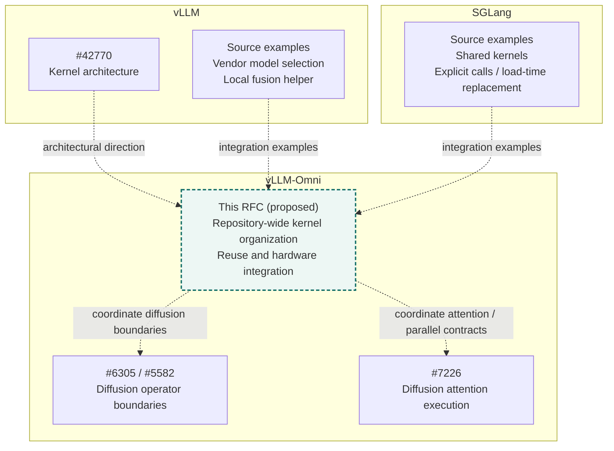

Dashed arrows show design references and proposed coordination.

References: [vLLM #42770][v42770] · [Omni #6305][o6305] / [#5582][o5582] · [Omni #7226][o7226] · [vLLM source cases](https://github.com/vllm-project/vllm-omni/issues/7382#issuecomment-5621035765) · [SGLang source cases](https://github.com/vllm-project/vllm-omni/issues/7382#issuecomment-5621035765).

#### Goals

1. Make kernel implementations, consumers and ownership easy to find across Omni; reuse an implementation when it supports each consumer's required shapes, layouts and dtypes and meets its numerical requirements.
2. Define model and hardware integration obligations at operation, block/component or model boundaries according to parameter, state and execution ownership.
3. Deliver consumer adoption and numerical/performance qualification through successive PRs, with supported configurations, selected paths and reproducible results recorded for each item.

The first series demonstrates these goals with QK/RoPE, basic gated residual and HunyuanImage3's existing native/NVIDIA transformer ResBlock. The repository-wide design also draws on existing cases such as Snake/SnakeBeta activations shared by Qwen2.5-Omni, Qwen3-Omni and speech models, and Fish KV-cache attention. Changes to these implementations are outside the Phase 0–3 delivery scope.

#### Non-goals

- Migrate every Omni kernel into one directory or replace existing attention, communication, quantization, loading and scheduling owners.
- Force model-specific variants into one API or add a general runtime registry, installer or quality gate as part of a directory move.
- Change current model defaults, error handling or compile behavior without a separately justified and validated change.
- Deliver new NPU ports, autoencoder changes or real-time World Model services in Phase 0–3.

<a id="detailed-design"></a>
#### Detailed Design

##### 1. Classification and sharing boundaries

Classify each **operation or fused operation** by model reuse and implementation backend. These are independent: a CUDA-specific implementation can serve several models, while a native implementation can still be model-specific.

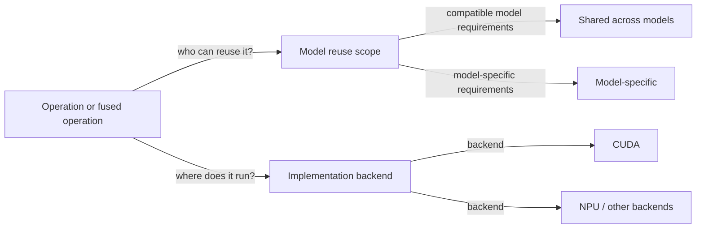

The arrows show classification. Record supported backend, variant and consumer combinations separately. The numerical reference defines expected behavior; `native/` names the current model implementation, which may itself use hardware-specific kernels.

Use the smallest integration boundary that owns the actual difference:

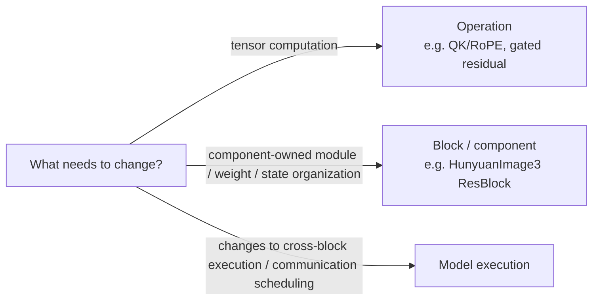

1. **Operation:** preserve the declared input/output, rounding, mutation and state behavior; make layout and dtype variants explicit.
2. **Block/component:** keep module composition, weight loading and component state with the model; native and hardware-specific implementations follow the same block interface.
3. **Model execution:** use existing initialization and wrapping paths for changes to cross-block execution or communication scheduling; keep communication ownership explicit.

<a id="repository-layout"></a>
##### 2. Repository-wide directory design

Keep implementations in their owning subsystem. **The first series adds `diffusion/layers/ops/` for shared diffusion tensor operations**, exported through `vllm_omni.diffusion.layers.ops`. Public layers keep their parameters and configuration.

```text
vllm_omni/
├── diffusion/
│   ├── layers/{norm.py,activation.py,...} # existing public layers
│   ├── layers/ops/                      # proposed shared tensor operations
│   ├── models/<model>/                  # model-owned operations and hardware blocks
│   ├── attention/                      # existing attention provider / execution paths
│   └── distributed/                    # existing parallel / component integration
├── model_executor/
│   ├── layers/                         # existing executor layer interfaces
│   └── models/
│       ├── common/
│       │   ├── snake_activation.py      # existing shared speech layer
│       │   └── ops/                     # existing tensor functions, including GN/AdaGN
│       └── <model module or package>    # model-owned computation and state
├── attention/                          # existing Fish KV-cache integration
├── quantization/                       # existing quantization config / provider integration
├── distributed/                        # existing connectors and coordination
└── platforms/                          # existing platform facts and setup hooks
```

Hardware implementations stay beside their operation or in the owning model's block/model package. Attention, quantization, communication and platform setup retain their existing public interfaces and lifecycle ownership.

**Retained exception:** the first series keeps GN+SiLU and AdaGN+SiLU in `model_executor/models/common/ops/`, with their existing imports. Their inspected consumers are HunyuanImage3 blocks.

**Later cross-subsystem sharing:** consider `vllm_omni/ops/<operation_type>/<operation>.py` only for actual callers in different subsystems, such as diffusion and speech, with a compatible full operation contract and no dependency on model initialization, model state or provider lifecycle. This requires separate review and is outside the first implementation series. Here, `<operation_type>` groups computations such as `rope` or `modulation`.

If approved, export through `vllm_omni.ops`, keep one canonical implementation, forward required old imports and validate each adopted consumer. The shared implementation must remain independent of diffusion and AR model internals.

<details>
<summary>Directory evidence — local snapshot, 2026-09-10</summary>

**Directory evidence.** Targeted local reads on 2026-09-10 used HEAD `b58ff5cb8b17250b76f9cdf9b9b46385cdda4376`: [executor common modules](https://github.com/vllm-project/vllm-omni/tree/b58ff5cb8b17250b76f9cdf9b9b46385cdda4376/vllm_omni/model_executor/models/common), [Fish attention files](https://github.com/vllm-project/vllm-omni/tree/b58ff5cb8b17250b76f9cdf9b9b46385cdda4376/vllm_omni/attention), [quantization exports](https://github.com/vllm-project/vllm-omni/blob/b58ff5cb8b17250b76f9cdf9b9b46385cdda4376/vllm_omni/quantization/__init__.py), [connector exports](https://github.com/vllm-project/vllm-omni/blob/b58ff5cb8b17250b76f9cdf9b9b46385cdda4376/vllm_omni/distributed/__init__.py) and [platform hooks](https://github.com/vllm-project/vllm-omni/blob/b58ff5cb8b17250b76f9cdf9b9b46385cdda4376/vllm_omni/platforms/interface.py). Top-level `ops/` is absent in that local baseline. This check does not refresh the 09-09 upstream/PR evidence or full inventory.

</details>

<a id="integration-rules"></a>
##### 3. Common interface and integration rules

**Responsibilities**

- **Public operation:** expose a stable callable with a documented input/output and numerical contract. Keep backend dispatch and existing registration in the canonical operation module.
- **Caller (model, layer or wrapper):** own input preparation, variant choice, parameters, surrounding state and enablement. Retain model-specific guards and the original computation where the shared reference does not match.

**Integration choices — existing examples**

Choose the entry that already owns the required parameters and state. These examples use different integration methods; each keeps its existing initialization, provider interfaces and execution policy.

**Helper — [vLLM Llama](https://github.com/vllm-project/vllm/blob/5db652225f00b55783823ae6606d36925e3e3efe/vllm/model_executor/models/llama.py#L116-L122).** The model explicitly inserts a helper between two Linear calls.

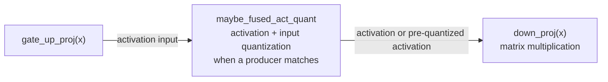

**Public layer — [Omni RMSNorm](https://github.com/vllm-project/vllm-omni/blob/b58ff5cb8b17250b76f9cdf9b9b46385cdda4376/vllm_omni/diffusion/layers/norm.py#L64-L99).** The layer keeps its parameters and configuration while delegating computation.

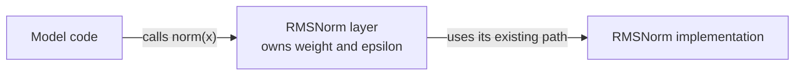

**Load-time replacement — [SGLang CUDA VAE](https://github.com/sgl-project/sglang/blob/ccfa120daecabab4b9b4d7e89ec82f41e071a7e9/python/sglang/multimodal_gen/runtime/models/vaes/flux2_vae_cuda_opt.py#L94-L129).** Loading changes the module objects; the original model call sites remain in place.

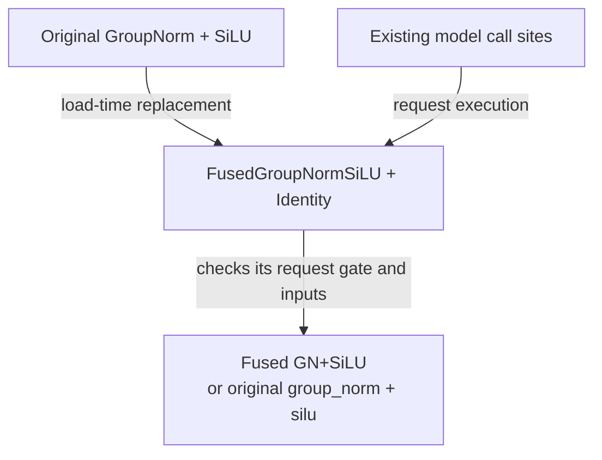

The VAE gate controls the installed wrapper; disabling it keeps the wrapper installed. These methods do not require a common installer or quality gate. Full [SGLang](https://github.com/vllm-project/vllm-omni/issues/7382#issuecomment-5621035765) and [vLLM](https://github.com/vllm-project/vllm-omni/issues/7382#issuecomment-5621035765) mechanisms remain in Appendix B.

<details>
<summary>Operation contract and compatibility checklist</summary>

- **Tensor and numerical behavior:** shapes/layouts/strides, device/dtype, weights/epsilon, intermediate casts/reductions, mutation/aliasing and output allocation.
- **Execution behavior:** supported accelerated variants, reference behavior, compile/graph modes, build/resource recovery and execution-error handling. Preserve existing behavior during relocation; changes to error handling require separate justification and path/state tests.
- **Reference and errors:** valid inputs outside the accelerated subset use the declared reference where provided; otherwise follow the documented unsupported-input behavior. Invalid requests raise errors. Retaining a model reference does not imply catching every kernel failure and falling back.
- **Public API:** expose a support query only when a caller needs it; keep optional dependencies lazy where required and preserve the existing registration/fake implementation. Metadata recording remains separate from per-call dispatch.
- **Adoption:** record the public import, actual callers, affected subsystem interfaces, tested configurations, selected paths and qualification evidence. Model loading, request policy and subsystem lifecycles remain with their existing owners.

</details>

<a id="diffusion-example"></a>
##### 4. First detailed example: diffusion

This example applies the repository rules to QK/RoPE, basic gated residual and HunyuanImage3 transformer ResBlock qualification. The directory and consumer changes below support Phase 0–3; other subsystems use the layout and integration rules above for their own tasks.

###### 4.1 Public surface and directory migration

The first diffusion surface is `vllm_omni.diffusion.layers.ops`, following the [maintainer suggestion on #6305][o6305path]. The QK/RoPE example below shows the proposed file and import changes; paths are relative to `diffusion/layers/`.

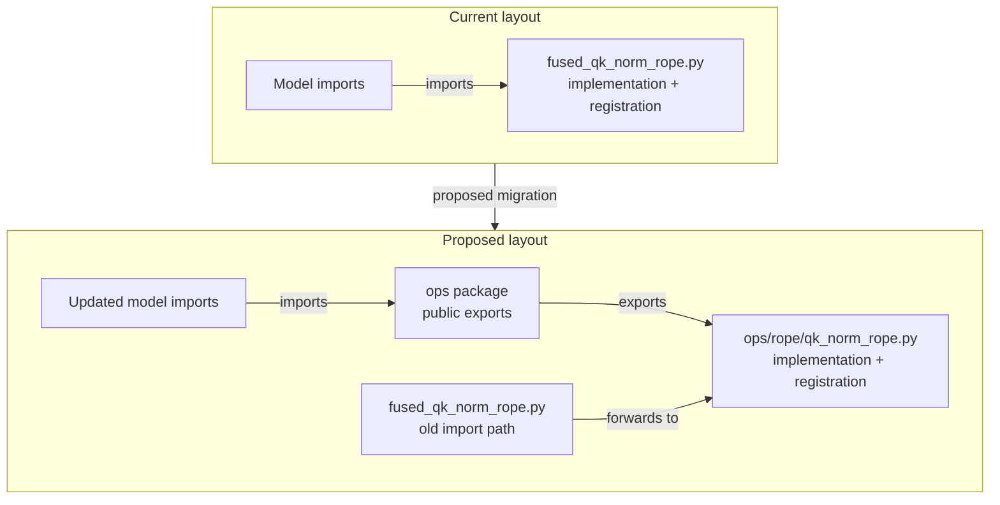

First re-export the existing module through the public surface; then move the complete module and retain the old import as a forwarding shim. The operation keeps one registration owner.

The proposed basic residual target is `ops/modulation/gated_residual.py`, based on [#6387][o6387]. Retain an old-path shim only if that import has shipped. Other subsystem and model homes follow the [repository layout](#user-content-repository-layout).

**Detailed reference:** [Full directory layout and retained responsibilities](https://github.com/vllm-project/vllm-omni/issues/7382#issuecomment-5621032712).

**Detailed reference:** [Operation and PR mapping for the first series](https://github.com/vllm-project/vllm-omni/issues/7382#issuecomment-5621032712).

###### 4.2 QK/RoPE adoption and consumer example

Use the existing H3 implementation and the Boogu integration proposed in [#6982][o6982] as the first migration example. H3 uses half-split RoPE; Boogu uses interleaved RoPE. Each model keeps its input preparation and numerical reference.

The proposed public entry preserves two selection boundaries: the model decides whether to use the operation; the operation selects its implementation for valid inputs.

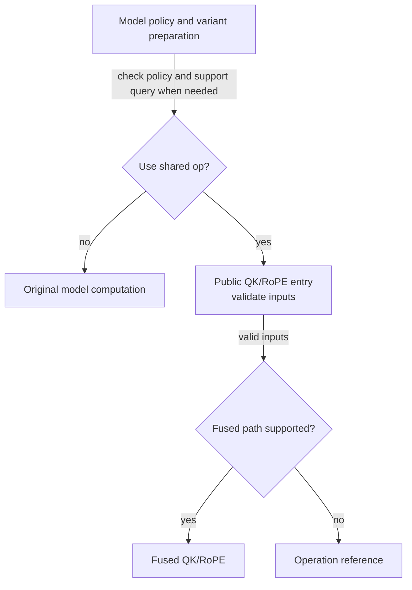

Boogu keeps its original normalization/RoPE chain when its model policy or required support query rejects fusion. The operation reference is a separate path for callers whose numerical contract permits it. Input validation and error behavior remain unchanged.
<details>
<summary>Consumer shapes, variants and source evidence</summary>

**Starting point and consumer contracts**

The existing main implementation primarily serves H3's packed half-split form; its accelerated half-split path is restricted to BF16 with head dimension 128 and rotary dimension 96. #6982 extends the same operation for Boogu's interleaved form. Each variant retains its documented geometry, layout and provider support.

In #6982, H3 uses the default `interleaved=False`; Boogu's self/joint attention helpers use `interleaved=True`. Boogu also retains a model-level `B*S >= 2048` policy for preparing packed tables. Preserve that policy and its qualified CUDA path during the import migration; additional backend enablement receives its own consumer validation. See the [PR signature](https://github.com/vllm-project/vllm-omni/blob/60186748d98a24bfe42a998809eb71958f8b8185/vllm_omni/diffusion/layers/fused_qk_norm_rope.py#L596) and [Boogu helper](https://github.com/vllm-project/vllm-omni/blob/60186748d98a24bfe42a998809eb71958f8b8185/vllm_omni/diffusion/models/boogu_image/boogu_image_transformer.py#L92).

| Consumer at #6982 head | Tensor and variant contract | Fast-path support / retained reference |
| --- | --- | --- |
| MiniMax-H3 `MiniMaxH3Attention` | Separate Q/K `[tokens, heads, head_dim]`, Q/K norm weights and a packed `[cos \| sin]` table; default `interleaved=False` | BF16 half-split acceleration uses head dimension 128 and rotary dimension 96; retain the existing CUDA/NPU branches and operation reference |
| Boogu `BooguImageSelfAttention` / `BooguImageJointAttention` | Model helper flattens `[B,S,H,D]` to `[B*S,H,D]`, packs the frequency table, and passes `interleaved=True`; #6982's author test plan reports production geometry 120/120 | CUDA BF16 interleaved kernel supports even `2 <= rotary_dim <= head_dim <= 256`; keep packed-table policy and the model guard, with Boogu's original norm/RoPE chain when they reject fusion |

The current shared API takes `q`, `k`, `q_weight`, `k_weight`, `rope_table`, `eps`, with keyword-only `head_dim=None`, `rotary_dim=None` and `interleaved=False`. Its public validation also enforces matching token counts and head dimensions, dtype/device, weight shape and packed-table shape. The existing private predicates are `_fused_cuda_supported` and `_fused_npu_supported`; the public eligibility query below is the proposed addition.

The H3 consumer is [its attention call](https://github.com/vllm-project/vllm-omni/blob/60186748d98a24bfe42a998809eb71958f8b8185/vllm_omni/diffusion/models/minimax_h3/minimax_h3_transformer.py#L627). Boogu's [self-attention](https://github.com/vllm-project/vllm-omni/blob/60186748d98a24bfe42a998809eb71958f8b8185/vllm_omni/diffusion/models/boogu_image/boogu_image_transformer.py#L557) and [joint-attention](https://github.com/vllm-project/vllm-omni/blob/60186748d98a24bfe42a998809eb71958f8b8185/vllm_omni/diffusion/models/boogu_image/boogu_image_transformer.py#L642) both use the helper whose guard and fallback are retained.

</details>

**Detailed reference:** [Migration files, public API and model reference details](https://github.com/vllm-project/vllm-omni/issues/7382#issuecomment-5621032712).

###### 4.3 Basic gated residual and explicit variants

The first shared residual operation computes `residual + branch * gate`. Its initial consumers are Wan2.2 and HunyuanVideo 1.5; LTX-2 follows as a separate adoption.

Similar formulas can have different rounding behavior:

```text
Basic #6387: multiply branch and gate -> round product to FP16/BF16 -> add residual
H3 VAE:     promote FP16 branch -> multiply by FP32 scale -> add FP32 residual
```

| Case | Behavior to preserve |
| --- | --- |
| Basic [#6387][o6387] | Product rounding in the tensor dtype, followed by addition. |
| SANA [#6823][o6823] | Its layout/output-stride rules, explicit conversions and special-value behavior. |
| H3 VAE | Its mixed FP16/FP32 arithmetic and model-owned execution conditions. |

Shared adoption requires numerical, actual-path and model qualification for both initial consumers. SANA and H3 VAE remain explicit variants; completing a contract comparison alone does not complete shared residual adoption.
<details>
<summary>Existing implementations, full contract comparison and sources</summary>

Basic gated residual is a first-series target. [#6387][o6387] already supplies a 224-line operation module, a 105-line test file, a 96-line microbenchmark and 14 proposed caller replacements across Wan2.2, HunyuanVideo 1.5 and LTX-2. The code integration is bounded; GPU numerical/compile checks and actual model regression are the substantial remaining qualification work. This assessment is based on source changes, not a delivery-date estimate.

| Contract dimension | Basic #6387 | SANA #6823 | H3 VAE scaled residual on main |
| --- | --- | --- | --- |
| Tensor computation | `residual + branch * gate` | `residual + gate * update` | FP32 residual + FP16 branch multiplied by FP32 channel scale |
| Accelerated inputs | Contiguous residual/branch, same FP16/BF16 dtype; global, per-batch or per-row gate, including supported strided views; hidden size at most 16384 | 3D residual/update; contiguous update; contiguous or transposed-dense residual/output; four broadcast/tokenwise gate shapes, including gapped views | Contiguous mixed-dtype tensors, hidden size 2048 and channel scale |
| Numerical boundary | Preserve low-precision product rounding before add; current tests use zero tolerance | Explicit BF16 rounding / FP16 conversion and special-value tests, preserve output stride | Explicit FP32 multiplication before add; preserve the model's mixed-dtype chain |
| Compile / rejection | Registered custom op and fake implementation; unsupported subset uses the eager expression | Compiled region keeps the original expression; eligibility rejection and cached launcher failure fall back | Model-owned optional helper returns `None` outside its exact inference/eager contract |
| Current consumer evidence | Three proposed integrations, GPU/model validation pending | SANA T2V/I2V; author H20 numerical and decoded-output measurements | H3 VAE model-specific tests and evidence record |

Sources: [#6387 operation][ogatedcode], [#6823 operation][osanagatecode], [H3 VAE operation][oh3scaled] and [H3 ownership record][oh3opsreadme]. Similar formulas are grouped in the index while these variants remain explicit.

</details>

<details>
<summary>Implementation inputs and completion rules</summary>

**Before residual implementation:** agree the basic #6387 contract, first consumers (Wan2.2 and HunyuanVideo 1.5), actual tensor dtype/layout traces and the acceptance rows below. LTX-2 is the next already-proposed consumer, with video/audio and cross-stream gates qualified explicitly. Model/backend reviewers confirm that at least two selected consumers actually reach the accelerated subset; mixed-dtype or unsupported invocations keep their proper reference.

**The contract decision** closes when the contract comparison, consumer selection, retained variants and error/compile policies are recorded. **Shared residual adoption** closes when basic gated residual has the canonical shared entry, actual caller integrations and completed numerical/path/model qualification for at least two different model architectures. SANA and H3 VAE variants need not be unified to complete that basic adoption.

If qualification reveals substantial new algorithm work or resources remain unavailable, record shared residual adoption as pending with its concrete remaining work and move that delivery to a later series. Keep the long-term two-operation reuse target; any substitute candidate receives an explicit scope decision before implementation. A contract-comparison result alone never counts as the second completed shared operation.

</details>

###### 4.4 Hardware block, component and model integration

The first hardware example qualifies the existing HunyuanImage3 native/NVIDIA transformer `ResBlock`. Preserve its current layer exports and default selection. Both block and real-model checks are required.

**B1 — planned block comparison**

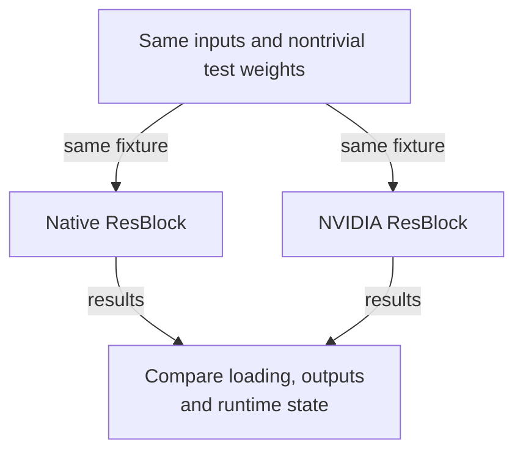

**B2 — planned real-model check**

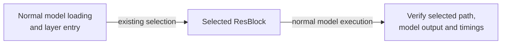

B1 compares the implementations with weights that exercise the residual branch. B2 verifies the normally selected block through the real model entry. The first delivery adds compatibility tests and an integration guide; changes to selection code require a concrete integration need.
<details>
<summary>Block contract, test placement and selection compatibility</summary>

The block contract includes:

| Obligation | HunyuanImage3 first delivery / later extension |
| --- | --- |
| Construction and weights | Same constructor/config semantics and checkpoint keys, including `in_layers.0/.2` and `out_layers.0/.3`; normal loading must preserve parameter coverage and identity |
| Tensor contract | Same input/output shape, layout and dtype behavior for the supported block variants; declared numerical tolerance |
| Selection | Test the actual selected class and normal fallback; use the existing Omni platform and registry facts |
| Execution state | Keep cuDNN/config effects scoped as the current NVIDIA block does; document unsupported modes |
| Model integration | Test the caller using the selected block and a real model run; combine block parity with full-model qualification |

The required new files are the compatibility suite under `tests/diffusion/models/hunyuan_image3/` and the integration guide. Preserve the existing `layers/__init__.py` exports and selection behavior. Extract a selection function only if a concrete caller, testability obstacle or new backend needs it, and describe that need in the PR. The deliverable is a qualified existing extension seam, with selection-code changes tied to a demonstrated integration need.

</details>

<details>
<summary>Later component and model ports</summary>

For a stateful component, use its own entry. #7056's Wan VAE package already owns installation and decode substitutions. Qualification must distinguish tiled/untiled, image/video, streaming callback, grad-enabled fallback and distributed decoding where claimed. In the reviewed head, fast `decode_frames` is used only without a streaming callback and with autograd disabled; the component contract should explicitly name these supported modes.

For a larger hardware implementation in the diffusion example, retain the existing `register_diffusion_model` replacement route. Its design review must specify how weights, model hooks, VAE setup and sequence-parallel wrapping remain compatible with `initialize_model`. A vendor implementation that performs its own communication cannot also receive equivalent framework wrapping unnoticed.

For diffusion block/model integration that includes attention, coordinate with #7226's proposed path-specific contracts, initialization/planning/execution lifecycle, compile modes, and distinction between “compatible with” and “implements” a parallel strategy. Ring may bypass the local attention backend. These larger integrations use the attention subsystem's agreed registry, lifecycle and custom-op facilities.

An NPU-specific block/model port follows when its public implementation, model and hardware owner are available. Phase 3 qualifies the existing block contract and paths; a subsequent port has its own implementation and qualification task. World-model workloads can supply subsequent consumers and requirements through the same integration route.

</details>

#### Constraints and Risks

- Similar formulas can differ in layout, intermediate rounding, mutation or state. Admission to the shared surface requires the actual consumer contract.
- A module move must retain import identity and one registration owner. Existing references, error behavior and compile/graph paths remain part of compatibility.
- An imported function or a consumer that always takes the reference path does not establish accelerated reuse. Test the selected implementation as well as its output.
- Dependency versions and available execution modes can change the integration work. Keep unrun device/model rows pending and qualify only the configurations actually tested.

<a id="success-criteria"></a>
#### Success Criteria

##### Benefit hypotheses and how to test them

The benefits below remain hypotheses. Evaluate the proposed organization, migration and hardware integration against their own documented baselines; existing implementation results provide supporting evidence.

| Hypothesis | How to evaluate it |
| --- | --- |
| Lower consumer integration cost | Compare a subsequent adoption's code changes, duplication, adaptation effort and review rework with a documented baseline. |
| Better model performance for selected consumers | Profile the workload; compare current and candidate kernel/model/request latency, selected paths, numerical error and generated-output quality. |
| Smoother hardware integration | Qualify the current HunyuanImage3 paths, then evaluate a real additional port's changes, compatibility issues and engineering effort. |
| Lower maintenance effort | Establish a workload baseline; compare the next contributor's integration time, review iterations and validation coverage. |

<details>
<summary>Benefit rationale, existing evidence and evaluation process</summary>

The benefits of this proposal are hypotheses to evaluate. Existing implementations and PR experiments motivate the work and provide candidate evidence. The net effects of this RFC's organization, migration and hardware integration need their own baseline comparisons.

| Hypothesis | Rationale / supporting evidence | Validation |
| --- | --- | --- |
| Lower consumer integration cost | Multiple model integrations suggest an opportunity to share compatible code. A stable surface and explicit variants may reduce repeated implementation and adaptation. | Complete a subsequent consumer adoption; compare changed code, remaining duplication, adaptation effort and review rework with a documented baseline. |
| Better model performance for selected consumers | Some existing fusions improve their reported configurations. New consumers may benefit when hotspot share, layouts and dispatch overhead are favorable. | Profile the actual workload and compare the current implementation with the candidate. Record kernel and model/request latency, selected path, numerical error and generated-output quality. |
| Smoother hardware integration | Existing native/vendor blocks provide concrete extension points. Explicit loading, tensor and state obligations may reduce integration failures and duplicated setup. | Qualify the current HunyuanImage3 paths, then evaluate a real additional port's changes, compatibility issues and engineering effort. |
| Lower maintenance effort | A shared ownership index and acceptance record may reduce discovery, review and regression-validation effort. | Establish a workload baseline, then record the next contributor's integration time, review iterations and validation coverage. |

**Existing evidence.** The #6982 author reports 3.59%/3.32% lower request latency for Boogu/H200 at 1024² with 28/50 steps; migration acceptance uses its own baseline. Its small-request policy reflects the importance of CPU dispatch overhead. [#6823][o6823] reports **2.14–2.91×** kernel speedup on H20 and **0.41–0.74%** decoded-output model latency reduction. These author-reported results support the value of the specific implementations at those configurations; the proposed migration and additional consumers require separate evaluation.

**Evaluation process.** Establish the current code/workload baseline, profile candidate hotspots, measure local changes and integration overhead, then validate model/request behavior. For engineering hypotheses, record a comparable integration workload and the effort of subsequent adoption. Retain neutral or adverse results and use them to refine the supported subset, abstraction or migration priority.

</details>

##### Validation artifacts and enablement

| Change being reviewed | Required evidence | Enablement decision |
| --- | --- | --- |
| Public import / implementation move | Import identity, single registration, old/new implementation parity, unchanged consumer outputs and actual path coverage | Preserve current defaults and numerical contract |
| New consumer, variant or backend | Exact reference definition, representative and rejected inputs, actual caller/accelerated path, supported execution modes and model output | Enable only the qualified subset; retain the correct model/operation reference elsewhere |
| Error handling / availability change | Previously failing configuration, actual alternate path or explicit failure, state/mutation consequences and repeated-call behavior | Review the behavior change separately from relocation or speed claims |
| Performance optimization / default-policy change | Correctness plus repeated comparison with the currently selected eager/compile/kernel path; affected block and model/request measurements | Set defaults using qualified model/request evidence, including dispatch overhead and fallback workloads |
| Hardware block/component replacement | Weight keys/loading coverage, nontrivial block output, selected class/kernel, runtime state and relevant parallel modes, model correctness/performance | Qualify the declared configurations; keep current selection elsewhere |

<details>
<summary>Acceptance records and numerical contracts</summary>

**Repository-wide acceptance.** Each change identifies its canonical home/public import, tensor or module contract, actual consumers and integration owner. Verify import/dependency compatibility, numerical behavior, actual selection and affected model/subsystem execution; attach performance evidence when claiming a performance change. Cross-subsystem promotion additionally checks dependency direction and every adopted consumer. These rules apply to later speech/AR and provider work; the matrix below is specific to the first diffusion series.

Each migrated operation or hardware boundary gets a compact result record linked from the index. Local tensor-operation and standalone-block tests without communication can use one target device. Collective or distributed-execution changes require their participating ranks; model GPU count and parallel layout affect per-rank inputs and end-to-end measurements and are fixed with the model configuration. Reuse each subsystem's existing tests and benchmarks; the first diffusion series uses existing pytest suites, authored PR benchmarks and `benchmarks/diffusion/diffusion_benchmark_serving.py`. The record identifies repository/PR head, checkpoint revision, hardware/software, shapes/strides/dtype, backend, compile/graph and parallel modes, baseline, actual selected path, numerical/quality criterion, timing boundary, repetitions/variation and commands/raw results. Unrun cells remain pending.

SGLang's [numerical policy][sreadme] and [model wiring tests][swiring] supply two useful practices: compare the actual model reference chain, and assert that the intended fast path was used. Its [first-sight gate][sgate] compares candidate/reference outputs and retains a verification decision; first verification stays outside compile tracing and graph capture. The first Omni series adopts the reference/path testing discipline using existing execution mechanisms. Introducing a runtime gate would require its own measured integration need and is not part of the directory migration.

Numerical contracts are operation-specific. For a pure move, compare the moved implementation with its pre-move counterpart on the same qualified environment and preserve its existing reference/tolerance. Exact fusions reproduce the declared arithmetic and rounding chain. Tolerance-based operations keep the relevant reference, dtype-specific tolerances and model-output checks. `torch.equal` checks element equality but does not check dtype and treats NaNs as unequal ([PyTorch contract][torchequal]); tests also assert metadata and explicitly define special-value/signed-zero behavior when claiming bitwise equality. A successful equality check for one configuration does not qualify other backends or input signatures.

</details>

##### First diffusion qualification matrix

These are planned acceptance rows, not completed experiments. Existing fixtures and author workloads are identified as such; new block fixtures are proposed explicitly. Before qualification, pin the remaining device/checkpoint and model/block threshold cells with the relevant reviewers; their names and resources remain TBD.

First-series delivery requires a public surface and one canonical registration owner per operation, together with the following qualifications:

| Scope | Required qualification |
| --- | --- |
| First series | **Q1/Q3:** MiniMax-H3 and Boogu QK/RoPE on CUDA, including operation, actual-path and model qualification. |
| First series | **R1:** Basic gated residual in both Wan2.2 and HunyuanVideo 1.5, including numerical, selected-path and model qualification. |
| First series | **B1 + B2:** HunyuanImage3 native/NVIDIA transformer ResBlock and the model through the selected block, for the declared configurations. |
| Follow-up | **Q2:** The existing H3 NPU QK/RoPE route remains a separate pending qualification until it is run. |
| Follow-up | **R2:** LTX-2 is the next residual consumer and is qualified independently of the initial two-model adoption. |

Completion of this series does not complete the repository-wide RFC. Each subsequent adoption records its own consumer, contract, integration and qualification results; partial qualification remains distinct from latency or engineering-cost improvement.

**Detailed reference:** [Complete qualification matrix, source tolerances and measurement rules](https://github.com/vllm-project/vllm-omni/issues/7382#issuecomment-5621032712).

<a id="implementation-steps"></a>
#### Implementation Steps

This repository-wide RFC uses diffusion as its first implementation example. Phase 0–3 below cover only that series; confirmed assignments are listed below. Qualification resources and dates are to be agreed per task. Documentation, tests and result records accompany each implementation.

P1 and P2 can proceed in parallel; P3 depends on its own block/model acceptance configuration.

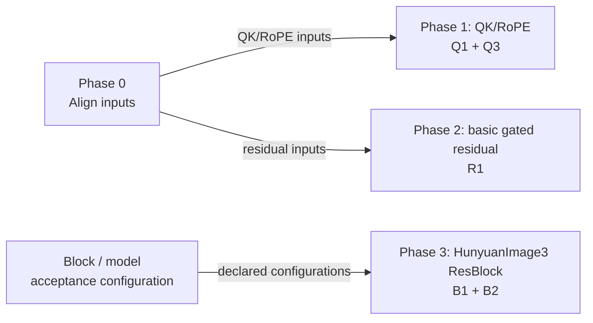

##### Phase 0: Align the implementation inputs

**Assignees:** TBD

**Completion:** the scope and inputs for the first implementation series are explicit. Record actual devices, runtime versions and model parallel configurations before executing qualification.

<details>
<summary>Implementation tasks</summary>

- [ ] Align the adopted #6982/#6387 code versions with their authors' accepted work.
- [ ] Fix the first operation contracts, consumers and applicable acceptance rows.
- [ ] Define the numerical references and representative test configurations.

</details>

##### Phase 1: Migrate QK/RoPE and its consumers

**Assignees:** @bugkeep (P1 canonical migration, #7417); @WangXukang-cypher (P1 complementary public API and compatibility, #7422); @EchoHayate (Q1 after B1); @Kare0638 (Q3).  
**Depends on:** the applicable Phase 0 contract decisions.

**Completion:** both H3 and Boogu pass operation, actual-path and model qualification on CUDA. Q2 NPU remains a separate pending qualification until it is run.

<details>
<summary>Implementation tasks</summary>

- [ ] Expose the public callable and eligibility query; first re-export the existing module, then move it completely to the canonical path.
- [ ] Retain the legacy import shim and one registration owner.
- [ ] Update H3 and Boogu consumers, preserving their variant, guard and reference behavior.
- [ ] Complete Q1/Q3 and link the configuration, commands and results from the operation index.

</details>

##### Phase 2: Adopt basic gated residual

**Assignees:** @ztang2370 (R1: Wan2.2, then HunyuanVideo 1.5; building on #6387).  
**Depends on:** the basic contract and first-consumer decisions; can progress alongside Phase 1.

**Completion:** both models pass numerical, selected-path and model qualification. Finishing the contract comparison alone does not complete this phase. If substantial new algorithm work or missing resources delay adoption, record the concrete remaining work as pending.

<details>
<summary>Implementation tasks</summary>

- [ ] Record the basic #6387 contract and the SANA/H3 VAE layout, rounding and execution-policy differences.
- [ ] Add the canonical shared implementation and wire Wan2.2 and HunyuanVideo 1.5.
- [ ] Complete R1 for both models, including actual accelerated calls and valid reference branches.
- [ ] Update the consumer index, tests and raw result links.

</details>

##### Phase 3: Qualify the existing hardware block

**Assignees:** @EchoHayate (B1, #7421); @specture724 (B2).  
**Depends on:** the applicable block/model acceptance configuration; independent of the shared-operation moves.

**Completion:** B1 and B2 pass for the declared configurations, with current defaults preserved. The autoencoder remains consumer evidence rather than an additional first-series delivery.

<details>
<summary>Implementation tasks</summary>

- [ ] Test HunyuanImage3 native/NVIDIA transformer ResBlock loading, nontrivial weights, outputs, selected paths and runtime state.
- [ ] Complete B1/B2 through the normal layer and model entries.
- [ ] Record the existing native/vendor measurements and update the integration guide. Add vendor before/after non-regression only if runtime code changes.

</details>

##### Future Work

Maintain the [complete inventory](https://github.com/vllm-project/vllm-omni/issues/7382#issuecomment-5621035765) as the repository-wide coordination list, grouped by computation. Following the tracking structure of [FlashInfer #4254][fi4254], link each concrete task or PR to its consumers, backend, owner (or TBD), adoption status and qualification evidence. Numerical results, performance claims and PR merge state remain separate. This tracking structure adds no runtime dispatch mechanism or second implementation numbering scheme.

Speech and other autoregressive paths, including existing Snake/SnakeBeta sharing and Fish KV-cache attention, remain active scope for identifying consumer needs, compatible reuse and hardware work with their owners. Select later implementations from actual contracts and profiles. Each task records the directory/public entry, consumer integration and affected subsystem interfaces from §§2–3, then defines its own acceptance. The inventory includes both in-repository computation and external-provider integration; subsystem ownership remains explicit.

For the diffusion example, qualify NPU/Q2, LTX-2/R2, named SANA/H3 VAE variants and additional hardware ports with their own evidence. Coordinate Wan VAE component modes with #7056 through its existing installation/decode entry. Maintain the contract/consumer index, appropriate CI and reproducible results through ordinary PRs. Confirmed follow-up scopes for SANA validation and the additional fusion PRs are tracked in the [coordination comment](https://github.com/vllm-project/vllm-omni/issues/7382#issuecomment-5629791477); other follow-up owners, including Q2, remain TBD. Resources and dates are to be agreed per task.

#### Alternatives

**Reorganize files only.** This makes browsing easier but leaves variant compatibility, consumer migration and hardware obligations unresolved. The proposed series pairs each physical move with real consumer and contract work.

**Introduce a general kernel registry now.** Current Omni operations and upstream helpers already provide local dispatch; SGLang uses its inventory for metadata while the traced models call resolved implementations. A new registry adds API and ownership questions before the first migrations demonstrate a need.

**Copy a vendor directory tree into every model.** This is appropriate when a real model execution region diverges, but duplicates common code for isolated operator differences. The proposed hierarchy supports operator, block/component and model ownership according to actual changes.

**Apply one upstream migration plan to every Omni subsystem.** The architectural principles are useful across the repository; concrete boundaries still depend on model, state and provider contracts. This RFC coordinates changes with each owner. #6305/#5582 and the separate attention-contract discussion guide the diffusion example, while speech and other autoregressive paths retain their own integration routes.

#### Open Questions

1. Does the repository layout assign shared operations, parameterized layers, model-specific computation and execution/provider responsibilities to the right homes?
2. Is a neutral `vllm_omni/ops/` appropriate only for actual cross-subsystem consumers with compatible contracts and neutral dependencies, while existing GN/AdaGN placement remains unchanged in this series?
3. Are QK/RoPE and basic gated residual the right first shared operations, with Wan2.2/HunyuanVideo 1.5 as the initial residual consumers?
4. Does qualification of the existing HunyuanImage3 block establish the right first hardware boundary, with larger ports using existing model/attention interfaces?
5. Which remaining block/model configurations, numerical thresholds and performance acceptance bands should be used? These must be pinned before qualification with the task contributors; remaining resources and dates are to be agreed.

### Feedback Period.

Two weeks from posting, with initial feedback requested on the five decisions in Open Questions. Implementation PRs can be prepared during review; namespace or ownership changes should reflect the discussion before migration merges.

### CC List.

To be filled with maintainers and contributors who agree to review the affected model/subsystem operations, hardware integrations and execution boundaries. The first series involves the relevant diffusion owners; later tasks involve their own owners. No reviewers are assigned by this draft.

### Any Other Things.

<details>
<summary>Source snapshots and observation dates</summary>

| Evidence | Fixed source | Observation date |
| --- | --- | --- |
| Omni design-source examples | [7c2e30afd3][omain] | 2026-09-08 |
| Omni inventory baseline | [b58ff5cb8b][oscan] | 2026-09-09; targeted directory/interface reads on 2026-09-10 |
| Omni upstream increment | [0e602509aa][ocurrent], [incremental comparison][odelta] | 2026-09-09; unchanged entries retain the baseline evidence |
| vLLM mechanisms | [5db652225f][vmain] | 2026-09-09 |
| SGLang mechanisms | [ccfa120dae][smain] | 2026-09-09 |

PR links describe the reviewed versions; explicitly recorded states are dated observations. Source presence and attributed author results do not complete this RFC's proposed qualification.

</details>

### Before submitting a new issue...

- [x] Related repository RFCs, issues and PRs were searched and reviewed.
- [ ] Documentation-chatbot check pending: attempted on 2026-09-10, but no browser was available to access it.

[o6982]: https://github.com/vllm-project/vllm-omni/pull/6982
[v42770]: https://github.com/vllm-project/vllm/issues/42770
[o6305]: https://github.com/vllm-project/vllm-omni/issues/6305
[o5582]: https://github.com/vllm-project/vllm-omni/issues/5582
[o7226]: https://github.com/vllm-project/vllm-omni/issues/7226
[o6305path]: https://github.com/vllm-project/vllm-omni/issues/6305#issuecomment-5433970515
[o6387]: https://github.com/vllm-project/vllm-omni/pull/6387
[o6823]: https://github.com/vllm-project/vllm-omni/pull/6823
[ogatedcode]: https://github.com/vllm-project/vllm-omni/blob/7da8d1447ac0ce8d8a545e1427d376e580ab7fd8/vllm_omni/diffusion/layers/gated_residual.py
[osanagatecode]: https://github.com/vllm-project/vllm-omni/blob/7f70a33537611247258acabef935984434e65929/vllm_omni/diffusion/layers/residual_gate.py
[oh3scaled]: https://github.com/vllm-project/vllm-omni/blob/b58ff5cb8b17250b76f9cdf9b9b46385cdda4376/vllm_omni/diffusion/models/minimax_h3/ops/vae/scaled_residual.py
[oh3opsreadme]: https://github.com/vllm-project/vllm-omni/blob/b58ff5cb8b17250b76f9cdf9b9b46385cdda4376/vllm_omni/diffusion/models/minimax_h3/ops/README.md
[sreadme]: https://github.com/sgl-project/sglang/blob/ccfa120daecabab4b9b4d7e89ec82f41e071a7e9/python/sglang/kernels/ops/diffusion/README.md#L29
[swiring]: https://github.com/sgl-project/sglang/blob/ccfa120daecabab4b9b4d7e89ec82f41e071a7e9/test/registered/kernels/ops/diffusion/test_model_fast_paths.py#L177
[sgate]: https://github.com/sgl-project/sglang/blob/ccfa120daecabab4b9b4d7e89ec82f41e071a7e9/python/sglang/kernels/ops/diffusion/sites/bitexact_gate.py#L67
[torchequal]: https://docs.pytorch.org/docs/2.14/generated/torch.equal.html
[fi4254]: https://github.com/flashinfer-ai/flashinfer/issues/4254
[omain]: https://github.com/vllm-project/vllm-omni/commit/7c2e30afd3e8d5c66c8fd867f694550da45f6193
[oscan]: https://github.com/vllm-project/vllm-omni/commit/b58ff5cb8b17250b76f9cdf9b9b46385cdda4376
[ocurrent]: https://github.com/vllm-project/vllm-omni/commit/0e602509aa9460cedca2de45094e6ea1d2be47ba
[odelta]: https://github.com/vllm-project/vllm-omni/compare/b58ff5cb8b17250b76f9cdf9b9b46385cdda4376...0e602509aa9460cedca2de45094e6ea1d2be47ba
[vmain]: https://github.com/vllm-project/vllm/commit/5db652225f00b55783823ae6606d36925e3e3efe
[smain]: https://github.com/sgl-project/sglang/commit/ccfa120daecabab4b9b4d7e89ec82f41e071a7e9


> **Comment by Dong1017 (2026-09-10T15:18:37Z):**

## Detailed design and qualification reference

Companion to the [RFC proposal](https://github.com/vllm-project/vllm-omni/issues/7382). These details retain the contracts and acceptance requirements summarized in the main post.

### 1. Full directory layout and retained responsibilities

```text
BEFORE (relative to vllm_omni/)
diffusion/
├── layers/
│   ├── custom_op.py, norm.py, activation.py
│   ├── fused_qk_norm_rope.py         # kernel + reference + dispatch + torch registration
│   └── mot/ops/                     # MoT-specific computation
├── models/
│   ├── hunyuan_image3/layers/{__init__.py,common/,native/,nvidia/}
│   ├── minimax_h3/ops/vae/          # model-specific exact VAE operations and installation
│   └── <model>/                    # other model-owned computation
├── attention/                     # providers and model-associated operations
├── distributed/                   # communication and component integration
└── registry.py                    # model replacement and initialization
model_executor/models/common/ops/  # GroupNorm + SiLU and adaptive variant
model_executor/models/common/snake_activation.py  # shared speech activation

OPEN-PR ADDITIONS (not present in the scanned main)
#6387: diffusion/layers/gated_residual.py
#6823: diffusion/layers/residual_gate.py
#7056: diffusion/distributed/autoencoders/wan_vae_fastpath/

AFTER FIRST MIGRATIONS (proposed; retained nodes keep their existing responsibilities)
diffusion/
├── layers/
│   ├── custom_op.py, norm.py, activation.py      # retain layer/platform APIs
│   ├── fused_qk_norm_rope.py                    # old import becomes a shim
│   ├── gated_residual.py                       # shim if #6387's old path has shipped
│   ├── mot/ops/                                # retain MoT-owned implementation
│   └── ops/                                    # new public operation surface
│       ├── __init__.py                          # exports; no second torch registration
│       ├── README.md                            # contract/consumer/ownership index
│       ├── rope/qk_norm_rope.py                 # whole canonical QK/RoPE module
│       └── modulation/gated_residual.py         # basic gated residual when shared residual adoption lands
├── models/
│   ├── hunyuan_image3/layers/{__init__.py,common/,native/,nvidia/}
│   ├── minimax_h3/ops/vae/                      # retain distinct exact contract
│   └── <model>/                                # model-owned variants and consumers
├── attention/                                  # retained provider/execution owner
├── distributed/autoencoders/wan_vae_fastpath/    # owned by #7056 if it lands
└── registry.py                                 # retained model setup owner
model_executor/models/common/ops/                # retain GroupNorm import compatibility
model_executor/models/common/snake_activation.py # retain shared speech entry

tests/diffusion/layers/ops/                       # new import/contract migration checks
tests/diffusion/models/<model>/                   # extend consumer/block suites
benchmarks/diffusion/diffusion_benchmark_serving.py # reuse request benchmark
benchmarks/kernels/gated_residual_benchmarks.py    # reuse #6387's proposed benchmark
docs/design/diffusion_kernel_integration.md       # proposed contributor integration guide
```

| Node | Responsibility and caller | Reuse scope | First-series action |
| --- | --- | --- | --- |
| `layers/norm.py`, `activation.py` | Layer/`CustomOp` APIs used by model modules; invoke native or existing upstream/device operations | Existing layer contracts | Retain. A tensor-level fused function in `ops/` does not replace the layer class or weight ownership |
| `layers/custom_op.py` | Selects a platform `forward_*` method for a layer | Platform-aware layer construction | Retain; it differs from model-class registration in `registry.py` |
| `layers/ops/__init__.py` | Public imports used by models, blocks and tests | Exported diffusion operations | Add exports, lazy where needed; implementation/torch registration stays in canonical modules |
| `ops/rope/qk_norm_rope.py` | QK/RoPE predicates, kernels, reference, dispatch and torch schema/fake implementation | Explicit qualified QK/RoPE variants | Move the complete module once; backend suffix files follow a concrete later need |
| Legacy `layers/fused_qk_norm_rope.py` | Existing callers' import compatibility | Same operation identity | Thin re-export after the move; no duplicate registration or implementation |
| `ops/modulation/gated_residual.py` | `residual + branch * gate`, accelerated subset and reference | Basic #6387 contract, qualified model callers | Land during shared residual adoption; agree initial placement with the author or retain a shim if the old path has shipped |
| `ops/README.md` | Small index for contributors/reviewers | Contract, consumers, ownership and results | Add records linked to tests and raw qualification results |
| `layers/mot/ops/` | MoT norm/GEMM used through MoT layer wrappers | Specialized MoT architecture | Retain existing owner and distinguish architecture reuse from generic norm/GEMM reuse |
| `hunyuan_image3/layers/__init__.py` | Model-facing exports and CUDA/native block selection | HunyuanImage3 | Qualify current selection without changing defaults |
| `hunyuan_image3/layers/common/` | Constructors and utilities used by that model's native/vendor blocks | Within HunyuanImage3 | Retain; this `common/` is not the cross-model executor operation package |
| `hunyuan_image3/layers/native/` and `nvidia/` | Reference and optimized blocks with compatible weights/interfaces | Same model, different execution implementations | Add parity/loading/selected-path coverage; a new vendor directory accompanies a real port |
| `minimax_h3/ops/vae/`, other model directories | Model contract guards, component installation, specialized kernels and references | Model-specific until matching consumers are qualified | Retain H3 VAE mixed-dtype/rounding contract and other documented specializations |
| `model_executor/models/common/ops/` | GroupNorm/SiLU callable implementations; inspected direct callers are HunyuanImage3 blocks | Cross-model location, currently one model's inspected consumers | Keep source and imports; extend the ownership record before proposing a move |
| `model_executor/models/common/snake_activation.py` | Snake/SnakeBeta activation shared by speech decoders | Several audio models | Index current reuse and retain the existing shared entry |
| `diffusion/attention/` | Attention providers, execution adapters and currently H3-owned modulation | Provider subsystem plus explicitly model-owned operation | Keep provider contracts; index H3 modulation without implying cross-model qualification |
| `diffusion/distributed/` and proposed `wan_vae_fastpath/` | Communication or VAE component installation/state, called through existing integration paths | Respective subsystem/component | Reuse existing a2a and #7056 ownership; do not create a parallel installation entry |
| `diffusion/registry.py` | Registered model replacement and ordered model/VAE/parallel setup | Framework model integration | Retain; block/model qualification checks compatibility with initialization |
| `tests/diffusion/layers/ops/` and `models/<model>/` | Operation compatibility versus actual model/block execution | Claimed configurations | Extend existing suites; new migration tests accompany code changes |
| Existing request benchmark and #6387 microbenchmark | Measure complete requests versus the local operation | Explicit timing scopes | Reuse locations, record both selected path and repeated timings |
| `docs/design/diffusion_kernel_integration.md` | Explains placement and qualification for the first diffusion example | Diffusion contribution guide, linked from the repository inventory | Add as each implementation phase documentation, linked from the operation index |

### 2. Operation and PR mapping for the first series

The first-series queue below highlights changes and important retained items. Appendix A provides the complete grouped inventory, including Qwen QK/RoPE, RoPE-only, SANA norm and non-diffusion work.

| Operation / fused operation (related PRs) | Classification and reason | Current state: path / consumers / evidence | Target state: entry / ownership | First-series action |
| --- | --- | --- | --- | --- |
| QK normalization + RoPE (#5990, #6982) | Shared operation with explicit half-split/interleaved variants | `layers/fused_qk_norm_rope.py`; H3 on main, Boogu integration in open #6982; CUDA/NPU support is variant-specific | Public `layers.ops`; canonical `ops/rope/qk_norm_rope.py`; model guards remain model-owned | **Existing-code migration + dependency integration (Phase 1)** |
| Basic gated residual (#6387) | Cross-model candidate with a model-neutral tensor expression and three proposed model integrations | Open PR `layers/gated_residual.py`; 14 Wan2.2/HunyuanVideo 1.5/LTX-2 call sites; GPU/model validation pending | Public `layers.ops.gated_residual`, canonical `ops/modulation/gated_residual.py` | **First-series second operation (Phase 2)**; prioritize Wan2.2 and HunyuanVideo 1.5, then LTX-2 |
| SANA residual-gate (#6823) | Same computation category, explicit layout/numerical/execution variant | Open PR `layers/residual_gate.py`; SANA T2V/I2V, transposed-dense and contiguous paths; H20 results are author evidence | Retain named variant and model policy; share only qualified compatible portions | **Phase 2 contract decision**; additional variant adoption is conditional, not required to unify all variants in shared residual adoption |
| GroupNorm + SiLU; adaptive GroupNorm + SiLU (#6662) | Reuse candidate; current direct consumers are within one model | `model_executor/models/common/ops/`; HunyuanImage3 transformer/autoencoder NVIDIA blocks | Same paths and callable ownership; linked qualification record | **Retain and qualify existing block route (Phase 3)** |
| Indexed gate/RMSNorm/scale/shift (#6281, #5832, #6878); H3 VAE exact operations | Model-related conditioning or mixed-dtype/rounding contract | `attention/ops/minimax_h3_modulation.py`; `models/minimax_h3/ops/vae/`; H3 consumers | Model ownership explicit; current imports preserved; future relocation follows compatible-consumer evidence | **Retain and index** |
| MAGI MoE and SwiGLU7/MHC (#7206, #7177, #7239, #7252, #7261) | Model/architecture-specific kernels and resource selection | Model implementation plus open/draft extraction and layer proposals, at their recorded heads | Follow actual accepted author/subsystem entry and exact variants | **Coordinate original work** |
| Wan VAE fastpath (#6009, #6012, #7056) | Stateful component and underlying operation optimizations | #7056 proposes `distributed/autoencoders/wan_vae_fastpath/`; earlier work supplies historical inputs | Existing proposed component install/decode contract | **Coordinate component qualification**; no duplicate package |
| Attention, communication, quantization, LoRA, compile/graph and AR/audio operations | Existing subsystem or cross-domain ownership | Current subsystem/model/common entries; details in Appendix A | Same owners and interfaces unless a concrete integration changes their boundary | **Retain / collaborate** |

A record may start with one consumer and say so. Completed cross-model reuse requires real caller and path qualification in different model architectures; two blocks from one model or a caller that always falls back do not establish accelerated reuse.

### 3. Migration files, public API and model reference details

**Concrete files and migration steps**

The example starts from the existing main module and coordinates with #6982 head `60186748d98a24bfe42a998809eb71958f8b8185`. Its interleaved kernel, Boogu wiring and authored tests remain the implementation baseline.

| Artifact | Current location / behavior | Proposed change |
| --- | --- | --- |
| Canonical operation | `diffusion/layers/fused_qk_norm_rope.py` contains dispatch, kernels, reference, torch schema and fake implementation | Phase 1 first re-exports it, then moves the complete module to `diffusion/layers/ops/rope/qk_norm_rope.py`, retaining one registration owner |
| Public and legacy imports | Models import the individual layer module; Boogu also imports a private CUDA predicate | Add `diffusion/layers/ops/__init__.py` exports and the public eligibility query; keep the old module as a compatibility shim and update consumers |
| H3 consumer | `diffusion/models/minimax_h3/minimax_h3_transformer.py` calls the shared operation with default half-split semantics | Change the import while preserving input preparation, dispatch/reference behavior and the current backend support |
| Boogu consumers | `diffusion/models/boogu_image/boogu_image_transformer.py` uses packed-table preparation, a CUDA guard and its original fallback | Adopt the public imports/query within that existing policy; retain `interleaved=True` and its model-owned reference |
| Contract and result record | Evidence is distributed across the module, model helpers and PR | Link the exact variants, consumers, supported modes and verification results from `diffusion/layers/ops/README.md` |
| Tests | `tests/diffusion/layers/test_fused_qk_norm_rope.py` and Boogu/H3 model suites | Extend existing coverage for import identity, single registration, actual caller/fast-path selection, reference branches, dynamic shapes and supported compile/graph modes; put new import-compatibility coverage under `tests/diffusion/layers/ops/` |

Backend-specific file splits follow a concrete implementation need after the canonical move. The migration preserves both the old callable behavior and the selected model variants.

**Public API and model-owned fallback**

Illustrative integration pseudocode: the eligibility query and public import are proposed; `interleaved` already exists in #6982. `original_boogu_norm_and_rope` below is pseudocode for the retained model expression.

```python
from vllm_omni.diffusion.layers.ops import (
    can_use_fused_qk_norm_rope,  # NEW: pure eligibility query
    fused_qk_norm_rope,          # existing behavior through a stable import
)

# Inside Boogu's existing CUDA / packed-table enablement policy.
# Unsupported cases retain Boogu's own normalization and RoPE expression.
if can_use_fused_qk_norm_rope(
    q, k, head_dim=head_dim, rotary_dim=rotary_dim, interleaved=True,
):
    q_out, k_out = fused_qk_norm_rope(
        q, k, q_weight, k_weight, rope_table, eps, interleaved=True,
    )
else:
    q_out, k_out = original_boogu_norm_and_rope(...)
```

There are two reference obligations. The public operation preserves its own documented reference semantics. A consumer whose original chain differs must retain its model-owned guard and reference: #6982 does this for Boogu because the generic eager fallback can round differently from its original RMSNorm chain. The migration preserves these two reference owners and their numerical behavior. H3 retains its existing call/reference arrangement and default `interleaved=False`.

Selection uses the actual invocation and remains correct for dynamic shapes. Compile/graph execution keeps the existing traceable/custom-op arrangement unless separately changed and validated. The pure eligibility query evaluates the existing predicates' tensor/geometry conditions; candidate construction and tensor execution retain their current owners.

### 4. Complete qualification matrix, source tolerances and measurement rules

**First-series deliverables.** The diffusion example provides a public surface, one canonical registration owner per operation, two qualified shared fusion operation types (QK/RoPE and basic gated residual) and the qualified HunyuanImage3 vendor-block route. Completion of this series does not complete the repository-wide RFC. Each subsequent adoption records its own consumer, contract, integration and qualification results; partial qualification remains distinct from latency or engineering-cost improvement.

| ID / consumer | Device, precision and representative input | Variant / execution / comparison baseline | Actual path assertion | Numerical / quality standard | Performance evaluation and exit condition |
| --- | --- | --- | --- | --- | --- |
| Q1 — MiniMax-H3 QK/RoPE | CUDA device model TBD; BF16; existing unit fixture `tokens={1,257,1024}`, 14 heads, head 128 / rotary 96, epsilon `1e-5`, packed QKV views | Half-split; eager plus supported existing compile/graph modes; pre-move fused implementation and declared RMSNorm/RoPE reference | New/old imports identify one registered op; eligible inputs launch intended kernel; rejected inputs use the expected reference | Old/new parity on the same environment; retain current reference test `atol=0.0625, rtol=0.02`; real H3 output threshold/checkpoint fixed by model reviewer before qualification | Repeated old/new kernel and real-model timings, including short inputs; pass preserved outputs, paths and agreed non-regression band. Source: [QK test][oqktest] |
| Q2 — H3 existing NPU QK/RoPE route | Existing NPU fixture shapes/dtypes from [NPU tests][oqknputest]; device and runtime TBD | Existing supported half-split/provider behavior; pre-move NPU path and test reference | Supported calls reach the existing NPU implementation; unsupported cases retain the original branch | Preserve the NPU suite's own reference/tolerances; no CUDA tolerance copied into this row | Device-specific repeated old/new comparison; mark pending until NPU resources are supplied, with no claim of validated migration on NPU |
| Q3 — Boogu self/joint attention QK/RoPE | BF16 interleaved; author production geometry 120/120; H200, 1024 x 1024, 28/50 steps is the carried #6982 workload; add below/at/above `B*S=2048` policy boundary | #6982 reconciled implementation and original Boogu norm/RoPE chain; preserve existing eager/compile/graph modes | Model guard selects fused CUDA path when qualified; small/rejected calls use Boogu's original chain, not an incompatible generic reference | Preserve authored operation and model comparison criteria; pin checkpoint, inputs/seed and exact tolerances from the adopted head before qualification | Same-workload repeated request A/B plus short-input dispatch cost; keep author gain separate from new migration result. Source: [#6982][o6982] |
| R1 — Basic gated residual, Wan2.2 / HunyuanVideo 1.5 | CUDA device TBD; FP16/BF16; existing `(2,257,4096)` tests with global/per-batch/per-token gates, `(2,17,128)` gapped gate/compile fixtures; capture each model's actual shapes/dtypes | #6387 reference `residual + branch * gate`; eager and custom-op compile path; current model's selected eager/compile implementation for model A/B | Direct kernel test and caller launch assertion; valid rejected shapes/dtypes/layouts exercise reference; confirm both models reach acceleration | Existing zero-tolerance tests plus metadata, rounding and special-value cases; unchanged consumer reference; model output criteria fixed before qualification | Reuse #6387 microbenchmark, including small inputs and production traces; repeated two-model A/B. Shared residual adoption needs both models qualified, not just passing fallback tests |
| R2 — LTX-2 extension | FP16/BF16 fixtures above plus actual video/audio and audio-to-video/video-to-audio gate traces; device/checkpoint TBD | Basic shared contract; current LTX-2 execution/compile baseline | Each adopted stream/site reaches intended variant; rejected sites keep current expression | Operation parity and audio/video output criteria agreed with LTX-2 reviewer | Qualify as the next consumer; report independently of initial two-model shared residual adoption completion. #7308 DiffVAE operations do not complete this transformer row |
| B1 — HunyuanImage3 native/NVIDIA ResBlock | CUDA model TBD; proposed synthetic `x=[B,128,H,W]`, `emb=[B,512]`, `B={1,2}`, `H=W={16,32}`, `dims=2`, dropout 0; FP32/FP16/BF16 and applicable autocast; output channels 128/256 | Same nontrivial state dict loaded into native/vendor blocks; identity/channel-changing skip cases; eager first, each claimed compile/graph mode separately | Normal `layers` entry selects current CUDA class; native class exercised as reference; selected GN/AdaGN kernels or legitimate reference branch asserted; cuDNN scope restored | Exact checkpoint-key/loading coverage; fill zero-initialized final convolution with nonzero test weights so the residual branch is observable. Underlying GN/AdaGN retain their own FP32-reference tolerances; full-block tolerance set before qualification, not inferred from isolated-op tolerance | Measure the existing native/vendor routes with the same fixture and timing scope. If runtime code changes, additionally require vendor before/after non-regression. Phase 3 also needs B2 model qualification. Sources: [block][ohnvidia], [GN tests][ogntest], [AdaGN tests][oadagntest] |
| B2 — HunyuanImage3 model through selected block | Existing image-accuracy harness; example recorded harness targets H100 x4 / NPU A3 x4; checkpoint, precision and hardware actually available remain TBD | Existing model-accuracy reference at fixed checkpoint/config/seed; normal loading and model entry; before/after comparison if runtime code changes | Confirm selected block class and relevant fused/reference calls inside the real model | Reuse appropriate existing model/device image criteria, including pixel and SSIM/PSNR checks; these do not define block parity. Any new configuration needs its own agreed threshold | Record repeated request/model timings with identical setup and pass existing model checks; apply before/after non-regression when runtime code changes. Source: [pixel-accuracy harness][oh3pixeltest] |

Q1 and Q3 retain both operation and model reference owners. For B1, current GroupNorm tests use FP32-reference `(rtol, atol)` of `(1e-5,1e-6)` for FP32, `(2e-3,2e-3)` for FP16 and `(1e-2,1e-2)` for BF16; adaptive GroupNorm uses `(1e-5,1e-5)` for its FP32 case. Autocast/dtype checks retain their own assertions. These values come from the existing suites, not a new universal tolerance.

The model/backend reviewers set each performance non-regression band before qualification after establishing baseline variation. Use warmed, repeated and order-balanced measurements; separate startup from steady state, and kernel/block time from denoising/decode/request time. Correct fallback selection is a passing path where the contract requires it; a performance claim for an accelerated subset additionally needs proof that acceleration ran. The [Omni performance proposal #3186][o3186] discusses a ≥1% E2E adoption rule for performance changes; pure migration acceptance remains compatibility and non-regression rather than a new speedup promise.

SANA (#6823) and H3 VAE extensions get separate rows when adopted, retaining their existing special-value/layout, mixed-dtype and model-output contracts. Pure operation tests can run without model weights; real model and supported-device cells remain required for the corresponding qualification claim.

[oqktest]: https://github.com/vllm-project/vllm-omni/blob/b58ff5cb8b17250b76f9cdf9b9b46385cdda4376/tests/diffusion/layers/test_fused_qk_norm_rope.py
[oqknputest]: https://github.com/vllm-project/vllm-omni/blob/b58ff5cb8b17250b76f9cdf9b9b46385cdda4376/tests/diffusion/layers/test_fused_qk_norm_rope_npu.py
[o6982]: https://github.com/vllm-project/vllm-omni/pull/6982
[ohnvidia]: https://github.com/vllm-project/vllm-omni/blob/7c2e30afd3e8d5c66c8fd867f694550da45f6193/vllm_omni/diffusion/models/hunyuan_image3/layers/nvidia/transformer_blocks.py#L94
[ogntest]: https://github.com/vllm-project/vllm-omni/blob/b58ff5cb8b17250b76f9cdf9b9b46385cdda4376/tests/model_executor/models/common/test_fused_group_norm_silu.py
[oadagntest]: https://github.com/vllm-project/vllm-omni/blob/b58ff5cb8b17250b76f9cdf9b9b46385cdda4376/tests/model_executor/models/common/test_fused_adaptive_group_norm_silu.py
[oh3pixeltest]: https://github.com/vllm-project/vllm-omni/blob/b58ff5cb8b17250b76f9cdf9b9b46385cdda4376/tests/e2e/accuracy/test_hunyuan_image3_pixel_accuracy.py
[o3186]: https://github.com/vllm-project/vllm-omni/issues/3186


> **Comment by Dong1017 (2026-09-10T15:18:50Z):**

## RFC appendices

Companion to the [RFC proposal](https://github.com/vllm-project/vllm-omni/issues/7382): repository inventory, upstream integration mechanisms and Omni design evidence.

<a id="operation-inventory"></a>
#### Appendix A. Operation and subsystem inventory

The 22 groups below cover repository-wide computation and provider integration. Only the highlighted QK/RoPE, basic residual and HunyuanImage3 transformer-block items belong to the first series. Other entries retain their existing owners until a concrete adoption task is agreed.

Source presence uses the snapshots listed above. PR states explicitly dated **2026-09-09** are historical observations; other PR links identify related work without asserting a current status.

##### A.1 Operations, consumers and planned actions

| Operation / related work | Existing location and consumers | Planned action |
| --- | --- | --- |
| **QK normalization + RoPE** — [#5990](https://github.com/vllm-project/vllm-omni/pull/5990), [#6982][o6982] | `diffusion/layers/fused_qk_norm_rope.py`: H3; #6982 proposes Boogu interleaved RoPE (open on 09-09). | **P1: Q1/Q3** via `ops/rope/qk_norm_rope.py`; one registration, legacy imports and each model's reference. Q2 separately pending. |
| RoPE / model QKV or RMSNorm + RoPE — #6647, #6317, #4669, #5896, #5881, #6410, #6908, #6571, #2478 | OmniVoice and SenseNova definitions; H3, MOSS-TTS and Boogu backend work has model-specific packing, mutation and provider requirements. | Keep model preparation and provider contracts; assess reuse per consumer. |
| **Basic gated residual / SANA variant** — [#6387][o6387], [#6823][o6823] | Both open on 09-09; proposed modules absent from the source baseline. #6387 has 14 calls across Wan2.2, HunyuanVideo 1.5 and LTX-2. | **P2: R1** for Wan2.2/HunyuanVideo 1.5 through `ops/modulation/gated_residual.py`; R2 later. Preserve explicit SANA layout/rounding/compile differences. |
| LayerNorm / RMSNorm — #4103, #6825, #3933, #5009, #5012, #5017, #2277, #2291, #3401 | `diffusion/layers/norm.py`: public LayerNorm, RMSNorm and RMSNormVAE layers and their provider paths. | Retain layer interfaces and model numerical references. |
| Indexed modulation / RMSNorm + AdaLN — #6281, #5832, #6878, #5921, #6794 | `diffusion/attention/ops/minimax_h3_modulation.py`: H3 indexed writes and BF16 intermediate rounding. #6794 splits large NPU launches. | Retain the model contract; additional models require their own adoption evidence. |
| SwiGLU / H3 NPU combinations — #6283, #6167, #6061, #5915, #6040, #5706, #6037, #6518, #5891 | Activation, normalization and attention combinations under model/backend owners. | Examine reusable activation computation separately from model and attention composition. |
| **GroupNorm + SiLU / AdaGN + SiLU** — #6662, #6945, #6012, #6306 | `model_executor/models/common/ops/`: inspected consumers are HunyuanImage3 NVIDIA transformer and autoencoder blocks. #6662 open and #6306 merged on 09-09. | **P3: B1+B2**, existing transformer ResBlock and normal model execution. Retain common imports; autoencoder remains inventory evidence and a possible follow-up. |
| VAE decode / movement / tiling / exact fusion — #6306, #6607, #7167, #6009, #6012, [#7056][o7056], [#7308][o7308] | H3 exact mixed-dtype ops; LTX-2.5 DiffVAE model-owned ops. Wan #7056 open at `7df23f6d93bd` on 09-09; #6009, #6012 open/draft but abandoned by their author. | Keep component loading, state and decode modes with the VAE. H3 residual is a separate variant; LTX DiffVAE does not complete R2. |
| QKV / FFN projection, packing and sampling — #6649, #4958, #5791, #4942, #5503, #4261, #3336, #226, #884 | Boogu, Qwen-TTS, Ming-TTS, OmniVoice, Z-Image and Qwen2.5-Omni model paths. | Preserve weight packing/loading, cache and sampling contracts; reuse Linear capabilities where compatible. |
| MoT GEMM / RMSNorm — #1146, #1328, #2897, #3960, #6488, #6490 | `diffusion/layers/mot/ops/{mot_gemm,mot_rms_norm}.py`: MoT token routing and branch contracts. | Retain MoT interfaces and placement. |
| MoE, paged KV and model execution — #5167, #6563, [#7177][o7177], [#7206][o7206], [#7239][o7239], [#7252][o7252], [#7261][o7261] | HunyuanImage3 model history and MAGI-2 `mh_moe.py`; #7239 is an import-safety fix in the 09-09 snapshot. | Keep resource selection, cache and execution policy model-owned; later tasks qualify their own consumers. |
| Snake / SnakeBeta speech activation | `model_executor/models/common/snake_activation.py`: Qwen2.5-Omni, Qwen3-Omni, Qwen3-TTS, CosyVoice3, IndexTTS2 and CovoAudio. Nemotron has a local variant. | Retain existing speech sharing; assess variants using their parameter/cache/dtype contracts. |
| Fish KV cache / speech-local fusion — #5943, #5175; issue #5942 | `attention/fish_kvcache_triton.py` and model hot paths. #5942, #5943 expose a fast path that always fell back. | Keep cache/synchronization ownership; verify the intended path is actually selected. |
| Speech CUDA Graph / TensorRT vocoder / HiFT preparation — #6082, #5869, #5638, #5604, #4606, #6927, #6916 | MiniCPM-o, VoxCPM2 and HiFT loading, graph and vocoder paths. | Preserve model loading, cache and graph lifecycle. |
| FlashAttention / FlashInfer / TRTLLM / HF kernels — #5344, #5509, #5283, #6542, #5779, #4926, #4977, #7020 | Existing attention wrappers and external providers. | Keep provider versions and selection in attention/backend interfaces. External kernels are outside A.2's file count. |
| Sparse / varlen attention and masks — #4820, #4493, #2233, #6711, #7034, #6940, #6871 | VSA/Wan, sparse plugins, FastH3, LongCat and Boogu attention/model paths. | Retain algorithm, layout and scheduling validation with their owners. |
| SP all-to-all / AllGather-KV / Ulysses / ring — #4238, #4968, #6340, #6866, #6814, #5716, #5717, #5255 | `diffusion/distributed/csrc/a2a_permute.cu` and collective communication paths. | Preserve distributed/attention interfaces and multi-device validation; coordinate with [#7226][o7226]. |
| Diffusion LoRA / HSDP — #6268, #6948, #7005 | Existing adapter/sharding integrations and weight-state ownership. | Retain subsystem interfaces and their correctness/performance checks. |
| Runtime masks / host synchronization — #4645, #6862, #6943 | Model/runtime scheduling and mask construction. | Keep caller execution policy and measure model/request impact. |
| Loading / offload — #5105, #6419, #6486, #6663, #6667, #6591 | Component initialization, transfers and memory lifecycle. | Retain loading/offload ownership. |
| Quantization / dynamic loading — #6573, #6279, #6162, #5737, #5764, #6791 | MXFP4/AITER, FP8 and custom-op provider call sites. | Keep scale/packing, weight and dependency contracts with quantization providers. |
| Compile / benchmarks — #4603, #398, #1923; [#3186][o3186] | Execution and performance-validation infrastructure. | Reuse eager/compile baselines and model/request measurements for qualification. |

##### A.2 Definition-file coverage

The 2026-09-09 inventory contains **21 kernel/JIT definition files**: 16 from [b58ff5cb8b][oscan], plus four Triton JIT files and one TileLang file from [#7308][o7308] in [0e602509aa][ocurrent]. This is a file count, including numerical helpers, rather than a count of operations or qualified consumers. Unmerged #6387/#6823 implementations are separate PR evidence.

<details>
<summary>21 definition files and their owners — paths relative to vllm_omni/</summary>

| Definition file | Concrete operation / owner | Disposition |
| --- | --- | --- |
| `diffusion/layers/fused_qk_norm_rope.py` | Shared QK normalization + RoPE | Phase 1 canonical move and Q1/Q3 qualification; Q2 separately tracked |
| `diffusion/layers/mot/ops/mot_gemm.py` | MoT routed GEMM | Keep MoT owner |
| `diffusion/layers/mot/ops/mot_rms_norm.py` | MoT RMSNorm | Keep MoT owner |
| `diffusion/attention/ops/minimax_h3_modulation.py` | H3 indexed modulation / norm fusion | Record model contract; retain |
| `diffusion/models/sensenova_u1/fused_rmsnorm_rope.py` | SenseNova RMSNorm + RoPE | Retain model variant |
| `diffusion/models/magi2/mh_moe.py` | MAGI-2 MoE helpers | Retain model/backend execution owner |
| `diffusion/models/minimax_h3/ops/vae/scaled_residual.py` | H3 VAE exact mixed-dtype scaled residual | Retain model contract |
| `diffusion/models/minimax_h3/ops/vae/qk_norm_rope.py` | H3 VAE exact QK normalization + RoPE | Retain model contract |
| [`diffusion/models/ltx2/ops/_numerics.py`](https://github.com/vllm-project/vllm-omni/blob/0e602509aa9460cedca2de45094e6ea1d2be47ba/vllm_omni/diffusion/models/ltx2/ops/_numerics.py) | Triton JIT numerical primitives (BF16 rounding and FP32 arithmetic); helper definitions, not a standalone consumer operation | Retain with LTX-2.5 DiffVAE; inventory only, not R2 qualification |
| [`diffusion/models/ltx2/ops/qk_rms_norm.py`](https://github.com/vllm-project/vllm-omni/blob/0e602509aa9460cedca2de45094e6ea1d2be47ba/vllm_omni/diffusion/models/ltx2/ops/qk_rms_norm.py) | DiffVAE Q/K RMSNorm, Q scaling and paired 3D RoPE; model-specific geometry | Retain with LTX-2.5 DiffVAE; inventory only, not R2 qualification |
| [`diffusion/models/ltx2/ops/residual_adaln.py`](https://github.com/vllm-project/vllm-omni/blob/0e602509aa9460cedca2de45094e6ea1d2be47ba/vllm_omni/diffusion/models/ltx2/ops/residual_adaln.py) | Ordered BF16 residual additions, RMSNorm and AdaLN; separate from basic gated residual | Retain with LTX-2.5 DiffVAE; inventory only, not R2 qualification |
| [`diffusion/models/ltx2/ops/swiglu.py`](https://github.com/vllm-project/vllm-omni/blob/0e602509aa9460cedca2de45094e6ea1d2be47ba/vllm_omni/diffusion/models/ltx2/ops/swiglu.py) | Tiled SwiGLU with workspace reuse; Torch matmuls and Triton SiLU-multiply fusion | Retain with LTX-2.5 DiffVAE; inventory only, not R2 qualification |
| [`diffusion/models/ltx2/ops/fna.py`](https://github.com/vllm-project/vllm-omni/blob/0e602509aa9460cedca2de45094e6ea1d2be47ba/vllm_omni/diffusion/models/ltx2/ops/fna.py) | TileLang neighborhood-attention kernel; NATTEN layout contract and a separate error policy | Retain with LTX-2.5 DiffVAE; inventory only, not R2 qualification |
| `diffusion/distributed/csrc/a2a_permute.cu` | All-to-all layout permutation | Keep distributed owner |
| `model_executor/models/common/ops/fused_group_norm_silu.py` | GroupNorm + SiLU used by HunyuanImage3 | Retain common function; Phase 3 transformer-block qualification |
| `model_executor/models/common/ops/fused_adaptive_group_norm_silu.py` | Adaptive GroupNorm + SiLU used by HunyuanImage3 | Retain common function; Phase 3 transformer-block qualification |
| `model_executor/models/common/snake_activation.py` | Shared Snake / SnakeBeta speech activation | Keep existing speech sharing |
| `model_executor/models/omnivoice/omnivoice_generator.py` | OmniVoice generator-local kernels | Retain model owner |
| `model_executor/models/omnivoice/fused_qkv_rope.py` | OmniVoice QKV + RoPE | Retain model packing/mutation contract |
| `model_executor/models/nemotron_voicechat/nemo_vendored/ear_tts_model.py` | Vendored speech activation variant | Retain model/vendor owner |
| `attention/fish_kvcache_triton.py` | Fish KV-cache attention | Keep attention/cache owner |

</details>

#### Appendix B. Fixed-source integration mechanisms

<a id="sglang-integration"></a>
##### B.1 SGLang: explicit calls and load-time replacement

The SGLang snapshot [ccfa120dae][smain] separates the public import surface, implementation storage, metadata inventory and model integration:

```text
python/sglang/
├── kernels/ops/diffusion/           # public exports, implementations and policy helpers
├── kernels/kda_kernels/            # implementations grouped by provenance
├── kernels/{registry.py,spec.py}   # metadata inventory
└── multimodal_gen/runtime/
    ├── models/                    # model call sites and wrappers
    └── platforms/                 # authoritative platform plugins
```

The [public module][sfacade] provides stable imports, registers metadata and lazily resolves exported symbols. Resolved values are cached; metadata registration is not per-inference registry dispatch. See [metadata registration](https://github.com/sgl-project/sglang/blob/ccfa120daecabab4b9b4d7e89ec82f41e071a7e9/python/sglang/kernels/ops/diffusion/__init__.py#L45-L48) and [lazy resolution and caching](https://github.com/sgl-project/sglang/blob/ccfa120daecabab4b9b4d7e89ec82f41e071a7e9/python/sglang/kernels/ops/diffusion/__init__.py#L620-L630). The [README][sreadme] organizes most implementations by semantic domain and compiler suffix.

Related sources: [model imports][sqwenimports], [facade resolution][sfacaderesolve], [registry][sregistry] and [runtime model invocation][sdenoise]. The [platform bridge][splatform] uses runtime platform plugins as its authoritative hardware source.

###### A. Qwen-Image: explicit model integration

Qwen keeps `norm_out` as Diffusers' `AdaLayerNormContinuous`. Its model forward explicitly calls `_qwen_norm_out(self.norm_out, ...)`; exporting a shared kernel does not change the Diffusers class. The wrapper uses the resolved predicate and callable directly. [Unchanged Diffusers normalization module](https://github.com/sgl-project/sglang/blob/ccfa120daecabab4b9b4d7e89ec82f41e071a7e9/python/sglang/multimodal_gen/runtime/models/dits/qwen_image.py#L2206-L2208), [explicit model call](https://github.com/sgl-project/sglang/blob/ccfa120daecabab4b9b4d7e89ec82f41e071a7e9/python/sglang/multimodal_gen/runtime/models/dits/qwen_image.py#L2438-L2442), [wrapper and original computation](https://github.com/sgl-project/sglang/blob/ccfa120daecabab4b9b4d7e89ec82f41e071a7e9/python/sglang/multimodal_gen/runtime/models/dits/qwen_image.py#L112-L172).

```text
DenoisingStage → Qwen forward → _qwen_norm_out(self.norm_out, ...)
  → original normalization/modulation or resolved fused implementation
  → output projection
```

- Compile tracing or unsupported inputs use the original chain. An unverified signature during graph capture also uses the original chain.
- For each supported signature, first verification outside capture runs both the candidate and reference; `BitExactFusionGate` verifies them, records its decision and selects the candidate or reference.
- Already verified signatures reuse the recorded decision without another equality check.

Sources: [model wrapper][sqwennorm], [raw kernel and predicate][sraw], [gate][sgate] and [model call site][sqwenfinal]. Dedicated [model wiring tests][swiring] cover the compile/capture/reference behavior.

SGLang also has an explicitly optional [Qwen QKV epilogue helper][stry] that returns `None` on unsupported cases; its [caller][sqkvcaller] restores the normal QK/RoPE path. The facade thus exposes both ordinary computation entries and explicitly optional integration helpers, each with a documented return contract.

###### B. CUDA VAE: install wrappers at load time, enable them per request

After loading a VAE, the loader calls `current_platform.optimize_vae`. For supported CUDA VAE decoders, this installs optimization wrappers on eligible modules. [VAE loader's platform hook](https://github.com/sgl-project/sglang/blob/ccfa120daecabab4b9b4d7e89ec82f41e071a7e9/python/sglang/multimodal_gen/runtime/loader/component_loaders/vae_loader.py#L728-L736), [CUDA VAE optimization selection](https://github.com/sgl-project/sglang/blob/ccfa120daecabab4b9b4d7e89ec82f41e071a7e9/python/sglang/multimodal_gen/runtime/platforms/cuda.py#L747-L774), [wrapper installation](https://github.com/sgl-project/sglang/blob/ccfa120daecabab4b9b4d7e89ec82f41e071a7e9/python/sglang/multimodal_gen/runtime/models/vaes/flux2_vae_cuda_opt.py#L385-L406).

```text
Load:
  vae_loader → current_platform.optimize_vae → install eligible wrappers

Request:
  DecodingStage sets the quality-controlled gate
    → installed wrapper.forward checks gate and input eligibility
    → fused implementation or original computation
```

For GN+SiLU, `FusedGroupNormSiLU` replaces an eligible GroupNorm while retaining its parameters and configuration; the original SiLU becomes `Identity`. When the gate is off or the input is unsupported, the wrapper itself executes `F.group_norm` followed by `F.silu`. Turning the gate off does not uninstall the wrapper. The original model call statements can stay unchanged because the modules in the model instance have already been replaced. [Parameter reuse and both forward branches](https://github.com/sgl-project/sglang/blob/ccfa120daecabab4b9b4d7e89ec82f41e071a7e9/python/sglang/multimodal_gen/runtime/models/vaes/flux2_vae_cuda_opt.py#L57-L91), [GroupNorm replacement and SiLU removal](https://github.com/sgl-project/sglang/blob/ccfa120daecabab4b9b4d7e89ec82f41e071a7e9/python/sglang/multimodal_gen/runtime/models/vaes/flux2_vae_cuda_opt.py#L94-L129).

The following unexecuted illustration uses the actual wrapper API. Assume `original_norm` and `x` have been prepared for a supported CUDA input:

```python
gate = VaeFastPathGate()
norm = FusedGroupNormSiLU(original_norm, gate)
activation = nn.Identity()

gate.enabled = False
y_ref = activation(norm(x))    # F.group_norm + F.silu inside the wrapper

gate.enabled = True
y_fused = activation(norm(x))  # fused GN+SiLU for supported x
```

If the input is unsupported, the second call also uses the internal reference path. In the real request path, `DecodingStage` uses a context manager rather than leaving the flag set:

```python
with use_vae_fast_path(
    vae, quality_allows_kernel_fusions(batch.sampling_params.quality)
):
    frames = self.decode(batch.latents, server_args, vae_dtype=vae_dtype)
```

The context saves the previous gate value and restores it in `finally`. Installation and request enablement are separate steps. [Decode-time quality control](https://github.com/sgl-project/sglang/blob/ccfa120daecabab4b9b4d7e89ec82f41e071a7e9/python/sglang/multimodal_gen/runtime/pipelines_core/stages/decoding.py#L339-L343), [gate state and restoration](https://github.com/sgl-project/sglang/blob/ccfa120daecabab4b9b4d7e89ec82f41e071a7e9/python/sglang/multimodal_gen/runtime/models/vaes/fast_path_gate.py#L28-L41).

###### Input eligibility, request permission and numerical verification

| Decision | Example | Meaning |
| --- | --- | --- |
| Does this input fit the implementation? | Device, dtype, shape and layout predicates | Select a supported kernel or the documented reference for a valid input |
| Does this request permit the optimization? | CUDA VAE `VaeFastPathGate` | A request-scoped flag controls this installed set of VAE fusions |
| Has this candidate matched its numerical reference? | Qwen `BitExactFusionGate` | Verify a candidate against the reference for a signature and retain the decision |

For the VAE fusions controlled by this quality flag, `lossless` leaves the gate off; `extra-high` and `high` both permit them. `high` can additionally allow model-provided approximate optimizations, as defined by that model. The permitted fusions need not be bit-exact: reassociation can change low-precision rounding. These tiers do not describe output-file compression quality, and `lossless` does not disable every optimization. [Quality tiers and separate compression settings](https://github.com/sgl-project/sglang/blob/ccfa120daecabab4b9b4d7e89ec82f41e071a7e9/python/sglang/multimodal_gen/configs/sample/sampling_params.py#L245-L261), [tiers permitting kernel fusions](https://github.com/sgl-project/sglang/blob/ccfa120daecabab4b9b4d7e89ec82f41e071a7e9/python/sglang/multimodal_gen/configs/sample/sampling_params.py#L54-L59).

The VAE flag does not compare numerical outputs. Qwen configures `BitExactFusionGate` for first-sight, per-signature numerical verification, including `torch.equal`; it is a different mechanism. [Numerical verification scope](https://github.com/sgl-project/sglang/blob/ccfa120daecabab4b9b4d7e89ec82f41e071a7e9/python/sglang/kernels/ops/diffusion/sites/bitexact_gate.py#L63-L77), [comparison and reference selection](https://github.com/sgl-project/sglang/blob/ccfa120daecabab4b9b4d7e89ec82f41e071a7e9/python/sglang/kernels/ops/diffusion/sites/bitexact_gate.py#L133-L170).

<a id="vllm-integration"></a>
##### B.2 vLLM: two independent integration cases

The reviewed upstream snapshot [5db652225f][vmain] supports new hardware-specific models, legacy models, and the Transformers backend concurrently.

```text
vllm/
├── models/deepseek_v4/{nvidia,amd,xpu,common}/ # model-owned implementations
├── models/common/ops/                        # operations shared across models
└── model_executor/
    ├── models/                              # legacy models + Transformers integration
    └── {layers/fusion/,kernels/}             # local helpers and downstream kernels
```

###### A. DeepSeek-V4: select a model class at package import

`vllm/models/deepseek_v4/__init__.py` is a Python package entry, not a model class's `__init__()` method. It selects and exports platform-specific model classes when the package is imported. See [package-level platform selection](https://github.com/vllm-project/vllm/blob/5db652225f00b55783823ae6606d36925e3e3efe/vllm/models/deepseek_v4/__init__.py#L14-L41).

```text
DeepSeek-V4 package import → platform check → vendor model classes
```

The model registry supports both new and legacy layouts. Hardware-specific model definitions can still use shared layers and kernels; the [hardware-agnostic discussion #44219][v44219] and its [architecture update][v44219update] describe an additional portable route.

###### B. Llama: select a fused producer for an existing Linear consumer

Llama chooses whether to fuse a computation inside `forward`. This is a separate example from DeepSeek-V4's package-level model selection. The [Llama call site](https://github.com/vllm-project/vllm/blob/5db652225f00b55783823ae6606d36925e3e3efe/vllm/model_executor/models/llama.py#L116-L122), introduced by [manual activation/quantization fusion #51415][v51415], is:

```python
x, _ = self.gate_up_proj(x)
x = maybe_fused_act_quant(self.act_fn, x, self.down_proj)
x, _ = self.down_proj(x)
```

A concrete supported case is a compressed-tensors **static FP8** layer whose selected consumer is `CutlassFP8ScaledMMLinearKernel`:

1. The selected kernel's `input_quant_key()` declares the pre-quantized format it can consume. This Cutlass path advertises `kFp8StaticTensorSym` only for the matching static configuration. [Consumer format declaration](https://github.com/vllm-project/vllm/blob/5db652225f00b55783823ae6606d36925e3e3efe/vllm/model_executor/kernels/linear/scaled_mm/cutlass.py#L175-L180).
2. The scheme initializes its kernel and calls `expose_input_quant_key()` in **`create_weights()`**, not in `process_weights_after_loading()`. The helper exposes the kernel's capability as `linear.input_quant_key`. [Kernel initialization and exposure](https://github.com/vllm-project/vllm/blob/5db652225f00b55783823ae6606d36925e3e3efe/vllm/model_executor/layers/quantization/compressed_tensors/schemes/compressed_tensors_w8a8_fp8.py#L132-L146), [exposing the capability on Linear](https://github.com/vllm-project/vllm/blob/5db652225f00b55783823ae6606d36925e3e3efe/vllm/model_executor/layers/fusion/quant_activation.py#L38-L52).
3. `maybe_fused_act_quant` looks up `(type(act_fn), linear.input_quant_key)` in its producer table. A match fuses activation and input quantization and returns `QuantizedActivation(data, scale, orig_dtype, orig_shape, quant_key)`; `orig_shape` describes the activation result's logical shape. [Producer lookup and plain-activation branch](https://github.com/vllm-project/vllm/blob/5db652225f00b55783823ae6606d36925e3e3efe/vllm/model_executor/layers/fusion/fused_act_quant.py#L131-L161), [static FP8 producer](https://github.com/vllm-project/vllm/blob/5db652225f00b55783823ae6606d36925e3e3efe/vllm/model_executor/layers/fusion/fused_act_quant.py#L36-L53).
4. The downstream Linear kernel validates the quantization key and FP8 dtype, consumes the supplied data and scale, and skips its own input quantization. **The matrix multiplication still runs in the downstream Linear.** [Key validation](https://github.com/vllm-project/vllm/blob/5db652225f00b55783823ae6606d36925e3e3efe/vllm/model_executor/layers/fusion/quant_activation.py#L55-L71), [consuming pre-quantized input without repeating quantization](https://github.com/vllm-project/vllm/blob/5db652225f00b55783823ae6606d36925e3e3efe/vllm/model_executor/kernels/linear/scaled_mm/ScaledMMLinearKernel.py#L135-L170), [Cutlass matrix multiplication](https://github.com/vllm-project/vllm/blob/5db652225f00b55783823ae6606d36925e3e3efe/vllm/model_executor/kernels/linear/scaled_mm/cutlass.py#L243-L272).

With no matching producer, the helper returns `act_fn(x)`, and the downstream Linear uses its normal path. The helper has no quality gate and does not catch kernel execution exceptions to fall back automatically. Fusion therefore depends on the selected consumer and producer match; it is not automatic for every FP8 layer.

The [quantized-activation contract][vquantcontract] still leaves scale layout and padding partly implicit. Omni should describe the tensor properties required by its own consumers.

The package-level model choice and the computation-level helper have different responsibilities. Both can reuse shared layers and kernels; CustomOp, compiler passes and torch.compile retain their supported integration paths.


#### Appendix C. Omni design evidence

<a id="omni-observations"></a>

These examples explain why the proposal retains existing selection and lifecycle ownership. Links use the fixed snapshots in the source table.

| Reviewed mechanism | Consequence for this RFC |
| --- | --- |
| [CustomOp][ocustom] selects its platform forward method at construction; [QK/RoPE][oqk] checks supported inputs, and [normalization layers][onorm] retain their own reference/compile paths. | A shared public import can reuse existing dispatch. Moving a file does not introduce a new registry or change its execution policy. |
| [HunyuanImage3 block selection][ohentry] chooses NVIDIA blocks on CUDA and native blocks otherwise. The [NVIDIA ResBlock][ohnvidia] preserves native checkpoint keys; [model initialization][oregistry] applies the existing VAE/parallel setup. | Qualify the block and normal model boundary through those existing routes, preserving checkpoint and initialization behavior. |
| H3 modulation's [BF16-rounding fix #6878](https://github.com/vllm-project/vllm-omni/pull/6878) and [NPU launch splitting #6794][o6794]; MAGI's proposed [resource selection #7177][o7177] and [import fix #7239][o7239merge]. | Numerical intermediates and backend resource limits belong to the implementation contract; import compatibility does not establish runtime qualification. |
| The proposed Wan VAE [#7056 installer changes][o7056delta] address rollback, restored layouts, updated weights and wrapper/hook compatibility. Its author's [abandoned earlier approaches][owansuperseded] remain historical inputs. | Installation and component state stay with the VAE. Fixes after the [earlier decode/autograd review][owanreview] still require independent validation. |

**LTX-2.5 DiffVAE illustrates component-specific policies.** In [0e602509aa][ocurrent], [#7308][o7308] adds model-owned QK/RoPE, residual/RMSNorm/AdaLN, SwiGLU and neighborhood-attention operations. They are separate from the LTX-2 transformer residual in #6387, so they do not complete R2 or expand the first series.

<details>
<summary>DiffVAE selection, replacement and error boundaries</summary>

The [resolver][oltxresolve] selects SM90 with Triton, with TileLang additionally required for FNA; compile/grad execution bypasses the optimized selection. [Decoder overrides][oltxdecoder] change selected instances' classes after Diffusers construction while retaining modules, parameters and checkpoint keys.

Triton helpers return a result or `None`: unsupported inputs, sampled numerical mismatches or caught launch exceptions select the original model chain. First-key numerical checks compare selected samples. The separate FNA path falls back to NATTEN when its model-level conditions fail; errors after FNA selection propagate. These are component-owned policies, not a universal Omni gate or error-recovery contract. [Sampled QK checks][oltxqk], [FNA caller/error boundary][oltxfnapath], [path tests][oltxtest].

</details>

Other changes remain with their existing subsystems: [H3 temporal decode callbacks][o7017] concern decoding after denoising; [benchmark failure records][o7259] and [pipeline timings][o6822] define measurement boundaries; [offload planning][o7209], [attention dependencies][o7185] and [NPU provider compatibility][o6685] retain their own lifecycle and interfaces.

[o6982]: https://github.com/vllm-project/vllm-omni/pull/6982
[o6387]: https://github.com/vllm-project/vllm-omni/pull/6387
[o6823]: https://github.com/vllm-project/vllm-omni/pull/6823
[o7056]: https://github.com/vllm-project/vllm-omni/pull/7056
[o7308]: https://github.com/vllm-project/vllm-omni/pull/7308
[o7177]: https://github.com/vllm-project/vllm-omni/pull/7177
[o7206]: https://github.com/vllm-project/vllm-omni/pull/7206
[o7239]: https://github.com/vllm-project/vllm-omni/pull/7239
[o7252]: https://github.com/vllm-project/vllm-omni/pull/7252
[o7261]: https://github.com/vllm-project/vllm-omni/pull/7261
[o7226]: https://github.com/vllm-project/vllm-omni/issues/7226
[o3186]: https://github.com/vllm-project/vllm-omni/issues/3186
[oscan]: https://github.com/vllm-project/vllm-omni/commit/b58ff5cb8b17250b76f9cdf9b9b46385cdda4376
[ocurrent]: https://github.com/vllm-project/vllm-omni/commit/0e602509aa9460cedca2de45094e6ea1d2be47ba
[smain]: https://github.com/sgl-project/sglang/commit/ccfa120daecabab4b9b4d7e89ec82f41e071a7e9
[sfacade]: https://github.com/sgl-project/sglang/blob/ccfa120daecabab4b9b4d7e89ec82f41e071a7e9/python/sglang/kernels/ops/diffusion/__init__.py#L410
[sreadme]: https://github.com/sgl-project/sglang/blob/ccfa120daecabab4b9b4d7e89ec82f41e071a7e9/python/sglang/kernels/ops/diffusion/README.md#L29
[sqwenimports]: https://github.com/sgl-project/sglang/blob/ccfa120daecabab4b9b4d7e89ec82f41e071a7e9/python/sglang/multimodal_gen/runtime/models/dits/qwen_image.py#L18
[sfacaderesolve]: https://github.com/sgl-project/sglang/blob/ccfa120daecabab4b9b4d7e89ec82f41e071a7e9/python/sglang/kernels/ops/diffusion/__init__.py#L620
[sregistry]: https://github.com/sgl-project/sglang/blob/ccfa120daecabab4b9b4d7e89ec82f41e071a7e9/python/sglang/kernels/registry.py#L1
[sdenoise]: https://github.com/sgl-project/sglang/blob/ccfa120daecabab4b9b4d7e89ec82f41e071a7e9/python/sglang/multimodal_gen/runtime/pipelines_core/stages/denoising.py#L2446
[splatform]: https://github.com/sgl-project/sglang/blob/ccfa120daecabab4b9b4d7e89ec82f41e071a7e9/python/sglang/kernels/ops/diffusion/common/platform.py#L14
[sqwennorm]: https://github.com/sgl-project/sglang/blob/ccfa120daecabab4b9b4d7e89ec82f41e071a7e9/python/sglang/multimodal_gen/runtime/models/dits/qwen_image.py#L112
[sraw]: https://github.com/sgl-project/sglang/blob/ccfa120daecabab4b9b4d7e89ec82f41e071a7e9/python/sglang/kernels/kda_kernels/layernorm_modulate_triton.py#L390
[sgate]: https://github.com/sgl-project/sglang/blob/ccfa120daecabab4b9b4d7e89ec82f41e071a7e9/python/sglang/kernels/ops/diffusion/sites/bitexact_gate.py#L67
[sqwenfinal]: https://github.com/sgl-project/sglang/blob/ccfa120daecabab4b9b4d7e89ec82f41e071a7e9/python/sglang/multimodal_gen/runtime/models/dits/qwen_image.py#L2438
[swiring]: https://github.com/sgl-project/sglang/blob/ccfa120daecabab4b9b4d7e89ec82f41e071a7e9/test/registered/kernels/ops/diffusion/test_model_fast_paths.py#L177
[stry]: https://github.com/sgl-project/sglang/blob/ccfa120daecabab4b9b4d7e89ec82f41e071a7e9/python/sglang/kernels/ops/diffusion/rope/qwen_qkv_epilogue_jit.py#L56
[sqkvcaller]: https://github.com/sgl-project/sglang/blob/ccfa120daecabab4b9b4d7e89ec82f41e071a7e9/python/sglang/multimodal_gen/runtime/models/dits/qwen_image.py#L999
[vmain]: https://github.com/vllm-project/vllm/commit/5db652225f00b55783823ae6606d36925e3e3efe
[v44219]: https://github.com/vllm-project/vllm/issues/44219
[v44219update]: https://github.com/vllm-project/vllm/issues/44219#issuecomment-5438656859
[v51415]: https://github.com/vllm-project/vllm/pull/51415
[vquantcontract]: https://github.com/vllm-project/vllm/blob/5db652225f00b55783823ae6606d36925e3e3efe/vllm/model_executor/layers/fusion/quant_activation.py#L20
[ocustom]: https://github.com/vllm-project/vllm-omni/blob/7c2e30afd3e8d5c66c8fd867f694550da45f6193/vllm_omni/diffusion/layers/custom_op.py
[oqk]: https://github.com/vllm-project/vllm-omni/blob/7c2e30afd3e8d5c66c8fd867f694550da45f6193/vllm_omni/diffusion/layers/fused_qk_norm_rope.py#L204
[onorm]: https://github.com/vllm-project/vllm-omni/blob/7c2e30afd3e8d5c66c8fd867f694550da45f6193/vllm_omni/diffusion/layers/norm.py
[ohentry]: https://github.com/vllm-project/vllm-omni/blob/7c2e30afd3e8d5c66c8fd867f694550da45f6193/vllm_omni/diffusion/models/hunyuan_image3/layers/__init__.py
[ohnvidia]: https://github.com/vllm-project/vllm-omni/blob/7c2e30afd3e8d5c66c8fd867f694550da45f6193/vllm_omni/diffusion/models/hunyuan_image3/layers/nvidia/transformer_blocks.py#L94
[oregistry]: https://github.com/vllm-project/vllm-omni/blob/7c2e30afd3e8d5c66c8fd867f694550da45f6193/vllm_omni/diffusion/registry.py#L400
[o6794]: https://github.com/vllm-project/vllm-omni/commit/5e4baea64d0f4cd1b6ce147e4f7a28f0f41d995f
[o7239merge]: https://github.com/vllm-project/vllm-omni/commit/e0d08797944277090699da03e29e8a3c0739e0f4
[o7056delta]: https://github.com/vllm-project/vllm-omni/compare/e2b0a7979b6fcd966e55047446a56f87400b8503...7df23f6d93bd5e1c688ba7ff278f796506b61c1f
[owansuperseded]: https://github.com/vllm-project/vllm-omni/pull/7056#issuecomment-5571567057
[owanreview]: https://github.com/vllm-project/vllm-omni/pull/7056#pullrequestreview-5133039525
[oltxresolve]: https://github.com/vllm-project/vllm-omni/blob/0e602509aa9460cedca2de45094e6ea1d2be47ba/vllm_omni/diffusion/models/ltx2/ops/__init__.py#L18-L90
[oltxdecoder]: https://github.com/vllm-project/vllm-omni/blob/0e602509aa9460cedca2de45094e6ea1d2be47ba/vllm_omni/diffusion/models/ltx2/vae/decoder.py#L375-L387
[oltxqk]: https://github.com/vllm-project/vllm-omni/blob/0e602509aa9460cedca2de45094e6ea1d2be47ba/vllm_omni/diffusion/models/ltx2/ops/qk_rms_norm.py#L269-L374
[oltxfnapath]: https://github.com/vllm-project/vllm-omni/blob/0e602509aa9460cedca2de45094e6ea1d2be47ba/vllm_omni/diffusion/models/ltx2/vae/decoder.py#L147-L196
[oltxtest]: https://github.com/vllm-project/vllm-omni/blob/0e602509aa9460cedca2de45094e6ea1d2be47ba/tests/diffusion/models/ltx2/test_ltx2_vae.py#L81-L236
[o7017]: https://github.com/vllm-project/vllm-omni/commit/ecdd762ff57640b2007ed84e9f681c18a872e28d
[o7259]: https://github.com/vllm-project/vllm-omni/commit/031612f2507594ef632f923379e04ee36ff98684
[o6822]: https://github.com/vllm-project/vllm-omni/commit/cdd4638b17f86db33a3f798dba468a7aef7bc76b
[o7209]: https://github.com/vllm-project/vllm-omni/commit/b6f4df320dc6ec187d11b3df2ecff14bd0fe5849
[o7185]: https://github.com/vllm-project/vllm-omni/commit/038c9b948fbf10e99d3167c18a6a22c20049f7f5
[o6685]: https://github.com/vllm-project/vllm-omni/commit/6e79d582e3c4a4da4a159904125f3de7a6cbae2b


> **Comment by vllm-omni-review-bot (2026-09-10T15:20:52Z):**

This issue appears to belong to: **docs/design/module/diffusion/diffusion_model_integration.md**.

Module owners: @fhfuih @Bounty-hunter @wtomin @RuixiangMa

Please help triage this issue when you have a chance.

<!-- omni-reviewbot:issue-assignment:v1 repo=vllm-project/vllm-omni issue=7382 -->


> **Comment by BeatSeat (2026-09-11T03:08:07Z):**

Hi I am interested and I am happy to help. Should we test the kernel on different devices?


> **Comment by specture724 (2026-09-11T03:14:01Z):**

I'd like to contribute


> **Comment by CXJorz (2026-09-11T03:48:22Z):**

I also want to contribute to the community.


> **Comment by baonudesifeizhai (2026-09-11T03:56:12Z):**

 SP all-to-all / AllGather-KV / Ulysses / ring — https://github.com/vllm-project/vllm-omni/pull/4238, https://github.com/vllm-project/vllm-omni/pull/4968, https://github.com/vllm-project/vllm-omni/pull/6340, https://github.com/vllm-project/vllm-omni/pull/6866, https://github.com/vllm-project/vllm-omni/pull/6814, https://github.com/vllm-project/vllm-omni/pull/5716, https://github.com/vllm-project/vllm-omni/pull/5717, https://github.com/vllm-project/vllm-omni/pull/5255 

--  for ulyses  pytorch upstream may update some api or ops for fast uylsess in long context ..we need to consider that 


> **Comment by EchoHayate (2026-09-11T03:57:40Z):**

I would like to contribute to the first implementation series with the following priority and bounded scopes.

### Primary: Phase 3 / B1 — HunyuanImage3 native–NVIDIA ResBlock qualification

I can own a focused B1 PR on A100 covering:

- loading the same nontrivial state dict into the native and NVIDIA ResBlock implementations, including checkpoint-key coverage;
- output parity for identity and channel-changing skip paths across the supported dtypes/shapes;
- assertions for the actual class/kernel selected through the normal `layers` entry, plus the legitimate reference/fallback branches;
- scoped runtime-state restoration (including cuDNN-related state);
- repeated A100 block-level timings, kept separate from model E2E claims.

This would coordinate with, rather than duplicate, the shared GN/AdaGN kernel work in #6662. Since B2 may require the repository H100 topology and real-model accuracy harness, can B1 land as an independently reviewable PR, with B2 completed through a separate maintainer-triggered qualification step?

### Secondary: Phase 1 / Q1 — MiniMax-H3 QK/RoPE public-surface migration and A100 qualification

After the B1 scope is confirmed, I can also take the H3/Q1 side: legacy/public import identity, a single registration owner, actual fused-path and rejected-input fallback assertions, eager plus supported compile/graph coverage, and repeated A100 operator/model measurements. I would coordinate with the merged H3 implementation in #5990 and Boogu/Q3 work in #6982. This scope explicitly excludes the model-specific H3 VAE operation currently changed by #7167.

Please confirm whether these B1 and Q1 boundaries match the intended PR split before I start implementation.


> **Comment by WangXukang-cypher (2026-09-11T04:13:35Z):**

Hi, I’d like to help with the relocation-only part of Phase 1: introducing the vllm_omni.diffusion.layers.ops public surface, moving fused_qk_norm_rope to the canonical path, retaining the legacy import shim and single registration owner, and adding import-identity/compatibility tests.
Since #6982 and the Phase 0 contract decisions are still in progress, would you prefer this as a separate PR after #6982 lands, or as a stacked PR based on #6982?


> **Comment by ztang2370 (2026-09-11T04:21:29Z):**

I’d like to take ownership of the Phase 2 (R1) consumer integration and qualification work, starting with Wan2.2 and then HunyuanVideo 1.5, building on #6387 in coordination with @Sunbeam23333.


> **Comment by Dong1017 (2026-09-11T05:09:49Z):**

We’re still collecting feedback on this RFC—further suggestions are welcome!

Thanks @baonudesifeizhai for highlighting SP/Ulysses work and evolving PyTorch interfaces; this helps clarify communication ownership and upstream reuse. @BeatSeat’s device-testing suggestion helps shape qualification coverage. @0z5a’s concrete candidates and @EchoHayate / @WangXukang-cypher’s PR-splitting questions help turn the RFC into bounded implementation work.

Thanks also to @specture724, @daii-0818, @NolenLiang, @Kare0638 and @THUqliu for offering hardware resources and validation support, and to @daii-0818 for volunteering to review the B2 plan and results. We appreciate everyone's ideas, review feedback and help coordinating the work.

**Assignments**, updated from the scopes offered and confirmed below:

| Contributor | Scope / linked work |
| --- | --- |
| @WangXukang-cypher | P1: complementary public support-query API, Boogu public-surface adoption and remaining compatibility coverage (#7422), building on #7417 and the adopted #6982 revision |
| @bugkeep | P1: canonical H3 QK/RoPE migration, legacy import shim, single registration owner and migration compatibility tests (#7417) |
| @EchoHayate | P3/B1: HunyuanImage3 ResBlock qualification (#7421); Q1/MiniMax-H3 qualification as a follow-up after B1 |
| @ztang2370 | P2/R1: Wan2.2, then HunyuanVideo 1.5 adoption and qualification, building on #6387 with @Sunbeam23333; please agree together who will submit the canonical module/export migration |
| @0z5a | Follow-up fusion work: Ulysses local pad/pack (#7418), Qwen-Image residual+AdaLN (#7419), and CFG+L2 (#7420), submitted as separate PRs |
| @Kare0638 | Q3: Boogu QK/RoPE qualification, including dispatch/fallback, numerical/model quality and request timings; coordinate with the P1 public surface |
| @specture724 | B2: full HunyuanImage3 model-level qualification through the normal model entry, with B1 and B2 evidence kept separate |
| @daii-0818 | Independent SANA residual-gate validation for #6823 on H20; review the B2 plan and results as offered |

#6982 retains the interleaved kernel, token gate and Boogu integration. The final integration order remains to be agreed with @Holworth; #7422 will be narrowed after that agreement.

The remaining **invitations and scope clarifications** are below; please confirm or adjust your row:

| Contributor | Suggested starting task |
| --- | --- |
| @LinzeShi | Shared tensor operations/public layers: a focused test-development PR extending `tests/diffusion/layers/test_custom_op.py` with mocked-platform, parameterized constructor-dispatch and `op(...)` call coverage, backend override/fallback and argument-forwarding assertions. Reuse existing cases and include CPU test commands/results; no production dispatch changes, new registry or device qualification |
| @BeatSeat | A focused shared Snake/SnakeBeta test/benchmark PR, building on #3886 |
| @CXJorz | One LTX-2 residual reference fixture/test against #6387 (R2 preparation); agree the split with @MrDongsls |
| @baonudesifeizhai | Continue #6866 as a linked Ulysses implementation PR and help review related follow-ups |
| @MrDongsls | Full LTX-2 R2 integration and qualification, building on #6387 with @ztang2370; agree the split with @CXJorz's focused fixture contribution |
| @THUqliu | P0: align QK/RoPE and basic gated-residual contracts, references and qualification configurations using #6982/#6387; P1 migration and Q1/Q3 execution stay with their existing contributors |
| @NolenLiang | Qwen3-Omni Code2Wav consumer integration and qualification, reusing shared Snake/SnakeBeta; start with one H200 configuration and actual-path/output/decoder-timing coverage, coordinating shared-operator changes with @BeatSeat |

Existing confirmed scopes need no reconfirmation. B1/B2 can be separate PRs, while P3 still requires both. Longer-term tasks retain their own acceptance criteria; Q2/H3 NPU QK/RoPE qualification remains unclaimed. Submitted PRs do not by themselves complete qualification.


> **Comment by Kare0638 (2026-09-11T05:33:14Z):**

Hi @Dong1017,

I would like to take ownership of the **Q3 / Boogu QK/RoPE qualification** task for Phase 1. 

I have access to NVIDIA A100 GPUs (and can validate on H100 as well). Given the recent discussion in #6982 regarding host dispatch overhead across different GPU architectures, I can help qualify the integration with the following scope:

1. **Token Gate & Dispatch Boundaries:** Sweep and evaluate the token crossover point on A100 (and H100) using the newly added `VLLM_OMNI_FUSED_QK_NORM_ROPE_MIN_TOKENS` knob, verifying both the CUDA fused path dispatch and proper fallback to Boogu's original norm/RoPE reference.
2. **Numerical & Quality Parity:** Verify BF16 numerical alignment and run the repository's image quality harness (LPIPS/SSIM) on production geometry (120/120) across standard resolutions (512², 768², 1024²).
3. **Latency Benchmarks:** Collect repeated end-to-end request timings and short-sequence dispatch overhead data on A100/H100 to complement the author's H200 results.
4. **Ops Migration Coordination:** Coordinate with @WangXukang-cypher to ensure the tests and results integrate cleanly with the new `vllm_omni.diffusion.layers.ops` surface and index.

Please let me know if this works and fits the current plan!


> **Comment by daii-0818 (2026-09-11T05:42:23Z):**

Hi @Dong1017,

Since @specture724's B2 invitation hasn't been confirmed yet, I'd like to offer to take ownership of B2 — HunyuanImage3 model-level qualification through the selected block, and I'm happy to share or step back if @specture724 confirms first.

I can dedicate an H200 ×8 machine to this:

run the existing image-accuracy harness (pixel + SSIM/PSNR) at a fixed checkpoint/config/seed through the normal model entry, confirming the selected NVIDIA block class and fused/reference calls inside the real model;
repeated request/model timings with identical setup, kept separate from @EchoHayate's B1 block-level numbers and sharing fixtures where possible;
checkpoint access is the one open dependency, which I'll pin against the recorded harness configuration before starting.
Separately, I also have an H20 ×8 machine matching #6823's author-side device — I can independently run its H20 test suite and reproduce the SANA T2V/I2V A/B while that PR waits for CI labels, and post the results there.

If B2 is settled otherwise, an H200 device row for B1 or sharing the R1 two-model A/B load with @ztang2370 are equally welcome.

Please let me know if this fits the current plan.


> **Comment by WangXukang-cypher (2026-09-11T05:57:09Z):**

Hi @Kare0638
Thanks for taking the Q3 / Boogu qualification work. I’m handling the P1 public surface, canonical relocation, and legacy import compatibility for QK/RoPE.  
I’ll share the migration PR/commit and the finalized public import path once the sequencing relative to #6982 is confirmed. Your qualification PR can then target or rebase onto that surface. I suggest keeping our changes as separate PRs: mine for relocation/import compatibility, and yours for GPU qualification and result records.  
I’ll keep you updated here when the migration branch is ready. And if you have any other questions or need to discuss the process, you can contact me through the email on my profile.


> **Comment by EchoHayate (2026-09-11T06:06:51Z):**

Confirmed. I’ll take P3/B1 first with the scoped A100 block-level qualification described above, coordinate fixtures and evidence boundaries with the eventual B2 owner, and keep Q1/MiniMax-H3 qualification as a follow-up after B1. For Q1, I’ll consume the public surface produced by @WangXukang-cypher rather than duplicate the relocation/import-compatibility work. I’ll keep B1 block-level evidence separate from B2 real-model/H200 qualification.


> **Comment by NolenLiang (2026-09-11T06:41:35Z):**

Hi @Dong1017, I'd like to contribute and take ownership of a focused kernel optimization or model-integration task under this RFC.
We have access to ample NVIDIA H200 and GB200 GPU resources and can support implementation work with real-model correctness and performance measurements on both architectures. We're currently working on Qwen3-Omni interruption handling, so speech model optimizations would also be of interest.
I've read the latest proposed assignments and would like to coordinate with the existing contributors. Is there an unassigned implementation task or a follow-up, that we could take on? We'd be happy to agree on a concrete scope and start with a focused draft PR.


> **Comment by specture724 (2026-09-11T06:55:46Z):**

Hi @Dong1017 @daii-0818,

Thanks for the B2 invitation, and thank you @daii-0818 for offering your resources and being flexible about ownership. I appreciate your willingness to help.

**I’d like to confirm that I will take full ownership of B2: HunyuanImage3 model-level qualification through the selected block.**

I can dedicate the following machines:

- Two machines with 8× H20 each, RDMA connection
- One machine with 8× H200
- One machine with 8× A2
- One machine with 8× A3

I’ll own the qualification work end to end: fixing the checkpoint/configuration/seed, running the existing image-accuracy harness through the normal model entry, verifying the selected block and fused/reference paths, and collecting reproducible model/request timings. I’ll agree on supported configurations and acceptance thresholds before running qualification.

I’ll also coordinate fixtures and coverage with @EchoHayate, keeping B2 model-level results separate from B1 block-level measurements.

@daii-0818, thanks again for the thoughtful offer. I’m ready to handle B2, so please feel free to pursue the SANA reproduction or other qualification work you mentioned. I’d welcome your feedback on the B2 plan and results.


> **Comment by MrDongsls (2026-09-11T07:32:13Z):**

Hi @Dong1017,

I'd like to take R2 — the LTX-2 gated residual extension. I'll build on #6387 and coordinate with @ztang2370 on the shared operator. @CXJorz — the earlier plan had you on the LTX-2 / R2-prep side, so just checking: are you planning to take R2? If you are, maybe we can work on it together; if not, I'd like to pick it up.


> **Comment by THUqliu (2026-09-11T07:44:02Z):**

Hi @Dong1017 ,
I'd like to help with Phase 0 or Phase 1(either works for me).

Hardware available:
- NVIDIA A100 80GB 

What I can take on:
- Phase 0: align the #6982/#6387 code bases with their authors' accepted work, propose the operation contracts, consumers and Q1/Q3 acceptance rows, and define the numerical references and test configurations.
- Phase 1: expose `vllm_omni.diffusion.layers.ops`, migrate `fused_qk_norm_rope` (re-export first, then full move with legacy shim and a single registration owner), update the MiniMax-H3 and Boogu consumers preserving their variant/guard/reference behavior (including Boogu's B*S >= 2048 policy), and run Q1/Q3 with operation, actual-path and model qualification.

I can start immediately.


> **Comment by daii-0818 (2026-09-11T08:25:25Z):**

Thanks @specture724 — glad B2 landed with someone covering both the CUDA and NPU sides; the A3×8 machine matches the recorded harness target directly.

To confirm the redirect: I'll take the #6823 SANA residual-gate independent validation on my H20×8 — running its authored H20 test suite and reproducing the T2V/I2V A/B on matching hardware while the PR waits for CI labels, then posting results on that PR. I'll review the B2 plan and results when they're up, and my H200×8 stays available as a second device row for B2/B1 if useful.

@Dong1017 — happy to turn the SANA results into a qualification record linked from the ops index once the format is agreed.


> **Comment by EchoHayate (2026-09-11T09:11:25Z):**

P3/B1 update: the focused HunyuanImage3 native/NVIDIA ResBlock qualification is ready for review in #7421 at `fa3d24d675136473fd72058c09cd23b43efa5290`.

- A100 80GB PCIe focused suite: `31 passed, 14 warnings`
- Covered: shared nonzero state loading, six block/control-flow cases, FP32/FP16/BF16/autocast parity, actual NVIDIA/Triton path assertions, and cuDNN state restoration
- Correctness qualification: **GO** for the covered block contracts
- A100 block-performance qualification: **NO-GO**; the NVIDIA block was slower in all eight measured rows (`+2.92%` to `+20.00%`)
- No production runtime or dispatch-policy change is proposed

The timing is block-only and must not be treated as HunyuanImage3 E2E or image-quality evidence. @specture724, B2 should continue to establish checkpoint/model/request-level correctness and performance independently through the normal model entry.


> **Comment by LinzeShi (2026-09-11T19:54:09Z):**

Hi @Dong1017, I saw that most of the implementation scopes are now assigned. I’d still be interested in a self-contained followup under #7382 that does not overlap with the existing P1/P2/P3 work. Is there a concrete scope I could take independently?


> **Comment by Levius-Fubuki (2026-09-13T03:00:12Z):**

I maintain the MammothModa2 shared-runtime migration in #7134 and would like to take a follow-up QK RMSNorm + interleaved RoPE consumer integration.

MammothModa2 uses 21 Q heads / 7 KV heads with head_dim=rotary_dim=120 and padded variable-length sequences. After #7417/#7422 stabilizes the public surface, I can preserve the model fallback and provide fused-path correctness plus fixed-input A800 latency, memory, and image-quality A/B results.

Would this be useful as a separate post-P1 consumer PR?


> **Comment by THUqliu (2026-09-13T07:26:02Z):**

@Dong1017  Thanks for the invitation — I confirm the P0 row for me. I'm reading #6982 and #6387 now, and will post a short progress update  in this issue as soon as possible.


> **Comment by daii-0818 (2026-09-14T02:28:53Z):**

Following up on the SANA scope from @specture724's redirect: the independent H20 validation of #6823 is complete — authored tests (142 CUDA + CPU fallback), production-shape microbenchmark (2.18–2.92×, bit-exact), and a 20-layer wiring probe (160/160 launches, 0 fallbacks, bitwise-identical outputs) all reproduce the author's claims on a separate H20 variant / CUDA 12.9 stack.


> **Comment by Dong1017 (2026-09-14T06:46:15Z):**

Thanks @Levius-Fubuki — yes, a separate post-P1 MammothModa2 QK/RoPE consumer integration would be useful.

Please keep #7134 focused on the shared-runtime migration. The follow-up can reuse the canonical implementation and public surface once #7417/#7422 stabilize, without duplicating the migration or registration work.

For MammothModa2’s 21Q/7KV, 120/120 geometry and padded variable-length inputs, please preserve the model fallback and include actual fused/fallback path coverage, correctness checks, and fixed-checkpoint/input/seed A800 latency, memory and image-quality A/B results.

Implementation and its necessary tests/qualification can stay in the same follow-up PR. This is an additional consumer task, not a request to split the existing #7134.


> **Comment by Levius-Fubuki (2026-09-14T07:08:09Z):**

Thanks, understood. I’ll keep #7134 focused and prepare the MammothModa2 qualification fixtures while #7417/#7422 stabilize, then submit the integration as one follow-up PR.


> **Comment by Kare0638 (2026-09-14T09:03:08Z):**

### Q3 Boogu QK/RoPE qualification — A100 pilot update

This is a qualification **pilot against merged #6982/main**, not the final Q3 sign-off. I will rerun the final matrix after the #7417/#7422 public surface stabilizes.

**Pinned environment**

- vLLM-Omni: `58adeec05f151e18542323cb4644b009b83cfef3` (clean worktree; contains merged #6982)
- GPU: 1× NVIDIA A100-SXM4-80GB, driver 580.159.03, MIG off
- Python 3.12.3, torch 2.13.0+cu130, Triton 3.7.1, vLLM 0.29.0, Transformers 5.14.1
- BF16; Boogu production geometry `D=120`, `Q heads=28`, `KV heads=7`; FlashAttention backend
- Base revision: `334ad7e5c6343d33308b306127e047b133e86926`
- Edit revision: `0cce2581de53bfdb5d67aa438e39c3d6e7556808`

**Operator / routing checks**

- Focused test set: **11 passed, 0 failed, 0 skipped**. This covers production geometry and strided views, packed-table routing, fallback exactness, and the 4139-token operand-ULP bound.
- Swept `B*S`: 32, 64, 128, 256, 512, 1024, 1536, 2047, 2048, 2049, 2304, 4096, 8192.
- Default gate boundary reproduced exactly: 2047 falls back; 2048/2049 fuse; `B=2,S=1024` fuses. Override `0` always fuses; a very large override forces fallback.
- Forced fallback is bit-exact to the previous eager chain.
- `torch.compile(fullgraph=True)` and CUDA Graph replay passed.
- Across the sweep, Q/K p99 absolute error was 0.015625; mean absolute error was approximately 0.00108/0.00115. The production-shape operand-ULP test passed.

The direct helper benchmark favored the fused operation at every sampled size (for example, 2048 tokens: 0.7800 ms eager vs 0.1466 ms fused; 8192: 2.5456 ms vs 0.2064 ms), but real-request results show why the request-level gate still matters.

**Boogu Base real-request A/B**

Same prompt, seed 42, BF16 checkpoint, one A100, HTTP `/v1/images/generations`; values below are client end-to-end steady means.

| Request | forced fallback | forced fused | fused delta |
|---|---:|---:|---:|
| 512×512, 2 steps | 0.6183 s | 0.6476 s | **+4.74%** |
| 512×512, 28 steps | 6.0296 s | 5.9272 s | **-1.70%** |
| 1024×1024, 2 steps | 1.9236 s | 1.8836 s | **-2.08%** |

The default-gate 512×512 two-step output was bit-identical to forced fallback, consistent with this request remaining below the 2048 gate. Peak GPU memory was 37,277 MiB at 512 and 40,959 MiB at 1024.

Cold compilation was kept separate: initial built-in warmup took about 72 s, and the first real 512 request on the initial server took 22.68 s. Neither is included in the steady values above.

**Base fixed-seed output comparison**

Both forced paths were internally deterministic across repeats. Their output hashes differed, so I also measured pixels:

| Request | 8-bit MAE | P99 | max | PSNR |
|---|---:|---:|---:|---:|
| 512×512, 2 steps | 0.492 | 2 | 7 | 50.03 dB |
| 512×512, 28 steps | 1.114 | 7 | 67 | 41.88 dB |
| 1024×1024, 2 steps | 0.523 | 3 | 11 | 48.87 dB |

The 28-step pair was visually indistinguishable on inspection. This single prompt is a numerical/model smoke, not sufficient distribution-level quality evidence.

**Boogu Edit smoke**

`Boogu-Image-0.1-Edit` loaded with the default 2048 gate, and multipart `/v1/images/edits` returned HTTP 200. For a 512×512 input and fixed seed:

- 2-step steady requests: 1.085 / 1.017 / 1.049 s, with identical output hashes.
- 28-step request: 10.715 s.
- Peak GPU memory: 37,279 MiB.
- The 28-step output applied the requested colored-pencil style while retaining the source composition.

**Pilot conclusion**

On this A100 stack, the data supports keeping the default 2048 gate: forced fusion regresses the shortest request, while larger or longer requests begin to recover a small end-to-end gain.

Before final Q3 sign-off I still need to:

1. rerun on the stabilized #7417/#7422 public-op head and verify the Boogu consumer actually dispatches through that public surface;
2. capture explicit real-model fused/fallback path counts or traces;
3. run forced fused/fallback A/B for Edit;
4. run the agreed public-prompt distribution with distribution-level quality evidence and retained exemplars;
5. add normal-step 1024/other production resolutions and more repetitions/confidence intervals.

A100 is the primary qualification target; H100 remains an optional secondary data point. Raw commands, JSON/CSV, logs, and representative images have been retained locally (archive SHA-256 `ea7b9a215e59081e57cd502a6548fa75bc4e4718bd589da59eb42b0ac32fb665`).


> **Comment by EchoHayate (2026-09-14T09:30:16Z):**

## Q1 / MiniMax-H3: A100 qualification update

I completed the operation/caller checks for #7417 on A100 80GB PCIe
(PyTorch 2.13.0+cu130, Triton 3.7.1, vLLM 0.29.0).

- Baseline: `311e714d34be1c80714833abc754635aa3c1b59b`.
- Candidate: `6b0a0665c116bb887bc8cdc9e50127fbb6853ad2`.
- **43 tests passed, zero failures/errors/skips**, covering import
  compatibility, fused/fallback paths, fullgraph compilation and
  changed-input CUDA Graph replay. Caller tests use the real
  `MiniMaxH3Attention.forward`, norms and operation, with controlled
  surrounding projections/attention.
- Four fresh processes in baseline/candidate/candidate/baseline order
  produced exactly equal finite inputs/outputs for 1/257/1024 tokens.
  Reference-tolerance and input-preservation checks also passed.

| Tokens | Baseline ms/call | Candidate ms/call | Delta |
| ---: | ---: | ---: | ---: |
| 1 | 0.103547 | 0.100664 | -2.784% |
| 257 | 0.104878 | 0.102062 | -2.685% |
| 1024 | 0.104044 | 0.104110 | +0.064% |

These are CUDA-event public-call timings: 20 warmups, 100 calls/sample,
five samples per route/process. They remain descriptive because of
run-to-run variation and the absence of an agreed non-regression band.

**Full Q1 remains pending:** this does not yet validate checkpoint-loaded
model quality or request performance. No production code changed. The
additional caller tests, benchmark and raw results are retained locally;
the qualification source files have not yet been submitted.

For model preparation, revision
`42ed227ee7df40d41602854ae760620d6eb651fe` is pinned and all five official
input/reference asset hashes match the existing accuracy harness.

@Dong1017, could you help confirm the next Q1 model profile and acceptable
performance regression band with the model/backend owners? The existing
harness specifies four H100s, 50 steps, 1344×768, SSIM ≥0.97 and
PSNR ≥34.0. I still need a matching worker and the Ref2VA partition before
running that full matrix.


> **Comment by Dong1017 (2026-09-15T01:03:39Z):**

@david6666666, could you help confirm the next model-level validation profile for **Q1 — MiniMax-H3 QK/RoPE qualification under this RFC**, given your work on #5978 and #5836?

In [Echo’s update](https://github.com/vllm-project/vllm-omni/issues/7382#issuecomment-5661896913), @EchoHayate reports **43 operation/caller checks passing on A100 80GB PCIe**, comparing baseline `311e714` with #7417 at `6b0a066`. These cover compatibility, fused/fallback paths, compilation and CUDA Graph replay. Full checkpoint-loaded model quality and request performance remain pending.

Our proposed starting point is:

- **Quality:** reuse the existing I2VA/Ref2VA official-reference cases from #5978: 1344×768, 50 steps, seed 0, SSIM ≥0.97 and PSNR ≥34. Retain paired baseline/candidate outputs and check repeated-request consistency.
- **Performance:** reuse the corresponding 8-step I2VA/Ref2VA workloads from #5836, with identical hardware, pinned model revision, backend and deployment settings on both sides. Exclude warmup from timing and report repeated DiT/request measurements with their spread. The goal is migration non-regression, not a new speedup.

Does this cover the appropriate initial Q1 scope, and what performance regression band would you recommend for these workloads?

The existing accuracy harness targets four H100s. Echo has prior A100 full-model experience, but still needs a matching worker and the Ref2VA partition. Would a declared A100 configuration be acceptable for initial Q1 model evidence, with any H100-specific qualification tracked separately? We can then coordinate the concrete resource requirements.

Thanks for helping align this with the existing H3 validation work.


> **Comment by THUqliu (2026-09-19T04:36:53Z):**

Hi @Dong1017
I've drafted the per-operation contract for `fused_qk_norm_rope` following the RFC's five contract categories, aligned against merged #6982 (`f7d9deb4`), #5990,and #7417's `ops/README.md` (`6b0a066`). Summary below; if useful I can also write up a detailed README for the contract.

**1. Tensor and numerical behavior** — shapes, dtypes, rounding semantics.
 *For this op:* Q/K `[tokens, heads, head_dim]`, head counts may differ; fast path BF16 only; interleaved rotates bf16-rounded values in fp32 (half-split keeps x-dtype arithmetic).

**2. Execution behavior** — accelerated variants and dispatch order. 
*For this op:* half-split 128/96, interleaved `rotary <= head <= 256`; dispatch NPU → CUDA fused → eager.

**3. Reference and errors** — which reference serves non-accelerated inputs, and when to raise. 
*For this op:* two fallback layers — Boogu's model-owned original chain (bit-exact) vs the op-owned eager reference (golden); invalid inputs raise.

**4. Public API** — minimal surface, preserved registration. 
*For this op:* keyword-only `head_dim/rotary_dim/interleaved`; 

**5. Adoption** — per-consumer records, ownership stays with models.
 *For this op:* H3 import-only change (#7417); Boogu keeps the packed table +`B*S>=2048` token gate until #7422.


> **Comment by Dong1017 (2026-09-20T10:15:16Z):**

@THUqliu, thanks for drafting this. It follows the five contract categories already described in [§3](https://github.com/vllm-project/vllm-omni/issues/7382#user-content-integration-rules), with the consumer/reference boundaries covered in [§4.2](https://github.com/vllm-project/vllm-omni/issues/7382#user-content-diffusion-example).

Two clarifications would make the summary consistent with the implementation and migration requirements:

1. **Half-split arithmetic:** “keeps x-dtype arithmetic” applies to the [eager reference](https://github.com/vllm-project/vllm-omni/blob/5896cfb40a98c3016c4ddd182e597f08f1f3cc75/vllm_omni/diffusion/layers/ops/rope/qk_norm_rope.py#L313). The [half-split CUDA kernel](https://github.com/vllm-project/vllm-omni/blob/5896cfb40a98c3016c4ddd182e597f08f1f3cc75/vllm_omni/diffusion/layers/ops/rope/qk_norm_rope.py#L137) rounds normalized values to BF16, then performs rotation in FP32. Please distinguish these paths.

2. **Boogu’s token gate:** please replace “until #7422” with “preserved through #7422’s public-surface migration.” The 2048 threshold is the consumer’s default, with an environment override—not an expiry condition tied to that PR. The existing [gate tests](https://github.com/vllm-project/vllm-omni/blob/5896cfb40a98c3016c4ddd182e597f08f1f3cc75/tests/diffusion/models/boogu_image/test_boogu_image_transformer.py#L831) and [bit-exact fallback test](https://github.com/vllm-project/vllm-omni/blob/5896cfb40a98c3016c4ddd182e597f08f1f3cc75/tests/diffusion/models/boogu_image/test_boogu_image_transformer.py#L811) provide concrete preservation checks.

The existing [Q1](https://github.com/vllm-project/vllm-omni/issues/7382#issuecomment-5661896913) and [Q3](https://github.com/vllm-project/vllm-omni/issues/7382#issuecomment-5661555514) reports can serve as the qualification references, retaining their stated gaps and pending acceptance decisions.

Does this match your intended distinction between operator behavior and consumer policy?


> **Comment by THUqliu (2026-09-21T19:50:50Z):**

@Dong1017, Thanks for the corrections — both are now fixed in the draft:
1. **Half-split arithmetic** — the contract now states the two paths separately: the CUDA kernel rounds normalized values to BF16 and rotates in FP32; the x-dtype arithmetic applies only to the eager reference.
2. **Boogu's token gate** — the contract now says "preserved through #7422's public-surface migration": 2048 is the consumer's default with an environment override, and the gate tests / bit-exact fallback test serve as the preservation checks.

For the question: Does this match your intended distinction between operator behavior and consumer policy?
Yes — that matches the intended distinction: operator behavior (dispatch, execution, reference) belongs to the "Execution behavior"
category, while consumer policy (gate, table preparation, fallback chain) belongs to "Adoption". The contract keeps them on opposite sides of that boundary.

I noticed #7417's ops/README.md covers the migration portion — I could extend it with the full five-category detail and the Q1/Q3 qualification matrix (the qualification work it currently defers). Would that be useful?


> **Comment by Dong1017 (2026-09-22T14:39:39Z):**

@THUqliu Thanks for incorporating the two corrections. Yes, extending the ops/README.md with the full five-category contracts and the Q1/Q3 qualification matrix would be useful as the QK/RoPE part of P0.

I'd suggest coordinating with @bugkeep to include these additions in #7417's README, keeping the contracts alongside the migration notes. A separate documentation PR is also an option if that makes collaboration or review easier.

Please pin the adopted revisions, numerical references and per-consumer acceptance configurations, link the existing validation reports, and make the remaining qualification gaps explicit. The validation runs themselves stay with their current owners.


> **Comment by THUqliu (2026-09-27T07:38:17Z):**

@Dong1017 — the QK/RoPE contract is now merged into #7417's `ops/README.md` via https://github.com/bugkeep/vllm-omni/pull/1 (five-category detail + qualification status with the pilot-report links and remaining gaps).
Feel free to re-check.

Next I'll draft the R1 basic gated-residual contract from #6387 with the same five categories. #6387 is still a Draft (CPU-only validation) — should I coordinate with @Sunbeam23333 on the alignment, and where would you like the R1 contract to land (the same `ops/README.md` once #7417 is in, or a separate doc until then)?


> **Comment by ztang2370 (2026-09-27T07:51:57Z):**

@THUqliu @Dong1017 — a quick update on the basic gated-residual work: following [my September 18 update](https://github.com/vllm-project/vllm-omni/pull/6387#issuecomment-5734060131), I opened #7857 to carry forward Sunbeam’s implementation with authorship preserved. Dong also [acknowledged the continuation on September 21](https://github.com/vllm-project/vllm-omni/pull/6387#issuecomment-5754003482).
#7857 includes:
- The intermediate-rounding and grad-enabled fallback fixes, with regression coverage.
- The canonical ops/modulation/gated_residual.py module and public export.
- Documentation in ops/README.md covering supported inputs, rounding, fallback behavior, and differences from the SANA and MiniMax-H3 VAE variants.
- A100 validation, with 87 operator tests passing, including CUDA and compile coverage, plus a correctness-checked operator benchmark.
Wan2.2 and HunyuanVideo 1.5 adoption and model-level qualification remain follow-ups in my P2/R1 scope; the operator results do not complete that qualification.
@THUqliu, could we build on the contract documentation already included in #7857? Happy to coordinate on any additional P0 details so the documentation reflects the updated implementation and remaining qualification work.


> **Comment by THUqliu (2026-09-27T08:27:07Z):**

@ztang2370 — thanks,  I'm happy to build on the contract documentation already in #7857.
I'll read through #7857 first, then open a PR against your branch with the P0 additions, and notify you when it's ready.


> **Comment by THUqliu (2026-09-30T14:11:55Z):**

Hi, @Dong1017
With P0 delivered, I'd like to help with the qualification runs. I have an A100 80GB available. Since Q1 and R1 model-level qualification stay with @EchoHayate and @ztang2370, could I offer the A100 as a worker and help run the acceptance configurations they define?  Or is there another gap you'd point me to?


> **Comment by EchoHayate (2026-10-01T10:24:19Z):**

@THUqliu Thanks for offering! I also have A100 access, so the most useful help on my Q1 side would be an **independent reproduction of the existing MiniMax-H3 operation/caller validation**, rather than additional GPU capacity.

Would you be happy to reproduce the checks in [my September 14 report](https://github.com/vllm-project/vllm-omni/issues/7382#issuecomment-5661896913) on your A100 80GB?

- Use the original frozen baseline `311e714d34be1c80714833abc754635aa3c1b59b` and candidate `6b0a0665c116bb887bc8cdc9e50127fbb6853ad2`, not the moving #7417 head.
- Reproduce the reported 43 operation/caller checks, including actual H3 fused/fallback selection, numerical checks, fullgraph compilation and changed-input CUDA Graph replay.
- Reproduce the baseline/candidate/candidate/baseline benchmark and input/output comparisons at 1/257/1024 tokens. Please retain the original tolerances and protocol; timing differences should be reported, not treated as a formal performance pass/fail.
- Share the exact GPU/software versions, source revisions, test summary, raw benchmark results and any discrepancies or missing reproduction steps. Please report failures before changing the implementation or relaxing checks.

The additional caller tests and benchmark are still local, as noted in the report. I will first share a sanitized, revision-pinned copy with the commands and expected results; you should not need to reconstruct the harness from the report.

This is a bounded independent reproduction, not full checkpoint-loaded model qualification or validation of the latest #7417 revision. I will keep responsibility for Q1 scope, interpreting discrepancies and coordinating the remaining model-level acceptance requirements. No change to R1 ownership is proposed.


> **Comment by EchoHayate (2026-10-01T11:25:02Z):**

@THUqliu The previously local Q1 harness and reproduction commands are now public:

**[Frozen MiniMax-H3 Q1 reproduction package](https://gist.github.com/EchoHayate/557d6a3e47eb01c2d223e3b7ba3e0735/fc56ad9f433a66554fd2c6c3d7fe6acfaba37e03)**

```bash
git clone https://gist.github.com/557d6a3e47eb01c2d223e3b7ba3e0735.git h3-q1-repro
cd h3-q1-repro
git checkout --detach fc56ad9f433a66554fd2c6c3d7fe6acfaba37e03
sha256sum -c SHA256SUMS
```

Then follow the README's source preparation and container commands. The package includes the exact caller tests and benchmark used for the September 14 run, the tensor/metadata comparator, sanitized historical raw timing samples and a 43-case JUnit summary. Both source-file hashes match the historical execution.

Please keep the independent reproduction bounded to baseline `311e714d34be1c80714833abc754635aa3c1b59b` versus candidate `6b0a0665c116bb887bc8cdc9e50127fbb6853ad2`: the 43 operation/caller checks, followed by the ABBA measurements and exact finite input/output comparison. Return the environment, test counts including skips, raw samples, comparison result and discrepancies. No implementation changes, tolerance relaxation or full-model qualification are requested. If the image or setup is unavailable, please report that rather than silently switching the environment.

For delivery verification, I checked all 24 original archive hashes and reran the archived tensor comparison. Fresh local CPU checks report **25 passed, 9 deselected**; these are not a new A100 run. The documented container commands were syntax-checked, but clean-container/GPU execution and current image availability were not revalidated in this publication. The original 43-pass GPU result remains tied to September 14 and the frozen revisions, not the current #7417 head.

I also published a **[separate historical evaluation supplement](https://gist.github.com/EchoHayate/8a4f571995a592cdba9b4cc1ccef6433/20623619efca9dec3039932b147d16c641cc11b6)**: B1 raw timing samples and sanitized negative-result records, plus earlier Hunyuan profiler tables and an existing Cosmos3 report index. B1's production-size **33 passed / 2 failed** result remains a failure at unchanged tolerances; incomplete profiler captures are explicitly identified. These are archival additions, **not extra tasks for you** or a claim that full model qualification is complete.

Both packages were fetched without authentication and their complete file contents and SHA-256 manifests verified. Machine-bound controllers, private paths, host/process identifiers and large tensor blobs are excluded.


> **Comment by THUqliu (2026-10-03T03:52:42Z):**

Hi, @EchoHayate
thanks for the precise scope. Happy to take the independent reproduction: frozen baseline `311e714d` vs candidate `6b0a0665`, the 43 operation/caller checks plus the ABBA benchmark and comparisons. I'll follow the gist's README and SHA256SUMS, report the environment, test counts including skips, raw samples and any discrepancies, and report failures rather than changing anything.


> **Comment by Dong1017 (2026-10-04T13:53:19Z):**

@THUqliu Thanks for offering the A100 and for confirming the independent operation/caller reproduction with @EchoHayate.

Please follow Echo’s [frozen reproduction package](https://github.com/vllm-project/vllm-omni/issues/7382#issuecomment-5930333129) for `311e714d` → `6b0a0665`: the 43 checks, ABBA benchmark and input/output comparisons, retaining the original protocol and tolerances. Share the results and artifact links here when ready, or report any setup blocker. Echo retains responsibility for Q1, discrepancy interpretation and the remaining full-model qualification.

For the documentation, my [review in ztang’s fork](https://github.com/ztang2370/vllm-omni/pull/1#issuecomment-5954981842) covers the README-only change at `d3b077b1`. Its five-category contract structure aligns with RFC #7382 §3, with no documentation changes requested for that revision. Wan2.2/HunyuanVideo 1.5 adoption and model qualification remain pending under @ztang2370’s R1 scope.


> **Comment by EchoHayate (2026-11-09T07:59:57Z):**

## Q1 / B1 — November 9 qualification delivery

- **Q1 at `60ad757b`:** current-source operation/caller suite completed on A100, **45 passed, zero failures/errors/skips**. The report includes the exact additional caller fixture and its source hash. Real attention, VDN/Ring, distributed execution, full-model quality and request performance remain outside this result.
- **B1 at source-equivalent `57cab7683`:** the diagnostic-only FP64 extension is now pushed. Both original production BF16 comparisons still fail unchanged `rtol=atol=0.02`, despite fused outputs having lower aggregate FP64 error in these fixtures. The original numerical-contract question remains with the model reviewers; isolated block execution does not satisfy normal-package/full-suite/L4/B2 acceptance.

Detailed reports are linked below. No shared-op default, production dispatch, tolerance or task ownership changed. These are delivered evidence updates, not full Q1/B1 sign-off or a merge request.

- [Q1 report and frozen caller fixture](https://github.com/vllm-project/vllm-omni/pull/7417#issuecomment-6735109519)
- [B1 numerical evidence and contract question](https://github.com/vllm-project/vllm-omni/pull/7421#discussion_r4510503499)


> **Comment by EchoHayate (2026-11-09T15:39:31Z):**

## B1 / Q1 coordination: remaining decisions and next checkpoints

Following today's [qualification delivery](https://github.com/vllm-project/vllm-omni/issues/7382#issuecomment-6735121643), I would like to consolidate the remaining steps here rather than keep refreshing evidence against a moving target. This is a status/coordination request, not a request to finish new GPU runs immediately.

- **B1 / #7421 — @Dong1017:** could you help route the [updated numerical-contract question](https://github.com/vllm-project/vllm-omni/pull/7421#discussion_r4510503499) to the appropriate model owner and confirm the next acceptance decision? The initial small-fixture review and the later two production-size BF16 failures are separate. Both failures remain recorded at unchanged tolerances; the FP64 diagnostics do not waive them. What further evidence or separately scoped production work is needed to close B1? Please keep B2's separately owned model qualification distinct.
- **Q1 migration / #7417 — @bugkeep:** could you share whether you can refresh the canonical migration, any remaining scope/review blockers, and an approximate next checkpoint for freezing a new base/head pair? The 45-pass report is tied to `60ad757b`, while current main has moved the H3 attention caller into `minimax_h3_blocks.py` and expanded the shared operator API. I suggest aligning the integration target before spending resources on another full-model comparison. This is not a request to duplicate #7422's complementary work.
- **Independent Q1 reproduction — @THUqliu:** is the [frozen reproduction accepted on October 3](https://github.com/vllm-project/vllm-omni/issues/7382#issuecomment-5965269531) complete, in progress, or blocked? If a report already exists, please link it. Otherwise, a setup blocker or realistic next checkpoint is useful; no need to silently switch revisions or expand into full-model qualification.

I will own consolidating replies into **delivered evidence / remaining decision / next actor / next checkpoint**, and keep responsibility for my B1/Q1 qualification follow-up. Once the migration target is fixed, I can align the caller checks and coordinate the minimum required model profile with the reviewers; hardware access and execution scheduling still need to be agreed.

A short status update is enough. If priorities or availability have changed, please say so and we can agree a smaller scope or explicit handoff rather than leave the work indefinitely open. No ownership change, tolerance change, or qualification pass is assumed by this comment.

AI assistance: TRAE helped consolidate the public records and draft this coordination update.


> **Comment by THUqliu (2026-11-09T15:53:40Z):**

@EchoHayate — thanks for the checkpoint, and apologies for the late status. October was fully occupied with business travel, so I couldn't run the reproduction and let the thread slip. I won't be able to continue the reproduction for the foreseeable future — could we please agree an explicit handoff?


> **Comment by EchoHayate (2026-11-09T16:01:11Z):**

## Q1 independent reproduction: arranging the handoff

@THUqliu Understood about your availability. Following [your update](https://github.com/vllm-project/vllm-omni/issues/7382#issuecomment-6744524915), let's arrange an explicit handoff rather than leave this as a run expected from you.

Do you know someone who would be interested and available to take over the independent reproduction? If so, could you introduce them here? A recommendation is enough; we should confirm their agreement before assigning anything. If you have any setup notes or blockers worth passing on, please share them; there is no need to run new tests just to prepare the handoff.

@Dong1017 Could you help identify an available independent validator if there is no suggested successor? Before asking anyone to commit resources, I suggest confirming which scope is useful:

- reproduce the original frozen `311e714d` → `6b0a0665` operation/caller comparison using the [published package and protocol](https://github.com/vllm-project/vllm-omni/issues/7382#issuecomment-5930333129); or
- defer a new independent run until #7417 has a refreshed, agreed base/head pair, then define that as a separate validation target.

I lean toward the second option to avoid duplicated work, unless the historical reproduction is still needed for a specific decision. We should not silently change the original protocol or treat the two targets as equivalent.

I will coordinate the handoff and provide the existing harness/evidence. Once someone volunteers, let's confirm **the person, exact scope/revisions, available environment and next checkpoint** here. This transfers only the independent reproduction; my Q1 qualification responsibility and bugkeep's migration ownership remain unchanged. Until a successor explicitly accepts, no replacement is assigned and the independent run is unstaffed.


> **Comment by THUqliu (2026-11-09T16:21:08Z):**

@EchoHayate — I don't have anyone to suggest as a successor on my side. Happy to share my partial progress: the gist package was downloaded and its SHA256SUMS were verified (all 11 files OK). Sorry for the delayed status update — this is my first time collaborating on an open-source project, and I'll flag any changes in my availability earlier next time.


> **Comment by EchoHayate (2026-11-10T01:55:27Z):**

@THUqliu No worries at all — I understand that work and travel can get in the way. Thanks for letting us know and for downloading and verifying the package; that’s useful preparation to pass along.

We’ll coordinate the next steps with Dong1017, so please don’t feel pressured to fit in a run before stepping back. I’m glad you joined the collaboration, and you’re welcome to contribute again whenever your schedule allows.

---

### Independent Q1 reproduction: volunteer needed

@Dong1017 For the RFC tracking record: THUqliu has confirmed that he cannot continue and has no suggested successor. He reports completing the package download and checksum verification, but the reproduction tests have not been run. **The independent Q1 reproduction currently has no assigned validator.**

Could another contributor with a suitable CUDA environment volunteer, or could you help identify someone available? The existing [reproduction package and protocol](https://github.com/vllm-project/vllm-omni/issues/7382#issuecomment-5930333129) are available, and I will coordinate the handoff.

Before anyone starts, let's agree whether the useful target is the original frozen comparison or a separate validation after #7417's refreshed base/head is fixed. Please confirm the scope, revisions, environment and next checkpoint with the volunteer rather than implicitly assigning a run.

This opening is only for independent operation/caller verification, not ownership of the migration or the entire Q1 qualification. My Q1 responsibility and bugkeep's #7417 ownership remain unchanged; the existing author results remain available.


> **Comment by Dong1017 (2026-11-10T08:46:04Z):**

Replying to the three checkpoints in [6744189212](https://github.com/vllm-project/vllm-omni/issues/7382#issuecomment-6744189212), [6744700630](https://github.com/vllm-project/vllm-omni/issues/7382#issuecomment-6744700630) and [6756727680](https://github.com/vllm-project/vllm-omni/issues/7382#issuecomment-6756727680).

**B1 / #7421.** The appropriate model owner is Bounty-hunter (the PR's routing record lists module owners Bounty-hunter, alex-jw-brooks and david6666666). I have routed the two open numerical-contract threads to them in the PR: [reply on r4510503499](https://github.com/vllm-project/vllm-omni/pull/7421#discussion_r4522793151) covers both the September 27 whole-block contract question and the November 9 FP64 follow-up. On the acceptance decision itself: the two production-size BF16 comparisons still fail at the unchanged `rtol=atol=0.02`; the FP64 diagnostics show lower aggregate error for the fused path but are decision input, not a waiver; isolated exact-source block execution does not satisfy normal-package/full-suite/L4 acceptance, and B2's separately owned model qualification stays separate. Closing B1 therefore needs one of two model-owner decisions — either the owner confirms the current native-BF16 compatibility contract as intended and records the justification for the observed deviations, or a different reference-based criterion is explicitly specified together with its model-level validation requirements. Echo's diagnostics already supply the evidence base for that decision; I have nothing to add beyond what the threads record.

**Independent Q1 reproduction.** No successor identified on my side — I cannot name an available validator today, so the slot stays unstaffed as you recorded. On scope I agree with deferring option (b): #7417's head is still `60ad757b` with no refreshed base/head pair, the 45-pass report is tied to that head, and current main has already moved the H3 attention caller into `minimax_h3_blocks.py`, so reproducing the frozen historical pair now would not inform a live decision. Unless someone needs the historical pair for a specific decision, define the validation target after the refreshed base/head is fixed, then recruit against that target. I will help identify candidates once the target is frozen.


### #9536 [open] [RFC]: Unified Loader / Offloader / Host Weight Manager
URL: https://github.com/vllm-project/vllm-omni/issues/9536  by specture724 2026-10-28T13:19:56Z  comments: 42

# [RFC]: Unified Loader / Offloader / Host Weight Manager

> Package naming revision (2026-11-10): The permanent package is `vllm_omni/diffusion/weight_management/`, remaining under `diffusion`. This revision changes package/import, test, tool, and documentation paths only. Existing CLI flags, configuration fields, type/function names, metric keys, and fault-injection environment variables retain their specified names. Responsibilities, dependencies, and release gates are unchanged. AI assistance: Codex applied and checked this naming revision.

> Scope: diffusion loading in vllm-omni (`vllm_omni/diffusion/model_loader/` and `vllm_omni/diffusion/offloader/`), plus deployment identity propagation through `vllm_omni/engine/stage_runtime.py`, `stage_engine_startup.py`, `stage_init_utils.py`, and `vllm_omni/diffusion/data.py`.
>
> Baseline: upstream `main@726b21a5e`.
>
> Design inputs: [design summary](https://github.com/specture724/vllm-omni/blob/6c6c41c5d9a1e9761fe9c3fe583d1468ce98d91c/LOADER_OFFLOADER_DESIGN_SUMMARY.md) and [overall design](https://github.com/specture724/vllm-omni/blob/6c6c41c5d9a1e9761fe9c3fe583d1468ce98d91c/LOADER_OFFLOADER_DESIGN.md).
>
> Source: [umbrella RFC](https://github.com/specture724/vllm-omni/blob/6c6c41c5d9a1e9761fe9c3fe583d1468ce98d91c/rfcs/00-umbrella.md) on `claude/project-thread-r3y6bo`, revision `6c6c41c5d9a1e9761fe9c3fe583d1468ce98d91c`.

## Child RFCs

| RFC | English issue | Chinese original |
|---|---|---|
| 01: Startup transaction, selector, and coexistence | [#9874](https://github.com/vllm-project/vllm-omni/issues/9874) | [Chinese](https://github.com/specture724/vllm-omni/blob/6c6c41c5d9a1e9761fe9c3fe583d1468ce98d91c/rfcs/01-startup-transaction.md) |
| 02: Unified Loader | [#9875](https://github.com/vllm-project/vllm-omni/issues/9875) | [Chinese](https://github.com/specture724/vllm-omni/blob/6c6c41c5d9a1e9761fe9c3fe583d1468ce98d91c/rfcs/02-unified-loader.md) |
| 03: Host storage | [#9876](https://github.com/vllm-project/vllm-omni/issues/9876) | [Chinese](https://github.com/specture724/vllm-omni/blob/6c6c41c5d9a1e9761fe9c3fe583d1468ce98d91c/rfcs/03-host-storage.md) |
| 04: Unified Offloader | [#9877](https://github.com/vllm-project/vllm-omni/issues/9877) | [Chinese](https://github.com/specture724/vllm-omni/blob/6c6c41c5d9a1e9761fe9c3fe583d1468ce98d91c/rfcs/04-unified-offloader.md) |
| 05: Configuration and observability | [#9878](https://github.com/vllm-project/vllm-omni/issues/9878) | [Chinese](https://github.com/specture724/vllm-omni/blob/6c6c41c5d9a1e9761fe9c3fe583d1468ce98d91c/rfcs/05-configuration.md) |

Roadmap: [English](https://github.com/vllm-project/vllm-omni/issues/9536#issuecomment-6627895771) · [Chinese](https://github.com/specture724/vllm-omni/blob/6c6c41c5d9a1e9761fe9c3fe583d1468ce98d91c/rfcs/ROADMAP.md).

## Motivation

The current implementation has several disconnected paths for the same responsibilities:

1. **Two loading paths.** DiT weights primarily use the Loader-visible `weights_sources`, `load_weights`, and `weight_loader` path. Text encoders, VAEs, and other components call `from_pretrained(...).to(device)` inside pipeline constructors. The Loader cannot account for their placement, sharing, or memory use.
2. **Three offload backends.** Module, layerwise, and distributed layerwise offload separately implement the same lifecycle with different host representations, block discovery, and hooks, totaling approximately 3,100 lines. With `load_format="diffusers"`, an entire pipeline is loaded through `from_pretrained` and uses diffusers' own offload implementation. Thirty-seven model files declare offload-specific metadata. Cosmos3 and MiniMax H3 implement a module-offload lifecycle protocol; MAGI-2 implements its own staged component transfers.
3. **Implicit startup handoff.** The Loader attaches `OffloadStartupState` to the pipeline. The distributed layerwise backend later maps checkpoints, rebinds parameters, and calls `post_load_weights`. Mapping and lease ownership, and exactly-once finalization, are difficult to establish.
4. **Limited sharing on one machine.** Direct checkpoint mapping requires TP size 1, no quantization, and no HSDP. Host Weight Runtime's final-layout path supports only two models. Other paths retain a complete private copy per process.
5. **Cold startup prevents deployment across machines with limited host memory.** AllGather retains only `1/N` per rank in steady state, but most loading paths first materialize a complete copy on every rank.
6. **Cleanup after process termination is unreliable.** Named files in memory filesystems survive process exit, and forcibly terminated processes cannot clean them up.
7. **Configuration is fragmented.** Approximately ten fields are spread across CLI arguments, Python arguments, and YAML. Legacy booleans select a backend through implicit precedence.

## Goals

### Weight loading

1. Load every weight-bearing component of a diffusion pipeline through one lifecycle.
2. Give the Loader sole ownership of checkpoint and model semantics, using generic mechanisms without model-specific loading implementations.
3. Perform one semantic write per final tensor.
4. Report every predictable error before the first model write.
5. Keep module structure and base weights unchanged when switching dynamic LoRA after commit.

### Host weights

1. Share one copy among workers in the same deployment on the same machine when their content is identical, including workers in different stages and replicas. Keep deployments isolated.
2. Support a model distributed across machines with limited host memory, with bounded cold-start memory use.
3. Leave no weight memory after all holder processes exit, including termination by `kill -9` or the OOM killer.

### Offload

1. Express offload policies through three independent elements: Unit, Trigger, and Transport.
2. Assign pinning, host registration, staging buffers, accelerator slots, streams, events, H2D transfers, and collectives to the Offloader.
3. Keep model declarations limited to components and typed structural fields. The Offloader owns residency, device placement, and transfers.
4. Close without restoring weights to CPU or initiating collectives.
5. Integrate with sleep mode while preserving accelerator addresses after wake-up.
6. Restrict CUDA graph capture to weights with stable addresses.

### Rollout

1. Preserve existing behavior and construction code while `legacy` is selected during coexistence.
2. Replace the existing path only after the complete unified implementation meets the release gates.

## Scope exclusions

- Autoregressive and speech stages, which use upstream vLLM loaders.
- DP, SP, and TP computation semantics and request scheduling.
- Activation and output transfers.
- Mutable base weights. Dynamic LoRA uses overlays that leave base weights unchanged.
- Wake-up after sleep level 2.
- HSDP loading and execution. HSDP-managed components retain HSDP's loading, sharding, and assembly mechanisms.
- Changes to `vllm_omni/host_weight_runtime/`. The unified implementation does not use this package.

## Architecture

The design assigns weight semantics to the Loader, host storage to the Host Weight Manager (HWM), and runtime transfers to the Offloader. The Runner composes these modules and drives startup.

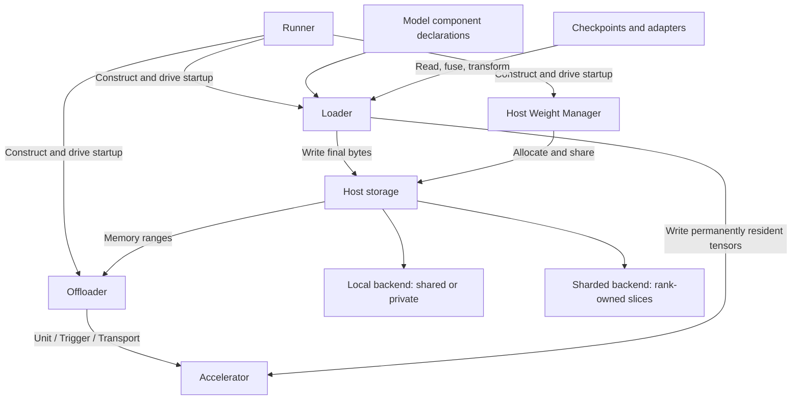

| Module | Responsibilities | Responsibility boundary |
|---|---|---|
| Runner | Construct modules, advance startup, invoke `close()` | Checkpoint interpretation belongs to Loader; Unit planning to Offloader; host allocation to HWM |
| Loader | Component declarations, structure-only construction, overlay wrapping, checkpoint mapping, adapter fusion, transformations, writing, finalization, content identity, final manifest | HWM owns host allocation; Offloader owns H2D and AllGather |
| HWM | Local records, sharing plans, host allocation according to the plan, local sharing, rank sharding | Loader owns checkpoint semantics; Offloader owns pinning, registration, and accelerator resources |
| Offloader | Planning, pinning, registration, staging, accelerator resources, H2D, AllGather, hooks, post-commit guards, close | Loader determines and produces weight content |

Dependency rules:

1. Loader accesses HWM and Offloader through interfaces and does not import their concrete implementations.
2. Offloader does not import Loader or safetensors readers and does not invoke model post-load hooks.
3. HWM does not interpret checkpoint keys or perform renaming, splitting, merging, quantization, or model finalization.
4. Models provide component declarations and generic structural information to Loader. They do not read offload or host configuration, import Offloader, look up offload hooks by name, or call runtime lifecycle methods.
5. Startup state is held explicitly by the startup driver; it is never attached to the pipeline for handoff.

Weights produced by this lifecycle live in memory. Each startup builds them from checkpoints. The kernel releases storage when its final holder exits.

The Loader, HWM, Offloader, and startup lifecycle form the unified weight implementation. A single selector enables them together. They coexist with the existing implementation until the release gates allow the default to change and the existing implementation to be removed.

## Terminology

| Term | Definition |
|---|---|
| Deployment | One orchestration process's lifetime, from startup to shutdown: `StageRuntime` in `Omni` or `AsyncOmni`, or its distributed subclass `DistStageRuntime`. Includes all directly launched replicas and headless replicas registered with its `OmniMasterServer` |
| Deployment ID | A fresh random 128-bit value generated on each orchestration startup and propagated to every diffusion worker. Two starts with identical configuration are separate deployments |
| Stage | A logical model stage in vllm-omni, comprising one or more replicas |
| Replica | An independently running instance of a stage, with its own executor, workers, and torch.distributed process groups |
| Rank | A worker's index in a distributed process group; one rank corresponds to one accelerator |
| DP / SP / TP | Data parallelism: rank groups within a replica, as configured by `data_parallel_size`, process different requests. Sequence parallelism: divide a request's sequence across ranks. Tensor parallelism: each rank owns part of the parameters. Separate replicas do not constitute DP |
| HSDP | A parallelism mechanism that shards parameters across accelerator ranks and assembles them before use |
| Component | A named, role-bearing model part declared to Loader, such as a DiT, text encoder, or VAE |
| Typed declaration fields | The closed set `repeated_blocks`, `unit_groups`, `shard_group`, and `fixed_adapters` |
| Repeated blocks | Structurally identical layers executed in sequence, such as DiT blocks |
| Rule table | Per-class data describing dtype, fp32 exceptions, renaming and merging, and keys ignored during loading |
| Adapter | A LoRA-like increment. A fused adapter is supplied by the user and fused into base weights by the checkpoint reader. A fixed adapter is declared through `fixed_adapters`. A dynamic adapter occupies dynamic LoRA overlay slots |
| Content identity | The basis for determining whether two workers in a deployment require identical final weights for a component |
| Final manifest | Final tensor names, shapes, dtypes, storage locations, and storage aliasing relationships |
| Host storage | Host memory allocated by HWM for final weight bytes |
| Local key | The five sharing prerequisites: boot ID, network namespace, PID namespace, memory cgroup, and effective UID |
| Plan fingerprint | A digest of the plan's local-storage content and layout: included tensors, dtype-based file grouping, and tensor offsets |
| Sharing set | Workers with the same deployment ID, local key, content identity, and plan fingerprint, sharing one host allocation |
| Writer / waiter | The writer builds and seals a sharing set's storage on a machine and serves file descriptors to later workers. Other workers are waiters |
| Rank shard | One rank's equal-sized slice of a repeated block's flattened bytes |
| Unit | Weights with one residency and transfer lifecycle: a whole component, repeated block, named group, resident-layer group, or a direct child outside the repeated blocks of a layer-mode component |
| Trigger | Determines when a Unit enters or yields accelerator memory |
| Transport | Determines how a Unit reaches the accelerator from host memory |
| `fully_resident` | Set by `commit()` when all component weights and buffers stay on the accelerator at stable addresses until close, and HSDP does not manage the component |
| H2D | Host-to-device transfer |
| AllGather | A collective that assembles rank-owned slices into a complete block |
| Pinning / registration / staging | Pin host allocation directly; register an existing allocation with the driver; or copy through a small fixed pinned allocation |
| File descriptor | A process-local handle to an open file, transferable through a local socket |
| Sealing | Irreversible Linux restrictions on a memory file, such as prohibiting writes and size changes |
| Overlay | Tensors applied on top of base weights without modifying them, including dynamic LoRA A/B slots |

## Startup transaction

### Interfaces

```python
class Offloader:
    def plan(catalog, topology, policy) -> PlacementPlan: ...
    def prepare_materialization(model, plan, storage) -> LoadTransaction: ...

class LoadTransaction:
    def commit(final_manifest) -> OffloadRuntime: ...

class OffloadRuntime:
    def close() -> None: ...

class HostWeightManager:
    def local_record() -> LocalRecord: ...
    def share_plan(topology, fingerprints) -> SharePlan: ...
    def elect(share_plan) -> Election: ...
    def admit(topology, share_plan, elections, layout) -> None: ...
    def allocate(layout, share_plan, elections) -> HostStorage: ...

class HostStorage:
    def view(tensor_key) -> torch.Tensor: ...
    def ranges(unit) -> list[MemoryRange]: ...
    def seal(final_manifest) -> None: ...
    def close() -> None: ...

@dataclass(frozen=True)
class MemoryRange:
    address: int
    length: int
    mapping: Mapping
    read_only: bool
```

- `local_record()` returns this rank's local key, PID, and available host memory.
- `share_plan()` is pure and returns the same result on every rank. `elect()` participates when this rank is a representative. `admit()` is pure and raises if capacity is exceeded.
- `Topology` contains the deployment ID and rank-ordered `LocalRecord` values, identical across a replica.
- `SharePlan` records each sharing set's members on each machine within this replica, its representative (the lowest rank), and its socket name.
- `Election` records whether each writer belongs to this replica or another replica; for an external writer, whether storage is sealed and how many bytes remain unwritten. It also records available host memory observed by the representative during election. A local writer's `Election` owns the listening socket and thread until `allocate()` transfers them to `HostStorage`. Runner closes them if startup fails before that transfer.
- `view()` returns a write target or a read-only view. `ranges(unit)` exactly covers the Unit's bytes in this process. Ranges become valid after `seal()` for shared storage, or after writing and page reclamation for private storage and rank shards.
- The writer's `seal()` finalizes and seals storage and distributes read-only descriptors. Waiters receive, verify, map read-only, and bind them. `close()` releases this process's mappings; the writer also closes its listening socket and descriptors.
- `MemoryRange.mapping` identifies the containing mapping. `read_only` is true for shared storage and false for private storage and rank shards.

The phases, ownership transfers, and failure behavior below are normative.

### Startup sequence

1. Runner constructs Loader, HWM, and Offloader.
2. Loader builds structure only; weight-bearing components contain no materialized parameter data.
3. Collect topology.
4. `Offloader.plan()` computes Units, Triggers, Transports, and host-storage choices without allocating resources or modifying the model.
5. Loader preflights checkpoints and adapters, computing content identities and the expected manifest.
6. Perform replica-wide validation, writer election, and host capacity admission.
7. `HWM.allocate()` allocates storage for host-resident tensors.
8. `Offloader.prepare_materialization()` acquires all capacity-consuming runtime resources before the first model write and returns a startup transaction.
9. Loader binds parameters to allocated storage and sends checkpoint-reader streams to each source's write entry point. Adapters are fused in the reader; online quantization proceeds layer by layer.
10. Loader verifies writes, finalizes host storage through `seal()`, completes shared-storage handoff and read-only binding, and calls `eval()`.
11. `commit()` validates the final manifest, registers host memory, sets `fully_resident`, installs hooks, and transfers resources to `OffloadRuntime`.
12. Configure compilation.
13. Begin serving.

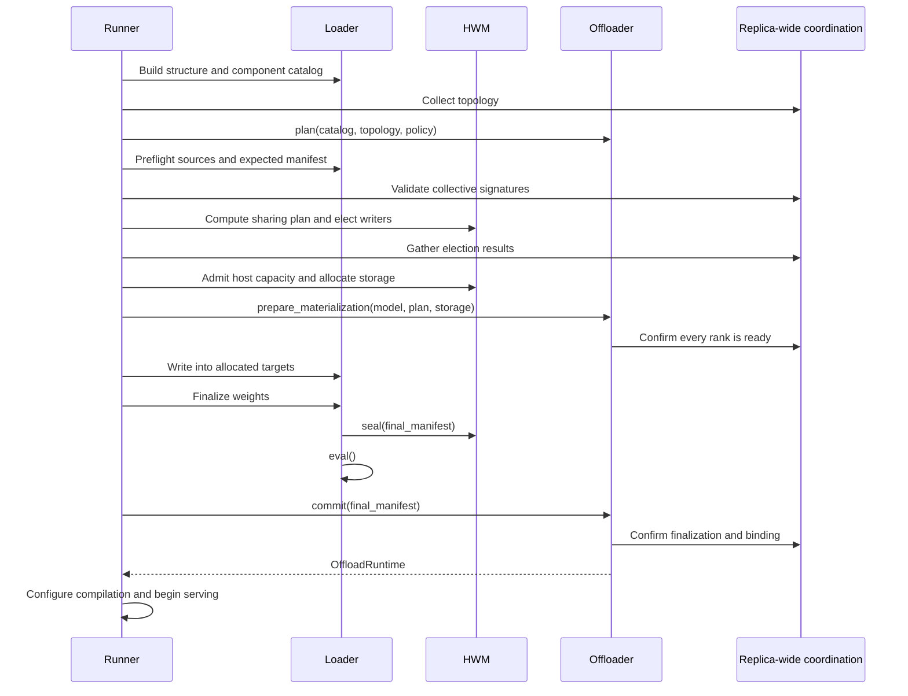

### States and ownership

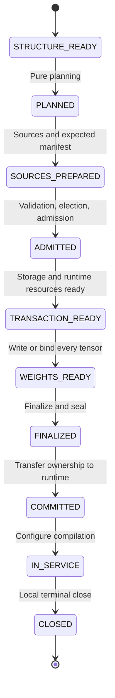

- `plan()` allocates no large resources, modifies no model state, and installs no hooks.
- Before commit, the startup transaction uniquely owns temporary resources acquired for materialization and releases this worker's resources if abandoned.
- Successful commit transfers resources to `OffloadRuntime` as one ownership handoff. Each resource handle is recorded once.
- From the first model write until successful commit, the model instance is disposable. A write, finalization, or commit failure discards it.
- Failures after `IN_SERVICE` are runtime failures: all workers in the replica terminate.

### Replica-wide coordination

Coordination uses the replica's existing torch.distributed process groups, gathering through the world group's Gloo group. Each round carries local error status. An error on any rank causes every rank in that replica to fail. Replicas exchange shared storage through local sockets.

0. **Topology collection:** after `init_distributed_environment`, before `plan()`. Every rank supplies `HWM.local_record()`; rank 0 also supplies the deployment ID. Every rank receives the same `Topology`.
1. **Validation, election, admission:** after Loader preflight, before `allocate()`.
   - Gather Units, content identities, layouts, Transports, and plan fingerprints. Compare the portions participating in collectives: AllGather Units, their identities, and layouts. Rank-local Units and rank-specific components are excluded from this comparison.
   - Form AllGather groups from per-component content identities. Every rank in the replica, including ranks without the component, creates groups in the same component-name order. Reject a group with only one rank.
   - Each rank computes the same sharing sets and representatives through `share_plan()`.
   - Every rank calls `elect()`. Representatives participate; other ranks return empty election results. Gather those results.
   - `admit()` reaches the same capacity decision on every rank, before host allocation or pinning.
2. **After `prepare_materialization()`:** return the transaction only after every rank is ready. Waiters then connect to writers.
3. **At `commit()`:** activate together only after all ranks complete finalization and binding.

A failure before a coordination point fails the entire replica. With world size 1, these steps execute locally.

## Loader

### Component declarations

Each pipeline declares every weight-bearing part once in its constructor. Declarations are generated per instance after configuration parsing, so one class can expose different components under different configurations. A declaration contains:

- A stable component name and one role: `dit`, `text_encoder`, `image_encoder`, `audio_encoder`, `vae`, or `other`.
- A path to one subtree, or a list of subtrees. Nested component subtrees are carved out of their enclosing component.
- A structure factory using configuration without reading weight values.
- Weight sources.
- A rule table when checkpoint and in-memory representations differ.
- Applicable typed structural fields.

**Completeness.** Every parameter and persistent buffer must belong to exactly one component. Planning reports all uncovered or multiply owned paths. Explicitly declare permanently resident parts as `other`. Deduplicate modules referenced through multiple attributes by module identity.

**Rank-specific declarations.** Components can differ by rank. A component without tensors is absent.

**Typed fields.** This closed field set describes model structure. Policy determines offload behavior. Every field has a generic consumer, contributes to the plan fingerprint, and has expected-result tests. Adding a field requires design review; arbitrary keys are prohibited.

| Field | Meaning | Consumer |
|---|---|---|
| `repeated_blocks` | Ordered paths to repeated-block containers, replacing automatic discovery for this component; also defines resident-layer counting order | Offloader planning and `torch.compile` region selection |
| `unit_groups` | Named submodule groups that can stream independently; paths support wildcards | Policy selection through `units` |
| `shard_group` | A process group that shards component weights in addition to TP and EP | Content identity and AllGather grouping |
| `fixed_adapters` | Model-provided adapters: name, source, targets, and `apply: fuse` or `overlay` | Loader |

Declarations remain queryable after commit. Compilation, cache acceleration, dynamic LoRA, model registration, sequence-parallel hooks, and VAE fast paths query them in place of `_dit_modules`, `_encoder_modules`, and `_vae_modules`. Commit adds the read-only `fully_resident` fact to each component.

### Structure-only construction

The unified Loader enters a structure-only construction context. Legacy constructors retain their existing behavior.

- Convert parameters to meta at `register_parameter`, independently of an outer `torch.device` context. Buffers are created on CPU as usual.
- During construction, `Module.to()` and `.cuda()` apply dtype and memory-format changes to parameters and buffers while suppressing device movement.
- Construct vLLM-style components from configuration. Construct transformers classes as in `create_transformers_model`, skipping `init_parameters` in this context; likewise skip `init_parameters_preserving_vllm_linear` in `create_transformers_model_with_vllm_linears`. Use `from_config` for diffusers classes.
- Keep read traps active from construction entry through finalization. During construction, reject tensor-data reads through `get_tensor`, slice access, `load_file`, `torch.load`, `load_state_dict` with real tensors, `from_single_file`, and custom non-Hugging-Face `from_pretrained`. During writing and finalization, trap file reads only; writing into bound storage through `load_state_dict` is allowed. Reading safetensors headers is allowed. Record trap violations in the context so swallowed exceptions still fail construction or finalization.
- After construction, verify every parameter is meta. Buffers and module attributes must contain no meta tensors, except nonpersistent buffers with sources registered through `declare_weights`.

Resolve each tensor's final dtype during structure-only construction: start with its constructed dtype and apply rule-table overrides. Planning, HWM layout, and the expected manifest all use this final dtype.

Per-class rule tables express the additional work normally performed by `from_pretrained`: tied parameters, ignored keys, transformers v5 weight conversions, dtype resolution, fp32 exceptions, write-time transformations (including execution-device requirements), and parameters whose meaningful initial values are absent from checkpoints. Tables are data consumed by generic Loader logic. Each table has a tensor-by-tensor comparison against `from_pretrained`. Runtime Loader uses checked-in tables and does not inspect `_keep_in_fp32_modules` on classes.

HSDP-managed components also start with structure only. Materialization allocates CPU storage for their meta parameters, then follows the existing HSDP `load_weights` and sharding path, outside HWM.

For `load_format="diffusers"`, declare components from `model_index.json`, construct each weight-bearing component with `from_config`, and load through this lifecycle. The diffusers pipeline object orchestrates forward execution and denoising. Unified loading does not call the adapter's `load_weights()`, `build_component`, or diffusers offload. The legacy adapter's full-pipeline `from_pretrained` path remains intact.

For `load_format="custom_pipeline"`, apply the registered-pipeline rules. First initialization in `re_init_pipeline` runs the entire startup lifecycle. Subsequent initialization closes the runtime and repeats the lifecycle, including election.

### Construction during coexistence

Component factories provide the construction dispatch point:

```python
def build_component(*, legacy: Callable[[], T], unified: Callable[[], T]) -> T: ...

def declare_weights(module: nn.Module, *, sources, rules=None, writer=None) -> None: ...
```

These functions live in `vllm_omni/diffusion/model_loader/construct.py`.

- `build_component` calls only `legacy()` in legacy mode and only `unified()` inside unified construction. After Loader closes the context, calls to `build_component`, `declare_weights`, or HF component entry points fail with the call location. Components previously created on demand are created in the unified constructor.
- Dispatch and read traps use the same process-level state. Model reads of the selector are limited to the required coexistence changes listed under Job 1.
- The legacy closure contains the original statements, with unchanged arguments, order, and callees.
- The unified closure uses configuration only, returns an instance of the same class with the same module tree, and calls `declare_weights` once for each weight-bearing module. It reuses existing path resolution, configuration parsing, and validation. Separate tensor-reading and state-dictionary construction logic lives in the model family's `unified_build.py`. Existing classes can gain new methods while retaining existing methods.

HF components have two entry points with the same internal dispatch:

- `from_pretrained_with_prefetch`: preserve existing behavior outside the context. Inside it, read configuration, construct on meta with `from_config`, and register the HF source and class rule table. Express construction postprocessing from overridden `from_pretrained` methods in the rule table and execute it in the context.
- `hf_component(factory, *args, **kwargs)`: replaces direct constructor calls to `X.from_pretrained(...)`. Outside the context it calls `factory(*args, **kwargs)` with unchanged behavior. Inside it, use the same structure-only path above.

Sources registered through `declare_weights` write directly into that module: use an explicit `writer`, otherwise its `load_weights(weights)`, otherwise parameter-name assignment. Pipeline `weights_sources` are assigned to components by prefix and streamed through the pipeline's `load_weights`. Unified loading skips pipeline `load_weights` when `weights_sources` is absent. Register precomputed data tensors as sources of nonpersistent buffers, and FastH3 and VDN as adapter sources.

Constructor code outside tensor-read sites, `forward`, `load_weights` handling `weights_sources`, and module classes are shared by both implementations. In unified mode, legacy offload query helpers report no offload, construction-time `.to()` applies only dtype and memory format, and model-controlled staging and residency follow the Job 1 migration checklist.

New pipelines follow the Z-Image and Kandinsky6 pattern: construct weight-bearing components from configuration or through HF entry points, and write weights through `weights_sources` and `load_weights`. Both implementations share construction code. During coexistence, reject new pipelines that read tensors in constructors. Unmigrated pipelines fail unified startup at the read location and identify `--diffusion-weight-stack legacy` as the available compatibility setting.

### Allocate before writing

This is the weight materialization mechanism:

1. Allocate final storage before writing: accelerator storage for permanently resident tensors, HWM host storage for host-resident tensors.
2. Bind parameters to targets and feed each source's checkpoint-reader stream to its write entry point. Existing `weight_loader` conventions handle TP slicing, merged parameters, and model mappings. Fuse adapters in the reader so `load_weights` receives fused tensors.
3. Once a layer's weights have been written, perform online quantization on the accelerator, write results into final storage, and release pre-quantization data. Quantization methods declare output shapes and dtypes before writing, so the expected manifest already describes final tensors.
4. Perform one semantic write per final tensor.
5. Copy parameters wholly replaced by finalization, such as parameter-changing calibration, into host storage during finalization.

The mechanism is independent of model identity.

### Finalization order

Loader runs this sequence once:

1. Complete all writes or bindings.
2. Run whole-model work that changes bytes, such as parameter-changing calibration.
3. Establish storage aliases.
4. Check write tracking: every required parameter was written. Except for parameters declared as replacements in step 2, every parameter and persistent buffer remains bound to its preallocated storage with unchanged shape and dtype. Each worker checks tensors it writes; the writer checks shared tensors.
5. Copy step-2 replacements into host storage and produce the final manifest.
6. Call host storage `seal()` to finalize all backends and hand off shared storage through read-only bindings.
7. Call pipeline `eval()` on every worker. This is the model's sole finalization entry point. It may read weights and construct non-weight runtime state, while leaving parameters and persistent buffers unchanged. A rank holds only a slice of sharded Units, so `eval()` cannot read those weights; construct dependent state on first use.
8. Call transaction `commit()`.

Unified loading does not invoke `post_load_weights`, `validate_loaded_weights`, or `validate_restored_host_weights`.

Weight bytes are fixed after step 5. After commit, base-weight bytes, layout, and aliasing are immutable. Changing a fused adapter or quantization method requires closing the runtime and restarting this lifecycle. Dynamic LoRA leaves base weights unchanged.

Waiters execute the same write traversal: shared-tensor writes are no-ops, while accelerator-resident, private, and rank-sharded tensors are written normally, preserving collective order. Waiters skip steps 4 and 5 for shared tensors; `seal()` receives and verifies read-only descriptors and binds them in step 6. Local sharing requires step 2 to be empty.

### Content identity

Compute content identity per component to determine local sharing, AllGather membership, and replica-wide consistency within a deployment.

Include model identity and revision, component boundaries, runtime representation (dtype and quantization), Loader rule-table version, byte- or shape-changing parallel coordinates (TP size and rank, EP when enabled, and declared `shard_group` size and rank), and fused/fixed adapter identities (user path or repository, revision, and format).

Exclude offload policy, dynamic overlays, DP coordinates that leave bytes unchanged, device addresses, resolved local cache paths, and deployment ID.

### Dynamic LoRA overlays

Dynamic LoRA has a fixed startup structure. Runtime activation copies data into preallocated overlays and leaves base weights unchanged.

**Enablement.** `max_lora_rank` enables dynamic LoRA and determines slot capacity. With `lora_backend=peft` and `--lora-path`, an omitted maximum uses that adapter's rank rounded up to the smallest legal rank supported by the LoRA layer. Reject larger runtime adapters. Without either configuration, reject runtime `add_lora`.

**Structure-only wrapping.**

- Loader wraps target layers during structure-only construction, using declared DiT components and pipeline-declared LoRA components.
- Wrapping changes structure without allocating real data.
- A generic mapping relates `x.weight` to `x.base_layer.weight`. Checkpoint mapping, content identity, and the final manifest use pre-wrapping names. Dynamic LoRA enablement and adapter selection leave local sharing unchanged.
- Planning sees the final wrapped structure. The wrapper belongs to its original layer's Unit, with hooks installed on the wrapper.

**Overlay slots.**

- Each wrapper has A/B slots sized by `max_lora_rank`.
- Dynamic slots belong to the permanently resident remainder, outside Units, HWM, and content identity.
- `prepare_materialization()` allocates slots and accounts for them in accelerator admission. Commit hands them to the dynamic LoRA manager; addresses remain stable.

**Runtime.**

- `add_lora` reads adapters into the LoRA manager's CPU cache, bounded by `max_cpu_loras`, outside HWM.
- Activation copies A/B into slots and zero-pads smaller ranks. Reject oversized adapters with the required configuration change.
- Forward computes `base(x) + scale · B(A(x))`; Offloader controls base-weight residency.
- The manager does not inspect offload configuration. Dynamic adapters can overlay base weights that already contain fused adapters.

### Adapter fusion and fixed adapters

- **Fusion happens in Loader's checkpoint reader**, shared by ordinary and HSDP paths. Renaming, TP slicing, parameter merging, HSDP sharding, and online quantization consume fused tensors. This enforces fusion before quantization, including TP size greater than 1.
- **Numerics:** compute Δ on the accelerator. By default, cast W and Δ to the stage dtype before addition, matching existing results bit for bit. Adapter formats may specify other rules. Fusion does not multiply by `lora_scale`.
- **Format determines application:** fusion-only formats such as MiniMax H3 FastH3 and VDN always fuse. Ordinary A/B adapters fuse with `lora_backend=distill`; with `peft`, they activate as startup dynamic LoRA.
- **Fixed adapters** are declared through `fixed_adapters`. `apply: fuse` follows user-supplied fusion. `apply: overlay` wraps at construction; its A/B tensors are base content written by Loader, belong to the target Unit, enter content identity, and use separate storage from dynamic slots.
- **Preflight:** fail on mismatched keys belonging to loaded components; warn for keys belonging to unloaded components. Reject fusion with `lora_scale != 1` or already-quantized checkpoints. Reject pre-sharded HSDP with LoRA or quantization during argument parsing.

## Host Weight Manager

### Backend selection

Planning selects the backend; there is no backend selector in user configuration.

| Placement / Transport | Backend | Host content held by this rank |
|---|---|---|
| Direct rank-local H2D | Local | Complete host-resident content, shared by eligible workers in the deployment on this machine |
| Shard H2D followed by AllGather | Sharded | This rank's shard |
| Permanently accelerator-resident | Outside HWM | None |

### Interaction with parallelism

| Parallelism | Weight content across ranks | Host storage |
|---|---|---|
| DP | Identical | Local sharing on one machine, or `1/N` per rank with sharded storage |
| SP | Identical | Same as DP |
| CFG parallelism | Identical | Same as DP |
| TP | Different by TP coordinate | Include TP size and rank in content identity; matching coordinates may share |
| EP | Different by EP coordinate | Include EP size and rank |
| Declared `shard_group` | Different by group coordinate | Include group size and rank |
| HSDP | Managed by HSDP | Outside HWM |

### Local backend

Workers form a sharing set across stages and replicas when all of these hold:

- Deployment IDs match.
- Local keys match: machine, container boundaries, and system user are compatible.
- Content identities and plan fingerprints for the complete shared weight set match.
- Every tensor's final shape and dtype are known before writing.
- Finalization step 2 is empty: no whole-model work changes bytes.

Workers outside these conditions load into private process memory. Separate deployments have different IDs and never connect or share storage.

**Deployment identity.** `StageRuntime` generates `secrets.token_hex(16)` once per construction. Local replica configuration receives `od_config.deployment_id` before process launch. Headless replicas receive the same value through `OmniMasterServer` registration. It is an internal `init=False` field, unavailable through CLI or configuration and excluded from content identity. When configuration comes from a tool or test outside `StageRuntime`, rank 0 generates a replica-local ID during topology collection, restricting sharing to that replica.

**Local key.** `local_record()` reads boot ID; device/inode pairs for network and PID namespaces; device/inode of the memory-cgroup directory; and effective UID. A worker with any unreadable field does not participate in sharing.

**Plan fingerprint.** Depend only on configuration and parallel layout. Exclude PID, available host memory, and current free accelerator memory so sequentially launched replicas produce matching plans.

**Memory files.** Create anonymous files with `memfd_create(MFD_CLOEXEC | MFD_ALLOW_SEALING)`:

- They reside in the kernel's internal memory filesystem and are accessible through descriptors.
- They consume no `/dev/shm` capacity. Machine and container memory limits apply; the writer's cgroup is charged.
- Fix file sizes from the expected manifest before loading; physical pages are committed on write.
- Files remain alive while any descriptor or mapping exists. The kernel releases them when the final holder exits.

**Format.** Use safetensors internally, with files grouped by component and dtype. Align tensors to their dtype. Compute layout from names, shapes, and dtypes; use deterministic name ordering and contiguous placement with tensors from one repeated block adjacent. The final manifest forms the safetensors header.

**Socket name.** Use `\0vllm-omni-hwm/<deployment-id>/<sharing-fingerprint>` in Linux's abstract namespace. The name disappears when its holder exits. The sharing fingerprint is a 128-bit digest of local key, content identity, plan fingerprint, and storage-format version.

**Election.** Within each replica, `share_plan()` groups same-machine members of each sharing set and selects the lowest rank as representative. The representative creates an `AF_UNIX`, `SOCK_SEQPACKET`, `SOCK_CLOEXEC` socket and atomically binds the name:

- Successful bind elects the writer, which begins listening immediately. Other local members wait.
- An occupied name indicates an external writer. The representative connects and verifies `SO_PEERCRED` UID against its effective UID. Every local member waits. A UID mismatch follows the error case below.
- Other election errors select private memory for that local group.

**Handoff.**

1. In `allocate()`, the writer creates writable memory-file mappings and applies `madvise(MADV_DONTFORK)`. Its listener runs from election until `HostStorage.close()`. Validate peer UID through `SO_PEERCRED`, protocol version, deployment ID, sharing fingerprint, and expected-manifest digest on every connection.
2. After coordination point 2, waiters connect. The representative reuses its election connection. A writer that has already sealed storage serves descriptors immediately.
3. All ranks traverse the same writes. Shared writes on waiters are no-ops.
4. In `seal()`, the writer reopens files read-only, creates `MAP_SHARED`, `PROT_READ` mappings, and rebinds every tensor and alias using the final manifest. Remove writable mappings; fail if any tensor still references one. Apply seals prohibiting writes, growth, shrinkage, and further seal changes. A sealing error fails startup.
5. Use `socket.send_fds` to send read-only descriptors and the final-manifest digest to connected waiters. Serve later connections immediately.
6. Waiters verify peer and file UID through `SO_PEERCRED` and `fstat`, verify seals, sizes, and manifest digest, then use the same name-based read-only binding logic. Close received descriptors after mapping.

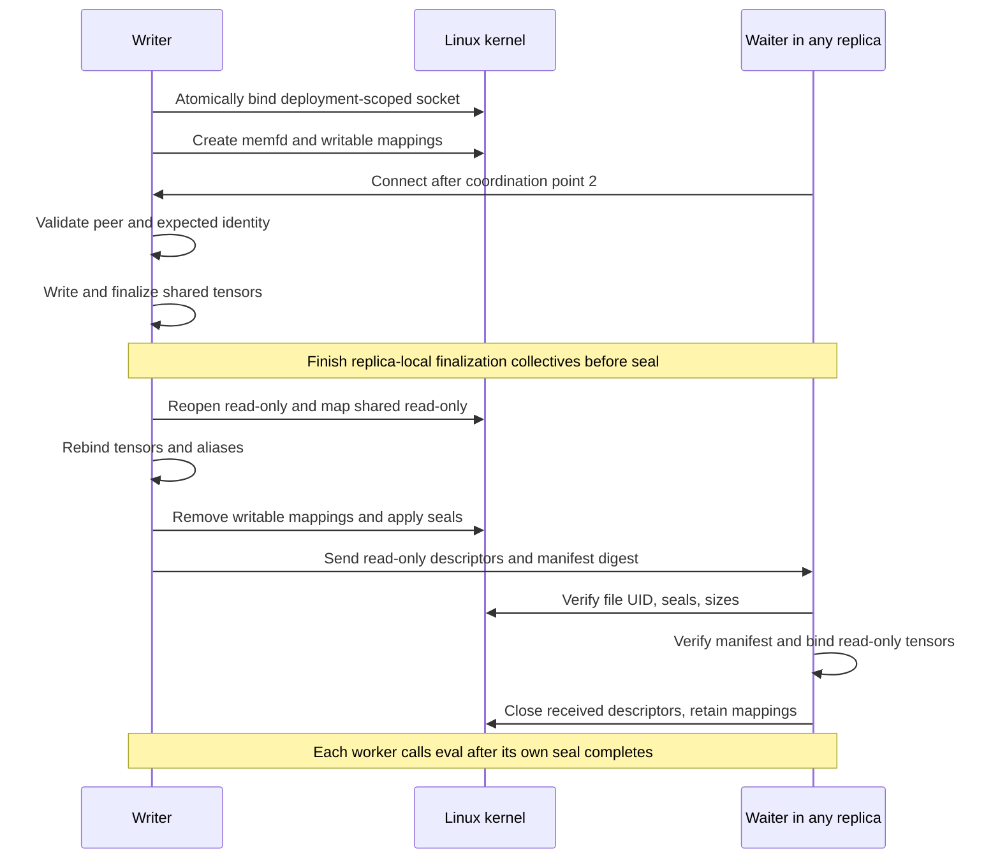

These are shared read-only mappings. Long-lived read-only registration pins shared pages without producing copies. Writing shared weights causes a segmentation fault. Every mapping uses a read-only descriptor: kernels before 6.7 reject `MAP_SHARED` mappings of `F_SEAL_WRITE` files opened writable, including mappings requested read-only.

**Ordering.** Complete replica-local finalization collectives before `seal()`. `seal()` performs no collectives. A writer seals and sends without waiting on sockets; waiters block for descriptors only inside `seal()`. This prevents socket dependencies across replicas from interlocking with collectives inside replicas.

**Late workers.** Later replicas and dynamically registered replicas run election normally. A live writer serves sealed storage immediately, and admission excludes its existing allocation. If the writer exited, a new representative rebuilds storage under the now-free socket name. Existing mappings remain valid.

| Failure | Behavior |
|---|---|
| Writer exits or fails before sealing | Connected waiters observe connection closure; their replicas fail startup with writer PID and stage |
| Writer exits after sealing | Already bound workers continue; later workers elect a new writer |
| Writer exits after sealing but before all waiters receive descriptors | Recipients bind normally; replicas of remaining waiters fail startup. Roles remain fixed during startup |
| Waiter fails | Writer closes that connection and continues building and listening |
| Writer stops progressing | Waiters remain blocked until stage startup timeout |

Online quantization runs one layer at a time on the accelerator. The writer retains only one layer's pre-quantization data transiently.

### Sharded backend

**Layout.** Flatten each repeated block by dtype, divide into N equal slices, and zero-pad as required. Rank r holds slice r. Each rank transfers its slice H2D and uses `all_gather_into_tensor` to assemble the complete block.

**Groups.** AllGather groups contain all ranks in a stage replica with the same component content identity. DP, SP, and CFG ranks with the same TP coordinate participate together. With TP size 1 and no declared `shard_group`, the group is the entire replica. A declared `shard_group` additionally requires matching group coordinates. Create groups at coordination point 1 and reject singleton groups there. Groups may span machines; each machine holds its local-rank count divided by N of the sharded content.

**Storage.** Each rank shard is private memory.

**Cold startup.** Planning selects and logs one of two construction paths:

| Path | Condition | Additional per-rank construction memory |
|---|---|---|
| Bounded path | Final shapes and dtypes are known before writing, and finalization step 2 does not replace this component's tensors | One reclamation threshold, equal to one repeated block, plus the two largest tensors |
| Full materialization followed by trimming | Final shapes or dtypes are determined during finalization, such as shape-changing calibration | One complete transient copy |

The bounded path reserves virtual address space for the component and binds parameters before normal `load_weights` execution. Physical memory is committed on write. Tensors wholly outside the rank's slice require no storage, no write, and no checkpoint-data read. Boundary-crossing tensors are written in full before out-of-slice pages are returned to the kernel. Reclamation is triggered by a written-byte threshold. Deployments across machines with limited host memory use this path.

**Sharding extent.** Shard repeated blocks: DiT blocks and text-encoder blocks whose content matches across ranks. DiT remainders, VAEs, and image encoders retain complete per-rank copies and must fit on one machine. Planning names the offending component when this requirement fails.

**Execution constraints.** Every rank in an AllGather group must execute the same blocks in the same order:

- DP requests in one wave require identical denoising-step counts and execution-path parameters.
- CFG branches execute identical blocks.
- DP or CFG parallelism with AllGather excludes cache acceleration.
- Cache backends synchronize block-skipping decisions across the SP group.
- DP size greater than 1 with text-encoder AllGather excludes prompt-embedding caching.

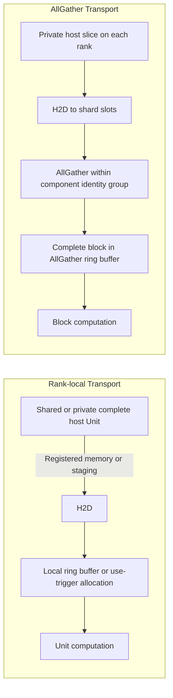

## Offloader

### Policy model

Offload policy combines **Unit + Trigger + Transport**. Each selected component has four independent settings:

| Setting | Values | Meaning |
|---|---|---|
| `mode` | `module` / `layer` | One Unit for the component, or one per repeated block |
| `weight_transfer` | `rank-local` / `allgather` | Direct local H2D, or shard H2D followed by AllGather |
| `resident_layers` | Nonnegative integer | Initial repeated blocks grouped for use-triggered residency |
| `units` | A name from declared `unit_groups` | Stream only matching groups; keep the remainder permanently on the accelerator |

Unselected components remain on the accelerator. Offload-disabled execution uses the same Offloader interface with permanent accelerator placement.

### Unit planning

Planning is pure. Inputs are policy, component declarations, structure, parallel topology, and platform capabilities. Output Units are disjoint.

| Weight grouping | Default location | Trigger |
|---|---|---|
| Whole component | Host | Use |
| Streaming repeated block or `units`-selected group | Host | Block ring |
| Resident-layer group | Host | Use |
| Remainder of a non-`dit` layer-mode component | Host | Use |
| Remaining permanently resident content | Accelerator | None |

- Assign every base-weight parameter and buffer to one placement grouping. Storage aliases belong to the same Unit. Reject incompatible lifecycles for cross-component aliases.
- Dynamic overlay tensors remain on the accelerator outside Units and HWM.
- Small component-root parameters outside child modules and configuration-derived nonpersistent buffers remain on the accelerator.
- If no component on this rank can make a selected module Unit or resident-layer group yield, plan it as permanently resident and log that decision.

**Repeated-block discovery** examines the module tree without reading model attributes:

1. Candidates are `nn.ModuleList` instances, including subclasses, with at least two base-weight-bearing elements of the same Python type, where that type defines its own `forward`.
2. Let B be the largest candidate element size in the component. A list qualifies when its largest element is at least B/4. Use this rank's final byte sizes.
3. Traverse from the component root in registration order. Record each qualifying list and stop descending into its elements. Skip subtrees owned by other components.
4. Declared `repeated_blocks` replaces automatic discovery. Reject selected layer-mode components with no repeated blocks.

For layer-mode remainders, keep `dit` remainders permanently on the accelerator; split other roles by direct child module into use-triggered Units.

With `units`, each matched submodule in the selected `unit_groups` becomes a streaming Unit. Disable automatic discovery for that component and keep its remainder permanently resident.

Count `resident_layers` per role: order selected layer-mode components by declaration, then blocks by declared `repeated_blocks` order or discovery registration order, and take the first N.

### Triggers

**Block rings.**

- Maintain independent buffers and successor tables for `rank-local` and `allgather` streaming Units. Omit resources for an absent Transport.
- Each buffer holds the two largest loaded Units for that Transport. AllGather uses padded `N × shard_size`; align tensors to dtype and round each Unit to 256 bytes.
- Initialize successors from component registration order. The rank-local table wraps last to first. The AllGather table has no successor for its last entry. Entering a Unit prefetches its successor. On a prediction miss, synchronously load the requested Unit and update the previous Unit's successor in that same table.
- Reject entry into a streaming Unit while another streaming Unit's forward remains active.
- Retain no AllGather Units across forwards. Assemble the first block on entry, then prefetch by successor. Update the AllGather table using only AllGather entry order, preserving collective decisions across ranks. Attach a Unit ID to every assembly and assert it on the accelerator.
- Compilation encloses block computation, leaving hooks outside the compiled boundary.

**Hook placement.** For block-ring Units, hook the block root and every module directly holding tensors. The first invoked hook enters the Unit; every invocation checks residency. For use-triggered Units, hook every directly tensor-owning module. Install through `HookRegistry` forward replacement.

**Use-triggered yielding.**

- Using a `dit` component makes other selected components' module Units, resident-layer groups, and use-triggered remainder Units yield.
- Using an encoder makes those `dit` Units and selected VAEs yield. Encoders do not evict one another.
- Using a selected VAE makes those `dit` Units and other selected VAEs yield.
- Encoders trigger yielding whether selected or unselected. Unselected VAEs and `other` components do not trigger it.

Yielding releases accelerator storage without host writeback. Parameters then point to empty placeholders that fail on read.

An unselected VAE stays on the accelerator without hooks; a selected VAE uses use-triggered residency.

**Post-commit guards.** `.to(execution_device)` on a managed module is a no-op. Reject device or dtype changes through every `Module._apply` entry point. Managed parameters report the execution device throughout service.

### Transports

- `rank-local`: copy directly from registered host storage asynchronously. When registration is unsupported, exceeds its limit, or fails, use two fixed staging buffers.
- `allgather`: transfer the local shard H2D through a pair of shard slots, then assemble the complete block into the block-ring buffer.
- Every policy avoids a complete pinned duplicate of host weights.

**Registration.** Consume `MemoryRange` from `HostStorage.ranges(unit)`. Page-align and merge selected ranges within each mapping, then register disjoint merged intervals. If an interval fails registration, route its Units through staging. Unregister the same merged intervals. Shared storage uses read-only registration.

The platform interface is `host_registration_support() -> (writable, read_only)`. CUDA queries device capabilities; other platforms report unsupported. Register in `commit()`, after sealing/read-only binding for shared memory and after writing/page reclamation for private and sharded storage. Verify the driver recognizes registered memory as pinned. Enforce limits per worker, prioritizing streaming blocks, resident-layer groups, and module Units. Register a whole Unit or stage the whole Unit.

**Staging: 2 × 256 MiB.** Always reserve this host capacity when a worker has host-resident Units. Allocate in `prepare_materialization()` when staging is planned. If registration fails during commit and staging has not been allocated, allocate it then.

### Resources and runtime constraints

Accelerator resources have two lifetime classes:

- **Fixed slots:** block-ring buffers, shard slots, and overlay slots. Allocate in `prepare_materialization()` before model writes and preserve addresses until close, including across supported sleep/wake cycles.
- **Module Units and resident-layer groups:** acquire from the caching allocator on entry and release on yield; their addresses may change.

`prepare_materialization()` also prepares the registration plan, required staging buffers, streams, events, and collective workspaces, and performs accelerator capacity admission:

```text
permanently resident content + overlay slots + block-ring buffers + shard slots
    + max(write-time transient memory, simultaneously resident use-triggered Units)
    <= available accelerator memory
```

Write-time transient memory includes the largest single adapter Δ and, for online quantization, one layer's pre-quantization data.

For simultaneous use-triggered residency, take the larger of:

- The largest sum for one `dit` component.
- The sum across all selected encoders plus the largest sum for one selected VAE.

These sums include module Units, resident-layer groups, and use-triggered layer-mode remainders.

Commit transfers dynamic overlay slots to the LoRA manager and remaining resources to `OffloadRuntime`. Runtime supplies the forward gradient mode: `no_grad` with block-ring Units, otherwise `inference_mode`. Runner does not inspect offload policy. HSDP retains `no_grad`.

One `OffloadRuntime` permits one forward at a time, including a batch. Reject reentrant or concurrent execution. After an exception, wait for copies and collectives before returning to idle. Mark runtime unusable when collective ordering can no longer be trusted.

### Close

Close uses this fixed local sequence:

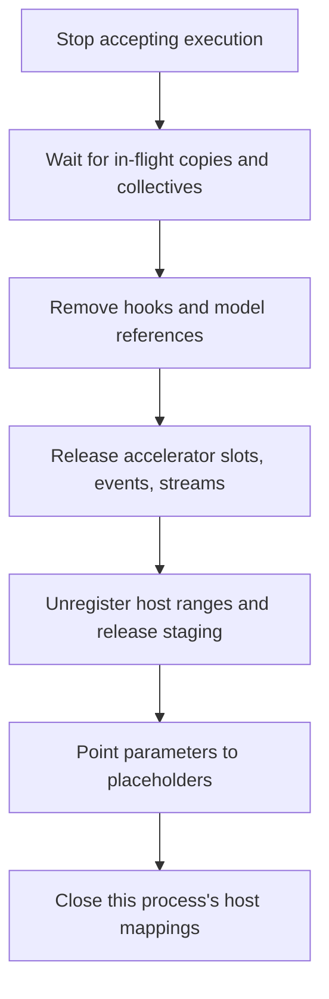

`OffloadRuntime.close()` is local and terminal. It restores no CPU weights and initiates no collectives.

### Sleep mode

Sleep mode releases accelerator weight memory while service is paused. Resource classes determine preservation behavior:

| Accelerator allocation | Sleep | Wake-up |
|---|---|---|
| Permanently resident weights and buffers; overlay slots | Copy to host and release device memory | Restore original addresses |
| Block-ring buffers and shard slots | Release directly without backup | Remap original addresses; fill on next use |
| Module Units and resident-layer groups | Yield before sleep | Load on next use |
| HWM host storage | Preserved | Preserved |

- Permanently resident allocations use the sleep allocator's `weights` pool. Ring buffers and shard slots use a release-without-backup pool. Allocate fixed slots before writes in `prepare_materialization()`. Loader allocates permanently resident weights and buffers in `weights` during writing and finalization. The startup driver does not enter a pool globally.
- Preserved addresses keep compilation results and CUDA graphs that read fully resident components valid after wake-up.
- Before sleep, drain copies and collectives, yield module Units and resident-layer groups, and clear ring state. The first forward after wake-up loads normally.
- Reject forwards while asleep.

### Model integration

Models provide structure and declarations. Generic mechanisms replace existing offload behavior:

| Existing behavior | Replacement |
|---|---|
| Choosing construction/loading devices from offload policy | Structure-only construction |
| Model-controlled component transfers, pinned copies, and load/unload hooks | Component declarations and use triggers |
| Policy-dependent fast-path disabling or structure changes | Structure and bytes determined by model configuration and parallelism |
| Model-specific weight offload, such as MiniMax H3 AdaLN projections | `unit_groups` selected through policy `units` |
| Model-specific rejection of offload combinations | Generic collective-order, capacity, and identity validation; unverified combinations without known correctness failures are recorded in the support matrix |
| `_layerwise_offload_blocks_attrs`, model `OffloadPlan`, resident paths | Component declarations, discovery, `repeated_blocks`, and `unit_groups` |
| CUDA graph decisions based on named offload hooks | `fully_resident` |

Other required model changes appear in Job 1: constructor tensor reads, post-load rebinding, execution-device lookup, address/device-based caches, CUDA graph and compile-mode selection, and dtype changes outside `.to()`.

Static tests enforce dependency rules for `models/`, `lora/`, and `cache/`: no Offloader imports and no string-based hook lookups. During coexistence, freeze existing imports in 28 model files and `lora/manager.py`, plus SeaCache's string lookup, in allowlists. Empty them when removing legacy.

### CUDA graphs and compilation

- Commit sets `fully_resident` only when every component weight and buffer stays on the accelerator at stable addresses until close and the component is outside HSDP.
- Model-captured CUDA graphs may read only fully resident component weights. Other execution is eager. A generic query reads the declaration in unified mode and preserves each model's current decision in legacy mode. Ring and use-triggered hooks fail during capture; yielding hooks on resident components fail only when that invocation must evict a Unit.
- Configure compilation after commit, choosing targets from declarations. Restrict `reduce-overhead`, `max-autotune`, and `triton.cudagraphs` to fully resident components. The generic compile helper selects `default` for other components and logs the change.
- Weight-keyed caches use parameter identity plus write generation, independent of storage address and device.

## Cleanup and recovery

- Final weights live in shared or worker-private memory.
- The kernel tracks holders and releases shared memory when the last holder exits, including normal exit, `kill -9`, and OOM termination. Writers retain read-only descriptors and listening sockets until close; waiters retain mappings.
- Closing or removing a writer's replica leaves other replicas' mappings valid. New workers run election again.
- A worker exit terminates its entire replica under multiprocessing and Ray executors. Other replicas continue serving.
- Restart reconstructs weights from checkpoints under a newly generated deployment ID.
- Use close-on-exec for memory files and sockets. Apply `MADV_DONTFORK` to writable and read-only mappings. Register `os.register_at_fork` cleanup to close inherited memory descriptors, listener sockets, and accepted waiter connections in children.

## Memory model

Let W be a component's final weight size and N its AllGather group size.

For the local backend, per machine and deployment:

```text
steady state = one W per sharing set
             + one W per private-memory worker
             + staging when needed

cold startup = steady state
             + reclaimable checkpoint page cache
             + writer transients: one tensor under transformation,
               or one layer's pre-quantization data
```

The shared weight term is independent of worker, replica, and stage counts. Separate deployments retain separate allocations.

For the sharded backend, per rank:

```text
steady state = W / N, including shard padding, + staging when needed

bounded cold startup = steady state + reclamation threshold
                     + two largest tensors + reclaimable checkpoint page cache

full-then-trim cold startup = steady state + one transient W
```

Machine occupancy is the sum across local ranks.

### Host capacity admission

Each replica checks host capacity during replica-wide validation, before writing:

```text
new occupancy on one machine
    = one W for each sharing set written by this replica
    + one W for each private-memory worker in this replica
    + this replica's local rank shards
    + shard cold-start overhead
    + staging buffers
    + writer and private-worker transients

shard cold-start overhead
    = reclamation threshold + two largest tensors, for the bounded path
      or one W, for full materialization followed by trimming

available memory
    = minimum of local_record observations and election-time observations
    - unwritten bytes of sharing sets whose writer is in another replica
```

For every observation, walk from the process's memory cgroup to the highest visible ancestor and take the minimum `memory.max - memory.current + inactive_file + active_file`. Use `inactive_file` and `active_file` from `memory.stat`; the broader `file` counter includes memory-file and tmpfs pages. When no level has a limit, use `MemAvailable`.

External-writer sharing sets contribute no new W. If new occupancy exceeds availability, every rank in the replica fails together. Concurrent replicas independently admit private allocations, so their combined private demand can still exceed capacity and fail during writing.

Continue with [configuration, rollout, implementation work, acceptance criteria, and observability](https://github.com/vllm-project/vllm-omni/issues/9536#issuecomment-6477111133).

## Feedback period

One week after publication.

## CC

@hsliuustc0106 @amy-why-3459 @yenuo26 @Gaohan123 @princepride @david6666666 @lishunyang12 @tzhouam @congw729 @Dong1017 @yuanheng-zhao @MuweiZ


> **Comment by specture724 (2026-10-28T18:21:58Z):**

# RFC continuation

[Return to the RFC architecture and lifecycle](https://github.com/vllm-project/vllm-omni/issues/9536).

## Configuration

### Implementation selector

```text
--diffusion-weight-stack {legacy,unified}
```

Default: `legacy`, preserving the current implementation. `unified` enables the new Loader, HWM, and Offloader together. These are the two supported selections.

### Offload policy

```text
--diffusion-offload {none,module,layerwise,distributed-layerwise}
--diffusion-offload-policy '<JSON>'
```

| Preset | Expansion |
|---|---|
| `none` | All components permanently accelerator-resident |
| `module` | Module Units for `dit`, `text_encoder`, and `image_encoder` |
| `layerwise` | Layer-mode `dit` with `rank-local` |
| `distributed-layerwise` | Layer-mode `dit` with `allgather` |

Custom policies select roles or component names and set `mode`, `weight_transfer`, `resident_layers`, and `units`. Python and YAML use `diffusion_offload_policy`:

```json
{
  "mode": "layer",
  "components": {
    "dit": {"weight_transfer": "allgather"},
    "text_encoder": {"mode": "module"},
    "vae": {"mode": "module"},
    "latent_upscaler": null
  }
}
```

- Component-name settings override role settings. `null` excludes a component.
- Selectable roles are `dit`, `text_encoder`, `image_encoder`, `audio_encoder`, and `vae`. `other` is ineligible.
- Top-level `mode` supplies the default granularity; components may override it.
- `weight_transfer` defaults to `rank-local`.
- `resident_layers` defaults to 0, applies to layer-mode components, and requires `rank-local`.
- `units` applies only to layer mode and names a declared `unit_groups` entry. MiniMax H3 AdaLN uses `"dit": {"mode": "layer", "units": "adaln"}`.
- Preset and custom policy are mutually exclusive within one configuration source.
- CLI, Python, and YAML share a parser. A higher-priority source replaces the complete policy.
- Missing preset roles are ignored. Explicit custom selections are checked against all ranks' plans at coordination point 1; fail if no rank matches. Unknown `unit_groups` fail planning.
- Reject unknown fields and invalid types.

Presets and old flags exclude VAEs. Select `vae` explicitly for use-triggered management. Unified policy has no hardware-dependent implicit offload: `none` leaves all weights on the accelerator.

### Host policy

| Setting | Argument / field | Meaning |
|---|---|---|
| Pinning and registration | `--pin-cpu-memory` / `--no-pin-cpu-memory`; `pin_cpu_memory`, default true | Enable registration or pinned staging. When disabled, skip capability queries and registration and use unpinned staging |
| Registration limit | `--diffusion-host-registration-limit-gib`; `host_registration_limit_gib` | Per-worker registration limit; 0 means unlimited. A positive value requires offload and `pin_cpu_memory` |

Local sharing activates automatically when eligible.

### Dynamic LoRA

| Setting | Argument / field | Meaning |
|---|---|---|
| Rank limit | `--diffusion-max-lora-rank` / `max_lora_rank` | Enable dynamic LoRA and size overlay slots |
| CPU cache size | `max_cpu_loras` | Existing meaning retained |

Without an explicit rank limit, unified mode derives capacity from a startup `peft` adapter supplied through `--lora-path`. Otherwise dynamic LoRA is disabled and `add_lora` reports the required argument. Legacy behavior remains unchanged.

### Legacy configuration compatibility

One compatibility layer translates old settings into policy in unified mode. Legacy mode continues using them as before.

| Old setting | Unified translation |
|---|---|
| `--enable-cpu-offload` | Module mode for all DiT and encoder components discovered by the existing implementation, excluding encoder entries whose role is `vae`, such as JoyImage's VAE |
| `--enable-layerwise-offload` | Layer-mode, rank-local DiT; likewise text encoders with repeated blocks |
| `--enable-distributed-layerwise-offload` | Layer-mode AllGather DiT; layer-mode rank-local text encoders with repeated blocks |
| `--dlo-no-use-allgather` | Rank-local DiT |
| `--dlo-resident-layers` | DiT `resident_layers` only with distributed layerwise enabled and existing resident-path declarations, currently MiniMax H3 and Kandinsky6. Otherwise ignore with one warning, preserving current behavior |
| `--diffusion-offload-config` / `diffusion_offload_config` | Preserve `mode`; select listed component roles; preserve per-component `weight_transfer` and `resident_layers` from `layer_options`; translate `pin_memory` to `pin_cpu_memory` |

Translation tests assert that selected components match the existing DiT/encoder discovery with VAE-role entries excluded.

Five models require documented memory exceptions: MiniMax H3, Wan2.2-S2V, MAGI-2, and JoyImage currently move DiT or resident layers around VAE execution; LingBot-Video moves VAE to CPU during denoising through `offload_vae_during_denoise`. Without selecting VAE, unified accelerator peaks can be higher. Exempt these models in translation tests with explanations, update recipes to select VAE, and log migration guidance when old flags are used. Ignore `offload_vae_during_denoise` in unified mode with one warning.

| Old setting rejected in unified mode | Migration diagnostic |
|---|---|
| Positive `--dlo-host-registration-limit-gib` | Use `--diffusion-host-registration-limit-gib` |
| Conflicting legacy `pin_memory` and `pin_cpu_memory` | Fail parsing. Legacy retains its current `pin_memory` precedence |
| Host Weight Runtime mode other than `disabled`, or an explicit root | Fail parsing |
| Explicit `minimax_h3_adaln_offload` enablement | Use policy `"units": "adaln"` |

Reject conflicting simultaneous old and new settings with migration guidance.

Legacy permits module or rank-local layerwise offload of HSDP-managed components. Unified planning rejects these combinations and presents the supported configurations: retain HSDP with the component resident, or remove HSDP and use layer mode with AllGather.

### Unsupported combinations

| Combination | Failure phase |
|---|---|
| Module mode with AllGather; positive `resident_layers` with AllGather | Argument parsing |
| Selecting role `other` | Argument parsing |
| Old registration-limit setting, Host Weight Runtime options, or pinning conflicts | Argument parsing |
| Cache acceleration with AllGather and DP or CFG size greater than 1 | Argument parsing |
| AllGather with a cache backend that does not synchronize block skipping across SP; treat Cache-DiT as unsynchronized | Argument parsing |
| Prompt-embedding cache with DP size greater than 1 and text-encoder AllGather | Argument parsing |
| Pre-sharded HSDP with LoRA or quantization | Argument parsing |
| Selecting an HSDP-managed component for offload | Planning |
| Layer selection without repeated blocks; unknown `units` group | Planning |
| Unsharded component content cannot fit one machine | Planning |
| Singleton AllGather group | Replica-wide coordination |
| Tensor without component ownership | Planning |
| Fused-adapter key mismatch for loaded components, fusion scale other than 1, or fusion into quantized checkpoints | Loader preflight |
| Pipeline not migrated to structure-only construction | Construction |

Resolve and freeze `OMNI_DIFFUSION_PROMPT_EMBED_CACHE` while building configuration. Workers do not read it; perform combination validation once during parsing.

### Validation layers

| Phase | Checks |
|---|---|
| Argument parsing | Types, unknown fields, mutual exclusion, old/new conflicts, unsupported combinations |
| Construction | Structure-only behavior, read traps, post-construction meta-tensor constraints |
| Offloader planning | Complete ownership, fp32 layers excluded from quantization, selected components/groups, repeated blocks, resident-layer counts, compatible alias lifecycles |
| Loader preflight | Readable sources, content identities, cold-start path, adapter keys |
| Coordination point 1 | Collective participants agree, valid AllGather membership, machine host capacity |
| `prepare_materialization()` | Accelerator/host runtime-resource admission, registration/staging plan, replica-wide readiness |

Each layer validates before its first irreversible modification.

## Rollout

1. Add the unified implementation alongside existing loading paths and all three offload backends. Keep `legacy` as default.
2. During coexistence, preserve legacy behavior. In unified mode, model-facing helpers in `offloader/config.py` report no offload, suppressing old policy branches. Apply the Job 1 checklist where remaining model code conflicts with managed weights; change unified behavior only and retain existing tests. Remove coexistence branches with legacy. Post-commit guards expose missed mutations on first use.
3. Require output parity and host/accelerator peak memory no higher than legacy for every existing model × offload-policy combination with end-to-end or nightly coverage, subject to the documented exceptions below.
4. Change the default to unified only after all release gates pass and every registered pipeline supports structure-only construction, every migrated family's tensor comparison passes with documented exceptions included in release exceptions, and the legacy fingerprint inventory has no unhandled changes.
5. Retain legacy for one release after the default changes, preserving coexistence rules. Unmigrated external pipelines registered through `register_diffusion_model` or `load_format="custom_pipeline"` explicitly select legacy during that release.
6. In the following release, remove legacy: three backends; diffusers full-pipeline loading and native offload calls; existing non-HSDP loading paths and Host Weight Runtime integration; model-specific declarations and lifecycle code; and legacy construction branches. Before removal, export legacy tensor results as per-tensor hashes and retain comparisons against those hashes.

### Release reference results and exceptions

Use legacy execution without offload as the output reference where legacy offload changes structure or dtype, including Flux2-Klein with TP greater than 1 and DreamZero VAE dtype. Fix VAE tiling when it otherwise depends on free memory. Compare fused-adapter tensors directly. For legacy cases with incorrect fusion, including distilled LoRA with online quantization or TP greater than 1, use a full-load, fuse, then quantize reference.

Document these gate exceptions in migration guidance:

- Offload of HSDP-managed components.
- Implicit MiniMax H3 AdaLN offload on SM120; unified recipes select `units` explicitly.
- Qwen-Image-2.1 decoding CUDA graphs with `--enable-cpu-offload`; unified module-offloaded DiT uses eager decoding, reducing memory and slowing decoding.
- Accelerator peaks under old flags for the five models listed in legacy compatibility.
- Deployments whose adapter keys mismatch loaded components or whose fusion scale differs from 1, rejected during preflight; adapters whose increments legacy silently drops and unified fuses.
- Host memory across two deployments of one model on one machine: legacy distributed layerwise with `--dlo-no-use-allgather` maps checkpoint page cache across deployments; unified retains isolated storage per deployment.

### Construction and fixes during coexistence

Preserve original constructor statements inside legacy `build_component` closures. Unified closures construct structure and declare sources. Both remain until removal.

- Migration PRs preserve existing test files and pass existing legacy tests.
- Compare each migrated family against legacy: tensor names, shapes, dtypes, strides, bytes, persistent/nonpersistent buffers, data tensors outside modules, aliasing, module-tree paths, and class names. Configurable families use generated small checkpoints on relevant family/Loader changes. Fixed-structure families use real checkpoints nightly.
- Record legacy read/conversion functions by qualified name and source fingerprint. This inventory detects legacy changes and defines later deletion candidates.

| Fix location | Detection | Required action |
|---|---|---|
| Shared code | Shared execution | Both implementations receive the fix |
| Legacy branch changing final tensors, dtype, layout, or module tree | Tensor comparison failure | Update unified in the same PR |
| Legacy branch changing errors, paths, retries, or validation without changing tensors | Fingerprint failure | Update unified in the same PR, or document why the change is inapplicable before refreshing the fingerprint |
| Legacy placement/transfer-only code | Outside unified behavior | Unified uses its generic mechanisms |

Document every intentional tensor difference in the comparison-exception table and release-gate exceptions.

### Removal inventory

Remove these model-side facilities after migration:

- `SupportsComponentDiscovery`, `_dit_modules`, `_encoder_modules`, and `_vae_modules`, after consumers use declarations.
- `_layerwise_offload_blocks_attrs`, model-declared `OffloadPlan`, and resident-path declarations.
- `SupportsModelCpuOffload`.
- MiniMax H3 residency controllers, allocator caches, AdaLN host staging and SM120 defaults, VAE-half/upscaler transfers; Cosmos3 stage contexts; MAGI-2 staged components and memory windows; other model-controlled transfers.
- Offload-policy branches and rejections specific to existing backends.
- Post-load-hook portions required only by the existing implementation, including `validate_restored_host_weights`.
- `_maybe_fuse_distilled_lora`, base-weight-fusing pipeline `load_lora_weights`, the worker's second distilled-LoRA fusion point, and LoRA-manager policy reads.
- Legacy `build_component` closures and `build_component` itself.
- Inventoried legacy read/conversion functions with no remaining consumers.
- Legacy weight-loading branches in HF entry points, `init_parameters` in `create_transformers_model`, and `init_parameters_preserving_vllm_linear` in its vLLM-linear variant.
- Legacy-only `load_weights` bodies.
- Runtime dtype changes replaced by tables: LingBot-Video and InternVLA-A1 `.to()` overrides, π0.5 `_set_inference_dtype`, and LTX2 vocoder `.float()` round trips; LTX2 phase-adapter materialization in `eval()`; MiniMax H3 FastH3/VDN stream wrappers; SeaCache named-hook lookup.
- Fingerprint inventory and fingerprint tests.

Before removal:

- Construct every registered pipeline on meta under covered parallel/quantization configurations. Assert that discovery includes every previously declared block and matches explicit expected groups, with explanations for differences. Containers themselves never become Units. Record automatic results and override reasons for components using `repeated_blocks`. Run a layer-mode smoke test for every model.
- Add block classes currently compiled only through `_layerwise_offload_blocks_attrs` to `_repeated_blocks`: `FluxSingleTransformerBlock`, `VaceWanTransformerBlock`, `MotionerAttentionBlock`, `MiniMaxH3TokenRefinerBlock`, `BooguImageDoubleStreamTransformerBlock`, `SDXLDownBlock2D`, `SDXLCrossAttnDownBlock2D`, `SDXLUpBlock2D`, and `SDXLCrossAttnUpBlock2D`. Compare compiled module sets before and after removal.
- Express MAGI-2's memory window in recipes as module-mode, rank-local `dit`.

## Relationship to existing RFCs

### #6648: Offloader unification

Retain its single topology resolution, early validation, historical component scope when omitted, independent component/Transport choices, and terminal close without collectives.

This RFC replaces model-side `OffloadPlan` with declarations and discovery; model stage declarations with use triggers; backend-class policy with Unit/Trigger/Transport composition; runtime lifecycle with terminal `close()`; and migration with a parallel implementation selected by one switch.

### #6414: Host Weight Runtime

Leave `vllm_omni/host_weight_runtime/` unchanged and unused by unified loading. HWM owns anonymous shared memory. Offloader owns pinning, registration, and staging, preserving the responsibility boundary established in #6414. Remove integration in existing loading paths together with legacy.

### #7204: Configuration

The Configuration section of this RFC supersedes #7204.

### Child RFCs

Merge order and milestones are defined in the roadmap: [English](https://github.com/vllm-project/vllm-omni/issues/9536#issuecomment-6627895771) · [Chinese](https://github.com/specture724/vllm-omni/blob/6c6c41c5d9a1e9761fe9c3fe583d1468ce98d91c/rfcs/ROADMAP.md).

| Child RFC | Work item | Chinese original |
|---|---|---|
| [01: Startup transaction, selector, and coexistence — #9874](https://github.com/vllm-project/vllm-omni/issues/9874) | Job 1 | [Chinese](https://github.com/specture724/vllm-omni/blob/6c6c41c5d9a1e9761fe9c3fe583d1468ce98d91c/rfcs/01-startup-transaction.md) |
| [02: Unified Loader — #9875](https://github.com/vllm-project/vllm-omni/issues/9875) | Job 2 | [Chinese](https://github.com/specture724/vllm-omni/blob/6c6c41c5d9a1e9761fe9c3fe583d1468ce98d91c/rfcs/02-unified-loader.md) |
| [03: Host storage — #9876](https://github.com/vllm-project/vllm-omni/issues/9876) | Job 3 | [Chinese](https://github.com/specture724/vllm-omni/blob/6c6c41c5d9a1e9761fe9c3fe583d1468ce98d91c/rfcs/03-host-storage.md) |
| [04: Unified Offloader — #9877](https://github.com/vllm-project/vllm-omni/issues/9877) | Job 4 | [Chinese](https://github.com/specture724/vllm-omni/blob/6c6c41c5d9a1e9761fe9c3fe583d1468ce98d91c/rfcs/04-unified-offloader.md) |
| [05: Configuration and observability — #9878](https://github.com/vllm-project/vllm-omni/issues/9878) | Job 5 and Job 6's gate matrix | [Chinese](https://github.com/specture724/vllm-omni/blob/6c6c41c5d9a1e9761fe9c3fe583d1468ce98d91c/rfcs/05-configuration.md) |

Each child RFC defines its Job 6 removals in its legacy-removal section.

## Implementation work

### Job 1: Startup transaction, selector, and coexistence

- Introduce `plan`, `prepare_materialization`, `commit`, and `close`, exercised through permanently resident execution.
- Add the selector and argument-time rejection of unsupported combinations.
- Make model-facing `offloader/config.py` queries report no offload in unified mode.
- Implement each required change below together with the work enabling its policy. Preserve legacy behavior and existing tests. Remove temporary dispatch branches with legacy in Job 6.
- Add static dependency tests covering Offloader imports and string-based hook lookup in `models/`, `lora/`, and `cache/`. Freeze the existing 28 model-file imports, `lora/manager.py` imports, and SeaCache lookup until Job 6.

| Location | Unified conflict | Required change |
|---|---|---|
| MAGI-2 pipeline offload checks, staged components, memory window | Memory window calls `.to("cpu")` on managed DiT | Gate existing behavior on the implementation selector |
| MAGI-2 MoE rebinding `W_gate`/`W_up` to `_owned_w13` views | Violates preallocation and prevents release of approximately two thirds of MoE weights | Register merged `W13` only in structure-only construction; write interleaved halves by shard ID. Preserve existing parameters, views, and `_apply` outside the context |
| MiniMax H3 SM120 AdaLN defaults and upscaler transfers | Model controls host placement and device movement | Gate existing behavior on the selector |
| MiniMax H3 AdaLN sidecar | Stream-based validation/seeding rejects waiter no-op writes | Declare nonpersistent-buffer sources; Loader writes sidecar. `eval()` seeds cache from buffers, using execution device and Loader content identity |
| MiniMax H3 video VAE device lookup and `self.to(float32)` | Conflicts with managed-device guards | Declare runtime dtype in rules; use execution device |
| MiniMax H3 `_offload_model_cpu_stage_output` | Unified path leaves multiple decoded outputs on accelerator | In unified mode depend only on `num_outputs_per_prompt`; retain legacy condition |
| Exact projection and AdaLN cache signatures | Address/device signatures and forward-hook disabling | Use parameter identity and write generation in unified mode |
| LingBot-Video `offload_vae_during_denoise` | Calls `.to("cpu")` on managed VAE | Gate existing behavior on the selector |
| SANA-WM request-time `_ensure_*` | Device/dtype changes and deferred VAE loading bypass Loader | Gate existing calls; build VAE through HF entry point in unified construction |
| HunyuanImage3 `.to(device)` before `AutoWeightsLoader` | Moves managed modules | Execute only in legacy mode |
| Kandinsky6 `self.device` | First parameter reports meta during construction | Use execution-device query in unified mode |
| Qwen-Image-2.1 and SenseNova-U1 decode graphs; AuK and OmniVoice graphs; Ming-Image, InternVLA-A1, DreamZero cudagraph compile modes | Capture addresses of evictable weights | Gate through generic `fully_resident` query and compile helper; preserve legacy decisions |
| Wan VAE fast path | Restores `tensor.data` after memory-format conversion | Declare memory format through rules and allocate by stride in unified mode |
| Cosmos3 mixed-precision NVFP4 lookup tables | Tables stay on the original post-load device | Resolve by current weight device or cache per device in unified mode |
| LTX2 vocoder `.float()` round trips on mps/xpu/cpu | Violates guards | Keep fp32 through rules with stage-dtype rounding and omit runtime conversion in unified mode |
| Post-commit PEFT wrapping and distilled-LoRA fusion | Changes structure and base weights | Wrap during structure construction (2f), fuse in checkpoint reader (2c) |
| Runner gradient mode | Depends on a legacy backend absent in unified mode | Read runtime-provided mode; preserve HSDP `no_grad` |
| `DiffusersAdapterPipeline._raise_unsupported_features` | Rejects old configuration translated by unified compatibility | Retain rejection only for legacy; unified policy/Offloader handle placement |
| DreamZero worker-extension VAE decode RPCs | Execute outside `OffloadRuntime.execution()` | Wrap unified worker-extension method calls in execution scope, excluding lifecycle-changing `re_init_pipeline`; includes `decode_video_latents_to_uint8` and `decode_accumulated_video_latents_to_uint8` |

### Job 2: Loader

- **2a: Construction context and factories.** Depends on Job 1. Implement structure-only construction, `build_component`, `declare_weights`, HF dispatch, read traps with persistent violation recording, post-construction checks, write tracking, final binding checks, and rejection of factory calls after context closure. Support per-instance/rank declarations, path lists, nested ownership, and completeness checks. Construct every registered pipeline and record support. Replace direct constructor `from_pretrained` calls in Flux, Flux2, ERNIE-Image, Helios, GLM-Image, HiDream-Image, LingBot-Video, Cosmos3 VAE, and related pipelines with `hf_component`, with per-class tables. Express LingBot-Video fp32 preservation through rules while retaining legacy behavior.
- **2b: Rule tables and comparisons.** Provide per-HF-class tables with `from_pretrained` tensor comparisons, pipeline-level legacy comparisons and exceptions, and the legacy source-fingerprint inventory.
- **2c: Allocate before writing.** Fuse and preflight adapters in the checkpoint reader, quantize online per layer, support fused fixed adapters, enforce finalization order, and produce content identities and manifests.
- **2d: Constructor-read family migration.** Depends on 2a, 2c, and 2b's comparison framework. Cover Wan2.2-S2V, AuK, Ming-Flash-Omni, Ming-Image, π0, π0.5, InternVLA-A1, Gr00t, OmniVoice, LTX2, SeedVR2, MAGI-2, DreamZero, Anima, Lance, MiniMax H3, Cosmos3 audio tokenizer, NextStep-1.1, and LongCat-Video-Avatar. For each family, preserve original calls in legacy factories, add `unified_build.py`, declare sources and rule tables, register precomputed buffers and adapter sources, inventory legacy functions, and add tensor comparison. Reject unified startup until migration is complete.
- **2e: Typed declarations and queries.** Implement `repeated_blocks`, `unit_groups`, `shard_group`, and `fixed_adapters`. Migrate compilation, caches, dynamic LoRA, registration, SP hooks, and VAE fast paths to queries.
- **2f: Overlays and diffusers loading.** Wrap dynamic and fixed-overlay layers during construction. Build diffusers components from `model_index.json` and `from_config`, then construct the pipeline object. Unified loading bypasses adapter `load_weights()` and `build_component`; preserve legacy full-pipeline loading.

### Job 3: Host storage

- Implement HWM interfaces, `HostStorage`, and `MemoryRange`.
- Propagate deployment ID from `StageRuntime` through internal configuration and headless registration; support rank-0 replica-local identity when absent.
- Implement local keys, memory files, election, peer UID checks, listener protocol, read-only rebinding, writable-map removal, sealing, descriptor handoff, waiter binding, and fork handling.
- Implement capacity admission.
- Implement equal-sized shard layout, per-component AllGather grouping including `shard_group`, coordinated group creation order, bounded loading, and full-then-trim loading.

### Job 4: Unified Offloader

- Plan Units using discovery, `repeated_blocks`, `unit_groups`, and `units`; verify per-pipeline discovery tables under covered topology/quantization configurations.
- Implement separate Transport rings and successor tables, hooks, use-trigger yielding, guards, and gradient mode.
- Implement Transports, merged-range registration in commit, limits, and staging.
- Enforce one active execution and terminal close.
- Set `fully_resident`, configure compilation after commit, select compatible compile modes, and migrate weight-keyed cache signatures.
- Allocate overlays and integrate both sleep allocator pools.

### Job 5: Configuration and observability

- Implement role/name policy parsing, `units`, optional VAE selection, presets, legacy translation including `--diffusion-offload-config`, and layered validation.
- Add pinning/registration controls and migration diagnostics.
- Update MiniMax H3, Wan2.2-S2V, MAGI-2, JoyImage, and LingBot-Video recipes to select VAE; document translation-test exceptions.
- Specify AdaLN `units` in MiniMax H3 SM120 recipes and module/rank-local DiT in MAGI-2 recipes.
- Add `--diffusion-max-lora-rank`, metrics, documentation, recipes, and the support matrix.

### Job 6: Release gates, default change, and removal

- Run gate matrix 05-9.
- Require structure-only support for every registered pipeline, passing family tensor comparisons with accounted exceptions, and no unhandled fingerprint changes.
- Change the default and retain legacy for one release under coexistence rules.
- Export legacy tensor hashes before removal and preserve comparisons against them.
- Require explicit `declare_components` on every registered pipeline and remove legacy-attribute inference.
- Remove legacy factories and `build_component`, legacy HF loading and parameter initialization, legacy-only `load_weights`, and fingerprint infrastructure.
- Delete inventoried readers/converters only after their final consumer is migrated. Preserve OmniVoice generator/decoder `load_weights(model_dir, device)` used by autoregressive paths. Remove `LanceWanVAE` reading only after both Lance and MAGI-2 use unified construction.

### Dependencies

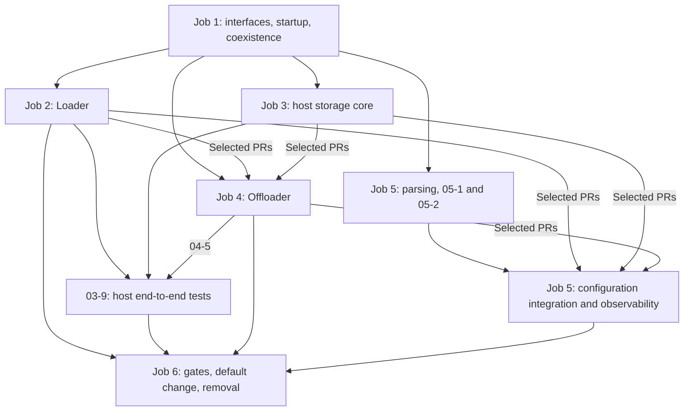

PR-level dependencies in child RFC implementation tables are authoritative:

- Job 1 comprises 01-1 through 01-7 and precedes Jobs 2–5. Job 2 comprises 02-1 through 02-18; Job 3 core is 03-1 through 03-8; Job 4 is 04-1 through 04-13.
- Within Job 2, 2d depends on 2a, 2c, and 2b's comparison framework.
- 04-1 uses 02-1's catalog and `pipeline_of`; 04-2 uses 02-2's construction context. 04-8/04-9 use 02-10 queries; 04-8 additionally needs family migrations 02-14/15/16. Model changes 04-10/11/12 follow 02-12/11/18 respectively. 04-13 uses 02-5 Loader.
- 04-3 uses 03-3's `HostRequest` and `flatten_shard_unit`; 04-13 uses storage from 03-5/03-6.
- 03-9 contains host end-to-end tests and depends on 02-5 and 04-5. The remaining Job 3 PRs depend only on Job 1.
- 05-1/05-2 parse and propagate configuration without changing existing behavior and depend only on Job 1. From 05-3 onward, integration depends on the relevant Loader, HWM, and Offloader PRs. Gate matrix 05-9 depends on 05-7, 03-9, and 04-13.
- Job 2 has no PR dependency on Jobs 3–5. Jobs 2–4 have no dependency on Job 5. Job 6 follows completion of Jobs 2–5. The PR dependency graph is acyclic.

## Acceptance criteria

### Static structure

- Loader does not import Offloader implementations; Offloader does not import Loader or checkpoint readers.
- HWM is testable without an accelerator or initialized distributed environment.
- Models read no offload/host configuration and call no runtime lifecycle methods. `models/`, `lora/`, and `cache/` perform no string-based offload-hook lookup.

### Loader

- Final tensor names, shapes, dtypes, strides, buffers, aliases, and bytes match the full-load reference.
- Quantization, TP layout, alias establishment, and finalization each have one owner.
- Factory dispatch calls only the selected branch; unified factories fail after context closure.
- Write-time `load_state_dict` into bound targets passes read traps.
- Every migrated family constructs without tensor reads and leaves all parameters on meta.
- Family comparisons cover tensors, persistent/nonpersistent buffers, aliases, module paths, and class names.
- Unmigrated pipelines fail with read locations and compatibility guidance.
- Swallowed trap exceptions still fail construction or finalization.
- Fused-then-quantized results match the reference at TP size 1 and greater than 1.
- Online-quantization host and accelerator peaks do not exceed legacy layerwise quantization.
- Loading, switching, and removing dynamic LoRA preserve module structure and base-weight addresses.

### Host storage

- Increasing eligible local workers from 1 to k leaves the summed proportional weight-memory footprint unchanged.
- Two single-accelerator replicas in one deployment share one copy. Concurrent headless startup elects one writer.
- Matching workers in different stages of one deployment share storage when complete identities and plan fingerprints match.
- Two deployments on one machine remain isolated; closing one leaves the other unaffected.
- Reject connections with mismatched deployment ID, fingerprint, or UID. Waiters refuse descriptors from a socket occupied by another UID.
- Weights larger than `/dev/shm` capacity load successfully without increasing `/dev/shm` use.
- Finalized memory files reject writes and writable mappings from every process.
- Waiter bindings preserve bytes and addresses across `eval()`.
- Rank-sharded steady-state weight storage is `W/N`, with padding accounted for; bounded cold-start overhead stays within its declared bound.
- Killing one worker terminates its replica while preserving other replicas' service and mappings. Killing all deployment workers returns shared-memory use to the pre-deployment baseline.
- Killing a writer before sealing fails waiter replicas' startup and leaves no residual allocation.
- Removing a sealed writer's replica preserves other service; later replicas elect and rebuild successfully.
- Forked Python children retain no memory-file or listening-socket handles.
- Planning reports unsharded components that cannot fit one machine.

### Offloader

- Policies produce disjoint Units.
- Both Transports match full-load outputs.
- Rings obey fixed memory bounds under actual execution order, skipped blocks, and exceptions.
- Every pipeline's discovered blocks match expected tables under covered configurations and include all formerly declared blocks.
- Rank-specific rank-local streaming Units leave AllGather ordering unchanged.
- Every supported pipeline has an all-components-offloaded smoke test covering compilation and exceptions.
- Module mode avoids repeated host writeback and pinned allocation.
- Managed device/dtype changes, including `.float()` and `.half()`, fail after commit.
- Evictable components are excluded from CUDA graphs; hooks enforce capture restrictions.
- Close restores no CPU weights, initiates no collectives, and releases each handle once.
- Sleep/wake preserves outputs, resident/fixed-slot addresses, and host storage.

### Transactions and failures

- Inject failures at planning, admission, allocation, writing, finalization, and commit.
- A failed rank fails its replica without deadlock. Other replicas remain unaffected, except replicas waiting on that rank's unsealed shared storage, which fail startup.
- Replicas that wait on one another for different sharing sets start without deadlock.

### Rollout

- Existing legacy tests and their files remain unchanged during coexistence.
- Retain raw output comparisons and memory-peak measurements for every gate-matrix combination.
- Migrate every constructor-reading family before changing the default.

## Observability

Report these five measurements separately; their categories overlap and must not be summed:

1. Per-worker proportional memory and its machine-wide sum. Summed RSS counts shared pages repeatedly. Cgroup and `Shmem` accounting count shared pages once.
2. Host-storage bytes, split into private, shared, and rank-sharded storage.
3. Registered host bytes.
4. Staging-buffer bytes.
5. Accelerator-slot bytes.

Startup logs record each component's Unit partition, backend, sharing eligibility and reason, and cold-start path. Shared storage logs include worker role, writer PID, and socket name. Record registration/staging choice per Unit and `fully_resident` plus compile-mode adjustments per component.

> AI assistance for the 2026-11-10 naming revision: Codex updated package/path references and checked consistency.


> **Comment by Hniii98 (2026-10-31T04:28:48Z):**

Hi @specture724 , thanks for putting together this refactoring proposal. I'd like to help with the implementation. Looking forward to the follow-up RFC with the task breakdown. 


> **Comment by barkly1te (2026-10-31T04:36:49Z):**

Hi @specture724, thanks for putting this proposal together! I'd like to help with the implementation.

I have a machine with 6 × RTX 3090 GPUs (24 GB each), dual Xeon Gold 5220R CPUs (48 cores / 96 threads total), and 376 GiB of RAM. 

I'm new to contributing to vLLM-Omni. Is there a suitable task I could start with?

Looking forward to the follow-up RFC.


> **Comment by nikiwang-125 (2026-10-31T04:37:01Z):**

@specture724 Hi, thanks for putting together this detailed RFC!

I am interested in contributing to Job 4 (Unified Offloader), particularly H2D transfers, prefetching, and asynchronous transfer/synchronization.

I will be happy to help with implementation, testing, and benchmarking.

Are there any tasks within Job 4 that i could work on?

Thanks!


> **Comment by Levius-Fubuki (2026-10-31T04:38:38Z):**

Hi @specture724, thanks for the detailed proposal. I’m particularly interested in 04-5, 04-6, and 04-7 in the linked design—resource preparation and commit, the rank-local runtime, and AllGather support—and would love to help with these parts.
Once the task breakdown is finalized, I’d be happy to coordinate on the scope and implementation order.


> **Comment by EJqy (2026-10-31T04:38:57Z):**

Hi @specture724, just attended your presentation. Offloading refactor sounds highly valuable and exciting to me. Looking forward to the upcoming RFCs and task breakdown! I am willing to work on any aspect that needs contribution!


> **Comment by gxianyd (2026-10-31T04:40:23Z):**

Thanks for the detailed RFC, @specture724. I'd like to help with the Loader (Job 2) or Offloader (Job 4) parts.
Where I think I could contribute most:
- **Job 2a/2c — structure-only construction + allocate-before-write**: the construction-time read traps, meta-parameter registration, and the writer path that streams checkpoint tensors into pre-bound final storage (including per-layer online quantization).
- **Job 2d — constructor-read family migration**: taking a few of the `from_pretrained`-in-constructor families (e.g. text-encoder/VAE-heavy pipelines) through `hf_component` / `declare_weights` and producing the tensor-by-tensor comparison against `from_pretrained` for the rule tables (2b).
- **Job 4 — Offloader**: Unit planning + block rings/successor tables, and the rank-local transport with merged-range registration and the 2×256 MiB staging fallback.
Happy to start from discussion with the child RFC for whichever piece you think is the best fit.


> **Comment by zhijianwuX (2026-10-31T04:42:18Z):**

Hi @specture724 , thanks for drafting this great refactoring proposal. I’m interested in helping with the implementation work. Looking forward to the subsequent RFC and task breakdown.


> **Comment by MrDongsls (2026-10-31T04:51:28Z):**

Thanks @specture724 for this detailed and comprehensive RFC! I'm particularly interested in the host weight manager design and would be happy to help implement that part. Looking forward to the task breakdown!


> **Comment by waizuichougou (2026-10-31T05:58:34Z):**

Hi @specture724, thanks for your detailed design. I’d like to help with 04-4 through 04-6. Looking forward to the next steps!


> **Comment by Dong1017 (2026-10-31T06:48:25Z):**

Thanks for the detailed design. The Loader/HWM/Offloader split and the legacy-coexistence plan look right to me, and I do not see a problem with the overall direction. Four items read as gaps between this RFC and the deployment evidence already in the tracker. They are questions and requests for acceptance criteria, not objections to the mechanism.

**1. Relationship to #6195 and #6231.**
The "Relationship to existing RFCs" section covers #6648, #6414 and #7204; neither #6195 nor its sub-issue #6231 appears anywhere in the body or the continuation comment. #6195 has Phase A merged (#6213: loader-owned `HostWeightPlan`, fail-closed direct checkpoint mmap, bounded no-AllGather staging) with Phase B (node-local normalized runtime cache) open. Could you state whether unified allocate-before-write plus HWM supersedes Phase A's loader-to-offloader handoff, and whether Phase B's runtime-cache file is retired in favour of the memfd sharing described here, or whether the two coexist? A short subsection would keep two weight-ownership implementations from advancing in parallel.

**2. Request-level consumers in the engine and executor.**
`diffusion_engine.py` derives `dp_concurrent` and `max_num_running_reqs` from whether a selected component uses AllGather, and `multiproc_executor.py` uses the same predicate to select the multi-request wave and to apply the wave timeout. On baseline `726b21a5e` the single-request path applies `_DLO_DP_WAVE_TIMEOUT_S` unconditionally (`timeout_options: dict[str, Any] = {"timeout": _DLO_DP_WAVE_TIMEOUT_S}`), and a `TimeoutError` calls `_fail_closed_on_dp_wave_timeout`, which shuts down the whole worker group. Child RFC 05 does define `ExecutionOffloadFacts.weight_collectives`, so the fact itself is owned; what I cannot find is a Job 1 change entry for these call sites and an acceptance criterion showing that unified mode reproduces the legacy request-level schedule for DP plus AllGather. The failure mode worth pinning is that a wrong-policy wave timeout terminates healthy work rather than failing the offending request.

**3. Host-memory target.**
Rollout step 3 and the Host storage acceptance rows require peaks no higher than legacy. Four host-memory figures have been reported for DLO topologies in this repository's trackers (roughly 650 GiB for USP8+DLO, 1,100 GiB for USP4+CP2+DLO, 1,900 GiB for USP8+CP2+DLO), and the corresponding framework-side item remains open. A non-regression gate can pass while that footprint is unchanged. Please add one criterion that names a workload and topology and compares peak host memory against those figures, and say explicitly whether the reduction is in scope for this RFC or stays with #6195.

**4. Staging on platforms without host-mapping registration.**
The design fixes staging at 2 x 256 MiB, and child RFC 04 sends ROCm, NPU, XPU and MUSA through the default implementation, so on those platforms every host-resident Unit moves through staging. The current rank-local path instead sizes its two host slots from the maximum block (`_allocate_shared_cpu_staging_buffers` in `distributed_layerwise_backend.py`), and `register_host_mappings` supports CUDA only at baseline `726b21a5e`, so staging is the only transport on Ascend. No acceptance criterion is platform-scoped. Either size staging from the largest Unit or add an NPU/ROCm criterion comparing step time and host peak against legacy.

Scope note: I read the RFC body and the continuation comment as of 2026-10-31, child RFCs 01, 03, 04 and 05 by targeted search, and `diffusion_engine.py`, `multiproc_executor.py`, `distributed_layerwise_backend.py` and `host_registration.py` at baseline `726b21a5e` and current `main` where relevant. I did not read child RFC 02, the roadmap or the two design documents, and I ran no device measurements.


> **Comment by ZiyiTsang (2026-10-31T07:36:33Z):**

Hi @specture724, thanks for the great RFC. I have multi-GPU H100 and 5090 machines available, and I'd like to help with the loader work in Job 1/2, especially refactoring and testing the multi-GPU path. Do let me know the further task breakdown if available.


> **Comment by wuli666 (2026-10-31T09:47:55Z):**

Hi @specture724, I'd like to take **04-2** (repeated-block discovery and the per-pipeline expectation table) and **04-8** (compile setup, residency table, cudagraph-mode downgrade, and the C12 sites). I've worked on diffusion model and quantization loading here before (#5103, #6894, #3973).

One question on 04-2: it lands before the family migrations (02-11 to 02-16, 02-18), so pipelines that still read tensors in their constructors can't be built on meta yet. Should `discovery.yaml` start with the constructible pipelines plus a pending list, like 02-2's support-matrix test, with each migration PR adding its rows?


> **Comment by nikiwang-125 (2026-10-31T09:58:56Z):**

@specture724 Hi! After going through the detailed task breakdown, I’m particularly interested in contributing to 04-4, 04-5, and 04-6 under Job 4 (Unified Offloader).

I’m especially interested in CUDA host memory registration, resource preparation, H2D transfers, and asynchronous prefetching/synchronization.

I’d be happy to take ownership of a specific subtask or collaborate with other contributors.

Are there any tasks in these areas that I could work on?

Thanks!


> **Comment by prettygirlisnotme (2026-10-31T10:01:54Z):**

Hi @specture724, I'd like to take 03-3 (host layout and sharding) and 03-2 (deployment ID propagation) as separate PRs, with 03-3 as my main focus. I've previously contributed #6699.

For 03-3, I'd start with the layout/sharding logic and CPU tests for mixed dtypes, aliases/strides, shard padding, and deterministic fingerprints. For 03-2, I'd cover local and headless startup plus ID preservation across worker serialization.

I saw @MrDongsls's interest in HWM and would be happy to coordinate the split. Are these two tasks still available? I'll follow the M1/03-1 dependencies and align the shared interfaces before implementation. Thanks!


> **Comment by wssswsws (2026-10-31T10:07:51Z):**

Hi @specture724 , thanks for the RFC and the livestream, I learned a lot from both.

I'd love to help where it's useful. If they're still open, I'm interested in:

05-1: policy types, schema, presets, and legacy-flag translation
03-6: the sharded host storage backend (and 03-1 / 03-7 if help is needed there)
Later on, 02-8 (dynamic LoRA wrapping) or 04-8 / 04-9 (compile / cache-signature changes), once their dependencies land

I also have on-demand access to multi-GPU machines, both NVLink (8×H100/A100, dual-socket) and PCIe-only, plus AMD (MI300X, RDNA3). If extra runs would help, e.g. the 05-9 gate matrix, 04-7 AllGather vs. rank-local, or ROCm host registration after 04-4, I'm happy to do them.

Happy to take whatever you think fits best. Thanks!


> **Comment by koppx (2026-10-31T10:18:35Z):**

Hi @specture724, I'm interested in the unified Loader work in **Job 2**, and would like to start with **02-9: the unified loading path for `load_format="diffusers"`**, if it's still available. I'd cover structure-only pipeline construction, integration with the unified loader, and the associated tests, following the 02-3/02-5 dependencies. Happy to coordinate with the other Loader contributors. Could you confirm whether I can take this task? Thanks!


> **Comment by xiaoyu-xyz (2026-10-31T10:34:27Z):**

Hi @specture724, I'd like to take on the Offloader Transport work described in the architecture section. The RFC assigns pinning, host registration, staging buffers, accelerator slots, streams, events, H2D transfers, and collectives to the Offloader, and the existing host_registration.py / chunked_transport.py already establish the protocol skeletons (HostRegistration, PinnedAllocator, chunk-major packing) without the CUDA execution layer behind them. I'd like to fill that gap.‌
 
Concretely, I can start with three pieces:
1. HostRegistration CUDA implementation. The protocol is defined as “Transport-owned registration for one process-local host mapping” and already has a cuda_host_registration stub, but the actual read-only mapping registration with the driver isn't wired through. I can implement the CUDA path and its lifecycle (register, verify, release) so that prepare_materialization() can acquire registration capacity before the first model write, as the RFC requires.‌
2. chunked_transport staging and event management. PinnedAllocator and CHUNK_MAJOR layout exist, but the stream/event layer that actually overlaps H2D with computation — the two alternating device slots and completion events — needs to be connected to the Transport contract. I can implement the event-gated H2D path and slot reuse logic, ensuring commit() transfers these resources into OffloadRuntime as a single ownership handoff.‌
3. CUDA graph stable-address constraint. The RFC explicitly requires that CUDA graph capture be restricted to weights with stable addresses after commit. I can add the address-stability check inside the Offloader's commit() path, so that a component either qualifies for fully_resident capture or is excluded before compilation is configured.‌ 
Is this area already assigned? If not, I'm happy to open a tracking issue under #9536 and start with the HostRegistration CUDA path. If another piece is more urgent on the Transport side — for example the AllGather collective overlap or the pinning capacity admission before prepare_materialization() — point me there instead.


> **Comment by aayc123 (2026-10-31T11:06:36Z):**

Hi @specture724, I'd like to take 03-7 (host capacity admission) and 03-8 (fork safety, fault injection, and multiprocess lifecycle tests), if they're still available, as two separate PRs.
For 03-7, I'd cover admit(), its manager integration, and CPU tests for shared/private/sharded demand, cold-start overhead, external-writer reservations, and capacity boundaries.
For 03-8, I'd cover fork-safe resource handling, the specified fault-injection points, and multiprocess lifecycle/failure tests through the startup driver.
I understand that 03-7 depends on 03-4, and 03-8 depends on 03-5/03-6/03-7. I'll coordinate the interfaces with those contributors before integration. I also noticed @wssswsws offered help with 03-7 and would be happy to coordinate the scope.
Could you confirm whether I can take these two tasks? Thanks!


> **Comment by TonybotNi (2026-10-31T11:35:34Z):**

Hi @specture724, I'd like to take **02-6: the legacy/unified tensor-by-tensor comparison framework, `export_legacy_hashes`, and the legacy fingerprint inventory**, if it is still available.

I've worked on hub-prefetch regression coverage (#8894) and MammothModa2 metadata propagation and equivalence validation (#7586), both currently under review. For 02-6, I'd cover tensor names, shapes, dtypes, strides, contents, persistent/nonpersistent buffers, aliasing, and module-tree comparison, together with the hash export and fingerprint checks described in the roadmap.

I'll follow the 02-5 dependency and coordinate the interfaces with the Loader and family-migration contributors. Could you confirm whether I can take this task and which branch/interfaces I should build against? Thanks!


> **Comment by TonybotNi (2026-10-31T11:38:00Z):**

**Update: replacing my earlier 02-17 request with 02-5; my 02-6 request remains. I'm no longer requesting 02-17.**

Hi @specture724, I'd like to focus on the unified Loader implementation and request **02-5: storage binding, write tracking, per-layer online quantization, finalization, the final manifest, and HSDP component handling**, alongside **02-6** as a separate PR. This would let me work on the loading path and its legacy-equivalence validation together.

I noticed @gxianyd's interest in Job 2a/2c, including the writer path and online quantization. I'd be happy to coordinate a clear split rather than duplicate that work. If 02-5 already has an owner, I'd welcome a defined implementation subtask within it, particularly storage binding/write tracking or finalization and manifest validation.

I'll follow the M1 and 02-3/02-4 dependencies and align interfaces before implementation. Could you confirm whether **02-5 + 02-6** is an appropriate scope, or suggest a split with the other Loader contributors? Thanks!


> **Comment by zhijianwuX (2026-10-31T12:29:44Z):**

Hi @specture724 , following up on my earlier comment: I'd like to take **05-2 — configuration plumbing, source precedence, and whole-policy replacement**, if it is still available.

I'd cover CLI/Python/YAML field propagation, stage-specific overrides, whole-policy replacement, and the required compatibility checks and CPU regression tests. I'll follow the M1/05-1 dependencies and coordinate the interfaces with the relevant contributors.

If 05-2 is already covered, I'd also be interested in **05-8 — the support-matrix renderer, documentation, and consistency tests**, following the 02-2/05-7 dependencies.

Could you confirm whether either task is available and which branch I should build against? Happy to coordinate the scope. Thanks!


> **Comment by O1range (2026-10-31T13:38:31Z):**

Hi @specture724, thanks for putting together this detailed RFC! I watched today’s vLLM talk about the loader/offloader refactoring and would love to contribute, particularly to Job 2 and Job 4.

I’m new to the vLLM-Omni community and have access to an 8× H200 server. I’ve seen that several contributors are already interested in these areas, and I’d be glad to collaborate or take on a complementary subtask.

I’m looking forward to a more detailed task breakdown. Please let me know where I can be most helpful—I’d be happy to coordinate on the scope and dependencies. Thanks!


> **Comment by MinhaoLi0318 (2026-10-31T13:39:44Z):**

Design feedback from the metrics and RL weight-sync side (I work on multi-stage latency attribution, RFC #8671). Code refs: main [`3bcd944`](https://github.com/vllm-project/vllm-omni/tree/3bcd94425f87fa2b0ec68582bd7c58fd7a5bc66b); RFC refs: [`a644d2f`](https://github.com/specture724/vllm-omni/tree/a644d2f39892ba6924ac981fe226ba099ddc3c3c/rfcs).

**1. RL weight transfer (#7686) is another call site missing from the Job 1 table** in the [continuation](https://github.com/vllm-project/vllm-omni/issues/9536#issuecomment-6477111133), like @Dong1017's [point 2](https://github.com/vllm-project/vllm-omni/issues/9536#issuecomment-6540259464). `prepare_model_for_weight_reload` checks `offload_enabled()` ([weight_reload.py#L32-L33](https://github.com/vllm-project/vllm-omni/blob/3bcd94425f87fa2b0ec68582bd7c58fd7a5bc66b/vllm_omni/diffusion/model_loader/weight_reload.py#L32-L33)) but is in neither §9.2 nor T7's `QUERY_CALLER_ALLOWLIST` ([01#L1007](https://github.com/specture724/vllm-omni/blob/a644d2f39892ba6924ac981fe226ba099ddc3c3c/rfcs/01-startup-transaction.md?plain=1#L1007)), so T7 would fail on today's main. Only the legacy loader calls it ([diffusers_loader.py#L1309](https://github.com/vllm-project/vllm-omni/blob/3bcd94425f87fa2b0ec68582bd7c58fd7a5bc66b/vllm_omni/diffusion/model_loader/diffusers_loader.py#L1309)), so `unified` with `weight_transfer_config` set would fail at worker init ([diffusion_worker.py#L358-L359](https://github.com/vllm-project/vllm-omni/blob/3bcd94425f87fa2b0ec68582bd7c58fd7a5bc66b/vllm_omni/diffusion/worker/diffusion_worker.py#L358-L359)) rather than at parse time, and §8.5 omits the WTE steps in `re_init_pipeline` ([#L1315-L1337](https://github.com/vllm-project/vllm-omni/blob/3bcd94425f87fa2b0ec68582bd7c58fd7a5bc66b/vllm_omni/diffusion/worker/diffusion_worker.py#L1315-L1337)). WTE rewrites base weights in place, a non-goal ([00#L77](https://github.com/specture724/vllm-omni/blob/a644d2f39892ba6924ac981fe226ba099ddc3c3c/rfcs/00-umbrella.md?plain=1#L77)): is the plan a coexistence row or a parse-time rejection?

**2. The M6 flip has no step-time condition, on CUDA either.** Rollout step 3 ([00#L874](https://github.com/specture724/vllm-omni/blob/a644d2f39892ba6924ac981fe226ba099ddc3c3c/rfcs/00-umbrella.md?plain=1#L874)) and the flip conditions ([ROADMAP#L190-L196](https://github.com/specture724/vllm-omni/blob/a644d2f39892ba6924ac981fe226ba099ddc3c3c/rfcs/ROADMAP.md?plain=1#L190-L196)) compare only outputs and memory; the risk table says the gate doesn't compare performance ([design#L1136](https://github.com/specture724/vllm-omni/blob/a644d2f39892ba6924ac981fe226ba099ddc3c3c/LOADER_OFFLOADER_DESIGN.md?plain=1#L1136)). Off CUDA that is Dong1017's point 4. On CUDA, Qwen-Image-2.1 decode goes eager as a gate exception ([00#L876](https://github.com/specture724/vllm-omni/blob/a644d2f39892ba6924ac981fe226ba099ddc3c3c/rfcs/00-umbrella.md?plain=1#L876)), and legacy gained #6374's chunked H2D/AllGather overlap ([data.py#L962](https://github.com/vllm-project/vllm-omni/blob/3bcd94425f87fa2b0ec68582bd7c58fd7a5bc66b/vllm_omni/diffusion/data.py#L962)) after the RFC base. I'm not claiming 05-9; I'd add a per-platform step-time field to the gate records, with a threshold like unified ≤ legacy × (1+ε). I can rerun the CUDA legacy baseline with my #8586 harness ([report](https://github.com/vllm-project/vllm-omni/issues/8586#issuecomment-6142595428), older pin: Qwen-Image-2.1 T2I, H100, 1024², 13.24 s/img with layerwise offload, eager decode and VAE tiling vs 5.84 s without offload).

**3. Split 05-6 so the instruments land after M1.** 05-6 ([05#L835](https://github.com/specture724/vllm-omni/blob/a644d2f39892ba6924ac981fe226ba099ddc3c3c/rfcs/05-configuration.md?plain=1#L835)) is near the end of the critical path ([ROADMAP#L237](https://github.com/specture724/vllm-omni/blob/a644d2f39892ba6924ac981fe226ba099ddc3c3c/rfcs/ROADMAP.md?plain=1#L237)), though `observability.py` imports only stdlib and `weight_stack.errors` ([05#L650](https://github.com/specture724/vllm-omni/blob/a644d2f39892ba6924ac981fe226ba099ddc3c3c/rfcs/05-configuration.md?plain=1#L650)), and 02/03/04 log through their own loggers until 05-6 rewrites them ([05#L670](https://github.com/specture724/vllm-omni/blob/a644d2f39892ba6924ac981fe226ba099ddc3c3c/rfcs/05-configuration.md?plain=1#L670)).

- **05-6a**, M1 only like 05-1 ([ROADMAP#L53](https://github.com/specture724/vllm-omni/blob/a644d2f39892ba6924ac981fe226ba099ddc3c3c/rfcs/ROADMAP.md?plain=1#L53)), no call-site edits: `observability.py`, event formatting, memory-report types, the PSS (`smaps_rollup`) reader, a runtime counter API.
- **05-6**, after its current deps: 02/03/04 log rewrites, byte-registration calls, D21, the orchestrator/metrics absorb, `docs/design/metrics.md`.

The PSS reader is the instrument Dong1017's host-peak criterion (point 3) needs. The umbrella Observability section ([00#L1154-L1164](https://github.com/specture724/vllm-omni/blob/a644d2f39892ba6924ac981fe226ba099ddc3c3c/rfcs/00-umbrella.md?plain=1#L1154-L1164)) has memory and startup logs but no runtime timing; the only offloader timer today is HWR registration ([distributed_layerwise_backend.py#L1206-L1257](https://github.com/vllm-project/vllm-omni/blob/3bcd94425f87fa2b0ec68582bd7c58fd7a5bc66b/vllm_omni/diffusion/offloader/distributed_layerwise_backend.py#L1206-L1257)). Counters, only with `--log-stats`: H2D bytes by path, sync loads on ring mispredicts (04 already wants this count, [04#L855](https://github.com/specture724/vllm-omni/blob/a644d2f39892ba6924ac981fe226ba099ddc3c3c/rfcs/04-unified-offloader.md?plain=1#L855)), transfer wait time. They split a point-2 gap into compute and waiting for weights, and would be emitted as one-line calls into `observability.py` at the commit/H2D boundary, so the 04-4..04-7 Transport/runtime PRs carry no metrics logic.

**4. 04 §5.4 waits on the wrong stream** ([04#L451-L457](https://github.com/specture724/vllm-omni/blob/a644d2f39892ba6924ac981fe226ba099ddc3c3c/rfcs/04-unified-offloader.md?plain=1#L451-L457)). The concat stream waits on slot k's previous concat, which it recorded itself (a no-op); the copy stream overwriting slot k waits on nothing, so it could clobber a shard the previous AllGather still reads. Main's copy stream first waits on the compute stream, which already waited on that slot's last AllGather ([distributed_layerwise_backend.py#L618](https://github.com/vllm-project/vllm-omni/blob/3bcd94425f87fa2b0ec68582bd7c58fd7a5bc66b/vllm_omni/diffusion/offloader/distributed_layerwise_backend.py#L618), comment [#L172-L174](https://github.com/vllm-project/vllm-omni/blob/3bcd94425f87fa2b0ec68582bd7c58fd7a5bc66b/vllm_omni/diffusion/offloader/distributed_layerwise_backend.py#L172-L174)).

@specture724, can I take 05-6a now, and the rest of 05-6 once its dependencies land if that suits you? I won't start code before you confirm scope and 01-1 is in.

AI assistance: Claude Code read the RFC and code and drafted this; I checked the numbers against my #8586 report and the references against main.


> **Comment by avraichur96 (2026-10-31T14:23:03Z):**

Hi @specture724, I'm finishing the Pi0/Pi0.5 shared-family refactor #8086 under #6867 and would like to help with 02-16 (Pi0, Pi0.5, InternVLA-A1, Gr00t) once 02-6 and the unified Loader contracts stabilize.

My strongest initial scope would be the Pi0/Pi0.5 migration with tensor-by-tensor loader equivalence and existing parity/serving regression coverage. I'd be happy to coordinate or split the remaining InternVLA-A1/Gr00t portion if you prefer.

Is 02-16 still available, and would a Pi-family-first bounded slice fit the roadmap?


> **Comment by AlanJager (2026-10-31T14:43:37Z):**

Hi @specture724, I’d like to take 04-3 — the unified Offloader planner and placement/layout plan, if it’s still available.

I’d cover Unit partitioning, resident-layer accounting, alias handling and yield relationships, Transport and AllGather-group inference, cold-start selection, device layout and memory-demand accounting, and the associated PlacementPlan methods and CPU tests.

If 04-1 is also available, I’d be happy to take it as a separate prerequisite PR before 04-3. I understand its scope includes the plan types, no-offload path, base transaction, guards, and no-Unit runtime.

I’ll follow the M1 + 02-1 dependencies for 04-1 and 04-2 + 03-3 for 04-3, reuse flatten_shard_unit(), and use the injected selection function until the policy implementation is available.

I noticed @gxianyd’s interest in Unit planning and would be happy to coordinate a clear split, along with the 04-2 and 03-3 contributors. If 04-1 already has an owner, I’d also be glad to help with a bounded M1 interface or test subtask while the prerequisites land.

Could you confirm whether this scope works and which branch/interface revisions I should build against? Thanks!


> **Comment by dorodo0721 (2026-10-31T15:47:27Z):**

Hi @specture724, I'd like to take **01-2** and **01-3** as two separate PRs, if they are still available.

- **01-2:** the legacy/unified selector, CLI/Python/YAML configuration propagation, parse-time validation, and process-level state ownership and cleanup, with `test_switch.py` coverage.
- **01-3:** offload-query coexistence, `ExecutionOffloadFacts` / `execution_offload_facts`, and the engine/executor call sites, with the CPU regression tests specified in child RFC 01.

I'll follow the 01-1 → 01-2 → 01-3 dependencies, coordinate the interfaces with the 01-1 contributor, and preserve legacy behavior. I noticed the broader interest in Job 1 and am happy to coordinate the scope.

Could you confirm whether I can take these two tasks and which branch/interface revision I should build against? Thanks!

AI assistance: Used Codex to review the linked task breakdown and draft this comment.


> **Comment by martinzhang03 (2026-10-31T17:47:12Z):**

Hi @specture724, thanks for the RFC, I learned a lot from it.

I'd love to help with the Host Weight Manager. If they're still open, I'm interested in:

03-4: sharing fingerprints, `share_plan()`, writer election, the protocol, and the listener thread
03-5: the local host storage backend: memfd allocation, `seal()`, read-only rebinding, and descriptor handoff

I'll start after M1 and 03-3 land, and I'm happy to align interfaces with the 03-3 and 03-7/03-8 contributors, and with @MrDongsls if they're looking at this area too.

I also have access to an A100 machine and to 8×A100 for heavier runs. If extra runs would help, e.g. the 03-9 host end-to-end tests, I'm happy to do them.

If someone is already on these, happy to take whatever you think fits best. Thanks!

AI assistance: Used Claude Code to read the RFC and draft this comment. I reviewed it before posting.


> **Comment by wenj-yan (2026-11-01T07:15:28Z):**

Hi @specture724,The offloading refactor sounds really valuable and exciting to me. I'm looking forward to the upcoming RFCs and task breakdown—please feel free to assign me any tasks that need to be picked up. I'm ready to take on work in whatever area needs contribution.


> **Comment by loitder (2026-11-01T10:34:28Z):**

Hi @specture724, thanks for the detailed RFC! I'd love to get involved in this refactor and contribute throughout the implementation. I'm particularly interested in Loader, HWM, and Offloader, and I'm also happy to take on tasks in other areas as needed. Looking forward to collaborating on the upcoming tasks!


> **Comment by czwdysj (2026-11-01T13:23:08Z):**

Hi @specture724, thanks for the detailed RFC!

I'd love to contribute to this refactor, particularly **Job 3 (Host Weight Manager)**.

I'm interested in taking **03-3: Host Weight Layout & Planning**, including tensor layout construction, safetensors header generation, shard flattening, plan fingerprints, and the corresponding CPU unit tests.

I've been working on LLM inference engines, memory management, and model offloading. My local environment is a single RTX 5060 (8GB) with Linux/WSL2, so I'd prefer to start with a CPU-testable module.

Could you confirm whether 03-3 is still available, and which branch I should target given its dependency on 03-1?

I'd be happy to coordinate with other contributors and submit a focused PR. Thanks!


> **Comment by nagisa-kunhah (2026-11-01T13:42:49Z):**

Hi @specture724, I’d like to take 02-7: adapter format conversion and reader-side fusion, if it’s still available.

I’d cover the diffusers/kohya/FastH3/VDN converters, adapter preflight checks, fused fixed adapters, and the unified worker distill branch, with tests comparing fused-then-quantized results against the reference at TP=1 and TP=2.


> **Comment by kunkunblueberry (2026-11-01T14:13:04Z):**

Hi @specture724, I'd like to take **01-1 and 01-4** as two focused PRs, if they are still available.

- **01-1 — Weight Stack package foundation:** establish the `weight_stack` package skeleton, core data types and Protocols, error types, `ResourceKind`, and `ResourceLedger`, with the corresponding unit tests.
- **01-4 — Replica-wide Coordination:** implement the replica-wide confirmation protocol, timeout/failure semantics, Topology assembly and deployment-identity validation, rank-coordinate handling, and AllGather group calculation/creation/reuse with process-level lifecycle management and multiprocess tests.

I'll implement **01-1 first**, then build 01-4 on its contracts, keeping the two changes separate for review. For 01-4, I'll coordinate the interfaces with the startup-driver/worker-integration work so the coordination layer owns group setup and lifecycle without taking over the startup transaction itself.

Could you confirm that both tasks are still available, and point me to the preferred branch/base or any interface decisions I should align with before starting? If either scope is already being handled locally, I'm happy to coordinate a clean split. Thanks!


> **Comment by xRay2016 (2026-11-01T17:16:38Z):**

Hi @specture724, I'd like to take 02-4: source resolution, the reader pipeline, lazy tensors, preflight source validation, content identity, and the expected manifest, if it is still available.
I'd cover the implementation and CPU tests described in child RFC 02, including deferred reads, slice-only materialization, skipping reads for meta targets, and content-identity checks.
I understand this task depends on M1 and 02-2. I'll coordinate interfaces with the 02-2 and 02-5 contributors.
Happy to coordinate the scope if any part is already underway.


> **Comment by Primarycoder-alt (2026-11-02T07:38:03Z):**

Hi @specture724 , I'm a beginner in vLLM development and would like to learn more about vLLM and vLLM-Omni by contributing to this project. I'm hoping to learn by doing, starting with a small task in this refactoring effort.

I have access to 1–2 NVIDIA A100 GPUs with 80GB memory each. Are there any beginner-friendly implementation or testing tasks that I could help with?


> **Comment by Umbreller-F (2026-11-02T08:21:23Z):**

Hi @specture724, I’d like to take **02-11: MiniMax H3 migration**, if it is still available.

I have a machine with **4× NVIDIA RTX PRO 6000 GPUs (SM120)**, and I have already successfully run MiniMax H3 on this setup. I can help with both multi-GPU validation and real-checkpoint testing, including the SM120-specific behavior.

For 02-11, I’d like to cover:

- Migrating MiniMax H3 to structure-only construction and explicit component declarations, including the video VAE encoder/decoder components, `repeated_blocks`, the AdaLN `unit_groups`, and the text-encoder `shard_group`.
- Moving the VAEs and latent upscaler to `declare_weights`, with the appropriate source selection and writers.
- **C04:** migrating the AdaLN sidecar to meta non-persistent buffers backed by `BufferSource`, and updating cache seeding to use `execution_device()` and the Loader-provided content identity.
- **C05:** replacing parameter-based device/dtype discovery in the VAE and handling its runtime dtype through the rule table.
- Tensor-by-tensor legacy/unified comparisons, including module structure, dtypes, strides, buffers, and aliasing, plus the required L2 synthetic-checkpoint and L4 real-checkpoint tests.

I understand that 02-11 depends on **02-6 and 02-7**. I’ll coordinate with their contributors and reuse the comparison framework and FastH3/VDN adapter converters rather than duplicating that work.

I’d also be happy to coordinate closely with you and the other contributors throughout the implementation.

Thanks!


> **Comment by RabCake (2026-11-03T16:27:14Z):**

Hi @specture724, thanks for the detailed RFC! I’m interested in 04-11 and 02-14 and would like to contribute:
- 04-11: I’d like to take the MiniMax H3 C03/C06 adaptations and associated tests, while preserving legacy behavior. I understand this depends on 02-11 and 04-6, and I’m happy to coordinate interfaces, implementation order, and validation scope with the corresponding contributors.
- 02-14: I’d like to help migrate Wan2.2-S2V, DreamZero, and LongCat-Video-Avatar to the unified Loader, following the 02-6 and 02-8 dependencies. Since this task covers multiple models, I’m happy to split the work by model or subtask and collaborate with other contributors.
- Later on, I’d also be happy to help with 04-13 end-to-end, smoke, sleep/wake, and fault-injection tests.

Are these tasks still available? I’d appreciate your guidance on a suitable scope and the preferred development baseline. Thanks!


> **Comment by zhang-zrq (2026-11-04T08:50:33Z):**

Hi @specture724, thanks for the detailed RFC and task breakdown!
I'd like to contribute to two parts of the Unified Loader migration, if they're still available:
- 02-17 — SANA-WM, HunyuanImage3, and Kandinsky6 compatibility fixes. I'd like to take the full scope, including C09/C10/C11, the required unified-mode tests, and preserving legacy behavior.
- 02-15 — Cosmos3 migration (partial). I'm particularly interested in migrating the Cosmos3 audio tokenizer to declare_weights and implementing the explicit component declarations for the DiT and text encoder, along with tensor-level equivalence tests.

I have access to two compute nodes, each equipped with 8 NVIDIA H20 GPUs, which I can use for implementation and multi-GPU validation.

Could you confirm whether these tasks are still available and which branch/interface baseline I should follow?

Thanks!


> **Comment by specture724 (2026-11-04T09:56:28Z):**

> Chinese original: [roadmap](https://github.com/specture724/vllm-omni/blob/6c6c41c5d9a1e9761fe9c3fe583d1468ce98d91c/rfcs/ROADMAP.md).

# Roadmap: Unified Loader / Offloader / Host Weight Manager

> Parent: [umbrella RFC](https://github.com/vllm-project/vllm-omni/issues/9536). Design basis: [overall design](https://github.com/specture724/vllm-omni/blob/6c6c41c5d9a1e9761fe9c3fe583d1468ce98d91c/LOADER_OFFLOADER_DESIGN.md).
>
> PR numbers, contents, dependencies, tests, and sizes are defined in the implementation sections of the five child RFCs. This roadmap sets out their merge order, milestones, parallel workstreams, and completion criteria.

## Child RFCs

| Child RFC | Umbrella job | Scope | PRs | Required changes and dispatch points |
|---|---|---|---|---|
| [01 Startup transaction, selector, and coexistence](https://github.com/vllm-project/vllm-omni/issues/9874) | Job 1 | `weight_management/` interfaces, errors, startup driver and replica-wide coordination; selector; coexistence of query functions; worker and runner dispatch; static dependency tests, frozen allowlists and coexistence registry | 01-1 through 01-7 | D01–D05 |
| [02 Unified Loader](https://github.com/vllm-project/vllm-omni/issues/9875) | Job 2 (2a–2f) | Component declarations, structure-only construction, rule tables, readers and lazy tensors, allocation before writing, finalization, content identity, adapter fusion, dynamic LoRA wrapping, `load_format="diffusers"`, migration of 19 constructor-reading families, query interfaces | 02-1 through 02-18 | C02, C04, C05, C09, C10, C11, C13, C15, C16, C18; D06 |
| [03 Host storage](https://github.com/vllm-project/vllm-omni/issues/9876) | Job 3 | HWM local and sharded backends, deployment identity, election and sealing, capacity admission, fork handling | 03-1 through 03-9 | None |
| [04 Unified Offloader](https://github.com/vllm-project/vllm-omni/issues/9877) | Job 4 | Repeated-block discovery, Unit planning, two Triggers and Transports, block rings, host registration and staging, guards, compilation, cache signatures and sleep mode | 04-1 through 04-13 | C01, C03, C06, C07, C08, C12, C14, C17, C19 |
| [05 Configuration and observability](https://github.com/vllm-project/vllm-omni/issues/9878) | Job 5 | Policy parsing and validation, legacy compatibility, host policy, `--diffusion-max-lora-rank`, startup logs, metrics, recipes, documentation, support matrix and release-gate matrix | 05-1 through 05-9 | D20, D21, D22 |

Umbrella Job 6 has no separate child RFC. PR 05-9 provides the gate matrix. Each child RFC specifies its legacy removals; M7 defines their order.

## PR numbering and dependencies

- PR numbers use `<child RFC>-<sequence>`, such as 02-5. Sizes S, M and L come from the child RFC tables and are used to compare work and calculate the critical path.
- All PRs in 02, 03, 04 and 05 depend on the complete merge of 01-1 through 01-7. The tables below do not repeat this dependency.
- A PR can merge when all its dependencies have merged, without waiting for other PRs in its milestone. Milestones mark acceptance points.
- The five child RFCs describe 56 PRs. Their combined dependency graph is acyclic and every referenced PR exists.

In the following table, each PR on the left depends on the PRs to its right.

| Dependency | Edges |
|---|---|
| 03 on 02 and 04 | 03-9 ← 02-5, 04-5 |
| 04 on 02 | 04-1 ← 02-1; 04-2 ← 02-2; 04-8 ← 02-10, 02-14, 02-15, 02-16; 04-9 ← 02-10; 04-10 ← 02-12; 04-11 ← 02-11; 04-12 ← 02-18; 04-13 ← 02-5 |
| 04 on 03 | 04-3 ← 03-3; 04-13 ← 03-5, 03-6 |
| 05 on 02 | 05-4 ← 02-8; 05-5 ← 02-2; 05-6 ← 02-5; 05-7 ← 02-11, 02-12, 02-14, 02-18; 05-8 ← 02-2 |
| 05 on 03 | 05-3 ← 03-5, 03-6, 03-7; 05-6 ← 03-8; 05-9 ← 03-9 |
| 05 on 04 | 05-3 ← 04-3, 04-5, 04-6, 04-7; 05-5 ← 04-2; 05-6 ← 04-5; 05-9 ← 04-13 |

02 has no PR dependencies on 03, 04 or 05. Except for 03-9, 03 depends only on 01. None of 02, 03 or 04 depends on 05.

## Milestones

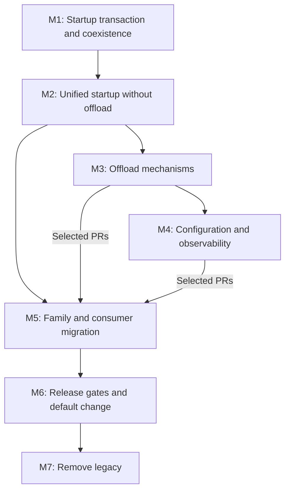

Work that can start earlier:

- 04-4, 05-1 and 05-2 depend only on M1.
- 03-6 depends only on 03-3 and can proceed alongside the rest of M2.
- M5's Loader PRs (02-7 through 02-18) depend only on the M2 PRs from 02 and can proceed alongside M3 and M4.

### M1: Startup transaction and coexistence foundation

| PR | Contents | Dependencies | Size | Required rows |
|---|---|---|---|---|
| 01-1 | `weight_management` package foundation, data types, Protocol, error types, `ResourceLedger` | None | M | None |
| 01-2 | Selector and process state, propagation, argument checks | 01-1 | S | D01 |
| 01-3 | Coexisting query functions, `execution_offload_facts` | 01-2 | S | D02 |
| 01-4 | Replica-wide coordination, `Topology`, AllGather groups | 01-1 | M | None |
| 01-5 | Startup driver, state machine, ownership chain, `FaultPlan`, test doubles | 01-1, 01-4 | L | None |
| 01-6 | Worker and runner dispatch, sleep pools, close and reinitialization | 01-2, 01-5 | M | D03–D05 |
| 01-7 | Static dependency tests T1–T8, registry, frozen allowlists, review checklist | 01-3, 01-6 | M | Site files for D01–D05 |

Completion criteria:

- Existing `legacy` behavior and tests remain unchanged.
- `--diffusion-weight-stack unified` can be selected through CLI, Python and YAML. Offload settings in unified mode raise `ConfigError` during parsing.
- Real unified pipelines raise `StackUnavailableError` at step 1 on each rank and fail together at point 0, identifying missing modules.
- Test doubles exercise the startup driver, coordination, resource ledger, release order, close, sleep/wake and reinitialization without offload. Every fault injection point in RFC 01 section 10 has a test.
- Unified query functions report no offload; engine and executor read `execution_offload_facts`.
- T1–T8 pass; four allowlists are frozen; `registry.py` contains C01–C19 and D01–D05; the review checklist is in `docs/contributing/`. Static tests and registry rules cover every unified branch from this point.

### M2: Unified startup without offload

| PR | Contents | Dependencies | Size | Required rows |
|---|---|---|---|---|
| 02-1 | Component declarations, catalog, `pipeline_of` | None | M | None |
| 02-2 | Construction context, read traps, final dtype, `build_component`, `declare_weights`, `hf_component`, support-matrix tests | 02-1 | L | D06 |
| 02-3 | Rule-table format and execution, `generate` tool, initial tables | 02-2 | L | None |
| 02-4 | Source resolution, reading pipeline, lazy tensors, content identity, expected manifest | 02-2 | L | None |
| 02-5 | Storage binding, write tracking, layerwise online quantization, finalization, final manifest, HSDP components | 02-3, 02-4 | L | None |
| 02-6 | Legacy-based tensor comparison, `export_legacy_hashes`, fingerprint inventory | 02-5 | M | None |
| 03-1 | HWM package foundation, local key, `create_host_weight_manager`, `local_record()` | None | M | None |
| 03-2 | Deployment ID generation and propagation | 03-1 | S | None |
| 03-3 | `HostRequest`, both backend layouts, `flatten_shard_unit`, plan fingerprint | 03-1 | M | None |
| 03-4 | Sharing fingerprint, election, protocol messages, listener thread | 03-3 | L | None |
| 03-5 | Local backend and private memory, `view()`, `seal()`, read-only rebinding | 03-4 | L | None |
| 03-7 | Capacity admission `admit()` | 03-4 | S | None |
| 04-1 | Offloader foundation, planning with `policy=None`, admission in `prepare_materialization()`, commit validation and guards, runtime without Units | 02-1 | M | None |

Completion criteria:

- The startup driver completes every step and coordination point using the real Loader, HWM and Offloader with `policy=None` and all components accelerator-resident.
- The support matrix records structure-only construction for each registered pipeline. Pipelines that construct successfully and have no unfinished required changes, such as Z-Image, complete unified startup and match legacy tensor by tensor. Constructor-reading pipelines raise `ConstructionError` with the read location and `--diffusion-weight-stack legacy` guidance.
- Each final tensor is written once; finalization follows the fixed order without model post-load hooks. Host and accelerator peaks for online quantization do not exceed legacy layerwise quantization.
- Permanently accelerator-resident tensors are allocated in `memory_pools.weights()`.
- The tensor comparison framework and fingerprint tests are in place and exercised using pipelines with compatible construction.
- Multiprocess tests cover local election, sealing, read-only rebinding and admission.

### M3: Offload mechanisms

| PR | Contents | Dependencies | Size | Required rows |
|---|---|---|---|---|
| 03-6 | Sharded backend, bounded-path views, `note_written()`, synchronous page reclamation, full-then-trim | 03-3 | M | None |
| 03-8 | Fork handling, fault injection, multiprocess lifecycle tests driven by 01 | 03-5, 03-6, 03-7 | M | None |
| 04-2 | Repeated-block discovery, `repeated_blocks` override, expected discovery table per pipeline | 02-2, 04-1 | M | None |
| 04-3 | Selection, Unit partitioning, resident layers, yielding, Transport, AllGather groups, cold-start paths, `host_request()` | 03-3, 04-2 | L | None |
| 04-4 | Platform host-registration interface and CUDA implementation | None | S | None |
| 04-5 | Complete transaction: registration plan, admission, fixed slots, staging, registration during `commit()` | 04-3, 04-4 | L | None |
| 04-6 | Hooks, use-triggered yielding, rank-local ring, single execution, gradient mode, close and sleep; runner and worker extensions use `execution()` | 04-5 | L | C17, C19 |
| 04-7 | `allgather`: shard slots, assembly stream and cross-component prefetch restrictions | 04-6 | M | None |
| 03-9 | GPU end-to-end tests for host storage with real Loader and Offloader | 02-5, 03-8, 04-5 | M | None |

Completion criteria: policy is injected through `UnifiedOffloader`'s `select` argument; CLI offload configuration remains rejected in unified mode until M4.

- Discovery matches expected tables for every registered pipeline under covered topology and quantization configurations.
- Policies produce disjoint Units; rank-local and AllGather outputs match full loading; block rings have fixed memory bounds and handle skipped blocks and exceptions.
- Managed device or dtype changes fail after commit; hooks fail when action is required during graph capture.
- Close restores no CPU weights and starts no collectives. Sleep/wake preserves outputs and resident/fixed-slot addresses.
- Increasing eligible local workers from 1 to k does not increase shared-memory allocation. Sharded steady-state occupancy is `W / N` per rank; bounded cold-start overhead is strictly less than the reclamation threshold plus the two largest tensors.
- Killing a worker terminates its replica without affecting other replicas; forked children retain no memory-file or listener handles.
- C17 and C19 have site files and unified test cases.

### M4: Configuration and observability

| PR | Contents | Dependencies | Size | Required rows |
|---|---|---|---|---|
| 05-1 | Policy types, JSON schema, presets, `resolve_selection`, legacy parsing and flag translation | None | M | None |
| 05-2 | New field and argument propagation, source precedence, rejection of new fields in unified mode before 05-3 | 05-1 | M | None |
| 05-3 | `parse_unified_config`, layered validation, environment folding, `startup_policy`, execution facts; enable unified offload configuration | 03-5, 03-6, 03-7, 04-3, 04-5, 04-6, 04-7, 05-2 | L | D20, D22 |
| 05-5 | Translation tests and exceptions; derived tests for `LEGACY_RESIDENT_DIT_MODELS` | 02-2, 04-2, 05-3 | M | None |
| 05-6 | `observability.py`, startup events, `weight_stack_memory_report`, metrics | 02-5, 03-8, 04-5, 05-3 | L | D21 |

Completion criteria:

- CLI, Python and YAML accept unified policies and produce equal results for equal policies. Higher-priority sources replace lower-priority policies as a whole.
- Compatibility translates legacy flags and `--diffusion-offload-config`; translation tests pass for every pipeline that constructs in the structure-only context.
- P01–P33 except P30 raise `ConfigError` during parsing; L01–L05 raise `PlanningError`, with L01 evaluated across all ranks.
- Startup logs include each component's Units, backend, sharing decision and reason, cold-start path and `fully_resident`. RFC 05 section 16.1 metrics are exported with `--log-stats`.

### M5: Migrate families and consumers

| PR | Contents | Dependencies | Size | Required rows |
|---|---|---|---|---|
| 02-7 | Adapter-format converters, reader fusion, fused fixed adapters, worker distill branch | 02-5 | L | C16 fusion |
| 02-8 | Dynamic LoRA wrapping, slot declarations, overlay fixed adapters, unified LoRA manager | 02-5 | M | C16 wrapping |
| 02-9 | Unified `load_format="diffusers"` | 02-3, 02-5 | M | C18 |
| 02-10 | Query interfaces and consumer migration, Wan VAE memory-format rules | 02-2, 02-3 | M | C13 |
| 02-11 | MiniMax H3 | 02-6, 02-7 | L | C04, C05 |
| 02-12 | MAGI-2, Lance | 02-6 | L | C02 |
| 02-13 | LTX2 | 02-6, 02-8 | M | C15 |
| 02-14 | Wan2.2-S2V, DreamZero, LongCat-Video-Avatar | 02-6, 02-8 | M | None |
| 02-15 | Ming-Flash-Omni, Ming-Image, Anima, NextStep-1.1, Cosmos3 audio tokenizer, SeedVR2, AuK, OmniVoice | 02-6 | L | None |
| 02-16 | π0, π0.5, InternVLA-A1, Gr00t | 02-6 | M | None |
| 02-17 | Required changes for SANA-WM, HunyuanImage3, Kandinsky6 | 02-3 | S | C09, C10, C11 |
| 02-18 | Migrate direct `X.from_pretrained` calls to `hf_component`, with required rule tables | 02-3, 02-6 | M | None |
| 04-8 | Compile setup, residency table, unified `regionally_compile` | 02-10, 02-14, 02-15, 02-16, 04-6 | M | C12 |
| 04-9 | Weight-keyed cache signatures, Cosmos3 NVFP4 lookup tables | 02-10, 04-5 | S | C07, C14 |
| 04-10 | MAGI-2 model changes | 02-12, 04-6 | S | C01 |
| 04-11 | MiniMax H3 model changes | 02-11, 04-6 | S | C03, C06 |
| 04-12 | LingBot-Video model changes | 02-18, 04-6 | S | C08 |
| 04-13 | End-to-end and GPU tests: full-load output comparison, all-components-offloaded smoke tests, sleep/wake and fault injection | 02-5, 03-5, 03-6, 04-7, 04-8, 04-9 | M | None |
| 05-4 | `--diffusion-max-lora-rank` validation P30 | 02-8, 05-3 | S | None |
| 05-7 | Recipes, documentation, migration guidance | 02-11, 02-12, 02-14, 02-18, 05-4, 05-5, 05-6 | M | None |
| 05-8 | Support-matrix rendering, documentation and consistency tests | 02-2, 05-7 | S | None |

Completion criteria:

- All 19 constructor-reading families are migrated and match legacy tensor by tensor, with reasons documented for comparison exceptions. Pipelines calling `X.from_pretrained` in constructors use `hf_component`.
- The support matrix has no pending entries or pipelines unsupported by unified mode.
- Adapter fusion followed by online quantization matches the fusion-before-quantization reference for TP size 1 and greater than 1. Loading, switching and unloading dynamic LoRA preserve module structure and base-weight addresses.
- All consumers listed in RFC 02 section 15 read the component catalog in unified mode. Components without `fully_resident` are excluded from CUDA graphs and use `default` compilation in place of cudagraph modes.
- Every supported pipeline has an all-components-offloaded smoke test.
- Every row in registry `ROWS` has at least one site file.
- Recipes, migration guidance and support-matrix documentation match current results.

### M6: Release gates and default change

| PR | Contents | Dependencies | Size | Required rows |
|---|---|---|---|---|
| 05-9 | Gate matrix: combinations, reference results, host and accelerator peak collection, raw data retention | 03-9, 04-13, 05-7 | M | None |

1. Merge 05-9 and run the gate matrix nightly, retaining output comparisons and raw data for both peaks for each combination.
2. Meet all conditions in umbrella rollout step 4:
   - Every combination outside gate exceptions matches legacy output and has host and accelerator peaks no higher than legacy.
   - Every registered pipeline constructs in the structure-only context.
   - Every migrated family passes tensor comparison, with each comparison exception included in gate exceptions.
   - The fingerprint inventory has no unhandled changes.
   - Every registry row has at least one site file.
3. Change the default of `--diffusion-weight-stack` to `unified`.
4. Retain `legacy` for one release, with coexistence rules still in force. Unmigrated external pipelines registered with `register_diffusion_model` or using `load_format="custom_pipeline"` explicitly pass `--diffusion-weight-stack legacy` in that release; document this in migration guidance.

### M7: Remove legacy

Execute in the release following the compatibility release.

Before removal:

- Use 02-6's `export_legacy_hashes` to save per-tensor legacy results and compare against those hashes.
- Every registered pipeline explicitly calls `declare_components`.
- Add the nine block classes compiled only through `_layerwise_offload_blocks_attrs` fallback to `_repeated_blocks`. `test_compile_targets.py` asserts identical compiled module sets before and after removal. Every registered pipeline passes a layer-mode smoke test.
- MAGI-2's recipe specifies its memory window with `dit` set to `module` and `rank-local`.

Remove in this order, following each child RFC's legacy-removal section:

1. **Dispatch points (01):** retain only unified branches in `DiffusionModelRunner.load_model` and `DiffusionWorker`'s `re_init_pipeline`, `sleep`, and `wake_up`. Remove the `materialize_legacy_offload_flags` call in `__post_init__`; retain only the 05-policy branch in `execution_offload_facts`. Reject `--diffusion-weight-stack legacy` during parsing with `ConfigError`. Legacy code is unreachable afterward.
2. **Models and loading (02, 04):** 04 removes the three backends, `offloader/` including `config.py`, model offload declarations and lifecycle code, policy-dependent branches and SeaCache's named hook lookup. 02 removes legacy `build_component` branches and `build_component`, legacy HF entry points, existing non-HSDP loading and Host Weight Runtime integration, legacy-only `load_weights`, fingerprints and fingerprint tests.
3. **Configuration (05):** remove the `policy.py` compatibility layer and rules, translation/equivalence tests, legacy fields, CLI options and validation. Retain only unified branches for D20–D22.
4. **Coexistence facilities (01):** remove each registry row and site file when its legacy branch is removed according to `legacy_removal`. Once all rows are gone, remove `tests/diffusion/weight_management/coexistence/`, process state, `is_unified()` and `weight_management.components.is_unified_stack()`. Empty the four frozen allowlists and remove T6 and T7.

Each PR removes a registry row and its legacy branch together. Static dependency tests pass after every step.

## Workstreams

The following workstreams can proceed in parallel after M1:

| Workstream | PR order | Integration points |
|---|---|---|
| Loader core (02) | 02-1 → 02-2 → 02-3, 02-4 → 02-5 → 02-6 | 04-1 waits for 02-1, 04-2 for 02-2; 03-9, 04-13 and 05-6 wait for 02-5 |
| Family migration (02) | 02-11 through 02-16 and 02-18 in parallel after 02-6; 02-7, 02-8, 02-9 after 02-5; 02-10 and 02-17 after 02-3 | 04-8 waits for 02-10, 02-14, 02-15, 02-16; 04-10, 04-11, 04-12 wait for 02-12, 02-11, 02-18 respectively; 05-7 waits for 02-11, 02-12, 02-14, 02-18 |
| Host storage (03) | 03-1 → 03-2, 03-3 → 03-4 → 03-5, 03-7; 03-3 → 03-6; 03-5, 03-6, 03-7 → 03-8 → 03-9 | 04-3 waits for 03-3; 05-3 for 03-5, 03-6, 03-7; 04-13 for 03-5, 03-6 |
| Offloader (04) | 04-4 at any time after M1; 04-1 → 04-2 → 04-3 → 04-5 → 04-6 → 04-7; 04-8 through 04-12 after 04-6; finish with 04-13 | 05-3 waits for 04-3, 04-5, 04-6, 04-7 |
| Configuration (05) | 05-1 → 05-2; 05-3 → 05-4, 05-5, 05-6 → 05-7 → 05-8, 05-9 | 05-9 waits for 03-9 and 04-13 |

## Critical path

With S = 1, M = 2 and L = 3, the longest dependency chain is:

01-1 → 01-4 → 01-5 → 01-6 → 01-7 → 02-1 → 02-2 → 04-2 → 04-3 → 04-5 → 04-6 → 04-7 → 05-3 → 05-6 → 05-7 → 05-9.

- 01-1, 01-4, 01-5, 02-1 and 02-2 are the earliest bottlenecks; every 02 and 04 PR follows them.
- M3 PRs 04-2 through 04-7 determine when 05-3 can merge. Subsequent configuration, logging and recipes depend on it.
- PRs one unit from the critical path: 04-1, 05-5, 05-8. PRs two to three units away: 05-4, 03-1, 03-3.
- Family migration 02-11 through 02-18 and host storage 03 can proceed in parallel according to review capacity.
- Prioritize review of critical-path PRs.

## Required changes and dispatch points

| Row | Location | PR | Milestone |
|---|---|---|---|
| C01 | MAGI-2 pipeline offload checks, staged components, memory window | 04-10 | M5 |
| C02 | MAGI-2 MoE `_owned_w13` views; register merged `W13` during structure-only construction | 02-12 | M5 |
| C03 | MiniMax H3 SM120 AdaLN offload default and upscaler transfers | 04-11 | M5 |
| C04 | MiniMax H3 AdaLN sidecar | 02-11 | M5 |
| C05 | MiniMax H3 video VAE device detection and `self.to(float32)` | 02-11 | M5 |
| C06 | MiniMax H3 `_offload_model_cpu_stage_output` with multiple outputs | 04-11 | M5 |
| C07 | Exact projection and AdaLN cache signatures | 04-9 | M5 |
| C08 | LingBot-Video `offload_vae_during_denoise` | 04-12 | M5 |
| C09 | SANA-WM per-request `_ensure_*` | 02-17 | M5 |
| C10 | HunyuanImage3 `.to(device)` at start of `load_weights` | 02-17 | M5 |
| C11 | Kandinsky6 `self.device` | 02-17 | M5 |
| C12 | Gate CUDA graphs and cudagraph compile modes by `fully_resident` | 04-8 | M5 |
| C13 | Wan VAE fast-path `tensor.data=` restoration | 02-10 | M5 |
| C14 | Cosmos3 mixed-precision NVFP4 lookup table | 04-9 | M5 |
| C15 | LTX2 vocoder `.float()` round trip | 02-13 | M5 |
| C16 | Post-commit PEFT wrapping and distilled LoRA fusion | 02-7 fusion, 02-8 wrapping | M5 |
| C17 | Runner gradient mode and execution scope | 04-6 | M3 |
| C18 | Diffusers adapter `_raise_unsupported_features` | 02-9 | M5 |
| C19 | Worker extension methods called outside `execution()` | 04-6 | M3 |
| D01 | `OmniDiffusionConfig.__post_init__` argument checks | 01-2 | M1 |
| D02 | `offloader/config.py` `resolve_offload` and `materialize_legacy_offload_flags` | 01-3 | M1 |
| D03 | `DiffusionModelRunner.load_model` dispatch | 01-6 | M1 |
| D04 | `DiffusionWorker` `__init__`, `load_model`, `shutdown`, `sleep`, `wake_up` | 01-6 | M1 |
| D05 | `CustomPipelineWorkerExtension.re_init_pipeline` | 01-6 | M1 |
| D06 | `models/utils.py` `create_transformers_model` and `create_transformers_model_with_vllm_linears` | 02-2 | M2 |
| D20 | `check_late` at end of `enrich_config` | 05-3 | M4 |
| D21 | Stage-process memory report collection | 05-6 | M4 |
| D22 | `check_migration` in `__post_init__` | 05-3 | M4 |

C01–C19 and D01–D05 are in 01-7's `registry.py`. Their owning PRs declare D06 and D20–D22 with `NEW_ROW` in site files. 01-7 adds the D01–D05 site files.

## Merge rules

Every PR during M1–M6 satisfies these rules:

- Change unified behavior only; preserve legacy behavior and existing tests. Do not modify existing test files, except 05-2 may add fields to the T5 field table, as permitted by 01.
- A PR handling a required row or dispatch point identifies its row number and `legacy_removal` in its description, adds `tests/diffusion/weight_management/coexistence/sites/<row>_<PR>.py`, and records every new selector or construction-context read in `SITES`. The legacy branch contains the original statements, with the diff showing their move into the branch. Add no entries to frozen allowlists.
- Model code reads the selector only through `weight_management.components.is_unified_stack()`. Unified branches in `models/`, `lora/` and `cache/` do not import Offloader, read offload or host configuration, look up hooks by name, or call `OffloadRuntime` methods.
- During coexistence, do not merge new pipelines that read tensors during construction. New pipelines follow Z-Image and Kandinsky6, sharing construction code between implementations.
- Synchronize legacy fixes according to the umbrella RFC's coexistence rules. Tensor-changing fixes are detected by tensor comparisons; other fixes by fingerprint tests. Update the unified branch in the same PR.
- Review each item in the checklist added to `docs/contributing/` by 01-7.

> AI assistance for the 2026-11-10 naming revision: Codex updated package/path references and checked consistency.


> **Comment by specture724 (2026-11-04T10:03:35Z):**

Detailed sub-RFCs are now updated


> **Comment by ZiyiTsang (2026-11-05T12:48:17Z):**

Hi @specture724, I’d like to take ownership of both of the following subtasks:
- 01-7 — Static dependency checks and coexistence checks under #9874.
- 02-1 — Component declarations and catalog foundations under #9875.
I’ll start with 01-7, then proceed with 02-1, coordinating with contributors working on the prerequisites and following the RFC’s dependency and merge order.

Could you confirm that both are available and record me as the owner of these two subtasks? Thanks!


> **Comment by darkstar1227 (2026-11-19T12:21:49Z):**

A data point on the open question above about #6195 Phase B (whether a node-local runtime cache is retired or coexists with the unified design), from the single-process case.

The RFC states "Restart reconstructs weights from checkpoints under a newly generated deployment ID." With online quantization that means re-reading and re-quantizing on every start. For MiniMax-H3 with `--quantization fp8`, that is about 124 GiB of BF16 reads (DiT 61.7 GiB, text encoder 62.1 GiB), producing the same final tensors each time.

We prototyped a local cache of the post-quantization tensors outside the tree. The first start loads online and saves the final tensors; later starts restore them instead of reading and quantizing. Measured on GB10 (DGX Spark, 128 GB unified memory), H3 fl2va, single GPU, no DLO, **vLLM 0.28.0 / vLLM-Omni e51fe6e** (not current main):

| | Online load | Restored |
|---|---|---|
| Start to `Application startup complete` | 248 s | 40.5 s |
| Weight load | 211 s | 12.3 s |
| cgroup memory peak during load | 71.8 GiB | 17.2 GiB |
| Same fixed-seed request | – | byte-identical MP4 |

The cache takes 56 GiB on local NVMe and restores at ~4.6 GiB/s, limited by the disk. On unified-memory hosts the lower peak matters as much as the time.

In the unified design this looks like an optional alternative source for a component's final tensors:
- The cache key is built from content identity, the runtime representation, the rule-table version, the plan fingerprint and the software versions.
- An entry is checked against the expected manifest during preflight. A mismatch falls back to the checkpoint before the first write.
- An entry is saved after weight bytes are fixed.
- It is independent of HWM, which decides where final tensors live while the workers run.

This differs from offline pre-quantized checkpoints such as #5848: the restored model is bit-identical to the online-quantized one.

Questions:
1. Is reuse of final weights across restarts in scope for this RFC, a later extension, or a non-goal?
2. If it is not in scope, would a Loader source hook be acceptable, so that a deployment can supply final tensors itself?

Happy to write this up as a sub-RFC and measure on GB10 if it is in scope.

(Prototype, measurements and this write-up were done with help from Claude Code; I reviewed the results.)


### #5700 [closed] [Roadmap] MiniMax-H3 follow-up: accuracy/performance CI, quantization, and optimizations
URL: https://github.com/vllm-project/vllm-omni/issues/5700  by david6666666 2026-08-03T08:07:53Z  comments: 41

## MiniMax-H3 progress <-> Issue/PR mapping (updated 2026-09-11)

Legend: :white_check_mark: merged/done - :hourglass_flowing_sand: open/in-progress - :warning: partial/limited or closed without delivery - :x: unimplemented/unvalidated follow-up

Verified against `vllm-omni/main@3d952d133` and live GitHub states on 2026-09-11. Merged implementation, measured performance, and hardware/feature-combination qualification are recorded separately; benchmark figures retain the cited revision and workload scope.

### 1 Feature completeness

#### 1.1 API alignment

| Status | Ref | Note |
|---|---|---|
| :warning: | #5751 (issue) + #5752 + #6391 (issue) + #6497 | The official FL2VA/Ref2VA input matrix is merged; follow-ups track an Ascend first/last-frame control regression and restore aspect-preserving letterbox preprocessing for reference images |
| :white_check_mark: | #7281 | Mixed Ref2VA requests now keep video-soundtrack and standalone-audio budgets separate. The formerly rejected image + video + 15-second WAV request completes on 4xB300; individual input limits remain enforced. |
| :warning: | #7254 (closed issue) | The mixed-reference content mismatch was also reproduced on CUDA; explicit reference roles and narration improved the tested request. The issue is closed after investigation, but #7281 fixes input acceptance only. Hosted-API prompt/preprocessing parity and general quality parity are not established. |
| :white_check_mark: | #5720 | Modular pipeline: FL2VA/Ref2VA share text_encoder/vae; startup task selection via `--task-type` |
| :hourglass_flowing_sand: | #5756 + #5905 + #6782 | ComfyUI r2v frontend support is merged; #5905 exposes `generate_sound`, while #6782 separately fixes the PyAV single-pass demux bug that drops H3 audio when converting MP4 responses to ComfyUI `VIDEO` objects and remains in review |

#### 1.2 Feature completeness and compatibility

| Status | Ref | Note |
|---|---|---|
| :warning: | #5709 + #5978 | The original T2VA reference-accuracy case was merged, then removed by #5978 because it did not meet the retained strict gate. Current official-asset accuracy coverage is I2VA/Ref2VA; T2VA smoke/performance coverage is not pixel-level reference alignment. |
| :white_check_mark: | #5978 | Align model-card reference inputs and add I2VA/Ref2VA accuracy coverage (merged; validated on 4xB300) |
| :white_check_mark: | #5785 | ComfyUI integration hint added to MiniMax-H3 recipe |
| :white_check_mark: | #5824 | Fail H3 encoder load when a weight or fused shard is missing (#5691 review follow-up) |
| :white_check_mark: | #5840 + #5997 | TeaCache support + Cache-DiT validation for H3 (FL2VA, validated on 1xH100), including the packed-attention test-backend compatibility fix |
| :warning: | #5724 + #6345 | The low-tile-count VAE hang fix is merged and falls back to rank-local tiling when decoder tiles are fewer than ranks; the broader small-canvas tiling change remains open |
| :warning: | #5810 | The H3 step-execution contract is merged and functionally correct, but current measurements show no latency or throughput benefit. Request mode remains recommended while useful cases are investigated in 4.1 |
| :warning: | #7047 | H3 Ring packed-padding handling has an open fix in #7047; CFG boundary qualification remains incomplete. The merged FastH3 VSA route explicitly rejects Ring/AllGather SP. |
| :white_check_mark: | #5991 | Checkpoint-defined distilled sigma schedules enable 4-step FL2VA inference while preserving the official 50-step path |
| :hourglass_flowing_sand: | #6737 (issue) + #6779 | The open request-mode implementation now uses first-frame handoff, Ref2VA-packed audio history, held overlap, video/audio crossfade, and audio-onset matching; 30/50-second runs are reported on 8xH20. It still lists a single-window FL2VA keyframe regression, num_segments=1 resolver divergence, and an auto-window duration gap. Step execution and incremental streaming remain unsupported; output duration is quantized to whole windows. |
| :white_check_mark: | #5976 + #6606 + #7230 | The repository is now rebased to vLLM 0.29.0. #7230 adapts renderer/media-processing, KV layout, and serving interfaces, including H3 segmented image/video presentation. Earlier benchmark numbers remain tied to their original software revisions. |
| :white_check_mark: | #2783 + #6476 + #6550 + #7062 + #7195 | LightX2V Turbo now accepts the published Diffusers-layout 4/8-step FL2VA and Ref2VA artifact families with per-artifact sampler/alpha validation. Ref2VA adapters require a Ref2VA-only server; ComfyUI fused-layout exports are rejected. DLO sidecars are merged, and same-adapter/same-scale reactivation now reuses resident uploads. The full artifact matrix has not been qualified across every offload/topology combination. |
| :hourglass_flowing_sand: | #6473 | The separate model-declared, startup-registered LoRA runtime remains a draft. The merged legacy manager still activates one adapter at a time; changing adapter or scale can require a full rebind. |
| :hourglass_flowing_sand: | #7197 (issue) + #7219 | Inference-step semantics are under review. On current main, ordinary H3 uses sigma-point counts and Turbo 4/8-forward artifacts require num_inference_steps=5/9; the draft proposes 4/8 while preserving their grids. Explicit checkpoint, FlashGen, and FastH3 schedules already use their declared forward counts. Do not apply the draft CLI semantics to current main. |
| :white_check_mark: | #6666 | FlashGen v1.0 native-layout four-step T2VA LoRA support is merged, including adapter-declared schedules and DLO resident sidecars. The path remains single-adapter, dynamic-only, NPU-validated, and incompatible with model/ordinary layerwise offload and Host Weight Runtime |
| :white_check_mark: | #6714 | FastH3 Dense/Data-Free four-step T2VA is merged as a dedicated load-time-fused student with 5 sigma positions / 4 transformer forwards. It is not request-switchable, rejects offload, and remains T2VA-only. The merged [production study](https://github.com/vllm-project/vllm-project.github.io/pull/315) reports a complete 10.125-second MP4 in 8.678-8.710 seconds on 8xB300; this is complete-response faster-than-playback, not streaming or time-to-first-frame. VSA support is also merged in #6909; see 3.2 for its topology and measurement boundaries |
| :hourglass_flowing_sand: | #6949 + #7149 | FastH3 offload follow-ups remain separate: #6949 proposes model-level CPU offload for Dense/Data-Free but has no full-model E2E result; #7149 documents offline fusion into a native checkpoint for 8xAscend A3 DLO. Neither changes the merged load-time `--lora-path` offload rejection; VSA offload is not established. |
| :warning: | #6540 | The two-stage H3 Turbo/TAEH3 + LTX-2.5 Super Acceleration PR closed unmerged. Its evolving B300 experiments are historical branch evidence, not an available main-branch pipeline or an active implementation PR. |
| :hourglass_flowing_sand: | #6139 (issue) + #6894 | Native loading/runtime support for the published pruned W8A8 INT8 ConvRot checkpoint is in review, including fail-closed inspection, TP scales, DLO integration, and A800 E2E evidence. The reported 10.91% median latency and 31.16% primary-worker peak-memory reductions compare the base BF16 model with a pruned + rotated + INT8 artifact, not a pure quantization ablation |

#### 1.2.1 MiniMax-H3 feature × feature compatibility

This lower-triangular matrix is symmetric; blank upper cells are omitted rather than unsupported. ✅ means a supported software path, 🟠 means preview/route-specific/functional-but-not-yet-useful, ❌ means an explicit incompatibility, and ❔ means no cited end-to-end evidence. A ✅ is not a performance guarantee for every hardware or topology.

| Feature | Turbo | FastH3 | DLO | Disagg. | Online FP8 | SVDQuant | Step exec. | Cache-DiT | Sparse attn. |
|---|---|---|---|---|---|---|---|---|---|
| Turbo | ✅ |  |  |  |  |  |  |  |  |
| FastH3 | ❔ | ✅ |  |  |  |  |  |  |  |
| DLO | ✅ | ❌ | ✅ |  |  |  |  |  |  |
| Disagg. | 🟠 | ❔ | ✅ | ✅ |  |  |  |  |  |
| Online FP8 | ❔ | ❔ | ✅ | ✅ | ✅ |  |  |  |  |
| SVDQuant | ❔ | ❔ | ❔ | ❔ | ❌ | 🟠 |  |  |  |
| Step exec. | ❔ | ❔ | ❌ | ❔ | ❔ | ❔ | 🟠 |  |  |
| Cache-DiT | ❔ | ❔ | ❔ | ❔ | ❔ | ❔ | ❌ | ✅ |  |
| Sparse attn. | ❔ | ✅ | ❔ | ❔ | ❔ | ❔ | 🟠 | ❔ | 🟠 |

Key boundaries:

- Turbo + DLO is merged in #6550. #7062 expands the artifact/task matrix, but does not supply a complete artifact × DLO × topology qualification matrix. Turbo + disaggregation has a maintained deployment config but no roadmap result yet.
- FastH3 + sparse attention is ✅ through merged #6909 for the released VSA artifacts and local/pure-Ulysses layouts. It requires the separately installed `fastvideo-kernel==0.3.5`; the reported B300 route uses Triton, and Ring/AllGather SP is rejected. Native FastH3 load-time fusion still rejects DLO. Open #7149 reports a separately offline-fused NPU checkpoint recipe, not native FastH3 adapter + DLO support; #7034 is a separate unmerged SM120 provider optimization.
- DLO + online FP8 is ✅ for both no-AllGather and AllGather through #5910/#6279. The complete AllGather H3 performance/quality row remains useful evidence, not a compatibility blocker.
- DLO and online FP8 can be applied to Stage 1 of the disaggregated recipe; Stage 0 remains BF16 and the VAEs retain checkpoint precision.
- Online FP8 and SVDQuant are alternative linear-weight formats. Step execution rejects DLO and Cache-DiT.
- Step execution stays 🟠 because it is functionally merged but has no demonstrated H3 production benefit; see 4.1 for claimable useful-case investigations.
- Every ❔ is a community verification opportunity. Upgrade it only with exact SHAs/commands, activation logs showing no fallback, a valid end-to-end media result, topology/stage timing, memory, and linked artifacts.

#### 1.3 Quantization (FP8 / INT8 / NVFP4)

| Status | Ref | Note |
|---|---|---|
| :white_check_mark: | #5737 + #5829 | H3 DiT online FP8 (resident-only), with the FP8 accuracy-CI follow-up fix; #5708 superseded |
| :white_check_mark: | #5706 + #6595 (closed issue) + #6876 | The H3 Qwen3-VL fused SwiGLU INT8 dispatch fix is merged: quantized projections now reach `quant_method.apply`, and global INT8 generation was reported on 4x910B3. #6605 remains a separate open recipe update; this does not establish BF16-vs-INT8 quality parity. |
| :hourglass_flowing_sand: | #6584 (issue) + #6585 | A WIP fix makes diffusion INT8 row scales TP-invariant across the correct process group, covers H3's independent text-encoder TP group, and enables existing ROCm INT8 kernels. Current evidence is execution/weight-contract smoke, not BF16-vs-INT8 quality parity |
| :white_check_mark: | #5978 | Retained model-card I2VA/Ref2VA accuracy gates use SSIM >= 0.97 and PSNR >= 34 dB and were validated on 4xB300. #5978 removed the obsolete T2VA case; it does not claim T2VA reference parity. |
| :hourglass_flowing_sand: | #5848 | ModelOpt mixed FP8 support for MiniMax-H3 |
| :warning: | #5873 | Older text-encoder-only FP8 opt-in remains open; the user-facing global encoder FP8 path has landed through #5910, so this branch should be treated as superseded unless its distinct scope is re-established |
| :hourglass_flowing_sand: | #5930 | Online NVFP4 for the MiniMax H3 text encoder |
| :white_check_mark: | #5910 + #6279 | Global per-tensor online FP8 for eligible H3 DiT + Qwen3-VL text-decoder linears is merged across resident, ordinary layerwise, DLO no-AllGather, and DLO AllGather paths. VAE remains checkpoint precision unless separately enabled through an accepted component path; unsupported online quantizers still fail closed. The merged [B300 study](https://github.com/vllm-project/vllm-project.github.io/pull/315) reports resident stage time 52.572 -> 49.769 seconds and per-rank peak HBM 87.16 -> 53.27 GiB for its frozen row; do not transfer those gains to DLO or another topology without a matched run |
| :hourglass_flowing_sand: | #6131 + #6857 | Video-VAE online FP8 remains in review. The newer component-scoped path is opt-in through `video_vae` (plain global FP8 does not enable it), preserves model-owned fallbacks, and reports 1.195x standalone VAE decode plus 1.016x FastH3 E2E on H200 with scoped quality evidence |
| :warning: | #6330 (RFC) + #6348 + #6501 | The normalized-cache prototype #6348 closed unmerged; the active HWR FP8 AllGather producer #6501 remains in review. Updated 4xB300 Ref2VA DP4/SP1 evidence reports 140 s baseline, 143 s cold production, and 99 s warm reuse with exact decoded video/audio hashes. Scope remains CUDA, per-tensor FP8 DiT, TP1, non-HSDP; cold/warm startup results are not request-speed claims. |
| :white_check_mark: | #6162 + #6493 (RFC) | The reusable offline SVDQuant NVFP4 W4A4 loader and rank-32 BF16 correction path are merged, with MiniMax-H3 FL2VA validated on SM103. Conversion tooling, model recipe, low-memory/sub-32-GB deployment, Ref2VA coverage, and native fused performance remain follow-ups |
| :x: | - | Online/native DiT NVFP4 beyond the merged offline SVDQuant path remains unimplemented here; keep this distinct from the completed SVDQuant W4A4 loader above. |

#### 1.4 Distributed layerwise offload

| Status | Ref | Note |
|---|---|---|
| :white_check_mark: | #5764 + #5864 | DLO 2xRTX path stages text-encoder and VAE decoder blocks, with the AllGather DP concurrent-request routing/IPC/lifecycle fix |
| :white_check_mark: | #5929 | Component-selective offload is merged through `--diffusion-offload-config`: mode=module/layer, components=[dit,text_encoder], and per-component rank-local/AllGather layer policies. H3 encoder block streaming and mixed DiT/encoder policies have B300 E2E evidence. VAE/image-encoder selectors are excluded; explicit configs keep them resident, legacy flags preserve model-specific staging, and HWR cannot be combined with the compact config. |
| :white_check_mark: | #7209 | A shared offload-plan resolver now validates component topology before tensor placement/hooks. It preserves the accepted policy set and does not by itself add offload combinations. |
| :hourglass_flowing_sand: | #6648 + #7204 (RFCs) + #7326 + #7327 | Further offloader protocol/configuration cleanup is tracked separately: distributed topology resolution and consumers of the resolved policy remain in review. |
| :hourglass_flowing_sand: | #5922 | Pin encoder offload buffers for faster CPU<->GPU transfer |
| :warning: | #5911 | The independent heterogeneous-request implementation for rank-local DLO DP closed unmerged; partial-wave and heterogeneous-request support therefore remain unresolved for that topology |
| :warning: | #6964 (issue) | Two concurrent invalid-duration requests reportedly deadlock TP2 rank-local H3 DLO on 2xRTX 5090, leaving workers spinning and later requests stuck. The report is open; merged success-path DP tests do not establish invalid-request collective recovery. |
| :hourglass_flowing_sand: | #5955 | Bounded, pipelined host staging for DLO to reduce persistent pinned payload; currently scoped to rank-local `--dlo-no-use-allgather` mode |
| :white_check_mark: | #6213 | Phase A merged: loader-owned `HostWeightPlan`, fail-closed direct-checkpoint mmap for compatible TP1/non-HSDP/non-online-quantized layouts, and bounded no-AllGather staging |
| :warning: | #6198 | Earlier rank-local mmap draft closed unmerged; its design was superseded by loader-owned Phase A in #6213 |
| :warning: | #6195 + #6231 + #6240 | The private node-local host-cache/direct-H2D prototype closed unmerged after its cache contract was replaced by the shared Host Weight Runtime series. Its L20X near-parity inference and lower-TP2-PSS evidence informed the replacement |
| :white_check_mark: | #6419 + #6427 + #6445 | Host Weight Runtime foundation, explicit warm-future post-load publication, and MiniMax-H3 BF16 final-layout artifact production/restoration are merged. These contracts do not activate DLO consumption by themselves |
| :warning: | #6486 + #6591 + #6501 + #6663 | No-AllGather BF16 HWR consumption and registered-mmap H2D are merged; BF16/FP8 AllGather HWR producers/consumers remain in review. Updated #6663 reports 2xB300 DP2/TP1 warm startup 202.002 -> 183.800 s and peak PSS -25.3%, with matching video/audio; cold publication adds 9.4% startup time and request latency is effectively unchanged. |
| :warning: | #6526 + #5929 + #6530 + #6629 | H3 DLO component-lifecycle reuse is merged; its matched L20X run reports 14.9% lower request latency for +1.9 GB peak HBM. The compact DiT/text-encoder policy is now merged in #5929. Older #6530 and observed-peak cache-budget #6629 remain draft proposals; their broader policies are not established by #5929. |
| :white_check_mark: | #6556 | H3 DLO DP2 FL2VA/Ref2VA and TP2 DLO + Turbo LoRA L3 variants are merged. Request-specific preparation is replica-local while DLO weight movement uses the DP group, avoiding accidental WORLD collectives/deadlock in pure-DP deployments |
| :warning: | [vllm-project.github.io#315](https://github.com/vllm-project/vllm-project.github.io/pull/315) | The merged 8xB300 BF16 DLO study publishes the resident-block latency-HBM Pareto frontier. At 35 resident blocks it reports 37.5% lower HBM for 5.1% higher latency; this scoped topology study is evidence for frontier reporting, not a universal DLO setting |
| :hourglass_flowing_sand: | #6374 | Chunked H2D/AllGather overlap remains in review. The updated PR reports Ascend 910B1 validation including H3, but its published >5%-gain timing table has no H3-specific row. Require a matched H3 latency/quality result before assigning a performance gain to this roadmap. |
| :hourglass_flowing_sand: | #6683 | Direct MiniMax-H3 grouped-QKV packing into rank-local DLO pinned staging is in review. A four-B300 BF16 FL2VA run reports byte-identical outputs and 65.5% lower CPU pack time at OMP=1; this is single-request evidence, not a throughput claim |
| :white_check_mark: | #6073 | DLO/layerwise hook dispatch now stays outside regional `torch.compile` graphs, fixing the compile-time worker-crash path |
| :white_check_mark: | #5929 | The previous single-GPU whole-encoder-only limitation is resolved by the explicit layer-mode text_encoder policy. Legacy offload flags retain their compatibility lifecycle; selecting the new compact config is required for its component-specific behavior. |
| :white_check_mark: | #6279 + #5929 | Finalized per-tensor FP8 weights/scales are supported by DLO AllGather. Component policy is now exposed separately by #5929, including guarded replicated-encoder AllGather; this does not qualify every FP8/component combination. TP/HSDP and other online quantizers remain outside the completed FP8 AllGather scope. |

#### 1.5 Hardware support and recipes (GPU/ROCm/NPU/XPU)

| Status | HW | Ref | Note |
|---|---|---|---|
| :white_check_mark: | GPU CUDA | #5691 | Base support + recipes/MiniMaxAI/MiniMax-H3.md |
| :white_check_mark: | RTX 4090/5090 | #5764 | 2-GPU DLO recipe (rtx5090/rtx4090 profiles) |
| :white_check_mark: | RTX 4090 | #5850 | Dedicated tested 2xRTX 4090 setup recipe merged |
| :white_check_mark: | RTX PRO 5000 | #5857 | Tested 2x rank-local DLO and 4x/8x resident BF16 recipes merged |
| :white_check_mark: | RTX PRO 6000 | #5863 | 2x/4x/8x recipe |
| :hourglass_flowing_sand: | NVIDIA H20-3e | #6163 | 2x/4x/8x BF16 and 8x FP8 recipe with measured latency/memory matrix |
| :hourglass_flowing_sand: | NVIDIA A100 40GB | #6492 | TP4 + CPU-offload/DLO deployment recipe is in review; this is recipe validation, not a new execution backend |
| :white_check_mark: | DGX Spark (GB10) | #5946 + #5972 + #7343 | Single-host recipes and Ref2VA measurements are merged. New dual-host GB10 T2VA results use TE-TP2/USP2 + online FP8 at 1344x768; each 5/10-second row has one measured sample on an older software revision. Cross-host launch still requires the documented external adaptation, so this is not a ready-to-use multi-host serve CLI. |
| :white_check_mark: | ROCm | #5723 | gfx942/gfx950 recipe merged; issue #5697 open (ROCm CI pending) |
| :white_check_mark: | NPU Ascend | #5699 + #5837 + #5896 | Soundfile fallback + `fork_rng` fix + RoPE batch-dim fix (fixes #5859); example #5765 open |
| :warning: | NPU Ascend 910B4 | #6400 (closed issue) + #6451 | The original repeated-request OOM issue is closed after a non-reproduction report on newer main. The regular-layerwise VAE/encoder-lifecycle fix #6451 remains open; exact 910B4 and current-main qualification are still limited. |
| :hourglass_flowing_sand: | NPU Ascend | #6060 | Add nightly 8x Ascend A3 MiniMax-H3 T2VA smoke/performance coverage; Buildkite hardware validation pending |
| :warning: | NPU Ascend 950PR | #6120 | Single-card recipe merged; 8-device validation is still unavailable, so the hardware row remains limited rather than generally validated |
| :hourglass_flowing_sand: | NPU Atlas 800I A3 | #7149 | A FastH3 Dense/Data-Free four-step recipe reports valid T2VA MP4s using an offline-fused native checkpoint and DLO on eight devices. This is a pending recipe with a distinct loading path; native `--lora-path` + DLO and VSA offload remain unsupported. |
| :warning: | NPU Atlas 800I A2 32GB | #6197 | Open startup failure on the 32GB SKU while the 64GB SKU works in the reporter's environment; small-HBM support is not established |
| :white_check_mark: | MUSA | #5703 + #5881 | Conditioned VAE RNG made device-aware and MiniMax-H3 dynamic RoPE fusion restored |
| :warning: | XPU | #5780 + #7047 | The CI collection fix is merged. An open multi-GPU serving PR covers XPU tiled-VAE gather-buffer reuse plus H3 residency, reference geometry, and Ring-padding fixes; the older #6990/#6992/#6993/#6995/#6996/#6997 branches closed unmerged. A merged H3 XPU recipe and full qualification remain pending. |
| :x: | L20 | - | Not validated (section 1 matrix) |

### 2 Usability

#### 2.1 Serve task selection (`--task-type fl2va` / `--task-type ref2va`)

| Status | Ref | Note |
|---|---|---|
| :white_check_mark: | #5720 | Serve startup selects the FL2VA/Ref2VA weight partition and shares text_encoder/vae via `--task-type fl2va` or `--task-type ref2va`; a `--task` alias is not implemented. |
| :hourglass_flowing_sand: | #5932 (RFC) | Dynamic Task-DiT residency for unified MiniMax-H3 serving |
| :warning: | - | Default initializes both FL2VA and Ref2VA DiTs; specifying the task loads only the needed partition |

#### 2.2 Per-request cache-dit speed/quality tradeoff

| Status | Ref | Note |
|---|---|---|
| :white_check_mark: | #5853 | Request-level quality grading via dynamic loading/unloading with Cache-DiT (merged) |

#### 2.3 Base/adapter switching

| Status | Ref | Note |
|---|---|---|
| :white_check_mark: | #7195 | Deactivation suspends LoRA masks while retaining uploaded weights; reactivating the same adapter at the same scale avoids rebinding. The reported 8xB300 mixed base/Turbo-v1.2 workload improves switched-request mean latency 40.57 -> 16.39 s, while consecutive Turbo and base controls are unchanged. This is an activation-cost result, not a denoising speedup. |

### 3 Performance

#### 3.1 Faster BF16 attention (TRTLLM_ATTN etc.)

| Status | Ref | Note |
|---|---|---|
| :white_check_mark: | #5779 + #6542 (fixes #5771 / #6358) | TRTLLM_ATTN now consumes producer-owned packed-padding metadata without an `attn_mask`, fixing the B200/SM100 default and removing per-layer CUDA scalar synchronization. The fast path is limited to validated single-batch `[real, pad]` packing, not arbitrary masks |
| :white_check_mark: | #7162 | The MiniMaxH3ModularPipeline alias now declares the same mask-free attention capability as MiniMaxH3Pipeline, restoring the eligible TRTLLM default when serving the repository root. B300 backend-selection logs validate this; timings that also change USP degree are not an isolated backend speedup. |
| :hourglass_flowing_sand: | #5852 | Multi-GPU (2/4/8) benchmark + SM120 attention path |
| :white_check_mark: | #5891 | Packed varlen attention on NPU eliminates quadratic mask materialization and the padding-mask OOM path |
| :hourglass_flowing_sand: | #6800 + #6902 | #6902 supersedes the interim env opt-in: packed FP8 KV-slice is proposed as the default for `--diffusion-kv-cache-dtype fp8`, with explicit unquantized fallback on contract mismatch. Separate q/head chunk controls stay opt-in, GQA head chunking collapses to full heads, and a 950PR long-video run reports bit-exact chunked dispatch |
| :white_check_mark: | #6040 | Native GQA plus fused AddRMSNorm for MiniMax-H3 encoder attention/residual paths on NPU are merged |
| :warning: | - | Generic Blackwell-only `SAGE_ATTN_3` remains distinct from H3 packed-attention integration and still needs its own boundary qualification ([`thu-ml/SageAttention`](https://github.com/thu-ml/SageAttention), no dedicated issue/PR). Separately, the merged [B300 study](https://github.com/vllm-project/vllm-project.github.io/pull/315) evaluates TRTLLM SAGE FP8 QK/PV quantization: K16 reports 1.211x model-execution speedup with LPIPS 0.3697, and conservative SAGE + Skip-Softmax reports 1.237x with LPIPS 0.3750. These are quality-changing, configuration-specific rows, not a global default |

#### 3.2 Sparse attention

| Status | Ref | Note |
|---|---|---|
| :warning: | #5706 + #6000 + #6037 + #7235 | RainFusion sparse attention, non-128-aligned shapes, op registration, and the end_step dense-tail fallback are merged on Ascend. A newer packed-padding rejection after #5543 is tracked by open #7235; H3 RainFusion should not be treated as regression-free on current main. |
| :hourglass_flowing_sand: | #5851 | Sol-Attn sparse attention backend for MiniMax H3 (training-free) |
| :white_check_mark: | #6282 (closed unmerged) + #6518 | Reference- and target-video spans for H3 RainFusion are merged via #6518. Submitted 800I A2/A3 evidence remains scoped; the separate packed-prefix regression #7235 and broader quality/hardware coverage still need qualification. |
| :white_check_mark: | #6909 | FastH3 VSA is merged with released gate weights, H3 64-token tiling, and actual FastVideo-kernel dispatch. The 8xB300 Triton runs report complete server response including MP4 9.838 -> 7.278 s (10-second request) and 14.199 -> 10.800 s (15-second request), with about 3.8 GB extra peak memory. These are one measured sample per shape/backend after warmup, using different dense/VSA student artifacts; they do not establish quality parity or client real-time playback. Local/pure Ulysses only; Ring/AllGather rejected. |
| :hourglass_flowing_sand: | #7034 | A separate draft adds FastH3 VSA provider routing for SM120/FlashInfer. RTX PRO 5000 kernel measurements report about 1.75x versus FastVideo Triton; the TP2/SP4 H3 E2E run remains blocked by an environment mismatch, so no model-level gain is established. |

#### 3.3 Operator fusion

| Status | Ref | Note |
|---|---|---|
| :white_check_mark: | #5801 | Fused RMSNorm and RoPE opt (Omni diffusion layers) |
| :white_check_mark: | #5990 | Shared CUDA Q/K RMSNorm + packed RoPE custom-op path merged, with eager fallback for unsupported devices/dtypes/geometries |
| :hourglass_flowing_sand: | #5832 | Fuse RMSNorm with indexed AdaLN modulation (norm1 / norm2 / final norm) |
| :white_check_mark: | #6281 + #6546 (closed issue) + #6794 + #6878 | Both modulation follow-ups are merged: Ascend launches are chunked at 65,535 rows, and CUDA fused gated-residual/RMSNorm preserves the BF16 materialization boundary instead of consuming an unrounded FP32 temporary. The latter fixes the reported H3 trajectory drift under FP8 SAGE K16. |
| :white_check_mark: | #6283 + #6341 (closed unmerged) + #6410 | CUDA SiluAndMul and NPU npu_swiglu dispatch plus a request-local DiT RoPE-table cache are merged. Quantized NPU projections additionally require the merged #6876 dispatch correction. |
| :white_check_mark: | #5881 | Restore MiniMax-H3 dynamic RoPE fusion (MUSA) |
| :white_check_mark: | #5915 + #6061 + #6167 | Qwen3-VL fused RMSNorm, fused RoPE, and packed-linear SwiGLU paths are merged on NPU; each remains scoped to its validated NPU/model geometry |
| :white_check_mark: | #6281 + #6878 | Fused gated-residual/modulation operators and the BF16 residual-semantics correction are merged; additional fusion candidates need a separate measured proposal. |
| :hourglass_flowing_sand: | #7167 | An exact H3 VAE Q/K RMSNorm-RoPE follow-up combines the Q and K launches into one. H200 operator tests preserve bitwise output; published improvements are kernel-level only, with full-model E2E benefit unmeasured. |

#### 3.4 Remove redundant computation

| Status | Ref | Note |
|---|---|---|
| :hourglass_flowing_sand: | #5768 | Gate scheduler finite-tensor validation behind env flag + fewer GPU syncs |
| :hourglass_flowing_sand: | #5819 | Precompute static conditioning |
| :hourglass_flowing_sand: | #5817 | Reuse packed attention masks across layers |
| :hourglass_flowing_sand: | #5820 | Use direct embedding scatters |
| :hourglass_flowing_sand: | #5783 | Precompute AdaLN modulation schedules (~13B-param projections once per schedule) |
| :hourglass_flowing_sand: | #5899 | Skip redundant per-step token-refiner recompute |
| :white_check_mark: | #6064 | Avoid repeated full scans of prepared Ref2VA reference videos while preserving pixel-exact RGB preprocessing (merged) |
| :hourglass_flowing_sand: | #5937 | Leaner VAE decode (autocast cache off, in-place revert, uint8 output) |
| :warning: | #6824 + #7241 | Device-side uint8 output preparation already removes part of the output-copy overhead. Broader torch.compile coverage remains a follow-up; the newer VAE allocation/residency reductions in #7241 are still unmerged. |

#### 3.5 Ref cache

| Status | Ref | Note |
|---|---|---|
| :warning: | #6491 (closed RFC, not planned) | The reference-KV cache proposal was closed as not planned after quality/performance concerns. Its K=2 SSIM 0.9701 result and skip-compute prototype remain historical experiments; no reference-KV cache implementation or production gain is merged. |

#### 3.6 Cross-step cache

| Status | Ref | Note |
|---|---|---|
| :white_check_mark: | #5840 + #5997 | TeaCache support + Cache-DiT validation for H3 (FL2VA, 1xH100), with packed-attention test-backend compatibility restored |
| :hourglass_flowing_sand: | #5952 | Calibrated TeaCache for Ref2VA |
| :warning: | #1786 | Layerwise offload + cache-dit compatibility fix (relevant if combined for H3) |

#### 3.7 USP communication optimization

| Status | Ref | Note |
|---|---|---|
| :white_check_mark: | #6173 | Strict-Ulysses input/output boundaries stay rank-local and gather compact final logits; merged after 8xB300 50-step quality/performance validation |
| :white_check_mark: | #6340 | Opt-in `--ulysses-a2a-permute` replaces strict-layout regular Ulysses relayout/all-to-all with NCCL SymmetricMemory functional custom ops. H3 A/Bs report 1.36% long-video E2E and 8.8% four-step diffusion-stage gains; one-time JIT warmup, maximum-shape prewarm, single-CUDA-stream workspace use, and numerical-drift gates must be reported. Unsupported layouts retain regular Ulysses |
| :white_check_mark: | #6814 + #5716 | Fast Ulysses now stages row-strided QKV with the copy engine and preserves grouped-query attention during head padding by padding KV first and deriving Q from the original Q:KV ratio. Joint and hybrid Ring coverage is included; malformed Q/KV ratios fail early |
| :white_check_mark: | #5717 | Generic advanced-UAA attention can skip sequence-length AllGather under an explicit equal-padded-shard contract. Published E2E evidence is Qwen-Image on H800; it is not an additional measured H3 strict-Ulysses speedup. |

#### 3.8 Text encoder Disaggregation

| Status | Ref | Note |
|---|---|---|
| :white_check_mark: | #5885 | Text encoder disaggregation is merged: Stage-0 vLLM AR encoder -> conditioning bridge -> inline Stage-1 diffusion with the local diffusion encoder disabled; the shipped single-node path does not configure OmniConnector |
| :hourglass_flowing_sand: | #5691 + #5892 | Independent text-encoder TP groups are supported; follow-up fixes initialization/execution when `text_encoder_tp_size` is smaller than the DiT world size |
| :white_check_mark: | #6720 | The `minimax_h3.text_conditioning/v1` handoff schema and strict Stage-0 -> Stage-1 dtype/layout/token-count/tag validation are merged. Encoder ownership is checked while the existing OmniPayload serializer and launch topology remain unchanged. |
| :hourglass_flowing_sand: | #6939 | VAE-encoder disaggregation is now proposed: Stage 0 gains video/audio VAE encoding and transfers latents/shape metadata; Stage 1 retains decoding. The PR reports static checks only and no real-weight GPU/runtime validation. |
| :hourglass_flowing_sand: | #6160 (RFC) + #6093 + #6264 | NIXL-backed stage payload transfer has an open H3 text-encoder-disaggregation consumer; TP2 producer -> TP4 diffusion E2E was exercised on 6xA100, while production multi-node and failure/recovery validation remain outstanding |

#### 3.9 VAE optimization / Disaggregation

| Status | Ref | Note |
|---|---|---|
| :hourglass_flowing_sand: | #5948 (RFC) | Production VAE optimization for diffusion pipelines (MiniMax-H3) |
| :warning: | #5979 (closed unmerged) + #6607 | The VAE regional-compile proposal closed unmerged in favor of the exact eager-operator direction in #6607. Historical H200 compile results are not a merged VAE compile feature. |
| :white_check_mark: | #6607 | Exact eager MiniMax-H3 video-VAE decoder operators are merged for SM90/SM100/SM103: fused Q/K normalization+RoPE, SwiGLU, scaled residual, and decoder-block FP16 weight materialization. Outputs remain bitwise equal; H200 Turbo VAE decode improved 39.4%-41.5% in the submitted 1/4-GPU A/Bs, while compile and unsupported contracts fall back |
| :hourglass_flowing_sand: | #5985 | Route H3 VAE decode through vLLM-Omni fused RMSNorm/RoPE operators (draft) |
| :warning: | #6014 + #6822 + #6030 + #7024 | Video/audio VAE timing is merged via #6822; the older standalone #6014 remains open. Stacked tiling is still draft work: #7024 ports #6030 onto the exact eager kernels and reports bit-exact B300 VAE decode reductions of 12.5% at PP1 and 12.0% at PP4; PP1 peak rises 11.83 -> 16.73 GiB. These are VAE-stage results. |
| :hourglass_flowing_sand: | #6857 | Component-scoped video-VAE online FP8 is in review with explicit opt-in, model-owned fallbacks, H200 FastH3 E2E and standalone decode evidence, and encoded/uncompressed quality comparisons |
| :white_check_mark: | #7017 (supersedes closed #6885) | A minimal frames-only `decode_with_chunks` callback is merged, reusing native temporal decode/blending, normalizing through the VAE processor, and preserving output-rank/error coordination. Real L20X weights produced 221 bit-exact reconstructed frames and a first callback at about 0.26 s after VAE start. This is producer-stage evidence; the old source-fingerprinted #6885 contract/benchmarks are not the merged implementation. |
| :hourglass_flowing_sand: | #7241 | Low-memory VAE serving work is in review: clip-wise reference upload, split encode/decode residency, allocator release, and uint8 temporal write-back. The reported NPU snapshot reduces decode peak from about 31 to 23.36 GB; full-model NPU latent/video equality and final peak validation remain pending. |
| :white_check_mark: | #6072 | Model-level CPU-offload residency is fixed and formalized for direct H3 DiT/text/video-VAE/audio-VAE stages, including shared residency windows for mixed references and exception-safe cleanup |
| :white_check_mark: | #6206 + #6345 + #6401 + #6566 (issue) + #6710 | Independent H3 VAE subgroups closed unmerged; low-tile-count and distributed-WORLD-group fixes are merged. The text-encoder cuDNN-SDPA state leak into later video-VAE decode is fixed by restoring the caller's process-global state |
| :hourglass_flowing_sand: | #6939 | VAE encoding in Stage 0 is proposed but unmerged; no independent H3 VAE decode engine/stage is merged. The callback in #7017 is not VAE disaggregation. |
| :warning: | #5764 | Partial: VAE tiling (#5691) and DLO-staged VAE decoder blocks (#5764); VAE is not an independent engine |

### 4 Production

#### 4.1 Diffusion Continuous batching

| Status | Ref | Note |
|---|---|---|
| :warning: | #5810 | Functional implementation merged. Four simultaneous requests measured 174.8 s in request mode, 179.0 s at step `max_num_seqs=1`, and 182.1 s at step `max_num_seqs=4`; mean latency rose from 111.5 s to 175.7 s at step4. A fixed five-second arrival test reduced throughput 10.5% and roughly doubled mean latency. Request mode remains the H3 recommendation |
| :x: | #6403 (issue) | Useful-case TODO: wire running-task cancellation through to accelerator execution, then measure cancel-to-GPU-idle time, avoided DiT forwards, and reclaimed HBM against request mode |
| :x: | - | Useful-case TODO: sparse staggered arrivals with `max_num_seqs=1`; measure admission delay, mean/P95 latency, throughput, and fairness against request mode |
| :x: | - | Useful-case TODO: shorter/lower-resolution workloads that do not saturate one device; test whether co-batching provides a material gain under a predeclared success criterion |
| :white_check_mark: | #6023 | Generic request-level batching output/IPC fixes merged (including large split-tensor shared-memory handling); this is a runtime prerequisite, not evidence that H3 step continuous batching is complete |
| :hourglass_flowing_sand: | #6780 | A generic step-execution-to-request-batch forward bridge is in review, but it is not wired into any production pipeline and its real H3-style GPU E2E was not run by the author. Structural reuse therefore does not change the negative H3 recommendation above |

#### 4.2 Request interruption / abort

| Status | Ref | Note |
|---|---|---|
| :warning: | #5810 + #6403 (issue) | Step-boundary abort exists inside H3 step execution, but the async video API still marks queued work in-progress too early and deleting a running task does not stop accelerator execution. A cancellation/reclamation benefit cannot be claimed until this control path is wired and measured |
| :warning: | #5983 + #6255 + #6253 (fixes #5793 / #5821) | Cancelled-future delivery handling and a higher configurable async-output wait bound are merged; guarding every result-pump dispatch, exposing pump death through health checks, and dropping abandoned decoded outputs remain in review |
| :white_check_mark: | #6385 | Diffusion execution failures now release retained accelerator memory, improving recovery after failed H3 requests |
| :warning: | #6933 + #6964 (issues) | Open reports cover orphaned async jobs after a disconnect during reference-video preprocessing and deadlock after concurrent invalid DLO requests. These are distinct failure paths and need current-main reproduction/recovery evidence; queued/running cancellation cannot be considered complete. |

#### 4.3 Large video output transport

| Status | Ref | Note |
|---|---|---|
| :white_check_mark: partial | #6023 | Worker-to-engine large diffusion outputs use corrected per-request shared-memory ownership; request-level batching no longer loses/orphans split outputs |
| :white_check_mark: | #6288 | The opt-in H3 planar MP4 response encoder is merged; it avoids a full interleaved RGB buffer and measured 22.8%-37.8% lower CPU encoding wall time with byte-identical output. This is not a DiT or E2E serving-speed claim |
| :white_check_mark: | #6499 | Persistent eight-worker planar frame conversion is merged; submitted MiniMax-H3 CPU/service evidence reports byte-identical output and lower non-streaming MP4 wall time |
| :hourglass_flowing_sand: | #6579 + #7095 | Moving non-streaming MP4/base64 encoding off the asyncio event loop remains in review in two overlapping PRs. The newer report measures liveness/API stalls during encoding; this targets responsiveness and does not imply faster DiT or MP4 encoding. |
| :white_check_mark: | #6776 + #6824 | The merged H3 output path prepares contiguous uint8 BTHWC on GPU (#6824, 75% smaller worker payload) and lets the server-owned parallel converter encode transported/interleaved strided RGB planes directly (#6776). The merge order composes both changes; online MP4s remain byte-identical, while the raw offline frame dtype changes to uint8 |
| :warning: | #6764 | The single-stage inline-selection alternative closed unmerged. Default single-stage serving remains subprocess-based; merged #6776 removes the MP4 fallback without changing placement |
| :warning: | #6212 (RFC) + #6477 + #6541 (RFC) + #6615 | H3-specific GPU uint8 preparation is merged through #6824, and the generic typed media contract is now merged through #6615 for WAN2.2 only. H3 migration, configurable URL/shared-memory/video-codec sinks, direct streaming, and complete transport qualification remain follow-ups. |
| :warning: | #6541 (RFC) + #6615 | The typed pre-D2H media contract is merged with runner-owned preparation and versioned IPC validation, but Phase 1 migrates WAN2.2 only. H3 remains on its model-specific output path; this is shared infrastructure availability, not a completed H3 migration. |
| :warning: | #6872 (RFC) + #7017 + #7018 + #7048 | The H3 chunk producer #7017 is merged; #6885 closed in favor of the smaller series. Worker-side bounded MP4 encoding #7018 remains open, and the shared H3/Wan consumer #7048 is draft. The reported Wan encode-overlap gains are not H3 E2E results; H3 public incremental delivery, backpressure/cancellation, audio composition, and time-to-first-playable-fragment still need an integrated qualification. |
| :hourglass_flowing_sand: | #7014 (issue) + #7015 | An LL-HLS packaging example for the generic fMP4 WebSocket stream is open. Synthetic container/playlist tests are reported, but no live-server H3 run is provided; packaging alone does not wire H3 into streaming. |
| :hourglass_flowing_sand: | #7355 | An opt-in experimental transport removes host copies via CUDA-registered SHM, borrowed receiver views, and borrowed RGB encoder frames. A fixed 8xH200 H3 workload reports 10.714 -> 10.262 s mean E2E (-4.22%) with all 20 MP4s byte-identical. Mandatory D2H remains, GPU memory is unchanged, and the experiment is unmerged. |

#### 4.4 Production readiness warmup

| Status | Ref | Note |
|---|---|---|
| :warning: | #6582 (closed RFC) + #6689 (open RFC) | The original readiness-profile RFC is closed; task-aligned model-owned dummy-run plans continue in #6689. H3 migration is proposed but has no merged implementation. The new RFC's measured canary is SenseNova-U1.5, so it does not validate removing H3's first-use tax. |

#### 4.5 Serving observability

| Status | Ref | Note |
|---|---|---|
| :white_check_mark: | #6822 | Detailed diffusion timings are merged: async output-ready wait is separated from engine execution, and H3 video/audio VAE decoder timing is exposed through the enabled pipeline profiler with metrics aggregation/unit conversion. |
| :warning: | #6965 (issue) | A separate open 2xRTX 5090 DLO report says diffuse timing omits most of the denoise loop. #6822 does not claim to resolve this report; validate the full timing sum before using it for optimization attribution. |

### 5 CI

#### 5.1 Accuracy CI - H100 / B200

| Status | Ref | Note |
|---|---|---|
| :warning: | #5709 + #5978 + #5543 | H100 accuracy coverage is present; dedicated B200 workloads, per-hardware qualification, and reliable failure artifacts remain to be completed. |
| :warning: | #5709 + #5740 + #5978 | Historical T2VA nightly coverage and its reference-URL fix were merged, but #5978 subsequently removed that test and replaced the nightly path with I2VA/Ref2VA. A currently scheduled strict T2VA official-reference gate is not present. |
| :white_check_mark: | #5737 + #5829 + #6735 (issue) + #6742 | MiniMax-H3 FP8 accuracy coverage is merged, and #6742 restores text-encoder TP2 for the vLLM 0.28 two-H100 fused BF16 baseline after the disaggregation change caused startup OOM |
| :warning: | #5978 + #6295 + #6688 + #7191 | I2VA/Ref2VA gates and static regional-compile stabilization are merged. #7191 additionally scopes deterministic cuDNN + TF32 to keyframe VAE encode and restores caller state; 4xB300 validation reports SSIM 0.974140 / PSNR 35.375611 dB without lowering thresholds. Current nightly I2VA/Ref2VA jobs still use H100; external reference inputs and B200 gating remain follow-ups. |
| :x: | #5543 | Generic `MIRROR_HW=b200` routing is merged, but H3-specific I2VA/Ref2VA and FP8 nightly jobs still select h100_4/h100_2 presets. A dedicated B200 H3 accuracy gate is not landed. |

#### 5.2 Performance CI - H100 / B200

| Status | Ref | Note |
|---|---|---|
| :warning: | #5836 + #5543 | H100 performance workloads are present; dedicated B200 baselines and repeatable long-running qualification remain incomplete. |
| :white_check_mark: | #5836 | MiniMax-H3 4xH100 diffusion perf config added to the perf harness |
| :warning: | #6554 (closed unmerged) + #6555 + #6556 | DLO DP2 online-serving smoke and DP2/TP2/Turbo L3 variants are merged. The proposed USP4/HSDP4 24-hour weekly stability PR #6554 closed unmerged, and current weekly YAML has no H3 stability job. Its earlier B300 short smoke is not a completed 24-hour soak. |
| :hourglass_flowing_sand: | #6060 | Nightly 8x Ascend A3 T2VA smoke/performance job is in review; hardware-run validation pending |
| :warning: | #5960 + #6201 + #6300 + #6538 | The earlier baseline refresh is merged and a seven-night H3 targeted refresh is in review, but the tracked V2V/DLO latency and memory regressions are not considered resolved until refreshed jobs demonstrate stable results |
| :x: | #5543 | Generic B200 routing exists, but the H3 performance job remains pinned to h100_4. A dedicated B200 H3 performance gate and repeatable baseline remain pending. |
| :white_check_mark: | #6597 + #7371 | Diff-aware source dependency filtering is merged for CUDA/NPU CI, with the post-merge L3 restoration. H3 accuracy/performance jobs have model-specific dependency keys; this improves selection and does not establish new hardware coverage. |
| :white_check_mark: | #7246 (closed issue) + #7259 | Video-serving benchmarks now expose `--video-job-timeout` (900 s default), advance progress on failures, and record request IDs/errors. Long queued H3 jobs can use a larger polling budget; timeout cleanup is not proof of accelerator cancellation. |

### 6 Contributor workflow

| Status | Ref | Note |
|---|---|---|
| :white_check_mark: | #6097 | The production-add-diffusion-model repository skill is merged under .claude/skills, with API, feature, performance, production, and CI evidence gates. Its guidance includes benchmark-scope separation, DLO latency/HBM tradeoffs, and chunk-producer versus complete-streaming boundaries; this documentation does not certify every H3 feature combination. |

---

Data source: [vllm-omni/main@3d952d133](https://github.com/vllm-project/vllm-omni/commit/3d952d1334f78ac6a4adc595974264457a8eb810), live linked PR/issue states and newly updated repository work, checked 2026-09-11. Historical performance references retain their cited SHAs/hardware, including [vllm-project.github.io#315](https://github.com/vllm-project/vllm-project.github.io/pull/315). This roadmap refresh inspected code, recipes, CI definitions, and published evidence; it did not rerun GPU/NPU benchmarks.


> **Comment by gcanlin (2026-08-03T09:46:25Z):**

Do we plan to support text encoder separated deploying for H3, e.g. text encoder + DiT?


Update: Create https://github.com/vllm-project/vllm-omni/issues/5707 RFC to discuss this proposal.


> **Comment by fywc (2026-08-03T10:10:16Z):**

I'd like to help with `Remove the per-layer GPU synchronization` & `Fix partial text-encoder TP groups`, thanks！


> **Comment by hsliuustc0106 (2026-08-03T10:54:36Z):**

**### [Call for help]** 

We also need to support low/customer level devices, e.g., 

- [ ] 5090
- [ ] 4090
- [ ] L20
- [ ] Pro 5000/6000.
- [ ] ....

Please help test it locally and submit Recipes.


> **Comment by FayeSpica (2026-08-03T12:21:27Z):**

Adds the MiniMax-H3 NPU container image: 

Atlas A2: quay.io/ascend/vllm-omni:minimax-h3
Atlas A3: quay.io/ascend/vllm-omni:minimax-h3-a3


> **Comment by ShengleiFu (2026-08-03T22:48:00Z):**

Hi folks, I'd like to help with roadmap, I will start with "Fail loading when any fused QKV or gate/up source shard is missing" first, plz assign to me or let me know if it conflicts with anything inflight, thanks!


> **Comment by hsliuustc0106 (2026-08-04T00:42:06Z):**

Related NVIDIA reference: [Deploy MiniMax-H3 with Sol Engine](https://nvlabs.github.io/Sana/Sol-Engine/H3/) (Aug. 3, 2026).

The post reports **3.95× end-to-end speedup** for MiniMax-H3 on **8× NVIDIA GB200** at 1344×768, 24 fps, and 124 frames (27.205 s → 6.883 s), with near-lossless quality. The recipe is inference-time only on the stock checkpoint—no distillation, LoRA, fine-tuning, or offline calibration—and combines:

- lossless kernel fusion and `torch.compile` graph capture;
- cross-step residual caching; and
- Sol-Attn training-free sparse attention.

This is directly relevant to the performance-optimization items in this roadmap, especially the operator-fusion and cache/attention work. The blog also provides a useful external reference for future H3 optimization validation, but its measurements are NVIDIA GB200 results and should not be treated as vLLM-Omni measurements.


> **Comment by mglyn (2026-08-04T01:21:39Z):**

MiniMax H3 online FP8 support- #5737 


> **Comment by xsmccc (2026-08-04T04:00:46Z):**

Hi @david6666666 @fywc, I’d like to work on the two packed-attention follow-ups: removing the cu_seqlens[...].item() host syncs and avoiding the unused attn_mask allocation on the packed FlashAttention path.

Are these items still available for contribution? If so, I can submit them together in one focused PR with profiling and correctness tests.


> **Comment by bbqalopbro (2026-08-04T04:29:28Z):**

Hi @david6666666, I’d like to help with these two operator fusion items for MiniMax H3:

* fused SiLU-and-multiply for the MLP activation
* fused RMSNorm, AdaLN modulation, and gated residual operations

I’ll start by checking the current eager and `torch.compile` paths, then see whether we can reuse existing vLLM ops or need a new fused implementation. I can add correctness tests and benchmarks as well.

I may split them into separate PRs if that makes review easier. Are these still available?


> **Comment by lfqaEWFC (2026-08-04T05:29:13Z):**

Hi @david6666666, I'd be interested in working on this.
- Evaluate fused Q/K norm and RoPE before packed FlashAttention.

I'll start by understanding the current implementation around Q/K normalization, RoPE, and packed FlashAttention, then evaluate the feasibility and performance impact of fusing these preprocessing steps. If appropriate, I'll include correctness tests and benchmarks as part of the implementation.

If it turns out to be too large for a single change, I'm happy to split it into multiple PRs.

Is anyone already working on this?


> **Comment by nagisa-kunhah (2026-08-04T05:29:56Z):**

@david6666666 Hi, I'd like to work on "Reduce repeated allocations/copies and improve torch.compile graph coverage" under section 4.3. I'll profile the current allocation patterns and identify opportunities to reuse buffers / reduce copies, then work on expanding torch.compile graph coverage. Please assign this to me if it's still available. Thanks!


> **Comment by ChoHee15 (2026-08-04T10:22:57Z):**

Hi @david6666666 @fywc, I'd like to work on **"Compute the token-refiner output once before denoising and reuse it across steps"** under §4.3.

The refiner takes only `(text_embed, cu_seqlens, max_seqlen)` with no timestep dependency, so its output is constant across steps but currently recomputed every step in `_embed()`. I'll hoist it out of the per-step forward and cache it, with correctness validation and perf numbers.

Is this still available? Please assign it to me if so, thanks!


> **Comment by leonardHONG (2026-08-05T02:02:15Z):**

Hi @david6666666 @hsliuustc0106, I'd like to take the MiniMax-H3 hardware validation and recipe work for RTX PRO 5000/6000 and H100/H200.

I'll validate the existing CUDA recipe with BF16 and online FP8, including the supported attention backends and parallel configurations, and report reproducible accuracy, latency, and peak-memory results. I'll start with the RTX PRO recipe, then extend the validation to H100/H200 CI coverage.

Please assign this scope to me if it is still available. Thanks!


> **Comment by ft54482 (2026-08-05T05:03:33Z):**

## 4× L40S (46GB each) — working recipe + API service

Responding to the **Call for help** for consumer/datacenter-class GPUs above (https://github.com/vllm-project/vllm-omni/issues/5700#issuecomment-5165430406) — L40S isn't on the list but is in the same class, so sharing in case it helps.

**TL;DR:** MiniMax-H3 (FL2VA, BF16) runs end-to-end on **4× L40S 46GB** with TP4 + CPU offload. 480×256 / 4s / 50 steps → **~53-64s per clip**, peak **~24GB/GPU**.

### Setup
- vLLM 0.26.0 + vllm-omni from source (editable, **no `[fa4]`** — L40S is Ada, use `CUDNN_ATTN`)
- Weights from ModelScope `MiniMax/MiniMax-H3`, **only the `FL2VA/` partition** (original checkpoint format, not the diffusers-converted top-level dirs). `--model-path` points at the `FL2VA/` subfolder.
- ffmpeg installed system-wide.

### Working launch command
```bash
vllm serve /path/to/MiniMax-H3/FL2VA \
  --omni --host 127.0.0.1 --port 8000 --trust-remote-code \
  --num-gpus 4 --tensor-parallel-size 4 \
  --text-encoder-tp-size 4 \
  --enable-cpu-offload --cpu-offload-gb 50 \
  --offload-group-size 1 --offload-num-in-group 1 --offload-prefetch-step 1 \
  --enforce-eager \
  --diffusion-attention-backend CUDNN_ATTN
```
End-to-end verified via `POST /v1/videos/sync` (multipart form): returns H.264 video + 32kHz stereo AAC MP4.

### Gotchas worth flagging (may save others time)
1. **Plain `--enable-cpu-offload` (no `--cpu-offload-gb`) OOMs** on 46GB: text-encoder(TP4) + VAE stay resident and fill the card; the DiT layer swap-in then OOMs. Adding `--cpu-offload-gb 50` + `--offload-group-size 1` fixed it (DiT layers stream in one at a time).
2. **`--vae-patch-parallel-size 4` raises `ValueError: Found empty tasks on sp rank 3`** during tiled decode (empty tile assignment to a rank). Removing it (and `--usp 1`) resolved it.
3. **`--enable-distributed-layerwise-offload` / `--dlo-*` are not in current main** (PR #5764 not merged). The `cpu-offload-gb` combo above achieves the same low-VRAM effect today.
4. **sglang path is a dead end** for H3 right now: stable 0.5.16 lacks H3; nightly falls back to the diffusers backend (`MiniMaxH3ModularPipeline._get_signature_types` mismatch) and the native loader expects convrot-quantized weights not present in the stock checkpoint. vLLM-Omni works out of the box on stock BF16.

### Hardware reality check
There's a lingering assumption that H3 needs H100/B200-class (80GB+) cards. On 4× L40S with offload it runs fine at ~24GB/GPU — peak is well under the 46GB ceiling. The bottleneck is latency (offload), not capacity. Smaller cards (RTX 5090 32GB, 4090 24GB) have been reported working via ComfyUI + RAM offload too.

Happy to turn this into a proper Recipe PR if it'd be useful — let me know the expected format/location for L40S-class recipes.


> **Comment by dpeng123 (2026-08-05T05:15:38Z):**

@david6666666 Hello! I'd like to take TeaCache support for MiniMax-H3, thanks!


> **Comment by princepride (2026-08-05T06:13:08Z):**

@david6666666 I'd like to implement diffusion continuous batching and investigate which features can use with it.


> **Comment by liuyao0322 (2026-08-05T06:19:49Z):**

@david6666666 Hi , I would like to take MiniMax-H3 text-encoder separation, could you assign it to me? Thanks!


> **Comment by mglyn (2026-08-05T06:32:31Z):**

@david6666666 Hi, I’d like to work on two items: the H3-specific per-request Cache-DiT speed/quality control in §2.2, and the generic encoder blockwise layerwise offload in §1.4. For the latter, my immediate goal is to make the MiniMax-H3 Qwen3-VL text encoder offload block by block instead of loading and offloading the entire encoder.


> **Comment by hsliuustc0106 (2026-08-05T14:44:40Z):**

> [@david6666666](https://github.com/david6666666) Hi , I would like to take MiniMax-H3 text-encoder separation, could you assign it to me? Thanks!

you can discuss under another RFC #5707 


> **Comment by baonudesifeizhai (2026-08-06T09:02:08Z):**

https://huggingface.co/feizhai123/MiniMax-H3-ModelOpt-Mixed9-Dynamic-FP8 

https://github.com/vllm-project/vllm-omni/pull/5848 


> **Comment by yiminghub2024 (2026-08-06T12:38:28Z):**

add rtx pro 6000 recipe https://github.com/vllm-project/vllm-omni/pull/5863  @david6666666 


> **Comment by YuDeng0102 (2026-08-07T16:44:08Z):**

 [@david6666666](https://github.com/david6666666) Hi, I'd like to take the DLO --layerwise-offload-components task. Could you assign it to me? Thanks!


> **Comment by hsliuustc0106 (2026-08-08T05:18:03Z):**

> [@david6666666](https://github.com/david6666666) Hi, I'd like to take the DLO --layerwise-offload-components task. Could you assign it to me? Thanks!

check related PR for updates, there still exists many cross feature tests and model tests


> **Comment by lishunyang12 (2026-08-08T20:14:28Z):**

PR #5929 implements the remaining actionable items in section 1.4:

- component-selective `--layerwise-offload-components`
- generic rank-local encoder blockwise offload through `OffloadPlan.encoder_block_attrs`
- MiniMax-H3 Qwen3-VL vision/text blockwise integration
- single-GPU encoder-only and distributed DiT+encoder+VAE recipes
- unit/contract coverage and a successful 1x B300 hardware smoke

It builds on the already merged #5864 result-routing/lifecycle fix. #5922 remains complementary for pinned whole-model transfer buffers.


> **Comment by KwokhoTsui (2026-08-10T09:43:44Z):**

Hi @david6666666, I'd like to take on the DiT NVFP4 task (currently listed as ❌ TODO in section 1.3 Quantization). Could you assign it to me? Thanks!


> **Comment by linzhenpl07 (2026-08-10T10:06:22Z):**

Hi @david6666666 @hsliuustc0106, I'd like to take the **H3-specific USP communication optimization** item in section 3.7.

I'll first establish correctness and performance baselines for the supported multi-GPU H3 configurations, identify the main communication overhead in the USP path, and then implement focused optimizations with regression tests and reproducible benchmarks.

Please assign this item to me if it is still available. Thanks!


> **Comment by fywc (2026-08-12T09:23:49Z):**

please take a look at this PR: https://github.com/vllm-project/vllm-omni/pull/5892 , aims to fix bug in partial text encoder TP groups. 
thanks!
cc @david6666666 @hsliuustc0106 


> **Comment by mo-ke-ke (2026-08-13T08:15:44Z):**

Hi @david6666666, I would like to take the open MiniMax-H3 packed SAGE_ATTN_3 follow-up in section 3.1.\n\nThe scope I plan to implement is:\n\n- add an explicit backend capability for a packed sequence with one valid Q/K/V prefix plus structural alignment padding;\n- make SAGE_ATTN_3 validate MiniMax-H3 packed metadata, run only the valid prefix, and restore the aligned output shape without allowing padding tokens to affect valid tokens;\n- preserve exact fallback behavior for unsupported GQA/MQA or malformed metadata;\n- add focused backend/model contract tests, documentation, and 8x B300 SM103 correctness, quality, profiling, and end-to-end performance results.\n\nDuplicate check: PR #1975 is the HunyuanImage3 packed FlashAttention path and does not cover MiniMax-H3 or SAGE_ATTN_3. Draft PR #5852 owns the SM120 FlashInfer backend and generic 2/4/8-GPU benchmark tooling; I will not duplicate that backend or its benchmark files. I found no open PR or comment claiming the H3 packed SAGE_ATTN_3 item.\n\nThe performance PR will only be opened if the same 8x B300 workload shows a repeatable end-to-end gain and the existing MiniMax-H3 accuracy/output gates pass. Please let me know if this conflicts with work already in flight.


> **Comment by mo-ke-ke (2026-08-13T09:31:48Z):**

B300 qualification update on my packed SAGE_ATTN_3 claim: I will not open that implementation as a PR. The current SageAttention3 kernel hard-codes the SM120 warp-level MXF4/NVF4 MMA path. On an 8x B300 node I verified that a native sm_103a build succeeds, but execution reaches CUTLASS invalid-control-path guards because SM103 requires the tcgen05 implementation rather than the SM120 mma.sync implementation. A setup/runtime whitelist change is therefore not a valid B300 deployment fix.

I am narrowing the follow-up investigation to a separate TRTLLM_ATTN-specific issue in the existing H3 default path: H3 already publishes valid_kv_length as a Python integer, but TRTLLM packed-prefix handling currently re-derives that boundary through repeated CUDA scalar reads/reductions in every layer and step. The proposed fast path would validate the explicit [valid prefix | structural padding] contract without reading CUDA scalar contents, trim Q/K/V and cu_seqlens structurally, and restore zero suffix rows. This is distinct from @xsmcccs claimed packed FlashAttention work; I will not modify the FlashAttention backend. I will only open the PR if fixed-workload 8x B300 measurements show a repeatable end-to-end gain with the existing H3 accuracy/output gates. Please flag any conflict with active TRTLLM work.


> **Comment by mo-ke-ke (2026-08-13T14:22:33Z):**

Follow-up on my B300 investigation: the TRTLLM packed-prefix experiment was not large enough to justify a PR, so I am not pursuing it.

I am now qualifying a different, narrowly scoped MiniMax-H3 SP-boundary optimization, extracted and reimplemented on current `main` from the independently reviewable ideas in the closed #5750 branch (with attribution to @david6666666):

- construct each strict-Ulysses rank's packed embedding/RoPE rows locally instead of materializing the full `[S, 5376]` activation on every rank and immediately discarding 7/8 of it;
- keep rows sharded through the row-local final projection, then gather `[S, 128]` FP32 logits rather than `[S, 5376]` BF16 hidden states.

This does **not** change the Ulysses Q/K/V all-to-all implementation, attention backend, or packed-prefix handling. On 8x B300, current-main `f41451f6`, TRTLLM_ATTN, U8, 1344x768 / 4s, eager, one excluded warmup + three measured requests, the initial combined implementation changed steady `diffuse` median from 0.5742s to 0.5698s (-0.77%) and peak memory from 89,652 MB to 88,554 MB per rank. Video arrays were bit-exact; audio cosine was 0.9999998 with max abs delta 1.79e-4. I am still running regional-compile and full 50-step validation, and will only open a PR if the gain remains repeatable.

@linzhenpl07, since you claimed the broader H3-specific USP communication item, please flag if your in-progress work includes these same pre/post-block boundaries. If so I will not open a duplicate; if your scope is attention-internal communication, the implementations should remain distinct.


> **Comment by mo-ke-ke (2026-08-13T17:46:54Z):**

Qualification is complete and I opened draft PR #6173 for the strict-Ulysses rank-local model boundaries described above. On exact current main vs candidate, 8x B300 U8, 1344x768 / 107 frames / 50 steps, B1 -> candidate -> B2 with one excluded warmup and five measured generations per engine, diffusion median improved 16.8485s -> 16.5584s (-1.72%), wall median 18.8572s -> 18.6598s (-1.05%), and peak memory fell 89,654 -> 88,530 MiB/rank. Video mean SSIM is 0.99813 and audio STFT cosine is 0.89359; focused tests, full-model quality, and the real U8 E2E smoke pass.\n\n@linzhenpl07, please flag any overlap with your broader USP communication work. This PR is limited to pre-transformer local embedding/RoPE construction and post-transformer compact-logit gathering; it does not change attention-internal Ulysses Q/K/V all-to-all. The commit attributes @david6666666 for the independently reviewable ideas in closed #5750.


> **Comment by yuanwu2017 (2026-08-19T02:09:24Z):**

#6093  and  #5885 are validated in #6264 


> **Comment by linzhenpl07 (2026-08-19T05:23:30Z):**

@mo-ke-ke Sorry for the late reply. No overlap — nothing I have in flight touches the pre/post-transformer boundaries or the attention-internal Ulysses all-to-all, so #6173 was not a duplicate.

I'm releasing the section 3.7 claim. My work went to the VAE path instead and I won't be picking USP communication back up, so it shouldn't sit claimed. It's yours if you want it.


> **Comment by linzhenpl07 (2026-08-21T01:37:28Z):**

Hi @david6666666 @hsliuustc0106 — I'd like to take the MiniMax-H3 packed `SAGE_ATTN_3` follow-up in section 3.1 (still `:x:`; claimed and released by @mo-ke-ke on 2026-08-13 because B300 is `sm_103`), since I have 4x RTX 5090 — `sm_120`, one of the three architectures `sageattention3_blackwell/setup.py` actually builds for.


> **Comment by CAICAIIs (2026-08-22T16:41:14Z):**

Hi @david6666666 @hsliuustc0106, I'd like to take the **Ref cache** item in §3.5 (still :x:).

I've posted [RFC #6491](https://github.com/vllm-project/vllm-omni/issues/6491) with measurements on 8×A100 for MiniMax-H3 Ref2VA:

- **Reference K/V drift**: deep layers 77-110% by step 48, but the first main-DiT layer is bit-exact stable; reference rows are ~88% of the packed sequence.
- **Quality validation**: a periodic refresh (K=2) of the reference K/V keeps **SSIM 0.9701 vs. the no-cache baseline** (official H3 Ref2VA gate pending CI), stable across seeds and across the official reference video; a one-time freeze collapses to 0.846.
- **Compute profile**: linear ops (qkv_proj + out_proj + MLP) are ~41% of per-step GPU time; skip-compute could address ~27-30% (measured operator times, prototype validated).

I also added an [A100-40GB recipe PR #6492](https://github.com/vllm-project/vllm-omni/pull/6492) (TP4 + CPU offload / DLO paths validated on 8×A100).

Please assign the §3.5 Ref cache item to me if it's still available, thanks!


> **Comment by MrDongsls (2026-08-26T05:50:47Z):**

@david6666666 @hsliuustc0106 Hi, I'd like to take on the `More torch.compile graph coverage` task. I noticed that it's currently marked with ❌. If it's still available, could you please assign it to me?


> **Comment by david6666666 (2026-08-28T07:24:54Z):**

**npu optimization and bug:**

- [x] #6037 verifing B300
- [x] #6054
- [x] #6410 wait CI
- [x] #6518 
- [x] #6666 comment to be fixed
- [x] #6573 verifing B300
- [x] #6595 usage error
- [ ] #6546 not assigned


> **Comment by hsliuustc0106 (2026-08-30T04:20:36Z):**

## 2026-08-30 roadmap refresh

I updated the checklist to separate **Step execution implementation status** from **demonstrated production value**:

- #5810 remains merged and functionally correct, but the item is now `:warning:` rather than complete.
- The simultaneous-request and fixed-arrival H3 measurements are recorded explicitly; both favor request mode.
- Request mode remains the current H3 recommendation.
- Three community-claimable investigations are now listed:
  1. wire and measure cancellation/resource reclamation through #6403;
  2. sparse staggered arrivals with `max_num_seqs=1`;
  3. short/lower-resolution workloads that may not saturate one device.

Each investigation needs a request-mode control and a predeclared success criterion. Repeating the already-negative simultaneous large-request benchmark is not a new use case.

I also refreshed the related output path items: #6499 is marked merged, while #6579, #6764, and #6776 remain distinct in-progress paths. The stale #6666 FlashGen entry is now marked merged.

@david6666666 @princepride, please correct any scheduling boundary or suggest another concrete H3 workload with a plausible benefit. Community contributors can claim one of the three open Step execution investigations in this issue with hardware, topology, workload, and expected success criterion.


> **Comment by hsliuustc0106 (2026-08-30T05:00:38Z):**

Added **§1.2.1 MiniMax-H3 feature × feature compatibility** to the roadmap. The matrix uses the same lower-triangular convention as vLLM: DLO × online FP8 is ✅ for both transfer paths; Step execution remains 🟠 because it is functional but has no demonstrated H3 production benefit; explicit incompatibilities and community-verification `❔` cells are separated. Each unknown cell now carries a minimum evidence requirement in the issue body.


> **Comment by hsliuustc0106 (2026-08-31T01:22:46Z):**

Roadmap §4.3 is refreshed for the merged output stack: #6776 + #6824 are now ✅ and documented as one composed path (GPU uint8 BTHWC preparation → smaller transport payload → parallel direct-planar encoding). #6764 is marked closed/unmerged, and the broader #6212 media-contract row now distinguishes merged H3-specific uint8 preparation from the remaining generic transport work.


> **Comment by hsliuustc0106 (2026-08-31T01:27:36Z):**

Roadmap §3.7 now includes merged #6340 Fast Ulysses transport beside #6173 strict-Ulysses boundaries. The row records the H3 1.36% long-video E2E and 8.8% four-step diffusion-stage evidence, plus the required JIT/readiness, maximum-shape prewarm, single-stream workspace, fallback, and numerical-drift boundaries.


### #10008 [open] Local serving on RTX laptops (8–16 GB, Linux/WSL2) — sub-issue of #10007
URL: https://github.com/vllm-project/vllm-omni/issues/10008  by hsliuustc0106 2026-11-08T00:04:37Z  comments: 38


> Sub-issue of #10007.

## Scope

Make a full pipeline (diffusion image/video + TTS) runnable with one command on a single 8/12/16 GB RTX GPU (Ada laptops = SM89, so FP8/Int8/GGUF/AutoRound all qualify per the [quantization matrix](https://github.com/vllm-project/vllm-omni/blob/18747cd29ce4493cc9c48169d401bcedc96ae700/docs/user_guide/quantization/overview.md)), plus realtime duplex qualification where VRAM allows (A7). The mechanisms all exist — per-stage `devices` placement, CPU offload, quantization, cache backends, VAE tiling, sleep mode — the work is curation, composition defaults, and measurement. Today the smallest documented deployment is 24 GB ([VoxCPM2](https://github.com/vllm-project/vllm-omni/blob/18747cd29ce4493cc9c48169d401bcedc96ae700/recipes/OpenBMB/VoxCPM2.md)).

## Work items

| ID | Item | Scope | Notes / starting point |
| --- | --- | --- | --- |
| A1 | Qualify 8/12/16 GB configurations for small models: offload (module/layerwise) × quantization (FP8/GGUF/AutoRound) × cache backends × VAE tiling. Report device peak, latency, quality. | M | In-tree candidates: Wan2.1-T2V-1.3B, Z-Image-Turbo, Qwen3-TTS-12Hz-1.7B, Ming-omni-tts-0.5B, VoxCPM2, CosyVoice3 |
| A2 | Curated single-GPU consumer deploy profiles: all stages pinned to `devices: "0"`, tuned per-stage `gpu_memory_utilization`, one `vllm serve --omni` command. Image, and image-video+TTS variants. | S–M | Per-stage placement exists ([glm_image.yaml](https://github.com/vllm-project/vllm-omni/blob/18747cd29ce4493cc9c48169d401bcedc96ae700/vllm_omni/deploy/glm_image.yaml)); work is curation + tuning + recipes |
| A3 | Low-VRAM preset composing offload + quantization + cache + VAE tiling behind one flag/profile, with interaction matrix and loud errors on invalid combos. | M | Design question: engine-core flag vs profile-YAML composition (RFC #10007 open question 1) |
| A4 | Idle sleep defaults for consumer profiles: auto-`/v1/omni/sleep` after configurable idle; measure wake latency. | S | Sleep/wakeup endpoints exist ([sleep_mode.md](https://github.com/vllm-project/vllm-omni/blob/18747cd29ce4493cc9c48169d401bcedc96ae700/docs/features/sleep_mode.md)) |
| A5 | WSL2 installation guide + known issues. | S | Docs only; cross-link #8135 (consumer TP corruption reported on WSL2) |
| A6 | Single-GPU multi-stage behavior doc: cross-stage queueing, cancellation, per-stage VRAM budgeting on one device, coexistence with the desktop environment. | S | Docs; feed findings into A2 defaults |
| A7 | Realtime full-duplex voice qualification on consumer GPUs (feeds RFC S5): measure streaming latency (time-to-first-audio, sustained realtime factor, interruption/turn-taking) of the duplex stack — [PersonaPlex](https://github.com/vllm-project/vllm-omni/blob/main/recipes/NVIDIA/PersonaPlex.md) full-duplex over `WS /v1/realtime?duplex=1`, MOSS-TTS-Realtime — on 16–24 GB; establish the minimum viable tier. | M | Duplex verified only on 141 GB Hopper today; unproven below that |

A1 results feed the parent RFC's S3 (min-VRAM tier tables); A7 feeds S5 (duplex qualification).

## Evidence and acceptance criteria

- [ ] Hardware tier (GPU model, VRAM, OS incl. WSL2 version), pinned commit, environment recorded per run.
- [ ] Peak device memory (reserved + allocated) per stage and end-to-end; failed/OOM configs kept visible.
- [ ] Quantization/cache combos: quality tolerances declared upfront; PSNR/SSIM/LPIPS + visual checks vs BF16/no-approximation.
- [ ] Combinations validated (offload × quant × cache × tiling × sleep/wake cycles), not isolated features.
- [ ] Cold start (incl. wake from sleep) reported separately from steady-state latency.
- [ ] Realtime/duplex runs (A7): streaming metrics (time-to-first-audio, RTF, interruption behavior) reported alongside per-request latency.

## Claim a task

Comment with hardware (device, VRAM, OS), the item ID, and proposed scope — see the parent RFC template. A single baseline or negative result on an 8–16 GB laptop is a valuable contribution.


> **Comment by pop-aiminer (2026-11-08T06:58:43Z):**

I'd like to take the 8 GB WSL2 baseline for A1.

- **Item ID:** A1 (8 GB tier, WSL2)
- **Contribution:** Baseline / profiling
- **Hardware:** NVIDIA GeForce RTX 4060 Laptop GPU (8 GB VRAM, SM 8.9), Windows 11 with Ubuntu 24.04 on WSL2 2.7.3, 16 GB host RAM
- **Proposed scope:** Run a single-model `Ming-omni-tts-0.5B` serving baseline at `18747cd` using a fixed TTS request.
- **Success criterion:** Post the exact commands, runtime versions, and model configuration so the run can be reproduced. If the request succeeds, report peak allocated and reserved GPU memory per stage and end to end, with cold-start and steady-state latency reported separately. If it fails or runs out of memory, report the failure and where it occurred.
- **Existing issue / PR:** #10008, under parent RFC #10007.


> **Comment by hsliuustc0106 (2026-11-08T09:45:57Z):**

> I'd like to take the 8 GB WSL2 baseline for A1.
> 
> * **Item ID:** A1 (8 GB tier, WSL2)
> * **Contribution:** Baseline / profiling
> * **Hardware:** NVIDIA GeForce RTX 4060 Laptop GPU (8 GB VRAM, SM 8.9), Windows 11 with Ubuntu 24.04 on WSL2 2.7.3, 16 GB host RAM
> * **Proposed scope:** Run a single-model `Ming-omni-tts-0.5B` serving baseline at `18747cd` using a fixed TTS request.
> * **Success criterion:** Post the exact commands, runtime versions, and model configuration so the run can be reproduced. If the request succeeds, report peak allocated and reserved GPU memory per stage and end to end, with cold-start and steady-state latency reported separately. If it fails or runs out of memory, report the failure and where it occurred.
> * **Existing issue / PR:** [Local serving on RTX laptops (8–16 GB, Linux/WSL2) — sub-issue of #10007 #10008](https://github.com/vllm-project/vllm-omni/issues/10008), under parent RFC [[RFC]: Consumer-device local serving (RTX laptops, Apple Silicon) — backend for OpenDirector #10007](https://github.com/vllm-project/vllm-omni/issues/10007).

Could you please also check MoSS series models:)


> **Comment by pop-aiminer (2026-11-08T09:56:41Z):**

> > I'd like to take the 8 GB WSL2 baseline for A1.
> > 
> > * **Item ID:** A1 (8 GB tier, WSL2)
> > * **Contribution:** Baseline / profiling
> > * **Hardware:** NVIDIA GeForce RTX 4060 Laptop GPU (8 GB VRAM, SM 8.9), Windows 11 with Ubuntu 24.04 on WSL2 2.7.3, 16 GB host RAM
> > * **Proposed scope:** Run a single-model  serving baseline at  using a fixed TTS request.`Ming-omni-tts-0.5B``18747cd`
> > * **Success criterion:** Post the exact commands, runtime versions, and model configuration so the run can be reproduced. If the request succeeds, report peak allocated and reserved GPU memory per stage and end to end, with cold-start and steady-state latency reported separately. If it fails or runs out of memory, report the failure and where it occurred.
> > * **Existing issue / PR:** [Local serving on RTX laptops (8–16 GB, Linux/WSL2) — sub-issue of #10007 #10008](https://github.com/vllm-project/vllm-omni/issues/10008), under parent RFC [[RFC]: Consumer-device local serving (RTX laptops, Apple Silicon) — backend for OpenDirector #10007](https://github.com/vllm-project/vllm-omni/issues/10007).
> 
> Could you please also check MoSS series models:)

Sure. I’ll start with MOSS-TTS-Nano-100M on the same 8 GB RTX 4060 Laptop / WSL2 setup and share the VRAM and latency results here.


> **Comment by mtxcjnb (2026-11-08T10:26:47Z):**

Claiming A2 (curated single-GPU consumer deploy profiles).

Hardware I can cover:
- NVIDIA RTX 4090D 24 GB, Linux, driver 580.178.04, CUDA 13.0
- RTX 5060 Laptop 8 GB, Linux (not WSL2), driver 595.99.02 — complements A1's WSL2 baseline

Note: I'll label the 24 GB device as RTX 4090D (China SKU) rather than RTX 4090, since throughput differs slightly from the 4090; VRAM-fit results are the same.

Proposed first slice:
- 24 GB: Qwen3-TTS-1.7B and SDXL 1024x1024
- Linux 8 GB: Qwen3-TTS-0.6B

Each profile will include the exact serve command and flags, peak VRAM from nvidia-smi, one end-to-end request/artifact, and the version matrix (vLLM / vllm-omni / torch / driver). I'll coordinate with A1's owner so the 8 GB rows don't duplicate.

I checked A2 currently has no assignee and no linked PR. Could you confirm the expected format/location for the profiles and the scope? I can start with the 24 GB Qwen3-TTS profile as a small first PR.


> **Comment by nikiwang-125 (2026-11-08T11:15:07Z):**

Hi, I’d like to claim A3 (Low-VRAM Preset).

I have access to remote NVIDIA GPUs and would like to work on combining offload, quantization, cache, and VAE tiling, including configuration validation and benchmarking.

Thanks!


> **Comment by MrDongsls (2026-11-08T11:38:00Z):**

I'd like to take the 8 GB Blackwell/WSL2 baseline for A1.

- **Item ID:** A1 (8 GB tier, WSL2)
- **Contribution:** Baseline / profiling
- **Hardware:** NVIDIA GeForce RTX 5060 Laptop GPU (8 GB VRAM, Blackwell SM 12.0), Windows 11 with Ubuntu 24.04 on WSL2 2.4.13, driver 595.79, CUDA 13.1, 16 GB host RAM
- **Proposed scope:** `Qwen3-TTS-12Hz-1.7B` serving baseline.
- **Success criterion:** Post the exact commands, runtime versions, and model configuration so the run can be reproduced. If the request succeeds, report peak allocated and reserved GPU memory per stage and e2e, with cold-start and steady-state latency reported separately and report all failures.
- **Existing issue / PR:** #10008, under parent RFC #10007.


> **Comment by curealb (2026-11-08T11:57:58Z):**

Hi, I'd like to contribute a 24 GB WSL2 baseline for A7, starting
with single-session PersonaPlex full-duplex serving.

- **Item ID:** A7 (24 GB tier, WSL2)
- **Contribution:** Baseline / profiling, followed by documentation of the measured results.
- **Hardware:** NVIDIA GeForce RTX 4090, 24 GB VRAM (SM 8.9),
  Ubuntu 22.04.5 on WSL2 3.0.3, NVIDIA driver 610.88.
- **Proposed scope:** Run the existing PersonaPlex duplex stack through `WS /v1/realtime?duplex=1` on a pinned commit, starting with a single session and reproducible audio inputs.
- **Success criterion:** Publish the exact commands, deployment configuration, model revision, and runtime versions. Report per-stage peak allocated/reserved GPU memory and whole-device memory usage, cold-start and steady-state measurements, TTFA, sustained RTF, and interruption/turn-taking behavior. Include startup failures, OOMs, and configurations that run but cannot sustain realtime.
- **Scope boundary:** This initial contribution covers the 24 GB tier. Establishing the minimum viable tier will require additional measurements on lower-memory devices.
- **Existing issue / PR:** #10008 (A7), under #10007 (S5).


> **Comment by mocias (2026-11-08T12:15:31Z):**

- **Item ID:** A1 (16 GB tier, WSL2, image and video generation)
- **Contribution:** Baseline / profiling
- **Hardware:** NVIDIA GeForce RTX 5060 Ti desktop GPU (16 GB VRAM, SM120), Ubuntu 24.04.5 LTS on WSL2 (WSL 2.6.3.0)
- **Proposed scope:** Benchmark `Tongyi-MAI/Z-Image-Turbo` and `Wan-AI/Wan2.1-T2V-1.3B-Diffusers` on a single GPU at `18747cd`. Start with BF16, CPU offload, and VAE tiling at a fixed image size for Z-Image-Turbo. For Wan2.1, start with a short, low-resolution clip and vary resolution and frame count separately.
- **Success criterion:** Publish reproducible commands, runtime versions, and request settings. Report peak allocated and reserved GPU memory per stage, peak device memory for the full run, and separate cold-start and steady-state timings. Record where any OOM occurs and the settings that reproduce it.
- **Existing issue / PR:** #10008, under parent RFC #10007.


> **Comment by LinzeShi (2026-11-08T12:21:21Z):**

I'd like to take A5 and the CosyVoice3 8 GB WSL2 baseline in A1. I have an RTX 4070 Laptop GPU (8 GB), running Ubuntu 22.04 on WSL2. I'll use Qwen3-TTS-12Hz-0.6B-CustomVoice only to validate the install guide, then test CosyVoice3 at concurrency 1 and share the versions, commands, memory usage and latency, including any failed runs.


> **Comment by pop-aiminer (2026-11-08T14:17:35Z):**

Hi @hsliuustc0106, I ran both A1 baselines on my RTX 4060 Laptop (8 GB) under WSL2. Both models completed all six speech requests.

- **Ming-omni-tts-0.5B** — 5141 MiB peak device memory and 1.06 s median steady-state latency.
- **MOSS-TTS-Nano-100M** — 1455 MiB peak device memory and 3.05 s median steady-state latency.

The reports include the full timings, per-stage memory measurements, and steps to reproduce.

- [[Ming baseline report](https://github.com/user-attachments/files/34544954/A1-Ming-omni-tts-0.5B-8GB-WSL2.md)](https://github.com/user-attachments/files/34544954/A1-Ming-omni-tts-0.5B-8GB-WSL2.md)
- [[MOSS Nano baseline report](https://github.com/user-attachments/files/34544955/A1-MOSS-TTS-Nano-100M-8GB-WSL2.md)](https://github.com/user-attachments/files/34544955/A1-MOSS-TTS-Nano-100M-8GB-WSL2.md)


> **Comment by MacaqueSUN (2026-11-08T16:01:57Z):**

Hi @hsliuustc0106, I’d like to take A4: idle sleep defaults for consumer profiles.

- **Item ID:** A4
- **Contribution:** implementation, tests, CUDA validation, and documentation
- **Hardware:** CUDA-capable RTX workstation on Linux for integration validation
- **Existing issue / PR:** #10008 A4; no open PR

Proposed initial scope:

1. Add an opt-in, configurable idle timeout for consumer deploy profiles, disabled by default outside those profiles.
2. Track active inference requests and streams so the engine never enters sleep while work is still in progress.
3. Serialize idle-triggered sleep with manual sleep/wakeup and server shutdown, avoiding duplicate transitions and timer races.
4. Define and implement the agreed behavior for a new request arriving while the engine is sleeping.
5. Add deterministic tests with mocked time and engine calls, plus a real CUDA smoke test reporting reclaimed memory and wake latency.
6. Document the configuration, lifecycle behavior, and operational limitations.

Success criteria:

- exactly one sleep transition occurs after the configured idle period;
- active HTTP requests, streaming responses, and realtime sessions prevent idle sleep;
- new activity cancels or resets a pending idle transition;
- sleep/wakeup failures leave the server in an explicit recoverable state;
- shutdown cleans up the idle controller without background-task leaks;
- existing manual `/v1/omni/sleep` and `/v1/omni/wakeup` behavior remains compatible.

Scope boundary: this contribution will implement and validate the lifecycle mechanism. Selecting default timeout values and collecting 8–24 GB consumer-tier measurements can be coordinated with the A1/A2 owners.

Before implementation, could you please confirm:

1. Should a request transparently wake a sleeping engine, or should clients continue to call `/v1/omni/wakeup` explicitly?
2. Should the configuration live only in consumer profile YAML, or also be exposed as a CLI/engine option?
3. Which endpoints should count as activity: inference routes only, or all non-control requests?
4. Is sleep level 1 or level 2 preferred as the consumer-profile default?

If this boundary is aligned, I’ll take A4 and first post the lifecycle/state-machine design before opening the implementation PR.


> **Comment by ziyuanLi-alex (2026-11-09T02:38:47Z):**

Hi, I'd like to claim **A7 (16 GB tier, Blackwell Laptop GPU)**, focusing on PersonaPlex full-duplex serving and performance profiling.

- **Item ID:** A7 (16 GB tier, WSL2)
- **Contribution:** Baseline / profiling, followed by documentation of the results.
- **Hardware:** NVIDIA GeForce RTX 5080 Laptop GPU (16 GB VRAM, Blackwell SM 12.0), Windows with Linux on WSL2.
- **Proposed scope:** Evaluate single-session PersonaPlex full-duplex serving through `WS /v1/realtime?duplex=1` on a pinned vLLM-Omni commit, using reproducible audio inputs.

**Success criteria:**
- Document the environment, deployment configuration, and exact commands to reproduce the tests.
- Measure peak GPU memory usage, cold-start and steady-state latency, time-to-first-audio (TTFA), and sustained real-time factor (RTF).
- Evaluate interruption/turn-taking behavior and identify whether real-time performance can be sustained.
- Report any startup failures, OOMs, or performance bottlenecks, and explore memory-saving configurations if necessary.

**Scope boundary:** I'll focus on the 16 GB tier to complement @curealb's 24 GB RTX 4090 baseline. The goal is to help establish the minimum viable GPU memory requirement for PersonaPlex full-duplex serving.

Please let me know if this scope aligns with A7 or if there are any additional metrics you'd like me to include.

Thanks!


> **Comment by htydecode (2026-11-09T02:56:11Z):**

Hi @hsliuustc0106, I'd like to contribute a focused A1 validation for Qwen3-TTS Base.

- **Hardware:** RTX 4060 Laptop GPU, 8 GB VRAM, Windows with WSL2.
- **Model:** Qwen/Qwen3-TTS-12Hz-0.6B-Base.
- **Scope:** Single-GPU voice cloning at concurrency 1, covering ICL and x-vector-only modes, cold and cached references, and streaming output.
- **Measurements:** Startup time, peak GPU memory, first-packet latency, E2E latency, RTF, audio duration, and completion/failure results. I'll separate cold startup from reference-cache misses and retain OOMs and failed configurations.
- **Deliverables:** A reproducible report with pinned revisions, exact commands and raw results, followed by a recipe/documentation PR for the validated configuration and limitations.

I noticed the existing Linux 8 GB Qwen3-TTS profile work and the WSL2 CustomVoice installation checks. My proposed scope focuses specifically on Base voice cloning on RTX 4060/WSL2.

Does this complement the existing contributions? I'm happy to coordinate the scope before starting.


> **Comment by czwdysj (2026-11-09T03:49:56Z):**

Hi @hsliuustc0106, I'd like to take **A6 (Single-GPU Multi-stage Behavior Documentation)**.

- **Item ID:** A6
- **Contribution:** Documentation and code analysis
- **Hardware:** NVIDIA RTX 5060 8GB, Windows 11 / WSL2 Ubuntu 24.04
- **Proposed scope:**
  1. Analyze cross-stage scheduling and queueing behavior when multiple stages share a single GPU.
  2. Document request cancellation and resource cleanup across stages.
  3. Explain per-stage VRAM budgeting and potential resource contention on consumer GPUs.
  4. Document considerations for running vLLM-Omni alongside desktop workloads.
  5. Provide practical findings and recommendations that can inform A2 deployment profiles.

I have experience with LLM inference engines, scheduling, and GPU memory management, and I'd be happy to contribute to this part.

Would A6 be available for me to take? Thanks!


> **Comment by MrDongsls (2026-11-09T05:34:46Z):**

A1 baseline for Qwen3-TTS-12Hz-1.7B-CustomVoice on an 8 GB Blackwell laptop GPU under WSL2. The stock deploy config does not fit in 8 GB of VRAM. The minimal working edit sets gpu_memory_utilization to 0.60 for the talker stage and 0.25 for Code2Wav, and reduces the stage 0 max_model_len and max_tokens from 4096 to 2048. With that edit, BF16 serves at 7509 MiB peak device memory and 0.578 s median steady state latency for a short input of 2.0 s audio, with 43 ms time to first audio. Adding online FP8 on the talker lowers the peak to 6770 MiB and the median to 0.481 s.

## Environment

| Item | Value |
| --- | --- |
| GPU | NVIDIA GeForce RTX 5060 Laptop, 8151 MiB, Blackwell SM 12.0 |
| Driver | 595.79 on the Windows host |
| Host | Windows 11, 16 GB RAM, WSL2 2.4.13.0, .wslconfig set to 10G memory and 8G swap |
| Linux | Ubuntu 24.04.2 LTS, kernel 5.15.167.4-microsoft-standard-WSL2 |
| vLLM-Omni | 0.32.0rc2.dev426+g18747cd29, a clean worktree at the RFC baseline commit 18747cd29 |
| Runtime | Python 3.12.3, vLLM 0.33.0 frozen wheel, torch 2.14.0+cu130, cuDNN 9.25.1 pinned runtime |

## Deployment and request

```bash
vllm serve Qwen/Qwen3-TTS-12Hz-1.7B-CustomVoice \
    --deploy-config qwen3_tts_8g.yaml \
    --omni --port 8091
```

The deploy yaml is a copy of `vllm_omni/deploy/qwen3_tts.yaml` with these changes: stage 0 sets gpu_memory_utilization to 0.60, max_model_len to 2048 and max_tokens to 2048, and stage 1 sets gpu_memory_utilization to 0.25. The FP8 variant adds quantization fp8 on stage 0 only. Everything else including Model Runner V2 and async chunking stays at stock defaults. Readiness is polled with GET /v1/models because /health on this build accepts connections but never responds even while the server is otherwise working normally.

The fixed request uses seed 42. An explicit seed disables the documented incomplete audio retry and makes repeated outputs byte identical.

```bash
curl -X POST http://127.0.0.1:8091/v1/audio/speech \
    -H "Content-Type: application/json" \
    -d '{"model":"Qwen/Qwen3-TTS-12Hz-1.7B-CustomVoice","input":"Hello, how are you?","voice":"vivian","language":"English","response_format":"wav","seed":42}' \
    --output out.wav
```

The long input is a fixed 25 word sentence that produces 9.8 to 10.3 s of audio. Streaming uses stream true, stream_format audio and response_format pcm at 24 kHz signed 16 bit mono.

## Latency and device memory

### BF16

| Measurement | Result |
| --- | ---: |
| Process launch to HTTP 200 from /v1/models | 62.7 s |
| First speech request including graph capture | 1.202 s |
| Warmup requests 2 and 3 | 0.620 s and 0.624 s |
| Ten steady state requests, short input, in order | 0.575, 0.589, 0.572, 0.578, 0.576, 0.573, 0.577, 0.583, 0.583, 0.583 s |
| Steady state median, short input, 2.0 s audio | 0.578 s at realtime factor 0.29 |
| Ten steady state requests, long input, median, 9.84 s audio | 2.596 s at realtime factor 0.26 |
| Time to first audio, streaming, median, short and long input | 43 ms and 46 ms |
| Device memory before launch, minimum over 30 s | 1010 MiB |
| Peak device memory during startup | 7507 MiB |
| Peak device memory during startup and all requests | 7509 MiB |

### FP8 on stage 0

| Measurement | Result |
| --- | ---: |
| Process launch to HTTP 200 from /v1/models | 73.0 s |
| First speech request | 4.640 s |
| Warmup requests 2 and 3 | 0.513 s and 0.510 s |
| Ten steady state requests, short input, in order | 0.491, 0.484, 0.480, 0.484, 0.481, 0.481, 0.481, 0.478, 0.476, 0.475 s |
| Steady state median, short input | 0.481 s, 17 percent below BF16 |
| Ten steady state requests, long input, median, 10.32 s audio | 2.331 s, 10 percent below BF16 |
| Time to first audio, median, short and long input | 42 ms and 39 ms |
| Device memory before launch | 242 MiB |
| Peak device memory during startup and all requests | 6770 MiB |

Generated duration differs slightly between the two variants, 9.84 s under BF16 and 10.32 s under FP8 on the long input. The talker samples codec tokens at temperature 0.9, so the small logit perturbation from weight quantization changes pause placement and pacing even at the same seed. Same weights with the same seed reproduce byte identical output. Mel spectrogram envelope correlation between the two variants is 0.957 on the short input and 0.929 on the long input, with no truncation and no clipping on listening.

## Per-stage memory

From engine core logs: weights are taken from the model loading lines, and the KV cache and graph numbers from the profiler lines.

| Stage | Peak weights | CUDA graph reservation | KV cache | Max concurrency at 2048 context |
| --- | ---: | ---: | ---: | ---: |
| Stage 0 talker, BF16 | 4.13 GiB | 0.3 GiB | 0.26 GiB holding 2432 tokens | 1.19 |
| Stage 0 talker, FP8 | 2.80 GiB | 0.3 GiB | 15200 tokens | 7.42 |
| Stage 1 Code2Wav | 0.29 GiB | inner graphs | none, stateful streaming decoder | n/a |

Under BF16 the KV cache holds only 1.19 requests of the 2048 context length, so the tier serves one stream at a time. FP8 raises this to 7.42 requests, which is what makes concurrent streaming viable on 8 GB.


## Notes for 8 GB consumer GPUs under WSL2

- WSL2 gets half the host RAM by default, about 8 GB on a 16 GB machine. The two stage engines plus page cache push host memory into swap at that level, so raise it in .wslconfig before serving. This run used memory=10G with 8G swap.
- WSL2 has no pinned memory, so connector UVA buffers fall back to device memory. On a card where every hundred MiB counts this is a real overhead on top of the Windows desktop.
- The Windows desktop shares the GPU. Idle device memory measured anywhere from 242 to 1250 MiB depending on browser and video playback, so close background load before measuring and expect fit results to shift with it. Peaks in this report are absolute nvidia-smi readings with the idle level noted per run.
- First time kernel compilation for FP8 and FlashInfer takes minutes on a laptop CPU. A readiness check with a short timeout will report a healthy server as dead on first boot. Budget for it or warm the compile cache once before measuring.


> **Comment by RongHuang14 (2026-11-09T06:25:52Z):**

Hi @hsliuustc0106, I'd like to take **A7's MOSS-TTS-Realtime streaming validation**.

- **Item ID:** A7 (MOSS-TTS-Realtime)
- **Contribution:** Benchmarking, profiling, and deployment documentation
- **Hardware:** NVIDIA RTX 5060 Ti 16 GB, Linux
- **Proposed scope:**
  1. Evaluate streaming serving at 1/2/4 concurrent requests.
  2. Measure first-audio latency, chunk intervals, RTF, and per-stage GPU memory.
  3. Report cold-start and steady-state results, including failures and OOMs.
  4. Provide reproducible benchmark results and a deployment recipe.

Would this scope be available? Thanks!


> **Comment by RongHuang14 (2026-11-09T07:09:03Z):**

Hi @hsliuustc0106, I'd also like to contribute to **A1, focusing on VoxCPM2**.

- **Item ID:** A1 (VoxCPM2)
- **Contribution:** Profiling, deployment tuning, and documentation
- **Hardware:** NVIDIA RTX 5060 Ti 16 GB, Linux
- **Proposed scope:**
  1. Establish a baseline and break down memory usage into model weights, KV cache, and audio-generation buffers.
  2. Adjust the KV budget and concurrency limit, then compare memory usage and performance across short/long inputs and 1/2/4 concurrent requests.
  3. Measure the memory and latency trade-offs of CUDA Graph settings, and test the combined configuration with zero-shot synthesis and voice cloning.
  4. Work toward a 16 GB deployment profile, checking output quality and recording failures and OOMs.
- **Success criterion:** Reproducible commands, pinned versions, peak allocated/reserved and whole-device memory, TTFA, RTF, and throughput. Report cold-start and steady-state results separately, with audio-quality checks against BF16 and tolerances defined before testing.

Thanks!


> **Comment by e1ijah1 (2026-11-09T11:07:40Z):**

  Hi @hsliuustc0106, I'd like to contribute an A1 baseline for MOSS-Image-SFT text-to-image generation on a 24 GB consumer GPU. This complements the MoSS-series coverage you asked for above, extending it from TTS to image generation.

  - Item ID: A1 (MOSS-Image-SFT)
  - Contribution: Baseline / profiling, docs
  - Hardware: NVIDIA RTX 4090 24 GB, Linux
  - Proposed scope:
    1. Establish a BF16 resident baseline for  OpenMOSS-Team/MOSS-Image-SFT at  — no recipe exists yet. Given MOSS-Image-Base's published 30+ GiB resident footprint on the identical backbone, this is expected to OOM on 24 GB; I'll document the OOM boundary if so rather than assume a clean run.
    2. Test DLO (distributed layerwise offload, applied to the DiT and text-encoder blocks) to explore 16 GB viability, reporting independently measured VRAM figures for the 4090.
    3. Compare quality against BF16 baseline with tolerances defined before testing; record all OOM configurations.
  
- Success criterion: 
  1. Reproducible  recipes/MOSS-Image/MOSS-Image-SFT.md with pinned commit, exact commands, peak allocated/reserved and whole-device memory, cold-start and steady-state latency. 16 GB tier included if DLO fits; OOM boundary documented if not.

Thanks!


> **Comment by mtxcjnb (2026-11-09T13:52:30Z):**

Hi @hsliuustc0106,

A2 interim measurement from the RTX 5060 Laptop 8 GB target. Image stage only so far. Posting the negative result first, because it changes what an A2 image profile has to contain.

**Setup**

- RTX 5060 Laptop, 8151 MiB (7.53 GiB usable), SM120, driver 595.99.02, Linux, Docker image `vllm/vllm-omni:nightly`
- vllm 0.32.0, vllm-omni 0.32.0rc2.dev352+g670aa7ec6.
- SD3.5 Medium from a local snapshot, `HF_HUB_OFFLINE=1`, bf16, seed 42, guidance 4.5, three fixed prompts.
- Weights are on an external mechanical HDD reading at about 100 MB/s. The cold start figures below are I/O bound and are not representative of an NVMe or tmpfs setup.

**The stock pipeline does not fit**

Weight sizes read from the safetensors headers. The diffusers folder stores each encoder twice under different names, so the 46 GB directory size overstates the footprint.

| Component | Size |
|---|---|
| CLIP-L F16 | 0.25 GiB |
| CLIP-G F16 | 1.39 GiB |
| T5-XXL F16 | 8.87 GiB |
| transformer BF16 | 4.60 GiB |
| VAE BF16 | 0.16 GiB |

T5-XXL alone is larger than the 7.53 GiB usable. Loading fails before `/health`, in weight loading rather than sampling, so resolution and step count cannot influence it:

```
torch.OutOfMemoryError: CUDA out of memory. Tried to allocate 6.33 GiB.
GPU 0 has a total capacity of 7.53 GiB of which 5.86 GiB is free.
Including non-PyTorch memory, this process has 1.64 GiB memory in use.
Of the allocated memory 1.52 GiB is allocated by PyTorch
```

**Why the existing levers do not help**

- `enable_cpu_offload` offloads the DiT only (`DEFAULT_OFFLOAD_COMPONENTS` is `{dit}`).
- `diffusion_offload_config` with `components: [dit, text_encoder]` in `mode: module` OOMs inside `ModelLevelOffloadBackend.enable`, which moves every encoder to the GPU before the swap hooks exist. T5 is 8.87 GiB, so it cannot survive that step.
- The same config in `mode: layer` is rejected: `Selected text encoder 'text_encoder' requires a model-declared streamable or on-demand plan`. `StableDiffusion3Pipeline` declares none, while wan2_2, mossimage, minimax_h3, magi2 and kandinsky6 do.
- `diffusion_quantization_config: fp8` covers the DiT linears only, and the encoders are cast to `od_config.dtype`, so it does not shrink T5.

**Minimal edit that works**

Declaring the encoder block lists on the pipeline, so layer offload can stream them:

```python
_offload_plan = OffloadPlan(
    encoder_component_types={
        "text_encoder": "text_encoder",
        "text_encoder_2": "text_encoder",
        "text_encoder_3": "text_encoder",
    },
    encoder_block_attrs={
        "text_encoder": ("text_model.encoder.layers",),    # 12 blocks
        "text_encoder_2": ("text_model.encoder.layers",),  # 32 blocks
        "text_encoder_3": ("encoder.block",),              # 24 blocks
    },
)
```

The transformer already declares `transformer_blocks`.

A second, smaller issue found on the way: the VAE takes `tile_sample_min_size` from the checkpoint `sample_size`, which is 1024 for SD3.5, so `vae_use_tiling` never splits a 1024 image. Halving the tile when tiling is requested is what actually moves the peak.

**Measurements**

One stage, `devices: "0"`, `mode: layer`, `components: [dit, text_encoder]`. Peak is device memory; cold start is launch to `/health` and should be ignored as a performance figure, since the weights come off the 100 MB/s HDD; steady is per image and unaffected by the disk once the weights are resident.

| Resolution | Steps | VAE tiling | Peak | Cold start | Steady |
|---|---|---|---|---|---|
| 512 | 4 | no | 3989 MiB | 145.8 s | 4.1-4.3 s |
| 512 | 28 | no | 3989 MiB | 244.8 s | 19.0-19.1 s |
| 1024 | 28 | no | 7461 MiB | 246.8 s | 28.2-30.5 s |
| 1024 | 28 | yes (tile 512) | 3993 MiB | 236.7 s | 27.9-28.4 s |

1024 without tiling leaves about 70 MiB under the usable limit, so nothing else can stay resident. With tiling the 1024 footprint returns to the 512 value, at the same latency. Tiling versus no tiling on the same seed gives PSNR 34.78 / 37.48 / 35.90 dB.

**Not done**

- No unmodified-BF16 reference. That pipeline does not fit on this card, so the reference would have to be computed on CPU; not done yet.
- Image stage only. A2's deliverable is image-video+TTS, so this does not make SD3.5 a supported A2 profile on its own.

Next I will test the video and TTS stages of the same single-GPU pipeline.

Question: is a change to `pipeline_sd3.py` carrying both the offload plan and the tile default the right shape for an A2 PR, or would you rather take the offload plan declaration separately as an offload-support patch?


> **Comment by RongHuang14 (2026-11-10T09:23:49Z):**

Hi @hsliuustc0106,

**A1 / VoxCPM2 progress**

I've finished the first VoxCPM2 measurements on an RTX 5060 Ti 16 GB under native Linux and am putting together the recipe PR.

**Setup**

16,311 MiB visible, SM120, driver 580.142, Ubuntu 24.04.4. Omni `7467d4b`, model `7936080b`, vLLM 0.33.0, PyTorch 2.14.0+cu130, loaded cuDNN 9.25.1.1. BF16, 10 CFM steps, CFG 2.0, seed 42, no quantization or CPU offload.

**Results**

Both profiles use unified decode graphs, legacy batched VAE off (the conflict described in #9971), and cadence 2/1. Only KV differs.

| KV budget | Sampled device peak | Warm c4 p95 first audio | Warm c4 p95 RTF |
|---|---|---|---|
| 6 GiB | 12,465 MiB | 477.4–490.7 ms | 0.334–0.338 |
| 2 GiB | 9,478 MiB | 477.2–495.8 ms | 0.327–0.346 |

Three rounds, fresh server per profile, client concurrency 1/2/4, 30 requests per cell: 540 measured requests with no HTTP failures. The ranges above are separate per-round results. Device memory was sampled every 200 ms; these are not allocator peaks. Compilation caches were retained and the measured shapes were prewarmed.

The paired English/Chinese synthesis and cloning checks passed at c1 and c4, with 320 outputs in total. I listened to six c4 pairs; both English-clone files had some background noise and were byte-identical across KV budgets. No other issues were found in those samples.

**Remaining work**

- Mixed short/long/cloning traffic is slower: the 15-minute c4 run completed 991 requests, but p95 first audio was 2.24–3.60 s.
- Startup/component memory attribution is incomplete. The allocator peak interval across sleep/wake was invalid.
- No 8/12 GB or WSL2 validation yet.

I'll include the configs, reproduction commands and raw results in the PR.


> **Comment by curealb (2026-11-10T12:54:58Z):**

Hi @hsliuustc0106,

I've completed the **A7 PersonaPlex-7B baseline evaluation on an RTX 4090 24 GB under WSL2**, covering normal turn-taking, sustained realtime streaming, native speech interruption, and concurrent serving.

**Environment:** RTX 4090 24 GB, Ubuntu 22.04.5 / WSL2, vLLM-Omni at `0d8dff83` with a local experiment patch, vLLM 0.33.0, and PyTorch 2.14.0+cu130.

**Key results:**

- **E1 — Response latency:** 30 sessions across three questions. Median TTFA ranged from 306.90 to 348.00 ms; 28/30 sessions passed the audio-continuity check.
- **E2 — Sustained streaming:** The extended-context configuration completed a 480-second session with RTF 1.000079 and zero simulated playback underruns.
- **E3 — Native interruption:** All three reviewed interruption scenarios showed successful task switching, supported by matched no-interruption controls.
- **E4 — Concurrent serving:** N=2 passed all three 180-second runs (3/3). Baseline N=4 failed due to KV cache saturation. An adjusted N=4 configuration completed a 180-second workload with RTF near 1, but playback underruns remained.

The evaluation includes the deployment configuration, cold-start and steady-state measurements, per-stage GPU memory usage, and unsuccessful test cases.

**Full report:** [A7-PersonaPlex-7B-v1-24GB-WSL2.md](https://github.com/user-attachments/files/34629947/A7-PersonaPlex-7B-v1-24GB-WSL2.md)

These results establish the feasibility of PersonaPlex full-duplex serving on a 24 GB consumer GPU, including repeatable two-session realtime performance under the tested workload.

Feedback is welcome, particularly on whether these results are sufficient for the **24 GB A7 baseline**.


> **Comment by mocias (2026-11-10T16:26:30Z):**

### A1 baseline: Z-Image-Turbo on RTX 5060 Ti 16 GB (WSL2)

All five configurations below returned valid 1024×1024 PNGs across four sequential requests. On this setup, FP8 without CPU offload had the lowest observed request latency, and GGUF Q4_K_M with offload had the lowest sampled whole-device peak.

**Setup.** Desktop RTX 5060 Ti (SM120, 16,311 MiB reported), driver 621.01, Ubuntu 24.04.5 LTS on WSL 2.6.3.0, 22 GiB RAM limit and 8 GiB swap. Omni `18747cd29ce4493cc9c48169d401bcedc96ae700` with local worker telemetry. Python 3.12.3, PyTorch 2.14.0, vLLM 0.33.0, Diffusers 0.40.0, Transformers 5.19.0. The logs contain a vLLM/Omni version-alignment warning.

| Configuration | Startup (s) | First request (s) | Subsequent requests (s) | Worker loading alloc. / res. (GiB) | Worker request alloc. / res. (GiB) | Device baseline / sampled peak (MiB) |
|---|---:|---:|---|---:|---:|---:|
| BF16, CPU offload | 278.54 | 324.77 | 312.30 / 333.55 / 356.43 | 7.70 / 8.28 | 14.09 / 16.32 | 1,005 / 16,018 |
| FP8, CPU offload | 190.70 | 114.91 | 102.00 / 43.08 / 16.14 | 4.66 / 4.66 | 8.51 / 10.78 | 730 / 11,940 |
| FP8, no offload | 103.09 | 10.00 | 9.49 / 9.13 / 9.26 | 10.54 / 11.16 | 12.98 / 15.49 | 1,200 / 16,021 |
| GGUF Q4_K_M, CPU offload | 163.82 | 129.78 | 114.63 / 96.76 / 100.11 | 8.43 / 8.44 | 8.80 / 9.76 | 771 / 10,906 |
| GGUF Q4_K_M, no offload | 241.01 | 701.46 | 717.33 / 738.09 / 1,149.13 | 13.24 / 13.99 | 15.68 / 18.28 | 1,071 / 16,030 |

Startup is launch to HTTP 200 from `/health`, including automatic warmup. Request timing includes reading the response. Each row is one server start at concurrency 1. FP8 with offload was still getting faster across the observed requests. Worker peaks are PyTorch allocator counters for the single diffusion stage. Device sampling includes Windows graphics use and had an approximately 68 s gap in the BF16 run.

**OOM and workaround.** An initial BF16 run was killed during loading with approximately 15 GiB RAM and 4 GiB swap visible to WSL. At a 22 GiB limit with 8 GiB swap, asynchronous GPU-to-CPU parameter copies failed at `cuMemHostAlloc` on the first prompt, even with `pin_memory=false`. A repeat at 26 GiB and 8 GiB swap failed at the same call. The successful offload rows use `pin_memory=false` and a one-line local change setting `non_blocking=False` in `SequentialOffloadHook._to_cpu`.

**Image comparison.** With CPU offload enabled and BF16 as the reference, FP8 scored PSNR **22.40 dB**, SSIM **0.91194**, LPIPS (AlexNet) **0.12038**. GGUF scored **19.70 dB**, **0.88483**, and **0.18447**, respectively. Repeated outputs within each precision were byte-identical, so these scores represent one distinct prompt and seed. Both retain the cup and saucer composition. GGUF adds latte art and omits the visible steam and spoon. This is an exploratory comparison without a predeclared quality tolerance.

**Reproduction.** Base checkpoint: `Tongyi-MAI/Z-Image-Turbo` revision `f332072aa78be7aecdf3ee76d5c247082da564a6`.

```bash
vllm serve Tongyi-MAI/Z-Image-Turbo --omni --host 127.0.0.1 --port 18391 \
  --dtype bfloat16 --enforce-eager --vae-use-tiling
```

For FP8 add `--quantization fp8` (CUTLASS in this run). For GGUF install `vllm-gguf-plugin==0.0.5` and add `--diffusion-quantization-config '{"method":"gguf","gguf_model":"/path/to/z_image_turbo-Q4_K_M.gguf"}'`. The GGUF file is from [jayn7/Z-Image-Turbo-GGUF](https://huggingface.co/jayn7/Z-Image-Turbo-GGUF/tree/6e2dff8e3abd78051c1211fb5833a03818a2f3cc). For offload rows apply the synchronous copy change above and add `--diffusion-offload-config '{"mode":"module","components":["dit","text_encoder"],"pin_memory":false}'`.

```bash
curl -fsS http://127.0.0.1:18391/v1/images/generations \
  -H 'Content-Type: application/json' \
  -d '{"model":"Tongyi-MAI/Z-Image-Turbo","prompt":"a cup of coffee on the table","size":"1024x1024","num_inference_steps":9,"guidance_scale":0,"seed":42}'
```


> **Comment by mocias (2026-11-12T05:07:41Z):**

### A1 results — Wan2.1-T2V-1.3B on RTX 5060 Ti 16 GB under WSL2

At **832×480 / 33 frames**, BF16 CUDA Graph completed **10/10** steady requests when the graph was released after denoising. At **81 frames**, BF16 eager with synchronous CPU offload completed **10/10**. The no-offload results show where each run stopped, from engine startup warmup through the first steady request.

#### Setup and measurement

- Desktop RTX 5060 Ti, SM120, 16,311 MiB reported by `nvidia-smi`, NVIDIA driver 621.01. Ubuntu 24.04.5 on WSL 2.6.3.0, configured with a 26 GiB RAM limit and 8 GiB swap.
- Python 3.12.3, PyTorch 2.14.0, vLLM 0.33.0, Diffusers 0.40.0, and Transformers 5.19.0. Model `Wan-AI/Wan2.1-T2V-1.3B-Diffusers`, snapshot `0fad780a534b6463e45facd96134c9f345acfa5b`.
- Eager runs used Omni `18747cd29ce4493cc9c48169d401bcedc96ae700`. CUDA Graph runs used Omni `0eb5d5bb63898ea5fea129c5af1421dbfc90befd` with `TORCH_COMPILE_DISABLE=1`. The comparison uses different Omni commits, so the latency differences cannot be attributed to CUDA Graph alone.
- Each configuration used a fresh service. Cold start includes the **engine's internal warmup** and ends when `/health` returns HTTP 200. The first API request is a separate, same-shape **API warmup**. A valid warmup MP4 is required before the ten sequential steady requests begin. **0/10** means the first steady request was sent and failed. **No steady requests sent** means the run stopped before that phase.
- The later matrix and Graph runs used a **60-minute server limit per API request** and stopped at the first failed request. HTTP 504 below indicates that this limit was reached. The denoising step counts are the last completed steps recorded before timeout.
- All generation rows used VAE tiling, 16 FPS, 30 denoising steps, guidance 5.0, and seed 42. Request latency ends when the client receives the full MP4. Successful outputs were decoded and checked for resolution, frame count, and FPS. Worker peaks come from the CUDA allocator. Whole-device peaks are `nvidia-smi` samples and include Windows desktop usage.

#### Results

| Resolution / frames | Execution / CPU offload | Cold start (s) | First API request (s) | Steady result | Worker steady peak, alloc. / res. (GiB) | Whole-device steady peak (MiB) |
|---|---|---:|---:|---|---:|---:|
| 480×272 / 17 | BF16 eager / off | 129.15 | 20.34 | 10/10, median 13.59 s | 14.22 / 14.84 | 15,929 |
| 480×272 / 17 | BF16 eager / synchronous | 404.18 | 200.83 | 10/10, median 158.89 s | 11.15 / 11.18 | 13,462 |
| 832×480 / 17 | BF16 eager / off | 116.76 | 58.28 | 10/10, median 52.28 s | 14.26 / 14.96 | 15,979 |
| 832×480 / 33 | BF16 eager / off | 193.83 | 135.00 | 10/10, median 1,429.44 s | 14.32 / 15.43 | 16,024 |
| 832×480 / 33 | BF16 eager / synchronous | 371.57 | 299.94 | 10/10, median 228.69 s | 11.16 / 11.24 | 12,389 |
| 832×480 / 33 | Online DiT FP8 eager / off | 280.15 | 98.91 | 10/10, median 90.33 s | 13.08 / 14.02 | 15,160 |
| 832×480 / 33 | Online DiT INT8 eager / off | **Engine startup warmup failed on the first DiT step** | No API warmup sent | No steady requests sent | — | — |
| 832×480 / 33 | BF16 Graph retained across requests / off | 174.21 | 450.27, valid MP4 | **0/10. Steady request #1 timed out at 60 min (HTTP 504, 20/30 steps)** | — | 16,018 on timed-out request |
| 832×480 / 33 | BF16 Graph released after denoising / off | 114.14 | 139.18 | 10/10, median 150.37 s | 14.70 / 15.23 | 16,018 |
| 832×480 / 81 | BF16 eager / off | 196.42 | 3,413.01, valid MP4 | **0/10. Steady request #1 timed out at 60 min (HTTP 504, 10/30 steps)** | — | 16,021 on timed-out request |
| 832×480 / 81 | BF16 eager / synchronous | 498.94 | 632.89 | 10/10, median 581.44 s | 11.18 / 11.27 | 12,703 |
| 832×480 / 81 | BF16 Graph released after denoising / off | 185.07 | **API warmup timed out at 60 min (HTTP 504, 17/30 steps)** | No steady requests sent | — | — |

- **33-frame BF16 eager without offload.** An earlier single-request retest produced a valid MP4 in 171.40 s. In the ten-request batch, steady latency ranged from 1,109.85 to 1,473.54 s after a 135.00 s API warmup. The cause of the slowdown remains undetermined.
- **33-frame CUDA Graph without offload.** With release enabled, the worker recorded one capture and 60 replays per request, including the API warmup. Steady latency ranged from 126.51 to 1,015.22 s. Requests 9 and 10 took 496.97 and 1,015.22 s. The retained-Graph warmup also recorded 60 replays and peaked at 14.48 / 16.08 GiB worker allocated / reserved. Some 33-frame Graph windows had gaps in device sampling.
- **81-frame Graph API warmup.** The service was healthy and the worker captured the 81-frame Graph. The client received HTTP 504 after 3,600.14 s, before an MP4 was produced. The sampled whole-device peak was 16,013 MiB. Denoising stopped before a complete request-level allocator peak could be recorded. The logs for all three timed-out API requests in the table showed no CUDA OOM before timeout.
- **Synchronous CPU offload.** These runs used module offload for DiT and UMT5 with `pin_memory=false` and a local change to make the device-to-host copy blocking in `SequentialOffloadHook._to_cpu`. The initial 33- and 81-frame offload runs hit the 600-second **engine startup limit**. Both completed their ten-request runs after raising `--init-timeout` to 1800. The per-request timeout remained 3,600 seconds.
- **Online DiT FP8.** It selected the CUTLASS FP8 kernel. The 33-frame batch completed in 89.87–93.88 s per request and used 864 MiB less sampled whole-device memory than the matching BF16 eager batch. FP8 video quality against BF16 and cache combinations remain untested.

#### Worker memory by stage at 832×480 / 33 frames

Each cell is the maximum worker allocated / reserved memory in GiB across ten successful steady requests. CPU offload was disabled for all three groups.

| Stage | BF16 eager | Online DiT FP8 eager | BF16 Graph released after denoising |
|---|---:|---:|---:|
| UMT5 text encoding | 13.81 / 14.96 | 12.57 / 13.55 | 14.15 / 15.20 |
| DiT denoising | 14.21 / 15.43 | 12.97 / 14.02 | 14.61 / 15.21 |
| VAE decoding | 14.32 / 14.96 | 13.08 / 13.49 | 14.70 / 15.23 |
| End to end | 14.32 / 15.43 | 13.08 / 14.02 | 14.70 / 15.23 |

#### Level 1 sleep and wake

This was a separate BF16 eager lifecycle test with a 480×272, 17-frame, two-step request. I enabled `--enable-sleep-mode`, put stage 0 to sleep at Level 1, called `/v1/omni/wakeup`, then repeated the request if wake succeeded.

| CPU offload | Level 1 sleep | Wake | First post-wake request |
|---|---|---|---|
| Off | Succeeded in 151.24 s | HTTP 500, CUDA OOM during memory remapping | — |
| Synchronous | Succeeded in 139.68 s | Succeeded in 77.91 s | 387.62 s, valid MP4 |

With synchronous offload, sampled idle device memory dropped from 15,985 to 4,179 MiB after sleep. The pre- and post-wake MP4s matched by SHA-256.

#### Reproduction

In Bash, point `MODEL` at the local snapshot above. The eager baseline and INT8 reproduction use the eager Omni commit listed in Setup.

```bash
export HF_HUB_OFFLINE=1
export VLLM_OMNI_VIDEO_SYNC_TIMEOUT=3600
MODEL=/path/to/snapshots/0fad780a534b6463e45facd96134c9f345acfa5b

common=(
  "$MODEL" --omni
  --served-model-name Wan-AI/Wan2.1-T2V-1.3B-Diffusers
  --host 127.0.0.1 --port 18092 --dtype bfloat16
  --vae-use-tiling
)

vllm serve "${common[@]}" --enforce-eager
```

For online quantization, add `--diffusion-quantization-config '{"transformer":{"method":"fp8"}}'` or use `"int8"` in the same field. For synchronous offload, apply the blocking-copy change described above and add `--init-timeout 1800 --diffusion-offload-config '{"mode":"module","components":["dit","text_encoder"],"pin_memory":false}'`.

For Graph, switch to the Graph-capable Omni commit and run the command below. Omit `diffusion_graph_release_after_denoise` to retain the captured graph across requests. With release enabled, the worker frees the graph pool before VAE decode and recaptures on the next request. My initial attempt with regional `torch.compile` enabled hit `RuntimeError: called a synchronizing CUDA operation` during internal warmup, after which Wan disabled Graph and recorded zero replays. [Upstream Wan denoise Graph implementation](https://github.com/vllm-project/vllm-omni/commit/0eb5d5bb63898ea5fea129c5af1421dbfc90befd)

```bash
TORCH_COMPILE_DISABLE=1 vllm serve "${common[@]}" \
  --stage-overrides '{"0":{"diffusion_use_graph":true,"diffusion_graph_release_after_denoise":true}}'
```

After `/health` returns 200, submit the following request once as warmup. If it returns a valid MP4, submit up to ten steady requests sequentially, stopping at the first failure. Use `num_frames=81` for the 81-frame case.

```bash
curl --fail-with-body --max-time 3620 \
  http://127.0.0.1:18092/v1/videos/sync \
  -F 'prompt=A small sailboat glides across a calm lake at sunrise, with soft ripples on the water.' \
  -F 'size=832x480' -F 'num_frames=33' -F 'fps=16' \
  -F 'num_inference_steps=30' -F 'guidance_scale=5.0' -F 'seed=42' \
  -o wan-33f.mp4
```

**INT8 engine startup warmup failure.** With the INT8 setting above, weights load and the engine completes text encoding and latent preparation. Its internal warmup fails on the first DiT denoising step, before `/health` returns HTTP 200. No API warmup or steady request is sent.

```text
Selected CutlassInt8ScaledMMLinearKernel for Int8OnlineLinearMethod
RuntimeError: dispatch_scaled_mm, .../c3x/scaled_mm_helper.hpp:34,
Int8 not supported on SM120.
```

The installed vLLM build selects CUTLASS INT8 on SM120, then the dispatcher rejects it. This matches the upstream kernel-selection report. I have not verified the Triton fallback for this Wan configuration. [vLLM #54311](https://github.com/vllm-project/vllm/issues/54311) · [vLLM PR #54316](https://github.com/vllm-project/vllm/pull/54316)


> **Comment by ziyuanLi-alex (2026-11-12T09:00:21Z):**


### A7 baseline — PersonaPlex 7B on RTX 5080 Laptop 16 GB under WSL2

I evaluated PersonaPlex 7B full-duplex serving through `WS /v1/realtime?duplex=1` on a single RTX 5080 Laptop GPU. The evaluation covered deployment, Full-Duplex-Bench v1.5, and sustained single-session streaming.

**Environment.** RTX 5080 Laptop GPU, 16 GB, Blackwell SM 12.0, WSL2. vLLM-Omni commit `29166b7fd7fb8ed8319e7aa9c6c6dc6593ae44c3`, vLLM `0.33.0`, and `nvidia/personaplex-7b-v1` revision `fdaf4090a61cb315c138a1faee287ffd6c716309`.

### 1. Deployment

The default BF16 profile, with per-stage `gpu_memory_utilization` set to `0.40 / 0.30`, failed the Stage 0 KV-cache budget check. Stage 0 model loading alone took about **14.75 GiB**, leaving no posible space for kv cache. Disabling CUDA graphs doens't solve this problem.

I enabled vLLM’s online FP8 W8A8 quantization for eligible Stage 0 layers, kept Stage 1 Mimi decoding in FP32, and set the stage memory budgets to **`0.80 / 0.15`**. The service passed `/health` with CUDA graphs enabled and the default two-session capacity.

- **Memory.** With the 3000-position FP8 profile, the ready service used **14,991 MiB** of sampled whole-device memory. Stage 0 reported **3.78 GiB of KV cache**, enough for **7,666 tokens of cache capacity**. The per-session context limit was **3,000 positions**.
- **Session lifecycle.** Two simultaneous sessions produced valid audio. A third was rejected with `resource_exhausted`. After one session closed, a replacement was admitted while the other continued streaming.

**Warm streaming.** I ran 10 sequential single-session tests using the same 40-second input plus 2 seconds of silence.

| Metric | Result |
|---|---:|
| Sessions completed | 10/10 |
| First PCM packet latency, median | 300.9 ms |
| First PCM packet latency, range | 236.6–344.4 ms |
| Audio packet interval, pooled p50 / p99 | 80.01 / 87.14 ms |
| Maximum audio packet interval | 292.06 ms |
| Client stream RTF, median | 1.0010 |
| Sessions with playback underruns | 4/10 |
| Total playback underrun time | ~130 ms |
| Sampled whole-device peak | 14,995 MiB |

I also manually inspected some samples and PersonaPlex stopped speaking during interruptions and responded after the user finished, yielding expected behaviour.

### 2. Full-Duplex-Bench v1.5

To check that the deployment handles realistic full-duplex sessions, I used the four Full-Duplex-Bench v1.5 overlap scenarios (user interruption, listener backchannel, talking to others, and background speech) against the 3000-position FP8 profile. All 996 independent sessions (498 clean/overlap pairs) completed and returned model audio.

Speech also started quickly. Measured on the client playout timeline, the median gap from the end of a user speech segment to the start of model speech was 292–324 ms in every scenario. 


### 3. Long-session streaming

I replayed the a five-minute AMI `ES2004a.Headset-0` clip, plus two seconds of client-appended silence, over a single WebSocket session for each profile. The original FP8 profile hit `context_length_exceeded` at about **233 seconds**. Following the 24 GB A7 experiment by @curealb , I raised Stage 0 `max_model_len` and `temporal_config.max_position_embeddings` to **16384** and kept the sliding attention window at **3000**. 

| Metric | Original FP8 | Extended FP8 |
|---|---:|---:|
| Session outcome | Stopped at ~233 s | Completed all 302 s of input and closed normally |
| First PCM packet | 360.9 ms | 379.2 ms |
| Audio packet interval p99 | 87.41 ms | 88.03 ms |
| Client-detected playback underrun | 0 before termination | 0 |
| Sampled whole-device peak during replay | 14,993 MiB | 14,997 MiB |

The extended run sent all **3,775 input frames**, achieved **99.97% output frame coverage**, and recorded a client stream RTF of **1.00014**. Packet interval p99 was **87.96 ms** before 240 seconds and **88.20 ms** afterward. This was one extended-context single-session run. The lifecycle and FDB results above apply to the original FP8 profile.


I plan to follow up with a deployment recipe containing the YAML, launch and replay commands, input checksums, and measured limits. After that, I’d like to validate more quantization options for the full-duplex engine and profile the user-to-model response gap to see where latency can be reduced.


> **Comment by mtxcjnb (2026-11-12T09:58:59Z):**

### A2 interim: Wan2.1 video + MOSS TTS on RTX 5060 Laptop 8 GB

Following my image-stage result above, I now have video and TTS measurements from the same 8 GB target. This is **not yet a one-command A2 profile**: the video and TTS runs below are separate deployments, and the co-residency test used two server processes.

**Scope correction:** my original claim named Qwen3-TTS and SDXL. The actual 8 GB work is SD3.5 Medium (image), Wan2.1-T2V-1.3B (video), and MOSS-TTS-Nano-100M (TTS). I have not started the 24 GB slice. I am focusing on the 8 GB Linux target first.

**Environment**

- RTX 5060 Laptop, 8151 MiB visible / 7.53 GiB usable, SM120, driver 595.99.02, native Linux, 30 GB host RAM.
- Docker image `vllm/vllm-omni:nightly`; vllm-omni source `670aa7ec6043571e0a8a16448685322e41d93828`, vLLM 0.32.0, vllm-omni 0.32.0rc2.dev352+g670aa7ec6, PyTorch 2.13.0+cu130.
- Wan2.1 checkpoint `0fad780a534b6463e45facd96134c9f345acfa5b`; MOSS checkpoint `44502f80dbf9743528fa921cc544d662c685ebec`. Local snapshots with `HF_HUB_OFFLINE=1`.
- Weights are on a roughly 100 MB/s external HDD, so cold-start times are I/O-bound. Peak device memory is sampled `nvidia-smi` usage, not per-stage PyTorch allocated/reserved counters.

**MOSS-TTS-Nano-100M**

Stock deploy YAML at `gpu_memory_utilization: 0.30`, and a copy at `0.20`, both `devices: "0"`, `max_num_seqs: 1`, eager. Both served three fixed prompts after one warmup.

| Fraction | Launch to `/v1/models` | Peak device | Per-request latency |
|---|---:|---:|---|
| 0.30 | 38.0 s | 845 MiB | 2.02 / 1.71 / 2.07 s |
| 0.20 | 35.7 s | 845 MiB | 2.07 / 1.71 / 2.15 s |

The WAVs were byte-identical between the two configurations. Lowering the fraction did not reduce resident memory here.

**Wan2.1-T2V-1.3B: what fits and what OOMs**

The local checkpoint stores UMT5 in FP32 (21.16 GiB) and the DiT in FP32 (5.29 GiB). At BF16, no offload and text-encoder-only layer offload both OOM during startup at 480x272. A local guard that keeps the text encoder on CPU when selected for offload, followed by layerwise offload of both the text encoder and DiT, serves.

The following runs use that configuration, `devices: "0"`, 16 FPS, seed 42, guidance 6.0, flow shift 8.0. Each row is one request, **not a steady-state median**.

| Request | Steps | Result | Latency | Engine request peak (`X-Peak-Memory-MB`) |
|---|---:|---|---:|---:|
| 480x272, 17 frames | 20 | Served | 26.65 s | 5494 MB |
| 640x368, 81 frames | 40 | Served | 351.70 s | 7092 MB |
| 768x432, 33 frames | 40 | Served | 190.27 s | 7400 MB |
| 832x480, 17 frames | 20 / 30 / 40 | CUDA OOM | 58.28 / 84.36 / 112.03 s | — |

All three 832x480 failures tried to allocate 442 MiB with about 100 MiB free; 6.00 GiB was allocated and 1.15 GiB reserved at failure. Reducing steps does not make this geometry fit. The successful MP4s were checked for the requested resolution, frame count, and FPS.

**Correction to my initial tiled-run interpretation:** in this revision, `pipeline_wan2_2.py` does not read `vae_use_tiling` or call `enable_tiling`. Therefore I am not claiming a Wan VAE-tiling improvement; the ceiling measurements above ran without that flag.

**Video + TTS co-residency: useful evidence, but two commands**

MOSS and Wan were started as separate `vllm-omni serve` processes on ports 8093 and 8094. At 640x368 / 40 steps, sequential video-then-TTS requests served for 17, 33, 49, 81, 97, 113, 129, and 161 frames (about 1–10 seconds of video). Sampled whole-device video peaks ranged from 7368 to 7700 MiB. The resulting TTS WAV matched the standalone MOSS output byte-for-byte.

This does **not** satisfy A2's one-`vllm serve --omni` requirement. There is no combined Wan+MOSS registered topology in this revision; image + video + TTS in one deployment has not been run. Host RAM is also a constraint: these offload runs used roughly 22–25 GiB process RSS, leaving limited room for another model and the desktop.

**Not yet validated for A2:** per-stage allocated/reserved peaks, Wan quality metrics and visual review, quantization/cache combinations, sleep/wake cycles, and a single-command image-video+TTS profile. I do not consider these measurements sufficient to mark an 8 GB combined tier supported.

For the A2 deliverable, should I proceed with separate image and video/TTS deploy YAMLs plus recipes, and submit the SD3/Wan offload fixes as separate model-support PRs? Or is a new combined pipeline topology expected within A2's scope?


> **Comment by zyuanbing (2026-11-12T12:10:51Z):**

@mocias @mocias Thanks for the detailed Wan2.1 report. Two things I think explain the open questions in it, plus a note on tiling.

**1. The BF16 slowdowns without offload look like VRAM spilling into system memory.** On WSL2, running out of VRAM doesn't always raise a CUDA OOM: the Windows driver can back the overflow with system memory, and the request just gets much slower. Your numbers point that way:

- At 33 frames, BF16, no offload, the worker's reserved peak was 15.43 GiB ≈ 15,800 MiB. Your Z-Image runs on the same machine started from a 730–1,200 MiB device baseline (Windows desktop). Together that is 16,530–17,000 MiB, more than the card's 16,311 MiB, before counting the CUDA context. So it could not all be resident, yet nothing OOMed, and `nvidia-smi` sat at 16,024 MiB, right at the limit.
- FP8 at the same shape reserved 14.02 GiB, which does fit, and ran in about 90 s.
- BF16 *with* synchronous offload (228.69 s) was about 6× faster than BF16 without it (1,429.44 s median). Offload should only add time, unless the no-offload run was paying for something worse.

The 81-frame timeout fits the same pattern. I've hit this on my own WSL2 box (RTX 5090 D v2, 24 GB): going past VRAM didn't OOM, the run got roughly 100× slower and eventually died with an illegal memory access.

Two ways to confirm:

- During a slow request, Windows Task Manager → Performance → GPU → "Shared GPU memory" should climb.
- Cap PyTorch in the worker with `torch.cuda.set_per_process_memory_fraction(...)`. vLLM-Omni doesn't set one for diffusion workers. If this is a spill, the same config should then fail with an OOM instead of slowing down.

If that holds, it's probably worth a line in the A5 WSL2 known issues (cc @LinzeShi): on WSL2, a device peak that sits at the physical limit doesn't mean the run fit.

**2. Root cause of the `cuMemHostAlloc` failure with `pin_memory=false`.** I think `pin_memory=false` never takes effect in module offload:

- `SequentialOffloadHook._to_cpu` always copies with `non_blocking=True` on CUDA ([sequential_backend.py#L146](https://github.com/vllm-project/vllm-omni/blob/7c586b5cbe019194b8d52f845139b3ff2c39ca18/vllm_omni/diffusion/offloader/sequential_backend.py#L146)). `pin_memory` only controls an extra `.pin_memory()` call after the copy ([#L112-L114](https://github.com/vllm-project/vllm-omni/blob/7c586b5cbe019194b8d52f845139b3ff2c39ca18/vllm_omni/diffusion/offloader/sequential_backend.py#L112-L114)).
- A non-blocking device-to-host `.to("cpu")` already allocates its destination in pinned memory. On torch 2.14.0+cu130, `x.to("cpu", non_blocking=True).is_pinned()` is `True`; with `non_blocking=False` it is `False`.
- WSL2 limits how much host memory can be pinned (a known limitation in NVIDIA's [CUDA on WSL guide](https://docs.nvidia.com/cuda/wsl-user-guide/index.html)), so the copy fails in `cuMemHostAlloc`. That also explains why making the copy blocking fixed it for you.

The fix would be to copy non-blocking only when `pin_memory` is enabled, plus a CUDA test that offloaded parameters are not pinned with `pin_memory=False`. Are you planning to send it? If not, I'm happy to open the PR and reference your report.

**3. Side note on Wan VAE tiling** (cc @mtxcjnb): `--vae-use-tiling` does reach Wan's VAE, even though `pipeline_wan2_2.py` never reads it.

- `initialize_model` sets `vae.use_tiling` on any pipeline whose VAE has that attribute ([registry.py#L602-L603](https://github.com/vllm-project/vllm-omni/blob/7c586b5cbe019194b8d52f845139b3ff2c39ca18/vllm_omni/diffusion/registry.py#L602-L603)).
- On a single GPU, `DistributedAutoencoderKLWan._decode` falls through to the parent ([autoencoder_kl_wan.py#L605](https://github.com/vllm-project/vllm-omni/blob/7c586b5cbe019194b8d52f845139b3ff2c39ca18/vllm_omni/diffusion/distributed/autoencoders/autoencoder_kl_wan.py#L605)), which switches to `tiled_decode` once the latent is larger than one tile ([#L147-L148](https://github.com/vllm-project/vllm-omni/blob/7c586b5cbe019194b8d52f845139b3ff2c39ca18/vllm_omni/diffusion/distributed/autoencoders/autoencoder_kl_wan.py#L147-L148)).

So the Wan runs that passed the flag did decode tiled, and runs without it are unaffected.

I'm about to claim the 24 GB SM 12.0 cell and will rerun your Wan2.1 shapes there with a memory cap, so we'll get a direct 16 → 24 GB comparison.


> **Comment by zyuanbing (2026-11-12T12:13:43Z):**

Hi @hsliuustc0106, I'd like to take the **24 GB tier on Blackwell SM 12.0 under WSL2** for A1, focused on video. Nobody covers 24 GB on SM 12.0 yet: the 24 GB rows are all RTX 4090 / 4090D, and the SM 12.0 rows are 8 and 16 GB.

- **Item ID:** A1 (24 GB, SM 12.0, WSL2, video diffusion)
- **Contribution:** baseline / profiling, quality evaluation, docs
- **Hardware:** NVIDIA GeForce RTX 5090 D v2, 24 GB (24,455 MiB reported), SM 12.0, driver 610.88. Ubuntu 26.04.1 LTS on WSL 3.0.3.0 (kernel 6.18.54.1), with a 26 GB WSL memory limit and 7 GB swap. 24 GB on SM 12.0 is also the RTX 5090 Laptop configuration. This desktop chip is faster, so I'll present memory/fit results as applying to that tier and latency as desktop-only.
- **Proposed scope:**
  1. **Wan2.1-T2V-1.3B** at the same snapshot (`0fad780a`) and requests as @mocias's 16 GB SM 12.0 runs (480×272 and 832×480 at 17–81 frames, 30 steps, guidance 5.0, seed 42): BF16 and online FP8, with and without module offload. That gives a direct 16 → 24 GB comparison on the same architecture, e.g. whether 832×480 × 81 frames fits in BF16 without offload.
  2. **Wan2.2-TI2V-5B** (`Wan-AI/Wan2.2-TI2V-5B-Diffusers`, in-tree `wan2_2_ti2v` deploy): T2V and I2V at the native 1280×704 × 121 frames plus smaller shapes, covering BF16 / online FP8 × no offload / module offload / layer offload × VAE tiling.
  3. **WSL2 measurement controls:** cap PyTorch with a per-process memory fraction, so exceeding VRAM fails with an OOM instead of spilling into system memory, and flag any uncapped run whose device peak reaches the physical limit. Record host RSS and the WSL memory limit next to device memory, since offload moves the pressure to host RAM. Module-offload rows will carry the same local blocking-copy change @mocias used until the `pin_memory` fix lands.

  I'll post the Wan2.1 comparison first, then Wan2.2-TI2V-5B.
- **Success criterion:** For each configuration, I'll report:
  - exact commands, plus the pinned commit and versions;
  - worker allocated/reserved peaks per stage, plus the sampled whole-device peak;
  - host RSS;
  - cold start and steady-state latency (median of repeated requests);
  - quality against BF16 from the same card. Offload only moves weights, so BF16 with offload serves as the reference where BF16 needs offload to fit.

  The quality thresholds, declared up front, are the quantization overview's smoke and stricter levels (PSNR ≥ 20 / ≥ 25 dB, MAE ≤ 12 / ≤ 6), plus visual review. Failed and OOM configurations stay in the report. Validated configurations go into a recipe PR.
- **Existing issue / PR:** #10008 A1, under #10007. This complements @mocias (16 GB SM 12.0) and @mtxcjnb (8 GB; his 24 GB slice hasn't started). I'll keep my rows to 24 GB SM 12.0.

Two related notes:

- The quantization overview marks Int8 W8A8 as supported on "NVIDIA Blackwell GPU (SM 100+)". On SM 12.0 it currently fails, as @mocias reported; `TestCudaInt8Smoke::test_real_cuda_int8_apply_forward` fails the same way on this card with vLLM 0.33.0, and vllm-project/vllm#54316 is still open. I can correct that row in the same docs PR.
- For S3, please consider a host-RAM column next to device memory. For offload profiles it is often the real limit: @mtxcjnb's 8 GB offload runs used 22–25 GiB process RSS, and the MiniMax-H3 recipes ask for at least 200 GiB of system RAM.


> **Comment by htydecode (2026-11-13T06:06:56Z):**

Following up on [my A1 test proposal](https://github.com/vllm-project/vllm-omni/issues/10008#issuecomment-6731130083), I ran Qwen3-TTS-12Hz-0.6B-Base on an RTX 4060 Laptop GPU (8,188 MiB) under WSL2 2.5.9.0 at RFC baseline commit `18747cd29ce4493cc9c48169d401bcedc96ae700`. The runtime was vLLM 0.33.0, PyTorch 2.14.0+cu130, and cuDNN 9.25.1.

All 12 measured streaming requests and one warmup request succeeded at concurrency 1 with BF16, async chunking, and eager mode on both stages. Both stages used `max_num_seqs=1`. Talker used `max_model_len=2048`, with GPU memory utilization set to `0.42` for Talker and `0.20` for Code2Wav.

| Mode | First-use TTFP after warmup | Repeat TTFP | Repeat E2E | Output duration | Repeat RTF |
|---|---:|---:|---:|---:|---:|
| ICL | 250 ms | 194 ms | 3.589 s | 4.00 s | 0.897 |
| X-vector-only | 941 ms | 107 ms | 3.905 s | 4.40 s | 0.887 |

Repeat values are medians of five requests per mode. The two modes used different reference clips. Server instrumentation confirmed first-use reference cache misses, followed by hits for reference codes and speaker embeddings in ICL and for speaker embeddings in x-vector-only mode.

Startup to API readiness took 347.95 s, including first-use FlashInfer compilation. Sampled whole-device memory peaked at 6,469 MiB, including desktop usage. PyTorch peak allocated/reserved memory was 3,472/3,662 MiB for Talker and 409/516 MiB for Code2Wav. This is a single deployment run with measurement hooks enabled.


> **Comment by RongHuang14 (2026-11-13T09:53:18Z):**

Following up on [my MOSS-TTS-Realtime claim](https://github.com/vllm-project/vllm-omni/issues/10008#issuecomment-6733751030), I've opened **Draft PR #10312**.

The tests used one desktop RTX 5060 Ti 16GB (16,311MiB), Ubuntu 24.04.4, driver 580.142, CUDA 13.0, PyTorch 2.14.0+cu130 and vLLM 0.33.0. Measured source was Omni `0c6328e` plus the fixes in the evidence patch. Talker BF16, codec FP32, 1GiB KV, 15-frame chunks, stage capacities 8/1; no quantization or offload.

1. **1/2/4 concurrent streaming requests.** Three fresh servers each ran 20 fixed EN/ZH short/long texts per concurrency, with the concurrency order rotated. All **180/180** timed requests completed. Warmups and first API requests were kept separate; each language warmup used two requests, including at c4.

2. **First audio, read intervals, RTF and GPU memory.** Each row below combines 60 timed requests.

   | Concurrency | First audio p50/p95 (s) | EOF RTF p50/p95 | Read interval p95 (s) | Within 100ms playback deficit |
   | --- | ---: | ---: | ---: | ---: |
   | 1 | 1.421/1.469 | 1.068/1.117 | 1.275 | 31/60 |
   | 2 | 4.012/22.632 | 1.661/7.149 | 2.267 | 24/60 |
   | 4 | 32.573/45.136 | 3.249/13.688 | 3.407 | 40/60 |

   First audio is the first nonempty PCM read. HTTP reads can split or merge codec chunks. RTF uses request start through response EOF divided by audio duration. Playback starts at the first read with no extra buffer, so a late burst can pass the deficit check despite a long wait for first audio.

   A separate 60-request run measured memory:

   | Concurrency | Talker allocated/reserved (GiB) | Codec allocated/reserved (GiB) | Sampled device peak (MiB) |
   | --- | ---: | ---: | ---: |
   | 1 | 5.516/5.650 | 3.837/3.949 | 14,655.4 |
   | 2 | 5.516/5.650 | 3.837/3.949 | 14,655.4 |
   | 4 | 5.529/5.650 | 3.837/3.949 | 14,655.4 |

   Reserved includes allocated; the stage peaks are not added together. Device sampling intervals were median 101ms and max 811ms. API residency is included in device usage, but its allocator was not measured.

3. **Startup and failures.** The stock deployment OOMed. Reducing KV let the workers start, but the first request still OOMed while loading the API reference codec. The PR removes unused codec modules and fixes reference-waveform device placement.

   | Measurement | Result |
   | --- | --- |
   | Startup with compiler caches retained | Health in 76.29–77.22s; first-request audio in 5.13–5.30s. A prior run took 53.08s to first audio. |
   | Sustained c1/c2 requests | Six windows over 240s each; 156/156 completed. Every window generated less than one audio second per wall second. |
   | HTTP cancellation | Disconnect triggered server abort; the following request completed. |
   | Independent c4 quality run | 20/20 synthesized outputs; EN WER 0/296, ZH CER 2/487 (0.41%). |

   Startup numbers are not a controlled cold-cache comparison. Reference codes and 15-frame PCM matched exactly before and after removing unused codec modules. I listened to six EN/ZH samples and found no obvious omissions, repetition, noise or abrupt voice changes.

   I also tried smaller chunks and codec capacity 2. Some first-audio results improved, but playback continuity got worse, so I kept the baseline settings. Codec CUDA Graph captured successfully, then API reference loading OOMed; all four warmup requests failed. Those runs and the earlier failures are included in the evidence.

4. **Commands and recipe.** [PR #10312](https://github.com/vllm-project/vllm-omni/pull/10312) includes the deployment recipe, pinned versions and benchmark commands. The [evidence release](https://github.com/RongHuang14/vllm-omni/releases/tag/a7-moss-realtime-16gb-evidence-v1) has the fixed inputs, configs, raw results, memory records, generated audio and failure logs, with SHA256SUMS.

The service completes synthesis on 16GB, but concurrent first audio is slow and some streams fall behind playback. These tests cover the MOSS HTTP TTS path; full-duplex conversation, native barge-in and the minimum realtime tier remain untested.


> **Comment by mocias (2026-11-14T04:12:17Z):**

### A1 / Z-Image-Turbo baseline and 10-request follow-up

Follow-up to [my initial baseline](https://github.com/vllm-project/vllm-omni/issues/10008#issuecomment-6772873511), covering BF16 and FP8 with CPU offload enabled and disabled.

BF16 with synchronous CPU offload and both FP8 configurations each completed one first request followed by ten sequential requests. All 33 PNGs decoded successfully. BF16 without CPU offload failed during model loading with CUDA OOM.

**Setup**

RTX 5060 Ti desktop GPU, SM120, 16,311 MiB reported VRAM, driver 621.01, Ubuntu 24.04.5 LTS on WSL 2.6.3.0. The matched follow-up used a 22 GiB WSL RAM limit and 8 GiB swap.

Omni `18747cd29ce4493cc9c48169d401bcedc96ae700`, model revision `f332072aa78be7aecdf3ee76d5c247082da564a6`, Python 3.12.3, PyTorch 2.14.0+cu130, vLLM 0.33.0, Diffusers 0.40.0, Transformers 5.19.0. The runtime emits an Omni/vLLM version-alignment warning.

All runs used concurrency 1, eager execution, VAE tiling, and the same request: `a cup of coffee on the table`, 1024×1024, 9 steps, guidance 0, seed 42. FP8 applies to supported DiT linear layers. The text encoder and VAE remain BF16.

The follow-up used one weight-loading thread and local worker telemetry. CPU offload configurations used `pin_memory=false` and the synchronous-copy change described below.

**Updated latency results**

Startup is process launch to the first successful `/health` check, including internal warmup, with model files cached. Request latency includes reading the HTTP response.

| Configuration | Startup (s) | First request (s) | Subsequent requests | Median (s) | Range (s) |
|---|---:|---:|---:|---:|---:|
| BF16, synchronous CPU offload | 46.11 | 46.39 | 10 | 26.22 | 22.40–72.59 |
| FP8, synchronous CPU offload | 35.07 | 12.07 | 10 | 12.05 | 11.44–12.62 |
| FP8, CPU offload disabled | 40.21 | 9.29 | 10 | 9.03 | 8.95–9.73 |
| BF16, CPU offload disabled | Loading OOM | — | 0 | — | — |

The ten BF16 offload requests took 72.59, 52.08, 59.48, 39.04, 26.61, 25.84, 24.73, 23.27, 22.40, and 23.56 seconds. The sequence continued to decrease, so the table retains the full ten-sample statistics.

**Worker GPU memory peaks**

Values are PyTorch `allocated / reserved`, in GiB. Component rows measure the worker's total allocation during that execution interval, including other resident weights and allocator cache. Each component value is the maximum across the ten subsequent requests.

| Configuration | Text encoding | DiT denoising | VAE decoding | Complete request |
|---|---:|---:|---:|---:|
| BF16, synchronous CPU offload | 11.71 / 16.32 | 12.11 / 12.55 | 14.09 / 16.32 | 14.09 / 16.32 |
| FP8, synchronous CPU offload | 6.14 / 10.78 | 6.53 / 7.01 | 8.51 / 10.78 | 8.51 / 10.78 |
| FP8, CPU offload disabled | 10.91 / 15.49 | 10.99 / 15.49 | 12.98 / 15.49 | 12.98 / 15.49 |

BF16 without offload failed in `load_model` while trying to allocate another 76 MiB. The error reported no free device memory and 18.77 GiB allocated by PyTorch. The failure log also contained an invalid non-PyTorch memory value, which is excluded from the summary. Physical VRAM residency was not measured separately.

**Local synchronous-copy and component measurement changes**

In `vllm_omni/diffusion/offloader/sequential_backend.py`, I changed `SequentialOffloadHook._to_cpu` as follows:

```diff
- non_blocking = not self.use_hsdp and not current_omni_platform.is_xpu()
+ non_blocking = False
```

This waits for each GPU-to-CPU parameter copy to finish before continuing. It is used together with `pin_memory=false` in the offload runs.

For component telemetry, I added boundaries around `encode_prompt`, the complete DiT denoising loop, and `vae.decode` in the Z-Image pipeline. At each boundary, the worker synchronizes CUDA, records the current `memory_allocated()` and `memory_reserved()`, and resets peak counters before executing the component. It synchronizes again at the end and records `max_memory_allocated()` and `max_memory_reserved()`. Before every reset, it preserves the previous interval's maxima; these maxima are merged with the final interval to retain the complete-request peak. Startup warmup, the first external request, and the ten subsequent requests are identified separately.

These boundary synchronizations are included in the follow-up timings. Each component peak includes all worker allocations present during that interval.

**Earlier baseline**

The earlier runs used one first request and three subsequent requests per configuration. They also recorded whole-device memory, including Windows graphics usage.

| Configuration | Startup (s) | First request (s) | Subsequent requests in order (s) | Worker loading peak, allocated / reserved (GiB) | Device baseline / observed peak (MiB) |
|---|---:|---:|---|---:|---:|
| BF16, synchronous CPU offload | 278.54 | 324.77 | 312.30 / 333.55 / 356.43 | 7.70 / 8.28 | 1,005 / 16,018 |
| FP8, synchronous CPU offload | 190.70 | 114.91 | 102.00 / 43.08 / 16.14 | 4.66 / 4.66 | 730 / 11,940 |
| FP8, CPU offload disabled | 103.09 | 10.00 | 9.49 / 9.13 / 9.26 | 10.54 / 11.16 | 1,200 / 16,021 |

Whole-device and host-memory sampling had an approximately 68-second gap in the earlier BF16 run. Its worker peaks and request timings were complete. The follow-up uses worker GPU counters and WSL RAM/swap sampling. Loading-thread settings, cache state, host state, and telemetry differ between the earlier and follow-up runs, so both sets retain their measurement conditions.

**OOM and recovery**

- At approximately 15 GiB WSL RAM and 4 GiB swap, Linux terminated the initial BF16 process during weight loading.
- At both 22 GiB and 26 GiB RAM limits with 8 GiB swap, BF16 asynchronous module offload failed at `cuMemHostAlloc` during GPU-to-CPU parameter transfer. Setting `pin_memory=false` alone reproduced the failure.
- Keeping `pin_memory=false` and setting `non_blocking=False` as shown above enabled successful BF16 generation.
- During follow-up preparation, WSL interruptions produced incomplete runs. Those logs were retained. The completed comparison above was collected after restarting Windows and using the matched 22 GiB setting.

**Image quality**

The earlier FP8 output scored PSNR **22.40 dB**, SSIM **0.91194**, and LPIPS-AlexNet **0.12038** against the matched BF16 reference. The cup and saucer composition is similar, with differences in the coffee surface, steam, and reflections.

These scores cover one distinct prompt and seed. In the follow-up, all eleven outputs within each successful configuration were pixel-identical, and FP8 outputs matched across the CPU offload settings. A broader quality evaluation with predeclared tolerances remains to be done.

**Reproduction**

```bash
vllm serve Tongyi-MAI/Z-Image-Turbo --omni \
  --host 127.0.0.1 --port 18391 \
  --dtype bfloat16 --enforce-eager \
  --vae-use-tiling --num-weight-load-threads 1
```

Add `--quantization fp8` for FP8. For the CPU offload configurations, apply the synchronous-copy change above and add:

```bash
--diffusion-offload-config \
  '{"mode":"module","components":["dit","text_encoder"],"pin_memory":false}'
```

Send the same request once as the first request, then ten more times in sequence:

```bash
curl -fsS http://127.0.0.1:18391/v1/images/generations \
  -H 'Content-Type: application/json' \
  -d '{"model":"Tongyi-MAI/Z-Image-Turbo","prompt":"a cup of coffee on the table","size":"1024x1024","num_inference_steps":9,"guidance_scale":0,"seed":42}'
```

The component telemetry described above is part of the instrumented follow-up timings. Sleep/wake latency remains unmeasured.


> **Comment by zyuanbing (2026-11-14T04:45:28Z):**

### A1 results — Wan2.1-T2V-1.3B on RTX 5090 D v2 24 GB (SM 12.0) under WSL2

Hi @hsliuustc0106, here is the first half of the 24 GB SM 12.0 cell: Wan2.1-T2V-1.3B with the same snapshot, Omni commit and requests as @mocias's 16 GB runs, so the two tables can be read side by side. All 16 configurations completed 10/10 steady requests. Wan2.2-TI2V-5B follows in a separate comment.

**Summary**

- On 24 GB this model needs no offload at any tested shape. 832×480 × 81 frames in BF16 without offload ran in 90.6 s with an 18.6 GB whole-device peak.
- Module offload costs a roughly constant 6 s per request and lowers the worker peak to about 11.2 GiB, but raises host RSS from about 4 GB to 16–19 GB.
- Module offload does not change the output: the MP4s are byte-identical to the no-offload runs.
- Online FP8 saves about 1.2 GiB and is 10–18% faster at 832×480, but slower at 480×272. Visually it is almost indistinguishable from BF16 at every shape. On metrics, its mean PSNR passes the smoke threshold at every shape, and its MAE passes the smoke threshold only at 832×480.
- Both 17-frame shapes show clear distortion in the final frames, in BF16 and FP8 alike. The 33- and 81-frame clips look normal. The 17-frame rows are useful for memory and latency, not as quality references.

#### Setup and measurement

- Desktop RTX 5090 D v2, SM 12.0, 24,455 MiB reported by `nvidia-smi`, driver 610.88. Ubuntu 26.04.1 on WSL 3.0.3.0 (kernel 6.18.54.1), 26 GB WSL memory limit, 7 GB swap. Memory results should carry over to the 24 GB RTX 5090 Laptop tier; latency is desktop-only.
- Python 3.12.14, PyTorch 2.14.0+cu130, vLLM 0.33.0, Diffusers 0.40.0, Transformers 5.19.0. Omni `18747cd29ce4493cc9c48169d401bcedc96ae700`. Model snapshot `0fad780a534b6463e45facd96134c9f345acfa5b`.
- Same protocol as @mocias: a fresh service per row; cold start ends when `/health` returns 200; one same-shape API warmup; then ten sequential steady requests. All rows use eager mode, VAE tiling, 16 FPS, 30 steps, guidance 5.0, seed 42. Every output was decoded and checked for resolution, frame count and FPS.
- **WSL2 controls.** The worker is capped with `torch.cuda.set_per_process_memory_fraction(0.96)` (22.93 GiB), so exceeding VRAM raises a CUDA OOM instead of spilling into shared system memory. The cap was never reached in this matrix. Whole-device memory, summed RSS of the server's process tree, and `MemAvailable` were sampled once per second.
- Worker peaks come from the CUDA allocator, reset at each stage boundary. Whole-device peaks are `nvidia-smi` samples and include 279–407 MiB of Windows desktop usage.
- Offload rows use `{"mode":"module","components":["dit","text_encoder"],"pin_memory":false}` and the same local blocking-copy change in `SequentialOffloadHook._to_cpu` that @mocias used. Stock non-blocking offload and `pin_memory=true` were not tested.

#### Results

| Resolution / frames | Precision / offload | Cold start (s) | First API request (s) | Steady median (s), range | Worker peak, alloc. / res. (GiB) | Whole-device peak (MiB) | Host RSS peak (GB) |
|---|---|---:|---:|---|---:|---:|---:|
| 480×272 / 17 | BF16 / off | 22.0 | 4.45 | 3.41 (3.40–3.44) | 14.22 / 14.84 | 16,144 | 3.5 |
| 480×272 / 17 | BF16 / module | 81.8 | 17.53 | 9.56 (9.12–10.14) | 11.15 / 11.18 | 12,513 | 17.7 |
| 480×272 / 17 | FP8 / off | 83.9 | 8.98 | 4.58 (4.55–4.84) | 12.98 / 13.52 | 14,905 | 3.1 |
| 480×272 / 17 | FP8 / module | 66.3 | 13.42 | 10.83 (10.20–11.09) | 11.15 / 11.18 | 12,528 | 16.3 |
| 832×480 / 17 | BF16 / off | 22.1 | 13.15 | 11.52 (11.49–11.80) | 14.26 / 14.96 | 16,274 | 3.7 |
| 832×480 / 17 | BF16 / module | 35.1 | 21.17 | 17.32 (17.22–17.97) | 11.16 / 11.18 | 12,511 | 18.1 |
| 832×480 / 17 | FP8 / off | 47.7 | 10.90 | 9.50 (9.42–9.62) | 13.03 / 13.53 | 14,919 | 3.5 |
| 832×480 / 17 | FP8 / module | 62.4 | 20.09 | 15.20 (14.84–15.85) | 11.16 / 11.18 | 12,530 | 15.9 |
| 832×480 / 33 | BF16 / off | 29.9 | 26.28 | 25.34 (25.19–25.48) | 14.32 / 15.43 | 16,748 | 3.3 |
| 832×480 / 33 | BF16 / module | 30.2 | 33.62 | 31.27 (31.09–31.49) | 11.16 / 11.24 | 12,575 | 18.3 |
| 832×480 / 33 | FP8 / off | 50.3 | 22.16 | 20.91 (20.82–21.00) | 13.08 / 14.02 | 15,417 | 3.7 |
| 832×480 / 33 | FP8 / module | 55.1 | 30.70 | 26.70 (26.46–27.63) | 11.16 / 11.20 | 12,548 | 16.2 |
| 832×480 / 81 | BF16 / off | 34.3 | 91.58 | 90.57 (90.18–92.34) | 15.10 / 17.10 | 18,584 | 3.9 |
| 832×480 / 81 | BF16 / module | 31.1 | 98.30 | 96.94 (96.52–97.65) | 11.18 / 11.27 | 12,614 | 19.2 |
| 832×480 / 81 | FP8 / off | 53.4 | 83.37 | 81.45 (81.34–81.82) | 13.86 / 15.59 | 17,023 | 4.2 |
| 832×480 / 81 | FP8 / module | 47.1 | 91.38 | 87.75 (87.50–88.42) | 11.18 / 11.24 | 12,587 | 17.4 |

All rows: 10/10 steady requests, no OOM. Within each row, the warmup and all ten steady MP4s have the same SHA-256.

#### 16 GB → 24 GB on the same architecture

| Resolution / frames, BF16 eager, no offload | 16 GB (@mocias) | 24 GB (this report) |
|---|---|---|
| 480×272 / 17 | 13.59 s, 14.22 / 14.84 GiB | 3.41 s, 14.22 / 14.84 GiB |
| 832×480 / 17 | 52.28 s, 14.26 / 14.96 GiB | 11.52 s, 14.26 / 14.96 GiB |
| 832×480 / 33 | 1,429.44 s, 14.32 / 15.43 GiB | 25.34 s, 14.32 / 15.43 GiB |
| 832×480 / 81 | timed out at 60 min | 90.57 s, 15.10 / 17.10 GiB |

- The worker peaks match to two decimals wherever both cards completed, so the two reports measure the same thing.
- At 17 frames the 24 GB card is 4.0–4.5× faster. At 33 frames it is 56× faster with an identical worker peak. That gap is far beyond the hardware difference, which supports the reading that the 16 GB run was exceeding VRAM and spilling into system memory rather than computing slowly.
- 81 frames needs 17.10 GiB reserved without offload, which explains why it cannot fit on 16 GB and fits comfortably on 24 GB.

#### Module offload

- The cost is 5.7–6.4 s per request at every shape, so it matters at 17 frames (3.4 → 9.6 s) and is negligible at 81 frames (90.6 → 96.9 s).
- The worker peak drops to about 11.2 GiB and is set by UMT5, not the DiT. That is why FP8 does not lower the peak once offload is on.
- Host RSS rises to 15.9–19.2 GB. The lowest `MemAvailable` was 6.5 GB (BF16, 81 frames) under a 26 GB WSL limit. On a machine with 16 GB of host RAM these offload rows would not have room.
- BF16 with offload produces the same MP4 SHA-256 as BF16 without it, and likewise for FP8.

#### Online FP8 against BF16

Computed per frame on the decoded steady MP4s (same card, no offload, seed 42). Thresholds are the quantization overview's smoke and stricter levels (PSNR ≥ 20 / ≥ 25 dB, MAE ≤ 12 / ≤ 6).

| Resolution / frames | PSNR mean / min (dB) | MAE | PSNR level | MAE level |
|---|---:|---:|---|---|
| 480×272 / 17 | 20.10 / 18.66 | 14.45 | smoke | fails smoke |
| 832×480 / 17 | 26.02 / 25.27 | 6.54 | stricter | smoke |
| 832×480 / 33 | 27.69 / 27.55 | 7.06 | stricter | smoke |
| 832×480 / 81 | 25.50 / 23.80 | 7.46 | stricter (mean) | smoke |

These numbers are measured on lossy MP4 output, so they include encoder differences.

**Visual review.** I watched each BF16 / FP8 pair side by side.

- At all four shapes FP8 is almost indistinguishable from BF16. The pixel differences behind the metrics above do not show up as blur, flicker or artifacts.
- Both 17-frame shapes (480×272 and 832×480) show clear distortion in the final frames. It appears in BF16 and FP8 alike, so it is not caused by quantization. It is possibly because 17 frames is far shorter than the model's native 81-frame length; I have not investigated.
- The 33- and 81-frame clips look normal in both precisions.

So the weak 480×272 / 17 metrics mostly compare two clips that are both degraded at the end, and should not be read as an FP8 quality problem. For quality qualification of this model I would use 33 frames or more.

#### Limitations

- Offload rows carry the blocking-copy change; they do not qualify the stock offload path.
- The per-stage reserved value for VAE decode is not an independent peak in no-offload rows, because my stage marker sits before the pipeline's cache release. End-to-end peaks are unaffected, so I report only those here.
- FP8 cold starts are longer than BF16 (47–84 s against 22–34 s). I have not separated kernel compilation from model load.
- Cache backends, CUDA Graph and INT8 were not run. INT8 still fails on SM 12.0 as @mocias reported.

#### Reproduction

```bash
export HF_HUB_OFFLINE=1
export VLLM_OMNI_VIDEO_SYNC_TIMEOUT=3600
MODEL=/path/to/snapshots/0fad780a534b6463e45facd96134c9f345acfa5b

vllm serve "$MODEL" --omni \
  --served-model-name Wan-AI/Wan2.1-T2V-1.3B-Diffusers \
  --host 127.0.0.1 --port 18092 --dtype bfloat16 \
  --vae-use-tiling --enforce-eager
```

Add `--diffusion-quantization-config '{"transformer":{"method":"fp8"}}'` for FP8, and `--init-timeout 1800 --diffusion-offload-config '{"mode":"module","components":["dit","text_encoder"],"pin_memory":false}'` for offload. The request is the one in @mocias's report, with `size` and `num_frames` changed per row.

The memory cap and the per-stage counters come from a small local patch to `pipeline_wan2_2.py` that calls `torch.cuda.set_per_process_memory_fraction` once and prints `max_memory_allocated` / `max_memory_reserved` at stage boundaries. It is controlled by environment variables and changes no computation. I can share the patch and the runner script if useful.


> **Comment by zyuanbing (2026-11-14T04:46:25Z):**

### A1 results — Wan2.2-TI2V-5B on RTX 5090 D v2 24 GB (SM 12.0) under WSL2

Hi @hsliuustc0106, second half of the 24 GB SM 12.0 cell: `Wan-AI/Wan2.2-TI2V-5B-Diffusers`, T2V and I2V at the native 1280×704 × 121 frames, plus one smaller shape. 8 of 17 configurations completed; the 9 failures are listed with where they stopped.

**Summary**

- At native 720p on this machine, only online FP8 completes. T2V takes about 230 s and I2V about 252 s per request, with or without offload.
- BF16 does not run at native 720p here. Without offload it exceeds VRAM. With module or layer offload it exhausts the 26 GB of host RAM. On this configuration host RAM is the limit, not VRAM.
- FP8 layer offload is the most comfortable profile: 15–17 GiB worker peak and 16.7 GB host RSS. FP8 module offload reaches the lowest VRAM (12.4 GiB) but leaves only 1.9–2.8 GB of host RAM available.
- VAE tiling is required at the native shape. Without it, VAE decode runs out of memory after denoising completes.
- FP8 is visually almost indistinguishable from BF16. At the native shape its metrics pass the quantization overview's stricter level for T2V and at least the smoke level for I2V. At 832×480 × 81 frames the metrics fail the smoke level (PSNR 15.44 dB) although the clip looks normal.

#### Setup and measurement

- Same machine and software as my Wan2.1 report above: RTX 5090 D v2 24 GB (24,455 MiB), SM 12.0, driver 610.88, WSL 3.0.3.0 with a 26 GB memory limit and 7 GB swap; PyTorch 2.14.0+cu130, vLLM 0.33.0, Diffusers 0.40.0, Transformers 5.19.0; Omni `18747cd29ce4493cc9c48169d401bcedc96ae700`. Model snapshot `b8fff7315c768468a5333511427288870b2e9635`.
- Requests follow the in-tree [A100 recipe](https://github.com/vllm-project/vllm-omni/blob/18747cd29ce4493cc9c48169d401bcedc96ae700/recipes/Wan-AI/Wan2.2-TI2V-5B-A100.md): 24 FPS, 50 steps, guidance 5.0, `flow_shift` 5.0, seed 42, the recipe's negative prompt. I2V uses the snapshot's own `examples/i2v_input.JPG` as `input_reference`.
- A fresh service per row, eager mode, `--dtype bfloat16`. One same-shape API warmup, then **three** sequential steady requests (not ten: a native request takes about four minutes). Every output was decoded and checked for resolution, frame count and FPS.
- **WSL2 controls.** The worker is capped with `torch.cuda.set_per_process_memory_fraction(0.96)` (22.93 GiB), so exceeding VRAM raises a CUDA OOM instead of spilling into system memory. A watchdog stops the server when `MemAvailable` falls below 1.5 GB, because running this WSL instance out of memory has crashed it before. Rows marked "host RAM" below were stopped by that watchdog, not by the kernel. With 7 GB of swap some of them might have finished, slowly; I did not test that.
- Offload configurations: module is `{"mode":"module","components":["dit","text_encoder"],"pin_memory":false}` with the blocking-copy change described in my Wan2.1 report; layer is the documented default `{"mode":"layer","components":["dit"]}`, which keeps UMT5 on the GPU.

#### Native 1280×704 × 121 frames, VAE tiling on

| Task | Precision / offload | Result | Steady median (s) | Worker peak, alloc. / res. (GiB) | Whole-device peak (MiB) | Host RSS peak (GB) | Min. `MemAvailable` (GB) |
|---|---|---|---:|---:|---:|---:|---:|
| T2V | BF16 / off | **CUDA OOM on the API warmup** | — | — | 22,958 | 12.5 | 22.5 |
| T2V | BF16 / module | **Host RAM: stopped 5.7 s into the API warmup** | — | — | 13,237 | 25.0 | 0.5 |
| T2V | BF16 / layer | **Host RAM: API warmup succeeded (315.8 s), stopped during steady requests, 0/3** | — | 15.38 / 16.36 (warmup) | 19,346 | 24.1 | 1.4 |
| T2V | FP8 / off | 3/3 | 229.8 | 19.65 / 22.26 | 23,582 | 5.2 | 20.7 |
| T2V | FP8 / module | 3/3 | 238.4 | 12.30 / 12.37 | 13,462 | 23.0 | 2.8 |
| T2V | FP8 / layer | 3/3 | 239.0 | 15.23 / 17.88 | 19,080 | 16.6 | 9.2 |
| I2V | BF16 / off | **CUDA OOM on the API warmup** | — | — | 23,206 | 11.3 | 22.5 |
| I2V | BF16 / module | **Host RAM: stopped 5.0 s into the API warmup** | — | — | 13,226 | 24.4 | 1.2 |
| I2V | BF16 / layer | **Host RAM: API warmup succeeded (330.7 s), stopped during steady requests, 0/3** | — | 17.04 / 18.63 (warmup) | 21,400 | 24.0 | 1.3 |
| I2V | FP8 / off | 3/3 | 251.8 | 21.00 / 22.92 | 23,686 | 6.1 | 19.8 |
| I2V | FP8 / module | 3/3 | 259.1 | 12.39 / 12.50 | 13,560 | 23.9 | 1.9 |
| I2V | FP8 / layer | 3/3 | 256.6 | 16.73 / 19.87 | 21,116 | 16.7 | 9.1 |

Cold start was 27–46 s for every row. For failed rows, the host RSS and `MemAvailable` columns cover the whole run; for completed rows they cover the steady requests.

#### Other rows

| Configuration | Result | Steady median (s) | Worker peak, alloc. / res. (GiB) | Whole-device peak (MiB) |
|---|---|---:|---:|---:|
| T2V 832×480 / 81, BF16 / off | 3/3 | 63.7 | 22.20 / 22.85 | 23,900 |
| T2V 832×480 / 81, FP8 / off | 3/3 | 43.8 | 17.63 / 18.99 | 20,208 |
| T2V 832×480 / 81, BF16 / module | **Host RAM: stopped 6.9 s into the API warmup** | — | — | 13,226 |
| T2V native, FP8 / off, **no VAE tiling** | **CUDA OOM in VAE decode, 207.9 s into the API warmup, after denoising finished** | — | — | 23,968 |
| T2V native, BF16 / module, **no VAE tiling** | **Host RAM: stopped 10.1 s into the API warmup** | — | — | 13,376 |

#### Observations

- **BF16 without offload is at the limit even at 832×480.** It reserves 22.85 GiB of a 22.93 GiB cap, and the whole-device sample reaches 23,900 of 24,455 MiB. The native shape does not fit.
- **BF16 with offload fails on host RAM, not VRAM.** The model's weights in BF16 plus the process baseline bring summed RSS to 24–25 GB within seconds of the first request. Module offload hits the limit immediately at both shapes. Layer offload completes one native request and then runs out during the next.
- **FP8 without offload works but has no headroom for I2V**: 22.92 GiB reserved against the 22.93 GiB cap.
- **Offload has almost no latency cost at this shape** (T2V 229.8 → 238.4 / 239.0 s; I2V 251.8 → 259.1 / 256.6 s), because the transfer time is small next to 50 steps of a 5B DiT.
- **Offload does not change the output.** For both tasks, the FP8 module and layer runs decode to exactly the same frames as FP8 without offload. Within each completed row, all MP4s share one SHA-256.
- **Host RAM column.** These rows are the case for the host-RAM column I suggested for S3: at the native shape, half of the offload profiles (BF16 module and BF16 layer, for both tasks) fail on host RAM, and FP8 module passes I2V with 1.9 GB to spare.

#### Online FP8 against BF16

Computed per frame on decoded MP4s, same card, same request and seed. The FP8 clips are from the no-offload rows. At 832×480 the BF16 reference is the no-offload row. At the native shape the BF16 reference is the one valid MP4 that each BF16 layer-offload row produced on its API warmup before it ran out of host RAM; offload does not change the output, as shown above. Thresholds are the quantization overview's smoke and stricter levels (PSNR ≥ 20 / ≥ 25 dB, MAE ≤ 12 / ≤ 6).

| Shape | PSNR mean / min (dB) | MAE | PSNR level | MAE level |
|---|---:|---:|---|---|
| T2V 1280×704 / 121 | 27.13 / 26.02 | 5.44 | stricter | stricter |
| I2V 1280×704 / 121 | 25.26 / 20.91 | 9.08 | stricter (mean) | smoke |
| T2V 832×480 / 81 | 15.44 / 14.97 | 17.46 | fails smoke | fails smoke |

**Visual review.** I watched each BF16 / FP8 pair side by side. In all three, FP8 is almost indistinguishable from BF16, and every clip looks normal, with no visible blur, flicker or artifacts.

The 832×480 row is where metrics and viewing disagree. The clip looks normal, so the low PSNR there reflects pixel-level differences between two acceptable samples after 50 steps rather than visible degradation. That shape is also off the model's native 720p. I would treat FP8 as qualified at the native shape, where both the metrics and the visual check hold, and note that pixel metrics alone are not a reliable gate for this model at 832×480.

#### Limitations

- Three steady requests per row.
- The native-shape BF16 references come from single warmup requests of rows that later failed, one clip per task.
- The host-RAM failures reflect a 26 GB WSL limit and a 1.5 GB safety threshold. A machine with 32 GB or more available to WSL would likely pass the BF16 offload rows; I cannot test that here.
- Layer offload was tested for the DiT only. Streaming UMT5 as well might keep BF16 within host RAM; not tested.
- Module-offload rows carry the blocking-copy change and `pin_memory=false`.
- Cache backends, CUDA Graph and INT8 were not run.

#### Reproduction

```bash
export HF_HUB_OFFLINE=1
export VLLM_OMNI_VIDEO_SYNC_TIMEOUT=3600
MODEL=/path/to/snapshots/b8fff7315c768468a5333511427288870b2e9635

vllm serve "$MODEL" --omni \
  --served-model-name Wan-AI/Wan2.2-TI2V-5B-Diffusers \
  --host 127.0.0.1 --port 18092 --dtype bfloat16 \
  --vae-use-tiling --enforce-eager \
  --diffusion-quantization-config '{"transformer":{"method":"fp8"}}' \
  --init-timeout 1800 \
  --diffusion-offload-config '{"mode":"layer","components":["dit"]}'
```

This is the FP8 layer-offload profile. Drop the last two flags for no offload, or drop the quantization flag for BF16.

```bash
curl --fail-with-body --max-time 3620 \
  http://127.0.0.1:18092/v1/videos/sync \
  -F 'prompt=A small sailboat glides across a calm lake at sunrise, with soft ripples on the water.' \
  -F 'negative_prompt=blurry, low quality, static, distorted, artifacts, watermark, text' \
  -F 'width=1280' -F 'height=704' -F 'num_frames=121' -F 'fps=24' \
  -F 'num_inference_steps=50' -F 'guidance_scale=5.0' -F 'flow_shift=5.0' -F 'seed=42' \
  -o wan22-t2v.mp4
```

For I2V, add `-F 'input_reference=@examples/i2v_input.JPG'` from the model snapshot and use the prompt `The subject in the image moves naturally while the camera slowly pushes in, cinematic, smooth natural motion.`

Next from my side: a 24 GB recipe for this model based on the FP8 layer-offload profile.


> **Comment by shiv2077 (2026-11-16T15:29:28Z):**

@hsliuustc0106 quick scope question before I claim anything: would a 6 GB data point be useful for A1 / S3, or is it out of scope? I have an RTX 3060 Laptop (6 GB, SM 8.6, the only Ampere card so far), native Ubuntu 24.04. I could run MOSS-TTS-Nano-100M and Qwen3-TTS-0.6B with the same requests as the 8 GB runs, and report what fits and what OOMs.


> **Comment by Zhangbo-cn (2026-11-22T16:38:50Z):**

## 6 GiB RTX laptop measurements — three smallest TTS candidates

Hardware/software: 1x NVIDIA GeForce RTX 3060 **Laptop 6 GiB** (6144 MiB usable), driver 617.42, vLLM 0.34.0, vLLM-Omni `5b764ae`, Linux (no WSL2), no nvcc/ninja (FlashInfer disabled). VRAM sampled at 0.2 s from `nvidia-smi`; audio inspected with `wave` (duration + peak amplitude, silence check).

| model | documented min | result on 6 GiB | peak device memory | cold start | synth / audio | RTF |
|---|---|---|---|---|---|---|
| `OpenMOSS-Team/MOSS-TTS-Nano` | none in `recipes/models/` (only the NPU markdown recipe) | serves with the **stock** deploy config | **0.73 GiB** | 52–62 s | 8.5 s / 2.8 s | ~3.0 |
| `Qwen/Qwen3-TTS-12Hz-0.6B-Base` | 8 GiB (`variants.base-0.6b`) | serves only with per-stage overrides | 4.78 GiB | 114 s | 2.6 s / 0.8 s | ~3.2 |
| `Qwen/Qwen3-TTS-12Hz-1.7B-CustomVoice` | 16 GiB | **does not start** | — | — | — | — |

### What the failures actually say

1. **The 24 GB-tuned per-stage defaults do not survive a small card.** With the documented `gpu_memory_utilization=0.3` per stage, `Qwen3-TTS-12Hz-0.6B-Base` dies during engine init:

   ```
   ValueError: No available memory for the cache blocks. The KV cache gets what is left
   after the model and its activations within `gpu_memory_utilization`=0.3
   ```

2. **A single global memory flag cannot fix a multi-stage pipeline** — the CLI rejects it with a clear message, which is good:

   ```
   ValueError: Pipeline 'qwen3_tts' has stage-specific flags targeting multiple stages:
   --gpu-memory-utilization (stages [0, 1]). Use --stage-overrides or set the values in
   the corresponding deploy YAML stages.
   ```

   So the practical knob is `--stage-overrides`. What worked on 6 GiB for the 0.6B Base:

   ```bash
   vllm serve Qwen/Qwen3-TTS-12Hz-0.6B-Base --omni --port 8000 \
     --stage-overrides '{"0":{"gpu_memory_utilization":0.62,"max_model_len":2048},
                         "1":{"gpu_memory_utilization":0.25,"max_model_len":2048}}'
   ```

   0.62/0.25 + `max_model_len=2048` is the difference between "no KV blocks" and a working server at 4.78 GiB peak. Nothing documents this today.

3. **1.7B does not fit in 6 GiB, and the error never mentions the second stage.** `Model loading took 4.11 GiB`; at `gpu_memory_utilization=0.72` the KV cache has 0.11 GiB but needs 0.22; at 0.78 there are no KV blocks at all; 0.82 + `enforce_eager` still fails. Even a success would have to leave room for the codec stage. A user on a 6 GiB card has no way to learn this before downloading 4.3 GiB of weights.

4. **MOSS-TTS-Nano-100M is the only candidate that just works**, and it is invisible to the memory index: there is no `recipes/models/OpenMOSS-Team/MOSS-TTS-Nano.yaml`, only `recipes/OpenMOSS/MOSS-TTS-Nano-NPU.md`. So `doctor` on this exact machine reported *no* recipe ≤ 6 GiB until one was added. Its Hub repo is published as `MOSS-TTS-Nano-100M`; `OpenMOSS-Team/MOSS-TTS-Nano` 307-redirects to it, which is why the existing docs id still resolves.

### Consequences for this sub-issue

- A "low-VRAM" story needs **per-stage** numbers, not a single device minimum: the same card holds `0.62 + 0.25` of two stages, and the doc surface has no way to express that (see also #10364 for the diffusion side).
- The gap is **knowing before downloading** — for the 1.7B the first honest signal appears after 4.3 GiB of weights are on disk and the engine aborts.
- Anything that indexes minima should read `recipes/models/**` (single source) instead of hardcoding values, so the model that *does* fit 6 GiB is listed.

Reproduction artifacts: probe script samples VRAM + `/health` + `/v1/audio/speech` per model and appends JSON (load time, peak MiB, request time, audio duration, RTF, OOM flag). Happy to attach it or land it under `tools/` if that is useful here.


> **Comment by SACHokstack (2026-11-24T04:26:05Z):**

I'd like to take the 12 GB native Linux baseline for Wan2.1-T2V-1.3B under A1.

- **Item ID:** A1 (12 GB tier, native Linux)
- **Contribution:** Baseline / profiling
- **Hardware:** NVIDIA GeForce RTX 3060 desktop, 12 GB VRAM (Ampere SM 8.6, no native FP8 support), driver 595.104.02, native Linux; vLLM 0.34.0.
- **Proposed scope:** Run a single-model `Wan2.1-T2V-1.3B` serving baseline across clip lengths on a single GPU at concurrency 1. Start with the stock configuration, then test CPU offload (module, then layerwise) and FP8 where necessary. Use the same model snapshot and request shapes as the existing 8/16/24 GB runs wherever possible.
- **Success criterion:** Post the exact commands, pinned commit, model revision, runtime versions, and configurations so the runs are reproducible. Report peak reserved GPU memory per request and whole-device peak; per-stage allocated/reserved where available, with cold-start and steady-state latency reported separately. Include successful configurations, failures, OOMs, and Ampere-specific limitations.
- **Existing issue / PR:** #10008 (A1), under parent RFC #10007.


> **Comment by Zhangbo-cn (2026-11-24T06:28:04Z):**

Good slot to take: A1 covers 8/12/16, and the 8 GB side now has one measured data point while 12 GB has none. A 12 GB desktop Ampere box also fills a gap the laptop runs cannot, because it is the same SM 8.6 tier with double the memory, so it separates "does not fit" from "does not fit in 6 GiB".

Two things from the 6 GiB runs (RTX 3060 Laptop, 6144 MiB, driver 617.42, vLLM 0.34.0; details in [my comment above](https://github.com/vllm-project/vllm-omni/issues/10008#issuecomment-7082234217)) that will save you a day on your proposed scope:

1. **A single `--gpu-memory-utilization` cannot drive `qwen3_tts`.** The pipeline has two stages and flags aimed at both are rejected: `ValueError: Pipeline 'qwen3_tts' has stage-specific flags targeting multiple stages: --gpu-memory-utilization (stages [0, 1])`. You need `--stage-overrides` from the first run, e.g. `{"0":{"gpu_memory_utilization":0.62,"max_model_len":2048},"1":{"gpu_memory_utilization":0.25,"max_model_len":2048}}` on 6 GiB; on 12 GB the two numbers are what you are tuning, and reporting them per stage is exactly the "peak per stage" line the acceptance criteria ask for.
2. **The 1.7B CustomVoice checkpoint failed on every 6 GiB config I tried**, ending in `ValueError: No available memory for the cache blocks. Try increasing gpu_memory_utilization...`. The 0.6B one reached 4.78 GiB peak with the overrides above. So your 12 GB baseline is the interesting test: `recipes/models/Qwen/Qwen3-TTS-12Hz-1.7B-CustomVoice.yaml` declares `vram_minimum_gb: 16` for all three 1.7B variants and `8` for the 0.6B ones. If 1.7B runs comfortably on 12 GB, that recipe number is too pessimistic and should come down with your numbers attached; if it only runs with offload, the declared minimum stands and the gap is documented.

On `stable-audio-3-medium`: the pipeline is registered (`vllm_omni/diffusion/registry.py:172`, `StableAudio3Pipeline`, `supports_audio_generation=True` in `model_metadata.py:68`) but there is no recipe and no doc for it yet, so you would be the first to publish a run. `recipes/models/stabilityai/stable-audio-open-1.0.yaml` is the closest template (`--trust-remote-code --enforce-eager --gpu-memory-utilization 0.9`, `vram_minimum_gb: 19`) — worth declaring a per-variant minimum for stable-audio-3 too, since the generated tier index reads `vram_minimum_gb` and a missing number shows up as "not yet measured" rather than a fit.

Where possible, keep the request shape identical to the 6 GiB runs: TTS via `POST /v1/audio/speech` with `ref_audio` as a `data:audio/wav;base64,...` URL (bare paths are rejected with `400 ref_audio must be a URL (http/https), base64 data URL (data:...), or file URI (file://...)`), ASR via `/v1/chat/completions` with an `audio_url` part. Report peak as MiB next to GiB, and label results by tier so the 12 GB numbers are not merged with the 6 GiB ones.


> **Comment by SACHokstack (2026-11-24T14:15:39Z):**

@Zhangbo-cn thanks. Your reply was to my original claim. I've since narrowed the scope to **Wan2.1-T2V-1.3B only** at 12 GB (the claim above is edited), so this slot doesn't cover Qwen3-TTS. Whether 1.7B CustomVoice fits on 12 GB, and whether `vram_minimum_gb: 16` is too pessimistic, is still open if someone wants to take it.

On Stable Audio 3: there is a markdown recipe at `recipes/StabilityAI/Stable-Audio-3-Medium.md`, but no structured `recipes/models/` YAML, so the tier index can't see it. #11038 makes `vllm serve --omni stabilityai/stable-audio-3-medium` resolve from the bare Hub ID. A YAML with a measured minimum can follow once that lands.

The Wan2.1 12 GB results are below. Memory is in MiB next to GiB and labelled 12 GB, as you suggested.

---

### A1 results — Wan2.1-T2V-1.3B on RTX 3060 12 GB, native Linux

On a 12 GB card, BF16 without offload runs out of memory while loading the UMT5 text encoder. With stock module CPU offload, every shape I tested completed **10/10**, up to **832×480 / 81 frames**. No patches were needed. Online DiT FP8 could not be tested with offload: in that mode the loader puts the whole pipeline on the GPU before quantizing, and it hits the same OOM.

#### Setup and measurement

- RTX 3060 12 GB (12,288 MiB, Ampere SM 8.6, no native FP8), driver 595.104.02. Pop!_OS 24.04 LTS, kernel 7.2.15, native Linux. 30.9 GiB host RAM, 16 GiB zram + 5 GiB swap. The benchmark GPU did not drive the display.
- Python 3.12.3, PyTorch 2.14.0+cu130, vLLM 0.34.0, Diffusers 0.42.0, Transformers 5.22.2. Omni `5d6f661ac784fd6496e8d28e5c42da7f57b32691`. Model `Wan-AI/Wan2.1-T2V-1.3B-Diffusers`, snapshot `0fad780a534b6463e45facd96134c9f345acfa5b`, loaded offline.
- I followed the 16 GB report's protocol and request:
  - fresh server per configuration; cold start ends at `/health` 200
  - one same-shape API warmup that must return a valid MP4, then up to ten sequential steady requests, stopping at the first failure
  - VAE tiling, eager, 16 FPS, 30 steps, guidance 5.0, seed 42, the sailboat prompt
- Every MP4 was checked with ffprobe for resolution, frame count and FPS.
- Memory sources:
  - **Worker peak** is the `X-Peak-Memory-MB` response header, which reports the worker's reserved peak.
  - **Device peak** is from 1 s `nvidia-smi` samples.
  - **Host RAM** is the sampled RSS of the server process tree, plus the lowest system-wide `MemAvailable`.
- This uses a newer Omni commit and vLLM (0.34.0) than the 16 GB report (`18747cd`, vLLM 0.33.0). Latency differences between the two reports are therefore not attributable to the GPU alone.

#### Results

| Resolution / frames | Config | Cold start (s) | API warmup (s) | Steady result | Worker peak, reserved (MiB / GiB) | Device peak (MiB / GiB) | Server RSS peak (GiB) |
|---|---|---:|---:|---|---:|---:|---:|
| 480×272 / 17 | BF16 / no offload | **OOM loading the text encoder** | — | No steady requests sent | — | 10,933 (10.68 GiB) | 18.0 |
| 480×272 / 17 | BF16 / module offload | 106.7 | 70.8 | 10/10, median 43.8 s (43.3–47.1) | 11,276 (11.01 GiB) | 11,623 (11.35 GiB) | 22.5 |
| 832×480 / 17 | BF16 / module offload | 104.1 | 123.8 | 10/10, median 120.3 s (112.5–139.5) | 11,310 (11.04 GiB) | 11,665 (11.39 GiB) | 23.4 |
| 832×480 / 33 | BF16 / module offload | 89.0 | 233.8 | 10/10, median 237.8 s (236.1–244.5) | 11,366 (11.10 GiB) | 11,679 (11.41 GiB) | 21.2 |
| 832×480 / 81 | BF16 / module offload | 103.1 | 802.2 | 10/10, median 790.9 s (784.3–798.1) | 11,396 (11.13 GiB) | 11,719 (11.44 GiB) | 25.2 |
| 832×480 / 33 | Online DiT FP8 / module offload | **OOM loading the text encoder** | — | No steady requests sent | — | 10,931 (10.67 GiB) | 19.0 |

- **No offload.** The OOM happens in `from_pretrained` for the UMT5 text encoder, before the engine starts: `Tried to allocate 1.96 GiB … 11.63 GiB total … 8.63 GiB allocated by PyTorch, 1.81 GiB reserved but unallocated`. This is a load-time limit, so a smaller request shape doesn't help.
- **Module offload.** `--diffusion-offload-config '{"mode":"module","components":["dit","text_encoder"]}'`, with `pin_memory` left at its default. Unlike the 16 GB WSL2 run, this needed no blocking-copy change. Cold start stayed under 2 minutes, but I raised `--init-timeout` to 1800 to match that report.
- **GPU memory is flat.** The worker's reserved peak moved only 120 MiB (0.12 GiB) from 17 to 81 frames. With offload, the longer clip shows up as latency and host RAM instead.
- **Host RAM is the binding limit.** At 81 frames the server tree reached 25.2 GiB of RSS on a 30.9 GiB machine. RSS sums per-process RSS, so pages shared between processes may be counted twice. On 16 GB-RAM machines, this configuration is likely to swap or be OOM-killed. An earlier attempt at the 832×480 batch was killed by a low-memory reaper while desktop apps were open; the rows above were rerun with the desktop idle.
- **Determinism.** Every successful row produced one SHA-256 for all eleven outputs (warmup plus ten steady). Run to run, a separate earlier 480×272 / 17 batch (the same config, before I fixed a client header bug) had a 48.3 s median against 43.8 s here, with an identical SHA-256.
- **Per-stage memory.** At this commit the server reports only `stage_0_gen_ms` and the request-level reserved peak, not allocated/reserved memory per stage (UMT5 / DiT / VAE). The 16 GB table's per-stage split has no equivalent here.

#### Online FP8 with CPU offload on 12 GB

With `--diffusion-quantization-config '{"transformer":{"method":"fp8"}}'` plus the module offload above, the worker logs:

```text
Per-component quantization: {'transformer': 'fp8'}
Online quantization with CPU offload, using cuda for weight loading (will offload back to CPU)
torch.OutOfMemoryError: CUDA out of memory. Tried to allocate 1.96 GiB.
```

`DiffusersPipelineLoader.load_model` (`vllm_omni/diffusion/model_loader/diffusers_loader.py`, around line 750) switches `load_device` from CPU to the accelerator for every online-quantized model when CPU offload is on. It then loads the whole pipeline there. Only the transformer is being quantized, but the BF16 UMT5 text encoder is also loaded onto the GPU, and it fails exactly as in the no-offload row. Without offload, FP8 cannot help either, because the same encoder load is what fails. So at this commit online DiT FP8 cannot run Wan2.1 on a 12 GB card. Loading only the quantized components on the accelerator would probably fix it. I have not tested that, and I have not tried layerwise offload with FP8, which likely takes the same branch. Because of this I could not measure whether Ampere's weight-only FP8 path is faster or smaller.

#### Not covered

Layerwise offload (module offload already completes every shape), CUDA Graph, Cache-DiT, sleep mode, INT8, and FP8 output quality.

#### Reproduction

```bash
export HF_HUB_OFFLINE=1
export VLLM_OMNI_VIDEO_SYNC_TIMEOUT=3600
MODEL=/path/to/snapshots/0fad780a534b6463e45facd96134c9f345acfa5b

vllm serve "$MODEL" --omni \
  --served-model-name Wan-AI/Wan2.1-T2V-1.3B-Diffusers \
  --host 127.0.0.1 --port 18092 --dtype bfloat16 \
  --vae-use-tiling --enforce-eager \
  --init-timeout 1800 \
  --diffusion-offload-config '{"mode":"module","components":["dit","text_encoder"]}'
```

For the no-offload row, drop the last two flags. For the FP8 row, add `--diffusion-quantization-config '{"transformer":{"method":"fp8"}}'`. The request is the same `curl` as in the 16 GB report, with `size` and `num_frames` set per row.


> **Comment by elvern18 (2026-11-26T08:57:39Z):**

I'd like to take the 12 GB WSL2 slot for Wan2.1-T2V-1.3B under A1, next to SACHokstack's native Linux baseline. The runs are done, results below. 

- **Item ID:** A1 (12 GB tier, WSL2)
- **Contribution:** Baseline / profiling and quality evaluation
- **Hardware:** NVIDIA GeForce RTX 4070 SUPER desktop, 12 GB VRAM (Ada SM 8.9, native FP8), driver 610.88, Windows 11 + WSL2 (Ubuntu 22.04.5), with the display on the same card.
- **Proposed scope:** `Wan2.1-T2V-1.3B` in BF16, online FP8 and online INT8 with layerwise text-encoder offload, at the four shapes of the 16 GB and 24 GB reports, plus the two small local changes that let FP8 and INT8 start on this card.
- **Success criterion:** Every row reproducible from the posted commands, commit and snapshot; worker and device peaks, cold start and steady-state latency reported separately; quality against BF16; failures and OOMs kept visible.
- **Existing issue / PR:** #10008 (A1), under parent RFC #10007. Related: #10259 and #10364.

### A1 results — Wan2.1-T2V-1.3B on RTX 4070 SUPER 12 GB under WSL2, display on the card

BF16, online FP8 and online INT8 at the four shapes of the 16 GB and 24 GB reports, with layerwise text-encoder offload. Every row completed, but they are not stock-main numbers. On main `95513b5`, FP8 and INT8 run out of memory at startup on this card, so every row here carries two small local changes to `pipeline_wan2_2.py`, described after the quality results.

#### Setup

- RTX 4070 SUPER 12 GB (Ada, SM 8.9, 12,282 MiB), driver 610.88, with the display connected to this card: about 2.2 to 2.4 GiB was in use (NVML) before each server started. Windows 11 (build 26200), WSL 2.7.12 (kernel 6.18.33.2), Ubuntu 22.04.5, Ryzen 7 7700, 26 GB WSL memory limit and 8 GB swap.
- Python 3.12.11, PyTorch 2.14.0+cu130, vLLM 0.34.0, Diffusers 0.42.0, Transformers 5.22.2, Omni `95513b5`, snapshot `0fad780`, loaded offline.
- Worker capped with `PYTORCH_CUDA_ALLOC_CONF=per_process_memory_fraction:0.745` (8.94 GiB), so a configuration that does not fit raises an OOM instead of spilling into shared memory. After loading, Windows shared GPU memory stayed at 12.1 to 12.2 GiB in every row. I read that as pinned host memory: the streamed encoder is 10.6 GiB, and Linux `Shmem` peaked at the same 12.1 GiB. Windows dedicated memory peaked at 11.1 of 12 GiB, so I see no sign of spilling.
- Same request as the 16 GB and 24 GB reports: sailboat prompt, 30 steps, guidance 5.0, seed 42, 16 FPS, VAE tiling, eager, `--dtype bfloat16`. Offload: `{"mode":"layer","components":["text_encoder"]}`.

#### Protocol difference

One server per precision instead of one per row, because loading takes 11 to 14 minutes here: cold start, then each shape smallest first, with one same-shape warmup and ten steady requests (three at 81 frames). The worker reserved peak is the largest `X-Peak-Memory-MB` in that row. The header is per request, but the server is shared, so blocks cached by earlier shapes can be counted in later rows: read the 33- and 81-frame peaks as upper bounds. Device peak is from 1 s NVML samples and includes the 2.2 to 2.4 GiB above. NVML also counts about 285 MiB of driver-reserved memory that `nvidia-smi` leaves out, so subtract 0.28 GiB to compare with `nvidia-smi` peaks. At this commit the server does not report per-stage allocated or reserved peaks, so I give the request-level reserved peak only.

#### Results

| Shape / frames | Precision | Cold start (s) | Warmup (s) | Steady median (range), done/target | Worker reserved peak (GiB) | Device peak (GiB) | Server RSS peak (GiB) |
|---|---|---:|---:|---|---:|---:|---:|
| 480×272 / 17 | BF16 | 678 | 15.6 | 10.4 (10.3–10.6), 10/10 | 6.84 | 9.28 | 21.1 |
| 480×272 / 17 | FP8 | 787 | 17.1 | 11.2 (11.1–11.3), 10/10 | 5.43 | 7.85 | 21.9 |
| 480×272 / 17 | INT8 | 862 | 16.5 | 9.4 (9.3–9.5), 10/10 | 5.43 | 8.17 | 20.9 |
| 832×480 / 17 | BF16 | same server | 39.8 | 36.9 (36.9–37.7), 10/10 | 6.90 | 9.35 | 15.8 |
| 832×480 / 17 | FP8 | same server | 42.4 | 38.9 (38.8–39.3), 10/10 | 5.63 | 8.09 | 16.0 |
| 832×480 / 17 | INT8 | same server | 35.1 | 33.1 (32.9–34.0), 10/10 | 5.63 | 8.37 | 16.3 |
| 832×480 / 33 | BF16 | same server | 82.0 | 80.0 (79.8–80.8), 10/10 | 7.43 | 9.88 | 15.9 |
| 832×480 / 33 | FP8 | same server | 83.4 | 82.7 (80.3–83.6), 10/10 | 5.98 | 8.78 | 16.1 |
| 832×480 / 33 | INT8 | same server | 73.8 | 73.3 (73.0–73.8), 10/10 | 5.98 | 8.71 | 16.5 |
| 832×480 / 81 | BF16 | same server | 292.6 | 298.2 (294.6–308.8), 3/3 | 8.58 | 11.36 | 16.7 |
| 832×480 / 81 | FP8 | same server | 285.1 | 283.2 (282.4–293.4), 3/3 | 7.62 | 10.96 | 16.7 |
| 832×480 / 81 | INT8 | same server | 267.3 | 268.2 (267.8–273.7), 3/3 | 7.62 | 10.20 | 17.2 |

Every MP4 passed ffprobe checks for resolution, frame count and FPS. Within each row, the warmup and all steady MP4s share one SHA-256. Host memory is tight: the server tree peaked at 21 to 22 GiB of RSS while loading, and the lowest `MemAvailable` was 4.5 GiB.

Two separate server runs of the same row differ by 5 to 8% here (INT8 at 480×272 / 17: 8.98 s in a three-clip run, 9.41 s in this one). INT8 ran 8 to 10% faster than BF16 and FP8 ran between 7% slower and 5% faster, so I would not rank the precisions on speed from these rows.

For scale, the [RTX 3060 BF16 rows with module offload](https://github.com/vllm-project/vllm-omni/issues/10008#issuecomment-7134089914) reserved 11.0 to 11.1 GiB at every shape. BF16 with layerwise offload of the text encoder reserves 6.8 to 8.6 GiB here, and FP8 and INT8 reserve 5.4 to 7.6 GiB.

#### Quality against BF16

Per frame on RGB decoded from the MP4s (same shape, seed and prompt). The thresholds are the quantization overview's: smoke PSNR ≥ 20 dB and MAE ≤ 12, stricter PSNR ≥ 25 dB and MAE ≤ 6. MP4s are lossy, so encoder differences are included. I did not declare these tolerances before the run.

| Shape / frames | Precision | PSNR mean / min (dB) | MAE mean | SSIM | PSNR level | MAE level |
|---|---|---:|---:|---:|---|---|
| 480×272 / 17 | FP8 | 22.81 / 22.57 | 11.44 | 0.8226 | smoke | smoke |
| 480×272 / 17 | INT8 | 24.25 / 23.89 | 9.32 | 0.8616 | smoke | smoke |
| 832×480 / 17 | FP8 | 28.49 / 28.29 | 7.30 | 0.9268 | stricter | smoke |
| 832×480 / 17 | INT8 | 35.55 / 35.10 | 2.80 | 0.9703 | stricter | stricter |
| 832×480 / 33 | FP8 | 11.82 / 11.78 | 37.21 | 0.7126 | fails smoke | fails smoke |
| 832×480 / 33 | INT8 | 32.80 / 32.12 | 3.38 | 0.9465 | stricter | stricter |
| 832×480 / 81 | FP8 | 15.95 / 15.87 | 29.96 | 0.8188 | fails smoke | fails smoke |
| 832×480 / 81 | INT8 | 33.71 / 32.66 | 2.74 | 0.9684 | stricter | stricter |

- **INT8** passes the stricter level at every 832×480 shape and the smoke level at 480×272.
- **FP8** passes smoke at both 17-frame shapes and fails it at 33 and 81 frames, on both metrics. In five frames sampled from each clip FP8 looks clean, but it drew a different scene: at 81 frames a boat with its sail down under a pink sky, where BF16 and INT8 drew a sail up. In the [24 GB report](https://github.com/vllm-project/vllm-omni/issues/10008#issuecomment-6871920279) on SM 12.0, FP8's mean PSNR passed the smoke level at every shape. I don't know why mine differ. It is one prompt and one seed, and the kernel selected here was `CutlassFP8ScaledMMLinearKernel`.
- The last frames of the 17-frame clips show colour blotches (480×272) or specks (832×480) in all three precisions. The 24 GB report saw distortion at the end of its 17-frame clips too, so I would not use 17 frames as a quality reference.

#### Local changes needed for FP8 and INT8

On stock main, FP8 and INT8 run out of memory at startup on this card, as in [SACHokstack's report](https://github.com/vllm-project/vllm-omni/issues/10008#issuecomment-7134089914), which explains the cause. I tried the fix suggested there, loading only the quantized part on the GPU, which here means keeping the text encoder in CPU memory. It took two small changes, and either one alone still fails. vLLM, PyTorch, Diffusers, Transformers and the snapshot match that report; the Omni commit differs (`95513b5` here, `5d6f661` there), and `diffusers_loader.py` is the same in both.

| INT8 DiT + layerwise text encoder, 480×272 / 17 | Result |
|---|---|
| main as is | OOM in `UMT5EncoderModel.from_pretrained`, tried to allocate 10.58 GiB |
| change 1 only: load the encoder under `torch.device("cpu")` | loads, then OOM in `.to(cuda)` |
| change 2 only: leave the encoder on CPU when offload selects it (the Wan change in #10259) | same OOM as main |
| both changes | serves, 10/10, 9.4 s median, 5.43 GiB reserved peak |

FP8 as is fails with the same OOM, and with both changes it gives the FP8 rows above. BF16 runs with change 2 alone: serves, 3/3, 9.9 s median, 6.84 GiB reserved peak.

<details><summary>The two changes, without the on/off switches I used</summary>

```diff
# vllm_omni/diffusion/models/wan2_2/pipeline_wan2_2.py (whitespace-only changes not marked)
+from contextlib import nullcontext
+from vllm_omni.diffusion.offloader.config import TEXT_ENCODER_COMPONENT, resolve_offload
# Wan22Pipeline.__init__
+            encoder_on_cpu = resolve_offload(od_config).offloads(TEXT_ENCODER_COMPONENT)
+            with torch.device("cpu") if encoder_on_cpu else nullcontext():  # change 1
                 self.text_encoder = from_pretrained_with_prefetch(
                     UMT5EncoderModel.from_pretrained,
                     model,
                     subfolder="text_encoder",
                     prefetch_list=component_subfolders,
                     local_files_only=local_files_only,
                     torch_dtype=dtype,
                 )
-            ).to(self.device)
+            self.text_encoder = self.text_encoder.to("cpu" if encoder_on_cpu else self.device)  # change 2, as in #10259
```

</details>

Change 2 is the Wan change in mtxcjnb's #10259, and nikiwang-125's #10364 plans a follow-up for the same loader issue.

#### Reproduction

Apply the two changes above to `95513b5`, then:

```bash
export HF_HUB_OFFLINE=1
export VLLM_OMNI_VIDEO_SYNC_TIMEOUT=3600
export PYTORCH_CUDA_ALLOC_CONF=per_process_memory_fraction:0.745
MODEL=/path/to/snapshots/0fad780a534b6463e45facd96134c9f345acfa5b

vllm serve "$MODEL" --omni \
  --served-model-name Wan-AI/Wan2.1-T2V-1.3B-Diffusers \
  --host 127.0.0.1 --port 18092 --dtype bfloat16 \
  --vae-use-tiling --enforce-eager --init-timeout 1800 \
  --diffusion-offload-config '{"mode":"layer","components":["text_encoder"]}' \
  --diffusion-quantization-config '{"transformer":{"method":"int8"}}'
```

Use `"fp8"` in the last flag for FP8, and drop that flag for BF16. The request is the same as the `curl` in the [16 GB report](https://github.com/vllm-project/vllm-omni/issues/10008#issuecomment-6815218378), with `size` and `num_frames` set per row.

#### Not covered

Module offload (it moves the whole text encoder to the card, which does not fit here with the display attached), no offload, display-free runs, GGUF, cache backends, VAE tiling off, sleep mode, and any other model.


### #7380 [open] RFC: MiniMax H3 API, ComfyUI nodes, and workflow parity
URL: https://github.com/vllm-project/vllm-omni/issues/7380  by princepride 2026-09-10T13:55:52Z  comments: 33

## Goal

Complete MiniMax H3 support in the existing vLLM-Omni ComfyUI nodes, add APIs only for H3 features that the server cannot currently express, and recreate the official and mainstream community workflows with remote vLLM-Omni execution.(ComfyUI location: `vllm-omni/apps/ComfyUI-vLLM-Omni`)

## Task model

Each checklist item is independently assignable and verifiable. Tasks are split by code boundary or workflow topology, not by different input examples that use the same implementation.

## Current baseline

- `/v1/videos` already supports T2VA, first-frame FL2VA, mixed Ref2VA, repeated `input_references`, reference ordering, and H3 reference limits.
- `VLLMOmniGenerateVideo` already selects T2VA, FL2VA, or Ref2VA from its connected inputs.
- `VLLMOmniMiniMaxH3Params`, `VLLMOmniVideoReferences`, `VLLMOmniRemoteLoRA`, and diffusion sampling nodes already exist.
- vLLM-Omni already supports FastH3 by fusing one selected adapter into the H3 checkpoint at server startup. FastH3 is not request-switchable through `VLLMOmniRemoteLoRA`.
- The current ComfyUI client supports only one FL2VA frame, caps each reference modality at two inputs, and rejects some valid mixed-reference combinations.
- Arbitrary timeline guides, latent-mask editing, and Fun ControlNet Union are not yet exposed through vLLM-Omni APIs.

## Shared prerequisites

- **Audio-preserving ComfyUI output path.** E2E validation for every workflow expected to retain H3's generated audio requires the MP4-to-ComfyUI `VIDEO` conversion and output path to preserve the audio stream. Track [#6782](https://github.com/vllm-project/vllm-omni/pull/6782) and the related earlier work in [#5905](https://github.com/vllm-project/vllm-omni/pull/5905); either implementation may satisfy this prerequisite.
- **Reference documentation alignment.** Mixed-reference support landed in [#5752](https://github.com/vllm-project/vllm-omni/pull/5752). The MiniMax H3 recipe's `Known limitations` must match the supported reference matrix described earlier in the same recipe. This cleanup is part of the RFC documentation work, not a separate task.

## Core ComfyUI node tasks

- [x] **NODE-01 — Complete H3 first/last-frame support in Generate Video.** @avraichur96 [https://github.com/vllm-project/vllm-omni/pull/7449](https://github.com/vllm-project/vllm-omni/pull/7449) Add separate optional `first_frame` and `last_frame` inputs while preserving compatibility with the existing `frame` input.
- [x] **NODE-02 — Complete H3 reference support in Video References.** @LinzeShi [https://github.com/vllm-project/vllm-omni/pull/7483](https://github.com/vllm-project/vllm-omni/pull/7483) Expand the existing reference node and request serializer to support ordered mixed inputs up to 9 images, 3 videos, and 3 audio clips.

No separate H3 Text to Video or Reference to Video generation node is required; the existing Generate Video node already owns that behavior.

## Official base workflow tasks

- [x] **WF-01 — Add the official H3 Text to Video workflow.** @zhuhu00 [https://github.com/vllm-project/vllm-omni/pull/7423](https://github.com/vllm-project/vllm-omni/pull/7423) Use the existing Generate Video, H3 Params, sampling, and Remote LoRA nodes.
- [x] **WF-02 — Add the official H3 Image to Video workflow.** @avraichur96 [https://github.com/vllm-project/vllm-omni/pull/7449](https://github.com/vllm-project/vllm-omni/pull/7449) Cover first-frame, last-frame, and first-and-last-frame generation in one template. Depends on NODE-01.
- [x] **WF-03 — Add the official H3 Reference to Video workflow.** @LinzeShi [https://github.com/vllm-project/vllm-omni/pull/7483](https://github.com/vllm-project/vllm-omni/pull/7483) Accept any supported combination of image, video, and audio references in one template. Depends on NODE-02.

Turbo is an option inside WF-01 through WF-03, not a separate workflow family. Each template must expose the appropriate remote LoRA, step count, and flow-shift settings.

## FastH3 deployment tasks

- [x] **NODE-03 — Add a FastH3 deployment node to the ComfyUI extension.** @princepride [https://github.com/vllm-project/vllm-omni/pull/7456](https://github.com/vllm-project/vllm-omni/pull/7456) Select a server with FastH3 fused at startup and pass its fixed T2VA configuration to Generate Video.
- [x] **WF-08 — Add the FastH3 Text to Video workflow.** @princepride [https://github.com/vllm-project/vllm-omni/pull/7456](https://github.com/vllm-project/vllm-omni/pull/7456) Cover the Dense/Data-Free and VSA/Data-Free deployment profiles. Depends on NODE-03.

FastH3 is a startup-fused model variant, not a request-level LoRA. The node must not send a `lora` field and must enforce the adapter's four-step T2VA contract.

## Arbitrary multiframe guide tasks

- [ ] **GUIDE-01 — Add arbitrary timeline guide conditioning to the model and API.** @shykoe [https://github.com/vllm-project/vllm-omni/pull/7574](https://github.com/vllm-project/vllm-omni/pull/7574) Support ordered image or clip guides, optional audio, positive and negative frame indices, and valid `17k+5` guide lengths.
- [ ] **GUIDE-02 — Add H3 timeline guide support to the ComfyUI extension.** @shykoe Allow guides to be chained and serialized to the API. Depends on GUIDE-01.
- [ ] **WF-04 — Add the official H3 Multiframe Reference workflow.** @0z5a [https://github.com/vllm-project/vllm-omni/pull/7558](https://github.com/vllm-project/vllm-omni/pull/7558) Recreate the four-anchor template with remote guide execution. Depends on GUIDE-02 and NODE-02.

## Latent-mask editing tasks

- [x] **EDIT-01 — Add H3 latent initialization and noise-mask conditioning to the model and API.** @xiaoyu-xyz [https://github.com/vllm-project/vllm-omni/pull/7465](https://github.com/vllm-project/vllm-omni/pull/7465) Cover both video and audio latents with per-token preservation and regeneration semantics.
- [ ] **EDIT-02 — Add H3 latent-mask editing support to the ComfyUI extension.** @avicii-forever [https://github.com/vllm-project/vllm-omni/pull/7575](https://github.com/vllm-project/vllm-omni/pull/7575) Upload the source media and serialize video and audio masks. Depends on EDIT-01.
- [x] **WF-05 — Add the H3 latent-mask editing workflow.** @FayeSpica Provide inpainting, object removal, continuation, and extension examples in one template. Depends on EDIT-02.

## Fun ControlNet Union tasks

- [ ] **CTRL-01 — Add H3 Fun ControlNet Union serving.** @zhuhu00 [https://github.com/vllm-project/vllm-omni/pull/7479](https://github.com/vllm-project/vllm-omni/pull/7479) Load the control model and expose control video, source video, mask, control type, and strength through the API.
- [ ] **CTRL-02 — Add H3 Fun ControlNet Union support to the ComfyUI extension.** @GoDiao [https://github.com/vllm-project/vllm-omni/pull/7492](https://github.com/vllm-project/vllm-omni/pull/7492) Serialize all supported control modes to the API. Depends on CTRL-01.
- [ ] **WF-06 — Add the official H3 Fun ControlNet Union workflow.** @congw729 [https://github.com/vllm-project/vllm-omni/pull/7507](https://github.com/vllm-project/vllm-omni/pull/7507) Cover Canny, Depth, HED, MLSD, Pose, and inpainting, including the pose-extraction subgraph. Depends on CTRL-02.

## Community workflow task

- [x] **WF-07 — Add a synchronized H3 video-upscale workflow.** @xuexueligao [https://github.com/vllm-project/vllm-omni/pull/7472](https://github.com/vllm-project/vllm-omni/pull/7472) Use ComfyUI post-processing nodes after remote generation and preserve the generated audio track.

## Dependency summary

```text
NODE-01 ----------------------------> WF-02
NODE-02 ----------------------------> WF-03, WF-04
NODE-03 ----------------------------> WF-08
GUIDE-01 ------------> GUIDE-02 -----> WF-04
EDIT-01 -------------> EDIT-02 ------> WF-05
CTRL-01 -------------> CTRL-02 ------> WF-06
Existing nodes ----------------------> WF-01, WF-07
Audio-preserving output path --------> WF-01..08 E2E validation
```

Tasks on the same level may be assigned and implemented in parallel.

## Workflow requirements

Every shipped workflow must:

- use portable input paths and avoid machine-specific paths;
- use 24 FPS and preserve synchronized audio where applicable;
- retain the audio stream when converting and saving a server response that contains H3-generated audio;
- respect H3's `17k+5` frame-length constraint;
- use H3-native resolution presets;
- keep FastH3 workflows on T2VA with four inference steps and the server-declared flow shifts;
- call remote vLLM-Omni nodes instead of local H3 model-loader nodes.

Community graphs that only configure local inference should be translated to the equivalent server configuration:

| Community graph feature | vLLM-Omni equivalent |
| --- | --- |
| Low-VRAM loading or chunked feed-forward | Server offload/DLO configuration |
| Multi-GPU loader nodes | `vllm serve` parallelism flags |
| Sage, VSA, or block-sparse attention nodes | Server attention backend configuration |
| Local INT8 or NVFP4 loaders | Server checkpoint and quantization options |
| Local VAE tiling or FastVAE nodes | Server VAE tiling and parallelism |

## Requirements for every implementation PR

Every PR that completes one or more tasks must:

- include focused automated tests for the behavior it changes;
- update the relevant API documentation, extension README, or workflow notes;
- provide an exact validation command;
- include a recorded real-model result when it adds or changes a workflow;
- preserve backward compatibility unless the RFC explicitly permits a break;
- reference the completed task IDs in its description.

Tests and documentation are part of each implementation PR and must not be filed as separate tasks.

## Not separate tasks

- Existing base H3 API behavior that only needs coverage while implementing a node or workflow.
- Individual first-frame, last-frame, and first-and-last-frame I2V examples.
- Individual image, video, and audio combinations supported by the same R2V graph.
- Turbo variants of T2V, I2V, and R2V.
- Separate FastH3 tasks for the Dense/Data-Free and VSA/Data-Free deployment profiles.
- Individual ControlNet types selected by the same Fun ControlNet Union graph.
- Tests, documentation, examples, or validation for another implementation task.

## Out of scope

- Supporting ComfyUI-repacked H3 checkpoints directly in vLLM-Omni.
- Making FastH3 request-switchable or loading it through the existing Remote LoRA request field.
- Configuring GPU topology from a ComfyUI graph.
- Pixel-identical parity with native ComfyUI.
- Treating every community optimization fork as a distinct workflow.
- Shipping a workflow before its required API or node task is complete.

## References

- [vLLM-Omni MiniMax H3 recipe](../../../recipes/MiniMaxAI/MiniMax-H3.md)
- [vLLM-Omni video API](../../serving/videos_api.md)
- [vLLM-Omni ComfyUI extension](../../../apps/ComfyUI-vLLM-Omni/README.md)
- [ComfyUI H3 workflow index](https://docs.comfy.org/tutorials/video/minimax/minimax-h3)
- [ComfyUI native H3 workflows and advanced techniques](https://docs.comfy.org/tutorials/video/minimax/minimax-h3-native)
- [ComfyUI Multiframe Reference](https://docs.comfy.org/tutorials/video/minimax/minimax-h3-multiframe)
- [ComfyUI Fun ControlNet Union](https://docs.comfy.org/tutorials/video/minimax/minimax-h3-fun-controlnet)
- [ComfyUI H3 implementation change](https://github.com/Comfy-Org/ComfyUI/pull/15224)
- [Official H3 T2V workflow](https://github.com/Comfy-Org/workflow_templates/blob/main/templates/video_minimax_h3_t2v.json)
- [Official H3 I2V workflow](https://github.com/Comfy-Org/workflow_templates/blob/main/templates/video_minimax_h3_i2v.json)
- [Official H3 R2V workflow](https://github.com/Comfy-Org/workflow_templates/blob/main/templates/video_minimax_h3_r2v.json)
- [Community H3 workflow collection](https://github.com/sepiablue-ai/minimax_h3_workflows)
- [MiniMax H3 Turbo workflows](https://github.com/ModelTC/Minimax-H3-Turbo)
- [FastH3 Preview adapter bundle](https://huggingface.co/FastVideo/FastVideo-FastH3-4-step-Preview-v1-LoRA)
- [Mixed-reference support](https://github.com/vllm-project/vllm-omni/pull/5752)
- [ComfyUI audio-preservation fix](https://github.com/vllm-project/vllm-omni/pull/6782)
- [Related ComfyUI audio-output work](https://github.com/vllm-project/vllm-omni/pull/5905)


> **Comment by vllm-omni-review-bot (2026-09-10T13:56:52Z):**

This issue appears to be related to model: **MinimaxH3**.

Model owners: @david6666666

Please help triage this issue when you have a chance.

<!-- omni-reviewbot:issue-assignment:v1 repo=vllm-project/vllm-omni issue=7380 -->


> **Comment by avraichur96 (2026-09-10T16:27:23Z):**

Hi @princepride ,

I'd like to take **NODE-01** and the dependent **WF-02** if that split looks good.

I’ll start by inspecting the existing `VLLMOmniGenerateVideo` node and `/v1/videos` serialization path, then keep the PR scoped to first/last-frame I2V support plus the corresponding workflow template.


> **Comment by LinzeShi (2026-09-10T23:05:53Z):**

The split looks sensible to me. One shared prerequisite worth noting is audio preservation in the ComfyUI output path (#6782 and #5905). This affects more than WF-07: any workflow expected to retain H3’s generated audio needs that path working. It would help to reference the existing work as a shared prerequisite for E2E workflow validation.

A small documentation cleanup as well: the MiniMax H3 recipe’s “Known limitations” still describes the old restricted reference combinations, although #5752 added mixed-reference support and the earlier sections of the same recipe already document it. That paragraph should be updated to match the RFC baseline.

Once the tasks are ready for assignment, I’d be interested in taking on NODE-02 and then WF-03 as a followup.


> **Comment by shykoe (2026-09-11T02:22:49Z):**

Hi, I'd like to work on GUIDE-01 → GUIDE-02, covering arbitrary timeline guide conditioning in the model/API and the corresponding ComfyUI guide-chaining and serialization support.

I'll implement GUIDE-01 first, followed by GUIDE-02, with tests and documentation included in each PR. I'll share the proposed API schema early to align with the RFC and the downstream WF-04 workflow.

If these tasks are still available, please assign them to me.


> **Comment by princepride (2026-09-11T02:41:55Z):**

@avraichur96 assigned: **NODE-01**, **WF-02**.


> **Comment by princepride (2026-09-11T02:41:56Z):**

@LinzeShi assigned: **NODE-02**, **WF-03**.


> **Comment by princepride (2026-09-11T02:41:56Z):**

@shykoe assigned: **GUIDE-01**, **GUIDE-02**.


> **Comment by princepride (2026-09-11T02:43:30Z):**

> The split looks sensible to me. One shared prerequisite worth noting is audio preservation in the ComfyUI output path ([#6782](https://github.com/vllm-project/vllm-omni/pull/6782) and [#5905](https://github.com/vllm-project/vllm-omni/pull/5905)). This affects more than WF-07: any workflow expected to retain H3’s generated audio needs that path working. It would help to reference the existing work as a shared prerequisite for E2E workflow validation.
> 
> A small documentation cleanup as well: the MiniMax H3 recipe’s “Known limitations” still describes the old restricted reference combinations, although [#5752](https://github.com/vllm-project/vllm-omni/pull/5752) added mixed-reference support and the earlier sections of the same recipe already document it. That paragraph should be updated to match the RFC baseline.
> 
> Once the tasks are ready for assignment, I’d be interested in taking on NODE-02 and then WF-03 as a followup.

Thanks! modified.


> **Comment by zhuhu00 (2026-09-11T02:48:38Z):**

Hi @princepride, I'd like to take **WF-01** and **CTRL-01** if they are still available.

For **WF-01**, I’ll add the H3 Text-to-Video workflow using the existing nodes, including the appropriate Remote LoRA, sampling, and Turbo settings. I’ll include workflow notes and a recorded real-model validation result, coordinating with the shared audio-preservation prerequisite.

For **CTRL-01**, I’ll implement H3 Fun ControlNet Union serving, including control-model loading and API support for control video, source video, mask, control type, and strength. I’ll share the proposed API schema early to align with the downstream CTRL-02 integration.

I plan to start with WF-01, then tackle CTRL-01 in a separate PR, with focused tests, documentation, and exact validation commands for each.

Could you assign these two tasks to me?


> **Comment by princepride (2026-09-11T02:50:34Z):**

@zhuhu00 assigned


> **Comment by xiaoyu-xyz (2026-09-11T02:54:11Z):**

Hi @princepride, I'd like to take EDIT-01. I’ll implement H3 latent initialization and video/audio noise-mask conditioning across the model execution path and /v1/videos API, including focused tests, documentation, and real-model validation. If it's still available, could you please assign it to me? Thank you!


> **Comment by avicii-forever (2026-09-11T03:03:26Z):**

Hi @princepride, I'd like to take EDIT-02.  I understand it depends on EDIT-01. If it's still available, could you please assign it to me? Thank you!


> **Comment by princepride (2026-09-11T03:07:39Z):**

@xiaoyu-xyz assigned: **EDIT-01**.


> **Comment by princepride (2026-09-11T03:07:40Z):**

@avicii-forever assigned: **EDIT-02**.


> **Comment by GoDiao (2026-09-11T04:05:19Z):**

Hi @princepride, I’d like to take **CTRL-02** if it is still available. I’ll coordinate with @zhuhu00 and continue from the **CTRL-01** API implementation once its contract is agreed. Could you please assign it to me?


> **Comment by xuexueligao (2026-09-11T05:13:13Z):**

Hi @princepride , I’d like to take WF-07 if it’s still available.
I plan to add a 2× video-upscale workflow using ComfyUI post-processing nodes, preserving H3’s generated audio. I’ll include tests, workflow notes, and a recorded real-model validation result, coordinating with the audio-preservation prerequisite.
Could you please assign this task to me?


> **Comment by congw729 (2026-09-11T05:25:44Z):**

Hi I would like to take WF-06 if it's still available. @princepride 


> **Comment by princepride (2026-09-11T05:32:10Z):**

@GoDiao assigned: **CTRL-02**.


> **Comment by princepride (2026-09-11T05:32:11Z):**

@xuexueligao assigned: **WF-07**.


> **Comment by princepride (2026-09-11T05:32:12Z):**

@congw729 assigned: **WF-06**.


> **Comment by princepride (2026-09-12T07:55:27Z):**

@0z5a Assigned, thank you!


> **Comment by fhfuih (2026-09-12T16:16:54Z):**

Glad to see the ComfyUI thing being continuously renovated! Feel free to ping me as I wrote the initial version.

Also I can add some more items here for your consideration (based on my previous knowledge about ComfyUI). Mostly not directly related to H3, but the H3 support now is a good timing for us to improve our ComfyUI plugin's overall impact.

- ComfyUI's Node/Plugin API is transitioning to their [v2](https://docs.comfy.org/interface/nodes-2). We can consider migrating to the new API. It has stricter typing support. Downside is less documentation (but their v1 and overall development is not very well documented either 😁) The best references would be their official builtin nodes.
- They have an official [plugin registry.](https://registry.comfy.org) We can register an account on behalf of vLLM/-Omni team and publish it there. They also have [official github workflow](https://github.com/comfy-org/publish-node-action) to auto-publish new versions.
- If branding is preferred, we can add vllm/-omni logo or theme colors to our nodes. Although it mostly relies on hacking CSS classes and JS globals. 
- (Help me verify if this point still applies cuz I haven't been looking at our ComfyUI code lately) For the scenario of an arbitrary number of inputs, there is actually a hacky way to implement dynamic input nodes (for a node to add or remove input connection dots dynamically). [Example](https://github.com/cozy-comfyui/cozy_ex_dynamic). See if we want to use that. Downside is the backend Python code will be harder to read.

Some of my suggestions above are related to hacks. I did confirm their feasibility locally before. But it depends on whether the community would like to accept hacks in the maintained codebase.


> **Comment by princepride (2026-09-14T13:00:20Z):**

@avicii-forever You may need cooperate with @xiaoyu-xyz 


> **Comment by xiaoyu-xyz (2026-09-14T13:01:32Z):**

Hi @avicii-forever, EDIT-01 is ready for you to build EDIT-02 on top of. The `/v1/videos` contract you'll serialize against:

- Fields: `source_video` (MP4/MOV, ≤512MiB), `source_audio` (WAV/MP3, ≤512MiB), `video_noise_mask`, `audio_noise_mask` (JSON, ≤8MiB).
- Mask semantics follow ComfyUI: `0` = preserve source, `1` = regenerate, fractional = blend.
- Constraints: `video_noise_mask` requires `source_video`; `audio_noise_mask` requires `source_audio` or a `source_video` with a soundtrack; any source upload needs at least one mask.
- Full contract + example: `docs/serving/videos_api.md` (see PR #7465). Happy to iterate on anything that doesn't map cleanly to your ComfyUI nodes.


> **Comment by FayeSpica (2026-09-16T10:09:56Z):**

Hi @princepride, I’d like to take WF-05 if it still available. I’ll stack it on EDIT-02 (#7575) and cover inpainting, object removal, continuation, and extension in one workflow template. Could you please assign it to me? Thank you!


> **Comment by princepride (2026-09-16T15:11:20Z):**

> Hi [@princepride](https://github.com/princepride), I’d like to take WF-05 if it still available. I’ll stack it on EDIT-02 ([#7575](https://github.com/vllm-project/vllm-omni/pull/7575)) and cover inpainting, object removal, continuation, and extension in one workflow template. Could you please assign it to me? Thank you!

Assiged! Thank you so much😊


> **Comment by BruceLoveDecimal (2026-09-20T12:27:39Z):**

Sorry, this may be a bit unrelated to this RFC, but should we support https://huggingface.co/Comfy-Org/Wan-Animate-2? It seems to have a large number of downloads in the ComfyUI ecosystem (552k), and we don't support this model right now. If it's OK, I can help integrate this model :)


> **Comment by congw729 (2026-09-21T08:17:03Z):**

Sharing a **WF-06 output-quality update** from the latest [#7507 description](https://github.com/vllm-project/vllm-omni/pull/7507), so the evidence is also available here for CTRL-01 / CTRL-02 / WF-06 validation.

The September 20 WF-06 run used `35421b29b`, incorporating CTRL-01 through `520e0ab69` and CTRL-02 `562cf1f7429f`. The full Canny UI → generation → save flow completed, with both server and saved outputs decoding to 124 frames at 1344×768 / 24 FPS and retaining the audio track. **Output-quality acceptance remains open.**

- **Video motion / face quality:** normal-speed review found an unnatural rotation in roughly the first second. Denser frame inspection showed head/face-orientation and shoulder/neck-transition issues in both the raw server response and saved video. The matched [VideoX-Fun reference run](https://github.com/aigc-apps/VideoX-Fun/tree/968f0e2192ba4c7a12868bf36d73260d135424ca) has now completed using the same input and prompt, with decoded control pixels, initial video/audio noise and actual sampling schedules aligned. The inspected native and Omni frames show closely matching motion and poses. This weakens an explanation specific to WF-06's UI/save path; shared implementation, conditioning and model behavior still need investigation. Full normal-speed comparison remains pending.
- **Weak generated audio:** Omni's raw Canny MP4 already had RMS `1.87247e-5`, and the saved output remained similarly weak. Native float32 audio was also weak **before encoding** (RMS `1.57614e-5`); its saver’s int16 conversion further reduced RMS to `3.08028e-6`, with 99.8324% zero samples. Omni's pre-encoding waveform was not captured, so waveform equivalence is still unverified. Retaining the audio stream alone does not establish listening quality.
- **Inpaint quality:** historical WF-06 runs did not produce the requested bridge. Lowering strength to 0.5 increased audio amplitude but introduced black areas/artifacts. A matching reference comparison remains pending; the original bridge mask and full configuration are still unavailable.

The September 21 public Tokyo Canny case adds another native result with weak pre-encoding audio. Its WF-06 run was deliberately stopped at 13/40 forwards to stay within the reservation limit, so there is **no completed Omni output comparison for that case yet**. The exact prompt used for the author's published video is also unknown.

The two remaining validation items can build on this evidence:

1. Attach reproducible Canny and Inpaint outputs from the final integrated revisions, including SHAs, inputs, masks and effective sampling settings. The WF-06 results above do not validate CTRL-01's newer `1db90c40` head.
2. Complete normal-speed visual/listening checks and the missing Inpaint comparison, then document the quality limitations and address any integration defects identified.

Thanks everyone for the progress! These findings remain part of the existing CTRL-01 / WF-06 validation work.

AI assistance: Codex assisted with summarizing the results reported in #7507 and drafting this update.


> **Comment by congw729 (2026-09-30T07:24:31Z):**

**WF-06 progress update — September 30** ([PR #7507](https://github.com/vllm-project/vllm-omni/pull/7507), results recorded September 27–29)

Since the [September 21 update](https://github.com/vllm-project/vllm-omni/issues/7380#issuecomment-5757461944), **Tokyo Canny has completed**, and the current candidate has now run **4/6 modes through real ComfyUI: Canny, Depth, Pose and HED**. A same-GPU native/Omni Canny benchmark is also complete. #7507 remains Draft.

The tested candidate is **`ad1333b59`**, integrating main `b63e35ab4`, CTRL-01 #7479 through `d3efd601a834` (including the ControlNet VAE tiling/state-restoration fix), and CTRL-02 #7492 through `8ce4dccaf712`.

| Mode | Current-candidate run | Outcome / remaining checks |
| --- | --- | --- |
| **Canny** | Prepared Tokyo hint; **1280×704, 243 frames**; UI **694.8 s (~11m35s)**, sampling 642 s | Visual feedback found no obvious issue; matched archived native comparison MAE 3.05/255, PSNR 35.40 dB. Audio remains weak. Default Canny extraction still needs revalidation. |
| **Depth** | Prepared astronaut depth hint; **1344×768, 124 frames**; UI **295.5 s (~4m56s)**, sampling ~265 s | Visuals initially accepted; sound remains very quiet. |
| **Pose** | Source video → RT-DETR/SDPose → H3; **1344×768, 124 frames**; extraction **72.3 s** + generation/save **295.6 s** | This sample's sound was accepted. Incomplete skeletons and limb/orientation differences still need review. |
| **HED** | Prepared dinosaur/BMX soft-edge hint; **1344×768, 124 frames**; UI **302.5 s (~5m03s)**, sampling ~267 s | Visuals initially accepted; listening/synchronization checks remain open. |
| **MLSD / Inpaint** | Earlier-version runs exist at `60a2361e2`; current-candidate reruns pending | MLSD structure adherence and Inpaint editing failures remain to be validated. |

All videos above use **24 FPS**. UI timings exclude model loading, manual setup and connection recovery. All four current outputs fully decode and retain server-video frame counts and audio sample counts. Canny/Depth/HED prepared and uploaded control pixels match exactly. Canny and Depth have save/reimport checks; Pose/HED reuse the same-version Depth full export/reimport evidence. No new native Depth/Pose/HED comparisons were run.

**Runtime:** `MiniMaxAI/MiniMax-H3` **FL2VA** + `alibaba-pai/MiniMax-H3-Fun-Controlnet-Union` **v1**; **one GPU, BF16, CUDNN_ATTN, eager, 8 CPU threads, VAE tiling, 40 actual forwards**, seed 43, CFG/control strength 1, video/audio flow shifts 12/3. Omni keeps H3 weights resident, with CPU offload and the exact AdaLN cache disabled. Driver-reported hardware: **NVIDIA L20X, 143771 MiB**. Environment: vLLM 0.30.0, PyTorch 2.13.0, ComfyUI 0.35.0 / frontend 1.52.7. Full weight revisions and configuration are in #7507.

**Same-GPU Tokyo Canny benchmark:** native VideoX-Fun `968f0e2192ba` and Omni each completed **two new-process first requests** on the same physical GPU, with aligned weights, control pixels, prompt, initial noise and sampling schedule.

| Metric | Native VideoX-Fun | WF-06 / Omni |
| --- | ---: | ---: |
| Steady sampling, steps 4–13 | **17.0 s/step** | **15.9–16.0 s/step** |
| Total sampling | **750.8–790.4 s** | **637.5–637.8 s** |
| Sampled GPU peak | **106.77 GiB** | **139.78 GiB** |

Native uses **model CPU offload**, while Omni uses resident weights; encoding paths also differ. The benchmark replays the UI request over HTTP and excludes ComfyUI preprocessing/re-encoding. These measurements cover two samples per deployment, without full-request warmup. The earlier large slowdown is no longer present under the current cuDNN configuration; memory use remains higher in Omni. All benchmark media checks passed and experiment services/GPU reservations were released.

**Other validation:** **780 distinct CPU/codec tests passed, 2 skipped**, and strict documentation builds passed. Changed-file mypy still reports 45 errors also present in the fixed main baseline; that gate remains to be resolved with the final integration.

**Next:** validate **MLSD**, then **Inpaint** with reproducible source/hint/mask inputs and a matched native comparison. The earlier missing-bridge/black-patch Inpaint behavior, dancer motion/face issues, weak Canny/Depth audio and synchronization acceptance remain open. We will also finish default Canny preprocessing, remaining input/mask combinations and 30→24 FPS checks, update the shipped guide, and reconcile final CTRL-01/02 revisions before merge. CPU offload and further acceleration remain separate follow-ups.

AI assistance: Codex assisted with the recorded implementation/testing and with summarizing the evidence in this update. No new experiments were run for this comment.


> **Comment by xiaoyu-xyz (2026-10-26T13:27:59Z):**

**WF-04 status.** #7558 is still a development draft (last updated 2026-10-11)
and lists HTTP guide transport and GUIDE-02 as pending; both have since merged
in #8838 and #9152.

I've opened #9420 with the runnable template: one semantic reference plus three
timeline guides at frames 36/72/120 (1.5 s / 3.0 s / 5.0 s) on a 124-frame,
24 FPS clip, a workflow guide at `docs/wf04-h3-multiframe.md`, and a CPU test
covering node schemas, the guide chain, the Ref2VA + guides route, and portable
asset paths.

It stays a draft until real-model validation is recorded. #7558 is linked from
the PR so the two can be reconciled or one closed.


> **Comment by YaoleWu (2026-11-02T10:13:52Z):**

Hi @princepride, sharing related H3 work: #7425 adds support for Alibaba’s Ref2VA/FL2VA PDD adapters, including their eight-evaluation schedule and Base/PDD request switching.

For this RFC, the integration question is how the existing Remote LoRA and sampling nodes should expose the task-specific artifacts and settings. Would it make sense to track this as an optional configuration of the existing H3 workflows?

The server-side PR is still under review. Scoped, source-isolated CPU checks are available; released-weight GPU/TP and ComfyUI end-to-end validation remain outstanding. I’d appreciate feedback on the intended integration boundary. Thanks!


> **Comment by congw729 (2026-11-17T02:44:34Z):**

@princepride, **WF-06 is ready for review in #7507**. Could you take a look at the six-mode workflow and Pose-extraction subgraph, especially whether the scope and validation meet this RFC's expectations?

All six modes and ordinary H3 without ControlNet have completed real-UI engineering checks on one fixed runtime, including save/reopen and audio preservation. The PR now opens with a Canny / WF-06 / author-native Base40 comparison, followed by Depth, HED and Pose examples; detailed configurations and test evidence are expandable. Base40 follows this sample's motion better than Turbo, while known audio and editing limitations remain documented.

CTRL-01 #7479 is merged. CTRL-02 #7492, final dependency integration, maintainer CUDA L2 / Buildkite and human approval remain before merge. Review can proceed in parallel with that integration.

AI assistance: Codex helped check and summarize the recorded evidence and draft this update.


### #7452 [open] [Perf] Onboard omni encoder stages to the upstream multimodal encoder CUDA Graph framework
URL: https://github.com/vllm-project/vllm-omni/issues/7452  by hsliuustc0106 2026-09-12T07:48:05Z  comments: 30

### Background

Upstream vLLM has a working multimodal **encoder CUDA Graph** framework (tracker vllm-project/vllm#38175; introduced for Qwen3-VL image in vllm-project/vllm#35963, extended to video in vllm-project/vllm#38061) that captures the vision/audio encoder forward as a single graph to eliminate per-kernel launch overhead. vllm-project/vllm#42785 (MiniCPM-V) further generalized the model-side integration: the capture cache is now keyed by `(token_budget, secondary_capture_axis_key)` via `EncoderCudaGraphConfig.capture_axes`, so shape tiers (patch-grid / pixel layouts) get distinct captures instead of padding every input to one shape. Infra lives in `vllm/v1/worker/encoder_cudagraph.py` + `encoder_cudagraph_defs.py`, with a design doc at `docs/design/cuda_graphs_multimodal.md`.

User-facing config:

```json
--compilation-config '{
  "cudagraph_mm_encoder": true,
  "encoder_cudagraph_token_budgets": [1024],
  "encoder_cudagraph_max_vision_items_per_batch": 32
}'
```

### Why this matters for vllm-omni

- Omni stage workers run encoders **eagerly on every request** — thinker ViT/audio encoders and diffusion conditioning encoders (e.g. image-edit reference images) relaunch hundreds of small kernels per forward.
- Omni's AR/generation runners subclass stock `GPUModelRunner` (`vllm_omni/worker/gpu_model_runner.py`), so the runner-level machinery arrives with a pin bump; what's missing is (a) config plumbing + verification in omni's multi-stage serving, and (b) model-side protocol implementation for omni-native encoders.
- Omni already hand-rolls per-model CUDA-graph wrappers (`mimo_audio/cuda_graph_decoder_wrapper.py`, `ming_tts/fm/cfm_cudagraph.py`, GLM-TTS DiT wrapper) — an encoder-level framework could absorb the ad-hoc encoder portions and give one measurement story.

### Gating

Upstream v0.29.0 was cut 2026-09-09 and #42785 merged 2026-09-10, so the **current 0.29 image alignment (#7410 / #7400) will not carry it**. Config plumbing and census work can start now; CI enablement needs the next upstream pin bump (0.29.1+/0.30).

### Proposed work

- [ ] Census omni stage models with per-request encoder forwards: bagel ViT, mimo_audio audio encoder, ming_flash_omni thinker, step_audio2 thinker, GLM-Image AR conditioning, image-edit reference encoders; record current eager/CG status per stage.
- [ ] For thinker stages riding upstream-supported encoders: verify `cudagraph_mm_encoder` end-to-end in omni multi-stage serving (pin-bump gated).
- [ ] For omni-native encoders: implement the model-side protocol from #42785 (`EncoderCudaGraphConfig`, `select_encoder_cudagraph_items`, capture-axes keys) and add them to the upstream tracker's integration list.
- [ ] Use `capture_axes` for shape-tiered encoders instead of padding to a single shape; do **not** force encoders with input-dependent shapes into static capture (cf. MiniCPM-V 4.5 dynamic frame fusion, excluded upstream by design) — flag those upfront.
- [ ] Evaluate the capture-axes pattern for resolution/aspect-ratio-tiered diffusion capture shapes (the diffusion runner is omni-owned, so this is a design borrow, not an inheritance).
- [ ] Per-stage A/B (eager vs graph) with stage-attribution timing before merging any enablement; report TTFT/ITL/throughput delta per stage.

### Upstream refs

- Tracker: vllm-project/vllm#38175
- Workflow: vllm-project/vllm#35963 (image) → vllm-project/vllm#38061 (video)
- Generalization + MiniCPM-V integration: vllm-project/vllm#42785


> **Comment by vllm-omni-review-bot (2026-09-12T07:49:04Z):**

This issue appears to belong to: **docs/design/module/ar_runtime.md**.

Module owners: @tzhouam @yinpeiqi @fake0fan @Sy0307 @Gaohan123

Please help triage this issue when you have a chance.

<!-- omni-reviewbot:issue-assignment:v1 repo=vllm-project/vllm-omni issue=7452 -->


> **Comment by MrlixiangWE (2026-09-12T17:20:40Z):**

I mapped the named stages and image-edit reference paths in item 1 on [bc0c9f4](https://github.com/vllm-project/vllm-omni/tree/bc0c9f4b45c45c59aa2f92471842e8c18ae403ca). These are the defaults from source; cached or precomputed inputs can skip the corresponding encoding.

| Model / stage | Input encoding path | Current default eager / CG coverage |
|---|---|---|
| [BAGEL AR](https://github.com/vllm-project/vllm-omni/blob/bc0c9f4b45c45c59aa2f92471842e8c18ae403ca/vllm_omni/model_executor/models/bagel/bagel.py#L639) | SigLIP; img2img also runs VAE encoding | Encoders run eager; no encoder CG protocol |
| [BAGEL diffusion](https://github.com/vllm-project/vllm-omni/blob/bc0c9f4b45c45c59aa2f92471842e8c18ae403ca/vllm_omni/diffusion/models/bagel/pipeline_bagel.py#L681) | Local images go through VAE and ViT conditioning prefill; transferred AR KV reuses the upstream work | Encoders run eager |
| [MiMo-Audio input tokenizer](https://github.com/vllm-project/vllm-omni/blob/bc0c9f4b45c45c59aa2f92471842e8c18ae403ca/vllm_omni/model_executor/models/mimo_audio/mimo_audio_code2wav.py#L213) | Parser → tokenizer worker's waveform encoder | Waveform encoder runs eager; a separate decoder graph is available |
| [MiMo-Audio AR](https://github.com/vllm-project/vllm-omni/blob/bc0c9f4b45c45c59aa2f92471842e8c18ae403ca/vllm_omni/model_executor/models/mimo_audio/mimo_audio_llm.py#L1283) | Input codec embeddings → input local transformer → downcast | Input prefill runs eager; the local transformer graph is used for generation feedback |
| [Ming-flash-omni thinker](https://github.com/vllm-project/vllm-omni/blob/bc0c9f4b45c45c59aa2f92471842e8c18ae403ca/vllm_omni/model_executor/models/ming_flash_omni/ming_flash_omni_thinker.py#L896) | Image/video ViT + projector; audio Whisper + projector | Both encoders run eager |
| [Step-Audio2 thinker](https://github.com/vllm-project/vllm-omni/blob/bc0c9f4b45c45c59aa2f92471842e8c18ae403ca/vllm_omni/model_executor/models/step_audio2/step_audio2_thinker.py#L753) | AudioEncoder + Adaptor | Encoder runs eager; the current full deployment also defaults to eager |
| [GLM-Image AR](https://github.com/vllm-project/vllm-omni/blob/bc0c9f4b45c45c59aa2f92471842e8c18ae403ca/vllm_omni/model_executor/models/glm_image/glm_image_ar.py#L2145) | Vision + VQ → embeddings and prior image tokens | Encoder runs eager |
| [GLM-Image diffusion](https://github.com/vllm-project/vllm-omni/blob/bc0c9f4b45c45c59aa2f92471842e8c18ae403ca/vllm_omni/diffusion/models/glm_image/pipeline_glm_image.py#L653) | Reference-image VAE → conditioning KV prefill | VAE encoder runs eager |
| [Dynin-Omni token2text (i2i)](https://github.com/vllm-project/vllm-omni/blob/bc0c9f4b45c45c59aa2f92471842e8c18ae403ca/vllm_omni/model_executor/models/dynin_omni/dynin_omni_token2text.py#L1521) | Reference image → MAGVITv2 codes | Encoder runs eager |
| [Qwen-Image-Edit/2509/2511](https://github.com/vllm-project/vllm-omni/tree/bc0c9f4b45c45c59aa2f92471842e8c18ae403ca/vllm_omni/diffusion/models/qwen_image/), [LongCat Edit](https://github.com/vllm-project/vllm-omni/blob/bc0c9f4b45c45c59aa2f92471842e8c18ae403ca/vllm_omni/diffusion/models/longcat_image/pipeline_longcat_image_edit.py), [Boogu Edit/Edit-Turbo](https://github.com/vllm-project/vllm-omni/blob/bc0c9f4b45c45c59aa2f92471842e8c18ae403ca/vllm_omni/diffusion/models/boogu_image/pipeline_boogu_image.py) | Pipeline-local VL/MLLM + VAE | Encoders run eager; denoiser compilation does not cover them |
| [Qwen-Image-Layered](https://github.com/vllm-project/vllm-omni/blob/bc0c9f4b45c45c59aa2f92471842e8c18ae403ca/vllm_omni/diffusion/models/qwen_image/pipeline_qwen_image_layered.py#L720) | Reference VAE; VL captioning when the prompt is empty | VAE and optional VL captioning run eager |
| [OmniGen2](https://github.com/vllm-project/vllm-omni/blob/bc0c9f4b45c45c59aa2f92471842e8c18ae403ca/vllm_omni/diffusion/models/omnigen2/pipeline_omnigen2.py), [FLUX Kontext](https://github.com/vllm-project/vllm-omni/blob/bc0c9f4b45c45c59aa2f92471842e8c18ae403ca/vllm_omni/diffusion/models/flux/pipeline_flux_kontext.py), [FLUX.2-dev](https://github.com/vllm-project/vllm-omni/blob/bc0c9f4b45c45c59aa2f92471842e8c18ae403ca/vllm_omni/diffusion/models/flux2/pipeline_flux2.py), [FLUX.2-Klein](https://github.com/vllm-project/vllm-omni/blob/bc0c9f4b45c45c59aa2f92471842e8c18ae403ca/vllm_omni/diffusion/models/flux2_klein/pipeline_flux2_klein.py), [Z-Image img2img](https://github.com/vllm-project/vllm-omni/blob/bc0c9f4b45c45c59aa2f92471842e8c18ae403ca/vllm_omni/diffusion/models/z_image/pipeline_z_image.py), [Ming imagegen](https://github.com/vllm-project/vllm-omni/blob/bc0c9f4b45c45c59aa2f92471842e8c18ae403ca/vllm_omni/diffusion/models/ming_flash_omni/pipeline_ming_imagegen.py) | Reference-image VAE | Encoder runs eager |
| [SenseNova U1/U1.5](https://github.com/vllm-project/vllm-omni/blob/bc0c9f4b45c45c59aa2f92471842e8c18ae403ca/vllm_omni/diffusion/models/sensenova_u1/pipeline_sensenova_u1.py#L586) | Reference NEOVision prefill | Encoder runs eager; the existing graph handles think decode |
| [Lance image-edit](https://github.com/vllm-project/vllm-omni/blob/bc0c9f4b45c45c59aa2f92471842e8c18ae403ca/vllm_omni/diffusion/models/lance/pipeline_lance.py#L992) | ViT + VAE conditioning prefill | Encoders run eager; VAE latents are already reused across CFG branches |
| [HunyuanImage3 Instruct AR](https://github.com/vllm-project/vllm-omni/blob/bc0c9f4b45c45c59aa2f92471842e8c18ae403ca/vllm_omni/model_executor/models/hunyuan_image3/hunyuan_image3.py#L1919) | Reference SigLIP2 + aligner; per-image sampled VAE encoding | Both encoders run eager |
| [HunyuanImage3 Instruct diffusion](https://github.com/vllm-project/vllm-omni/blob/bc0c9f4b45c45c59aa2f92471842e8c18ae403ca/vllm_omni/diffusion/models/hunyuan_image3/pipeline_hunyuan_image3.py#L1611) | Reference ViT + VAE conditioning prefill | Both encoders run eager |

I'd like to help with the follow-up work, though my hardware isn't sufficient for end-to-end validation across all the models. If there are community development machines available, or someone with the compute resources wants to collaborate, I'd be happy to help.


> **Comment by Sendoh-code (2026-09-14T00:25:39Z):**

Hi @hsliuustc0106 @MrlixiangWE — I'd like to help with this. I want to take the Z-Image img2img reference-VAE encoder as it's single encoder, simple to start with. I can begin on the census + capture-axes design now and validate once the next pin bump lands. Could I be assigned to this?


> **Comment by BruceLoveDecimal (2026-09-14T02:33:34Z):**

can I take the **Ming-flash-omni thinker** (`MingVisionEncoder` + `WhisperAudioEncoder`)?


> **Comment by MrlixiangWE (2026-09-14T02:46:44Z):**

@BruceLoveDecimal @Sendoh-code  I'm currently splitting up the tasks. Could you let me know what hardware devices you have available so I can coordinate the division of work?


> **Comment by BruceLoveDecimal (2026-09-14T02:48:37Z):**

> [@BruceLoveDecimal](https://github.com/BruceLoveDecimal) [@Sendoh-code](https://github.com/Sendoh-code) I'm currently splitting up the tasks. Could you let me know what hardware devices you have available so I can coordinate the division of work?

2*H20. Thanks, feel free to ping me if anything needed


> **Comment by Sendoh-code (2026-09-14T02:54:25Z):**

> [@BruceLoveDecimal](https://github.com/BruceLoveDecimal) [@Sendoh-code](https://github.com/Sendoh-code) I'm currently splitting up the tasks. Could you let me know what hardware devices you have available so I can coordinate the division of work?

I have 1× A100 40GB. Should be sufficient for the Z-Image img2img encoder task I'm picking up. Maybe other small models. Thanks for asking!


> **Comment by hsliuustc0106 (2026-09-14T02:56:03Z):**

@BruceLoveDecimal @MrlixiangWE @Sendoh-code please do cross reviews


> **Comment by MrlixiangWE (2026-09-15T07:15:29Z):**

@hsliuustc0106 Here is the task table for the six items, with the acceptance criteria every enabling PR has to meet. Does this work as the basis for the work?

Status: ✅ done, ⚠️ in progress, ❌ not started. W1–W5 map to items 1–5 of the Proposed work in this issue; item 6 (per-stage A/B) is written as the acceptance criteria.

## Overview

| Work item | Status | Done when |
|---|:---:|---|
| W1 Model and stage census | ✅ | The models and image-edit reference paths listed in item 1 are mapped, see the [census comment](https://github.com/vllm-project/vllm-omni/issues/7452#issuecomment-5647467433); the remaining models are in the W2 and W3 tables |
| W2 Stages riding upstream-supported encoders | ⚠️ | Every task's PR in the table below is merged and meets the acceptance criteria |
| W3 Omni-native encoder protocol | ⚠️ | Every task's PR in the table below is merged and meets the acceptance criteria; encoders that cannot be integrated have their reason recorded in this issue |
| W4 Shape tiers and fallback | ⚠️ | Every W2/W3 task lands with the tiering stated in its description; each eager-only branch has a test; the out-of-range fallback is merged |
| W5 Diffusion conditioning encoder design | ❌ | Every task in the W5 table has its result posted in this issue, and the design conclusion is posted |

## Acceptance criteria

Every W2/W3 PR that enables encoder CUDA graphs must meet the table below. The three common-change PRs in the first W2 row do not enable encoder graphs; they are accepted by the tests stated in that row, not by this table.

| Item | Requirement |
|---|---|
| How it is enabled | Off by default. The user sets `compilation_config: {cudagraph_mm_encoder: true}` in that stage's deploy yaml and sets the stage to `enforce_eager: false` (upstream skips all graph capture, encoder graphs included, when `cudagraph_mode` is NONE). The PR records the `encoder_cudagraph_token_budgets` and `encoder_cudagraph_max_vision_items_per_batch` actually used. The enabling steps go into the model's recipe, or into the PR description when the model has no recipe |
| Evidence the graph is active | The log shows `Initialized EncoderCudaGraphManager` and `Encoder CUDA graph capture complete` (INFO); report the number of captured graphs and stage startup time for both arms. Hit statistics come from an offline script reading `runner.encoder_cudagraph_manager.get_cumulative_stats()`, or from the manager's periodic log every 100 executions under `VLLM_LOGGING_LEVEL=DEBUG`; report `graph_hits` and `graph_misses`, with `graph_hits` above 0. With the switch off, no manager is created |
| Comparison | The two arms differ only in `cudagraph_mm_encoder`, everything else identical, both with `enforce_eager: false`. If the model's deploy defaults to `enforce_eager: true`, report one extra row of absolute numbers for the default config, excluded from the percentages |
| Output comparison | Take the multimodal embedding the encoder hands to the language model, using real inputs from the model's recipe or deploy examples, at least 8 per modality; report per-item max absolute error against eager (max and mean) and name the tensor. At concurrency 1, greedy-decoded tokens match eager; on divergence, give the first divergent position and the top1−top2 margin there |
| Coverage | Every input modality the task touches (image, video, audio); the model's primary deploy with its default parallel config, other deploys listed by config difference without running; also compare outputs for batches where one encoder forward merges at least 2 multimodal items (once at the `encoder_cudagraph_max_vision_items_per_batch` limit, once across two token budgets); other sizes of the same model: list the config difference when the encoder structure is identical, run it when the structure differs |
| Serving | Start the full pipeline online service from the primary deploy, send one request per modality, outputs decode correctly, attach log excerpts of each stage handoff |
| Performance | Both arms at concurrency 1, 8 and 32: per-stage encoder forward time, TTFT, ITL, throughput (state units), each as a percentage delta; pipelines whose downstream stage is diffusion report end-to-end latency and throughput. Warmup separated from timing, at least 3 repeats per data point, report median and range. State hardware, model version, seed, vLLM and Omni commits |
| Memory | Both arms: allocated and reserved GPU memory after capture, the encoder graphs' own footprint, KV cache capacity, host RSS delta across capture |
| Tests | Regression tests enter through the stage entry point on the real call path, with CI level and hardware markers per `.buildkite/cuda/test-ready.yml`; a graph-vs-eager output test; one test each for this model's tiers and for out-of-range input; one unit test that needs no non-CUDA hardware and asserts no manager is created on non-CUDA platforms and the path stays eager |
| Other graphs in the process | If the same stage already has other CUDA graphs (decoder graphs, model-private graphs, such as the extra graphs the AR runner captures in `gpu_ar_model_runner.py`), their outputs still match eager with encoder graphs on; write "not applicable" otherwise |
| Review | Author self-review comment; request a cross review from another participant in this issue, stating the reviewed head commit, tests run and untested combinations |

## W2 Stages riding upstream-supported encoders ⚠️

The encoder CUDA graph manager and the Qwen2.5-VL / Qwen3-VL protocols are already in v0.29.0, so development and local validation for this section can start on the current pin. Following the Gating section, PRs that enable encoder graphs merge after the next vLLM pin bump. The Omni worker/runner common changes do not enable encoder graphs and can merge on the current pin. All rows below tier by token count.

| Task | Description | Owner | Status | PR | Reviewers | Notes |
|---|---|---|:---:|---|---|---|
| Omni worker/runner common changes | 1. Subtract CUDA graph memory when the worker computes the KV budget: `determine_available_memory` in `vllm_omni/worker/base.py` follows upstream `gpu_worker.py`, calling `profile_cudagraph_memory()` when `cudagraph_mode` is not NONE (the estimate already includes encoder graphs) and subtracting only when `VLLM_MEMORY_PROFILER_ESTIMATE_CUDAGRAPHS` is on. This affects every stage that captures decoder graphs, not only those with encoder graphs: tests cover KV cache capacity with that env var on and off, the PR reports the capacity change for one existing deploy, and the memory-components section of `docs/configuration/gpu_memory_utilization.md` is updated;<br>2. Out-of-range fallback: upstream already falls back to eager when tokens exceed the largest budget; this item adds the "frame count exceeds capture capacity" case on the current pin, falling back to eager without error, output matching eager, with one test. The "tier layout not captured" case (upstream asserts when `(token_budget, axis_keys)` misses) only exists on versions containing #42785 and is completed in the same task after the pin bump;<br>3. When W3 `capture_axes` tasks are developed on vLLM main, the 6 reads of `uses_xdrope_dim` in the runners (two GPU runners under `vllm_omni/worker/`, two NPU runners under `vllm_omni/platforms/npu/worker/`) fail on main because the field was removed: read with a default, with one unit test that needs no GPU.<br>Each of the three items is its own PR | @MrlixiangWE | ⚠️ | #7632 (item 1), #7650 (item 2), #7635 (item 3) |   | Item 1 merges before any other enabling task; item 2 merges before any enabling task that includes video |
| MammothModa2 | AR stage of Preview (inner Qwen2.5-VL) and Dev (inner Qwen3-VL): `MammothModa2ForConditionalGeneration` forwards the protocol to the inner model; image input only, no frame budget; Preview and Dev each provide their own acceptance data. Deploys covered: `mammoth_moda2.yaml` and `mammoth_moda2_ar.yaml` (AR stage defaults to `enforce_eager: true`). Excludes the DiT stage and the AR decoder graphs and compilation | unassigned | ❌ | |   | #7319 and #7432 change the same file `mammoth_moda2/mammoth_moda2.py` (AR CUDA graphs and compilation): before opening the PR, comment on both PRs with this task's change scope; whichever merges second resolves conflicts and reruns the output comparison. #7533 changes multimodal encoder cache reuse for the Mammoth AR stage: rerun the performance comparison after it merges and record the baseline commit in the PR |
| JOYAI, AURA | JOYAI stage0 (upstream `Qwen3VLForConditionalGeneration`, `joyai_vl_interaction.yaml`) and AURA stage1 (the empty subclass in `aura_omni/qwen3_vl.py`, `aura_omni.yaml`): the protocol is inherited from the upstream implementation and `compilation_config` is already passed through per stage (`config/stage_config.py`, `config/omni_config.py`), so this task changes no model code; it delivers image and video acceptance data, regression tests and the enabling steps in the recipe; any pass-through or stage-init gap found during validation is fixed in this task. Excludes AURA stage0 (Qwen3-ASR, an upstream model) and the TTS stages | unassigned | ❌ | |   | Image and video share one switch; merging requires the out-of-range fallback from the Omni worker/runner common changes |
| MiniMax-H3 | stage0 (`MiniMaxH3TextEncoder` in `minimax_h3/text_encoder.py`, Qwen3-VL): covers FL2VA (first/last keyframes to video and audio, task `fl2va`) and Ref2VA (mixed references to video and audio, task `ref2va`) under `minimax_h3_disaggregated.yaml`; `t2va` has no multimodal input and is recorded as not applicable. stage0 defaults to `tensor_parallel_size: 2`; acceptance is taken at TP=2. Excludes the stage1 diffusion conditioning encoders (see W5) | unassigned | ❌ | |   | Image and video share one switch; merging requires the out-of-range fallback from the Omni worker/runner common changes. #6939 is changing stage0's `minimax_h3/text_encoder.py`: start after it merges; if it is closed unmerged, start from main |

## W3 Omni-native encoder protocol ⚠️

Qwen-Omni, Ming-flash-omni, Audex/Step-Audio2 and Covo/MiMo-Audio tier by token count only; they are developed on the current pin (vLLM v0.29.0) and merge after the next vLLM pin bump, per the Gating section. HunyuanImage3, MiniCPM-o 4.5 and BAGEL/GLM-Image/Dynin need `capture_axes`: develop on vLLM main and open a draft PR stating the vLLM commit used; after the pin moves to a version containing #42785, rerun acceptance on that version, then merge. Cross-version rules: `prepare_encoder_cudagraph_capture_inputs` takes `axis_keys=None` as the 7th positional parameter after `path` (the manager on main passes it positionally, v0.29.0 does not), not keyword-only; `EncoderCudaGraphConfig.capture_axes` exists only on versions containing #42785, so guard the declaration by version and keep import and runtime on the current pin unaffected; models that declare capture axes return the axis key from `select_encoder_cudagraph_items` as main expects. Protocols for upstream models (such as AURA stage0's Qwen3-ASR) belong upstream; this table only covers Omni-side integration.

| Task | Description | Owner | Status | PR | Reviewers | Notes |
|---|---|---|:---:|---|---|---|
| Qwen-Omni | Vision, video and audio encoders of the Qwen3-Omni thinker (`qwen3_omni/qwen3_omni_moe_thinker.py`, whose vision tower is the Omni subclass `Qwen3Omni_VisionTransformer` overriding forward) and the Qwen2.5-Omni thinker (`qwen2_5_omni/qwen2_5_omni_thinker.py`); the two generations' vision and audio towers are independent classes, so the protocol is implemented once per generation, with an output comparison per modality. AuK stage0 (`auk/auk.py`, wrapping the Omni Qwen2.5-Omni thinker that the registry maps `Qwen2_5OmniThinkerModel` to, vision tower removed, audio only) forwards the protocol from the AuK top-level class and provides acceptance data under the AuK deploy. Primary deploys: `qwen3_omni_moe.yaml`, `qwen2_5_omni.yaml`, `auk.yaml`. Excludes talker, code2wav and AuK's DiT stage | @MrlixiangWE (Qwen3-Omni), @Sendoh-code (Qwen2.5-Omni + AuK stage0) | ⚠️ | |   | Both thinkers share the image/video input handling in `Qwen2_5OmniConditionalGenerationMixin`; a PR changing that code attaches acceptance data for both models. The pre-capture metadata computation for the vision tower goes into a new shared module under `vllm_omni/model_executor/models/common/`, reused by the Ming-flash-omni task. The thinkers in `qwen2_5_omni.yaml` and `auk.yaml` default to `enforce_eager: true` (the former's comment cites custom ops that do not trace, the latter's the fused-hidden forward bypassing the compiled graph): before setting `false` for the two arms, verify those forwards produce the same output under `enforce_eager: false` |
| Ming-flash-omni | Thinker vision tower `MingVisionEncoder` (`ming_flash_omni/vision_encoder.py`, wrapping vLLM's `Qwen3Omni_VisionTransformer`, protocol implemented on the wrapper) and audio tower `WhisperAudioEncoder` (`ming_flash_omni/audio_encoder.py`). Excludes the TTS stage and the image-gen pipeline (the latter is in W5) | @BruceLoveDecimal | ⚠️ | |   | The vision tower's capture metadata computation reuses the shared module created by the Qwen-Omni task; if this task's PR opens first, the shared module ships with this PR |
| HunyuanImage3 | AR-stage SigLIP2 vision tower (`hunyuan_image3/siglip2.py`) and VAE encoder, tiered by resolution. SigLIP2's per-image positional embedding interpolation (the `F.interpolate` loop over `spatial_shapes` in `Siglip2VisionEmbeddings.forward`) moves outside the captured region, passing precomputed positional embeddings as a buffer the way upstream Qwen3-VL does; VAE encode is captured only up to the latent distribution parameters, and the per-request generator sampling in `_vae_encode` stays outside the graph. Deploy `hunyuan_image3_ar.yaml`. The DiT side is verified only, not changed | @LinzeShi | ⚠️ | |   | `Siglip2VisionTransformer` is reused by the DiT-side `pipeline_hunyuan_image3.py`; after the change, show DiT output unchanged |
| Audex, Step-Audio2 | Audex audio tower `audio_tower` (`audex/audex_omni.py`, transformers `Qwen2AudioEncoder`) and Step-Audio2's `AudioEncoder` (`step_audio2/step_audio2_thinker.py`). Deploys covered: `audex_s2s.yaml` (stage0 does not set `enforce_eager`, graphs on by default) and `step_audio_2.yaml` (stage0 sets `enforce_eager: true`, both arms switch it to `false`); other Audex deploys listed by config difference. Excludes code2wav and the speech decoder | @Sendoh-code | ⚠️ | |   | #5321 changes the Step-Audio2 encoder output lengths: this task's tiers follow the output lengths after it merges; if it is not merged yet, produce data on current main and record the baseline commit in the PR |
| Covo, MiMo-Audio | Covo audio encoder (`WhisperEncoder` in `covo_audio/covo_audio_llm.py`) implements the protocol. MiMo-Audio's `input_local_transformer` already has a private CUDA graph (`MiMoInputLocalTransformerCudaGraph` in `mimo_audio/mimo_audio_llm.py`): migrate it to the manager path and delete the private implementation; the control arm is the pre-migration private graph, at least 3 repeats per point with the same inputs and concurrency, median reported; report time, memory and output consistency before and after migration, plus an eager baseline for absolute error; merge only if the post-migration time is within the repeat range or faster. MiMo-Audio's audio tokenizer encoder runs on the processor side (data parsing in `mimo_audio.py`), not on the multimodal encoder path, and is not changed here. Excludes code2wav's `cuda_graph_decoder_wrapper.py` | @jeffaa729 | ⚠️ | |   | One PR per model |
| MiniCPM-o 4.5 | Vision (SigLIP) + resampler and the audio encoder (`minicpmo_4_5/minicpmo_4_5_omni_llm.py`), tiered by slice count and resolution; video goes through the image path frame by frame, without the dynamic frame fusion of upstream MiniCPM-V 4.5. Deploy `minicpmo_4_5.yaml`. Excludes the duplex/streaming path (`minicpmo_4_5/duplex/`) and token2wav's `cuda_graph_wrapper.py` | @0z5a | ⚠️ | #7659 (vision), #7799 (scheduler compatibility) |   | Duplex/streaming stays eager, with one test showing that path does not use graphs when the switch is on |
| BAGEL, GLM-Image, Dynin | BAGEL vision tower for image understanding and img2img (`bagel/bagel.py`, protocol implemented in the Omni subclass); the AR-side VAE encoding for img2img (`VAEEncoder` in the same file) belongs to this task too, with its own output comparison alongside the vision tower's; GLM-Image AR's `_process_image_input` (`glm_image/glm_image_ar.py`), capture boundary up to and including ViT plus VQ quantization, with both the embedding fed to the language model and the tokens handed to the diffusion stage in the comparison; Dynin i2i input image encoding `_encode_prompt_image_tokens` (`dynin_omni/dynin_omni_token2text.py`, remote-code MAGVITv2 unchanged, wrapper added on the Omni side) migrated to the manager path. All three tier by resolution. Excludes the diffusion side of BAGEL and GLM-Image (see W5) | unassigned | ❌ | |   | One PR per model. #6702 changes the same SigLIP layout in `bagel/bagel.py`: before opening the PR, comment on #6702 with this task's change scope; whichever merges second resolves conflicts and reruns the BAGEL output comparison |

Reference-audio encoding in TTS models, and speech encoding done inside a model's `preprocess` hook or streaming session loop (Nemotron VoiceChat's FastConformer perception, PersonaPlex's Mimi), run in the API server, on the processor side, or in the model's own loop; they do not pass through the encoder CUDA graph manager and are outside the scope of this issue.

## W4 Shape tiers and fallback ⚠️

Each encoder's tiering is stated in its W2/W3 row (by token count, or by resolution and slice count via `capture_axes`); the concrete tiers go into that task's PR. The following branches can only run eager; the owning task guarantees in code that they stay eager without error when the switch is on:

- MiniCPM-o 4.5 streaming/duplex (W3 MiniCPM-o 4.5 row), with one test;
- HunyuanImage3 VAE encode per-request random sampling (W3 HunyuanImage3 row, sampling stays outside the graph), with one test;
- Qwen2.5-VL / Qwen3-VL with multimodal pruning (EVS) on: upstream sets `EncoderCudaGraphConfig.modalities` empty, the manager is still created but no modality uses graphs (the three W2 rows): add a test asserting `supports_modality("image")` and `supports_modality("video")` are both False and `graph_hits` stays 0 after a batch;
- MiMo-Audio's audio tokenizer encoding on the processor side (W3 Covo, MiMo-Audio row), not on the manager path, unchanged.

The out-of-range fallback is delivered by item 2 of the Omni worker/runner common changes in W2.

## W5 Diffusion conditioning encoder design ❌

Evaluate whether the capture-axes pattern (a finite set of shape keys, fixed input buffers, eager fallback out of range) applies to the image, video and audio conditioning and reference encoders of diffusion models, and which models are worth enabling CUDA graphs for. DiT denoising and VAE decode already have regional compile and Cache-DiT paths and are outside this item; the design conclusion states whether they deserve separate tasks. W5 does not depend on W2–W4 and can start on current main. Model directories are under `vllm_omni/diffusion/models/`; `minimax_music3` is under `vllm_omni/model_executor/models/`.

Each model-group task completes the two steps below independently; one comment per model group, linked in the "Result" column.

1. **Source analysis table**, columns: model | encoder | call site (file:line) | calls per request | what determines the input shape (resolution, aspect ratio, frame count, number of reference images, audio length) | cross-request state, random sampling, multi-GPU communication | tierable capture yes/no | reason.
2. **Timing comparison table**, columns: model | encoder time | end-to-end wall time | share | eager time | graph time | estimated end-to-end gain = (eager − graph) / end-to-end wall time | max absolute error of replay vs eager | tensor the error is taken on.
   - Only for models step 1 judged tierable. Use the recipe's default resolution and step count with real reference inputs; models without a recipe use the deploy yaml defaults, stated as such. Share is taken against end-to-end wall time.
   - Every encoder with a share of at least 5% gets a script that loads only that component and captures CUDA graphs by tier (skeleton: vLLM's `vllm/v1/worker/encoder_cudagraph.py`), filling the second half of the table, whether or not the row's "Prototype" column names it; encoders named in the "Prototype" column additionally show which tiers were captured and that out-of-range input falls back to eager, even below 5%.
   - `--enable-diffusion-pipeline-profiler` only times `vae.encode`, `vae.decode`, `diffuse`, `text_encoder.forward`, `tokenizer.forward` and `denoise_step` by default; add temporary timing points for components it misses. Neither the scripts nor the timing points are merged.

| Task | Models | Prototype | Owner | Status | Result | Notes |
|---|---|---|---|:---:|---|---|
| Qwen-Image family | `qwen_image` (`pipeline_qwen_image_edit.py` is Edit, `pipeline_qwen_image_edit_plus.py` is Edit-2509 and Edit-2511, `pipeline_qwen_image_layered.py` is Layered), `longcat_image` (`pipeline_longcat_image_edit.py`) | Varying reference-image count: Edit-2511 VAE encode | unassigned | ❌ | | |
| FLUX family | `flux` (`pipeline_flux_kontext.py`), `flux2`, `flux2_klein` | Varying reference-image count: `flux2_klein` VAE encode | unassigned | ❌ | | |
| Other image models | `sensenova_u1`, `boogu_image`, `omnigen2`, `z_image` | Resolution and layout: `sensenova_u1` vision encoder | unassigned | ❌ | | Not covered by the profiler: `boogu_image` and `omnigen2` do not set it up; `sensenova_u1`'s vision encoder is not in the default targets |
| Wan family | `wan2_2` (T2V, I2V, S2V, VACE; TI2V-5B via `wan2_2_ti2v.yaml`), `lance` (uses the Wan VAE) | None | unassigned | ❌ | | Not covered by the profiler: `wan2_2` i2v `image_encoder`; the `bagel` vision tower embedded in `lance` (`lance` has the profiler, `vae.encode` is timed) |
| Other video models | `hunyuan_video`, `ltx2`, `helios`, `sana_video`, `sana_wm`, `longcat_video`, `lingbot_video` | Frame chunking: the chunk loop of `helios` VAE encode (the noise randomness after chunking is outside the capture) | unassigned | ❌ | | Not covered by the profiler: `longcat_video`, `lingbot_video` and `sana_wm` do not set it up; `sana_video` only times `forward`; `hunyuan_video` i2v `image_encoder` |
| World models and VLA | `dreamzero`, `gr00t`, `internvla_a1`, `pi0`, `lingbot_world` | Session state and existing torch.compile: `dreamzero` VAE encode | unassigned | ❌ | | Not covered by the profiler: `dreamzero`, `gr00t`, `pi0` do not set it up. `dreamzero`'s text/image encoders and `vae._encode` are already wrapped in `torch.compile(mode="reduce-overhead")` when `enforce_eager: false` (`setup_compile` in `pipeline_dreamzero.py`): the timing comparison uses `enforce_eager: true` as the eager arm and `enforce_eager: false` as the optimized arm, reports both, and tiered capture is evaluated only as the increment over reduce-overhead |
| BAGEL, GLM-Image | `bagel`, `glm_image` | None | unassigned | ❌ | | Not covered by the profiler: `bagel`'s vision encoder; `glm_image` has the profiler |
| Audio | `auk`, `minimax_music3` | None | unassigned | ❌ | | Neither sets up the profiler; `minimax_music3` does not run on the diffusion runner, locate its conditioning encoder call site before adding timing points |
| HunyuanImage3, Ming-flash-omni, MiniMax-H3 | `hunyuan_image3`, `ming_flash_omni`, `minimax_h3` | Multi-GPU: on the default deployment in `minimax_h3_disaggregated.yaml`, verify that capture leaves multi-GPU communication and memory residency order unchanged | unassigned | ❌ | | Not covered by the profiler: `ming_flash_omni`'s `condition_encoder` and ByT5 glyph encoder (`vae.encode` is timed); `hunyuan_image3`'s vision encoder |
| MAGI-2, Cosmos3 | `magi2`, `cosmos3` (Nano, Super, Edge; Edge shares the pipeline, record only its default resolution and frame-count differences) | None | unassigned | ❌ | | Both have the profiler; `magi2`'s `_encode_reference_image` is in its targets |
| Design conclusion | Summary of all rows above | None | unassigned | ❌ | | Done after every row above has posted its result, delivering two parts: 1. the design note: how shape keys are defined, where capture and replay live in `vllm_omni/diffusion/worker/diffusion_model_runner.py`, the out-of-range fallback contract, and per shape problem which parts of the capture-axes pattern apply and why the rest do not; 2. the list of models worth enabling CUDA graphs for, from the timing comparison, with enabling tracked as new tasks appended to this table. Check coverage against the `vllm_omni/diffusion/models/` directory listing when summarizing |

The following directories were checked in source and have no image, video or audio reference input on the default inference entry, so they get no task: `ernie_image`, `hidream_image`, `hidream_o1_image`, `krea2`, `nextstep_1_1`, `ovis_image`, `sd3`, `sdxl`, `stable_audio`, plus `pipeline_qwen_image.py` in `qwen_image`, `pipeline_flux.py` in `flux` and `pipeline_longcat_image.py` in `longcat_image`. `mammoth_moda2`'s DiT only receives hidden states from the AR stage; `omnivoice` and `cosyvoice3_audio` are TTS; `dmd2`, `mistral_encoder`, `t5_encoder`, `diffusers_adapter` and `schedulers` are shared components, evaluated with the pipelines that use them.


> **Comment by MrlixiangWE (2026-09-15T10:31:35Z):**

@0z5a Let's wait until hsliuustc0106 confirms the [task table](https://github.com/vllm-project/vllm-omni/issues/7452#issuecomment-5676300371). Once it's approved, you can pick a part of it to work on. In the meantime, could you let me know what hardware devices you have available? We don't seem to have enough hardware for the HunyuanImage3 part at the moment.


> **Comment by LinzeShi (2026-09-15T12:39:49Z):**

Hi, I’d like to take the three Omni worker/runner common changes under W2 as separate PRs, and potentially help with W3 model integration afterward, subject to the confirmed task split. I have several H200s.


> **Comment by MrlixiangWE (2026-09-15T12:46:53Z):**

@LinzeShi  Thanks for your involvement. If the task table gets approved, would you be able to take on part of the HunyuanImage3 work? I’m currently working on the Omni worker/runner common changes. Let's wait for hsliu 


> **Comment by LinzeShi (2026-09-15T12:53:55Z):**

> [@LinzeShi](https://github.com/LinzeShi) Thanks for your involvement. If the task table gets approved, would you be able to take on part of the HunyuanImage3 work? I’m currently working on the Omni worker/runner common changes. Let's wait for hsliu

@MrlixiangWE Sure, I’d be happy to help with the HunyuanImage3. Let’s confirm the scope once the task table is approved.


> **Comment by Sendoh-code (2026-09-15T15:51:43Z):**

Hi @MrlixiangWE — I'd like to switch my claim to the Qwen-Omni task (W3): implementing the encoder CUDA graph protocol for Qwen3-Omni and Qwen2.5-Omni thinker (vision/video/audio towers), plus AuK stage0. I managed to get 2-4×A100 40GB. Just to flag interest and hold a spot before the task table is approved. Thanks！


> **Comment by MrlixiangWE (2026-09-16T02:34:00Z):**

@BruceLoveDecimal Ming-flash-omni and @LinzeShi HunyuanImage3 are now yours in the [task table](https://github.com/vllm-project/vllm-omni/issues/7452#issuecomment-5676300371).


> **Comment by MrlixiangWE (2026-09-16T02:42:09Z):**

@0z5a I put you on MiniCPM-o 4.5. It is an omni-native encoder tiered by slice count and resolution through `capture_axes`, which is what you asked for, and `minicpmo_4_5.yaml` runs all three stages on one device, so it fits a single L20.

@Sendoh-code for the Qwen-Omni row, Qwen2.5-Omni and AuK stage0 may suit your hardware better, so I put those two on you. Audex and Step-Audio2 are yours as well — both are on the current pin, so that PR can open before the pin bump, and I have notes from an Audex component run to share when you start.

Both of your rows build on the shared capture-metadata helper under `model_executor/models/common/`, which lands with whichever Qwen or Ming-flash-omni PR opens first; the later PRs rebase onto it. The two Qwen generations also share the image/video input handling in `Qwen2_5OmniConditionalGenerationMixin`, so a PR that changes that part carries acceptance data for both models.

Still open: W2 JOYAI/AURA, W2 MiniMax-H3 and the W5 model groups.


> **Comment by MrlixiangWE (2026-09-16T06:44:15Z):**

@BruceLoveDecimal @Sendoh-code @LinzeShi @0z5a I have put each of you as the owner of your row in the [task table](https://github.com/vllm-project/vllm-omni/issues/7452#issuecomment-5676300371), so let's start. When you open a PR, @ me on it and I will put the link in the table and fill the Reviewers column; we do the cross reviews once the PRs are up.

The W5 measurement groups are all still open — ten model groups, each one a source analysis table plus a timing comparison posted as a comment, no PR needed. If you have the hardware and the time, taking one or a few of them would help, and it gives you a base in that part of the project.


> **Comment by jeffaa729 (2026-09-16T16:30:59Z):**

Hi @MrlixiangWE  I would like to claim the CoVo-Audio and MiMo-Audio tasks in W3, if they are still available. I have access to several A100 80GB GPUs for correctness and performance validation.


> **Comment by MrlixiangWE (2026-09-16T16:52:51Z):**

@jeffaa729 Yours — the Covo, MiMo-Audio row is now on you in the [task table](https://github.com/vllm-project/vllm-omni/issues/7452#issuecomment-5676300371). One PR per model.

The MiMo-Audio half is a migration: `input_local_transformer` already has a private CUDA graph (`MiMoInputLocalTransformerCudaGraph` in `mimo_audio/mimo_audio_llm.py`), so it moves onto the manager path and the private implementation goes away. The control arm is the pre-migration private graph, same inputs and concurrency, at least 3 repeats per point, and the migration merges only if the post-migration time is inside the repeat range or faster. Its audio tokenizer encoder runs on the processor side and is out of scope.

Both models are on the current pin, so the work can start now.


> **Comment by Asthenia0412 (2026-10-15T12:43:02Z):**

Hi #7452 maintainers — I have experience with distributed embedding exchange in SGLang (see Asthenia0412/sglang PR feat/embedding-row-sampling-exchange). The same fused (token_id, logit_value, embedding_row) all_gather pattern would apply to vLLM-Omni CUDA Graph encoder. Happy to contribute a similar optimization here if the approach is welcome.


> **Comment by Asthenia0412 (2026-10-16T21:07:57Z):**

Hi @MrlixiangWE — I can take the **W5 Other video models → helios** row. I have the SGLang embedding-row-sampling-exchange experience (mentioned above), and Helios VAE encode chunk-loop tiering is a good match — the chunk count is bounded and deterministic per-request.

My plan:
1. Post the source analysis table (model | encoder | call site | shape determinism | tierable capture yes/no)
2. If tierable, write the capture script and post timing numbers
3. Conclude whether to extend to LingBot video or other models

Starting now on source analysis, will post findings shortly. 🙏


> **Comment by Asthenia0412 (2026-10-16T21:09:35Z):**

**Helios source analysis — W5 row completion (step 1)**

### Source analysis table

| model | encoder | call site | calls per request | input shape determinism | cross-request state | tierable capture yes/no | reason |
|---|---|---|---|---|---|---|---|
| helios | AutoencoderKLWan VAE encode | `pipeline_helios.py:1740` `prepare_image_latents` | 1 (I2V image prefix) | single frame, `(B,C,1,H,W)`, H/W fixed by VAE config | No randomness in VAE forward | Yes | Single exact-shape call. Always 1 frame. |
| helios | AutoencoderKLWan VAE encode | `pipeline_helios.py:1745` `prepare_image_latents` | 1 (fake video repeat) | `min_frames = (num_latent_frames_per_chunk-1)*4+1`, default 33 frames. Repeats the same single image. | Same | Yes | Shape keyed by `num_latent_frames_per_chunk`. 1-3 tiers expected (default 9, 5, or 3 latents per chunk -> 33/17/9 frames). |
| helios | AutoencoderKLWan VAE encode | `pipeline_helios.py:1781` `prepare_video_latents` | 1 (first frame latent) | Same as :1740 — single frame | No state | Yes | Same as :1740; can share the captured graph. |
| **helios** | **AutoencoderKLWan VAE encode** | **`pipeline_helios.py:1789` chunk loop** | **`num_chunks = total_video_frames // min_frames` (N times)** | **Each chunk has EXACTLY `min_frames` frames (line 1788 slices `[chunk_start:chunk_end]` where both are multiples of `min_frames`)** | Same | **Yes** | **PRIMARY TARGET.** Loop body lines 1785-1791 calls `vae.encode(video_chunk)` N times. Each `video_chunk` has identical shape `(B, C, min_frames, H, W)`. |

### What determines input shape?

- **Temporal**: `min_frames = (num_latent_frames_per_chunk - 1) * 4 + 1` (AutoencoderKLWan temporal scale factor). Default 9 -> **33 frames**. Other typical values: 5->17, 3->9 frames. Primary capture axis.
- **Spatial**: `H, W` from input image/video. Fixed in production (e.g., 720p or 1080p). Multiple resolutions = separate tiers.
- **Batch**: helios typically runs B=1.

### Randomness / multi-GPU / other blockers

- **No random ops inside vae.encode()** — VAE forward is deterministic. `.latent_dist.sample(generator=generator)` runs AFTER encode returns, outside capture boundary.
- **No multi-GPU comms** in VAE encode path.
- **Chunk count varies** but per-chunk shape does NOT. Capture one graph per tier, replay N times in loop.

### Tiering proposal

| Tier Key | `num_latent_frames_per_chunk` | `min_frames` | Notes |
|---|---|---|---|
| frames=9 | 3 | 9 | Minimal chunk size |
| frames=17 | 5 | 17 | Balanced |
| frames=33 | 9 | 33 | **Default** |
| H720W1280 | any | any | Spatial tier 1 |
| H1080W1920 | any | any | Spatial tier 2 |

Each unique `(frames, H, W)` -> one captured graph. If spatial is fixed, only 3-5 tiers.

### Design conclusion

Tiered capture-axes pattern **FULLY APPLIES** to Helios VAE encode:

1. All 4 call sites use `AutoencoderKLWan` VAE with identical forward signature
2. Per-call tensor shapes are deterministic given config
3. The chunk loop (:1789) is the hottest path — multiple identical-shape captures per request
4. No random state inside VAE forward, no multi-GPU barriers
5. Eager fallback covers out-of-range spatial resolutions

Will post timing comparison table (step 2) when I can get GPU time. Let me know if this analysis looks off 🙏


> **Comment by Asthenia0412 (2026-10-16T21:11:08Z):**

Update follow-up:

I pushed the capture script skeleton to branch `feat/helios-w5-cudagraph-analysis` on my fork (https://github.com/Asthenia0412/vllm-omni/), file at `benchmarks/helios_cudagraph/helios_vae_cudagraph_benchmark.py`. It captures 3 tiers (min_frames=9/17/33) with eager-vs-graph replay timing and correctness checks — ready to run once I have GPU access.

**Current blocker**: the sandbox I am working from has no CUDA devices, so I cannot run the timing table (step 2) here. I will post numbers as soon as I can get GPU time, likely on a spot instance or a friend box in the next few days.

In the meantime, the design conclusion from step 1 stands independently of timing: tiered capture-axes **fully applies** to Helios VAE encode — the chunk loop (`pipeline_helios.py:1789`) is shape-invariant per-call and has no random ops or multi-GPU barriers inside the VAE forward. The script validates this assumption, so once GPU is available we are one run away from the timing cells.

If anyone else picks this row up and has GPU to run it sooner, the branch is there 🙏


> **Comment by MrlixiangWE (2026-10-19T06:17:32Z):**

@Asthenia0412  sorry for late, you can work on it. Feel free to open a draft PR first so others don't end up duplicating the work. Once it's ready, ping me and I'll help review it and get it merged. Also, you can use the vLLM-Omni skill to help, but please keep an eye on the quality of agent-generated code.


> **Comment by ysnlly (2026-11-09T07:48:21Z):**

Update: I am withdrawing my request for the W5 Qwen-Image family measurement task, so it remains available for another contributor. Thanks!


> **Comment by MrlixiangWE (2026-11-09T07:55:13Z):**

> Update: I am withdrawing my request for the W5 Qwen-Image family measurement task, so it remains available for another contributor. Thanks!

you can work on it. if you open a pr please ping me to help with review


> **Comment by SyaOtiLan (2026-11-14T10:39:40Z):**

Hi @hsliuustc0106 @MrlixiangWE, is the W5 Qwen-Image family measurement task still available following @ysnlly's withdrawal? I'd like to help, starting with the Edit-2511 reference-image VAE encoder prototype listed in the task table.

I'd map the call sites and shape/state constraints, then compare eager and tiered CUDA Graph execution with real reference images. The report would include replay error, capture time and memory, out-of-range eager fallback, and the encoder's contribution to end-to-end latency. I'd post the source-analysis and timing tables here before proposing runtime changes.

Please let me know if someone has already picked up this scope.


> **Comment by Moviw (2026-11-21T17:38:34Z):**

Hi @MrlixiangWE, I'd like to take the BAGEL part of the W3 "BAGEL, GLM-Image, Dynin" row, if it is still open: the BAGEL vision tower for image understanding and img2img, plus the AR-side `VAEEncoder`, each with its own output comparison. GLM-Image and Dynin stay open for others.

BAGEL tiers by resolution, so I'll develop on vLLM main with `capture_axes`, open a draft PR that states the vLLM commit, and rerun the acceptance checks after the pin bump. #6702 changes the same SigLIP layout in `bagel/bagel.py`, so I'll comment there with my change scope before opening the PR.

Hardware: RTX PRO 6000 Blackwell (96 GB) and A100 80GB. Background: I recently worked on the Qwen3-Omni vision encoder path in sglang-omni (sgl-project/sglang-omni#4352).


### #10009 [open] Local serving on Apple Silicon (MPS, experimental) — sub-issue of #10007
URL: https://github.com/vllm-project/vllm-omni/issues/10009  by hsliuustc0106 2026-11-08T00:04:39Z  comments: 26


> Sub-issue of #10007.

## Scope

Enable diffusion + TTS stages on Apple Silicon (`mps` devices), functional-first: correct outputs, no performance promises, no new Metal kernel work in this repo. **Any Apple Silicon laptop is in scope** — base M-series with 8 GB unified memory through Max/Ultra with 128 GB+. Capacity varies enormously across that range, so the deliverable is not a single supported machine but a per-tier recipe matrix (B5): what fits and runs at each tier, so users can check their own hardware. On high-memory machines (32–128 GB) even 14B-class models fit — there the constraint is speed, not capacity. The AR/text stage on Mac is explicitly deferred (B4).

Groundwork on two levels:

- **In-tree:** ported diffusion models carry MPS guards (e.g., float32 RoPE tables under `is_mps` in [flux_transformer.py](https://github.com/vllm-project/vllm-omni/blob/18747cd29ce4493cc9c48169d401bcedc96ae700/vllm_omni/diffusion/models/flux/flux_transformer.py)); no in-tree MPS platform is registered.
- **Out-of-tree:** the [vllm-metal](https://github.com/vllm-project/vllm-metal) PyTorch-MPS plugin now has the upstream plumbing it needs (external `CustomOp` registration, #8943–#8949) and **already serves Qwen3-TTS through upstream Omni** ([vllm-metal#1109](https://github.com/vllm-project/vllm-metal/pull/1109), validated on macOS/M5 Pro per #8943). The headline question for this issue is therefore **OOT plugin vs in-tree MPS platform**, not starting platform registration from zero.

## Landed since the RFC snapshot (2026-11-08)

| PR | What it provides | State |
| --- | --- | --- |
| [#8943](https://github.com/vllm-project/vllm-omni/pull/8943) | External `CustomOp` registration (`register_oot`/`forward_oot`) so hardware plugins implement existing operators; fixes MPS-blocking-copy stream tracking, absent capture sizes, native MRv2 runner validation | merged 2026-10-23 |
| [#8946](https://github.com/vllm-project/vllm-omni/pull/8946) | Shared-memory storage hooks and publication ordering (plumbing) | merged 2026-10-30 |
| [#8949](https://github.com/vllm-project/vllm-omni/pull/8949) | Eager predictor KV reuse (optimization) | merged 2026-10-30 |
| [vllm-metal#1109](https://github.com/vllm-project/vllm-metal/pull/1109) | [PyTorch-MPS][Omni] Serve Qwen3-TTS through upstream Omni | merged 2026-11-01 |
| [vllm-metal#1117](https://github.com/vllm-project/vllm-metal/pull/1117) | [PyTorch-MPS] Pin nightly Torch for earlier GPU submission | merged 2026-11-01 |
| [vllm-metal#1052](https://github.com/vllm-project/vllm-metal/pull/1052) | [PyTorch-MPS] Fuse Q/K RoPE with a bundled Metal kernel | merged 2026-10-15 |

## Related efforts (different route)

| Project | What it shows | Relation to this issue |
| --- | --- | --- |
| [zuiho-kai/h3-metal](https://github.com/zuiho-kai/h3-metal) | FastH3 — the MiniMax-H3 video model OpenDirector's demo served through vLLM-Omni — runs Metal-native in a dedicated C engine (derived from antirez/h3.c, MIT): **18.2 s warm clip** with the 4-step distilled checkpoint on M5 Max 128 GB; roadmap targets 8 GB Macs and prebuilt binaries | Proof that video diffusion on Apple GPUs is practical. It is **not** a PyTorch-MPS/Omni data point — CLI-only today, no Omni integration — but it belongs in the B1 decision space as the dedicated-engine alternative for single-model stages (speed vs unified integration) |

## Work items

| ID | Item | Scope | Notes / starting point |
| --- | --- | --- | --- |
| B1 | Settle the platform path: continue via the OOT plugin (vllm-metal / PyTorch-MPS), register an in-tree MPS platform, or OOT-first with later promotion. Document `register_oot`/`forward_oot` (#8943) as the reusable pattern for other hardware plugins either way. Weigh the dedicated-engine route (e.g., [h3-metal](https://github.com/zuiho-kai/h3-metal) for FastH3) as a third option for single-model stages. | M | Decision shapes everything below; see RFC #10007 open question 2 |
| B2 | Attention/kernel path on MPS: SDPA/Math fallbacks selectable; audit existing MPS guards across ported **diffusion** models (RoPE dtype, timestep dtypes); enumerate remaining blockers (custom ops, float64, flash-attn deps). TTS-side kernels already progressed in vllm-metal (#1052 fused RoPE, #1117 submission timing). | M | Guards present in flux/flux2/longcat/omnigen2/schedulers |
| B3 | First end-to-end MPS targets: ✅ **Qwen3-TTS — done** via [vllm-metal#1109](https://github.com/vllm-project/vllm-metal/pull/1109) (validated macOS/M5 Pro). Remaining: VoxCPM2 (TTS), Z-Image-Turbo (image) — **the diffusion stage on MPS is still untested end-to-end**. | S–M | Diffusion is the new critical path |
| B4 | Exploratory: where the AR/text stage runs on a Mac — upstream vLLM CPU backend (aarch64), MLX integration, cloud API with local diffusion/TTS, or extension of the vllm-metal plugin route proven for Qwen3-TTS. Decide after B3 evidence. | L | Open design question; out of scope until B3 diffusion lands |
| B5 | Unified-memory tier recipe matrix: per (chip, unified memory) tier — 8/16/24/32/48/64/128+ GB — document which models and configurations run locally end-to-end, following the #8586 C2 / #10007 S3 cohort-table convention (peak memory, correctness; warm latency noted, not a goal). Community reports fill the matrix; the doctor CLI (#10007 S4) consumes it to tell users what fits on their machine. | M | Omni-side precedent: Qwen3-TTS on M5 Pro (#8943 validation). Low tiers are the open frontier: video on 8 GB Macs is unproven on the Omni path (h3-metal targets it on a dedicated engine). Duplex/realtime voice joins the matrix only after diffusion lands (B3) |

## Acceptance criteria

- [ ] Platform-path decision (B1) recorded with rationale in RFC #10007 open question 2.
- [ ] Outputs within declared tolerance vs CUDA reference (or documented divergence), per model.
- [ ] No speed claims — correctness reports only until a separate perf effort is scoped (vllm-metal's optimization PRs are tracked separately).
- [ ] Install path documented (PyTorch MPS builds, version pins — see vllm-metal#1117 for the Torch pin); support tier decision recorded.
- [ ] Chip, unified-memory size, and macOS version recorded per report (precedent: M5 Pro in #8943 validation); B5 matrix cells filled only with evidence.

## Claim a task

Comment with your Mac model, chip, unified memory, macOS/PyTorch versions, and the item ID. B1 needs a maintainer/contributor conversation spanning vllm-omni and vllm-metal; B2/B3 (diffusion on MPS) need an M-series machine. **Reports on base M-series laptops (8–16 GB) are especially valuable** — they are the least-covered cells of the B5 matrix. Coordinate with [vllm-metal](https://github.com/vllm-project/vllm-metal) before duplicating kernel or plugin work.


> **Comment by d1vyPandey (2026-11-08T09:37:16Z):**

I’d love to tackle B1 – the missing `OmniPlatformEnum.MPS` registration and platform class mirroring the existing CUDA/ROCm implementations caught my eye. Could you assign me to this issue?


> **Comment by hsliuustc0106 (2026-11-08T09:52:16Z):**

> I’d love to tackle B1 – the missing `OmniPlatformEnum.MPS` registration and platform class mirroring the existing CUDA/ROCm implementations caught my eye. Could you assign me to this issue?

can you help check how https://github.com/vllm-project/vllm-omni/pull/8943 adapt mps to vllm-omni now and figure out the current supporing status for asr/tts/diffusion/omni models :)


> **Comment by hsliuustc0106 (2026-11-08T09:55:13Z):**

Updated 2026-11-08 after reviewing the merged vllm-metal PR series — the framing of this issue changed materially:

- **Qwen3-TTS on Apple Silicon is already done**: vllm-metal#1109 serves it through upstream Omni (validated on macOS/M5 Pro per #8943). B3's remaining first targets are VoxCPM2 (TTS) and Z-Image-Turbo (image) — the **diffusion stage on MPS is now the critical path**.
- **B1 reframed**: the question is no longer "register an MPS platform from zero" but **OOT plugin (vllm-metal) vs in-tree MPS platform** — the external `CustomOp` registration plumbing landed in #8943/#8946/#8949, and vllm-metal#1052/#1117 already progressed TTS-side kernels.
- Added a "Landed since the RFC snapshot" table so the baseline stays pinned while progress is tracked.

Anyone with an M-series machine: B2/B3 (diffusion on MPS) are the open items — see the updated issue body.


> **Comment by hsliuustc0106 (2026-11-08T10:00:46Z):**

Scope update: **any Apple Silicon laptop is in scope** — base M-series (8 GB unified memory) through Max/Ultra (128 GB+). It should not read as if Mac support targets only high-memory machines.

- New **B5 — unified-memory tier recipe matrix**: per (chip, unified memory) tier (8/16/24/32/48/64/128+ GB), document which models/configurations run locally end-to-end, reusing the #8586 C2 / #10007 S3 cohort-table convention. Community reports fill the matrix; the doctor CLI (#10007 S4) consumes it so users can check what fits on their own machine.
- The least-covered cells are the low tiers: video on 8 GB Macs is unproven on the Omni path (h3-metal targets it on a dedicated engine). **Reports on base M-series laptops (8–16 GB) are especially welcome.**
- RFC #10007 updated for consistency: G4/S3 now cover unified-memory tiers alongside VRAM tiers; S4's probe includes Apple Silicon chip/unified memory.


> **Comment by T4t4KAU (2026-11-08T11:23:41Z):**

Hi @hsliuustc0106, I'd like to narrow my proposed scope to B5: validation and recipe documentation for the M2 Max / 32 GB tier.

My setup:
- MacBook Pro, Apple M2 Max, 32 GB unified memory
- macOS 26.6.2
- MPS is available; I'll use the project-recommended PyTorch version and record the exact environment in the report.
I'll start by reproducing the existing Qwen3-TTS integration through vllm-metal and upstream Omni. I'll document the installation steps, exact versions and commands, model configuration, memory usage, and output samples. For correctness validation, I'd appreciate guidance on the reference outputs and comparison criteria.

My contribution will focus on testing and documentation. If I encounter blockers requiring framework, plugin, or kernel changes, I'll report reproducible logs for the implementation owners rather than take on those changes.

Would this B5 scope be useful?


> **Comment by GoDiao (2026-11-08T11:25:04Z):**

Hi @hsliuustc0106, I'd like to take the M1 Pro / 16 GB cell of B5 and part of B3 (VoxCPM2 end to end on MPS, plus a Z-Image-Turbo attempt). Details below.

Item ID: B3 (partial), B5 (M1 Pro / 16 GB cell)
Contribution: baseline / quality evaluation, and fixes where a blocker can be pinned down
Hardware: MacBook Pro (MacBookPro18,3), Apple M1 Pro (8-core CPU), 16 GB unified memory, macOS 26.6.2; PyTorch pinned per vllm-project/vllm-metal#1117
Proposed scope:
- B5: fill the M1 Pro / 16 GB cell. Start with Qwen3-TTS through vllm-metal (reproduce vllm-project/vllm-metal#1109 on a first-generation M-series chip), then VoxCPM2 and Z-Image-Turbo.
- B3: run VoxCPM2 (2.3B) end to end on MPS. Try Z-Image-Turbo too; at bf16 the 6.2B transformer plus the 4B text encoder come to about 20 GB, so on 16 GB I expect to report where it stops (memory, offload or quantization support on MPS) rather than a full run.
Success criterion: per model, the exact commands and versions, peak unified memory, and either the output checked against a CUDA reference or the failure point with logs. Failed and OOM configs stay in the matrix.
Existing issue / PR: none for this cell


> **Comment by hsliuustc0106 (2026-11-08T12:00:15Z):**

> Hi [@hsliuustc0106](https://github.com/hsliuustc0106), I'd like to narrow my proposed scope to B5: validation and recipe documentation for the M2 Max / 32 GB tier.
> 
> My setup:
> 
> * MacBook Pro, Apple M2 Max, 32 GB unified memory
> * macOS 26.6.2
> * MPS is available; I'll use the project-recommended PyTorch version and record the exact environment in the report.
>   I'll start by reproducing the existing Qwen3-TTS integration through vllm-metal and upstream Omni. I'll document the installation steps, exact versions and commands, model configuration, memory usage, and output samples. For correctness validation, I'd appreciate guidance on the reference outputs and comparison criteria.
> 
> My contribution will focus on testing and documentation. If I encounter blockers requiring framework, plugin, or kernel changes, I'll report reproducible logs for the implementation owners rather than take on those changes.
> 
> Would this B5 scope be useful?

yes, you can check other tts models later :) we will discuss about the arch recently


> **Comment by DuYves886 (2026-11-08T12:15:28Z):**

Hi @hsliuustc0106, I'd like to take the M5 MacBook Air / 16 GB cell of B5, starting with the existing Qwen3-TTS integration through vllm-metal and upstream Omni (with plans to test other TTS and diffusion models as well).

- Item ID: B5 (M5 Air / 16 GB)
- Contribution: baseline validation and recipe documentation
- Hardware: MacBook Air, Apple M5 (8-core GPU), 16 GB unified memory, macOS 27.2
- Environment: Python 3.12.14, PyTorch 2.16.0.dev20261013; MPS is available.

I'll start with Qwen/Qwen3-TTS-12Hz-0.6B-CustomVoice and test non-streaming and streaming speech generation. I'll document the installation steps, pinned versions, launch configuration, and output samples, along with measurements such as memory usage and cold-start versus warm-request latency. Any failed or OOM configurations will be included with reproduction steps.

The environment is prepared and basic MPS checks have passed.


> **Comment by T4t4KAU (2026-11-08T12:26:21Z):**

> > Hi [@hsliuustc0106](https://github.com/hsliuustc0106), I'd like to narrow my proposed scope to B5: validation and recipe documentation for the M2 Max / 32 GB tier.
> > My setup:
> > 
> > * MacBook Pro, Apple M2 Max, 32 GB unified memory
> > * macOS 26.6.2
> > * MPS is available; I'll use the project-recommended PyTorch version and record the exact environment in the report.
> >   I'll start by reproducing the existing Qwen3-TTS integration through vllm-metal and upstream Omni. I'll document the installation steps, exact versions and commands, model configuration, memory usage, and output samples. For correctness validation, I'd appreciate guidance on the reference outputs and comparison criteria.
> > 
> > My contribution will focus on testing and documentation. If I encounter blockers requiring framework, plugin, or kernel changes, I'll report reproducible logs for the implementation owners rather than take on those changes.
> > Would this B5 scope be useful?
> 
> yes, you can check other tts models later :) we will discuss about the arch recently

Thanks for confirming the testing/documentation scope. I completed the initial Qwen3-TTS cell without framework, plugin or kernel source changes.

Mac: M2 Max / 32 GB, macOS 26.6.2, Metal 67eb85b (#1109), vLLM 0.32.0+cpu, Omni c4ac0642, Torch 2.16.0.dev20261013. Official BF16/eager profile; greedy talker and code predictor; Ryan/English; serial requests; MPS fallback disabled. GLOO_SOCKET_IFNAME=lo0 resolved a local hostname initialization delay. The model came from ModelScope, with file checksums recorded.

Two English texts, three repeats each, completed in both the baseline and the memory-instrumented MPS run (12 requests total). All were valid 24 kHz mono WAVs, and corresponding WAV hashes were identical across repeats and the two MPS runs. Independent Whisper-large-v3-turbo transcription, without a reference-text decoding prompt, yielded normalized WER 0 for both texts (5 and 29 words). This is a small content check: two unique texts, not twelve independent quality samples.

I also ran the same six requests on an A800 40 GB CUDA reference, using the same 13 checkpoint file hashes, Omni commit, vLLM version, Transformers 5.19.0, deployment parameters and request bodies. CUDA used its supported Torch 2.13.0 / CUDA 13.0 stack; MPS used the pinned nightly. CUDA repeats were internally identical and ASR WER was also 0 using the same local transcription setup. Cross-device WAVs were different: short audio was 3.12 s on MPS vs 3.44 s on CUDA; long audio was 12.32 s vs 13.20 s. I am reporting this as documented divergence, not waveform equivalence or a numerical-tolerance PASS. Listening/perceptual evaluation remains pending, and the difference is not isolated to hardware alone.

Memory: an external read-only observer recorded cumulative MPS allocator peaks without patching inference functions. Stage 0 allocated/reserved peaks were 2.417/2.703 GiB; stage 1 was 0.295/1.164 GiB. The sampled cross-stage driver-allocation sum peaked at 3.904 GiB. These differ from process RSS (sampled process-tree sum 3.456 GiB, potentially double-counting shared pages) and are not an exact whole-system unified-memory peak. Logs, counter samples, method, versions, commands, checksums and WAVs are collected in the evidence bundle. Latencies are raw observations only; no speed claims.

Setup findings are retained: Metal main 05c65a4 with vLLM 0.33.0 and the pinned Omni failed at CLI import (missing vllm.entrypoints.launchers.cli_args); the historical #1109 / vLLM 0.32.0 combination ran successfully.

Would this documented-divergence report be sufficient for the Qwen3-TTS M2 Max / 32 GB matrix cell, and where should the recipe and evidence be added? I can expand the test corpus or TTS coverage based on the preferred criteria. 


> **Comment by Siyan410 (2026-11-08T12:57:59Z):**

Hi @hsliuustc0106, I'd like to claim the M4 / 24 GB cell of B5, with a stretch goal on B3 diffusion.

- Item ID: B5 (M4 / 24 GB); B3 attempt (Z-Image-Turbo on MPS if memory allows)
- Contribution: baseline validation, recipe/docs, quality notes (and blocker reports if needed)
- Hardware: MacBook Air, Apple M4, 24 GB unified memory
- Environment: macOS Golden Gate 27.0.1; MPS is available; I'll use the project-recommended PyTorch version and record the exact environment in the report.

I'll start by reproducing the existing Qwen3-TTS integration through vllm-metal and upstream Omni, then document install pins, commands, peak unified memory, and output samples. I'll also try VoxCPM2 and Z-Image-Turbo on MPS; failed and OOM configs will be included with logs.

Success criterion: fill the B5 matrix cell for M4 / 24 GB with documented end-to-end results.


> **Comment by T4t4KAU (2026-11-08T13:15:43Z):**

> > > Hi [@hsliuustc0106](https://github.com/hsliuustc0106), I'd like to narrow my proposed scope to B5: validation and recipe documentation for the M2 Max / 32 GB tier.
> > > My setup:
> > > 
> > > * MacBook Pro, Apple M2 Max, 32 GB unified memory
> > > * macOS 26.6.2
> > > * MPS is available; I'll use the project-recommended PyTorch version and record the exact environment in the report.
> > >   I'll start by reproducing the existing Qwen3-TTS integration through vllm-metal and upstream Omni. I'll document the installation steps, exact versions and commands, model configuration, memory usage, and output samples. For correctness validation, I'd appreciate guidance on the reference outputs and comparison criteria.
> > > 
> > > My contribution will focus on testing and documentation. If I encounter blockers requiring framework, plugin, or kernel changes, I'll report reproducible logs for the implementation owners rather than take on those changes.
> > > Would this B5 scope be useful?
> > 
> > 
> > yes, you can check other tts models later :) we will discuss about the arch recently
> 
> Thanks for confirming the testing/documentation scope. I completed the initial Qwen3-TTS cell without framework, plugin or kernel source changes.
> 
> Mac: M2 Max / 32 GB, macOS 26.6.2, Metal 67eb85b ([#1109](https://github.com/vllm-project/vllm-omni/pull/1109)), vLLM 0.32.0+cpu, Omni [c4ac064](https://github.com/vllm-project/vllm-omni/commit/c4ac0642bd3254b3aac9050a6aadeaf0c225633e), Torch 2.16.0.dev20261013. Official BF16/eager profile; greedy talker and code predictor; Ryan/English; serial requests; MPS fallback disabled. GLOO_SOCKET_IFNAME=lo0 resolved a local hostname initialization delay. The model came from ModelScope, with file checksums recorded.
> 
> Two English texts, three repeats each, completed in both the baseline and the memory-instrumented MPS run (12 requests total). All were valid 24 kHz mono WAVs, and corresponding WAV hashes were identical across repeats and the two MPS runs. Independent Whisper-large-v3-turbo transcription, without a reference-text decoding prompt, yielded normalized WER 0 for both texts (5 and 29 words). This is a small content check: two unique texts, not twelve independent quality samples.
> 
> I also ran the same six requests on an A800 40 GB CUDA reference, using the same 13 checkpoint file hashes, Omni commit, vLLM version, Transformers 5.19.0, deployment parameters and request bodies. CUDA used its supported Torch 2.13.0 / CUDA 13.0 stack; MPS used the pinned nightly. CUDA repeats were internally identical and ASR WER was also 0 using the same local transcription setup. Cross-device WAVs were different: short audio was 3.12 s on MPS vs 3.44 s on CUDA; long audio was 12.32 s vs 13.20 s. I am reporting this as documented divergence, not waveform equivalence or a numerical-tolerance PASS. Listening/perceptual evaluation remains pending, and the difference is not isolated to hardware alone.
> 
> Memory: an external read-only observer recorded cumulative MPS allocator peaks without patching inference functions. Stage 0 allocated/reserved peaks were 2.417/2.703 GiB; stage 1 was 0.295/1.164 GiB. The sampled cross-stage driver-allocation sum peaked at 3.904 GiB. These differ from process RSS (sampled process-tree sum 3.456 GiB, potentially double-counting shared pages) and are not an exact whole-system unified-memory peak. Logs, counter samples, method, versions, commands, checksums and WAVs are collected in the evidence bundle. Latencies are raw observations only; no speed claims.
> 
> Setup findings are retained: Metal main 05c65a4 with vLLM 0.33.0 and the pinned Omni failed at CLI import (missing vllm.entrypoints.launchers.cli_args); the historical [#1109](https://github.com/vllm-project/vllm-omni/pull/1109) / vLLM 0.32.0 combination ran successfully.
> 
> Would this documented-divergence report be sufficient for the Qwen3-TTS M2 Max / 32 GB matrix cell, and where should the recipe and evidence be added? I can expand the test corpus or TTS coverage based on the preferred criteria.

B5 follow-up: VoxCPM2 on M2 Max / 32 GB — experimental BF16 configuration

I tested a second TTS family, OpenBMB/VoxCPM2, through upstream Omni and vllm-metal without modifying framework, plugin, kernel or native model implementation code.

Stack: macOS 26.6.2, Metal 67eb85b (vllm-project/vllm-metal#1109), vLLM 0.32.0+cpu, Omni c4ac0642, Torch 2.16.0.dev20261013, voxcpm 2.0.3, Transformers 5.19.0. Weights came from ModelScope, with eight file hashes recorded.

The dtype setting matters:
- An all-FP32 configuration was rejected by Metal's fp16/bf16 validation.
- With vLLM BF16 and native VoxCPM's default MPS dtype selection, the native path switched to FP32. Loading completed, but built-in speech warmup hit an MPSNDArrayMatrixMultiplication destination/accumulator datatype assertion; the worker died and health returned 503.
- Keeping the BF16 deployment config and explicitly setting VOXCPM_MPS_DTYPE=bfloat16 allowed health and all six speech requests to complete. No source patch was needed. The native package defaults to FP32 on MPS for numerical stability, so this override should remain experimental until broader quality testing is available.

Configuration: MRv2/eager, synchronous scheduling, max_num_seqs=1, 512 MiB KV cache, max_model_len=4096, MPS fallback disabled. Unified/incremental graph and batched FSQ fusion options were disabled. CFM remained at 10 steps / CFG 2.0 / cutoff 1.0; requests used seed=42, voice=default and non-streaming WAV responses.

Two English inputs, three repeats each, returned valid 48 kHz mono audio. Same-input repeats were byte-identical within each platform. A matched-checkpoint A800 40 GB reference used the same YAML, Omni/vLLM versions, voxcpm version and request bodies. CUDA used Torch 2.13.0 / CUDA 13.0, while MPS used the pinned nightly; device kernels and internal compilation/graph behavior also differ. Audio durations were 3.36 s (MPS) vs 2.24 s (CUDA) for the short text, and 10.40 s vs 9.60 s for the longer text. Cross-platform WAVs differ, and I am reporting documented divergence rather than waveform equivalence.

Independent Whisper-large-v3-turbo transcription, using the same local CPU FP32 setup and no reference-text decoding prompt, yielded normalized WER 0 on both platforms (5 and 29 reference words). That is only two unique texts / 34 reference words per platform; human listening, broader multilingual coverage and perceptual/speaker similarity remain unverified.

The successful MPS run's allocator peaks were 8.638 GiB allocated and 9.438 GiB reserved, including initialization/warmup. Sampled driver allocation peaked at 9.465 GiB. These are distinct metrics, not an exact whole-system unified-memory peak. Both failed configurations and their memory/log evidence are retained. Raw latencies are recorded without speed claims.

I propose recording this as an experimental VoxCPM2 BF16 recipe for the M2 Max / 32 GB cell, with the two failed dtype configurations alongside it. Logs, exact configs, model hashes, memory counters and WAVs are collected.


> **Comment by zhuhu00 (2026-11-08T13:53:26Z):**

Hi @hsliuustc0106, I'd like to claim these two bounded contributions:

**B5 — M3 Pro / 18 GB unified-memory cohort**
- Hardware: Apple M3 Pro, 18 GB unified memory.
- I have already run Qwen3-TTS and VoxCPM2 locally.
- Contribution: document the serving stack, pinned versions/revisions, launch commands and model configuration, output checks, memory measurements, and reproducible recipes for this hardware cohort. Any failed/OOM configurations will be retained alongside successful results.
- Success criterion: evidence-backed Qwen3-TTS and VoxCPM2 entries for M3 Pro / 18 GB, with clearly stated correctness checks and limitations.

**B2 — Z-Image-Turbo MPS blockers**
- Contribution: investigate attention fallback selection, dtype issues, and CUDA-specific dependencies along the Z-Image-Turbo MPS path; reproduce concrete blockers and contribute minimal fixes with regression tests.
- Success criterion: reproducible blocker reports and focused fixes for confirmed issues, followed by end-to-end validation where memory permits.

I'll coordinate the Z-Image-Turbo work with the existing B3/B5 contributors and keep the implementation findings and qualification results linked here.


> **Comment by cassieliang6709 (2026-11-09T02:59:35Z):**

Hi @hsliuustc0106, I'd like to take the M3 MacBook Air / 16 GB cell of B5.

- Item ID: B5 (M3 Air / 16 GB)
- Contribution: baseline validation and recipe documentation
- Hardware: MacBook Air, Apple M3, 16 GB unified memory (macOS version and exact versions will be recorded in the report)
- Proposed scope: Reproduce Qwen3-TTS through vllm-metal and upstream Omni (vllm-metal#1109) on this chip, then report where it stops if other models don't fit.
- Success criterion: exact commands and versions, peak memory, cold-start vs warm latency, and output samples. Failed and OOM configs stay in the report.
- Existing issue / PR: none for this cell

I also have an M1 Pro / 16 GB, but that cell is already taken by @GoDiao, so I'll focus on the M3 Air.


> **Comment by zjbpaul1317 (2026-11-09T08:06:39Z):**

Hi @hsliuustc0106, I'd like to investigate **Wan2.1-T2V-1.3B on a 32 GB Apple Silicon Mac**, focusing on the MPS blockers it exposes and a potential recipe.

I'll pin the Omni / vLLM / vllm-metal / PyTorch stack and start with a small offline workload (320x576, 17 frames). Initial source inspection points to three candidate blockers on this path:

- no diffusion attention-backend selection for a non-CUDA platform (`get_diffusion_attn_backend_cls` raises in the base class);
- peak-memory reporting resolves to `torch.mps.*`, which has no `max_memory_reserved`/`reset_peak_memory_stats`, so the first request raises;
- `DiffusionWorker.sleep()` and `PinnedChunkRing` assume CUDA-style allocators and streams.

I'll reproduce each before proposing a focused fix with regression tests.

If inference completes, I'll report exact commands, peak unified memory with the metric defined, output checks against a CUDA reference (or documented divergence), and retain failed/OOM configurations.

- Item ID: B3 (Wan2.1-T2V-1.3B, M2 Max / 32 GB); fixes feed B2
- Contribution: baseline/profiling, plus focused fixes and tests
- Hardware: MacBook Pro, Apple M2 Max, 32 GB unified memory, macOS <version>
- Scope boundary: no Z-Image work; platform changes stay additive so B1's OOT-vs-in-tree decision is untouched

Coordination: I'll share platform fixes with the existing Z-Image MPS work and complement the M2 Max / 32 GB TTS reports rather than repeat them.

Would this bounded Wan investigation be a useful extension of the current diffusion scope?


> **Comment by aireet (2026-11-09T08:42:56Z):**

Hi @hsliuustc0106, I'd like to take the M5 Max / 64 GB cell of B5.

- Item ID: B5 (M5 Max / 64 GB)
- Contribution: baseline validation and recipe documentation
- Hardware: Apple M5 Max, 64 GB unified memory
- Proposed scope: reproduce Qwen3-TTS through vllm-metal and upstream Omni (vllm-metal#1109), then try VoxCPM2 and Z-Image-Turbo, since 64 GB leaves headroom for the diffusion stage.
- Success criterion: exact commands and pinned versions, peak unified memory, cold-start vs warm latency, and output samples. Failed and OOM configs stay in the report.
- Existing issue / PR: none for this cell


> **Comment by Yuy1L1 (2026-11-09T10:19:46Z):**

Hi @hsliuustc0106 , I'd like to take the M5 / 24 GB cell of B5.

- **Item ID:** B5 (M5 / 24 GB)
- **Contribution:** baseline validation, MPS compatibility fixes where applicable, and recipe documentation
- **Hardware:** Apple M5, 24 GB unified memory
- **Proposed scope:** reproduce Qwen3-TTS through vllm-metal and upstream Omni (vllm-metal#1109), then try VoxCPM2 and investigate any MPS-specific blockers encountered, particularly around dtype handling, attention backends, and memory management.
- **Success criterion:** exact commands and pinned versions, peak unified memory, cold-start vs warm latency, and output samples. Failed and OOM configurations will be documented. Where feasible, contribute targeted fixes with regression tests.
- **Existing issue / PR:** none known for this specific hardware cell.


> **Comment by GoDiao (2026-11-09T13:28:58Z):**

The diffusion path that all models share now runs end to end on Apple Silicon through vllm-metal, verified with SDXL. Two companion PRs:

- vllm-project/vllm-metal#1307 — the MPS platform side: `configure_mps` no longer dereferences the missing `model_config` of diffusion-stage configs, `MPSOmniPlatform` gets `is_initialized` and the peak-memory accessors (per-request peak of the worker's physical footprint), and the diffusion attention backend defaults to `TORCH_SDPA`.
- #10071 — the Omni side: out-of-tree platforms dispatch diffusion attention to `forward_oot`, implemented for SDPA.

With both, SDXL (`stabilityai/stable-diffusion-xl-base-1.0`, bf16) serves a 1024×1024 image on an M1 Pro / 16 GB. Before them every diffusion model stopped at stage startup on vllm-metal (seen with Z-Image-Turbo), so this should also unblock the Z-Image / Wan work (cc @zhuhu00 @zjbpaul1317 @hsliuustc0106 ). Only SDXL was run; memory and quality numbers for the B5 cell will come with my report.


Also, vllm-project/vllm-metal#1301 (merged) moves the `omni` extra to vLLM-Omni v0.33.0rc1. Before it, vllm-metal main with vLLM 0.33.0 failed at CLI import (`No module named 'vllm.entrypoints.launchers.cli_args'`), which is why earlier reports pinned vllm-metal#1109 + vLLM 0.32.0 + Omni `c4ac0642`. Current vllm-metal main installs and serves Qwen3-TTS with `./install.sh` and `uv pip install -e '.[omni]'` (cc @T4t4KAU). One caveat on that stack: VoxCPM2's default `vae_decode_every: 3` crashes at warmup on MPS (the stop-mask side stream added in vllm-omni#8310); `vae_decode_every: 1` avoids it, and #10072 fixes it so the default works.


- #10072 — VoxCPM2 default config on MPS


> **Comment by Siyan410 (2026-11-12T04:42:46Z):**

> Hi [@hsliuustc0106](https://github.com/hsliuustc0106), I'd like to claim the M4 / 24 GB cell of B5, with a stretch goal on B3 diffusion.
> 
> * Item ID: B5 (M4 / 24 GB); B3 attempt (Z-Image-Turbo on MPS if memory allows)
> * Contribution: baseline validation, recipe/docs, quality notes (and blocker reports if needed)
> * Hardware: MacBook Air, Apple M4, 24 GB unified memory
> * Environment: macOS Golden Gate 27.0.1; MPS is available; I'll use the project-recommended PyTorch version and record the exact environment in the report.
> 
> I'll start by reproducing the existing Qwen3-TTS integration through vllm-metal and upstream Omni, then document install pins, commands, peak unified memory, and output samples. I'll also try VoxCPM2 and Z-Image-Turbo on MPS; failed and OOM configs will be included with logs.
> 
> Success criterion: fill the B5 matrix cell for M4 / 24 GB with documented end-to-end results.

## B5: MacBook Air M4 / 24 GB

Hardware: Apple M4 MacBook Air, 24 GB unified memory, macOS 27.0.1.

Stack: vLLM 0.33.0, PyTorch 2.16.0.dev20261013, vllm-metal `db072df`, and vLLM-Omni v0.33.0rc1 with PRs #10071 and #10072.

Configuration:

- Qwen3-TTS 0.6B CustomVoice with the vllm-metal MPS deployment profile
- VoxCPM2 with BF16 MPS override, eager execution, synchronous scheduling, one sequence, 512 MiB KV cache, and CUDA-specific fusions disabled
- Z-Image-Turbo with BF16, 9 inference steps, CFG 0, eager execution, VAE tiling and slicing

Results:

| Model | Result | Peak MPS allocated / driver |
| --- | --- | ---: |
| Qwen3-TTS 0.6B CustomVoice | 6/6 requests succeeded, valid 24 kHz mono WAV, Whisper WER 0 | 2.42 / 3.69 GiB |
| VoxCPM2 | 6/6 requests succeeded, valid 48 kHz mono WAV, repeated outputs were byte-identical | 8.60 / 9.75 GiB |
| Z-Image-Turbo 512² | Valid image generated with swap | 19.42 / 21.86 GiB |
| Z-Image-Turbo 1024² | Valid image generated with heavy swap | 20.60 / 27.87 GiB |
| Z-Image-Turbo with CPU offload | NaN output and black image | 20.08 / 24.72 GiB |

The VoxCPM2 short prompt repeated the final sentence after a period of silence. The behavior reproduced on the earlier v0.32 stack with the same weights.

This fills the M4 / 24 GB B5 cell with:

- Qwen3-TTS: end-to-end success
- VoxCPM2: end-to-end BF16 MPS result
- Z-Image-Turbo: end-to-end generation with swap
- CPU offload: reproducible MPS failure

Logs, model hashes, memory samples, WAV files, and PNG outputs are collected in the evidence bundle.


> **Comment by wuli666 (2026-11-13T07:57:37Z):**

Hi @hsliuustc0106, I'd like to take the **M5 Pro / 48 GB** cell of B5.

- **Item ID:** B5 (M5 Pro / 48 GB)
- **Contribution:** baseline validation and recipe documentation
- **Hardware:** MacBook Pro (Mac17,12), Apple M5 Pro, **48 GB unified memory**, 20-core GPU, macOS 27.2.1, Metal 4
- **Proposed scope:** reproduce Qwen3-TTS through vllm-metal and upstream Omni (vllm-metal#1109), then the diffusion path (vllm-metal#1307 + #10071) at a size that fits 48 GB. 48 GB sits in the band you described in the issue where the constraint is speed rather than capacity, so I'll report both what fits and what does not — the OOM configs are part of the data.
- **Success criterion:** exact commands and pinned versions, peak unified memory, cold-start vs warm latency, and output samples. Failed and OOM configs stay in the report.
- **Existing issue / PR:** none for this cell

Two notes:

1. This machine is new, so I'll pin the stack from scratch and report the exact combination that worked. I'll post early smoke results before the full matrix.
2. I'm also following the OpenDirector side of #10007 (ThinkFlowLab/OpenDirector#224, item V4(b)), so once this recipe runs I'll turn it into the end-to-end check there: idea → script → image/video → TTS → export on this Mac.

Happy to take a different slice if another cell is more urgent.


> **Comment by cassieliang6709 (2026-11-13T08:56:36Z):**

## B5: MacBook Air M3 / 16 GB

Hardware: Apple M3 MacBook Air, 16 GB unified memory, macOS 26.2 (25C56).

Stack: vLLM 0.33.0+cpu, PyTorch 2.16.0.dev20261013, vllm-metal `0.33.0.dev20261112090227` (`3451a014`, descendant of `db072df` / #1307). Source `./install.sh` could not build natives on this machine (Command Line Tools only; no `xcrun metal`), so the official prebuilt wheel was used. vLLM-Omni was `v0.33.0rc1` (`4b63581c`) plus cherry-picks of PRs #10071 and #10072 (`0.33.0rc2.dev7+g0fd60f909.cpu`).

Memory metric (please do not treat as identical to “Peak MPS allocated / driver”): an external 0.5 s observer summed each serve-process-tree PID’s `phys_footprint` from `proc_pid_rusage` / `RUSAGE_INFO_V4`. The sum can over-count shared pages. RSS sum is also recorded. No inference functions were patched. For Z-Image-Turbo the peaks below were measured during a failed weight load, not during successful inference.

Configuration:

- Qwen3-TTS 0.6B CustomVoice with the vllm-metal MPS deployment profile
- VoxCPM2 with BF16 MPS override (`VOXCPM_MPS_DTYPE=bfloat16`), eager execution, Model Runner V2, synchronous scheduling, one sequence, 512 MiB KV cache, and CUDA-specific fusions disabled; default `vae_decode_every: 3` (with #10072)
- Z-Image-Turbo with `--dtype bfloat16 --enforce-eager --vae-use-tiling --vae-use-slicing`, planned 9 steps and CFG 0 at 512² and 1024². No private down-spec was applied.

Results:

| Model | Result | Peak process-tree phys_footprint / RSS sum |
| --- | --- | ---: |
| Qwen3-TTS 0.6B CustomVoice | 6/6 requests succeeded and wrote valid 24 kHz mono WAVs; repeats were byte-identical. The audio itself is incomplete: short-form speech energy lasts about 0.50–2.05 s (Whisper: “Hello, have a...”); the 9.92 s long-form file has speech energy only in about 0.45–2.05 s and is near-silent afterwards (Whisper stops at “The morning light crossed the quiet”) | 6.703 / 2.711 GiB |
| VoxCPM2 without `model_runner: v2` | Built-in speech warmup crashed the engine (`AssertionError: new_req_data.prefill_token_ids is not None` in `vllm/v1/worker/gpu/model_runner.py`); `/health` stayed 503. This is not the #8310 / `Unknown device: 104` path; #10072 was already applied | 11.414 / 2.770 GiB (during failed load) |
| VoxCPM2 with Model Runner V2 | 6/6 requests succeeded after 7.1 s warmup, valid 48 kHz mono WAV; repeats were byte-identical; default `vae_decode_every: 3` worked. The short clip has a second speech burst after a pause (Whisper: “Hello. Have a wonderful day. Have a wonderful day.”). The long clip matches the reference | 11.442 / 2.235 GiB |
| Z-Image-Turbo | Did not finish loading weights while keeping the 5 GiB free-disk floor. The 30.64 GiB Hub snapshot downloaded completely on run 1. Three serve attempts (runs 2–3 with `HF_HUB_OFFLINE=1`) all stopped during transformer-shard load as APFS swap grew (workdir tmp was empty; space returned after process exit). Run 1: TE 3/3, transformer just starting, stop at 2.78 GiB free. Run 2: transformer 1/3, stop at 4.55 GiB free. Run 3 started at 13.78 GiB free, reached TE 3/3 and transformer 2/3, then fell to 3.92 GiB free in about two minutes (13.78→10.78→8.78→6.78→3.97). Metal log: 17.2 GB total, 10.1 GB available. No images were produced. After this was recorded, the 31 GiB weight cache was deleted (43.34 GiB free) | Load-only peaks: 11.693 / 3.713, 15.431 / 3.948, and **20.431 / 3.913 GiB** on run 3 (transformer 2/3). Completing the last shard plus inference would go higher |

Observed latencies (raw, not a performance claim):

- Qwen3-TTS short (5 words, 3.68 s audio): 16.726 / 5.451 / 6.083 s
- Qwen3-TTS long (26 words, 9.92 s audio): 15.936 / 16.325 / 16.392 s
- VoxCPM2 short (5 words, 5.44 s audio): 13.433 / 11.591 / 11.566 s
- VoxCPM2 long (26 words, 8.00 s audio): 17.475 / 18.060 / 18.677 s

Whisper WER used openai-whisper 20250625, `large-v3-turbo` on MPS, `language=en`, no reference-text decoding prompt, `condition_on_previous_text=False`, and jiwer 4 normalization (lowercase, strip punctuation, collapse whitespace). All 12 WAVs were scored; byte-identical repeats produced identical transcripts.

- Qwen3-TTS short: WER 40% (2 deletions / 5). Hypothesis: “Hello, have a...”.
- Qwen3-TTS long: WER 76.92% (20 deletions / 26). Hypothesis stops at “The morning light crossed the quiet”. This is truncated generation in the audio, not a Whisper miss.
- VoxCPM2 short: WER 80% (4 insertions / 5). Hypothesis: “Hello. Have a wonderful day. Have a wonderful day.” The waveform confirms the repetition.
- VoxCPM2 long: WER 0% (26/26). Hypothesis matches the reference after normalization (comma only).

This fills the M3 / 16 GB B5 cell with end-to-end Qwen3-TTS and VoxCPM2 (MRv2) results, a retained failed VoxCPM2 config without MRv2, a swap/disk-bound weight-load failure for Z-Image-Turbo, and Whisper WER on the existing TTS WAVs.

Logs, commands, memory samples, and WAV files are in `~/vllm-omni-b5/` on the test machine.


> **Comment by aireet (2026-11-13T10:22:17Z):**

### B5: M5 Max / 64 GB — validation report

I completed the M5 Max / 64 GB cohort runs on November 12, with matched CUDA references for Qwen3-TTS, VoxCPM2 and Z-Image-Turbo.

**Hardware:** MacBook Pro, M5 Max (40 GPU cores), 64 GB unified memory, macOS 26.6.2. CUDA reference: one RTX 5090 in Docker, driver 580.173.02 / CUDA 13.0.

**Stack:** vLLM 0.33.0 (+cpu on Mac), Omni `4b63581cf6527dc5c964558650e996c0a36e027a` + #10071; vllm-metal `1e1cdabc` + the #1307 backport. Torch: 2.16.0.dev20261013 on MPS, 2.14.0+cu130 on CUDA; Transformers 5.19.0, Diffusers 0.40.0, VoxCPM 2.0.3. The 2092 installed Omni Python files match, excluding generated version metadata; 41 compared files cover runtime weights/configs/tokenizers and match by SHA-256. Different Torch builds and device kernels limit hardware-only attribution.

**Configuration:** Qwen3-TTS 0.6B CustomVoice uses the same BF16/eager YAML on both platforms, greedy decoding, Ryan/English. VoxCPM2 uses BF16/eager MRv2, synchronous scheduling, one sequence, 512 MiB KV cache, `vae_decode_every: 1`, incremental/unified graphs and batched FSQ fusion off; the tested MPS recipe sets `VOXCPM_MPS_DTYPE=bfloat16`. Z-Image uses BF16/eager, SDPA, VAE tiling/slicing, 9 steps, CFG 0, without offload/quantization/approximation cache. MPS fallback is disabled.

| Model | MPS result | CUDA comparison | MPS sampled allocated / driver, GiB |
| --- | --- | --- | ---: |
| Qwen3-TTS 0.6B | 6/6 valid 24 kHz mono WAVs | Both texts WER 0 on both platforms; WAVs differ | 2.635 / 3.907 |
| VoxCPM2 BF16 | 6/6 valid 48 kHz mono WAVs | **Short/long WER 0.8/0 on MPS vs 0/0 on CUDA** | 8.598 / 9.724 |
| Z-Image-Turbo | 512² and 1024², 2/2 each | Controlled comparison below meets declared gates | 19.659 / 27.657, combined run |

Speech covers two unique English texts / 34 words, three repeats each. The same local Whisper-large-v3-turbo setup transcribed both platforms without a reference-text prompt. Same-input WAVs are byte-identical within each platform; cross-platform waveforms and durations differ.

For “Hello, have a wonderful day.”, MPS Vox repeats “Have a wonderful day”; CUDA speaks it once. This reproduces the symptom in the [M4/24 GB report](https://github.com/vllm-project/vllm-omni/issues/10009#issuecomment-6814754454) and adds this cohort's CUDA comparison. The MPS short-input content check fails; its cause is not established.

CPU-generator seed 42 produced different initial-noise hashes across the recorded stacks. A separate controlled comparison used the public Omni API with **identical saved float32 initial latents**. Native-resolution results, two repeats per size:

| Size | PSNR dB | SSIM | LPIPS Alex v0.1 |
| --- | ---: | ---: | ---: |
| 512² | 31.3504 | 0.970014 | 0.013044 |
| 1024² | 36.3442 | 0.987781 | 0.007834 |

All controlled pairs meet the predeclared experimental gates: PSNR >= 30, SSIM >= 0.95, LPIPS <= 0.15. These are experiment-specific thresholds, not universal maintainer criteria. This covers one image prompt at two sizes. Agent visual inspection found matching snow/fox composition; human review remains pending.

Memory values are maxima of aligned process sums sampled every 0.05 s. MPS reserved is unavailable; driver allocation is a separate metric. The full report retains per-stage counters, CUDA allocated/reserved peaks/bounds, physical-footprint samples and raw timings, without speed claims.

Failures retained on the tested stack: MPS `vae_decode_every: 3` warmup stream error ([#10072](https://github.com/vllm-project/vllm-omni/pull/10072), still open/unmerged when checked November 13), native-default-FP32 dtype assertion under the BF16 deployment, pre-fix diffusion startup failure, and a DNS-only inconclusive probe. A November 13 diagnostic reproduces the dtype abort and retains its FSQ linear-call stack. No new OOM occurred. Diffusion enablement uses the existing #10071 / vllm-metal#1307 work.

This is an experimental B5 cohort result with documented Vox divergence; it does not decide B1 or establish an official support tier. The recorded install recipe, exact YAMLs, launch/request parameters, per-stage memory and raw timings are included below. Generated WAV/PNG samples, model hashes, logs, raw counters, the full report and reproduction files are available in the [evidence ZIP](https://github.com/user-attachments/files/34800278/b5-m5max-evidence.zip) (19.5 MiB). Archive SHA-256: `1b5757819d0be309965f11fe0972f26e9627a5e5ac4c20d80bb4aa4452ed8342`. Broader multilingual/perceptual quality and human listening remain unverified.

**AI assistance:** OpenAI Codex prepared the harnesses, ran and checked the experiments, calculated metrics and drafted this report. All media are generated model outputs, not ground-truth references.


<details>
<summary>Recorded installation, exact configurations, stage memory and timing evidence</summary>


### Installation on the tested Mac environment

Use Python 3.12 and full Xcode on Apple Silicon. The tested environment already
existed; these are its recorded installation steps, not a claimed fresh Mac
installation performed in this session:

```sh
git clone https://github.com/vllm-project/vllm-metal.git
cd vllm-metal
git checkout 1e1cdabc49a601571cf92a97798759f2cfc104bd
git apply /path/to/evidence/diffusion_metal.diff
./install.sh
source .venv-vllm-metal/bin/activate
VLLM_OMNI_TARGET_DEVICE=cpu uv pip install -e '.[omni]'
uv pip install 'transformers==5.19.0' 'diffusers==0.40.0' 'voxcpm==2.0.3'
site_dir=$(python -c 'import sysconfig; print(sysconfig.get_paths()["purelib"])')
(cd "$site_dir" && git apply /path/to/evidence/pr10071_src.diff)
```

The pinned Metal extra installs Omni 4b63581cf6527dc5c964558650e996c0a36e027a.
Metal's requirements-torch.txt pins Torch 2.16.0.dev20261013. The source patch
from #10071 and Metal's #1307 backport were already present before this
session; no new framework behavior was implemented here. environment.json,
installed_tts_packages.txt and mps_omni_source_hashes.json identify the stack.
The editable venv metadata still names the original source checkout; the
actual import mapping points at /Users/mac/b5-m5max/vllm-metal-zimage.

### Model snapshot pins

```text
Qwen/Qwen3-TTS-12Hz-0.6B-CustomVoice:
  85e237c12c027371202489a0ec509ded67b5e4b5
openbmb/VoxCPM2:
  7936080b41163874f38610f46f438e2c0757f9fd
Tongyi-MAI/Z-Image-Turbo:
  f332072aa78be7aecdf3ee76d5c247082da564a6
```

### Exact Qwen deployment (qwen3_tts_mps.yaml)

```yaml
# Qwen3-TTS on MPS: greedy preview with eager execution.
model_runner: v2
async_chunk: true
connectors:
  connector_of_shared_memory:
    name: SharedMemoryConnector
    extra:
      talker_first_audio: true
      codec_streaming: true
      connector_get_sleep_s: 0.01
      connector_get_max_wait_first_chunk: 3000
      connector_get_max_wait: 300
      codec_chunk_frames: 25
      codec_left_context_frames: 72
      initial_codec_chunk_frames: 1
      decode_batch_max_size: 4
stages:
- stage_id: 0
  max_num_seqs: 8
  gpu_memory_utilization: 0.3
  trust_remote_code: true
  enable_prefix_caching: false
  async_scheduling: false
  max_num_batched_tokens: 512
  max_model_len: 4096
  devices: '0'
  output_connectors:
    to_stage_1: connector_of_shared_memory
  default_sampling_params:
    temperature: 0.0
    top_k: -1
    max_tokens: 4096
    min_tokens: 0
    repetition_penalty: 1.5
    top_p: 1.0
  silence_ban_frames: 0
  subtalker_sampling_params:
    do_sample: false
    temperature: 0.9
    top_k: 50
    top_p: 1.0
  dtype: bfloat16
  enforce_eager: true
  kv_cache_memory_bytes: 536870912
- stage_id: 1
  dtype: bfloat16
  max_num_seqs: 8
  gpu_memory_utilization: 0.3
  enforce_eager: true
  trust_remote_code: true
  enable_prefix_caching: false
  async_scheduling: false
  max_num_batched_tokens: 65536
  max_model_len: 65536
  devices: '0'
  input_connectors:
    from_stage_0: connector_of_shared_memory
  default_sampling_params:
    temperature: 0.0
    top_p: 1.0
    top_k: -1
    max_tokens: 65536
    repetition_penalty: 1.0
```

### Exact Vox deployment (voxcpm2_shared.yaml)

```yaml
# B5 M5 Max: VoxCPM2 on MPS. Based on vllm_omni/deploy/voxcpm2.yaml; changes follow the T4t4KAU M2 Max recipe plus vae_decode_every: 1 (vllm-omni#10072 not yet in 0.33.0rc1). enable_incremental_vae: false is pinned explicitly (default false on MPS; on CUDA MRv2 it is auto-enabled and requires unified graphs), so the same file is used on both platforms.
async_chunk: false
dtype: bfloat16
stages:
- stage_id: 0
  max_num_seqs: 1
  gpu_memory_utilization: 0.3
  kv_cache_memory_bytes: 536870912
  enforce_eager: true
  trust_remote_code: true
  enable_prefix_caching: false
  async_scheduling: false
  max_num_batched_tokens: 4096
  max_model_len: 4096
  devices: '0'
  engine_extras:
    hf_overrides:
      voxcpm2_runtime_config:
        inference_timesteps: 10
        cfg_value: 2.0
        cfg_cutoff_ratio: 1.0
        audio_emit_every: 1
        vae_decode_every: 1
        enable_incremental_vae: false
        enable_batched_cfm: true
        enable_batched_vae_decode: true
        coalesce_audio_d2h: true
        enable_loc_dit_fused_qkv: true
        enable_loc_dit_fused_mlp: true
        enable_loc_dit_zero_dt_cache: true
        enable_loc_dit_skip_qkv_contig: true
        enable_loc_dit_reduce_overhead_no_cg: true
        enable_unified_decode_graph: false
        unified_decode_graph_max_batch_size: 8
        enable_batched_fsq_fusion: false
        enable_batched_prefill_tail: true
  default_sampling_params:
    temperature: 0.0
    top_p: 1.0
    top_k: -1
    max_tokens: 4096
    seed: 42
    repetition_penalty: 1.0
model_runner: v2
```

### Recorded launch commands and requests

The three servers were run serially. Absolute paths below are the recorded test-machine paths; model snapshots and YAMLs are pinned above. On MPS the environment used `VLLM_METAL_BACKEND=mps`, `PYTORCH_ENABLE_MPS_FALLBACK=0`, `GLOO_SOCKET_IFNAME=lo0`, `HF_HUB_OFFLINE=1` and `TRANSFORMERS_OFFLINE=1`; Vox additionally used `VOXCPM_MPS_DTYPE=bfloat16`. The read-only observer and upstream patch files referenced by the recipe are included in the evidence ZIP linked above.

**qwen**

```sh
/Users/mac/b5-m5max/vllm-metal-zimage/.venv-zimage/bin/python -m vllm_omni.entrypoints.cli.main serve /Users/mac/.cache/huggingface/hub/models--Qwen--Qwen3-TTS-12Hz-0.6B-CustomVoice/snapshots/85e237c12c027371202489a0ec509ded67b5e4b5 --omni --host 127.0.0.1 --port 18092 --deploy-config /Users/mac/Documents/workSpace/ai/b5-m5max-evidence/qwen3_tts_mps.yaml
```

POST `/v1/audio/speech`; each speech input was repeated three times, each image size twice. Each value below is one request body, keyed by test case:

```json
{
  "short": {
    "input": "Hello, have a wonderful day.",
    "response_format": "wav",
    "seed": 42,
    "voice": "Ryan",
    "language": "English"
  },
  "long": {
    "input": "Apple Silicon shares one pool of memory between the CPU and the GPU, so a small speech model can run on a laptop without a separate graphics card.",
    "response_format": "wav",
    "seed": 42,
    "voice": "Ryan",
    "language": "English"
  }
}
```

**vox**

```sh
/Users/mac/b5-m5max/vllm-metal-zimage/.venv-zimage/bin/python -m vllm_omni.entrypoints.cli.main serve /Users/mac/.cache/huggingface/hub/models--openbmb--VoxCPM2/snapshots/7936080b41163874f38610f46f438e2c0757f9fd --omni --host 127.0.0.1 --port 18092 --deploy-config /Users/mac/Documents/workSpace/ai/b5-m5max-evidence/voxcpm2_shared.yaml
```

POST `/v1/audio/speech`; each speech input was repeated three times, each image size twice. Each value below is one request body, keyed by test case:

```json
{
  "short": {
    "input": "Hello, have a wonderful day.",
    "response_format": "wav",
    "seed": 42,
    "voice": "default"
  },
  "long": {
    "input": "Apple Silicon shares one pool of memory between the CPU and the GPU, so a small speech model can run on a laptop without a separate graphics card.",
    "response_format": "wav",
    "seed": 42,
    "voice": "default"
  }
}
```

**zimage**

```sh
/Users/mac/b5-m5max/vllm-metal-zimage/.venv-zimage/bin/python -m vllm_omni.entrypoints.cli.main serve /Users/mac/.cache/huggingface/hub/models--Tongyi-MAI--Z-Image-Turbo/snapshots/f332072aa78be7aecdf3ee76d5c247082da564a6 --omni --host 127.0.0.1 --port 18092 --dtype bfloat16 --enforce-eager --diffusion-attention-backend TORCH_SDPA --vae-use-tiling --vae-use-slicing
```

POST `/v1/images/generations`; each speech input was repeated three times, each image size twice. Each value below is one request body, keyed by test case:

```json
{
  "512": {
    "prompt": "A red fox sitting in fresh snow, morning light, photo",
    "size": "512x512",
    "n": 1,
    "seed": 42,
    "generator_device": "cpu",
    "num_inference_steps": 9,
    "guidance_scale": 0.0,
    "response_format": "b64_json"
  },
  "1024": {
    "prompt": "A red fox sitting in fresh snow, morning light, photo",
    "size": "1024x1024",
    "n": 1,
    "seed": 42,
    "generator_device": "cpu",
    "num_inference_steps": 9,
    "guidance_scale": 0.0,
    "response_format": "b64_json"
  }
}
```

### Cohort A memory— M5 Max / 64 GB

| Model | Stage | Sampled allocated maximum (GiB) | Peak reserved (GiB) | Sampled MPS driver (GiB) |
| --- | --- | ---: | ---: | ---: |
| Qwen3-TTS 0.6B CustomVoice | stage0 | 2.416 | N/A | 3.285 |
| Qwen3-TTS 0.6B CustomVoice | stage1 | 0.219 | N/A | 1.207 |
| Qwen3-TTS 0.6B CustomVoice | End-to-end sampled sum | 2.635 | N/A | 3.907 |
| VoxCPM2 (experimental BF16) | stage0 | 8.598 | N/A | 9.722 |
| VoxCPM2 (experimental BF16) | End-to-end sampled sum | 8.598 | N/A | 9.724 |
| Z-Image-Turbo 512/1024 | stage0 | 19.659 | N/A | 27.657 |
| Z-Image-Turbo 512/1024 | End-to-end sampled sum | 19.659 | N/A | 27.657 |

MPS provides no CUDA-style reserved or allocator peak API. N/A is intentional: sampled driver allocation is a separate metric, never called reserved. Per-process allocated/driver maxima are read-only samples every 0.05 s. End-to-end is the maximum timestamp-aligned sum of live process samples (maximum sample age 0.25 s), not a sum of individual peaks. Zero-allocation API processes are retained in raw counters. Physical-footprint tree peaks sampled separately at 0.5 s were Qwen 6.762 GiB, Vox 11.477 GiB and Z-Image 28.911 GiB. Shared pages can be double-counted, short peaks can be missed, and system swap had been observed earlier in the session (no matched-run swap baseline/delta was captured); these are not exact whole-system unified-memory peaks or an isolated no-swap capacity test.

### Cohort B memory — single RTX 5090

| Model | Stage | Peak allocated (GiB) | Peak reserved (GiB) |
| --- | --- | ---: | ---: |
| Qwen3-TTS 0.6B CustomVoice | stage0 | 2.775 | 2.947 |
| Qwen3-TTS 0.6B CustomVoice | stage1 | 0.337 | 0.373 |
| Qwen3-TTS 0.6B CustomVoice | End-to-end allocator peak / bound | 2.991–3.112 | 3.320 |
| VoxCPM2 (experimental BF16) | stage0 | 8.696 | 9.178 |
| VoxCPM2 (experimental BF16) | End-to-end allocator peak / bound | 8.696 | 9.178 |
| Z-Image-Turbo 512/1024 | stage0 | 21.636 | 23.674 |
| Z-Image-Turbo 512/1024 | End-to-end allocator peak / bound | 21.636 | 23.674 |

Stage rows use observed CUDA allocator high-water counters (`max_memory_allocated` / `max_memory_reserved`). For single-allocating-stage models the end-to-end allocator peak is that stage peak. For the two-stage Qwen pipeline, the end-to-end allocated peak is bounded below by the larger of its aligned sampled sum and individual stage peaks, and above by the sum of all process peaks; it is reported as an interval. Qwen reserved has matching lower/upper bounds, so 3.320 GiB is established. Bounds cover recorded allocator counters, not external non-Torch CUDA allocations. The separate aligned sampled sums remain in memory_summary.json; do not treat a sum of nonconcurrent peaks as an exact simultaneous peak. Initialization, built-in warmup and all HTTP requests are covered. The 0.05 s observer reads counters without wrapping inference methods. Whole-device used-memory samples are retained separately and include unrelated baseline allocation. The alignment calculation has an assert-based self-check.

### Timing observations (not performance claims)

Requests are short x3 then long x3 for speech, 512² x2 then 1024² x2 for images. Startup is a cached-model fresh process until healthy and includes built-in warmup where applicable. First requests at a new shape can include compilation; no controlled cold-start or cross-device speedup claim is made.

| Cohort | Model | Cached-process startup to health (s) | Client request times, in order (s) |
| --- | --- | ---: | --- |
| MPS | Qwen3-TTS 0.6B CustomVoice | 28.07 | 0.968, 0.770, 0.784, 2.563, 2.480, 2.460 |
| MPS | VoxCPM2 (experimental BF16) | 26.17 | 1.638, 1.468, 1.466, 2.103, 2.103, 2.102 |
| MPS | Z-Image-Turbo 512/1024 | 36.07 | 3.738, 4.212, 18.768, 21.256 |
| CUDA | Qwen3-TTS 0.6B CustomVoice | 146.24 | 60.948, 1.546, 1.468, 74.717, 4.704, 4.711 |
| CUDA | VoxCPM2 (experimental BF16) | 137.16 | 13.599, 0.232, 0.207, 0.636, 0.636, 0.627 |
| CUDA | Z-Image-Turbo 512/1024 | 33.04 | 0.781, 0.766, 3.090, 3.083 |

</details>


> **Comment by DuYves886 (2026-11-16T01:24:09Z):**

## B5: MacBook Air M5 / 16 GB

**Hardware:** Apple M5 MacBook Air (8-core GPU), 16 GiB unified memory, macOS 27.2.1.

**Backend:** vllm-metal + upstream Omni on MPS; version pins and configurations below.

**Results from two test rounds on November 14:**

| Model / configuration | Status | Result |
| --- | --- | --- |
| Qwen3-TTS 0.6B CustomVoice, non-streaming + streaming | **Functional success** | 64 decodable 24 kHz mono responses; **11 texts / 15 distinct PCM outputs**. Long English/Chinese samples transcribed through their endings in ASR. |
| Native SDXL BF16, 512² | **Functional success** | Three PNGs, including a byte-identical repeat. Visual/prompt-adherence concerns remain. |
| Native SDXL BF16, 1024² | **Retry completed** | Initial attempt resource-aborted; later guarded retry generated an image. Some outputs show smearing. |
| VoxCPM2, experimental BF16/MRv2 | **Resource-aborted** | Stopped during weight loading, before health or audio generation; #10072 warmup path not reached. |
| Diffusers SDXL 1024², diagnostic | **Resource-aborted** | PNG saved before the process crossed the guard; the whole run remains aborted. |
| Z-Image-Turbo | **Not run** | Estimated BF16 transformer + text encoder: 18.96 GiB before VAE/runtime/OS. Capacity estimate only; no observed OOM. |

<details>
<summary>Version pins, configurations, measurements and reproduction evidence</summary>

**Stack:** macOS build 26B131; Python 3.12.14; vLLM `0.33.0+cpu`; official prebuilt vllm-metal `0.33.0.dev20261112090227`; Torch `2.16.0.dev20261013`; Transformers `5.19.0`; Diffusers `0.40.0`. Optional CPU fallback disabled; default MPS protection retained. The paired Metal Torch override leaves one recorded vLLM Torch-pin metadata conflict.

```text
vllm-metal: 3451a0149531e4d2889488ed1a80b5a74f6bb2c5
vllm-omni: b6d3f8e72e51dd0fff0a8ef9f7cfb448b85ac6cc

Qwen/Qwen3-TTS-12Hz-0.6B-CustomVoice
85e237c12c027371202489a0ec509ded67b5e4b5
stabilityai/stable-diffusion-xl-base-1.0
462165984030d82259a11f4367a4eed129e94a7b
openbmb/VoxCPM2
7936080b41163874f38610f46f438e2c0757f9fd
```

**Configuration:** Qwen official MPS profile, both stages `max_num_seqs=1`, BF16/eager/MRv2, greedy, 512 MiB talker KV; Ryan/English and Vivian/Chinese. Ramp copy adds only `codec_chunk_ramp: [4,4,8,16,25]` (#5152). Supplementary requests used seed 42; earlier requests omitted it. Native SDXL: BF16/Euler, 20 steps, CFG 5, seed 42, no offload/quantization.

**Content / playback:** unprompted CPU CT2 large-v3-turbo ASR evaluated all 15 distinct PCM outputs. Long English (98 words, 42.0 s) and Chinese (184 Han characters excluding punctuation, 47.2 s) had normalized WER/CER 0.

AVAudioEngine playback covered two texts × baseline/ramp × first-PCM/200 ms prebuffer, once per combination. First-PCM-start render-FIFO underrun: baseline 0.891/0.859 s; ramp 0/0 s. Prebuffering also removed baseline underrun, delaying first data rendering to 1.084/1.117 s.

**Memory / latency:**

| Run | Sampled server-tree physical footprint | Client latency |
| --- | ---: | --- |
| Qwen | 6.55–6.61 GiB | Warm medians, five serial repeats: WAV 1.791 s; baseline/ramp streams 1.803/1.827 s; PCM TTFA 75/187 ms |
| Native SDXL 1024 retry | 13.535 GiB | 32.957 s end-to-end |

Footprint sampling was approximately 0.5 s, sequential per-PID CPU+MPS attribution; shared pages may be overcounted. These are sampled observations, not model-exclusive RAM or atomic peaks. Qwen's separate diagnostic aligned MPS allocated/driver maxima were 2.653/3.908 GiB (100 ms target sampling; reserved N/A). Four diagnostic outputs matched baseline PCM; checked API pre-encoding floating-audio boundaries were finite, without coverage of every internal tensor. TTFA includes leading quiet samples; no speed claims.

SDXL retry: +2.810 GiB system swap; initially 10.70 GiB available versus 6.19 GiB in the aborted attempt. Host/cache conditions differed.

**Failures / evidence:** unchanged 4 GiB system-swap increment guard, plus pressure/disk guards; MPS limits were not raised. Vox used a separate experimental BF16/MRv2 `voxcpm==2.0.3` candidate with 13 dependency-metadata issues; its conditional follow-up failed the memory prerequisite and was not launched.

</details>


> **Comment by vcdlk (2026-11-22T03:22:24Z):**

Hi [@hsliuustc0106](https://github.com/hsliuustc0106),I’d like to test MOSS-Image and H3-Image (if memory allows) on an Apple M4 Pro with 48 GB of unified memory and contribute the results to the Apple Silicon compatibility matrix.

I’ll try to generate a sample image with each model using the MPS backend. For each run, I’ll document the environment, dependency versions, command, prompt, seed, and resolution. For successful runs, I’ll share the output image, generation time, and peak memory usage. If a run fails, I’ll include the configuration and error log so others can reproduce the issue.


> **Comment by thegoldenflow (2026-11-22T05:43:11Z):**

Hi @hsliuustc0106,

I'd like to claim **B5 — Apple M6 / 32 GB unified-memory validation**.

**Hardware:** MacBook Pro, M6 (12-core GPU), 32 GB unified memory. I'll include the exact macOS and PyTorch versions in my report.

I'll reproduce the existing vLLM-Metal + Omni MPS setup, starting with SDXL, and document correctness, peak memory, latency, and any reproducible failures.

Would this scope be useful? I'm happy to coordinate to avoid overlapping work.


> **Comment by vcdlk (2026-11-27T07:23:38Z):**

### B5 — MOSS-Image-Base on Apple M4 Pro / 48 GB

Following up on my earlier comment. `OpenMOSS-Team/MOSS-Image-Base` completed startup warmup and generated valid PNGs at 512×512 and 1024×1024 using the vllm-metal PyTorch MPS backend and vLLM-Omni `aaf9b98` from the branch in #11025.

| Configuration | Result | Time to `/health` | Image request | Peak worker physical footprint |
| --- | --- | ---: | ---: | ---: |
| 512×512, 10 steps | HTTP 200, valid PNG | 41.25 s | 38.60 s | 28.20 GiB |
| 1024×1024, 10 steps | HTTP 200, valid PNG | 39.38 s | 173.14 s | 30.19 GiB |

Each row is one request after a separate server start. Request time is measured at the HTTP client. The footprint is the Metal worker’s per-request physical footprint and includes CPU and MPS memory.

**Tested environment**

- Apple M4 Pro, 48 GB unified memory, macOS 27.0.1 (`26A434`), Python 3.12.13
- vLLM `0.34.0+cpu`, vllm-metal `0.34.0` at `c51f6421d94c650b6aecbeb0ffb38bf9d6365ddf`, PyTorch `2.16.0.dev20261013`, Transformers `5.22.2`, Diffusers `0.42.0`, huggingface-hub `2.4.0`
- vLLM-Omni `aaf9b98bf3bb926e5fb71f7ee6c80123bd55a1aa`, checkpoint `85975793d8b3d432f1b6e27f352abaa4c2a4c0d3`
- BF16, eager execution, SDPA, one image per request, `PYTORCH_ENABLE_MPS_FALLBACK=0`

**Reproduction**

From the vLLM-Omni checkout, use the PyTorch MPS environment above and the specified checkpoint snapshot in the local Hugging Face cache.

```bash
PYTHONPATH="$PWD" HF_HUB_OFFLINE=1 VLLM_METAL_BACKEND=mps \
  PYTORCH_ENABLE_MPS_FALLBACK=0 \
  vllm-omni serve OpenMOSS-Team/MOSS-Image-Base \
  --omni --dtype bfloat16 --enforce-eager --host 127.0.0.1 --port 8092
```

After `/health` returns 200, set `size` to `512x512` or `1024x1024` and send one request.

```bash
size=512x512
jq -nc --arg size "$size" '{
  model: "OpenMOSS-Team/MOSS-Image-Base",
  prompt: "A red ceramic mug on a white table.",
  size: $size, n: 1, num_inference_steps: 10,
  guidance_scale: 3.0, flow_shift: 5.0, seed: 0,
  response_format: "b64_json", return_stage_metrics: true
}' | curl -sS --noproxy '*' http://127.0.0.1:8092/v1/images/generations \
  -H 'Content-Type: application/json' --data-binary @- \
  -o "moss-$size.json" -w 'HTTP %{http_code}, %{time_total}s\n'

jq -er '.data[0].b64_json' "moss-$size.json" \
  | /usr/bin/base64 -D > "moss-$size.png"
```

**Generated samples**

Both images show a red ceramic mug on a white table. Each PNG is byte-identical to its corresponding earlier MPS sample.


**Failures and remaining checks**

The pre-fix `float64` warmup failure is tracked in #11023. The timestep regression test passes on CPU and MPS at `aaf9b98`. 

The 1024×1024 request increased system swap by 4.90 GiB and ended with macOS memory pressure at warning level. The 50-step request was deferred. Comparison against a CUDA reference is pending.


> **Comment by crisp-amd (2026-11-27T10:21:16Z):**

Hi @hsliuustc0106 @Yuy1L1, I'd like to contribute a focused B5 validation for SDXL on a MacBook Air M5 with 24 GB unified
memory, running macOS 26.6.

I saw that the existing M5 / 24 GB proposal focuses on Qwen3-TTS and VoxCPM2. Would an SDXL-specific contribution complement that work?

I'd start with single-request generation at 512x512 and 1024x1024, record memory usage and failures, and compare outputs against an NVIDIA H20 CUDA reference using matched weights and generation settings.

I'd also investigate any reproducible output-quality issues,without assuming the reported artifacts are framework bugs.

No implementation or validation has been completed yet.


### #8264 [open] [RFC]: vLLM-Omni Q4 2026 Roadmap — Community Discussion
URL: https://github.com/vllm-project/vllm-omni/issues/8264  by hsliuustc0106 2026-09-29T00:06:45Z  comments: 24

## Motivation

Let's discuss the **vLLM-Omni Q4 2026 roadmap (October–December)**. Building on the completed work in the [Q3 roadmap](https://github.com/vllm-project/vllm-omni/issues/4901), we welcome community input on what to prioritize next.

**For anyone who would like to join in this roadmap, please open a new issue and ping me and the related maintainers.**

## vLLM-Omni Q4 Roadmap

Items below consolidate community proposals; final priorities, implementation splits, and ownership still need coordination unless explicitly confirmed. Each task ends with its current owner or contributor status: “proposed assignee” means volunteered interest awaiting coordination, and “unassigned” means no confirmed owner for that scope was found. Assignments on linked RFCs apply only to their stated scope.

**Status snapshot (November 24, 2026):** Checked items are scoped, merged milestones. Open checkboxes track the remaining work; a merged slice or a passing model-specific test does not imply wider rollout or cross-platform validation.

### 1. World Model Integration and Real-Time Generation

- [x] Land the first world-model serving paths: LingBot integration and stepwise execution (#5491, #6844), interactive camera updates (#7198), and ABot on the shared realtime-video path (#6392, #10207). WorldKV and named CI also landed (#9945, #9009).

- [ ] Integrate the world-model engine into the main framework. **Assignee: unassigned; proposed contributor: @kunkunblueberry for shared integration and validation, scope to coordinate in #7074.**
- [ ] Continue optimizing world models for real-time generation, including pipeline parallelism. **Assignee: unassigned (world-model optimization scope to confirm).**

Related RFCs: #7074, #6672; current phase tracking: #9565.

### 2. Omni Serving APIs and Full-Duplex Tool Calling

- [x] Land Joy-AI-VL duplex tool delegation through the shared session ledger (#9149).
- [ ] Extend Joy-AI-VL tool coverage beyond the landed delegation path. **Assignee: unassigned.**
- [ ] Improve tool calling in Gander. **Assignee: unassigned.**
- [ ] Discuss and implement the proposed API split: `/v1/realtime` for turn-based models (new request per turn; #8339), `/v1/live/sessions` for full-duplex models (resumable requests; #8085). Preserve `/v1/realtime?duplex=1` during the transition and identify shared endpoint/runtime code. **Assignee: unassigned; API proposal / #8339 contributor: @NickCao.**
- [ ] Clarify full-duplex session/stream lifecycle contracts and their interaction with scheduling (#7181). **Proposed assignee: @kunkunblueberry.**

- [ ] Define tool-call timeout/cancellation and subsequent-turn recovery on `/v1/realtime?duplex=1` (#8542), coordinating with @Sy0307 on #7346's call/result identity and epoch boundary. Start with contract and regression work covering speech while a result is pending, late/duplicate results after timeout or effective interruption, and successful subsequent turns. Runtime changes await an agreed split; application-side tool execution is out of scope. **Proposed assignee: @Mike001-wq; identity/epoch coordination: @Sy0307.**
- [ ] Discuss optional native-duplex Semantic VAD session integration separately in #8543. #7478 targets turn-based sessions and excludes native-duplex Semantic VAD. Confirm a useful model-supported integration and the boundary with @LHXuuu, @chickeyton, and the relevant Qwen owners before implementation. Valid outcomes include no native integration or backend-only sharing. Preserve server VAD, client commits, and native LISTEN/SPEAK defaults. Stale decisions after resumed speech, clear, overflow, cancellation, reconfiguration, or close must not commit audio or trigger a response. **Proposed assignee: @Mike001-wq; scope/interface coordination: @LHXuuu, @chickeyton, and Qwen owners to be identified.**

- [x] Land shared application-executed tool flow and duplex timeout/cancellation recovery (#8493, #8758). Keep model-specific late-result and next-turn coverage, plus the Gander integration (#7346), in scope for follow-up.
- [x] Land Smart Turn/Silero for the engine-owned turn-based path (#8895). Native-duplex Semantic VAD (#8543) remains a separate proposal.

- [x] Land the generalized turn-based `/v1/realtime` implementation (#8339) proposed by @NickCao. `/v1/live/sessions`, the transition contract, and shared endpoint/runtime boundaries remain open in #8085 and #7181.
- [ ] Evaluate an optional, default-off post-ASR response judge (#8211, open PR #8316, **contributor: @Zssan12**). Its [current merge hold](https://github.com/vllm-project/vllm-omni/pull/8316#issuecomment-7114855356) is to sync overlapping duplex changes from `main` and verify the new combination on CUDA. The separate terminal-listen recovery fix landed in #8661. Judge timeout and request/session options are follow-up proposals and do not change VAD or native LISTEN/SPEAK defaults.

Related RFCs: #7181, #7194, #8085, #8068, #6614, #6895.

### 3. DiT KV Cache and OmniConnector

- [ ] Generalize the DiT paged KV-cache manager. **Assignee: unassigned.**
- [ ] Unify DiT KV-cache transfers through OmniConnector. **Assignee: unassigned; related #5431 assignee: @Nughm3.**
- [x] Land NIXL transport for AR/encoder-to-DiT payloads (#6093, #6264). Shared paged cache and ownership/lifetime rules are separate follow-ups.
- [x] Define cache ownership and transfer lifecycle contracts for partial hits, async prefetch, completion, and cancellation on AR→DiT workloads (#5244, #6160). **Proposed assignee: @0z5a.**

- [ ] Extend model-side adoption of shared DiT KV-cache infrastructure: cache layouts, attention-backend compatibility, request isolation, and safe reuse/release during batching and cancellation (coordinate with cache-manager and connector work). **Proposed assignee: @LinzeShi.**

Related RFCs: #5431, #7727.

### 4. ComfyUI Integration

- [ ] Integrate and optimize ComfyUI. **Assignee: unassigned for the overall track; existing subtask assignees remain in #7380/#8251/#7723/#7661.**

- [x] Land scoped ComfyUI workflows: H3 timeline guides (#8460, #8838, #9152), remote SeedVR2 restoration (#8505), and YuE2 generation/cover (#8881). Multi-frame workflows (#7558, #9420), audio preservation (#6782), and remaining production templates (#8251) stay open.

Related RFCs: #7380, #8251, #7723, #7661.

### 5. Configuration Unification and Cleanup

- [x] Retain typed configs through runtime startup (#6849).
- [ ] Complete the remaining `VllmOmniConfig` cutover and legacy runtime removal (#6500, open #8077). **Assignee: @maithilijoshi20 for #6500; broader #4021 assignments remain in that issue.**
- [ ] Scope SHM/CUDA IPC YAML cleanup: decide whether the first slice is bounded deploy-YAML cleanup (#6176) or requires a focused connector/placement RFC. **Assignee: unassigned; @maithilijoshi20 expressed interest pending scope.**
- [ ] Validate duplicate connector-edge definitions: accept equivalent specs and reject conflicting non-role backend options, preserving existing explicit `role` behavior and adding parser regression coverage (#8423 closed without merge). Confirm a follow-up before implementation. Keep this bounded fix separate from the config migration and CUDA-IPC work. **Previous contributor: @shunwendongan (#8423); follow-up unassigned.**

- [ ] As the capabilities proposed in section 11 become validated defaults, remove their obsolete opt-in flags and deployment YAMLs while retaining meaningful hardware-placement and latency/throughput profiles. **Assignee: unassigned; proposal: @sphinxkkkbc.**

Related RFCs: #6500, #4021.

### 6. Diffusion Refactoring and Optimization

- [ ] Refactor and optimize diffusion. **Assignee: unassigned for the overall track; related RFC assignments remain scoped to their existing tasks.**
- [ ] Extend serving optimization and benchmark recipes across model/hardware tiers: Wan2.2 TI2V-5B first, then A14B TP2, Qwen-Image 20B, and HunyuanVideo 13B; target RTX 5090 and 2× H20-96G. Build on #7469, #7881, and #8300; keep this track separate from scheduler/execution-architecture implementation (#7902/#8203/#8210), the loader/offloader refactor, and the vLLM 0.30 rebase, coordinating wherever interfaces overlap. **Proposed assignee: @yanbao1217.**

- [ ] Improve diffusion batching, resource accounting, and generation/decode coordination through existing scheduler and streaming interfaces: bounded queues, request-local state, ordered output, and cancellation (#7306, #6227; coordinate stage budgets with #1867/#6071). Include diffusion-side #4084 follow-ups for supported parallel configurations and attention-backend compatibility (building on #8254/#8304 and coordinating with sections 3, 10, and 12). **Proposed assignee: @LinzeShi.**
- [ ] Separate batching and streaming validation. Measure first-chunk latency and delivery gaps in addition to throughput; cover slow clients, cancellation, bounded queues, and resource release ([proposal](https://github.com/vllm-project/vllm-omni/issues/8264#issuecomment-5975981637)). **Proposed assignee: @LinzeShi.**

Landed slices include SenseNova-U1 denoising synchronization (#8254), byte transport (#7916), and playback backpressure (#8721). SenseNova-U1 cache layout (#8304) and the broader batching/streaming workload matrix remain open.

Related RFCs: #8098, #7306, #7226, #6305, #6646, #5574, #5288, #5200.

### 7. RSI Investigation

- [ ] Investigate RSI using [InferRSI](https://github.com/InferMatrixLab/InferRSI), starting with one diffusion workload and a reproducible baseline, target metric, and evaluation budget. **Assignee: @timzsu.**

### 8. Loader/Offloader/HWR Refactor

- [x] Land the unified weight-stack package foundation (#9725, RFC #9536).
- [ ] Continue the loader/offloader/HWR refactor (#9874, #9875, #9876, #9877, #9878), starting with startup, selector/ownership (#10911), and replica coordination (#9726). Full cutover and legacy coexistence remain open. **Owner: @specture724.**

### 9. Kernel Reuse and Hardware Integration

- [ ] Kernel reuse and hardware integration across diffusion, speech, quantization, and communication paths (#7382). **Assignee: unassigned for the overall track; #7382 first-series assignees: @bugkeep, @WangXukang-cypher, @EchoHayate, @Kare0638, @ztang2370, @specture724 (scopes in #7382).**

Model-specific QK/RoPE integrations have landed (#7594, #7596, #7597, #7969); shared migration and backend qualification (#7417, #7422, #7421) remain open. Keep operation-level evidence separate from distributed and full-model acceptance.

### 10. Scheduler and Prefix Cache

- [x] Complete the #7902 GPU attribution investigation for the evaluated workload (MiniCPM-o 4.5 on H100; NPU validation deferred) and land the scheduler/cache lifecycle adapter and write-task ownership changes (#7920, #8835). **Track decision owner: @ZhengWG; scoped contributors: @kunkunblueberry and @MinhaoLi0318 (GPU attribution item 0.1).**
- [ ] Carry preempt/resume row-delivery correctness into the MRV2 track (#10046) per the [#7902 phase closure](https://github.com/vllm-project/vllm-omni/issues/7902#issuecomment-6818079831). #8034 closed without merge. The later full-payload accumulation fix (#10692, release backport #10797) is related but does not establish parity across all growing/shrinking cache-hit cases.
- [ ] Build matched cache-on/off accuracy and performance evidence plus Nightly parity for each eligible model/stage before changing defaults. Keep NPU and deferred layout, streaming identity, offload, and read/write-path follow-ups separate. Qwen3-Omni turn-mode Thinker Stage 0 is already enabled (#9578); this does not imply other stages or duplex defaults. The LLM-stage metrics split (#8575, merged) and diffusion/transfer telemetry RFC #8671 are separate from #7902.
- [ ] Model-declared KV budget interface for `OmniGenerationScheduler` (#7760). **Assignee: unassigned.**
- [ ] Reuse scheduler, batch, and request-state contracts across heterogeneous stages with different batching/parallelism needs, building on #8203 and #8210 (coordinate with section 14). **Proposed assignee: @kunkunblueberry.**

- [x] Fix YuE2 prefix-cache output when multimodal output is populated in `sample()` (#8415, #8479). **Contributor: @twu3202.**

### 11. Speech Serving Performance

- [ ] Fix two-stage AR→flow TTS scaling with concurrency, starting with CosyVoice 2/3 flow-stage batching (#6870). **Assignees: @timzsu, @linyueqian (#6870).**

- [ ] Generalize eager MTP when all required inputs are available after the current step's sampling: complete/publish the audio frame in that step and retain its embedding for the next step. Share frame alignment, stopping, and request-lifecycle handling; defer execution only for a concrete model dependency. **Assignee: unassigned; proposal: @sphinxkkkbc.**
- [x] Land the shared Qwen3-TTS streaming decoder across single-stage and separate-stage layouts, including scoped in-context voice cloning (ICL) (#9023; supersedes unmerged #8476).
- [ ] Validate broader rollout before making the shared path a default. The CUDA async-chunk default proposal (#9768) is still a draft.
- [ ] Expand MRV2 model coverage and shared sampling, streaming, and state handling. Promote validated paths to defaults only on supported model/platform combinations, after checking output parity, first/last chunks, cancellation, slot reuse, latency, throughput, and memory. **Assignee: unassigned; proposal: @sphinxkkkbc.**

CosyVoice3 packed Flow/batched HiFT (#8224, opt-in) and the shared MRV2 audio transport repair (#10721) landed; neither completes the two-stage scaling track. Qwen3-TTS's opt-in single-stage fused path (#8259) includes a stateful decoder and eager MTP. v0.34's AR/generation runner is MRV2-only (#10365); named model follow-ups include Higgs Audio v3 (#10800) and PersonaPlex Stage 0 (#10042), without implying full model/platform parity. [@wuli666 proposed](https://github.com/vllm-project/vllm-omni/issues/8264#issuecomment-6033734318) a shared eager-MTP contract, one deferred model first, then MOSS-TTS Local migration; scope to coordinate with @Sy0307 and @sphinxkkkbc.

### 12. CUDA Graph Coverage

- [x] Land Qwen3-Omni Thinker image-encoder CUDA graphs (#8215), one slice of #7452.
- [ ] Extend CUDA graphs to remaining encoder paths (#7452) and chunk decode (#7093). **Encoder assignee: @MrlixiangWE (#7452); chunk-decode assignee: unassigned.**
- [ ] Expand bounded-shape graph support with eager fallback and safe buffer/cache lifetimes during async transfers, reusing upstream infrastructure (BAGEL #7584 closed without merge; later shape-tier proposals remain under #7452). YuE2 #7940 is a closed, unmerged reference; follow-up scope needs confirmation. **Proposed assignee: @0z5a.**

- [ ] Extend shape-aware graph capture to suitable diffusion conditioning/encoder paths, building on #7452. HunyuanImage3 #8437 is still a draft for opt-in AR SigLIP2, not DiT/VAE graph coverage. Cover eager fallback and buffer lifetimes as shapes/batches change, and report capture time and graph-memory overhead alongside steady-state gains. **Proposed assignee: @LinzeShi.**

### 13. Quantization Coverage

- [ ] Extend continuous quantization support across model families (#1854), including staged MiniMax-H3 SVDQuant support (#6493). **Assignees for #1854: @hongzhi-gao, @akshatvishu, @Songrui625, @lcukyfuture, @wuli666, @yangjianjuan, @JasonJ2021; #6493 assignee: unassigned.**
- [ ] Investigate SM120 NVFP4 and other low-precision hot paths for video workloads, coordinating with the MiniMax-H3 track (#7415, #6493). Validate kernel improvements end to end. **Proposed assignee: @0z5a.**

MiniMax-H3 serialized MXFP4 (#9379) landed as a scoped path; SM120 NVFP4 (#9904) and the staged SVDQuant roadmap (#6493) remain open.

### 14. Scalable Orchestration and Configurable Stage Routing

- [x] Land opt-in multi-process API serving (#6923, #4680), with process-local orchestrators over shared GPU stages. The request-lifecycle documentation landed separately in #10928.
- [ ] Continue multi-replica scalability and request-state ownership work (#3481, #2336). **Assignee: unassigned for #3481; #2336 assignees: @fake0fan, @princepride.**
- [ ] Replace hardcoded `next_stage = current_stage + 1` routing with explicit transitions from pipeline configuration, preserving sequential pipelines as the default (RFC #8740, open PR #8745; [coordinate scope with @kunkunblueberry](https://github.com/vllm-project/vllm-omni/issues/8264#issuecomment-5992005576)). **Proposed assignee: @Pinoeer-kingxi; coordination: @kunkunblueberry.**
- [ ] Apply configured transitions consistently to forwarding, async-chunk prewarming, and completion/cleanup; validate topology and preserve per-request ordering and cancellation behavior. **Proposed assignee: @Pinoeer-kingxi; coordination: @kunkunblueberry.**

### 15. Speech Correctness and Earlier Duplex Regression Coverage

- [ ] Add a proposed nightly cross-request voice-isolation check for voice-cloning TTS: several reference voices at concurrency 8, speaker matching on every output, and a proposed zero-mismatch criterion. Build on #8235/#8288, #8224, and the multi-voice benchmark in #8456; demonstrate that the check flags the pre-fix revision `c85f1a4` and passes the fixed baseline. **Proposed assignee: @twu3202.** CosyVoice3-specific Nightly coverage landed in #8689 (three voices, C8, with C1 and ASR controls); cross-model expansion remains in #8555 and open Qwen3-TTS Base PR #10608.
- [ ] Add a short turn-ending case to ready-level duplex tests selected for shared-duplex changes, reproducing the `response_required` regression in #8217 and checking the pre-regression baseline. Continue MiniCPM-o duplex E2E coverage for shared-path changes (#7962, #8217). #8581 tracks this exact turn-ending case; the current Ready suite has other MRV2 duplex cases, while the exact `response_required` case remains in Merge CI. **Proposed assignee: @twu3202.**

[Proposed contributor: @twu3202](https://github.com/vllm-project/vllm-omni/issues/8264#issuecomment-5975752160), also offering testing of newly merged speech models and the prefix-cache work in section 10. These checks are proposed coverage, not already-landed CI guarantees.

### 16. PersonaPlex Capacity and Long-Session Correctness

- [x] Land batched live-append and Mimi graphs (#8356), then consolidated batched execution/graphs and memory work (#8441; supersedes the unmerged #7734/#8444).
- [x] Publish a reproducible fixed-CUDA capacity envelope: output continuity, first-audio latency, delivery gaps, throughput, and memory. The #8356 result covered 64 concurrent 30-second sessions on one H200-class GPU, not long-session MRV2 capacity. **Contributor: @linyueqian.**
- [x] Land W6 scheduler-boundary and overflow-survival coverage (#8784, #8683) and the first legacy-runner continuation past 3,000 frames (#8783).
- [ ] Complete W6 (#7389): bound placeholder history (draft #8785), verify sliding-window KV reclamation and reference parity on the current MRV2 stack, and exercise post-boundary continuity, cancellation, and slot reuse. See the [v0.34.0 PersonaPlex compatibility note](https://github.com/vllm-project/vllm-omni/releases/tag/v0.34.0); the later Stage 0 MRV2 work (#10042) is separate. **W6 owner: @ztang2370 (as identified by @linyueqian).**

[Proposed Q4 focus: @linyueqian](https://github.com/vllm-project/vllm-omni/issues/8264#issuecomment-5977829696), who identifies @ztang2370 as handling W6. Dates and available capacity remain to be confirmed.

## Validation and contributor coordination

Performance work should report output correctness and lifecycle coverage, matched repeated E2E latency/throughput/memory measurements under a fixed GPU memory budget, and reproducible per-tier recipes. Compare against reference implementations/tuned baselines with high- and low-concurrency controls; publish commands, pinned checkpoints/configurations, and results. Separate the effects of cache, graphs, and transfer overlap where supported. For streaming, include first-chunk latency, delivery gaps, slow clients, cancellation, and bounded cleanup; for CUDA graphs, include capture time and graph-memory cost. Validate parity and request/slot lifecycle before promoting opt-in paths to defaults.

Interested contributors above volunteered in the comments; scope and ownership remain to be coordinated with existing owners. @0z5a and @kunkunblueberry offered implementation, review, testing, and multi-GPU validation; @yanbao1217 offered implementation and hardware-tier benchmarking; @MrlixiangWE will continue encoder-graph implementation and review.

**Process proposal for discussion:** @MrlixiangWE suggested a reminder if no ready-for-review PR is opened within 7 days of assignment, then unassignment by day 10 after assignment if there is no reasonable reply or progress. This is not an adopted policy; maintainers should agree on scope and exceptions before applying it.

## Community feedback

Please comment with:

- **Your top Q4 priorities:** carryovers, new capabilities, or current pain points, with concrete workloads and issue/PR links.
- **Expected outcomes:** a proposed deliverable and how we should validate it.
- **How you can help:** implementation, review, testing, or hardware access.

Code owners: please share priorities, dependencies, and available capacity for your areas. Suggestions across serving, models, hardware, performance, reliability, and developer experience are welcome.

Proposed feedback window: **two weeks from publication**. We can then consolidate proposals into a prioritized roadmap with confirmed owners and tracking issues.

## CC list

All unique owners listed in [CODEOWNERS at the drafting snapshot](https://github.com/vllm-project/vllm-omni/blob/3e62bba3cb1ea98a007d35651527d2ca4e91aeb0/.github/CODEOWNERS):

@alex-jw-brooks @amy-why-3459 @Bounty-hunter @congw729 @david6666666 @fake0fan @fhfuih @Gaohan123

@gcanlin @hsliuustc0106 @Isotr0py @JaredforReal @linyueqian @lishunyang12 @natureofnature @NickCao

@princepride @RuixiangMa @SamitHuang @Sy0307 @tjtanaa @tzhouam @vraiti @wtomin

@xuechendi @yenuo26 @yinpeiqi @yuanheng-zhao @ywang96 @ZeldaHuang @ZJY0516


> **Comment by specture724 (2026-09-30T06:42:12Z):**

Currently I'm planning a HUGE refactor on loader/offloader/HWR module. I will push my RFCs after the national day


> **Comment by MrlixiangWE (2026-09-30T09:18:50Z):**

What about adding encoder CUDA graphs for Omni stage encoders to Q4 (#7452)? The vLLM 0.30 rebase (#7820) brought in upstream's shape-tiered encoder captures (vllm-project/vllm#42785), while thinker and Omni-native encoders on main still run eagerly for every multimodal request. The first model is in #8215: on A800, Qwen3-Omni thinker first-token latency -9.40% to -13.54% at TP=1 and TP=2. I'll keep working on this, and keep helping review and push forward the PRs related to #7452.

Also, one process suggestion for assigned Q4 tasks: if the assignee has not opened a ready-for-review PR within 7 days of assignment, they get a reminder; if there is still no reasonable reply or progress by day 10, the task is unassigned so someone else can pick it up. That keeps iteration fast and matches the 7-day window the contributing guide already uses for review pings.


> **Comment by shunwendongan (2026-09-30T10:55:32Z):**

Hi maintainers — I’d like to help with a bounded configuration-cleanup item under the Q4 roadmap.

While reading the current `load_omni_transfer_config` path, I noticed that a `(from_stage, to_stage)` edge is registered only once and duplicate definitions are checked for connector name but not backend options. If the input and output sides use the same connector name with different options, the later definition is silently discarded and the result depends on stage/config ordering.

I am preparing a focused PR to:

- validate duplicate same-edge specs using the connector name and edge-level backend options;
- preserve identical/equivalent duplicates and fail fast on conflicting options with the edge and conflicting fields in the error;
- keep direction-specific fields such as `role` injected during stage materialization, rather than storing them in the shared edge-level spec;
- add parser regression coverage for legacy/new schemas, global/inline references, identical duplicates, conflicting extras, explicit `wakeup_scope`, role handling, and input immutability.

This stays separate from the larger `VllmOmniConfig` migration and from CUDA-IPC/tensor-handoff work in #8273/#5138/#8077. I will validate the parser-focused portion on CPU/static checks; accelerator-specific integration remains for project CI and maintainer hardware.

AI assistance: Codex helped draft this comment and the implementation/test plan. The submitted changes will be personally reviewed and the actual validation results will be reported.

Is this bounded scope aligned with the roadmap, and is there an existing tracking issue or owner I should coordinate with before opening the PR?


> **Comment by kunkunblueberry (2026-09-30T13:32:45Z):**

My main Q4 priority is to continue the scheduler / execution-architecture work around **#7902**, and extend this toward more unified cross-stage and full-duplex execution.

I have been working on **#7902** as the base layer for this direction, with **#7920** implementing the scheduler → prefix-cache translation boundary and explicit state ownership. I’d like to continue working with the other contributors on #7902 to keep this foundation well-defined, maintainable, and extensible as more request lifecycles and execution modes are added.

Recent work such as **#8203 (Ming request/wave batching)** and **#8210 (Helios continuous/request-level batching)** has also been built around the existing `StepScheduler` / `InputBatch` / request-state machinery rather than introducing another scheduler implementation. This has made me increasingly interested in extending the same direction beyond individual model features.

For Q4, I would like to contribute to:

* **Scheduler and lifecycle architecture:** clearer state ownership and execution contracts, building on #7902 and #7760.
* **Cross-stage execution:** how requests, batches, and payloads move between heterogeneous stages with different batching and parallelism requirements, especially for AR→DiT and related pipelines.
* **Full-duplex execution:** understanding and helping improve the session/stream lifecycle and its interaction with the scheduler and stage execution, building on #7181 and related work.

The broader goal I have in mind is to help move Omni toward a more consistent execution architecture: different models and stages should be able to reuse clear state, lifecycle, scheduler, and stage-boundary contracts without each introducing another parallel implementation.

I can contribute implementation, review, testing, and multi-GPU validation, and I would like to work closely with the existing owners on these areas.


> **Comment by yanbao1217 (2026-09-30T13:43:37Z):**

My main Q4 priority is the **Diffusion Refactoring and Optimization** item, focused on **per-tier serving optimization and benchmark coverage for the diffusion path**, with measurable E2E gains rather than microbenchmarks only.

**Optimization — extend the recent DiT performance work to uncovered model × hardware combinations.** The recent series — #7469 (online serving + DiT CUDA Graph), #7881 (VAE CUDA Graph + tiling), and #8300 (compiled DiT step, cuDNN attention, startup warmup) — established the techniques; I would like to apply the same treatment starting with `wan2_2` (TI2V-5B single-GPU tier first, then the A14B MoE TP2 tier), and then to Qwen-Image 20B and HunyuanVideo 13B.

**Tiered hardware coverage.** Current verified annotations are largely H100/A800-class. I want to close the gap on other production-relevant tiers, where the optimization trade-offs also differ (graphs, compilation, overlap, and FP8 matter more where compute is scarce):
- Single-GPU consumer tier: RTX 5090 (SM120, 32GB)
- 2× H20-96G (192GB, NVLink): memory-rich / compute-limited tier

**Validation:**
- Output correctness against the reference implementations, plus lifecycle tests.
- Same-workload before/after benchmarks per tier: E2E latency, throughput, and memory overhead under a fixed GPU memory budget, following the tracker's performance reporting requirements (matched, repeated runs, high- and low-concurrency controls).
- Per-tier recipes with commands, pinned checkpoints/configurations, and results.

**Scope boundaries.** This stays out of the scheduler/execution-architecture work around #7902/#8203/#8210, the loader/offloader refactor, and the vLLM 0.30 rebase — I would coordinate with those owners wherever the per-tier work touches their interfaces.

I would like to contribute implementation, benchmarking, and validation on the tiers above, coordinating with the owners of the referenced PRs on scope and dependencies.


> **Comment by shunwendongan (2026-10-02T09:51:51Z):**

I opened a draft PR for this bounded parser fix: https://github.com/vllm-project/vllm-omni/pull/8423

It validates duplicate `(from_stage, to_stage)` connector definitions for connector name and edge-level backend options, keeps equivalent duplicates accepted, preserves explicit `role` compatibility, and adds CPU-marked regression coverage for legacy/new schemas and global/inline forms.

Local checks passed: compileall, Ruff check/format, diff check, and an isolated parser run (18 passed, 1 skipped). The full repository pytest entry point is blocked on my MacBook because the global fixtures require `torch`; accelerator integration remains for CI/maintainer hardware. The PR is draft pending my line-by-line review and maintainer feedback.

AI assistance: Codex helped with the implementation, tests, and this update.


> **Comment by NickCao (2026-10-02T14:57:05Z):**

For omni model serving (both full-duplex and turn-based), I think the best way forward is to dedicate the /v1/realtime endpoint to turn-based models, and the new /v1/live/sessions endpoint to full-duplex models.

For turn-based models, they would use the chat completion semantics, where each turn is sent to the engine as a new request, for full-duplex models, they would use resumable requests.

The effort for replacing the /v1/realtime (duplex=0) handler we inherited from vllm (that one is for transcription, wasn't even designed for omni models) with a fully openai spec compliant handler is here: https://github.com/vllm-project/vllm-omni/pull/8339, which already works with most if not all turn-based models, without any model specific code, and support tool calling and barge-in.

And the RFC for /v1/live/sessions is here https://github.com/vllm-project/vllm-omni/issues/8085

The current full duplex runtime would still be the choice for running either kind of the models on the /v1/realtime?duplex=1 endpoint, while we find opportunities to share more code among these endpoints.


> **Comment by twu3202 (2026-10-04T02:23:44Z):**

My Q4 priority is correctness checks for speech and full-duplex serving, as the "report output correctness" part of the Validation section.

1. **Cross-request voice mixing under concurrency.** This keeps coming back (#4370, #4415, #4355, #8039), and the latest pair shows the gap. #8235 and #8288 are in v0.30.0 and went away on main as a side effect of a performance PR, #8224, and nothing would notice if they came back. @Arifuzzamanjoy's measurement on #8235 and the multi-voice benchmark in #8456 are most of the pieces. The measurement used two independent speaker models and found 11.7–25% wrong voices at concurrency 8 before #8224, and 0/360 after. I'd like to turn this into a nightly check for the voice-cloning TTS models: several reference voices at concurrency 8, a speaker match on every output, and zero mismatches allowed. Validation: it flags c85f1a4 (before #8224) and passes on main.
2. **Duplex coverage before merge CI.** The two MiniCPM-o duplex regressions in September (#7962, #8217) were fixed quickly, but each surfaced only in merge CI. The `/v1/realtime` / `/v1/live/sessions` split in section 2 and the duplex performance PRs in review all touch the same shared duplex code, so an earlier signal would help them land. I'd propose one short turn-ending case in the ready-level duplex tests, selected when shared duplex code changes. A `response_required` case reproduces #8217 and passes on the commit before it. I'll also keep running the MiniCPM-o duplex e2e for PRs that touch shared duplex paths.
3. **Prefix-cache correctness (section 10).** A model that writes its multimodal outputs in `sample()` loses them when prefix caching is on, and YuE2 returns 400 for every request (#8415). I have a prototype of the runner-side fix and can take it once the direction is agreed there.

How I can help: implementing 1 and 3, the duplex test in 2, and testing newly merged speech models.


> **Comment by LinzeShi (2026-10-04T02:59:18Z):**

My main Q4 focus is diffusion execution under concurrency, especially sections 6 and 10, with related work on DiT KV-cache integration (section 3) and CUDA Graph coverage (section 12). Building on my SenseNova-U1 work (#8254, #8304) and HunyuanImage3 encoder graphs (#8437), I’d like to help drive design and implementation along three connected tracks:

- **Diffusion execution and scheduling:** Improve batching, resource accounting, and generation/decode coordination through the existing scheduler and streaming interfaces. This includes bounded queues, request-local state, ordered output, and cancellation, building on #7306/#6227 and coordinating with the stage-budget work in #1867/#6071. I’d also work on diffusion-side follow-ups to #4084 for supported parallel configurations and attention-backend compatibility.

- **DiT KV-cache integration:** Extend model-side adoption of the shared DiT KV-cache infrastructure, focusing on cache layout contracts, attention-backend compatibility, request isolation, and safe reuse and release under batching and cancellation. I’d coordinate this with the ongoing cache-manager and connector work.

- **CUDA Graph coverage:** Extend shape-aware capture to suitable diffusion conditioning and encoder paths, building on #7452. Focus on capture coverage, eager fallback, startup and memory costs, and correct buffer lifetimes as request shapes and batches change.

I plan to follow up with focused RFCs and implementation work, keeping diffusion execution as the main priority and coordinating shared interfaces with the existing contributors. Validation will cover output correctness, request lifecycle, and repeated E2E latency, throughput, and memory measurements against tuned baselines, including first-chunk latency and delivery gaps for streaming.

For section 6, I’d find it useful to separate batching and streaming acceptance tests, since good throughput can still hide long waits for the first chunk or gaps between chunks. The streaming cases should also cover slow clients and cancellation, checking that queues stay bounded and resources are released. For CUDA Graphs, I’d include capture time and graph-memory overhead alongside steady-state performance on matched workloads and GPU memory budgets, so we can judge the speedup against startup cost and the memory left for concurrent requests.


> **Comment by linyueqian (2026-10-04T07:47:35Z):**

For my Q4 focus, I would prioritize PersonaPlex serving. The first outcome is completing the batched live-append and Mimi graph work in #8356 to publish a reproducible capacity envelope on a fixed CUDA setup covering output continuity, first-audio latency, delivery gaps, throughput, and memory. The reported 64-session result covers 30-second calls and must stay separate from long-session capacity claims. Coordinate the depformer and connector follow-ups (#7734, #8444) against this baseline before claiming combined gains.

The second outcome is W6 in #7389, handled by @ztang2370. This requires reference parity across the 3000-frame boundary, a healthy session afterwards, and bounded KV and placeholder history. Verify sliding-window block reclamation in the pinned vLLM before raising the limit; otherwise, keep an explicit cap and clean failure. Add focused regression coverage for output continuity, cancellation, and slot reuse so capacity work remains correct as the shared duplex path changes.

These are my proposed priorities for now; dates and available capacity can be confirmed separately.


> **Comment by Mike001-wq (2026-10-04T08:22:17Z):**

I’d like to focus on tool calling and Semantic VAD. For continuity, Mike001-wq and NolenLiang are both my accounts, this builds on my recorded C/D/E interest in #7055 and related work in #7644 / #7864.
I propose the following scope:

- Tool-call timeout and cancellation recovery in the existing unified duplex runtime. Build on #7346’s call/result identity, epoch checks, and duplicate-result handling, coordinating with @Sy0307. Focus on the remaining timeout/recovery contract, input and continuation behavior while results are pending, and cross-model validation that cancelled or expired calls cannot affect subsequent turns. The initial target is the existing /v1/realtime?duplex=1 stack; reuse across #8339 / #8085 would be a separate coordination decision.
- Semantic VAD session integration and asynchronous lifecycle. I’d like to take the integration and stale-decision invalidation work, building on the backend/endpoint policy proposed in #7478. I’d align the integration point with @LHXuuu, @chickeyton, and the relevant Qwen authors, including the distinction between #7478’s turn-based scope and optional integration into the unified runtime. Preserve acoustic server_vad, client commits, and the default model-owned LISTEN/SPEAK policy for native-duplex models such as MiniCPM. Decisions invalidated by resumed speech, clear, cancellation, reconfiguration, or closure must not commit input or trigger responses.
- Focused acceptance coverage: user speech during pending tool calls, late results after interruption, stale VAD decisions, and successful subsequent turns after timeout or cancellation.

Could the relevant owners confirm this split and flag any overlapping implementation already underway? Once aligned, I’ll start with a focused contract and regression PR, followed by the agreed integration work.


> **Comment by linyueqian (2026-10-04T20:40:33Z):**

@Mike001-wq this looks like a useful and bounded contribution. I suggest starting with the tool-call timeout and cancellation contract along with regression coverage on `/v1/realtime?duplex=1`, coordinating with @Sy0307 on the call and result identity and epoch handling for #7346. Please ensure the coverage handles speech while a result is pending, late or duplicate results after a timeout or interruption, and a successful subsequent turn. Keep application-side tool execution outside of this runtime change.

For Semantic VAD, please align on the session-integration boundary with @LHXuuu, @chickeyton, and the Qwen owners before starting the implementation. Because #7478 currently targets turn-based sessions and explicitly excludes native-duplex Semantic VAD, any optional unified-runtime integration needs its own agreed scope. Stale decisions following resumed speech, clear, overflow, cancellation, reconfiguration, or close never commit audio or start a response; the existing server VAD, client commits, and native LISTEN/SPEAK defaults must keep their current behavior.

I support starting with that contract and regression PR. The listed owners still need to confirm the implementation split, and cross-endpoint reuse with #8339/#8085 can be coordinated separately. My focus for Q4 remains on the PersonaPlex work described above.


> **Comment by WEIXILIN0307 (2026-10-05T09:45:12Z):**

hi @kunkunblueberry I'd be interested in contributing to section 14, particularly making stage transitions follow the pipeline configuration instead of assuming the next stage is always stage_id + 1. My initial thought is to keep forwarding, prewarming and cleanup consistent while preserving existing sequential pipelines. Happy to coordinate on the scope as the roadmap takes shape.


> **Comment by sphinxkkkbc (2026-10-05T12:16:32Z):**

I’d like to propose three related Q4 priorities, with the goal of turning validated opt-in paths into reusable capabilities and supported defaults.

1. **Generalize eager MTP.** When all inputs needed by MTP are available after the current step’s sampling, complete and publish the audio frame in that step. Keep the resulting embedding in model state for the next step’s input, rather than deferring MTP to the next step’s preprocessing. Qwen3-Omni and Qwen3-TTS already demonstrate this pattern, while MOSS-TTS Local has an eager path behind an opt-in flag. The common path should handle frame alignment, stopping, and request lifecycle. Deferred execution should require a concrete model dependency.

2. **Make streaming decoders reusable components across TTS pipeline topologies.** Start with Qwen3-TTS: its single-stage Talker path uses `StreamingCodecDecoder`, and #8476 is bringing that decoder into the two-stage Code2Wav path. I’m also working on ICL support so this decoder can cover more of Qwen3-TTS’s existing decode paths. Building on that coverage, we should extract the common decoder integration and lifecycle handling into reusable framework support. A TTS model could then provide its decoder component and use the same streaming decode capability whether the decoder runs alongside the generator in a single stage or in a separate stage. The pipeline topology would remain a deployment choice, without requiring a separate model-specific decoding implementation for each layout.

3. **Expand MRV2 model coverage.** Validate more model families on MRV2 and make it the default on the platforms where each model is supported. Move shared sampling, streaming, and state handling into common infrastructure so models do not need to enable and implement the same features separately.

As these capabilities become validated defaults, remove the obsolete opt-in flags and deployment YAMLs created solely for them. Keep separate profiles where users make a meaningful choice, such as hardware placement or latency versus throughput. Validate output parity, first and last chunks, cancellation and slot reuse, and latency, throughput, and memory before changing defaults.


> **Comment by Mike001-wq (2026-10-05T16:09:31Z):**

Thanks @linyueqian. I've opened two focused RFCs to keep the ownership and interface discussions in one place:

- **Tool-call timeout/cancellation and recovery:** https://github.com/vllm-project/vllm-omni/issues/8542. @Sy0307, this is the venue for agreeing how the lifecycle contract relates to #7346, identity/epoch ownership, deadlines and effective invalidation, and late/duplicate-result feedback. Contract and regression work on `/v1/realtime?duplex=1` remains my first delivery priority; application-side tool execution stays outside the runtime change.
- **Optional native-duplex Semantic VAD session integration:** https://github.com/vllm-project/vllm-omni/issues/8543. @LHXuuu @chickeyton, this first asks whether a supported native-duplex integration is useful, then clarifies the backend/session boundary and stale-decision safety separately from #7478's turn-based scope. Could maintainers identify the relevant Qwen owners? No native integration is also a valid discussion outcome.

I've prepared a local contract draft and characterization tests for audio input while a tool result is pending, duplicate result submissions, and a fresh tool call after an accepted result. These are syntax-checked only; runtime tests have not been run. Late-result handling after timeout/interruption and successful subsequent-turn recovery still need implementation and coverage once we agree on the boundary.

Both RFCs propose a scope rather than claim confirmed ownership. I'll use the tool RFC to agree the minimal runtime split before changing the runtime, and keep Semantic VAD implementation deferred until the relevant owners confirm its scope and interface. Cross-endpoint reuse with #8339/#8085 remains a separate coordination decision.


> **Comment by twu3202 (2026-10-07T06:40:36Z):**

Opened #8581 for the duplex turn-ending case and #8555 for the nightly voice check in section 15. For the section 10 item, the direction was agreed in #8415, and #8479 is approved and waiting to merge.


> **Comment by wuli666 (2026-10-07T08:06:55Z):**

My main Q4 priority is the **eager MTP generalization item in section 11**, plus the MRv2 support it needs for models still on the deferred path.

**Plan:**
1. Pull the Qwen-specific assumptions in `worker_v2/model_states/eager_mtp.py` out into a minimal model-side contract, without changing Qwen3-TTS/Qwen3-Omni behavior.
2. Onboard one deferred model (Fish Speech or Audio8-TTS), including its MRv2 support.
3. Migrate MOSS-TTS Local's separate eager path onto the shared one.
4. Make eager the default only after per-model validation: output parity, stopping, cancellation/slot reuse, and E2E latency/throughput/memory.

I can contribute implementation, review, testing, and multi-GPU validation, and would like to work closely with the existing owners in this area.

**Coordination:**
- @Sy0307: I'd like to align with you on the contract boundary first, so it doesn't conflict with your work on `eager_mtp.py` (#8163, #8259, #8477).
- @sphinxkkkbc: this builds on your proposal. Happy to split the work if you plan to take part of it.

**Existing work I'll keep following up on:** #3466 (Qwen2.5-Omni FP8, #1854), #3973 (Stable Audio 3), #6894 (MiniMax-H3 INT8 ConvRot), #7783 (duplex input reservations).


> **Comment by Zssan12 (2026-10-09T04:57:24Z):**

I'd like to add the optional post-ASR response judge to section 2 (RFC #8211, PR #8316). It is judge-agnostic (Qwen3-1.7B, LAYA and CLM adapters so far; another judge needs an adapter), off by default, and a rejected turn reuses the existing listen / abort / release path. Results so far are in the PR (AURA + LAYA on self-built held-out dialogues) and in @QingZhou-YangHY's H200 A/B with the Qwen3 judge in #8211.

#8661 separately fixes next-turn recovery in auto-response sessions after a terminal listen, which both judge rejections and AURA's own `<|silent|>` hit.

Follow-ups I can own after #8316: a fail-open judge timeout and request/session judge options, each with regression coverage for late results, cleanup and the next turn. Context for short answers to a previous question needs its own evaluation first. The judge only decides on a committed turn, so VAD and the native LISTEN/SPEAK defaults stay as they are; reuse across `/v1/realtime` and `/v1/live/sessions` would follow the API split.

cc @hsliuustc0106 @linyueqian @kunkunblueberry


> **Comment by kunkunblueberry (2026-10-10T09:43:36Z):**

> My main Q4 priority is to continue the scheduler / execution-architecture work around **[#7902](https://github.com/vllm-project/vllm-omni/issues/7902)**, and extend this toward more unified cross-stage and full-duplex execution.
> 
> I have been working on **[#7902](https://github.com/vllm-project/vllm-omni/issues/7902)** as the base layer for this direction, with **[#7920](https://github.com/vllm-project/vllm-omni/pull/7920)** implementing the scheduler → prefix-cache translation boundary and explicit state ownership. I’d like to continue working with the other contributors on [#7902](https://github.com/vllm-project/vllm-omni/issues/7902) to keep this foundation well-defined, maintainable, and extensible as more request lifecycles and execution modes are added.
> 
> Recent work such as **[#8203](https://github.com/vllm-project/vllm-omni/pull/8203) (Ming request/wave batching)** and **[#8210](https://github.com/vllm-project/vllm-omni/pull/8210) (Helios continuous/request-level batching)** has also been built around the existing / / request-state machinery rather than introducing another scheduler implementation. This has made me increasingly interested in extending the same direction beyond individual model features.`StepScheduler``InputBatch`
> 
> For Q4, I would like to contribute to:
> 
> * **Scheduler and lifecycle architecture:** clearer state ownership and execution contracts, building on [[RFC][Roadmap] Omni prefix cache follow-ups #7902](https://github.com/vllm-project/vllm-omni/issues/7902) and [[RFC]: Model-Declared KV Budget Interface for OmniGenerationScheduler #7760](https://github.com/vllm-project/vllm-omni/issues/7760).
> * **Cross-stage execution:** how requests, batches, and payloads move between heterogeneous stages with different batching and parallelism requirements, especially for AR→DiT and related pipelines.
> * **Full-duplex execution:** understanding and helping improve the session/stream lifecycle and its interaction with the scheduler and stage execution, building on [[RFC]:  Design of Unified Full-duplex Framework #7181](https://github.com/vllm-project/vllm-omni/issues/7181) and related work.
> 
> The broader goal I have in mind is to help move Omni toward a more consistent execution architecture: different models and stages should be able to reuse clear state, lifecycle, scheduler, and stage-boundary contracts without each introducing another parallel implementation.
> 
> I can contribute implementation, review, testing, and multi-GPU validation, and I would like to work closely with the existing owners on these areas.

One additional area I’d like to contribute to is **Item 1 — World Model Integration and Real-Time Generation**. This direction aligns closely with the work I’m currently pursuing with my research group at PKU.

I’d like to contribute to the model integration work, building on the existing LingBot World implementation and working with the current contributors to understand how its integration approach can be applied to H3 and other world models where appropriate. I hope to help with the implementation, validation, and any shared runtime improvements needed along the way, while coordinating with the existing owners on scope and interfaces.


> **Comment by maithilijoshi20 (2026-10-12T02:36:42Z):**

For my assigned section-5 item, #6849 completed the typed runtime-startup foundation and #8077 now covers the remaining #6500 cutover and legacy removal.
I am also interested in the unassigned SHM/CUDA-IPC YAML cleanup item. Before opening an RFC, I’d like to confirm the intended scope: is this expected to be only a bounded deploy-YAML cleanup under #6176, or should it define connector configuration and placement-validation rules coordinated with #8273, #5431/#5138, and #8423? If it is the latter, I can open a focused RFC and take that work.


> **Comment by MinhaoLi0318 (2026-10-12T02:50:45Z):**

@hsliuustc0106 Following the note on joining, I opened RFC #8671, a short companion to #6472 for diffusion-phase and per-request transfer fields. @EchoHayate [proposed this split](https://github.com/vllm-project/vllm-omni/issues/6472#issuecomment-6030440168) (#6472: stage-edge events and shared rules; #8531: recording core; #8575: LLM-stage split) and [clarified identity and clock origin](https://github.com/vllm-project/vllm-omni/issues/6472#issuecomment-6055451698) for it, noting that these are proposed boundaries, not confirmed assignments or maintainer approval. cc @ZhengWG @lishunyang12 @vraiti

**Link to section 10 (#7902 item 0).** @ZhengWG decides #7902's scope and acceptance; I implement rows 0.1 and 0.2.
- 0.1, MiniCPM-o 4.5 on one H100, base vs refactor × prefix cache off/on, 3 rounds: the [report](https://github.com/vllm-project/vllm-omni/issues/7902#issuecomment-6010944164) found no regression in the four derived comparisons, and a Stage-0 `vllm_ttft` shift on prefix hits that the end-to-end comparisons did not flag.
- 0.2, one factor at a time (concurrency, async output, model): not run yet.
- Related, #8136 (C8 text TTFT after #7968): Stage-0 slot queueing and CPU-core contention are [ruled out as the main cause](https://github.com/vllm-project/vllm-omni/issues/8136#issuecomment-6010703758); a 2-GPU placement and MPS run is [planned for about 10-18](https://github.com/vllm-project/vllm-omni/issues/8136#issuecomment-6060254518).

**What the fields add.** For #7902, the relevant parts are #8575's per-request queue / prefill / decode split for LLM stages and the RFC's transfer rows (0 placeholders today); the diffusion rows are outside #7902's scope (a non-goal there). Where they apply, they should help the Validation section's "Separate the effects of cache, graphs, and transfer overlap where supported"; they don't cover graphs, and that section's owners keep their scope.

**Question:** if @ZhengWG agrees, could section 10 list me as a proposed contributor for a bounded scope? E.g. at the end of the first bullet's owner text: "#7902 rows 0.1-0.2 and the LLM-stage/transfer attribution fields they use (#8575, RFC #8671): **Proposed contributor: @MinhaoLi0318.**" The attribution part depends on @vraiti / @lishunyang12 confirming the split; if they haven't by consolidation, the #7902 rows alone are fine.

Happy to present at the 10-21 community meeting if there's a slot.

AI assistance: Claude Code helped draft this comment; I reviewed it and am responsible for it.


> **Comment by ZhengWG (2026-10-13T10:07:05Z):**

Some clarification on **Section 10 — prefix cache (#7902)**:

Status after a round of review and GPU validation (details in #7902):
- Performance attribution (#7902 item 0) is done: no end-to-end regression on GPU (with @MinhaoLi0318). NPU is deferred.
- The YuE2 `sample()` bullet landed in #8479 (thanks @twu3202), so it can be checked off.

Q4 priorities, in order:
1. **Scheduler → prefix-cache boundary:** merge #7920 (@kunkunblueberry) and the write-task ownership cleanup #8835 (@ZhengWG). 
2. **Request-lifecycle correctness — preempt/resume** (#7902 item 4, #8034, #7681; @cr-gao, @Bezdarnost): reproduce on `main`, then fix. This is the prerequisite for turning prefix caching on by default.
3. **Default-on prefix caching, and keeping it on** (@ZhengWG ):
   - Build an accuracy/perf matrix across more models (Qwen3-Omni, MiniCPM-o, Qwen3-TTS and others).
   - Enable prefix caching by default on the stages that pass.
   - Add nightly checks so it stays on: cache-on vs cache-off output parity and a perf comparison.

Out of the Q4 plan: the remaining P2 items in #7902 (KV-layout support, streaming content identity, external offload) stay tracked there, and I'll review PRs when they are ready. Deferred: the read-plan and write-path redesigns (#7902 items 2/3), since no open bug or end-to-end cost was found, and NPU validation (0.3) until there is an owner with Ascend access (contributions welcome).

@MinhaoLi0318: happy to have you listed for 0.1 (done). 0.2 is closed in #7902, and the attribution-field work (#8575, #8671) now sits outside #7902, so its listing is up to those owners. @twu3202: your offer to test the section-10 work would help most on the item-4 reproduction and the nightly cache-on/off parity checks; let's coordinate in #7902.


### #7598 [open] [RFC]: SenseNova-U1.5 performance optimization — ultra-low-latency and high-throughput serving tracks
URL: https://github.com/vllm-project/vllm-omni/issues/7598  by hsliuustc0106 2026-09-15T14:38:27Z  comments: 21

### Motivation.

#### Summary

SenseNova-U1.5 (`sensenova/SenseNova-U1.5-8B-MoT`, merged in #6516) is a **unified**
image-generation-and-understanding model served by a single pipeline: one Qwen3-based
Mixture-of-Transformers acts as text encoder (KV cache), optional "think" reasoner
(greedy AR decode), and denoising backbone, with **no separate VAE** — U1.5's pixel head
decodes hidden states straight to pixels. It already ships an unusually strong
acceleration baseline (default-on paged KV + CUDA-graph decode, a model-local fused
QK-norm + 3D-RoPE Triton kernel, Cache-DiT/TeaCache hooks, CFG-parallel, TP, layerwise
offload, default-on regional compile), but it is pinned to a **single-request serial
path** with a **Python-loop AR decode**, and several platform levers never reach it
(attention-backend selection, request batching, quantization plumbing, response
compression).

This RFC proposes optimizing SenseNova-U1.5 along **two distinct serving goals** that
want **different configurations**, and lists a concrete, independently-landable set of
work items for each. Every item is labeled **lossless** or **lossy** (definitions below),
and every **lossy** item names the **accuracy gate** it must pass before default
enablement. Shared items are coordinated with the MammothModa2 umbrella #7075 so they
land as framework features, not per-model forks.

This is also a **call for help**: most items are *adopt and validate an existing
framework feature on one model*, not new infrastructure — good, well-scoped
contributions for someone with a GPU. See [§8 Call for help](#8-call-for-help-oss).

**Goals**

- **Goal A — ultra-low latency.** Per-request E2E seconds (images have no
  time-to-first-token; the analogue is total request latency, split think / denoise /
  decode / response). Best served by a small `max_num_seqs` profile with tuned
  few-step defaults.
- **Goal B — high throughput.** Aggregate req/s and GPU utilization under concurrency.
  Best served by a large `max_num_seqs` / **batched** profile.

**Non-goals.** New model architectures, new kernels (beyond wiring existing ones), and
new serving systems (see [§7 Out of scope](#7-out-of-scope)). Stays inside the existing
vLLM-Omni diffusion framework.

##### Lossy vs lossless — definitions

- **LOSSLESS** = output numerically equivalent to the reference path (single-device
  BF16, dense reference attention, no cache/compile/offload) — bit-exact, or differing
  only by FP reduction-order / padding noise. **No accuracy gate needed** (an alignment
  harness suffices).
- **LOSSY** = changes the generated output *by design* (an approximation) → **requires
  an accuracy gate** (metric + reference, stated per item) before default enablement.

The repository already draws this line in its own docs:
`docs/user_guide/diffusion_features.md` groups **cache methods** under "Lossy
Acceleration" (`:26`) and **parallelism methods** under "Lossless Acceleration" (`:35`);
`attention_backends/sage.md` declares Sage attention lossy (INT8). This RFC extends that
taxonomy to the remaining system-level levers.

---

#### 1. Motivation / current state

**Two goals, two different server profiles — and one model-specific twist.** For most
diffusion models the denoise loop dominates latency. Here, the recipe-recommended
configuration inverts that: **think mode runs a per-token greedy AR decode loop that
dwarfs the diffusion loop** (H200, single-shot: think-on 50-step = **81.6 s** vs
think-off = **9.0 s**; the paged-decode design docstring measures decode at **~80% of
think-request wall clock** even after its own optimization, at ~20 ms/token pre-graph,
42 layers). Meanwhile the throughput ceiling is absolute: the engine **rejects
`max_num_seqs > 1`** for this pipeline, and concurrency cannot raise aggregate
throughput at all.

**Latency path:** template+prefill (und tower) → *[think AR decode — dominant when on]*
→ denoise loop `steps × (2–3 CFG forwards)` over all image tokens (bidirectional,
non-causal) → ConvDecoder pixel decode (unprofiled, structurally cheap: PixelShuffle +
convs) → PNG base64 response encode.

**Throughput path:** one request at a time, AR decode invisible to the scheduler —
which "cannot admit, pool, evict a prefix for, or continuously batch" it
(`paged_decode.py` module docstring, which states its own deletion condition once decode
becomes scheduler-driven).

**Measured baselines** (published; historical, not fresh): A800-80G TP=1 — 1024²/25
steps 5.24 s (209.5 ms/step); 1536×2720/50 steps 43.0 s. H200 TP=1 — think-off 50-step
9.0 s; distilled 8-step 624 ms; think-on 50-step + paged decode 81.6 s; ~34 GB bf16
resident; first request pays ~0.7 s compile/capture and a think request captures its
decode graph **twice per request** (512-bucket crossing).

##### Capability summary (supported / limited / missing)

Sources: `docs/user_guide/diffusion_features.md:142`; sources under
`vllm_omni/diffusion/models/sensenova_u1/`. "Track" = which goal it serves; "Lossy?" =
lossless/lossy label (— = not an acceleration).

| Capability | Status | Track | Lossy? | Evidence |
|---|---|---|---|---|
| Paged KV + CUDA-graph single-token decode | ✅ default-on | A | Lossless | `paged_decode.py`; env `VLLM_OMNI_SENSENOVA_PAGED_DECODE`, buckets 512–8192 |
| Fused QK-norm + 3D-RoPE Triton kernel | ✅ | A/B | Lossless | `fused_rmsnorm_rope.py`; model-local (shared-helper contract mismatch, A9/note) |
| torch.compile (regional + dynamic) | ✅ default-on | A | Lossless | compiles `language_model`; first-request ~0.7 s |
| CFG-Parallel | ✅ | A/B | Lossless | `CFGParallelMixin`; incl. 3-branch img2img |
| Tensor-Parallel | ✅ wiring (untested >1) | A/B | Lossless | vLLM parallel layers; examples README TP=2 |
| Layerwise CPU offload | ✅ | — (memory) | Lossless (adds latency) | `_dit_modules`/`_encoder_modules` protocol |
| Cache-DiT | ✅ (denoising calls only) | A | **Lossy (bounded)** | `cachedit/model_specific.py` `SensenovaCachedBlocks`; gate: SSIM/PSNR vs no-cache |
| TeaCache | ⚠️ wired, **doc cell ❌ (stale)** | A | **Lossy** | `teacache/backend.py:61-74` + calibrated coefficients; reconcile |
| Attention-backend selection | ⚠️ **dead-pinned to SDPA** | A/B | Lossless (FA/CuDNN); **Lossy (Sage)** | `self.attn.attention = self.attn.sdpa_fallback` (`sensenova_u1_transformer.py:329`) |
| FP8 quantization | ❌ plumbing gap | A/B | **Lossy** | transformer threads `quant_config`; pipeline constructs model **without it** |
| Request-level batching | ❌ | B | Lossless | no `supports_request_batch`; engine raises on `max_num_seqs>1`; `images[0]` only |
| Scheduler-driven AR decode / continuous batching | ❌ | B | Lossless | AR loop inside pipeline `forward`; scheduler-invisible |
| Prefix caching (cond/uncond) | ❌ | B | Lossless | pipeline-owned `DynamicCache`; system template request-invariant |
| Step execution | ❌ | B | Lossless | feature-matrix ❌ |
| SP (Ulysses/Ring) / PP / HSDP | ❌ | B | Lossless | 3D RoPE + per-half QK norms make SP nontrivial (design note first) |
| Response compression (chat path) | ❌ | A/B | Lossless (bytes only) | `serving_chat.py` hardcodes PNG ×2; images API already has the #7447 helper |

---


---

### Proposed Change.

#### 2. Goal A — ultra-low latency

**Proposed target (NOT measured).** On a named config — 1× H200 (or A800), U1.5,
1024², think-on, 50 steps, cfg 4.0 — reduce per-request **E2E seconds**, reporting
**ms/token (AR decode)**, **ms/step (denoise)**, **think-token count distribution**,
and **response-encode ms**. Secondary profile: think-off / distilled-8-step. These are
proposed metrics plus instrumentation to add, not measured results.

| # | Item | Effort | Latency impact | Status | Lossy? |
|---|---|---|---|---|---|
| A1 | Attention backend for the denoise path | S | Medium | **dead-pinned OFF** | Lossless (FA/CuDNN); **Lossy (Sage)** |
| A2 | Distilled-8-step latency profile (tuned defaults) | S | **Largest** | ON (merged) | **Lossy** |
| A3 | Think budget exposure (`max_think_tokens`) | S | Large (think-on) | OFF | knob (documented trade-off) |
| A4 | Persistent decode-graph capture at readiness | S | Medium | OFF | Lossless |
| A5 | AR-loop host-sync removal + GPU-side sampling | M | Medium | OFF | Lossless |
| A6 | Resident flash-format KV (remove per-step copies) | M | Medium | OFF | Lossless |
| A7 | Packed cond/uncond (CFG) execution | M–L | Medium–Large | OFF | Lossless (padding noise) |
| A8 | FP8 quantization | S (wiring) | Medium | ❌ plumbing gap | **Lossy** |
| A9 | Denoise-loop sync removal + re-embed audit | S–M | Low–Medium | OFF | Lossless |
| A10 | Response-path compression (chat PNG) | S | Medium (client) | OFF | Lossless |

**A1 — Attention backend for the denoise path** *(S / Medium)*
- **What & why.** Dense attention is **hard-pinned**: `SenseNovaU1Attention` sets
  `self.attn.attention = self.attn.sdpa_fallback` (`sensenova_u1_transformer.py:329`),
  overriding the role-aware backend selector — FLASH_ATTN / CUDNN_ATTN / SAGE never
  fire. The denoise forward is **non-causal and mostly maskless**, so flash/varlen
  paths are plausible (the paged-decode side already uses `flash_attn_varlen_func`).
  On SM90, CUDNN_ATTN measured **−11.8%** stage time on Boogu-Image (#7447 recipe
  section) — plausibly the largest single denoise-side lever here too.
- **Work.** Audit why the pin exists (GQA shapes, additive float masks via
  `create_block_causal_mask`), restore backend routing where contracts allow,
  benchmark backends on the target GPU, pick a validated default.
- **Lossy/Lossless.** **LOSSLESS** for FlashAttention / cuDNN / PyTorch SDPA (same
  math; FP reduction-order only). **LOSSY for Sage** (`SAGE_ATTN`/`SAGE_ATTN_3`,
  INT8 attention) — gate: output quality vs `TORCH_SDPA` at the same seed
  (`attention_backends/sage.md`).
- **Target.** ms/step reduction vs SDPA. **Serves both goals.**

**A2 — Distilled-8-step latency profile** *(S / Largest)*
- **What & why.** Directly cuts the dominant `steps` term and drops CFG: the distilled
  LoRA runs **8 steps at cfg 1.0** (mandatory — cfg 4.0 "produces a blown-out,
  posterised image", recipe). Merged and validated (#6516): 624 ms vs 9.0 s think-off
  / 81.6 s think-on on H200.
- **Work.** Document as the **latency profile** with tuned defaults
  (`num_inference_steps=8`, `cfg_scale=1.0`); publish quality numbers vs the 50-step
  base.
- **Lossy/Lossless.** **LOSSY** — few-step DMD distillation is a checkpoint-level
  approximation. **Accuracy gate:** PSNR/SSIM (+LPIPS) of distilled output vs the
  50-step base at matched seeds; note the LoRA A/B in #6516 shows pixel-level
  divergence by design (MAE 58.62 vs non-LoRA control) — the gate is perceptual
  quality, not parity.
- **Target.** E2E seconds on the named config. **Serves both goals.**

**A3 — Think budget exposure (`max_think_tokens`)** *(S / Large think-on)*
- **What & why.** Think length is hard-coded (`max_think_tokens=1024`,
  `pipeline_sensenova_u1.py:807`) and absent from `SENSENOVA_U1_EXTRA_BODY_PARAMS`.
  Since AR decode is ~80% of think-request wall clock, the think budget is the
  single most direct latency knob.
- **Work.** Expose as an extra-body param (API-surface question — see §9), document
  the quality/latency trade, report the tokens-per-think distribution to size a
  good default.
- **Lossy/Lossless.** Not an approximation — a **user-selected trade-off** (lowering
  it changes conditioning by design; default unchanged). Quality gate when lowering:
  image quality vs default think length.
- **Target.** Think-on E2E as a function of budget.

**A4 — Persistent decode-graph capture at readiness** *(S / Medium)*
- **What & why.** Decode graphs are captured **per request** — twice for a think
  request whose sequence crosses the 512 bucket (recipe "Known limitations"); first
  request pays ~0.7 s. `_warm_ar_decode` warms a **single** decode shape at readiness
  because the engine dummy request is think-off.
- **Work.** Warm the think-reachable bucket range (512→2048) during readiness;
  extend `_warm_ar_decode`; document capture lifecycle.
- **Lossy/Lossless.** **LOSSLESS** — graph replay of the same kernels.
- **Target.** Eliminate per-request capture stalls (the mid-serving re-capture is
  hidden by medians — report P100 too).

**A5 — AR-loop host-sync removal + GPU-side sampling** *(M / Medium)*
- **What & why.** The think/text loop is a Python greedy loop: `next_token.item()`
  sync per token (`_generate_think`/`_generate_text`), Python-side
  argmax/multinomial over TP-all-gathered full-vocab logits, no logits processors.
- **Work.** Batch/async sampling, GPU-side stop-token detection, keep tensors on
  device across steps.
- **Lossy/Lossless.** **LOSSLESS** (greedy stays greedy; seeded sampling re-validated
  for stream-position equivalence).
- **Target.** ms/token reduction on the decode loop.

**A6 — Resident flash-format KV (remove per-step copies)** *(M / Medium)*
- **What & why.** `prepare_flash_kv_cache` transposes + copies the whole prefix KV
  once per request, and the bidirectional denoise path `.copy_`s current-step K/V
  into flash buffers **every step, every layer**
  (`sensenova_u1_transformer.py:493-499`) — O(layers × prefix) bytes per step.
- **Work.** Keep KV resident in flash format end-to-end; fold the paged-decode
  buffer machinery and the dense-path buffers into one layout.
- **Lossy/Lossless.** **LOSSLESS** (layout only).
- **Target.** Per-step ms + allocator pressure reduction.

**A7 — Packed cond/uncond (CFG) execution** *(M–L / Medium–Large)*
- **What & why.** Sequential two-forward CFG doubles every denoise step. Cond/uncond
  use **different prompt prefixes and different KV caches**, so packing needs a
  padding/alignment design (shared prefix → per-branch suffix; memory trade against
  34 GB resident and the duplicate MoT towers).
- **Work.** Design + implement packed pos/neg batch; coordinate with the equivalent
  MammothModa2 item (#7075, @ShengleiFu) so one design serves both models.
- **Lossy/Lossless.** **LOSSLESS** modulo padding (FP reduction-order only).
- **Target.** ~2× ms/step at equal hardware when not using CFG-parallel. **Serves
  both goals.**

**A8 — FP8 quantization** *(S wiring / Medium)*
- **What & why.** The transformer threads `quant_config` into every layer, but the
  pipeline constructs `SenseNovaU1ForCausalLM` **without it** — a concrete wiring
  gap, not a missing feature. With duplicate und/gen towers the model is effectively
  2× a dense 8B; FP8 halves the 34 GB footprint and accelerates the
  bandwidth-bound GEMMs.
- **Lossy/Lossless.** **LOSSY** — precision reduction by construction.
  **Accuracy gate:** SSIM + PSNR (+LPIPS) vs BF16 baseline at same
  seed/prompt/steps/resolution, per the documented fp8 gate.
- **Target.** ms/step reduction + memory. **Serves both goals** (capacity →
  replicas/throughput on Goal B).

**A9 — Denoise-loop sync removal + re-embed audit** *(S–M / Low–Medium)*
- **What & why.** Per branch forward, `exist_und`/`exist_gen` force an
  `.any().item()` sync (`sensenova_u1_transformer.py:689-690`) — ×2–3 branches ×
  50 steps; the TeaCache extractor syncs again. Each step also re-patchifies the
  image and re-embeds all image tokens through the conv tower (4080 tokens at
  1536×2720 × 50 steps) — audit what is step-invariant (rotary tables, position
  embeds, static shapes) vs. genuinely per-step.
- **Lossy/Lossless.** **LOSSLESS** (exact-invariant reuse only).
- **Target.** Per-step ms; sync count from a profile.

**A10 — Response-path compression (chat PNG)** *(S / Medium, client-side)*
- **What & why.** The chat path always re-encodes `format="PNG"` at full quality
  (`serving_chat.py`, two sites); multi-MB 2048² responses serialize slowly. The
  images API already has the compression helper from #7447/#7459 (on Boogu,
  jpeg + fast backend measured **−22%** client E2E).
- **Work.** Wire `output_format`/`output_compression` through chat completions;
  return all batched images (`images[0]` is returned today).
- **Lossy/Lossless.** Byte-format change; image-content **LOSSLESS** (PNG path
  bit-identical; jpeg is a user-selected format change).
- **Target.** Client-side E2E ms. **Serves both goals.**

---

#### 3. Goal B — high throughput

**Ceiling today:** the pipeline does not declare `supports_request_batch`, so the
engine **raises on `max_num_seqs > 1`** (`diffusion_engine.py`); execution is REQUEST_
BATCH with batch 1; the AR decode loop runs inside one pipeline `forward`, invisible
to the scheduler; and multi-image requests silently drop all but `images[0]`.
**Aggregate throughput ≈ `1 / per-request time`, and concurrency cannot change that.**

**Proposed target (NOT measured).** On a named config — 1× H200 (or A800),
`max_num_seqs=N` — raise aggregate **req/s** toward ≈`N×` today's single-request rate
for N=2–4, and report **GPU utilization** under concurrency, for think-on and
think-off mixes.

| # | Item | Effort | Throughput impact | Status | Lossy? |
|---|---|---|---|---|---|
| B1 | Scheduler-driven AR decode / continuous batching | L | **Highest** | ❌ | Lossless |
| B2 | Request-level batching (`supports_request_batch`) | M–L | High | ❌ | Lossless |
| B3 | Prefix caching for cond/uncond prefixes | M | Med–High | ❌ | Lossless |
| B4 | Step execution + step-wise batching | M–L | Medium | ❌ | Lossless |
| B5 | TP>1 validation + SP/PP/HSDP | M | Medium | TP ⚠️ / rest ❌ | Lossless |
| B6 | Warmup / shape bucketing for mixed traffic | S | Low–Med | 🔶 partial | Lossless |

**B1 — Scheduler-driven AR decode / continuous batching** *(L / Highest)*
- **What & why.** The structural fix. Migrating think/text decode onto a
  scheduler-visible runner (the `ARDiffusionModelRunner` direction referenced in
  `paged_decode.py`'s own deletion criteria) makes decode admittable,
  prefix-cacheable, and continuously batchable — unlocking B2–B4 and multi-request
  throughput for the *dominant* think workload.
- **Work.** Scheduler contract for AR-inside-diffusion pipelines; keep
  `paged_decode.py` as the fallback path during migration; coordinate with the
  request-mode runtime foundation in #7075 (@Levius-Fubuki / @BeatSeat) so the
  interface is shared, not forked.
- **Lossy/Lossless.** **LOSSLESS** — same per-token math; scheduler-driven.
- **Target.** Interleaved progress of N think requests; aggregate req/s scaling.

**B2 — Request-level batching** *(M–L / High)*
- **What & why.** One fused `forward()` over compatible requests; today the
  `batch_size` extra arg only tiles **one** prompt into multiple images and only
  `images[0]` is returned. Design note: `forward` reads `req.prompts[0]`.
- **Work.** Declare `supports_request_batch` with isolated conditioning/sampling
  state; fix multi-image output; follow the Flux/LTX-2 pattern.
- **Lossy/Lossless.** **LOSSLESS** — each request stays independent.
- **Target.** ≈N× aggregate req/s at `max_num_seqs=N`. **Conflicts with Goal A**
  (queueing wait).

**B3 — Prefix caching for cond/uncond prefixes** *(M / Med–High)*
- **What & why.** The cond prefix (system message + prompt + think block) and uncond
  prefix are re-prefilled every request; the system template is request-invariant
  and multi-turn/understanding traffic repeats prefixes wholesale. The AR cache is a
  pipeline-owned `DynamicCache` the scheduler cannot pool or reuse.
- **Work.** Surface AR prefixes to the scheduler's prefix cache with token-aligned
  hidden-state preservation across hits (the same constraint as #7075's caching
  item) — naturally rides on B1.
- **Lossy/Lossless.** **LOSSLESS** with hit/miss equivalence tests.
- **Target.** Prefill ms eliminated per cache hit; report hit-rate sensitivity.

**B4 — Step execution + step-wise batching** *(M–L / Medium)*
- **What & why.** Feature-matrix ❌; request-local denoising state + cancellation is
  the prerequisite chain for step-wise continuous batching (same sequencing as
  #7075: step execution first, then step-wise batching as a separate item).
- **Lossy/Lossless.** **LOSSLESS**.
- **Target.** Concurrent admission across denoise steps; cancellation latency.

**B5 — TP>1 validation + SP/PP/HSDP** *(M / Medium)*
- **What & why.** TP wiring exists (vLLM parallel layers + stacked mapping; examples
  README documents TP=2) but nothing above TP=1 is measured; the logits all-gather
  is per-token. SP is **nontrivial here** — 3D RoPE (t/h/w split across head-dim
  halves) and per-half QK RMSNorms make head-sharding semantics subtle → design note
  before a PR. PP/HSDP blank in the matrix; need owners.
- **Lossy/Lossless.** **LOSSLESS** (FP reduction-order only).
- **Target.** Documented multi-GPU scaling: per-GPU memory, comm overhead,
  GPU-seconds per image.

**B6 — Warmup / shape bucketing for mixed traffic** *(S / Low–Med)*
- **What & why.** Mixed think/text/denoise shapes trigger recompiles and captures in
  serving; A4 covers the latency side, this covers steady-state mixed-shape traffic.
- **Lossy/Lossless.** **LOSSLESS**.
- **Target.** Fewer mid-serving recompiles under concurrency (P100 latency
  stability).

---

#### 4. Cross-goal trade-offs

- **Serves both goals (aligned):** A1 (attention backend, lossless except Sage),
  A2 (distilled profile, **lossy**), A7 (packed CFG), A8 (FP8, **lossy**), A10
  (response compression), TP (B5).
- **Latency-only:** A3 (think budget), A4 (startup capture), A5/A6/A9
  (loop/copy/sync removal).
- **Throughput-only:** B1–B6 (all lossless).
- **Conflicts (explicit):**
  1. **Batching ↔ latency** — queueing/coalescing waits trade first-request latency
     for throughput (repo-wide `request_batch_max_wait_ms` semantics).
  2. **Paged-decode graphs ↔ dynamic LoRA** — already mutually exclusive in code
     (capture disabled when dynamic LoRA wrappers are present); document.
  3. **TeaCache ↔ Cache-DiT** — shared adapter surface, mutually exclusive (same
     repo-wide constraint).
  4. **Cache backends ↔ step mode (B4)** — diffusion cache backends unsupported in
     step execution.
  5. **Packed CFG (A7) ↔ batching capacity** — packing pos/neg doubles per-request
     activation memory against the 34 GB baseline.
  6. **Multi-GPU parallelism ↔ throughput under concurrency** — comms; parallel
     ranks can't batch.
  7. **Think quality ↔ latency** — A2/A3 trade output quality for the dominant AR
     cost.
- → **Recommendation:** treat A and B as **separate server profiles** (small
  `max_num_seqs`, distilled/think-budget-tuned for latency; large `max_num_seqs`,
  batched + prefix-cached for throughput), and document both in the recipe.

---

#### 5. Already tracked / in-flight (do not duplicate)

- **#6516 (merged)** — the implementation this RFC optimizes: paged decode +
  CUDA-graph decode, fused QK-norm/3D-RoPE Triton kernel, distill-LoRA path,
  bucket growth; recipe carries A800/H200 baselines.
- **#7075 (MammothModa2 umbrella)** — shared items to land once, not per-model:
  packed CFG (@ShengleiFu), request batching / request-mode runtime foundation
  (@BeatSeat / @Levius-Fubuki), prefix-caching alignment constraint, step execution
  sequencing.
- **#6982 (merged)** — shared `fused_qk_norm_rope` helper; SenseNova's geometry
  (dual per-half norms + three RoPE tables) does not fit its contract — either
  generalize the helper or document why the kernel stays model-local (avoid a third
  divergent implementation; Boogu-Image / MiniMax-H3 use the shared one).
- **#7447 / #7459 (merged)** — response compression plumbing this RFC reuses for the
  chat path (A10); #7447's recipe section carries the SM90 attention-backend
  evidence (A1).
- **#6665 (Boogu roadmap)** — precedent for the claim-a-task / sub-issue workflow
  and for the measured SM90 backend numbers cited here.

---

#### 6. Acceptance criteria (roll-up)

- [ ] Each landed item ships A/B numbers **per goal** (latency: E2E s, ms/token,
  ms/step, response-encode ms, P50 **and** P100; throughput: req/s, GPU
  utilization) with pinned SHAs, seeds, hardware, and warmup discipline.
- [ ] **Add `tests/dfx/perf` baselines for sensenova** (none exist today) and
  publish the anchor **stage-attribution table in the #6714/#6607 house format**:
  AR prefill / think decode / denoise / pixel decode / response encode / E2E, with
  the 4-column `VLLM_OMNI_SENSENOVA_PAGED_DECODE` × think × distilled A/B.
- [ ] Every **LOSSY** item passes its stated **accuracy gate** (§2/§3) before
  default enablement; **LOSSLESS** items need an alignment harness only.
- [ ] `docs/user_guide/diffusion_features.md` cells flip per validated
  configuration — including the **stale TeaCache ❌ cell** (code ships a calibrated
  enabler).
- [ ] `recipes/SenseNova/SenseNova-U1.5.md` documents the two recommended server
  profiles (latency vs throughput) with working commands.
- [ ] Existing correctness suite stays green
  (`tests/diffusion/models/sensenova_u1/` — paged-decode equivalence, GQA,
  RMSNorm fp64 reference, Triton kernel — plus the three H100 weekly e2e lanes).

---

#### 7. Out of scope

- **New model architectures / bespoke kernels / new serving systems** — framework
  concerns; this RFC wires and validates existing ones.
- **ConvDecoder pixel-decode optimization** — unprofiled; structurally cheap
  (PixelShuffle + convs). Fold into the baseline measurement first; promote to an
  item only if the stage table shows it matters.
- **INT8 / NVFP4 / MXFP4 / GGUF / SVDQuant** — quantization-RFC territory (#1854
  analog); A8 is FP8-only.
- **CPU offload as a perf lever** — memory-only; layerwise offload adds latency.
- **LoRA feature work** — merged in #6516; the distilled LoRA appears here only as
  the A2 latency profile.
- **New hardware lanes** (Ascend NPU / AMD / Intel) — blank in the hardware matrix;
  out of scope unless someone claims them.
- **Understanding/chat task tuning beyond the shared AR items** — img2text/text2text
  ride the same decode loop (A3–A6, B1–B3 apply as-is); no bespoke work proposed.

---

#### 8. Call for help (OSS)

SenseNova-U1.5 has a clear, measurable gap on both goals, and most of the work is
**adopting and validating an existing vLLM-Omni feature on one model** rather than
building new infrastructure. If you have access to an H200/A800-class GPU and want a
well-scoped contribution, these are ready to pick up. **Comment on this RFC** to claim
one, and we'll help scope it.

| Starter task | Item | Difficulty | Skills | Why it's a good start |
|---|---|---|---|---|
| Benchmark attention backends + unpin decision | A1 | **Good first issue** | CUDA, benchmarking | Pure measurement + routing restore; Boogu SM90 numbers say large payoff |
| Readiness bucket warmup (kill per-request captures) | A4 | **Good first issue** | Python, CUDA graphs | Localized; `_warm_ar_decode` extension |
| Chat response compression + multi-image output | A10 | **Good first issue** | Python, API plumbing | Follow merged #7447/#7459 pattern |
| TeaCache / Cache-DiT validation + doc-cell fix | A2-adjacent | **Good first issue** | GPU + SSIM/PSNR | Code is merged; work is the quality gate + flipping the stale ❌ |
| FP8 wiring + validation | A8 | Intermediate | quantization | Plumbing gap is small; the accuracy gate is the work |
| Expose `max_think_tokens` + distribution report | A3 | Intermediate | API surface | Small PR; needs the §9 API question answered |
| Prefix caching for AR prefixes | B3 | Intermediate | KV cache, scheduler | Rides B1's contract; big multi-turn win |
| Request-level batching + multi-image output | B2 | Intermediate | Diffusion engine internals | Flux/LTX-2 pattern; fixes a silent-drop bug too |
| Packed cond/uncond CFG | A7 | Intermediate–Advanced | Attention/KV layout | Coordinate with #7075 so one design serves two models |
| Scheduler-driven AR decode / continuous batching | B1 | **Advanced** | Scheduler internals, AR diffusion | Highest throughput payoff; the hard one |

**What we can offer:** review, CI guidance, help reproducing the reference config
(1× H200, U1.5, 1024², think-on / distilled profiles). **What we need from you:** a
GPU, and the discipline to report the accuracy gate for any lossy item you land.

#### 9. Open questions / feedback

1. **Two profiles, or one auto-tuned?** We propose documenting A and B as *separate
   server profiles*; should the framework instead pick from a latency/throughput SLO?
2. **Default for lossy levers.** Once gates pass, should the distilled-8-step profile
   or FP8 become default-ON for latency-oriented deployments, or stay opt-in with a
   documented recommended profile?
3. **B1 scope.** Is scheduler-driven AR decode a model-local change, or does it want a
   shared AR-diffusion scheduler contract (coordinated with #7075's runtime foundation
   and the `vllm_omni/experimental` runner direction)? `paged_decode.py` states its
   own deletion condition — the endgame should be explicit.
4. **`max_think_tokens` API surface.** Extra-body param via `model_extras` (like
   `max_tokens`), or a sampling-params field? Affects A3's shape.
5. **Shared QK-norm/RoPE kernel.** Generalize the #6982 helper contract to cover
   SenseNova's dual-norm/three-table geometry, or bless model-local kernels as a
   legitimate pattern?
6. **Instrumentation.** Where should the per-goal harness live so every item reports
   comparable numbers (extend `tests/dfx/perf` baselines + house-format tables)?

---

#### 10. References

**In-repo (paths relative to repo root, rev `92715f3f7`):**
- Implementation: `vllm_omni/diffusion/models/sensenova_u1/{pipeline_sensenova_u1.py,sensenova_u1_transformer.py,paged_decode.py,fused_rmsnorm_rope.py}`; `vllm_omni/model_extras/sensenova_u1.py`.
- Key anchors: SDPA pin `sensenova_u1_transformer.py:329`; per-step flash-KV copies `:493-499`; branch syncs `:689-690`; `max_think_tokens` `pipeline_sensenova_u1.py:807`; paged-decode default `:750`; batch guard `vllm_omni/diffusion/diffusion_engine.py` (REQUEST_BATCH + raise on `max_num_seqs>1`); chat PNG `vllm_omni/entrypoints/openai/serving_chat.py` (two sites); quant-config gap `pipeline_sensenova_u1.py:514-517`.
- Feature matrix: `docs/user_guide/diffusion_features.md:26,35,142`; Sage caveat `docs/user_guide/diffusion/attention_backends/sage.md`.
- Recipe/baselines: `recipes/SenseNova/SenseNova-U1.5.md` (A800 + H200 sections, known-limitations capture note).
- Tests: `tests/diffusion/models/sensenova_u1/` (7 files); `tests/e2e/offline_inference/test_sensenova_u1_*` (3 e2e, H100 weekly lane).

**PRs / issues (github.com/vllm-project/vllm-omni):** #6471 (support request),
#6516 (merged support + validation record), #7075 (MammothModa2 umbrella — shared
items), #6982 (shared fused QK-norm/RoPE helper), #7447/#7459 (response compression),
#6665 (Boogu roadmap precedent; SM90 attention-backend measurements),
#6714/#6607 (perf-evidence house format).


---

### Feedback Period.

At least one week from filing.

### CC List.

@MrlixiangWE (SenseNova-U1.5 author, #6516) @Gaohan123

### Any Other Things.

- All in-repo references are pinned to rev `92715f3f7` (`main` at filing). **No new
  benchmark was run for this RFC** — every number cites the recipe or the #6516
  validation record.
- To claim a work item, comment here with the item ID (e.g. "claiming A1"); we will
  wire tracking sub-issues as claims land (same workflow as #6665). Shared items are
  coordinated with #7075 so they land as framework features, not per-model forks.


> **Comment by vllm-omni-review-bot (2026-09-15T14:43:37Z):**

This issue appears to belong to: **docs/design/module/diffusion/diffusion_model_integration.md**.

Module owners: @fhfuih @Bounty-hunter @wtomin @RuixiangMa

Please help triage this issue when you have a chance.

<!-- omni-reviewbot:issue-assignment:v1 repo=vllm-project/vllm-omni issue=7598 -->


> **Comment by MrlixiangWE (2026-09-15T15:02:42Z):**

I'd like to take **B1 — Scheduler-driven AR decode / continuous batching**.

I implemented the paged decode path in #6516, and I'll keep working on this line: starting from the deletion condition in `paged_decode.py`, move think/text decode onto a scheduler-visible runner and keep `paged_decode.py` as the fallback during migration.

First a design note in a sub-issue for open question 3, covering the `ARDiffusionModelRunner` direction, the #7134 request-mode runtime and @BeatSeat's #7443. The first PR keeps single-request output identical to the paged path.

Hardware: 2× A800 80GB (PCIe).


> **Comment by Dmaner (2026-09-15T15:58:58Z):**

@hsliuustc0106 **I'd like to take A8 — FP8 quantization**. I'll wire the quantization config into SenseNovaU1ForCausalLM, verify FP8 loading and execution for both the understanding and generation branches
Hardware: A800 80GB/H200


> **Comment by YuDeng0102 (2026-09-15T16:02:57Z):**

Hi @hsliuustc0106, I'd like to work on B2 — request-level batching and multi-image output. I  will validate correctness, throughput, and memory with `max_num_seqs=2–4`. 
Hardware: 1× A800


> **Comment by shihongzhi (2026-09-15T16:06:29Z):**

Hi @hsliuustc0106 , I'd like to work on A4 - Persistent decode-graph capture at readiness. I'll extend _warm_ar_decode to pre-capture the decode CUDA graphs for all relevant sequence-length buckets during server readiness, and verify that no new graph captures occur during serving across bucket boundaries.
Hardware: 1× A800


> **Comment by voidreaming (2026-09-15T18:27:21Z):**

Hi @hsliuustc0106, I'd like to take A1 — attention backend benchmarking and routing validation. I'll first investigate why SDPA is pinned, then validate compatible FlashAttention/cuDNN paths against the SDPA baseline and report correctness, denoising latency, and end-to-end latency.

Hardware: 1× H200. 


> **Comment by LinzeShi (2026-09-16T00:26:02Z):**

Hi, I’d like to take A6 and A9 — KV-cache layout optimization and denoise-loop sync removal / invariant reuse, with correctness and performance validation on H200.


> **Comment by hsliuustc0106 (2026-09-16T14:17:13Z):**

### Cross-review request for SenseNova-U1.5 contributors

Thanks @MrlixiangWE @Dmaner @YuDeng0102 @shihongzhi @voidreaming @LinzeShi for the claims — A1, A4, A6/A9, A8, B1 and B2 are now taken. We'll wire tracking sub-issues as scoping/design notes land (same workflow as #6665).

Until the PRs are up, could each contributor take **one cross-review of a neighboring claim**, matched to the contracts and performance claims your item shares? The first review target is the neighbor's scoping comment or design note (state the part you will cover), followed by a fresh implementation review once the PR is ready. Reviewing the neighboring design now should catch contract mismatches before anyone is deep in a PR.

| Claim (owner) | Requested peer reviewers | Review focus |
| --- | --- | --- |
| B1 — scheduler-driven AR decode (@MrlixiangWE) | @shihongzhi; @BeatSeat / @Levius-Fubuki if bandwidth allows | Scheduler contract against the #7075 / #7443 / #7086 request-mode runtime (shared, not forked); paged-decode fallback lifecycle and the deletion condition; how A4's readiness warmup survives the migration; interaction with B2's `supports_request_batch`. |
| B2 — request-level batching + multi-image output (@YuDeng0102) | @MrlixiangWE; @ShengleiFu if bandwidth allows | Per-request isolation of conditioning/sampling state; multi-image fix vs today's `images[0]` drop; the engine guard on `max_num_seqs>1`; memory trade with packed CFG (§4) and FP8 capacity; Flux/LTX-2 pattern applicability. |
| A8 — FP8 wiring + accuracy gate (@Dmaner) | @YuDeng0102 | The SSIM/PSNR (+LPIPS) gate baseline: pin attention backend, steps, seed, resolution; actual coverage of both towers (does `quant_config` reach `SenseNovaU1ForCausalLM`?); memory and ms/step attribution vs the BF16 34 GB baseline. |
| A1 — attention backend benchmark + unpin (@voidreaming) | @Dmaner | Why the SDPA pin exists (GQA shapes, float masks via `create_block_causal_mask`); routing restore vs backend contracts; A/B controls (fixed steps/seed/resolution, warmup, P50 **and** P100); Sage kept separate as lossy. |
| A6/A9 — flash-format KV residency + sync removal (@LinzeShi) | @voidreaming | Flash-layout unification vs the dense-path buffers and the `flash_attn_varlen_func` contract; per-step `copy_` elimination evidence; `.any().item()` sync count from a profile; step-invariant re-embed audit (exact-invariant reuse only). |
| A4 — readiness bucket warmup (@shihongzhi) | @LinzeShi | Which buckets the think path can actually reach (512→2048); captured-graph validity if A6 changes the KV layout; verification that serving takes zero new captures across bucket crossings (report P100, not just medians). |

Please reply here with **`item → reviewer → expected first-pass date`**, ideally a first pass by **September 21 UTC** (design-note reviews can land earlier; flag availability constraints and suggest another contributor if not). If your item shares a contract with a second neighbor, adding yourself as a reviewer there is welcome, but one target is the ask.

On the target design note/PR, please leave:

- The reviewed head/dependency SHAs, and evidence-backed findings with severity and file/line references. Read existing threads first and recheck whether each issue still applies.
- Tests actually run, results and limitations, and which configurations/hardware remain untested.
- An assessment of the A/B controls against the RFC's acceptance criteria (§6): per-goal metrics (E2E s, ms/token, ms/step, response-encode ms, P50 **and** P100 for latency; req/s + GPU utilization for throughput), pinned SHAs/seeds/hardware, warmup discipline, and for any **lossy** item the named accuracy gate. Do not infer E2E benefit from a stage-only timing.
- The feature combinations you can jointly validate with the author (§4 lists the explicit conflicts — batching↔latency, graphs↔dynamic LoRA, TeaCache↔Cache-DiT, cache backends↔step mode, packed CFG↔memory). Unsupported combinations should be rejected clearly, not silently ignored.

Two coordination notes:

- The RFC's anchors are pinned to rev `92715f3f7`; `main` is already ~34 commits ahead. Recheck line anchors (SDPA pin, `max_think_tokens`, branch syncs, quant-config gap) against current main before opening a PR.
- Shared items should discharge their runtime-contract review in the #7075 cross-review thread where that is the natural home (#7443/#7086 for B1/B2; packed CFG for a future A7 claimant) — link the first pass in both threads if you review there.

Peer review is not an automatic approval exchange. Please request changes when warranted and use approval only after assessing the code and evidence; shared runtime and kernel changes still need the appropriate code-owner review. Authors should respond to peer findings with fixes and test evidence, and flag dependency/merge-order risks here.


> **Comment by Bezdarnost (2026-09-16T19:45:17Z):**

I’d like to take A5 — AR-loop host-sync removal and GPU-side sampling. I have an RTX 5080 for development and can arrange single-H200 access for full-model validation.

@MrlixiangWE, since B1 will move decoding into the scheduler, which part of A5 would remain useful through that migration? I propose starting with profiling the current loop, then targeting a bounded change that preserves greedy tokens and stop behavior. I’ll report decode ms/token and end-to-end latency with fixed inputs, warmup, and correctness comparisons.

Hardware: 1xH200, 1xRTX5080.


> **Comment by hsliuustc0106 (2026-09-16T22:48:15Z):**

Tracking sub-issues wired up front so the six claims are trackable (workflow as #6665):

- A1 — attention backend benchmarking + unpin: #7663 (@voidreaming)
- A4 — readiness bucket warmup: #7664 (@shihongzhi)
- A6+A9 — flash-format KV residency + sync removal / re-embed audit: #7677 (@LinzeShi)
- A8 — FP8 wiring + accuracy gate: #7678 (@Dmaner)
- B1 — scheduler-driven AR decode / continuous batching: #7679 (@MrlixiangWE)
- B2 — request-level batching + multi-image output: #7680 (@YuDeng0102)

Each sub-issue carries the item's scope, lossy/lossless gate, and the cross-review pairing with the **2026-09-21 UTC** first-pass target from the table above. Design notes can land directly on the sub-issue; cross-review sign-up replies (`item → reviewer → expected first-pass date`) stay on this thread. Owners: GitHub's assignee field on the sub-issues is limited to people who have commented there — feel free to comment and use *assign yourself* so ownership shows up in lists.


> **Comment by Bezdarnost (2026-09-16T23:56:58Z):**

> Tracking sub-issues wired up front so the six claims are trackable (workflow as [#6665](https://github.com/vllm-project/vllm-omni/issues/6665)):
> 
>     * A1 — attention backend benchmarking + unpin: [[Perf][Diffusion] SenseNova-U1.5 A1: denoise attention backend benchmarking and unpin #7663](https://github.com/vllm-project/vllm-omni/issues/7663) ([@voidreaming](https://github.com/voidreaming))
> 
>     * A4 — readiness bucket warmup: [[Perf][Diffusion] SenseNova-U1.5 A4: persistent decode-graph capture at readiness #7664](https://github.com/vllm-project/vllm-omni/issues/7664) ([@shihongzhi](https://github.com/shihongzhi))
> 
>     * A6+A9 — flash-format KV residency + sync removal / re-embed audit: [[Perf][Diffusion] SenseNova-U1.5 A6+A9: resident flash-format KV and denoise-loop sync removal #7677](https://github.com/vllm-project/vllm-omni/issues/7677) ([@LinzeShi](https://github.com/LinzeShi))
> 
>     * A8 — FP8 wiring + accuracy gate: [[Perf][Diffusion] SenseNova-U1.5 A8: FP8 quantization wiring + accuracy gate #7678](https://github.com/vllm-project/vllm-omni/issues/7678) ([@Dmaner](https://github.com/Dmaner))
> 
>     * B1 — scheduler-driven AR decode / continuous batching: [[Perf][Diffusion] SenseNova-U1.5 B1: scheduler-driven AR decode / continuous batching #7679](https://github.com/vllm-project/vllm-omni/issues/7679) ([@MrlixiangWE](https://github.com/MrlixiangWE))
> 
>     * B2 — request-level batching + multi-image output: [[Perf][Diffusion] SenseNova-U1.5 B2: request-level batching + multi-image output #7680](https://github.com/vllm-project/vllm-omni/issues/7680) ([@YuDeng0102](https://github.com/YuDeng0102))
> 
> 
> Each sub-issue carries the item's scope, lossy/lossless gate, and the cross-review pairing with the **2026-09-21 UTC** first-pass target from the table above. Design notes can land directly on the sub-issue; cross-review sign-up replies (`item → reviewer → expected first-pass date`) stay on this thread. Owners: GitHub's assignee field on the sub-issues is limited to people who have commented there — feel free to comment and use _assign yourself_ so ownership shows up in lists.

Thanks for creating the tracking issues. I previously volunteered for A5. Is that item still planned as a separate contribution, or should its scope be coordinated with B1 (#7679)? I’d like to confirm the ownership boundary before starting implementation.


> **Comment by howard-shan (2026-09-17T04:43:15Z):**

Hi @hsliuustc0106, I'd like to take **A3 — expose `max_think_tokens`** based on rtx pro 6000.

I propose using the existing `model_extras` / `extra_body` mechanism for both text-to-image and image-to-image requests, keeping the default at 1024 and preserving the current stopping behavior. I'll add input validation, regression tests, and documentation, then validate with the full model and report actual think-token counts, budget-exhaustion rates, and end-to-end latency across several budgets with fixed prompts/seeds and warmup.

Before starting, could you confirm whether `model_extras` is the preferred API surface, or whether this should be a dedicated sampling-params field, as raised in open question 4?


> **Comment by Levius-Fubuki (2026-09-17T06:43:57Z):**

B1 → @Levius-Fubuki → first pass by 2026-09-21 UTC. I’ll review the scheduler contract against #7134/#7443, focusing on keeping the runtime shared rather than forked, the paged-decode fallback/deletion lifecycle, and compatibility with A4 warmup and B2 request batching. I’ll start once the design note is posted.


> **Comment by xRay2016 (2026-09-18T08:21:50Z):**

Hi @hsliuustc0106, I'd like to take B6 — warmup / shape bucketing for mixed traffic, if it is still available.

Hardware: NVIDIA H20.

I’ll open a sub-issue with the implementation plan, dependencies, and validation methodology.


> **Comment by shihongzhi (2026-09-19T08:15:41Z):**

Hi @hsliuustc0106 , I'd like to take B4 — Step execution + step-wise batching for SenseNova-U1.5. I'll start with the step-execution prerequisite, adding request-local denoising state and cancellation support, then validate the integration with the existing step-wise batching runtime and coordinate with #7075 to avoid duplicating shared framework work.

Hardware: A800-80GB


> **Comment by lxer19 (2026-09-20T15:24:25Z):**

Hi @hsliuustc0106, I'd like to take **A7 — packed cond/uncond CFG execution**, if it's still available.

I don't have a local NVIDIA GPU, but I can rent a cloud A100/H100 80GB for validation. Would that be sufficient, or do you prefer A800/H200?


> **Comment by perfect7613 (2026-09-24T13:52:34Z):**

Hi @hsliuustc0106, I'd like to take **A10 — response-path compression on the chat completions path**.

Both chat encode sites in `serving_chat.py` still save `format="PNG"`. `generate_diffusion_images` already takes `output_format` / `output_compression` from #7447. I'll thread those through chat completions, keep the default PNG path bit-identical, and add a unit test with a fake image so this does not need a SenseNova load. I'll also recheck the "only `images[0]` is returned" note on current main; both encode loops already walk the full image list.

Hardware: CPU for the unit test. I can use a short Modal GPU run if a serving check is required.

A9 is already claimed with A6 on #7677, so I am not taking that. A10 is the remaining small item I can see with no claim.


> **Comment by lxer19 (2026-10-04T22:57:56Z):**

> Hi [@hsliuustc0106](https://github.com/hsliuustc0106), I'd like to take **A7 — packed cond/uncond CFG execution**, if it's still available.
> 
> I don't have a local NVIDIA GPU, but I can rent a cloud A100/H100 80GB for validation. Would that be sufficient, or do you prefer A800/H200?

<p><strong><span>Roofline sanity check on the ~2× A7 target</span></strong></p><p><span>Before benchmarking, I did a simple roofline check on the packed-CFG target.</span></p><p><span>SenseNova-U1's generation tower has ~8.10B denoising parameters (~16.2 GB BF16; 42 layers). Ignoring attention/elementwise work and assuming peak BF16 FLOPS + HBM bandwidth:</span></p><div><pre dir="ltr"><code>mem(T)  = 16.2 GB / HBM BW
comp(T) = 2 * 8.10B * T / peak FLOPS

sequential = 2 * max(mem, comp(T))
packed     =     max(mem, 2 * comp(T))</code></pre></div><p><span>where </span><code dir="ltr">T = (side / 32)^2</code><span> image tokens per CFG branch.</span></p><div><div><div>
GPU | ridge (FLOP/B) | 512², T=256 | 2048², T=4096
-- | -- | -- | --
A800 | 156 | 1.00× | 1.00×
H200 | 206 | 1.00× | 1.00×
H100 | 295 | 1.15× | 1.00×

</div></div></div><p><span>Full ~2× requires the </span><strong><span>packed</span></strong><span> forward to remain memory-bound, approximately </span><code dir="ltr">2T &lt;= ridge</code><span>; that means </span><code dir="ltr">T &lt;= 78 / 103 / 148</code><span> on A800 / H200 / H100. Even the smallest supported 512² case has </span><code dir="ltr">T=256</code><span>.</span></p><p><span>So the ideal roofline alone does not predict ~2× at supported resolutions. Real packed execution may still win because M=512 GEMMs can utilize the GPU better than M=256 and branch-forward launch overhead is reduced; that needs measurement.</span></p><p><span>Two questions:</span></p><ol start="1"><li><span>Which GPU / resolution was the RFC's </span><code dir="ltr">~2× ms/step</code><span> estimate based on?</span></li><li><span>Is there an existing SenseNova T2I per-step profile / </span><code dir="ltr">trace.json</code><span> I can compare against?</span></li></ol> Hi @hsliuustc0106 


### #8134 [open] [RFC]: Ming-Image performance optimization — low-latency, high-throughput, and multi-hardware serving tracks
URL: https://github.com/vllm-project/vllm-omni/issues/8134  by hsliuustc0106 2026-09-24T23:35:09Z  comments: 16

### Motivation.

> **Evidence base:** static read of `main` @ `29d13e331` (Ming-Image support landed in #8021, commit `71125f80a`). **No benchmark was run** — all targets below are *proposed, not measured*, and "supported" means documented/source-declared. Every item cites a file path, PR, or doc.
>
> **Lossy vs lossless — definitions.** **LOSSLESS** = output numerically equivalent to the reference path (single-device BF16, default attention backend, no cache / no quantization) — bit-exact, or differing only by FP reduction-order / non-determinism noise; **no accuracy gate needed** (the alignment harness suffices where numerics move). **LOSSY** = changes the generated output *by design* (an approximation) → **requires an accuracy gate** (metric + reference, stated per item) before default enablement. Where a label is not clean-cut, a one-line nuance is given.

#### Summary

Ming-Image (`inclusionAI/Ming-Image-0.1-Design` T2I + image editing, and `-Design-Layer` layer decomposition) landed natively in #8021 as a **two-stage pipeline**:

- **Stage 0 (AR thinker, prefill-only):** Qwen2.5-VL vision tower + 20-layer BailingMoeV2 MoE; exports 256 image-query tokens plus direct VLM states from layers 5/12/20 (`vllm_omni/model_executor/models/ming_image/model.py`; `max_tokens: 1`, `temperature: 0`). Cheap relative to stage 1.
- **Stage 1 (diffusion, dominant):** 30-layer Z-Image flow-matching DiT (`MingImageTransformer2DModel(ZImageTransformer2DModel)`, inner dim 6144, `FlowMatchEulerDiscreteScheduler`), conditioned **entirely by stage-0 hidden states** — stage 1 has *no text encoder*. Decode via the Qwen-Image RGBA VAE (`DistributedAutoencoderKLQwenImage`).
  Defaults: **1024², 12 steps, cfg = 1.0 for Design (guidance-free, single NFE per step); cfg = 2.0 for Design-Layer (true batch-doubled CFG — every step costs 2×)**, and Design-Layer additionally decodes `num_layers + 1` latents.

We want to optimize Ming-Image along **three goals, which want three different server profiles**:

- **Goal A — Low latency** (per-request E2E, ms/step, cold-start). Best served by a single-request profile with cache + kernels.
- **Goal B — High throughput** (aggregate req/s under concurrency). Best served by a batched profile.
- **Goal C — Multi-hardware** (single-GPU footprint, Blackwell, AMD, Ascend). Same math on more backends.

Today Ming-Image is **CUDA-only, two GPUs, one request at a time**: the deploy default pins stage 0 → device 0, stage 1 → device 1, `max_num_seqs: 1` on both stages, `async_chunk: false`, `platforms: {}` (`vllm_omni/deploy/ming_image.yaml`), and the recipe states "Only one reference image and one request at a time are currently supported" (1×H100 "to be validated"). Concurrency therefore does **not** raise aggregate throughput, and every optimization below is a **shared vLLM-Omni framework Ming has not adopted yet** — no new bespoke infrastructure.

#### Capability summary (supported vs limited vs missing)

Sources: `docs/user_guide/diffusion_features.md` (Z-Image row has the full ✅ set; **there is no Ming-Image row at all**); code paths as cited. "Goal" = which track it serves. "Lossy?" = lossy/lossless label (— = not an acceleration).

| Capability | Status | Goal | Lossy? | Note |
|---|---|---|---|---|
| Regional torch.compile + CUDA Graph Trees (stage 1) | ✅ ON (Ming-specific) | A | Lossless | `pipeline.py:198` forces `regionally_compile(..., fullgraph=True)`; `ming_image.yaml` `diffusion_compile_dynamic: true`; recipe documents per-shape/layer-count first-request compile cost |
| Per-stage pipeline profiler | ✅ ON | A/B instr. | — | `setup_diffusion_pipeline_profiler` → `DiffusionOutput.stage_durations`; gated by `od_config.enable_diffusion_pipeline_profiler` |
| Two-GPU stage split (deploy default) | ✅ ON | A (memory) | Lossless | `ming_image.yaml` devices 0/1, shared-memory connector |
| CFG-Parallel (`cfg_parallel_size`) | ❌ Unwired for Ming | A (Layer) | Lossless | framework flag exists (`diffusion/data.py:299`; design doc `docs/design/feature/cfg_parallel.md`); Design-Layer's batch-doubled CFG is exactly its use case |
| TP / SP (Ulysses) on the DiT | ⚠️ Inherited `_sp_plan`, unvalidated | A/B | Lossless | Ming's transformer inherits Z-Image's SP plan (Z-Image row ✅); never validated for the Ming subclass |
| Attention backend selection (FA/Sage/CuDNN/TRT-LLM/SDPA) | ✅ plumbing | A/B | Lossless (FA/CuDNN/SDPA); **Lossy (Sage)** | `vllm_omni/diffusion/attention/` selector; Sage is INT8-quantized attention |
| Kernel fusions (Z-Image family) | ⚠️ In-flight upstream | A | Lossless | fused QK-norm+RoPE #7597 (open, Z-Image); Ming inherits the transformer structure — validate on the subclass |
| TeaCache | ❌ Missing — **raises today** | A | **Lossy (bounded)** | `_MODEL_COEFFICIENTS` has `ZImageTransformer2DModel` only (`cache/teacache/config.py:50`); `MingImageTransformer2DModel` hits the raise at `:137-142`; extractor registry likewise |
| Cache-DiT | ❌ Missing (no enabler) | A | **Lossy (bounded)** | `register_custom_dit_enablers` covers Wan2.2/Cosmos3/Krea2/Magi2/MammothModa2 only (`cache/cachedit/model_specific.py:911`); generic BlockAdapter path plausible but unregistered/unvalidated |
| FP8 quantization | ⚠️ Plumbing only | A/B | **Lossy** | `quant_config` is plumbed into `MingImageTransformer2DModel`; Z-Image linears use vLLM quant path with `packed_modules_mapping {to_qkv, w13}`; `diffusion/quantization/hsdp_fp8.py` exists; zero validation/docs for Ming |
| Request-level batching (`supports_request_batch`) | ❌ Missing (bsz-1) | B | Lossless | flag `False`; `num_outputs_per_prompt != 1` raises (explicit TODO); forward-context `direct_condition` documented "for now for bsz 1" |
| Continuous / multi-request batching (`max_num_seqs > 1`) | ❌ Missing | B | Lossless | yaml pins `max_num_seqs: 1` both stages; engine warns when >1 without request-batch support (`diffusion_engine.py:324`); `edge.max_inflight: 1` |
| VAE tiled / patch-parallel decode (`vae_patch_parallel_size`) | ⚠️ Class supports, flag off | B (esp. Layer) | Lossless (tiled / spatial-shard); **Lossy-minor (patch)** | Ming already uses `DistributedAutoencoderKLQwenImage`; flag default 1 |
| CPU / layerwise offload | ⚠️ Framework present, unvalidated | (memory) | Lossless (adds latency) | `diffusion/offloader/` layerwise backend keys on `["layers"]`, which Z-Image declares; offload is a memory lever, not a perf lever |
| Single-GPU (1×H100) profile | ❌ Unvalidated | C | Lossless | recipe: "2x H100 80GB (1xH100 to be validated)"; co-locating stages halves footprint |
| AMD / Ascend / Blackwell | ❌ CUDA-only recipe + CI | C | Lossless | `platforms: {}` in all Ming yamls; no Ming-Image entries in any Buildkite lane; CUDA nightly now spans H100/L4/B200 (#7028), AMD MI300 nightly exists (#6978) |
| Benchmark harness / examples for Ming-Image | ❌ None | instr. | — | `benchmarks/diffusion/diffusion_benchmark_serving.py` is generic; no Ming-Image example scripts, no perf baselines |
| Warmup / shape bucketing | 🔶 Engine warmup exists | A/B | Lossless | `diffusion_engine.py:843,893`; recipe warns per-shape recompiles — production shapes must be pre-warmed |

### Proposed Change.

Three independent tracks; items can land in any order. **Claim a task by commenting `I'd like to take <ID>`** (e.g. `A1`, `C3`) — we'll wire a sub-issue to you. S-sized items are good first contributions.

---

#### Goal A — Low latency

**Latency path:** stage-0 prefill (small, prefill-only) → **DiT denoise loop** `steps × (1 or 2 for CFG)` transformer forwards (dominant) → **VAE decode** (1 latent for Design; `num_layers + 1` for Design-Layer) → RGBA post-process. The stage profiler (`stage_durations`) already exists to attribute this — no new instrumentation needed, only numbers.

**Proposed target (NOT measured).** On a named config — 2×H100 (deploy default) and 1×H100 (Goal C1), `Ming-Image-0.1-Design`, 1024², 12 steps, cfg 1.0 — reduce E2E seconds and ms/step vs the current defaults, report the stage-duration breakdown, and for Design-Layer report the cfg=2.0 premium.

| # | Item | Effort | Latency impact | Status | Lossy? |
|---|---|---|---|---|---|
| A1 | Step-cache acceleration (TeaCache + Cache-DiT registration) | S–M | Large | ❌ raises | **Lossy** |
| A2 | Attention backend benchmark + validated default | S | Medium | plumbing ✅ | Lossless (FA/CuDNN); **Lossy (Sage)** |
| A3 | Inherit Z-Image kernel fusions (fused QK-norm+RoPE) | S–M | Medium | in-flight | Lossless |
| A4 | Compile hardening: shape bucketing + warmup pre-capture | M | Medium–Large (cold start) | 🔶 partial | Lossless |
| A5 | FP8 quantization validation | S–M | Medium | plumbing only | **Lossy** |
| A6 | CFG-Parallel for Design-Layer; single-GPU co-location | M | Large (Layer / 1-GPU) | ❌ / 🔶 | Lossless |

**A1 — Step-cache acceleration: TeaCache + Cache-DiT for Ming** *(S–M / Large)*
- **What & why.** Skip redundant transformer compute across the 12 Euler steps — the largest NFE-reduction lever that needs no new model. Ming's denoise loop runs in the shared Z-Image loop, and the cache machinery is wired generically (`od_config.cache_backend` → `diffusion_model_runner.py:407`), but Ming is **not registered**: TeaCache raises `KeyError` for `MingImageTransformer2DModel` (`cache/teacache/config.py:137-142`; the Z-Image coefficients at `:50` are themselves a copy of Qwen-Image's, flagged "need to be tuned specifically"), and Cache-DiT has no Ming enabler (`cache/cachedit/model_specific.py:911`).
- **Work.** Add Ming coefficients + context extractor to TeaCache; register a Cache-DiT enabler (or validate the generic BlockAdapter path); add cache knobs to `ming_image.yaml`; calibrate for both variants (Design-Layer's batched-CFG latents change the residual statistics the caches rely on — cf. the separate-CFG-flag fix #3756).
- **Lossy/Lossless.** **LOSSY (bounded)** — threshold-gated compute skip. **Accuracy gate:** SSIM/PSNR/LPIPS vs the dense pipeline at the same seed/prompt/steps, per variant.

**A2 — Attention backend benchmark + validated default** *(S / Medium)*
- **What & why.** Ming uses the pluggable diffusion attention layer; backends (FA / Sage / CuDNN SDPA / TRT-LLM / SDPA) are selectable but no default is validated for Ming's shapes (1024² → 16×16-patch latents + 256 condition tokens).
- **Work.** Benchmark backends on H100 (+ B200 under Goal C2); pick and document a default in the recipe.
- **Lossy/Lossless.** **LOSSLESS** for FlashAttention / CuDNN / PyTorch SDPA (same math, FP reduction-order only). **LOSSY for Sage** (INT8-quantized attention). **Accuracy gate (Sage only):** vs `TORCH_SDPA` at the same seed.

**A3 — Inherit Z-Image kernel fusions** *(S–M / Medium)*
- **What & why.** `MingImageTransformer2DModel` subclasses `ZImageTransformer2DModel`, so Z-Image kernel work should transfer — fused QK-norm+RoPE #7597 is in flight (open), and baseline QKV projection packing is already inherited.
- **Work.** Validate the fusions on the Ming subclass (different layer count / conditioning adapter), then document. Also cheap and Ming-specific: the `MingImageConditioning` direct projector (RMSNorm + Linear) can join the fused-norm sweep.
- **Lossy/Lossless.** **LOSSLESS** — weight packing and fused-but-equivalent math (FP reduction-order only).

**A4 — Compile hardening: shape bucketing + warmup pre-capture** *(M / Medium–Large on cold start)*
- **What & why.** Stage 1 already runs regional compile + CUDA Graph Trees (`diffusion_compile_dynamic: true`), but the recipe documents the cost: *the first request for each new image shape or layer count pays compilation and graph-capture cost*. Dynamic compile also gives up specialization the compiler could otherwise do.
- **Work.** Add a resolution/layer-count bucketing profile (16-divisible grid) + pre-warm of production shapes at startup (engine warmup exists, `diffusion_engine.py:843,893`); quantify dynamic vs bucketed-static compile.
- **Lossy/Lossless.** **LOSSLESS** — affects compilation/allocation, not generated values. *Nuance:* torch.compile is not guaranteed bit-exact but designs no approximation — alignment harness, not a quality gate.

**A5 — FP8 quantization validation** *(S–M / Medium)*
- **What & why.** Faster GEMMs on the dominant stage. Plumbing exists: the transformer is constructed with `quant_config`, Z-Image linears use the vLLM quant path (`packed_modules_mapping {to_qkv, w13}`), and online FP8 lives in `diffusion/quantization/hsdp_fp8.py`. Remaining work is **validation + docs, not new implementation**.
- **Lossy/Lossless.** **LOSSY** — BF16 → FP8 precision reduction by construction. **Accuracy gate:** SSIM + PSNR (+LPIPS) vs the BF16 baseline at the same seed/prompt/steps/resolution.
- **Target.** ms/step reduction with that gate. Serves both A and B.

**A6 — CFG-Parallel for Design-Layer + single-GPU co-location** *(M / Large for Layer and 1-GPU)*
- **What & why.** Design-Layer runs cfg 2.0 as **batch-doubled CFG — every step pays 2×**, then decodes `num_layers + 1` latents. The framework's CFG-Parallel (`cfg_parallel_size`, `diffusion/data.py:299`) overlaps the conditional/unconditional halves on separate ranks — deterministic, identical results — and is simply not wired for Ming. Separately, the two-GPU default exists for memory, not speed; stage 0 is a cheap prefill-only thinker, so **co-locating both stages on one device** should hold latency (removing one IPC hop) at half the footprint — the recipe's "1xH100 to be validated".
- **Work.** Wire + validate `cfg_parallel_size` for the Ming pipeline (Design-Layer primary); validate the 1-GPU co-located profile and document VRAM.
- **Lossy/Lossless.** **LOSSLESS** — CFG-parallel is deterministic and identical; co-location preserves math (FP-order only).

#### Goal B — High throughput

**Ceiling today.** Ming-Image admits **one request at a time end-to-end**: `supports_request_batch = False`, `max_num_seqs: 1` on both stages, `edge.max_inflight: 1`, the forward-context condition is documented "for now for bsz 1", and `num_outputs_per_prompt != 1` raises with an explicit TODO. Aggregate throughput ≈ `1 / per-request time`; **concurrency does not raise throughput.** Stage 0 is a vLLM-native AR model (its side can batch today) — the diffusion stage is the bottleneck.

**Proposed target (NOT measured).** On 2×H100, `max_num_seqs = N`, raise aggregate **req/s** toward ≈N× the single-request rate for N = 2–4 (Design), and report GPU utilization under concurrency plus the Design-Layer decode share.

| # | Item | Effort | Throughput impact | Status | Lossy? |
|---|---|---|---|---|---|
| B1 | Request-level batching (`supports_request_batch=True`) | M–L | High | ❌ | Lossless |
| B2 | Continuous / wave batching (`max_num_seqs > 1`) | L | Highest | ❌ | Lossless |
| B3 | VAE tiled / patch-parallel decode (Layer variant) | M | Med–High (Layer) | 🔶 flag off | Lossless (tiled/shard); **Lossy-minor (patch)** |
| B4 | DP replicas (full pipeline per GPU) vs stage-split | L | High (2× on 2×H100) | ❌ (new profile) | Lossless [INF] |
| B5 | Warmup / bucketing for bursty loads (shared with A4) | S | Low–Med | 🔶 | Lossless |

**B1 — Request-level batching** *(M–L / High)*
- **What & why.** One fused forward over compatible requests. The blockers are all enumerated: lift `supports_request_batch` (explicit TODO on `num_outputs_per_prompt`), make the forward-context `direct_condition` multi-request, and batch the `thinker2image` stage-input processor + `MingImageConditioning` path.
- **Analog.** Flux / Qwen-Image / SD3 request-batch pipelines; the Z-Image parent loop already handles batched latents for CFG, so the batching primitive is exercised.
- **Lossy/Lossless.** **LOSSLESS** — each request keeps its own seed/output; padding adds FP reduction-order noise only.

**B2 — Continuous / wave batching (`max_num_seqs > 1`)** *(L / Highest)*
- **What & why.** N concurrent requests share denoise waves → ~N× aggregate req/s. Framework design exists (`docs/design/feature/diffusion_continuous_batching.md`); the engine already warns that Ming can't take `max_num_seqs > 1` (`diffusion_engine.py:324`).
- **Work.** Batch-safe condition plumbing (stage-0 exports are per-request tensors delivered over the shared-memory connector with `max_inflight: 1`), then raise the yaml pins. Sequence with B1 (request batch is the natural first wave).
- **Lossy/Lossless.** **LOSSLESS.**

**B3 — VAE tiled / patch-parallel decode for Design-Layer** *(M / Med–High for Layer)*
- **What & why.** Design-Layer decodes `num_layers + 1` latents per request — at `num_layers=6`, seven 1024² RGBA decodes. Ming already uses the distributed VAE class; the tile/patch-parallel machinery (`vae_patch_parallel_size`, `diffusion/data.py:302`) is just off.
- **Lossy/Lossless.** **LOSSLESS** for tiled and spatial-shard decode; **LOSSY-minor for patch** decode (halo stitch, documented <0.5% diff). **Accuracy gate (patch only):** vs single-GPU decode.

**B4 — DP replicas: two 1-GPU pipelines vs one 2-GPU stage-split** *(L / High theoretical)*
- **What & why.** The 2×H100 default splits stages for memory; if C1 lands (single-GPU co-location fits), the *same node* can instead run **two replicas** of the full pipeline → ~2× req/s. Replica serving is not a first-class diffusion-serving feature today (stage-based disaggregation only, `docs/design/feature/disaggregated_inference.md`), so this is partially an engine feature ask.
- **Lossy/Lossless.** **LOSSLESS [INF]** — replicas preserve per-request math; not covered by an explicit framework contract yet.

**B5 — Warmup / bucketing under bursty load** *(S / Low–Med)* — shared with A4; first-request compile stalls are throughput-visible when shapes vary.

#### Goal C — Multi-hardware

**Today:** CUDA-only. The recipe has a single `## CUDA` section (2×H100, "CUDA 13.0"); every Ming deploy YAML has `platforms: {}`; no Ming-Image test runs in any Buildkite lane (CUDA nightly spans H100/L4/B200 via #7028; an experimental AMD MI300 nightly lane landed in #6978; there is no Ming NPU coverage — NPU diffusion kernels exist only for TTS today). Meanwhile the multi-hardware recipe pattern already exists in-repo: the sibling `recipes/inclusionAI/Ming-omni-tts.md` documents **both 1×H100 and AMD MI300X (ROCm 7.2)** sections, and `recipes/MiniMaxAI/MiniMax-H3-NPU.md` shows the NPU pattern.

Hardware enablement is **LOSSLESS** by nature (same math on different backends; differences are FP reduction-order / vendor-kernel level) — each item needs an e2e parity check (same seed, images pass the alignment tolerance), not a quality gate.

| # | Item | Effort | Status | Lossy? |
|---|---|---|---|---|
| C1 | 1×H100 single-GPU profile (co-located stages) | S | ❌ unvalidated | Lossless |
| C2 | Blackwell B200 validation (SM100) | S–M | lane exists, model absent | Lossless |
| C3 | AMD ROCm MI300X | M | lane exists (#6978), model absent | Lossless |
| C4 | Ascend NPU enablement | L | ❌ | Lossless |
| C5 | Docs matrix + CI lane rows | S | ❌ blanks | — |

**C1 — Single-GPU (1×H100) profile** *(S)* — co-locate stage 0 + stage 1 on one device (A6's second half); document VRAM in the recipe; flips "1xH100 to be validated". Halves deployment footprint and removes the cross-stage hop.

**C2 — Blackwell B200** *(S–M)* — the shared nightly CUDA YAML now covers H100/L4/B200 (#7028). Validate the regional-compile + CUDA-Graph path and the attention backends on SM100 (kernel availability and graph capture differ from Hopper); record the validated default.

**C3 — AMD ROCm MI300X** *(M)* — the MI300 nightly lane (#6978) and ROCm parity RFC #5912 provide the infrastructure; the Ming-omni-tts recipe proves the Ming family runs on ROCm. Work: boot the two-stage pipeline on ROCm, pick a working attention backend, add a nightly lane entry, add an `## AMD` recipe section (tts-recipe pattern).

**C4 — Ascend NPU** *(L)* — no NPU diffusion coverage for the Ming family today. Precedents to build on: real-valued RoPE ops #6571, and the upstream-validated NPU operator set for diffusion transformers (`torch_npu.npu_rms_norm`, `npu_swiglu`, native GQA — the Boogu NPU branch proves the pattern); stage 0 additionally exercises the BailingMoeV2 MoE on NPU. Start with a boot + parity report on a documented CANN/torch-npu stack, then opt into an NPU smoke lane.

**C5 — Docs + CI rows** *(S)* — add a Ming-Image row to `docs/user_guide/diffusion_features.md` (today only Z-Image has the family's ✅ cells) and per-platform cells to the hardware matrix; populate `platforms:` in `ming_image.yaml` as configurations validate.

#### Cross-goal interactions (shared items & conflicts)

- **Serves A and B (aligned):** A1 (step cache, **lossy**), A2 (attention backends, lossless except Sage), A5 (FP8, **lossy**), B5/A4 (warmup, lossless).
- **Latency-leaning:** A3 (fusions), A4 (compile/bucketing), A6 (CFG-parallel + co-location) — all lossless.
- **Throughput-only:** B1–B4 — all lossless (B3 patch mode lossy-minor).
- **Conflicts (call out explicitly):**
  1. **Batching (B1/B2) ↔ latency.** Coalescing adds queueing wait and head-of-line delay; keep the single-request latency profile (`max_num_seqs: 1`) as a distinct server profile (framework precedent: `request_batch_max_wait_ms` trades first-request latency for burst coalescing).
  2. **Stage-split ↔ co-location ↔ replicas.** The 2×H100 node has three mutually exclusive profiles: today's stage-split (memory-driven), C1's co-location (single-GPU latency/footprint), B4's two replicas (throughput). Document all three; recommend per goal.
  3. **CFG-Parallel (A6) ↔ throughput under concurrency** — devices spent on per-request speed cannot serve replicas (and true batch-doubled CFG *doubles* the per-step batch, which interacts with cache statistics, A1).
  4. **Shape bucketing (A4) ↔ shape freedom.** Bucketing trades the "any 16-divisible resolution" contract for compile quality and warm starts; make it a profile, not a default restriction.
  5. **FP8 (A5) × step cache (A1)** compose, but each **LOSSY** gate must be re-run on the composed configuration before co-defaulting them.
- **Recommendation:** treat A and B as **separate server profiles** (single-request / cached / co-located for latency; batched / replicated for throughput), and C as validation matrix rows on top of either profile.

#### Already-tracked / in-flight (do not duplicate)

- **#8021** (merged, `71125f80a`) — Ming-Image base support: two-stage pipeline, regional compile + CUDA Graph Trees, per-stage profiler.
- **#7597** (open) — Z-Image fused QK-norm+RoPE: **A3 rides on it**; validate on the Ming subclass once merged.
- **#6978** (merged) — experimental AMD MI300 nightly lane: **C3 targets it**.
- **#7028** (merged) — CUDA nightly YAML shared across H100/L4/B200: **C2 targets it**.
- **Continuous batching design** (`docs/design/feature/diffusion_continuous_batching.md`) — B1/B2 adopt it; no per-model fork needed.
- **CFG-Parallel design** (`docs/design/feature/cfg_parallel.md`) and the `cfg_parallel_size` flag — A6 wires it, no new design.
- **FP8 docs + plumbing** (`docs/user_guide/quantization/fp8.md`, `diffusion/quantization/hsdp_fp8.py`) — A5 is validation-only.
- Umbrella RFCs that overlap: #5912 (ROCm parity), #1854 (continuous quantization — INT8/NVFP4 out of scope here), #4901 (roadmap).

#### Out of scope / upstream asks

- **Few-step / distilled or CFG-distilled variants** (e.g. a guidance-distilled Design-Layer) — model-side, belongs to inclusionAI; the systems answer (CFG-Parallel A6, step cache A1) is covered above. Happy to relay quality numbers from the accuracy gates as evidence.
- **Prompt refiner** for detail-rich prompts (recipe TODO) — quality feature, not perf.
- **Negative-prompt support** — Design intentionally uses zero negative conditioning (non-empty `negative_prompt` is rejected); not a perf item.
- **CPU offload as a perf lever** — memory-only; layerwise offload adds latency. In scope only if a smaller-GPU Goal C row is claimed.
- **DLO/LoRA specialization for Ming** — inferred from generic paths; verify-only.

#### Acceptance criteria

- [ ] A Ming-Image row exists in `docs/user_guide/diffusion_features.md` and the hardware matrix; cells flip ✅ per validated configuration.
- [ ] Each landed item ships A/B numbers **per goal** (latency: E2E s, ms/step, stage durations from the existing pipeline profiler; throughput: req/s at `max_num_seqs=N`, GPU utilization) from `benchmarks/diffusion/diffusion_benchmark_serving.py`, and the recipe records the measured baselines + recommended profiles.
- [ ] Every **LOSSY** item passes its stated accuracy gate (A1: SSIM/PSNR/LPIPS vs dense; A2 Sage: vs SDPA; A5: SSIM+PSNR+LPIPS vs BF16; B3 patch: vs single-GPU decode) before default enablement.
- [ ] Per-hardware sections (`## AMD`, `## NPU`) added to `recipes/inclusionAI/Ming-Image.md` only after e2e parity on that platform, with a nightly lane entry.
- [ ] E2e coverage added for every newly supported configuration (batching, cache, quant, co-located single-GPU).

#### Claim a task

Comment `I'd like to take <ID>` (e.g. `A1`, `C3`) and we'll wire a sub-issue to you. Items are independent; S items are good first contributions.

| ID | Item | Effort | Lossy? | Status |
|---|---|---|---|---|
| A1 | TeaCache + Cache-DiT registration for Ming | S–M | Lossy | unclaimed |
| A2 | Attention backend benchmark + default | S | Lossless* | unclaimed |
| A3 | Z-Image fusion inheritance validation | S–M | Lossless | unclaimed |
| A4 | Shape bucketing + warmup pre-capture | M | Lossless | unclaimed |
| A5 | FP8 validation | S–M | Lossy | unclaimed |
| A6 | CFG-Parallel (Layer) + 1-GPU co-location | M | Lossless | unclaimed |
| B1 | Request-level batching | M–L | Lossless | unclaimed |
| B2 | Continuous batching | L | Lossless | unclaimed |
| B3 | VAE tiled/patch decode (Layer) | M | Lossless* | unclaimed |
| B4 | DP replica profile | L | Lossless | unclaimed |
| C1 | 1×H100 profile | S | Lossless | unclaimed |
| C2 | B200 validation | S–M | Lossless | unclaimed |
| C3 | AMD MI300X | M | Lossless | unclaimed |
| C4 | Ascend NPU | L | Lossless | unclaimed |
| C5 | Docs matrix + CI rows | S | — | unclaimed |

\* except the sub-modes called out above (Sage attention; VAE patch decode).

### Feedback Period.

Ongoing — this is a claim-by-comment tracking RFC, not a one-shot design decision; tasks stay claimable until done. Please leave design feedback on any item you plan to implement (especially A1 cache calibration and B1/B2 batching semantics) before opening the PR.

### CC List.

- @yuanheng-zhao (Ming-Image support author, #8021)
- @0z5a
- @Gaohan123

### Any Other Things.

**Help-wanted blurb** (copy-paste friendly, for external promotion):

> Ming-Image (`inclusionAI/Ming-Image-0.1-Design`, T2I + image editing + layer decomposition) recently landed in vLLM-Omni (#8021) and currently serves one request at a time on 2×H100, CUDA-only. We're organizing its optimization roadmap into three tracks — **low latency** (step caching, attention backends, kernel fusions, FP8, CFG-parallel), **high throughput** (request-level and continuous batching, VAE decode parallelism, DP replicas), and **multi-hardware** (single-GPU profile, B200, AMD MI300X, Ascend NPU) — every item labeled **lossless vs lossy** with a named accuracy gate. All levers are shared framework features Ming hasn't adopted yet, so most items are registration + validation work rather than new infrastructure. Pick an item in the claim-a-task table — S-sized ones are good first contributions.

References: recipe `recipes/inclusionAI/Ming-Image.md`; deploy `vllm_omni/deploy/ming_image.yaml`; stage-0 model `vllm_omni/model_executor/models/ming_image/model.py`; stage-1 pipeline `vllm_omni/diffusion/models/ming_image/` (denoise loop in `vllm_omni/diffusion/models/z_image/pipeline_z_image.py`); caches `vllm_omni/diffusion/cache/`; batching design `docs/design/feature/diffusion_continuous_batching.md`; CFG-parallel design `docs/design/feature/cfg_parallel.md`; feature matrix `docs/user_guide/diffusion_features.md`.

<!-- optional after posting:
python vllm_omni/collect_env.py  (or attach your environment output here)
-->


> **Comment by nagisa-kunhah (2026-09-25T01:44:22Z):**

Hi, I'd like to work on B3 and B4（if C1 is valid）. Could you assign them to me? Thanks!


> **Comment by jeffaa729 (2026-09-25T01:55:42Z):**

Hi , I would like to take A1, A2, A4. Thanks!


> **Comment by TreamTik (2026-09-25T03:20:39Z):**

I'd like to take C4, and the NPU-related parts of C5, A2, and A4.

Scope:
- C4: minimal e2e parity on a documented CANN/torch-npu stack, default lossless config, single request, no cache/FP8/batching. Add NPU recipe section and smoke lane.
- C5: add NPU rows to the docs matrix and CI, coordinating with the C5 owner.
- A2: select and document a working attention backend on NPU. No change to CUDA default.
- A4: minimal NPU warmup/bucketing validation after parity. No change to CUDA behavior.

Out of initial scope:
- A1/A3/A5/A6, B1-B5. I can follow up with NPU A/B tables after parity.

I'll report NPU A/B tables after parity:
- Goal A: E2E s, ms/step, stage durations.
- Goal B: req/s at max_num_seqs=N, NPU utilization.


> **Comment by kunkunblueberry (2026-09-25T06:25:33Z):**

I'd like to contribute to **A6 (CFG-Parallel + single-GPU co-location)** as my primary focus. I saw that A6 has already been claimed, so I'm happy to collaborate on the existing implementation or take a focused sub-scope around CFG-parallel wiring, stage co-location, and validation.

I'd also like to take **B1 and B2** as a consecutive track if they are still available: B1 for request-level batching as the foundation, followed by B2 for continuous/wave batching and request lifecycle across denoising steps.


> **Comment by hsliuustc0106 (2026-09-25T08:43:11Z):**

> I would like to take A3, A5 and A6.^^

please pay attention to your previous open PRs and leave these tasks to others :)


> **Comment by pop-aiminer (2026-09-25T11:04:45Z):**

I'd like to take C4 — and, as a follow-up once the CUDA-side B1/B2 land, the NPU side of B1/B2 (currently in no one's scope).

Happy to coordinate or split with @TreamTik; leaving the call to the maintainers.

Hardware: I have access to Ascend 910/950-series NPUs.

Scope:

- Pre-work: static torch-npu compatibility scan of the Ming pipeline → bring-up blocker list (CUDA-only paths, compile/CUDA-graph dependencies, operator gaps); draft the `## NPU` recipe section and smoke lane yaml.
- C4: minimal e2e parity on a documented CANN/torch-npu stack, default lossless config, single request, no cache/FP8/batching. Acceptance per the RFC: e2e parity vs CUDA baseline + Goal A table on NPU (E2E s, ms/step, stage durations); evaluate torchair/GE vs eager for stage-1.
- C5 (NPU rows only), coordinating with the C5 owner.
- Follow-up: NPU enablement + validation of B1/B2 after C4 parity and the CUDA-side B1/B2 land — connector `max_inflight`, `max_num_seqs > 1` req/s and NPU utilization (Goal B table).

If C4 goes to @TreamTik, I'll take the B1/B2 NPU follow-up and help with validation afterward.


> **Comment by jarvengg (2026-09-28T02:38:15Z):**

Hi, I'd like to help with the NPU follow-up work after C4 parity is established.
I don't have access to H100, but I do have an NPU environment available. I'd be interested in taking a focused NPU-side optimization/validation task, e.g. A3/A5 on NPU, and I'm happy to coordinate with @TreamTik and @Jinge-Ma to avoid overlap.
Please let me know which sub-scope would be most useful. Thanks!


> **Comment by VLa1111 (2026-09-30T03:33:00Z):**

Hi @hsliuustc0106 'd like to help with FP8 quantization validation for Ming-Image

**Plan**: validation only, on the existing FP8 plumbing — report ms/step plus the accuracy gate (SSIM/PSNR/LPIPS vs the BF16 baseline, same seed/prompt/steps/resolution), and add the recipe section.
I have access to pro6000 x 4, not H100/B200, is PRO 6000 run acceptable as supplementary evidence, or does A5 need to be measured on CI hardware before it can close?


> **Comment by ErliCai (2026-09-30T07:14:00Z):**

I'd like to work on C3


> **Comment by tlysanhuo (2026-10-06T03:52:17Z):**

I'd like to take **C1** (the 1×H100 co-located profile). Plan: co-locate stage 0 + stage 1 on a single H100 with `Ming-Image-0.1-Design`, validate e2e output at 1024² / 12 steps / cfg 1.0, record VRAM at load and peak plus the stage-duration breakdown in the recipe, and flip the "1xH100 to be validated" note. If this overlaps with A6's co-location half and @kunkunblueberry is already on it, happy to yield and take C2 (B200) coordination instead.


> **Comment by tlysanhuo (2026-10-08T02:29:24Z):**

C1 update — 1x H100 co-location validated, PR #8612 ready for review.

Co-located stage 0 + stage 1 on a single H100 80GB with `Ming-Image-0.1-Design` (deploy yaml: stage-1 `devices: "0"`, mem fractions 0.60/0.33, rest stock), validated e2e at 1024² / 12 steps / cfg 1.0:

- Two independent server starts, both HTTP 200 with a valid PNG; the seed-42 output is byte-identical (SHA-256) across both co-located runs and the two-GPU reference.
- Single-request OmniTiming: e2e 2.39 s / 2.74 s vs 3.73 s on 2x H100; stage 0→1 transfer stays 0 ms.
- Peak VRAM 69.9 GiB on the one GPU (0.60 + 0.33 leaves ~10 GiB headroom for the stage-1 compile workspace).

Environment note: measured on a driver-535 host via the CUDA 13.0 forward-compatibility package, vLLM 0.31.0 / vLLM-Omni 099f9b553.


> **Comment by tlysanhuo (2026-10-08T03:53:10Z):**

Happy to take **A5** (FP8 validation) on the H100 side — this builds directly on the C1 setup just validated (#8612), so the BF16 baseline and serving stack are already in place.

**Plan:**
- BF16 vs online FP8 (stage-1 `quantization: fp8`) on 1x H100, colocated config from C1; same seed/steps/resolution across several prompts (the recipe smoke prompt + 3 more), vLLM 0.31.0 / vLLM-Omni 099f9b553.
- Accuracy gate: SSIM + PSNR (+ LPIPS) vs the BF16 outputs; if quality degrades, re-run with `img_mlp` in `ignored_layers` (per the FP8 guide's sensitive-layer note) and report both.
- Perf: per-request OmniTiming (e2e + stage breakdown) and peak VRAM vs the BF16 numbers already in the recipe PR.
- Deliverable: validation table + a recipe section, PR linked here.

@ErliCai your pro6000 offer would slot in nicely as supplementary hardware rows if the maintainers want them — happy to coordinate so we don't duplicate.


> **Comment by tlysanhuo (2026-10-08T04:34:40Z):**

A5 update — stage-1 FP8 validated on 1x H100, PR #8620 ready for review.

Online FP8 on the dominant stage-1 DiT (single yaml line, `quantization: fp8`), co-located layout from C1, same seed/steps/resolution across four prompts (the recipe smoke prompt + three more):

- Accuracy gate vs BF16 (SSIM / PSNR / LPIPS): 0.922 / 20.9 dB / 0.096, 0.941 / 22.9 dB / 0.073, 0.816 / 18.9 dB / 0.124, 0.990 / 28.1 dB / 0.014. All outputs remain coherent; complex scenes drift the most (street-market prompt), simple graphics barely move (logo prompt).
- Steady-state stage-1 latency ~2.0 s → ~1.2 s; e2e 2.6 s → 1.35 s.
- Peak VRAM 70.1 → 64.3 GiB.
- Startup pays one-time quantize + compile (654 s vs 472 s in-session BF16).

Numbers and the recipe section: #8620. Default-enablement is left to maintainers per the RFC's gate policy; `ignored_layers` (`img_mlp`) is the documented escape hatch if any scene regresses further. @ErliCai the pro6000 supplementary-hardware offer still stands.


> **Comment by ErliCai (2026-10-15T22:25:51Z):**

> A5 update — stage-1 FP8 validated on 1x H100, PR [#8620](https://github.com/vllm-project/vllm-omni/pull/8620) ready for review.
> 
> Online FP8 on the dominant stage-1 DiT (single yaml line, `quantization: fp8`), co-located layout from C1, same seed/steps/resolution across four prompts (the recipe smoke prompt + three more):
> 
> * Accuracy gate vs BF16 (SSIM / PSNR / LPIPS): 0.922 / 20.9 dB / 0.096, 0.941 / 22.9 dB / 0.073, 0.816 / 18.9 dB / 0.124, 0.990 / 28.1 dB / 0.014. All outputs remain coherent; complex scenes drift the most (street-market prompt), simple graphics barely move (logo prompt).
> * Steady-state stage-1 latency ~2.0 s → ~1.2 s; e2e 2.6 s → 1.35 s.
> * Peak VRAM 70.1 → 64.3 GiB.
> * Startup pays one-time quantize + compile (654 s vs 472 s in-session BF16).
> 
> Numbers and the recipe section: [#8620](https://github.com/vllm-project/vllm-omni/pull/8620). Default-enablement is left to maintainers per the RFC's gate policy; `ignored_layers` (`img_mlp`) is the documented escape hatch if any scene regresses further. [@ErliCai](https://github.com/ErliCai) the pro6000 supplementary-hardware offer still stands.

Hi @tlysanhuo, I think you replied to wrong person, @VLa1111 has access to pro6000, please check @tlysanhuo 's comments above


### #5731 [open] [CI] - ROCm CI Parity with CUDA
URL: https://github.com/vllm-project/vllm-omni/issues/5731  by functionstackx 2026-08-03T22:33:08Z  comments: 15

### 🚀 The feature, motivation and pitch

AMD's blog post here says that AMD support vllm-omni  project as first class day 0  https://rocm.blogs.amd.com/software-tools-optimization/vllm-omni/README.html#vllm-omni-high-performance-omni-modality-on-amd

but due to AMD lack of providing CI GPUs, there has been a ton of missing CI tests. @andyluo7 what is the timelines for when AMD will contribute GPUs & fix vllm-omni to have first class parity?

Here is the missing test frequency that CUDA has that [AMD does not have](https://github.com/vllm-project/vllm-omni/tree/67c54777bb22e9e7e08fdf7c47a64f06b566fc47/.buildkite/amd)
- [test-nightly.yml](https://github.com/vllm-project/vllm-omni/blob/67c54777bb22e9e7e08fdf7c47a64f06b566fc47/.buildkite/cuda/test-nightly.yml)
- [test-weekly.yml](https://github.com/vllm-project/vllm-omni/blob/67c54777bb22e9e7e08fdf7c47a64f06b566fc47/.buildkite/cuda/test-weekly.yml)

Below is the missing ROCm CI tests, please correct if i am missing something or have 1 or 2 test incorrect

## Missing ROCm tests
- [x] Entrypoint Test with MI300/MI325 (equivalent of H100 - [CUDA CI test here](https://github.com/vllm-project/vllm-omni/blob/67c54777bb22e9e7e08fdf7c47a64f06b566fc47/.buildkite/cuda/test-merge.yml#L55-L63) )
- [x] `tests/distributed/` [link to CUDA CI test](https://github.com/vllm-project/vllm-omni/blob/67c54777bb22e9e7e08fdf7c47a64f06b566fc47/.buildkite/cuda/test-ready.yml#L89-L96) 
- [x] `tests/model_tests/diffusion` Test name `Tiny Model Tests · Diffusion (base)` [link to CUDA CI test](https://github.com/vllm-project/vllm-omni/blob/67c54777bb22e9e7e08fdf7c47a64f06b566fc47/.buildkite/cuda/test-ready.yml#L75-L78)
- [x]  `tests/model_tests/diffusion` Test name `Tiny Model Tests · Diffusion (Multi-GPU accelerations)` [link to CUDA multi-GPU 4 L4 CI tests](https://github.com/vllm-project/vllm-omni/blob/67c54777bb22e9e7e08fdf7c47a64f06b566fc47/.buildkite/cuda/test-nightly.yml#L189-L200)
- [x] `tests/e2e/features/rlhf_test/test_verl_omni_e2e.py`  Test name `RLHF · VeRL-Omni E2E Test`  [link to CUDA CI tests](https://github.com/vllm-project/vllm-omni/blob/67c54777bb22e9e7e08fdf7c47a64f06b566fc47/.buildkite/cuda/test-ready.yml#L134)
- [x] `Diffusion · Quantization Test with MI300/MI325` [link to CUDA CI with H100 tests](https://github.com/vllm-project/vllm-omni/blob/67c54777bb22e9e7e08fdf7c47a64f06b566fc47/.buildkite/cuda/test-nightly.yml#L474-L478)
- [x] `Diffusion · Quantization Test with L4 equivalent - probably MI250X?` [link to CUDA CI with L4 tests](https://github.com/vllm-project/vllm-omni/blob/67c54777bb22e9e7e08fdf7c47a64f06b566fc47/.buildkite/cuda/test-nightly.yml#L480-L485)
- [x] `Omni · MiniCPM-o 4.5 Offline Test with H100 equivalent i.e. mi300/mi325` [link to CUDA CI with h100](https://github.com/vllm-project/vllm-omni/blob/67c54777bb22e9e7e08fdf7c47a64f06b566fc47/.buildkite/cuda/test-ready.yml#L164-L173)
- [x] `Omni · MiniCPM-o 4.5 Online Test with H100 equivalent i.e. mi300/mi325` [link to CUDA CI with H100](https://github.com/vllm-project/vllm-omni/blob/67c54777bb22e9e7e08fdf7c47a64f06b566fc47/.buildkite/cuda/test-ready.yml#L175-L184)
- [x] `Omni · MiniCPM-o 4.5 Duplex Test with H100 equivalent i.e. mi300/mi325` [link to CUDA CI with H100](https://github.com/vllm-project/vllm-omni/blob/67c54777bb22e9e7e08fdf7c47a64f06b566fc47/.buildkite/cuda/test-ready.yml#L186-L211)
- [x] `Function Test with H100 equivalent i.e. mi300/mi325` [link to CUDA CI with H100](https://github.com/vllm-project/vllm-omni/blob/67c54777bb22e9e7e08fdf7c47a64f06b566fc47/.buildkite/cuda/test-nightly.yml#L15-L19)
- [x] `Omni · Accuracy Test` Test file `tests/e2e/accuracy/qwen3_omni/test_qwen3_omni.py` [link to CUDA ci with H100](https://github.com/vllm-project/vllm-omni/blob/67c54777bb22e9e7e08fdf7c47a64f06b566fc47/.buildkite/cuda/test-nightly.yml#L40-L51)
- [x]    `Omni · Perf Test · No Async Chunk` [link to CUDA CI with h100 mirror](https://github.com/vllm-project/vllm-omni/blob/67c54777bb22e9e7e08fdf7c47a64f06b566fc47/.buildkite/cuda/test-nightly.yml#L53-L64)
- [x] `Omni · Perf Test · Async Chunk` [link to CUDA CI with h100 mirror](https://github.com/vllm-project/vllm-omni/blob/67c54777bb22e9e7e08fdf7c47a64f06b566fc47/.buildkite/cuda/test-nightly.yml#L66-L77)
- [ ] ~~`Omni · Perf Test · vLLM Text` [link to CUDA CI with h100 mirror](https://github.com/vllm-project/vllm-omni/blob/67c54777bb22e9e7e08fdf7c47a64f06b566fc47/.buildkite/cuda/test-nightly.yml#L79-L90)~~ _(CUDA job removed)_
- [ ] ~~` Omni · Perf Test · Multi-Replica`  [link to CUDA CI with h100 mirror](https://github.com/vllm-project/vllm-omni/blob/67c54777bb22e9e7e08fdf7c47a64f06b566fc47/.buildkite/cuda/test-nightly.yml#L92-L103)~~ _(CUDA job removed)_
- [x] `Omni · Multi-Replica Startup Test with 4x H100 equivalent aka 4xmi300/mi325` [link to CUDA CI with h100 mirror](https://github.com/vllm-project/vllm-omni/blob/67c54777bb22e9e7e08fdf7c47a64f06b566fc47/.buildkite/cuda/test-nightly.yml#L105-L109)
- [x] `Omni · Doc Test with H100 equivalent aka mi300/mi325` [link to CUDA CI with h100 mirror](https://github.com/vllm-project/vllm-omni/blob/67c54777bb22e9e7e08fdf7c47a64f06b566fc47/.buildkite/cuda/test-nightly.yml#L34-L38)
- [x] `TTS · VoxCPM2 Test` [link to CUDA CI](https://github.com/vllm-project/vllm-omni/blob/67c54777bb22e9e7e08fdf7c47a64f06b566fc47/.buildkite/cuda/test-ready.yml#L213-L226)
- [x] `TTS · Higgs-Audio-V3 Test` [link to CUDA CI](https://github.com/vllm-project/vllm-omni/blob/67c54777bb22e9e7e08fdf7c47a64f06b566fc47/.buildkite/cuda/test-ready.yml#L258-L272)
- [x] `TTS · Function Test` [link to CUDA CI](https://github.com/vllm-project/vllm-omni/blob/67c54777bb22e9e7e08fdf7c47a64f06b566fc47/.buildkite/cuda/test-nightly.yml#L117-L124)
- [x] `TTS · Accuracy Test · VoxCPM2` test file `tests/e2e/online_serving/test_voxcpm2_tts_expansion.py` [link to CUDA CI](https://github.com/vllm-project/vllm-omni/blob/67c54777bb22e9e7e08fdf7c47a64f06b566fc47/.buildkite/cuda/test-nightly.yml#L126-L136)
- [x] `TTS · Perf Test` [link to CUDA CI](https://github.com/vllm-project/vllm-omni/blob/67c54777bb22e9e7e08fdf7c47a64f06b566fc47/.buildkite/cuda/test-nightly.yml#L138-L150)
- [ ] ~~`TTS · VoxCPM2 · Perf Test` [link to CUDA CI](https://github.com/vllm-project/vllm-omni/blob/67c54777bb22e9e7e08fdf7c47a64f06b566fc47/.buildkite/cuda/test-nightly.yml#L152-L164)~~ _(CUDA job removed)_
- [ ] ~~`TTS · Higgs-Audio-V3 · Perf Test` [link to CUDA CI](https://github.com/vllm-project/vllm-omni/blob/67c54777bb22e9e7e08fdf7c47a64f06b566fc47/.buildkite/cuda/test-nightly.yml#L152-L164)~~ _(CUDA job removed)_
- [x] `tests/e2e/online_serving/test_z_image.py` [AMD CI only covers offline difussion tests but not offline diffusion tests](https://github.com/vllm-project/vllm-omni/blob/67c54777bb22e9e7e08fdf7c47a64f06b566fc47/.buildkite/amd/test-amd-merge.yml#L94-L100) [link to CUDA CI that shows CUDA covers both](https://github.com/vllm-project/vllm-omni/blob/67c54777bb22e9e7e08fdf7c47a64f06b566fc47/.buildkite/cuda/test-merge.yml#L243-L251)
- [x] `Diffusion · Bagel Test` [link to active CUDA CI](https://github.com/vllm-project/vllm-omni/blob/67c54777bb22e9e7e08fdf7c47a64f06b566fc47/.buildkite/cuda/test-ready.yml#L285-L298) [link to ROCm disabled inactive Bagel Tests](https://github.com/vllm-project/vllm-omni/blob/67c54777bb22e9e7e08fdf7c47a64f06b566fc47/.buildkite/amd/test-amd-ready.yml#L186-L223)
- [x] `tests/e2e/online_serving/test_qwen_image.py ` Test Name `"Diffusion · Qwen Image Test` [link to CUDA CI](https://github.com/vllm-project/vllm-omni/blob/67c54777bb22e9e7e08fdf7c47a64f06b566fc47/.buildkite/cuda/test-ready.yml#L324-L334)
- [x] `tests/e2e/online_serving/test_qwen_image_edit.py` Test Name `Diffusion · Qwen Image Edit Test` [link to CUDA CI](https://github.com/vllm-project/vllm-omni/blob/67c54777bb22e9e7e08fdf7c47a64f06b566fc47/.buildkite/cuda/test-ready.yml#L274-L283)
- [x] `tests/e2e/online_serving/test_qwen_image_layered.py` test name `Diffusion · Qwen Image Layered Test` [link to CUDA CI](https://github.com/vllm-project/vllm-omni/blob/67c54777bb22e9e7e08fdf7c47a64f06b566fc47/.buildkite/cuda/test-ready.yml#L336-L346)
- [x] `tests/e2e/online_serving/test_cosmos3.py` test name `"Diffusion · Cosmos3 Test` [link to CUDA CI](https://github.com/vllm-project/vllm-omni/blob/67c54777bb22e9e7e08fdf7c47a64f06b566fc47/.buildkite/cuda/test-ready.yml#L312-L322)
- [x] `tests/e2e/offline_inference/test_flux2_klein.py`  test name `Diffusion · FLUX.2 Klein Test` [link to CUDA CI](https://github.com/vllm-project/vllm-omni/blob/67c54777bb22e9e7e08fdf7c47a64f06b566fc47/.buildkite/cuda/test-merge.yml#L252-L259)
- [x] `Audio Generation Model Test` [ROCm bug causing it to be disabled](https://github.com/vllm-project/vllm-omni/blob/67c54777bb22e9e7e08fdf7c47a64f06b566fc47/.buildkite/amd/test-amd-ready.yml#L127-L137)
- [x] `Diffusion X2I(&A&T) · Function Test with H100 · Single-GPU` test file ```tests/e2e/online_serving/test_qwen_image_expansion.py
            tests/e2e/online_serving/test_qwen_image_edit_expansion.py
            tests/e2e/online_serving/test_qwen_image_layered_expansion.py
            tests/e2e/online_serving/test_boogu_image.py
            tests/e2e/online_serving/test_boogu_image_edit.py
            tests/e2e/online_serving/test_boogu_image_expansion.py
            tests/e2e/online_serving/test_boogu_image_edit_expansion.py
            tests/e2e/online_serving/test_bagel_expansion.py
            tests/e2e/online_serving/test_krea2_expansion.py
            tests/e2e/offline_inference/test_krea2_expansion.py``` [link to CUDA CI](https://github.com/vllm-project/vllm-omni/blob/67c54777bb22e9e7e08fdf7c47a64f06b566fc47/.buildkite/cuda/test-nightly.yml#L213-L230)
- [x] ` Diffusion X2I(&A&T) · Function Test · Multi-GPU Qwen-Image` [link to CUDA CI](https://github.com/vllm-project/vllm-omni/blob/67c54777bb22e9e7e08fdf7c47a64f06b566fc47/.buildkite/cuda/test-nightly.yml#L232-L242)
- [x] `Diffusion X2I(&A&T) · Function Test · Multi-GPU Layered/LongCat/FLUX` [link to CUDA CI](https://github.com/vllm-project/vllm-omni/blob/67c54777bb22e9e7e08fdf7c47a64f06b566fc47/.buildkite/cuda/test-nightly.yml#L244-L252)
- [x] ` Diffusion X2I(&A&T) · Function Test · Multi-GPU Bagel` [link to CUDA CI](https://github.com/vllm-project/vllm-omni/blob/67c54777bb22e9e7e08fdf7c47a64f06b566fc47/.buildkite/cuda/test-nightly.yml#L254-L262)
- [x] `Diffusion X2I(&A&T) · GLM-Image Function Test` [link to CUDA CI](https://github.com/vllm-project/vllm-omni/blob/67c54777bb22e9e7e08fdf7c47a64f06b566fc47/.buildkite/cuda/test-nightly.yml#L264-L273)
- [x] ` Diffusion X2I(&A&T) · Doc Test` [link to CUDA CI](https://github.com/vllm-project/vllm-omni/blob/67c54777bb22e9e7e08fdf7c47a64f06b566fc47/.buildkite/cuda/test-nightly.yml#L281-L285)
- [x] `Diffusion X2I(&A&T) · Accuracy Test` [link to CUDA CI](https://github.com/vllm-project/vllm-omni/blob/67c54777bb22e9e7e08fdf7c47a64f06b566fc47/.buildkite/cuda/test-nightly.yml#L287-L293)
- [x] `HunyuanImage3-DIT · Accuracy Test` [link to CUDA CI](https://github.com/vllm-project/vllm-omni/blob/67c54777bb22e9e7e08fdf7c47a64f06b566fc47/.buildkite/cuda/test-nightly.yml#L295-L301)
- [x] `Diffusion X2I(&A&T) · Perf Test · Qwen-Image` [link to CUDA CI](https://github.com/vllm-project/vllm-omni/blob/67c54777bb22e9e7e08fdf7c47a64f06b566fc47/.buildkite/cuda/test-nightly.yml#L303-L317)
- [ ] ~~`Diffusion X2I(&A&T) · Perf Test · Qwen-Image-Edit` [link to CUDA CI](https://github.com/vllm-project/vllm-omni/blob/67c54777bb22e9e7e08fdf7c47a64f06b566fc47/.buildkite/cuda/test-nightly.yml#L319-L333)~~ _(CUDA job removed)_
- [ ] ~~`Diffusion X2I(&A&T) · Perf Test · Qwen-Image-Edit-2511` [link to CUDA CI](https://github.com/vllm-project/vllm-omni/blob/67c54777bb22e9e7e08fdf7c47a64f06b566fc47/.buildkite/cuda/test-nightly.yml#L335-L349)~~ _(CUDA job removed)_
- [ ] ~~` Diffusion X2I(&A&T) · Perf Test · Qwen-Image-Layered` [link to CUDA CI](https://github.com/vllm-project/vllm-omni/blob/67c54777bb22e9e7e08fdf7c47a64f06b566fc47/.buildkite/cuda/test-nightly.yml#L351-L365)~~ _(CUDA job removed)_
- [ ] ~~`Diffusion X2I(&A&T) · Perf Test · BAGEL` [link to CUDA CI](https://github.com/vllm-project/vllm-omni/blob/67c54777bb22e9e7e08fdf7c47a64f06b566fc47/.buildkite/cuda/test-nightly.yml#L367-L381)~~ _(CUDA job removed)_
- [x] `Diffusion X2V · Wan2.2 T2V Function Test` [link to CUDA CI](https://github.com/vllm-project/vllm-omni/blob/67c54777bb22e9e7e08fdf7c47a64f06b566fc47/.buildkite/cuda/test-nightly.yml#L392-L396)
- [x] `Diffusion X2V · Wan2.2 I2V/TI2V Function Test"` [link to CUDA CI](https://github.com/vllm-project/vllm-omni/blob/67c54777bb22e9e7e08fdf7c47a64f06b566fc47/.buildkite/cuda/test-nightly.yml#L398-L402)
- [x] `Diffusion X2V · LingBot Video MoE Function Test` [link to CUDA CI](https://github.com/vllm-project/vllm-omni/blob/67c54777bb22e9e7e08fdf7c47a64f06b566fc47/.buildkite/cuda/test-nightly.yml#L404-L408)
- [x] `Diffusion X2V · Other Function Test` [link to CUDA CI](https://github.com/vllm-project/vllm-omni/blob/67c54777bb22e9e7e08fdf7c47a64f06b566fc47/.buildkite/cuda/test-nightly.yml#L416-L421)
- [x] `Diffusion X2V · Doc Test` [link to CUDA CI](https://github.com/vllm-project/vllm-omni/blob/67c54777bb22e9e7e08fdf7c47a64f06b566fc47/.buildkite/cuda/test-nightly.yml#L410-L414)
- [x] `Diffusion X2V · Wan2.2 Accuracy Test` [link to CUDA CI](https://github.com/vllm-project/vllm-omni/blob/67c54777bb22e9e7e08fdf7c47a64f06b566fc47/.buildkite/cuda/test-nightly.yml#L423-L428)
- [x] `Diffusion X2V · Other Accuracy Test` [link to CUDA CI](https://github.com/vllm-project/vllm-omni/blob/67c54777bb22e9e7e08fdf7c47a64f06b566fc47/.buildkite/cuda/test-nightly.yml#L430-L437)
- [x] `Diffusion X2V · Perf Test` [link to CUDA CI](https://github.com/vllm-project/vllm-omni/blob/67c54777bb22e9e7e08fdf7c47a64f06b566fc47/.buildkite/cuda/test-nightly.yml#L439-L455)
- [x] `Diffusion X2V · MiniMax H3 T2VA Accuracy Test` [link to CUDA CI](https://github.com/vllm-project/vllm-omni/blob/900a7f0813d0482811b0e4dfd3cf7deabbe2429f/.buildkite/cuda/test-nightly.yml#L430-L434)
- [x] `Diffusion X2V · Perf Test · MiniMax-H3 with 4xH100 Equivalent aka Mi300/mi325` [link to CUDA 4xH100 CI](https://github.com/david6666666/vllm-omni/blob/4767c524304e08ad27da3cb53965edcad936748b/.buildkite/cuda/test-nightly.yml#L463-L476)
- [x] `Reliability Test - qwen3-omni` [link to CUDA CI](https://github.com/vllm-project/vllm-omni/blob/67c54777bb22e9e7e08fdf7c47a64f06b566fc47/.buildkite/cuda/test-weekly.yml#L9-L15)
- [x] `Reliability Test - wan22` [link to CUDA](https://github.com/vllm-project/vllm-omni/blob/67c54777bb22e9e7e08fdf7c47a64f06b566fc47/.buildkite/cuda/test-weekly.yml#L17-L23)
- [x] `Reliability Test - hunyuan-image` [link to CUDA CI](https://github.com/vllm-project/vllm-omni/blob/67c54777bb22e9e7e08fdf7c47a64f06b566fc47/.buildkite/cuda/test-weekly.yml#L25-L31)
- [ ] ~~`Reliability Test - voxcpm2` [link to CUDA CI](https://github.com/vllm-project/vllm-omni/blob/67c54777bb22e9e7e08fdf7c47a64f06b566fc47/.buildkite/cuda/test-weekly.yml#L33-L39)~~ _(CUDA job removed)_
- [x] `Invalid parameters Test``tests/dfx/reliability/invalid_param_test/` [link to CUDA CI](https://github.com/vllm-project/vllm-omni/blob/67c54777bb22e9e7e08fdf7c47a64f06b566fc47/.buildkite/cuda/test-weekly.yml#L46-L50)
### Alternatives

_No response_

### Additional context

_No response_

### Before submitting a new issue...

- [x] Make sure you already searched for relevant issues, and asked the chatbot living at the bottom right corner of the [documentation page](https://vllm-omni.readthedocs.io), which can answer lots of frequently asked questions.


> **Comment by tjtanaa (2026-08-04T05:31:45Z):**

hi @functionstackx Thanks for bringing this up. 


> **Comment by haic0 (2026-08-04T13:46:52Z):**

> * [test-nightly.yml](https://github.com/vllm-project/vllm-omni/blob/67c54777bb22e9e7e08fdf7c47a64f06b566fc47/.buildkite/cuda/test-nightly.yml)
> * [test-weekly.yml](https://github.com/vllm-project/vllm-omni/blob/67c54777bb22e9e7e08fdf7c47a64f06b566fc47/.buildkite/cuda/test-weekly.yml)

@functionstackx  Thanks, we are checking with omini community now for the CI issues, will make the CI workflow as complete as CUDA. Tks.


> **Comment by functionstackx (2026-08-04T14:07:53Z):**

Hi @haic0 there is over 59+ tests currently missing from ROCm and only less than 40 tests currently ROCm running for weekly, nightly, merge, pr. 

The blocker mainly is lack of AMD provided CI GPUs. 

Trying to fix the tests without AMD adding more GPUs will cause vllm-omni CI queue times to rapidly rise. 

Furthermore, since vllm-omni is on the same shared buildkite pool as the main vllm repo, rapidly rise CI queue times will affect main vllm repo queue times too


> **Comment by functionstackx (2026-08-04T14:10:53Z):**

@haic0 note that the tests that are missing aren't just for test-nightly and test-weekly but there is plenty from test-ready and test-merge too. Please take a look at full list above and/or take a look at this https://github.com/vllm-project/vllm-omni/tree/67c54777bb22e9e7e08fdf7c47a64f06b566fc47/.buildkite/cuda


> **Comment by akshatvishu (2026-08-06T13:52:57Z):**


These test suites are **present in CUDA CI**, **absent from AMD CI**and **omitted from this issue**

| CUDA CI Source | Test Group | Test Suite / Label | Target Files / Command | AMD CI Status | Tracked in #5731? | Action Required |
|---|---|---|---|:---:|:---:|---|
| `test-ready.yml` | Diffusion Test | **Diffusion · Other Test** | `tests/diffusion/` | Missing | Omitted | Add to Issue #5731 |
| `test-ready.yml` | - | **Engine&Model Executor Test** | `tests/engine/, tests/model_executor/` | Missing | Omitted | Add to Issue #5731 |
| `test-ready.yml` | E2E Test | **Diffusion · GGUF Plugin Test** | `tests/plugin/test_gguf_diffusion.py` | Missing | Omitted | Add to Issue #5731 |
| `test-merge.yml` | E2E Test | **TTS · IndexTTS2 Test** | `tests/e2e/online_serving/test_indextts2.py, tests/e2e/offline_inference/test_indextts2.py` | Missing | Omitted | Add to Issue #5731 |
| `test-merge.yml` | E2E Test | **TTS · SoulX-Singer Test** | `tests/e2e/offline_inference/test_soulxsinger.py` | Missing | Omitted | Add to Issue #5731 |
| `test-nightly.yml` | Omni Model Test | **Omni · Doc Test with L4** | `tests/examples/` | Missing | Omitted | Add to Issue #5731 |


> **Comment by functionstackx (2026-08-06T19:39:15Z):**

hi @andyluo7

in https://github.com/vllm-project/vllm-omni/pull/5836 , it adds `Diffusion X2V · Perf Test · MiniMax-H3` `pytest -s -v tests/dfx/perf/scripts/run_diffusion_benchmark.py --test-config-file tests/dfx/perf/tests/test_minimax_h3_vllm_omni.json` using 4xH100 , i am updating the table with this update with it since the equivalent AMD CI is missing


> **Comment by andyluo7 (2026-11-25T18:39:40Z):**

Status update on the list above, checked against `main` at 21f4202 (Nov 25). I ticked 39 of the 61 items.

Blocking job counts in the current pipeline definitions:

| Tier | CUDA | AMD |
| --- | ---: | ---: |
| READY | 33 | 34 |
| MERGE | 18 | 30 |
| NIGHTLY | 56 | 56 |
| WEEKLY | 60 | 74 |
| Total | 167 | 194 |

Job counts are not test parity, so each item was checked against the tests today's CUDA job actually runs, using the CUDA and AMD nightlies on the same commit (#21052 / #17527, both at 43bb649) plus the weekly runs and YAML. Ticked means a Blocking AMD job runs the same test functions, except where noted below.

<details>
<summary>Ticked items and the AMD jobs that cover them</summary>

| # | Item | AMD job(s) |
| --- | --- | --- |
| 4 | Tiny Model Tests · Diffusion (Multi-GPU) | nightly `ROCm · Tiny Diffusion Multi-GPU · 2-GPU / 4-GPU / 4-GPU Stable`. 25 of 28 CUDA cases; the 3 LTX2 multi-GPU variants are not on ROCm yet |
| 5 | RLHF · VeRL-Omni E2E | ready `ROCm · VeRL-Omni Generate GPU Test` |
| 8 | MiniCPM-o 4.5 Offline | ready `ROCm · MiniCPM-o 4.5 Offline Coverage`, merge `MERGE · MiniCPM-o 4.5 Offline`, nightly `MiniCPM-o Offline Full-Model Modalities` |
| 9 | MiniCPM-o 4.5 Online | ready `ROCm · MiniCPM-o 4.5 Online Coverage`, merge `MERGE · MiniCPM-o 4.5 Online`, nightly `MiniCPM-o Online Full-Model Modalities` |
| 10 | MiniCPM-o 4.5 Duplex | ready `ROCm · MiniCPM-o 4.5 Duplex Coverage`, merge `MERGE · MiniCPM-o 4.5 Duplex` + `Advanced Duplex/Window`, nightly `MiniCPM-o 4.5 Duplex Function`. CUDA's merge duplex job has since grown to 13 functions; 12 of them have no ROCm mark |
| 12 | Omni · Accuracy (`test_qwen3_omni.py`) | nightly `Qwen3-Omni Accuracy` |
| 13 | Omni · Perf · No Async Chunk | nightly `Qwen3-Omni No-Async-Chunk Perf`, **NonBlocking** (MI300 baseline added in #10562) |
| 14 | Omni · Perf · Async Chunk | nightly `Qwen3-Omni Async-Chunk Perf`, **NonBlocking** |
| 17 | Multi-Replica Startup (4 GPU) | nightly `Qwen3-Omni Multi-Replica Correctness` |
| 18 | Omni · Doc Test | nightly `Qwen3-Omni Documentation Examples` |
| 19, 22 | VoxCPM2 Test / Accuracy | weekly `VoxCPM2 TTS · 1-GPU` (CUDA runs these weekly too now) |
| 20 | Higgs-Audio-V3 | weekly `Higgs Audio V3 · 1-GPU`. The MRV2 profile test added in #10800 is CUDA-only |
| 26 | `online_serving/test_z_image.py` | weekly `Portable diffusion contracts · 4-GPU`; offline in merge `Diffusion Model Test` |
| 27 | Bagel | weekly `Bagel online · 1-GPU` |
| 28 | Qwen Image | ready `READY · Qwen-Image Batch`, merge `MERGE · Qwen-Image Online Smoke` / `Batch` |
| 29, 30 | Qwen Image Edit / Layered | weekly `Qwen-Image Edit and Layered online · 1-GPU` |
| 31 | Cosmos3 | weekly `Cosmos3 generation modes · 1-GPU` |
| 32 | FLUX.2 Klein | weekly `Portable diffusion contracts · 1-GPU` (+ `test_flux2_expansion.py` on 4-GPU) |
| 33 | Audio Generation | weekly `Portable diffusion contracts · 1-GPU` (Stable Audio offline + online) |
| 34 | X2I Function · Single-GPU | nightly `Qwen-Image Expansion 1 GPU`; weekly `Qwen-Image Edit and Layered online · 1-GPU`, `Boogu online · 1-GPU`, `Bagel online · 1-GPU`, `Krea2 online and offline · 1-GPU` |
| 35 | X2I Function · Multi-GPU Qwen-Image | nightly `Qwen-Image Expansion 2 GPU`; weekly `Qwen-Image Edit and Layered online · 2-GPU`, `Krea2 offline · 2-GPU` |
| 36 | X2I Function · Multi-GPU Layered | weekly `Qwen-Image Edit and Layered online · 2-GPU` |
| 37 | X2I Function · Multi-GPU Bagel | weekly `Bagel online · 2-GPU` |
| 38 | GLM-Image | weekly `GLM-Image online and AutoRound · 2-GPU` |
| 39 | X2I Doc Test | nightly `Qwen-Image 2.1 Text-to-Image Documentation` |
| 40 | X2I Accuracy | nightly `Qwen-Image Diffusers Accuracy`, `Qwen-Image Diffusers Backend Similarity`; weekly `Qwen-Image Edit and Layered accuracy · 1-GPU` |
| 47, 48 | Wan2.2 T2V / I2V/TI2V Function | nightly `Wan2.2 Function 1 GPU`, `Wan2.2 Function 2 GPU` |
| 49 | LingBot Video MoE Function | nightly `LingBot-Video MoE Image and Video Modes`. CUDA's job now also runs `test_lingbot_world_v2` TP1, which is not on ROCm |
| 51 | X2V Doc Test | nightly `Offline Image-to-Video Documentation`. 4 of 6 cases; `quick_start_001` and `advanced_features_001` not on ROCm yet |
| 52 | Wan2.2 Accuracy | nightly `Wan2.2 I2V Accuracy 2 GPU`, `Wan2.2 Diffusers Backend Similarity` |
| 53 | X2V Other Accuracy | nightly `HunyuanVideo-1.5 Video Similarity`; weekly `LTX legacy · LTX-2.3 distilled I2V · 1-GPU`, `Helios streaming similarity · 1-GPU` |
| 55 | MiniMax H3 Accuracy | nightly `MiniMax-H3 I2VA Ref2VA Accuracy`, `MiniMax-H3 Timeline Guide Accuracy` (the T2VA similarity test was removed; CUDA runs these now) |
| 57–59 | Reliability · qwen3-omni / wan22 / hunyuan-image | weekly `Reliability Test · qwen3-omni` (+ replicas), `· wan22`, `· hunyuan-image` |
| 61 | Invalid parameters | weekly `Reliability Test · Invalid parameters · MI300 · Single-GPU / 2-GPU / Audio`. 27 of 28 functions; `test_chat_rejection_preserves_speech` not on ROCm yet |

</details>

Still open:

- Missing on ROCm: #1 Entrypoint Test with H100 (15 Qwen3-Omni duplex-playback and realtime-websocket tests), #6/#7 diffusion quantization (no ROCm marks), #42 Qwen-Image(-2.1) perf, #54 X2V perf, #56 MiniMax-H3 perf.
- Partial: #2 `tests/distributed` (2 of 40; Mooncake RDMA, NIXL and CUDA-IPC weight sharing are not on ROCm), #3 tiny diffusion base (22 of 46 cases), #11 Omni function test (22 of 37 functions), #21 TTS function test (8 of 16), #23 TTS perf (11 of 23 cases, mostly NonBlocking), #41 HunyuanImage3 DiT accuracy (DiT TP4 test has no ROCm mark; the LoRA accuracy test runs), #50 X2V other (VACE yes, Wan2.2 AutoRound no).
- Struck through, because CUDA no longer runs them either: #15 vLLM Text perf, #16 Multi-Replica perf, #24 VoxCPM2 perf, #25 Higgs perf, #43–#46 Qwen-Image-Edit / Edit-2511 / Layered / BAGEL perf, #60 voxcpm2 reliability. If any of these come back on CUDA, I'll unstrike them.


> **Comment by andyluo7 (2026-11-25T22:39:47Z):**

Update on #61 (invalid parameters): the one case not on ROCm, `test_unsupported_tts_endpoints.py::test_chat_rejection_preserves_speech[drama-3]`, cannot run on any platform today. Its server rejects `fish_omni.yaml` because the Drama-3 DAC stage still needs the retired Model Runner V1; #10365 kept that pin on purpose, and the V2 port is tracked in #10584. MI300 runs the other 27 functions, so the box stays ticked; I'll add this case once the port lands.

Also merged: #11170 adds MI300 jobs for the remaining Qwen3-Omni realtime/duplex entrypoint tests (#1), the one-card Omni function gaps (#11) and the TTS function gaps (#21).


> **Comment by andyluo7 (2026-11-26T03:30:30Z):**

Ticked `Tiny Model Tests · Diffusion (base)`: #11176 pins all 46 CUDA cases in AMD READY `ROCm · Tiny Diffusion Base GPU Test` (46/46 on MI300, AMD #17585) and adds LTX2 to the 2-GPU/4-GPU tiny nightlies. It also fixes the SDXL/Krea2 determinism failures (MIOpen solver, ROCm/rocm-libraries#16780) and the SDXL torch.compile crash with AITER attention.


> **Comment by andyluo7 (2026-11-26T13:39:45Z):**

Ticked the two `Diffusion · Quantization Test` items and `Diffusion X2V · Other Function Test` after #11193.

- Quantization (H100 + L4 scopes): 21 tests now run in AMD nightly on MI300 (`Diffusion · Quantization · 1-GPU` / `· GGUF` / `· LTX-2 FP8`), green in AMD #17617. #11193 also fixes FNUZ FP8 handling in Cosmos3 mixed precision and HSDP that these tests exposed.
- Not run on ROCm: FlashInfer CUTLASS / CuTe DSL backends (NVIDIA-only); `fp8_flux2_dev_text_encoder` quality (the MI300 CI pod stops responding while the FP8 arm loads the 24B text encoder with CPU offload); the Qwen-Image FP8 smoke (`qwen_image_random` unavailable on ROCm).
- Other Function Test: Wan2.2 AutoRound W4A16 runs nightly (8/8); Wan2.1 VACE already runs weekly; `test_ltx2_expansion.py` has since been removed.


> **Comment by andyluo7 (2026-11-26T19:26:03Z):**

Ticked `tests/distributed/` after #11235.

- AMD READY now runs the CUDA `Distributed Test · 1GPU` / `· 2GPU` connector tests on MI300: 27 Mooncake TCP/RDMA connector tests and 8 native NIXL two-process tests (green in AMD #17658). #11235 also fixes NIXL loading on ROCm (`nixl_rocm`) and restores the ROCm Mooncake build in the ROCm image.
- The 1-GPU job sets `MC_DISABLE_HIP=1` for one same-process Mooncake test (kvcache-ai/Mooncake#5883, fix in kvcache-ai/Mooncake#5884).
- Not run on ROCm: the CUDA IPC weight-sharing tests in those CUDA jobs. The weight-sharing feature itself is NVIDIA-only (`torch_cuda_ipc_codec.py` rejects HIP).


> **Comment by andyluo7 (2026-11-27T00:49:08Z):**

Ticked the four perf items after #11245. AMD nightly now runs MI300 owners for the CUDA perf jobs:

- Qwen-Image-2.1 single-GPU (5 cases), Wan2.2 I2V single and USP2 (3), MiniMax-H3 4-GPU (4) and Chatterbox (12), green in AMD #17681.
- MI300 baselines are enforced for Wan2.2 and MiniMax-H3 T2V/TI2V/V2V. They are the median of three nightlies with 1-5% spread.

Not yet at parity:
- Qwen-Image-2.1 Ulysses-4 stays CUDA-only: its warmup hangs on the MI300 CI pods but passes on an MI325X node.
- MiniMax-H3 DLO runs without a baseline because it is too noisy across runs.
- Chatterbox throughput on ROCm does not scale with concurrency: 1.7-3.5 audio-s/s vs 34-84 on H100. It runs without a baseline while that is investigated.

For context, CUDA's own MiniMax-H3 and TTS single-GPU perf jobs are currently red on CUDA nightly.


> **Comment by andyluo7 (2026-11-27T00:55:38Z):**

Ticked three more items:

- `TTS · Function Test`: #11170 added the CUDA TTS function cases that no AMD job ran (CosyVoice3 voice isolation, Chatterbox expansion, YuE-2, and the unsupported-endpoint check). They run in AMD nightly `TTS Full-Model Additions · 1-GPU`, green on main nightly #17623.
- `Function Test with H100 equivalent`: the Omni cases (Qwen3-Omni colocate async, MiniCPM-o 4.5 expansion, JoyAI visual duplex) run in AMD nightly since #11170. Two parts do not apply:
  - The ModelOpt NVFP4 W4A4 Marlin fallback is NVIDIA-only.
  - The Qwen3-Omni AutoRound W4A16 tests are skipped on CUDA too (`_SKIP_ISSUE_5652`).
- `HunyuanImage3-DIT · Accuracy Test`: `test_hunyuan_image3_dit_lora_generation` runs in AMD nightly. `test_hunyuan_image3_dit_tp4_it2i_online` currently fails on CUDA nightly (PSNR 27.3 vs ≥ 29.0 in #21052 and #21145). Its ROCm mark can follow once CUDA is green.

The last open item, `Entrypoint Test` (one realtime test that JIT-compiles an attention kernel mid-request on MI300), is being fixed in a follow-up PR.


> **Comment by andyluo7 (2026-11-27T03:09:17Z):**

The last open item, `Entrypoint Test`, is covered by #11251. CI is green on its head: AMD #17706 and CUDA #21221. I'll tick the box once #11251 merges.

- The realtime test that JIT-compiled `kernel_unified_attention` mid-request now passes on MI325. The 2D prefill variant with `num_seqs == 1` was never warmed; #11251 warms it before vLLM's JIT monitor starts.
- The AMD MERGE `Qwen3-Omni Realtime and Duplex Entrypoints` job now runs all 30 tests that CUDA's entrypoint job runs, and becomes Blocking. So do the READY distributed jobs.

After that, every item will be ticked or struck. What is left is not a missing AMD job:

- NVIDIA-only tests: the ModelOpt NVFP4 W4A4 Marlin fallback and the NVFP4 / flashinfer-cutedsl maps.
- `HunyuanImage3 DiT TP4` IT2I is failing on CUDA nightly (PSNR). Its ROCm mark can follow once CUDA is green.
- Qwen-Image-2.1 Ulysses-4 perf stays CUDA-only: its warmup hangs on the MI300 CI pods but passes on an MI325X node.
- Chatterbox perf is collect-only on MI300: throughput is flat across concurrency and needs a separate ROCm investigation.
- The nightly jobs added by #11170, #11193 and #11245 stay NonBlocking until they have about a week of green main nightlies.

@functionstackx, once #11251 merges, would you close this issue, or tell us what else you'd want covered first?


> **Comment by andyluo7 (2026-11-27T16:08:05Z):**

#11251 merged, so I ticked `Entrypoint Test`. Every item is now ticked, or struck because its CUDA job was removed. The caveats in my previous comment still apply.


### #6672 [open] [RFC]: LingBot World 2.0 Continuous Development Roadmap
URL: https://github.com/vllm-project/vllm-omni/issues/6672  by fhfuih 2026-08-27T03:59:08Z  comments: 14

## Motivation.

LingBot World 2.0 landed in vLLM-Omni via #5491. This document tracks the continuous development roadmap of LingBot World 2, as a representative World Mode to serve streaming, interactive video generation at realtime performance.

The original ~5 FPS measurement, 117-frame ceiling and tick-per-`generate()` lifecycle motivated this roadmap. Stepwise execution [#6844](https://github.com/vllm-project/vllm-omni/pull/6844), long-horizon state [#6838](https://github.com/vllm-project/vllm-omni/pull/6838) / [#7498](https://github.com/vllm-project/vllm-omni/pull/7498), and camera interaction [#7198](https://github.com/vllm-project/vllm-omni/pull/7198) have since merged; a two-minute rollout and LingBot Ulysses stepwise operation were validated. The historical ~5 FPS figure is no longer the current served benchmark.

**Goals:** ≥12 generated FPS on ≤4 H200 GPUs; ~2 minutes of visually stable rollout; one-request interactive serving. The current optimization targets are **≤500 ms mean chunk-6–38 cadence on four H200s** and **≤1,000 ms on two H200s**, at 480×832, four DMD steps and 12 frames/chunk. Cadence, first-chunk latency, playback underruns and quality are separate acceptance measures.

## Performance update — 2026-09-25

The machine reports `NVIDIA L20X` in NVML because of a BIOS labeling error; the hardware owner confirmed these cards are H200. The served measurements use selective online FP8 (320 quantized linears, 82 BF16 camera/C2WS projections per worker, dynamic per-token scales), experimental last-step KV commit skip, 40-chunk requests and one warmup followed by measured sessions. The selective exclusions are retained to limit generation-quality harm; broader FP8 coverage and static scales are not part of this result.

| Configuration | Mean chunks 6–38 | Status against target |
| --- | ---: | --- |
| Four cards, pinned main `57d3e9fdf`, before [#7749](https://github.com/vllm-project/vllm-omni/pull/7749) decoder/RGB changes | 590.94 ms (99 intervals) | Baseline |
| Four cards, same main + exact CPU RGB layout + opt-in fused VAE | **548.68 ms** (99 intervals) | 48.68 ms above 500 ms; mean first chunk 1,082.22 ms |
| Four cards, earlier experimental `d521b3f91` + decoder/RGB + #7921 staging | **532.68 ms** (165 intervals) | 32.68 ms above 500 ms; earlier code/configuration, host-load variation |
| Two cards, rebased full [#7749](https://github.com/vllm-project/vllm-omni/pull/7749) stack, default contiguous KV gather on | **896.14 / 891.80 ms** (99 intervals per arm) | Meets 1 s mean target; 9 / 11 one-chunk-buffer underruns |

[#7921](https://github.com/vllm-project/vllm-omni/pull/7921) graph-safe KV history staging merged September 23; [#7749](https://github.com/vllm-project/vllm-omni/pull/7749) merged September 24 and includes the exact/fused decoder paths, exact CPU RGB copy, opt-in bit-identical one-pass FP8 input quantizer, opt-in 96-channel VAE convolution and default LingBot KV gather with history staging. Neither four-card result includes the later quantizer or convolution; the 532.68 ms run enabled gather and staging experimentally, before these became the LingBot default. The merged full stack still needs a clean four-card served repeat. The two-card result meets mean cadence but does not establish stall-free playback: one gather-on arm had 7.5 s / 5.5 s first chunks in later sessions, and the gather changes attention reduction order. Long-rollout visual approval remains open. Next: diagnose startup stalls and underruns, repeat the full stack on four cards with matched quality checks, then profile the remaining four-card gap. [Benchmark and validation detail](https://github.com/vllm-project/vllm-omni/pull/7749).

## Task architecture (original dependency map)

- #4990 RFC New Model: Lingbot-World 2.0
  - PR #5491 MERGED — base implementation
    - Realtime runtime
      - #6844 stepwise AR-Diffusion (non-blocking & high-priority)
      - #6533 stateful & disagg VAE
      - #6475 → PR #6481 Land paging fixes for default 832×480 geometry
    - Model/Runtime perf optimization
      - #6841 USP (non-blocking & high-priority)
      - #6463 torch.compile (non-blocking & high-priority)
      - #6838 Reuse conditioned latent block (non-blocking & high-priority)
      - #6444 benchmark (non-blocking)
    - Interactive serving (RFC #5120)
      - PR #6294 (non-blocking & high-priority)
      - PR #7198 (depend on 6844)
      - RFC #6646 streaming backpressure
    - Sibling / follow-on models
      - Minimax H3 World
      - #6392 ABot-World


### Feedback Period.

_No response_

### CC List.

| Group | Users | Why |
| --- | --- | --- |
| **LingBot World 2 integration** | @Jack47, @hsliuustc0106, @tzhouam | Authored/reviewed 5491, 5271, 4990; own model path, AR KV, and validation |
| **Realtime stateful serving & session routing** | @linzhenpl07 | 6227, 6226, 6233, 6475/6481; session affinity and stateful video runtime |
| **Camera Interaction** | @Miguel0312 | also worked on camera interaction before |
| **Sibling AR-Diffusion models** | @tsinghua-code, @wtz2333 | 6392 ABot-World shares infra and serving requirements |
| **World-model program** | @TKONIY, @wjsuijlenh | 1987 umbrella; 4480 session memory (adjacent, not blocking) |
| **Maintainers / reviewers** | @hsliuustc0106, @Gaohan123, @david6666666 | Review and merge authority |


### Any Other Things.

## Related Work

```text
#1987 World-model RFC (umbrella)
│
├─ v1 / Fast (pre–World 2)
│   #1045 New Model: LingBot-World  →  PR #2073 (I2V, still open)
│   #3072 RFC: LingBot-World-Fast   →  PR #3701 (Fast pipeline, still open)
└─  #4480 session-memory RFC (cites #3701 as Lingbot Fast)
```

| Item | Role relative to this RFC |
| --- | --- |
| [#1987](https://github.com/vllm-project/vllm-omni/issues/1987) | World-model program umbrella |
| [#4990](https://github.com/vllm-project/vllm-omni/issues/4990) | LingBot World 2.0 model request |
| [#5491](https://github.com/vllm-project/vllm-omni/pull/5491) | Merged baseline integration |
| [#5271](https://github.com/vllm-project/vllm-omni/pull/5271) | Model-neutral AR-Diffusion KV |
| [#5120](https://github.com/vllm-project/vllm-omni/issues/5120) / [#6294](https://github.com/vllm-project/vllm-omni/pull/6294) | Generic mid-stream interaction framework |
| [#6227](https://github.com/vllm-project/vllm-omni/issues/6227) | Realtime stateful video serving runtime |
| [#6646](https://github.com/vllm-project/vllm-omni/issues/6646) | Streaming backpressure |
| [#6392](https://github.com/vllm-project/vllm-omni/pull/6392) | Sibling realtime model on same infra |
| [#4480](https://github.com/vllm-project/vllm-omni/issues/4480) | Session memory manager (DreamZero/Cosmos3; not AR paged KV) |


> **Comment by vllm-omni-review-bot (2026-08-27T04:02:06Z):**

This issue appears to belong to: **docs/design/module/diffusion/diffusion_model_integration.md**.

Module owners: @Bounty-hunter @wtomin @RuixiangMa

Please help triage this issue when you have a chance.

<!-- omni-reviewbot:issue-assignment:v1 repo=vllm-project/vllm-omni issue=6672 -->


> **Comment by wtz2333 (2026-08-27T04:33:49Z):**

I am currently investigating the model’s performance on other frameworks as described in A1. Next, I plan to work on A3 and A4. Regarding CUDA Graph and torch.compile mentioned in A2, there appear to be some issues with their implementation in PR #5491, which requires further analysis at a later stage.


> **Comment by wtz2333 (2026-08-27T06:07:52Z):**

For Track‑A, I believe we can also add support for Ulysses/SP, spatial‑parallel VAE decoding, and later explore overlapping VAE(N) with DiT(N+1).


> **Comment by tsinghua-code (2026-08-27T07:49:59Z):**

Taking Track B as a whole, driving it in priority order.

For B2, the groundwork from prior contributors is already in good shape, so I'd rather push B3 forward first — completing the stateful per-chunk VAE decoding. I'd also like to keep following up on B1 and B4; both look challenging but interesting to me, especially the step execution and streaming alignment on the framework/engine side.

Plan: B3 first, then B1/B4 as they unblock.


> **Comment by BruceLoveDecimal (2026-08-27T11:24:01Z):**

I’d like to take B1. It looks like a blocking and challenging piece of trackB 🧐


> **Comment by fhfuih (2026-08-28T02:17:04Z):**

Thanks for the replies above

> I am currently investigating the model’s performance on other frameworks as described in A1. Next, I plan to work on A3 and A4. (@wtz2333 )

You can also help look at profiling traces to see the root cause of the performance limitation. I added this item to the RFC

> we can also add support for Ulysses/SP, spatial‑parallel VAE decoding (@wtz2333 

We can, and better if we can roll out these optimizations in the order of their performance gains :)

> later explore overlapping VAE(N) with DiT(N+1) (@wtz2333 

For this, #4590 may be related. Also added this ref to RFC above

-----

@tsinghua-code @BruceLoveDecimal since you have different preferences of priority, I am putting you guys on different sub-tasks for now, please feel free to collaborate and negotiate the distribution of work 😁 


> **Comment by linzhenpl07 (2026-08-28T15:38:53Z):**

### B3: the streaming-decode question already has a measured answer (PR #6533)

B3 leaves this open:

> Decide whether cross-chunk Wan VAE `feat_cache` continuity is required for acceptable seams or if per-chunk decode (Helios-style) is sufficient initially.

PR #6533 implements the continuity option and measures it. **Continuity is required, and it turns out to be free** — so the "sufficient initially" fallback is not a trade-off worth taking.

**Why per-chunk decode cannot work here.** The decoder's `first_chunk` flag currently marks *the call's* first frame. Decoding chunk by chunk therefore restarts the causal expansion on every chunk, which is exactly where seams come from. #6533 makes `first_chunk` a property of *the session's* first frame instead, which is what makes chunk N+1 continue chunk N.

**The cache moves from the decoder module to the session.** That is the whole difference between "decode a clip" and "stream a session". It also closes a failure mode that is worth naming: with the cache owned by the module, two concurrent sessions overwrite each other's temporal context, and the result is a plausible but wrong video while every timing metric stays green.

**Measured** on the reference checkpoint at 832x480, bf16, one RTX PRO 6000, torch 2.11:

| | result |
|---|---|
| four-chunk decode vs single-call decode | **bit-identical** |
| time to first frame | **1.9 s → 0.31 s** |
| resident decoder state | **1801 MiB, flat across chunks** |
| total session time | unchanged |

Resident state is bounded by construction — each causal convolution retains at most `CACHE_T` temporal slices — so it is a function of resolution, never of session length.

**One caveat on the control, because it is easy to measure the wrong thing.** `AutoencoderKLWan._decode` applies `post_quant_conv` to the whole latent at once, while the tiled path in this repo applies it per frame. It is a 1x1x1 convolution, so the two are mathematically identical, but they can select different kernels; on bf16 CUDA that seeds a 0.004 difference which the causal convolutions downstream amplify to 0.047. Comparing against `_decode` therefore measures *where `post_quant_conv` runs*, not anything about streaming, and the result moves with the torch version. The control that isolates chunking is the same session decoded in a single call through the same path.

**One consequence for session admission.** This cache has no recompute source: it is the compressed tail of every frame decoded so far and cannot be rebuilt from the prompt or the latents. Releasing it ends the stream — there is no partial eviction. So it is state, not cache, and `StreamingDecodeState.nbytes` is the quantity admission has to account for: 1801 MiB per concurrent session at 832x480. That interacts with A3's `gpu_memory_fraction` and resident-session-count question.

**Status.** #6533 was rebased onto current main today (it had drifted 83 commits behind). On the target device: 17/17 streaming-decode tests pass, and the full `tests/diffusion/ar_diffusion/` directory is 270 passed / 1 failed, where the single failure is a local checkout artifact unrelated to this branch — that box carries the source half of #6463 without its test half.

Happy to fold this into whatever shape B3 ends up taking; flagging it here mainly so the "decide whether" is not re-litigated from scratch.


> **Comment by linzhenpl07 (2026-08-30T09:08:35Z):**

> For B2, the groundwork from prior contributors is already in good shape, so I'd rather push B3 forward first — completing the stateful per-chunk VAE decoding.

Just so we don't duplicate: **the stateful per-chunk VAE decode part of B3 is already implemented and measured** — PR #6533, open and rebased onto current main as of 8-28. Details are in my comment above; the short version:

- session-owned `StreamingDecodeState` (the cache moves out of the decoder module, which is also what stops two concurrent sessions from silently corrupting each other's temporal context)
- `first_chunk` becomes a property of the *session's* first frame rather than the *call's*
- four-chunk decode is **bit-identical** to the single-call decode; time-to-first-frame 1.9 s → 0.31 s; resident state 1801 MiB flat across chunks at 832×480
- 17/17 streaming-decode tests pass on the target device

So the "decide whether cross-chunk `feat_cache` continuity is required" item in B3 is answered with numbers rather than a judgement call: continuity is required, and it costs nothing.

**What is still open in B3** and would be genuinely useful to pick up:

- wiring LingBot to `/v1/realtime/video` and `serving_video_output_stream.py` — #6533 only provides the decode primitive, nothing above it consumes it yet
- session affinity for replicated stages (#6226 → PR #6233)
- session admission accounting: the streaming state has no recompute source, so it is state rather than cache and there is no partial eviction. 1801 MiB per concurrent session is a hard input to A3's `gpu_memory_fraction` / resident-session-count question.

Happy to hand over or collaborate on any of that. Review on #6533 is welcome from anyone who ends up owning the layer above it.


> **Comment by fhfuih (2026-08-31T02:47:03Z):**

Thanks for the reminder. Had a quick look at 6533, it adds to the experimental `ar_diffusion` folder and introduces yet another entrypoint to users, correct? We already have `ar_diffusion/session.py` that introduces a second entrypoint semantics to users, and it is to be refactored (the purpose of **B1**).

So I think

- ultimately streaming VAE decode must be built on top of our existing, non-experimental call path. Specified and exemplified in RFC #4590, PR #3208 
- To make it possible, it inherently depends on **B1**
- It that takes long, @linzhenpl07 's current implementation in #6533 can be seen as a drop-in implementation for demo/test purpose and build on today's LingBot World 2 alternative entrypoint semantics
- But still, I'd suggest #6533 to at least extend the current `examples/offline_inference/diffusion/lingbot_world_v2_realtime.py` script with streaming decode on, instead of adding another `examples/offline_inference/diffusion/ar_diffusion_streaming_decode.py` that doesn't use any entrypoint (not even experimental `ARDiffusionSessionManager`) at all. This look like a test script instead 😂 


> **Comment by BruceLoveDecimal (2026-08-31T07:35:36Z):**

Hi @fhfuih @linzhenpl07, #6844 implements: prepare_encode once, then each AR block denoises against the paged KV window and post_decode streams one latent chunk with session_id == request_id (B1).I also wired it up with #6533 and fed each streamed chunk through WanStreamingDecoder, and it works.


> **Comment by hsliuustc0106 (2026-08-31T07:39:22Z):**

I think we need to check the current serving perf status for e2e client service time: computation, communication, host launch/CPU mp4 encoding overhead, input/output processing time.


> **Comment by hsliuustc0106 (2026-09-01T00:40:37Z):**

### Proposed P0 execution order for Track A

Building on the E2E client-service breakdown requested above, I suggest treating these as the immediate P0 items before stacking more model optimizations:

1. **Restore current-main correctness at the shipped 480×832 geometry — #6481**
   - Decouple frame-level eviction from the FlashAttention physical page size.
   - Cover committing and non-committing scratch paths, sink/window rollover, and direct-vs-paged parity.
   - Bring the PR out of draft and return pre-commit/current Buildkite to green.
   - Revalidate TP=1 and TP=2 on the vLLM 0.28-aligned tree.

2. **Remove the compiled K/V-pool clone — #6463**
   - This PR is currently mergeable with green required checks.
   - The attached 2×H200 trace attributes about 19.4% of GPU time to the avoidable copy; after merge, please rerun a clean H200 A/B and report measured wall-time, HBM, and output parity rather than carrying forward the trace-derived estimate.

3. **Check in one reproducible E2E serving benchmark/profile harness**
   - Pin vLLM-Omni SHA, vLLM SHA, checkpoint revision, torch/CUDA, topology, resolution, seed, and compile mode.
   - Separate model preparation/download, process-to-ready, first tick, warm pre-window ticks, and filled-window ticks.
   - Break down DiT, VAE, communication/NCCL, host launch, image/prompt/camera preprocessing, D2H/IPC, CPU MP4 encoding, and client-visible delivery.
   - Run one excluded warmup plus at least three measured repetitions for 1×H200 TP1 and 2×H200 TP2; report mean ± stddev, P50/P95, generated FPS/RTF, peak HBM, and same-seed accuracy.

**P0 exit criteria:** the unmodified merged stack runs 480×832 in eager and compiled modes; direct and paged paths meet the current parity baseline; seven or more chunks cross the rolling window without memory growth; and raw commands/results are preserved.

@linzhenpl07, could you please prioritize #6481/#6463 and call out any blockers or help needed? @wtz2333, could you help own the Track-A E2E benchmark/profile and H200 TP1/TP2 rerun? @fhfuih, could you help coordinate this ordering with the roadmap? @Gaohan123 @david6666666 @Jack47, once the P0 gates are green, could you please prioritize review so we can establish a trustworthy baseline quickly before evaluating Ulysses, NVFP4, and further serving work?


> **Comment by fhfuih (2026-09-01T01:37:09Z):**

@hsliuustc0106 we happen to have had an internal discussion last evening, with the following conclusion/plan. With slightly difference but the same spirit:

**Track B1 is prioritized to the top** (align LingBot World 2's realtime execution path with the regular, non-experimental one, currently used by Helios) #6844 
- Reason: many existing PRs that attempts to optimize the serving part is only limited to the experimental call path. Some of them are partly or already done in the regular step-wise execution path. Given there is limited to no urgent need to finalize everything in the next iteration, we think it is best to re-analyze the gaps in the serving part after 6844

For **Track A**,
- agree that "we need to check the current serving perf status for e2e client service time" before pushing many optimization PRs. We suggest to **post more decomposed profile/benchmark metrics here** and try to sort the priority of optimization solutions
- **Agree to land #6463 first** after more test results regarding the performance and video quality are added there.
- **Decide to defer #6481**. This PR is related to #6532 , and the video quality outcome is yet to be tested verified. 

So in conclusion, prefer to land #6844 and #6463 in the next iteration. Meanwhile investigating serving-side optimization opportunities after 6844 and model-level optimization opportunities in the meantime

What do you think?


> **Comment by wtz2333 (2026-09-01T06:43:43Z):**


## LingBot-World TP / SP / `torch.compile` performance matrix

Steady-state results for LingBot-World on vLLM-Omni. All times are **ms** unless noted.

### Test setup

| Item | Fixed value |
|---|---|
| Workload | BF16, 480×832, 4 DMD steps, 10 ticks, seed 42, latent-only |
| Hardware | NVIDIA H200, 143771 MiB |
| Steady-state stats | 3 fresh processes / case; ticks 6–9 each; 12 samples / case |
| Trace | One filled tick captured after warmup; distributed values are rank ranges |

`DiT wall` includes NCCL in distributed cases.

### Steady-state E2E

| Case | TP | SP | Compile | Client service mean ± SD | DiT wall | Text | Server other | Materialized E2E | Serialized delivery | First tick |
|---|---:|---:|---|---:|---:|---:|---:|---:|---:|---:|
| M0 | 1 | 1 | off | **2992.5 ± 8.0** | 2815.5 | 27.8 | 146.8 | 2995.1 | **3013.3** | 6031.6 |
| M1 | 2 | 1 | off | **2183.0 ± 10.6** | 1913.6 | 28.6 | 238.9 | 2256.5 | **2278.7** | 8851.4 |
| M2 | 1 | 2 | off | **1848.4 ± 9.4** | 1588.5 | 26.0 | 232.0 | 1919.9 | **1957.1** | 10333.9 |
| M3 | 1 | 1 | on | **2463.9 ± 10.9** | 2285.8 | 27.7 | 148.3 | 2471.5 | **2491.6** | 16537.1 |
| M4 | 2 | 1 | on | **1663.0 ± 29.3** | 1391.4 | 26.3 | 243.2 | 1743.9 | **1774.2** | 19002.4 |
| M5 | 1 | 2 | on | **1561.9 ± 21.3** | 1276.1 | 26.2 | 256.8 | 1633.0 | **1653.9** | 24166.2 |

### Client output path

| Case | Stage0 | Client − Stage0 | Output materialize / validate | Latent + metadata serialize | Serialized delivery |
|---|---:|---:|---:|---:|---:|
| M0 | 2990.1 | 2.43 | 2.41 | 18.15 | **3013.3** |
| M1 | 2181.2 | 1.81 | 73.34 | 22.24 | **2278.7** |
| M2 | 1846.5 | 1.82 | 71.44 | 37.14 | **1957.1** |
| M3 | 2461.8 | 2.11 | 7.50 | 20.03 | **2491.6** |
| M4 | 1660.9 | 2.11 | 80.77 | 30.28 | **1774.2** |
| M5 | 1559.1 | 2.76 | 70.91 | 20.96 | **1653.9** |

Distributed cases pay ~70–81 ms in output materialize/validate vs ~2–8 ms on single GPU. That gap is why serialized speedup is slightly lower than client-service speedup.

### Nsight: compute, communication, host launch

Host-launch CPU sum is a profiler diagnostic. It is **not** added into E2E.

| Case | Trace window | Non-NCCL compute union | NCCL union | NCCL non-overlap | NCCL/compute overlap | GPU idle | Launches / rank | Host launch CPU sum / rank |
|---|---:|---:|---:|---:|---:|---:|---:|---:|
| M0 | 2905.1 | 2847.8 | 0 | 0 | 0 | 57.3 | 17,637 | 1399.9 |
| M1 | 1961.5–1962.8 | 1710.1–1742.8 | 161.6–187.2 | 161.6–187.2 | 0 | 57.1–65.5 | 19,042 | 710.3–724.0 |
| M2 | 1655.3–1657.2 | 1486.5–1487.9 | 81.1–98.5 | 81.1–98.5 | 0 | 70.8–87.7 | 20,442 | 554.2–562.0 |
| M3 | 2286.5 | 2240.4 | 0 | 0 | 0 | 46.1 | 7,237 | 442.0 |
| M4 | 1415.0–1426.4 | 1230.4–1235.1 | 193.0–203.3 | 135.1–146.1 | 57.1–57.9 | 44.8–49.8 | 9,242 | 90.1–94.9 |
| M5 | 1314.8–1341.0 | 1142.9–1166.6 | 88.1–110.8 | 88.1–110.8 | 0 | 61.1–86.4 | 10,042 | 141.9–153.5 |

Compile cuts host launches sharply (17.6k → 7.2k on SP1; similar on TP/SP). **M4 is the only case with NCCL/compute overlap** (~57 ms). SP2 NCCL is smaller than TP2 NCCL, but it does not overlap compute in these traces.

### Speedup

| Comparison | Client service speedup | Service reduction | Serialized speedup | Serialized reduction |
|---|---:|---:|---:|---:|
| M0 → M1: TP eager | 1.371× | 27.05% | 1.322× | 24.38% |
| M0 → M2: SP eager | 1.619× | 38.23% | 1.540× | 35.05% |
| M0 → M3: compile, SP1 | 1.215× | 17.67% | 1.209× | 17.31% |
| M1 → M4: compile on TP2 | 1.313× | 23.82% | 1.284× | 22.14% |
| M2 → M5: compile on SP2 | 1.183× | 15.50% | 1.183× | 15.49% |
| M0 → M4: TP2 + compile | 1.800× | 44.43% | 1.698× | 41.12% |
| M0 → M5: SP2 + compile | **1.916×** | **47.81%** | **1.822×** | **45.11%** |
| M4 → M5 | 1.065× | 6.08% | 1.073× | 6.78% |

### First request and compile cache

| Case | Engine init mean | First-run first tick | Later disk-cache first tick |
|---|---:|---:|---:|
| M0 eager | 27.41 s | 5.90 s | 5.71–6.49 s |
| M1 eager | 50.47 s | 8.60 s | 8.77–9.19 s |
| M2 eager | 67.78 s | 9.82 s | 9.77–11.42 s |
| M3 compile | 28.04 s | **23.08 s** | **12.58–13.95 s** |
| M4 compile | 51.51 s | **23.89 s** | **16.21–16.91 s** |
| M5 compile | 60.45 s | **32.69 s** | **18.73–21.08 s** |

Compile first-tick cost is large even with a disk cache. Steady-state numbers above exclude this.

### Raw latent consistency

| Comparison | Mean chunk MAE | Min cosine | Overall max abs |
|---|---:|---:|---:|
| All cases, replicate1 vs replicate2 | 0 | ≈1.0 | 0 |
| M0 vs M2: SP eager | 0 | ≈1.0 | 0 |
| M0 vs M1: TP eager | 0.04796 | 0.98805 | 2.9812 |
| M0 vs M3: compile, SP1 | 0.04434 | 0.99306 | 2.6838 |
| M2 vs M5: compile, SP2 | 0.04909 | 0.99003 | 2.6879 |
| M1 vs M4: compile, TP2 | 0.07858 | 0.97256 | 3.4582 |
| M4 vs M5: compile TP vs SP | 0.02614 | 0.99658 | 1.5756 |

Replicates are bit-exact. **SP eager matches M0 exactly.** TP and compile introduce small latent drift; compile-on-TP2 is the largest (min cosine 0.97256).


---


### #6227 [open] [RFC] Real-Time Stateful Video Generation Serving Runtime
URL: https://github.com/vllm-project/vllm-omni/issues/6227  by linzhenpl07 2026-08-15T21:30:37Z  comments: 13

## Summary

This is an umbrella/integration RFC for making **real-time stateful video generation** a first-class serving mode in vLLM-Omni.

The intent is **not** to re-spec existing components. Several important pieces already exist or are being developed independently:

- #1987: world-model support and multi-turn realtime interaction;
- #4480: generalized session memory/state management;
- #5491: typed realtime AR-Diffusion tick/session execution;
- #3632 / #5527: streaming output and structured mid-stream interaction;
- #2280: model-depth PP + Stream Batch for real-time video execution;
- #4707: replica-level DP / StagePool scaling for video generation;
- #290: chunk/step-level SLO-aware diffusion scheduling;
- #2089: VAE as a separate stage;
- #6226: session-affinity routing for replicated realtime AR-Diffusion.

What is still missing is a **single production-oriented vertical contract and rollout plan** connecting these pieces from long-lived session state to incremental decoded video delivery and multi-session/multi-replica execution.

This aligns with #4901 (vLLM-Omni Q3 Roadmap), which explicitly calls out **World Model Support and Diffusion Generation Serving**, diffusion KV-cache management, DP/EP/PP support, and refactoring the `DiffusionEngine` path including **streaming**.

cc @hsliuustc0106 @Gaohan123

---

## Motivation

Traditional diffusion video serving is request-oriented:

```text
request
  -> encode
  -> full denoising loop
  -> VAE decode
  -> return complete video
  -> request state is released
```

Realtime causal / AR video generation has a different lifecycle:

```text
create session
  -> accept prompt/action/control update
  -> generate next chunk
  -> commit persistent state
  -> decode and emit that chunk
  -> accept next update
  -> generate next chunk
  -> ...
  -> reset / close
```

For this workload, low single-request latency is necessary but not sufficient. The serving runtime also needs:

- persistent session state across requests/ticks;
- bounded rolling KV / non-KV memory;
- chunk-wise incremental media output;
- interaction at chunk boundaries;
- low-latency multi-GPU execution for short causal chunks;
- multi-session scheduling and backpressure;
- multi-replica placement with session locality;
- explicit SLO and memory-admission semantics.

Today these capabilities are being built in separate RFCs/PRs, but there is no umbrella definition of what constitutes a production-ready realtime video serving path or how the components compose.

---

## Current building blocks and remaining gaps

### 1. Realtime session/control plane — #5491 / #5527

#5491 introduces a model-neutral `ARDiffusionTickRequest`, session lifecycle, one-request/one-AR-block execution, deterministic session/request/event/chunk identifiers, persistent worker-local AR state, and commit/failure semantics.

This is the right core session/tick abstraction, but its current scope intentionally leaves several production gaps:

- latent-only realtime output; no stateful streaming VAE / incremental pixel delivery;
- AR stage restricted to one replica;
- `max_num_seqs=1`; no request batching / step-execution integration;
- no public transport in #5491 itself;
- bounded model-specific generation horizon for the current LingBot path.

#5527 extends streaming diffusion interaction beyond prompt updates to structured modalities such as camera controls.

### 2. Persistent session state — #4480 + AR-Diffusion paged KV

#4480 provides the memory-plane abstraction for long-lived world-model sessions: paged KV plus typed non-KV state, staged/committed state semantics, and a path toward unified byte accounting and residency.

The realtime serving path should consume this state rather than introduce another model-local lifecycle manager or allocator.

### 3. Streaming media output — #3632 / #2089

#3632 defines incremental diffusion output and mid-run steering. #2089 proposes separating VAE from the denoising stage.

For realtime AR generation, the missing vertical path is:

```text
AR latent chunk N
       |
       +--> commit session state
       |
       +--> stateful/incremental VAE decode
                     |
                     +--> emit frames immediately

while DiT is already generating chunk N+1
```

This requires explicit decode/output backpressure and overlap semantics rather than waiting for the entire latent sequence.

### 4. Low-latency distributed execution — #2280

#2280 targets the short-chunk regime where Sequence Parallelism can be a poor fit and proposes model-depth Pipeline Parallelism plus Stream Batch / micro-step execution.

This should be the execution substrate for realtime video, but it needs to compose with the session/tick path rather than remain a separate offline-style execution mode.

### 5. Multi-replica scaling — #4707 / #6226

Replica-DP is natural for throughput scaling, but stateful AR sessions cannot use ordinary request-level routing once worker-local persistent state exists.

#6226 proposes the first required step: sticky session-to-replica affinity so all ticks of a live session remain on the replica owning its state.

Longer term, initial placement and admission should become state/HBM aware.

### 6. SLO-aware scheduling — #290

#290 introduces chunk/step-level preemption and EDF-style SLO scheduling for diffusion workloads.

For long-lived realtime sessions, scheduling eventually needs additional signals beyond remaining compute:

```text
effective cost / slack
  = deadline
  - current time
  - remaining compute
  - state transition / restore cost
  - queueing / pipeline effects
```

This RFC does not redefine #290, but proposes realtime session state and residency as additional scheduling inputs once the basic vertical path is working.

---

## Proposed serving contract

The production runtime should expose a model-neutral lifecycle equivalent to:

```text
create_session()
accept_interaction(...)
prepare_next_chunk()
execute_chunk_or_steps()
commit_session_state()
decode_chunk()
emit_chunk()
reset_session()
close_session()
```

A model may implement chunk generation differently internally, but the engine-visible invariants should be common:

1. `session_id` identifies one persistent generation world/context.
2. `request_id` identifies one concrete chunk/tick computation.
3. State created during an in-progress denoising/chunk is staged until the chunk is successfully committed.
4. A failed tick must not partially advance persistent state.
5. Decoded output may be emitted incrementally only after the corresponding model/state commit semantics are satisfied.
6. Reset/close must release control-plane state, memory-plane state, and replica affinity deterministically.

---

## Proposed rollout

### Phase 0 — Reference realtime vertical path

Use at least one causal/few-step video model as a reference workload and establish an end-to-end path:

```text
session
 -> interaction/tick
 -> persistent state reuse
 -> next latent chunk
 -> incremental decode
 -> partial video output
```

No requirement that the RFC be tied to one specific model family.

Deliverables:

- common benchmark harness;
- session/tick correctness tests;
- incremental output demo;
- explicit TTFF/chunk-latency/RTF metrics.

### Phase 1 — Stateful streaming decode

Connect realtime AR chunks to incremental/stateful VAE decode and partial delivery.

Goals:

- no full-video barrier before first frames are returned;
- overlap `DiT(chunk N+1)` with `VAE(chunk N)` where possible;
- bounded decode state;
- backpressure when the client/network is slower than generation;
- deterministic abort/reset behavior.

### Phase 2 — Step execution + PP / Stream Batch

Compose the realtime session path with #2280 / existing step-wise diffusion execution.

Goals:

- multiple in-flight realtime sessions / denoising states;
- PP execution for short causal chunks;
- Stream Batch without violating per-session state ordering;
- preserve chunk commit boundaries and interaction semantics.

### Phase 3 — Multi-replica realtime sessions

Use #4707 replica infrastructure plus #6226 session affinity.

Initial semantics:

```text
first live tick -> choose replica using existing policy
subsequent ticks -> sticky route to owner replica
reset/close -> release affinity
replica failure -> deterministic fail/recovery policy
```

No state migration is required for the first version.

### Phase 4 — Byte-aware admission and state-aware SLO scheduling

Consume #4480 memory accounting/residency metadata and #290 scheduling primitives.

Admission should consider at least:

```text
resident session bytes
+ next-chunk staging/scratch reserve
+ replica free HBM
```

Scheduling/placement may later incorporate:

- session residency/locality;
- migration/restore/recompute cost;
- per-session playback deadline;
- PP occupancy;
- memory pressure.

### Phase 5 — Preemption, migration and branch/fork policies

Follow-up research/production work, after simpler ownership semantics are validated:

- offload vs keep-resident vs recompute;
- state migration between replicas;
- session fork / CoW-aware placement for world-model rollouts;
- recovery after replica loss.

---

## Performance and production gates

A realtime video path should not be declared production-ready based only on aggregate generation latency.

Suggested metrics:

### Single-session

- time to first chunk / first frame;
- P50/P95 chunk latency;
- steady-state generated FPS;
- real-time factor (`generation_time / generated_video_duration`);
- VAE/DiT overlap efficiency;
- peak HBM and HBM per session;
- long-session memory growth / boundedness;
- numerical/perceptual parity against the model's reference path.

For workloads intended to sustain live playback, the primary steady-state gate should be approximately:

```text
RTF <= 1
```

for the declared hardware/model/resolution/FPS profile.

### Multi-session

- aggregate generated FPS / throughput;
- P50/P95/P99 chunk latency;
- deadline-hit / buffer-underrun rate;
- resident sessions per replica;
- admission failures / OOMs;
- state movement/rebuild bytes;
- fairness across long-lived sessions;
- GPU utilization and PP bubble ratio where applicable.

All performance claims must state model, checkpoint, resolution, FPS/chunk size, denoising steps, hardware topology and concurrency.

---

## Non-goals

This umbrella RFC intentionally does **not**:

- define or train a new causal video model;
- require converting every offline video diffusion model into a realtime model;
- introduce another KV allocator or session-memory manager;
- replace the detailed design in #2280, #4480, #3632, #4707, #290 or #6226;
- require state migration in the first multi-replica implementation;
- prescribe one public transport before the existing realtime/video API work converges.

The role of this RFC is to define the **composition contract, rollout order, and end-to-end production gates**.

---

## Relationship to Q3 roadmap

This proposal is intended as an execution-level breakdown of the following #4901 Q3 items:

- World Model Support and Diffusion Generation Serving;
- missing runtime/model support for interactive/world-model workloads;
- diffusion KV cache manager;
- DP/EP/PP support;
- `DiffusionEngine` refactor including streaming;
- parallelism and large-scale serving efficiency.

If this scope is agreed, the existing issues/PRs can remain independently owned while being tracked against one end-to-end realtime serving milestone.

---

## Open questions

1. Should this live as the umbrella under #1987 interactive-video work, or directly under the Q3 diffusion-generation-serving roadmap?
2. Which causal/few-step model should be the first reference E2E workload after #5491 lands?
3. Should stateful streaming VAE be implemented first as an inline decoder primitive, or directly through the separate-stage design in #2089?
4. What is the minimum production SLO profile we want to standardize: TTFF only, TTFF + RTF, or per-chunk playback deadlines?
5. For multi-replica AR sessions, should Phase 0 failure semantics be fail-closed only, or include explicit state rebuild/rebind immediately?

Related: #4901, #1987, #5491, #4480, #3632, #5527, #2280, #4707, #6226, #290, #2089.

cc @hsliuustc0106 @Gaohan123

> **Comment by linzhenpl07 (2026-08-20T11:15:27Z):**

Answering **Open Question 2** ("which causal/few-step model should be the first reference E2E workload"): what the reference model actually has to provide, why I think LingBot-World 2.0 is the right pick today, which other in-tree video models were considered and where each one falls short, and how Phase 0 could be built so the choice does not leak into the harness.

## What the reference model has to provide

Phase 0 needs the serving-relevant properties to be **declarative and static**, so the runtime never probes the model to size, admit, or commit a session. Seven requirements, referenced as R1–R7 below:

| | Requirement | Why the RFC needs it |
|---|---|---|
| **R1** | Fixed cache geometry declared up front — `num_layers`, `num_kv_heads`, `head_size`, `tokens_per_frame`, `frames_per_block`, from config rather than a warm-up run | Placement and admission have to be decided before the first forward |
| **R2** | Bounded rolling context — `window_frames`, optionally with `sink_frames` | Without it, per-session memory grows with session age and every multi-session gate in this RFC is untestable |
| **R3** | A temporal commit unit the model can advance atomically (`frames_per_block`) | This is what makes invariants 3 and 4 (stage during the chunk, commit at the boundary) implementable rather than aspirational |
| **R4** | Interaction accepted at that same boundary, with an open-ended horizon | A model whose full output length is fixed at request time is a streaming-output problem, not a stateful-session problem |
| **R5** | Few-step sampling | The proposed steady-state gate is `RTF <= 1`; per-chunk denoising cost is the binding constraint |
| **R6** | Out-of-pool state declared — `model_owned_state_bytes_per_session`, `max_scratch_tokens_per_branch` | Phase 4 admission is `resident bytes + next-chunk staging reserve + free HBM`; the first two terms are unknowable unless the model publishes them |
| **R7** | Runner-owned session state: KV bound only for the duration of one forward, with reset/close notifications | Non-goal of this RFC is "another KV allocator or session-memory manager". A pipeline-instance-owned cache also silently collides across concurrent sessions |

The contract for R1/R2/R3/R6/R7 already exists: `SupportsARDiffusionPipeline` and `ARDiffusionKVCacheSpec` in `vllm_omni/experimental/ar_diffusion/capability.py`.

## Why LingBot-World 2.0

`LingBotWorldCausalDMDPipeline` / `robbyant/lingbot-world-v2-14b-causal-fast-diffusers`.

- **It is the only in-tree video model that satisfies R1–R7 as a video-delivery workload.** The per-model evidence is in the table below.
- **R5 is satisfied by construction**: four DMD steps on a fixed `(1000, 750, 500, 250)` schedule. This is the single property that makes `RTF <= 1` reachable on one node, which is the gate this RFC proposes. A 40–50-step model cannot be a realtime reference at any level of engineering.
- **R2 is satisfied in the strong form**: it declares `sink_frames` from `config.sink_size` and computes the recent window as `total_window_frames - sink_frames`, so a long session has a genuinely bounded resident set that a test can assert a plateau on.
- **R4 is exercised beyond prompt updates**: camera/keyboard actions apply at the next chunk boundary, three latent frames at a time. A prompt-update-only model would leave the interaction path underspecified.
- **R6 is fully declared**: cross-attention KV (text, 512 tokens), plus `model_owned_state_bytes_per_session` computed as a condition buffer sized over the full horizon, plus a `session_capacity`.
- **Phase 0 harness cost is close to zero**: the in-process realtime example already exists at `examples/offline_inference/diffusion/lingbot_world_v2_realtime.py`, driving `ARDiffusionSessionManager -> ARDiffusionOmniTickConsumer -> AsyncOmni -> ARDiffusionEngine` — the same path a future HTTP/WebSocket transport would use.

Caveats worth stating: the checkpoint is `cc-by-nc-sa-4.0`, it is marked Experimental in `supported_models.md`, resolution is capped at a `480 * 832` pixel area, and raw frame counts are constrained to `9 + 12k` up to 117. So the production gates in this RFC should be defined against the contract and the harness, with this checkpoint as one instantiation rather than as the definition.

## Candidates considered and where they fall short

| Model | R1 geom | R2 window | R3 chunk | R4 interact | R5 few-step | R6 bytes | R7 owned | Where it breaks |
|---|:-:|:-:|:-:|:-:|:-:|:-:|:-:|---|
| **LingBot-World 2.0** | ✅ | ✅ | ✅ | ✅ | ✅ | ✅ | ✅ | — |
| **DreamZero-DROID** | ✅ | ✅ | ✅ | ✅ | ⚠️ | ✅ | ✅ | Implements the same contract, so it is the natural second model. But the delivered artifact is a robot action rollout, not a video stream for playback, so the `RTF <= 1` and playout-deadline gates this RFC proposes do not apply to it. `num_inference_steps` is configurable rather than a fixed distilled schedule |
| **LongCat-Video-Avatar-1.5** | ❌ | ❌ | ⚠️ | ❌ | ✅ | ❌ | ❌ | Closest near-miss: distilled LoRA at 8 steps, real KV reuse, segment continuation. But the KV lives in a pipeline-instance attribute (`self.kv_cache_dict`, reset to `{}` on clear) rather than runner-owned per-session state — R7; continuation is previous-frame conditioning via `num_cond_frames`, not a bounded rolling window with sink — R2; and the horizon is fixed at request time from audio duration (`_resolve_num_segments`), so there is no open-ended session to keep alive — R4 |
| **Cosmos3** | ❌ | ❌ | ❌ | ❌ | ❌ | ❌ | ⚠️ | Its `chunk_size` is `action_chunk_size`, validated to equal `num_frames - 1` or `num_frames` — i.e. one whole clip per request, not a rolling temporal chunk. The existing session-state work is encode-once cross-attention text K/V, which is per-request conditioning reuse, not a rolling self-attention session |
| **Helios / Helios-Distilled** | ❌ | ❌ | ❌ | ❌ | ⚠️ | ❌ | ❌ | "Chunk" here means a stage of the resolution pyramid (`pyramid_num_stages`, `chunk_num_steps`) applied to the whole latent, not a committed temporal segment. `_cross_attn_kv_cache` is an LRU keyed by conditioning, shared across requests — a cache, not session state |
| **MiniMax-H3, LingBot-Video, Wan2.2, HunyuanVideo-1.5** | ❌ | ❌ | ❌ | ❌ | ❌ | ❌ | ❌ | Whole-clip bidirectional diffusion at 40–50 steps. No causal KV, no temporal commit unit, no session to keep alive. These are the workload this RFC explicitly contrasts against in the Motivation section |
| **GR00T N1.7, InternVLA-A1** | — | — | — | — | — | — | — | Robot policies without a video delivery path; out of scope for a video serving runtime |

The pattern: **R5 and R7 are the two that eliminate almost everything.** Several models are few-step (LongCat at 8, Helios-Distilled) and several have some form of KV reuse, but only the AR-Diffusion pipelines expose that state to the runner instead of holding it on the pipeline instance. R7 is also the requirement that Phase 3 depends on most directly — sticky routing is meaningless if the state it is sticky to is not addressable by the engine.

## Suggested Phase 0 design

Drive the harness entirely from the capability spec, so swapping the checkpoint swaps the profile and nothing else:

```text
profile = pipeline.ar_diffusion_kv_cache_spec()

chunk_frames   <- profile.frames_per_block
resident_bytes <- f(num_layers, num_kv_heads, head_size,
                    tokens_per_frame,
                    window_frames + sink_frames,
                    len(kv_branches))
                  + sum(cross_attention[*].num_tokens)
                  + model_owned_state_bytes_per_session
staging_bytes  <- f(frames_per_block, max_scratch_tokens_per_branch)
```

No model name should appear anywhere in the harness.

Metrics, defined once against that profile:

```text
TTFF   = t(first emitted frame) - t(session create)
chunk  = P50 / P95 of per-tick wall time in steady state
RTF    = wall_time(N chunks) / (N * frames_per_block / target_fps)
```

Three tests, ordered by how much they constrain later phases:

1. **Boundedness.** Run `K` chunks with `K >> window_frames / frames_per_block`. Assert resident session bytes plateau, and that the plateau matches the value predicted from the profile above. This is what makes every multi-session gate in this RFC checkable.
2. **Staging vs commit.** Inject a failing tick mid-session. Assert self/cross-attention KV, model-owned state, and the emitted-chunk counter are all unchanged (invariant 4), and that the next tick resumes from the last committed state.
3. **Reset determinism.** Assert `reset` returns the session to a state equivalent to a fresh session with the same conditioning, and that `close` deterministically releases control-plane state, pool allocations, and later replica affinity.

Only once those hold does Phase 1's DiT/VAE overlap have a stable definition of "the chunk N state that decode is allowed to read".

## Hardware target and the memory arithmetic behind it

The `robbyant/lingbot-world-v2-14b-causal-fast-diffusers` transformer config gives `num_layers=40`, `num_attention_heads=40`, `attention_head_dim=128`, `patch_size=[1,2,2]`, `sink_size=9`, `sliding_window_num_frames=18`, `num_frames_per_block=3`. At the default `480 x 832` with VAE spatial factor 8:

```text
tokens_per_frame  = (480/8/2) * (832/8/2)      = 1560
resident frames   = window(18-9) + sink(9)     = 18 latent frames
resident tokens   = 18 * 1560                  = 28,080

self-attn KV / session (bf16, TP=1, 1 branch)
  = 2 * 40 layers * 28,080 * 40 heads * 128 * 2 B   = 21.4 GiB
cross-attn text KV (512 tokens)                     = 419 MB
model_owned_state_bytes_per_session                 = 7.5 MB
weights (14B, bf16)                                 = 28.0 GB
```

So one live session costs about **51 GB** and the declared `session_capacity=2` costs about **75 GB** before activations and fragmentation.

That single number decides the hardware:

| Config | Verdict |
|---|---|
| 1x H200 141 GB, TP=1 | **Suggested Phase 0 target.** Holds weights plus both declared sessions with roughly 2x headroom. TP is out of the variable set, so Phase 0 measures the session protocol rather than the parallelism |
| 1x B200 180 GB, TP=1 | Equivalent, more headroom. Also validated by the recipe |
| 1x H100/A100 80 GB | Not suitable for Phase 0. 75 GB for the declared session capacity leaves nothing for activations; the boundedness test would be measuring OOM avoidance, not the protocol. Usable only at `session_capacity=1` or with FP8 weights, both of which add a variable |
| 2x B200, TP=2 | The recipe's other validated config. `num_kv_heads` is divided by `tp_size`, so per-GPU KV drops to **10.7 GiB**. This is the right config for Phase 2/3, not Phase 0 |
| 1x RTX PRO 6000 Blackwell 96 GB, TP=1 | **Viable, and the cheapest single-card option.** Holds one session with ~45 GB spare, or both declared sessions with ~21 GB spare. Same `sm_120` as consumer Blackwell. See the throughput caveat below |
| 1x RTX 5090 32 GB | Not possible. **The blocker is the weights, not the KV**: 28 GB of bf16 weights already fill the card before a single KV byte is allocated |
| 4x RTX 5090, TP=4 | Memory fits at 12.8 GB/GPU, but see the interconnect note below |

The recipe already lists H200 and B200 as the validated hardware, and this arithmetic is why.

### On workstation and consumer Blackwell (`sm_120`)

Worth spelling out, because not every contributor has an H200 and the failure modes are different from what one would guess:

**Software is not the blocker.** The AR path's self-attention goes through `vllm.vllm_flash_attn.flash_attn_varlen_func` in `vllm_omni/experimental/ar_diffusion/kv_cache/paged_attention.py`, i.e. plain FA varlen — it does not depend on TRTLLM, SageAttention, or any datacenter-only backend. The repo already distinguishes `sm_120`/`sm_121` from `sm_100`/`sm_103` where it matters (`tests/quantization/test_quack_fp8_gate.py`).

**Throughput is the caveat on RTX PRO 6000.** Published GEMM comparisons put H200 NVL roughly 63% ahead of RTX PRO 6000 in BF16, with about 1.47 TB/s vs 4.1 TB/s measured copy bandwidth. If an H200 lands near the 16 FPS gate, a PRO 6000 should be expected around 10 FPS, i.e. `RTF ~ 1.6`. Two levers: drop to `352 x 640` (tokens per frame `1560 -> 880`, KV per session `21.4 -> 12.1 GiB`), or FP8. Note that FP8 is not free here — this checkpoint has no online-FP8 path of the kind MiniMax-H3 has, and quack FP8 auto-disables on `sm_120`.

**Multi-GPU consumer cards do not rescue the memory problem.** Splitting the weights with TP works arithmetically, but consumer Blackwell has no NVLink. Per committed chunk the query is `3 * 1560 = 4680` tokens, so one bf16 activation is 47.9 MB, and a ring all-reduce twice per layer across 40 layers and 4 steps gives:

| Config | All-reduce volume per chunk | Time | Share of the 750 ms budget |
|---|---:|---:|---:|
| TP=2, PCIe 5.0 x16 (~50 GB/s) | 15.3 GB | 307 ms | 41% |
| TP=4, PCIe 5.0 x16 | 23.0 GB | 460 ms | **61%** |
| TP=4, NVLink-class (~400 GB/s) | 23.0 GB | 58 ms | 8% |

Replica-DP is not an escape either, since a single 32 GB card cannot hold one session's 51 GB. So for this model the practical `sm_120` story is: **one 96 GB workstation card, TP=1** — which is also the configuration that keeps Phase 0 measuring the session protocol rather than the interconnect.

## FPS target

The model's own chunk arithmetic sets the gate. `num_frames_per_block=3` latent frames, VAE temporal factor 4, so one committed chunk is **12 raw frames**. The offline example exports at 16 fps:

```text
video seconds per chunk = 12 / 16 = 0.75 s
RTF <= 1  <=>  per-chunk wall time <= 750 ms  <=>  >= 16 generated FPS
```

Proposed Phase 0 gates at `480 x 832` on 1x H200:

- **Sustained >= 16 FPS** (`RTF <= 1`) over a session long enough to pass the boundedness test.
- **TTFF <= 1 s.**
- Stretch: **24 FPS**, i.e. per-chunk wall time <= 500 ms, which is what leaves slack for the Phase 1 decode path to overlap without pushing RTF above 1.

### Published anchors

Same problem, other systems, for calibration:

| System | Reported | Hardware | Model scale | Resolution |
|---|---|---|---|---|
| Self-Forcing | 17.0 FPS, 0.69 s first frame | 1x H100 | 1.3B-class | 832 x 480 |
| Matrix-Game 2.0 | 25 FPS, unlimited length via KV cache | 1x H100 | Wan-based | 352 x 640 |
| Causal Forcing | 17.0 FPS | 1x H100 | 1.3B-class | 832 x 480 |
| StreamDiffusionV2 | **58.28 FPS with a 14B model**, first frame 0.5 s, no TensorRT or quantization | **4x H100** | 14B | streaming |
| StreamDiffusionV2 | 64.52 FPS | 4x H100 | 1.3B | streaming |
| LingBot-World 2.0 vendor claim | 720p at 60 fps, sub-second latency | 8 GPUs, model not disclosed | 14B | 720p |

Two things to read off this table:

1. **The 16 FPS gate is not ambitious, it is the floor.** Self-Forcing and Causal Forcing reach 17 FPS on a single H100 at the same 832x480 class, and Matrix-Game 2.0 reaches 25 FPS at a lower resolution. The reason to still set the Phase 0 gate at 16 is that those are model-and-kernel numbers from bespoke research runtimes, whereas Phase 0 here is measuring a general serving path with session state, staging/commit, and reset semantics on top.
2. **StreamDiffusionV2 is the only same-scale anchor**: 58.28 FPS with a 14B model on 4x H100 via pipeline parallelism across denoising steps and layers, with an **SLO-aware batching scheduler and a sink-token-guided rolling KV cache**. That last detail matters here: it is the same design as this checkpoint's `sink_size=9` plus 18-frame sliding window, which is direct evidence that R2 in the requirements above is the right shape rather than a LingBot quirk. It is also the natural multi-GPU target number for Phase 2, once #2280-style PP composes with the session path.

The vendor's own 720p-at-60fps claim should not be used as a gate: the model card does not disclose the GPU and states that the deployment code is not released.

One consequence of picking a four-step model: per-chunk compute is small enough that fixed per-tick overhead — state bind/unbind, scheduling, output plumbing — becomes a first-order term rather than noise. I would suggest Phase 0 report that overhead as its own line item next to TTFF and RTF, since it is exactly the quantity Phase 2 (step execution and PP) exists to amortize.


> **Comment by linzhenpl07 (2026-08-20T12:05:04Z):**

Following up on the reference-workload comment, this is about **Open Question 4** ("minimum production SLO profile: TTFF only, TTFF + RTF, or per-chunk playback deadlines") and about how the multi-session numbers in the Performance gates section should be produced.

Short version: **TTFF + RTF is not sufficient — the missing gate is per-chunk playout continuity, and there is already published work that defines it precisely.**

## Getting the load parameter right

There are three distinct quantities here, and conflating them is the easiest way to produce a benchmark that measures nothing:

| Quantity | Valid open-loop load parameter? |
|---|---|
| **Session/stream arrival rate** (streams/s) | **Yes.** This is what the literature drives. SlackServe uses Poisson arrivals at a 1 stream/s baseline; TurboServe replays production traces characterized by arrivals, departures, and mean concurrently-active sessions per interval |
| **Per-session tick rate** | **No.** Ticks of one session are strictly ordered and state-dependent — tick `k+1` reads the KV committed by tick `k`, and cannot be issued until the previous chunk returns. Raising it only grows a queue |
| **Number of concurrently active sessions** | Derived state, not an input. It is the right thing to *report* alongside every measurement |

So the shape to copy is **sessions arriving and departing over time**, not offered request rate. Note also that here every tick is the same size — `frames_per_block = 3` latent frames, VAE temporal factor 4, so one tick is always 12 raw frames and `ticks/s = generated FPS / 12`. Reporting ticks/s is fine as a derived output; as an axis it carries nothing that generated FPS does not.

## What N can actually be today

Two independent limits, from different layers:

```text
state:      session_capacity = 2          (LingBot-World 2.0 pipeline spec)
execution:  max_num_seqs     = 1          (vllm_omni/experimental/ar_diffusion/runner.py:98-102,
                                           raises for max_num_seqs > 1)
```

Plus the memory arithmetic from the previous comment: 51.4 GB for one live session, 74.9 GB for two.

So on one replica today, **two sessions can be resident but their ticks cannot overlap**. Concurrency of state is 2; concurrency of execution is 1. That is the intended scope of the merged tick work, not a defect — but it decides what the first multi-session benchmark is for.

**It is a baseline, not a scaling curve.** The expected result at `N=2` is:

```text
aggregate generated FPS(N=2)  ~=  aggregate generated FPS(N=1)
per-session RTF(N=2)          ~=  2x RTF(N=1)
```

If aggregate FPS instead *drops* measurably at `N=2`, the gap is per-tick switching cost — state bind/unbind, KV pool paging, conditioning rebuild. That deserves its own line item next to TTFF and RTF, because it is exactly what Phase 2 (step execution and PP) exists to amortize. Until that number exists, Phase 2 is a proposal without a baseline.

## Prior art worth aligning with

This workload already has serving-side literature, and I would rather adopt its vocabulary than invent a parallel one:

| Work | Primary metrics | Load model | Setup |
|---|---|---|---|
| **TurboServe** ([2606.19271](https://arxiv.org/abs/2606.19271)) | **Worst-case per-chunk latency** (max chunk latency across all active sessions) and **GPU operating cost**. Compared *bidirectionally*: latency at matched cost, and cost at matched latency | Production trace replay; traces characterized by arrivals / departures / mean active sessions per interval. Session lifecycle is active / **idle (state retained, GPU slot released)** / terminate | 16x H20 and 64x B300; LongLive-1.3B and larger |
| **SlackServe** ([2606.15319](https://arxiv.org/abs/2606.15319)) | **Continuous Play Ratio (CPR)** and **TTFC** (see below) | Poisson at 1 stream/s, plus four variants: burst (10% of streams simultaneous), prompt-switch (resets slack), client pause (accumulates slack), and an enterprise trace. Stream lengths sampled from {81, 129, 161, 241} frames | 2 nodes / 16x H100; Causal-Forcing and Self-Forcing; **480p, 16 fps playout, 3-frame chunks** |
| **TridentServe** ([2510.02838](https://arxiv.org/pdf/2510.02838)) | SLO attainment, mean and P95 latency | Per-stream SLO; re-homing plus elastic SP | Stage-level diffusion serving |
| **Stateful Worlds, Stateless Elasticity** ([2607.10389](https://arxiv.org/abs/2607.10389)) | Per-block release period and slack; state footprint and co-residency bound | Five tenant classes: interactive human sessions with hard per-block deadlines, planner fanout, rollout cohorts, bulk generation, deterministic replay | Matrix-Game 2.0 on RTX 5090 |

Three things from these that this RFC should adopt directly:

**1. CPR is the metric Open Question 4 is asking for.** SlackServe defines it as the fraction of chunks delivered before their playout deadlines:

```text
CPR = (1/|U|) * sum_u (1/N_u) * sum_i  1{ t_ready(u,i) <= t_ddl(u,i) }
```

with TTFC as the time from stream arrival to delivery of the first playable chunk. Their configuration — 480p, 16 fps playout, 3-frame chunks — is the same shape as LingBot-World 2.0 here, so the definitions transfer without adaptation.

**2. "State is the binding constraint before FLOPs."** [2607.10389](https://arxiv.org/abs/2607.10389) measures a distilled causal world model producing **12-frame / 3-latent-frame blocks** — structurally identical to this pipeline — on an RTX 5090: four quanta at 93.9 ms p50 give **375.6 ms blocks, 32 fps against a 400 ms release period with 6% slack**, and **5.32 GB of KV per session bounds co-residency at 4-5 sessions per 32 GB device**. That is a useful yardstick for the numbers in the previous comment: LingBot-World 2.0's 23.0 GB per session is 4.3x that footprint, which is why the same class of card holds several sessions of one model and none of the other.

**3. Near-deterministic quanta phase-lock against a fixed release grid.** The same paper reports within-run quantum jitter as tiny but across-run variance 2.3x larger, producing a three-phase latency beat that **a random-collision model over-predicts by roughly 2x**. Practical consequence for this RFC: deadline-miss rates must be measured, not predicted from an arrival model.

## Answering Open Question 4

TTFF + RTF is not enough. RTF is a ratio of aggregates: a session can hold `RTF = 0.9` over a minute and still stutter visibly, because chunks arrive in bursts that individually miss their playout instants. The minimum profile should be three things:

| Metric | What it gates | Why it is not redundant |
|---|---|---|
| **TTFC / TTFF** | session start | Perceived responsiveness at creation and after reset |
| **RTF** | steady-state capacity | Whether the configuration can sustain generation at all. Necessary, not sufficient |
| **CPR** (and underruns per session-minute) | continuity | The actual user-visible gate |

CPR presumes a declared playout deadline per chunk, so the release period and any playout buffer depth have to be stated with the number — otherwise the same system reads as compliant or broken depending on an unstated assumption. At `frames_per_block = 3` and 16 fps the natural release period is **750 ms**.

For a fleet-level gate, TurboServe's **worst-case per-chunk latency across active sessions** is the right companion to CPR: it is what a single lagging session does to the deployment, which a mean or even a P95 across sessions can hide.

## Two load modes, both required

**A. Saturating.** Each session issues the next tick as soon as the previous returns. Measures the ceiling: maximum aggregate generated FPS and frames per GPU-second. No deadlines exist in this mode.

**B. Playback-paced.** Sessions arrive by an arrival process, each consuming at `target_fps` so a tick is due every release period. Measures CPR, TTFC and worst-case per-chunk latency. SLO is only defined in this mode.

Running only A produces a throughput number no deployment can use. Running only B hides the ceiling, making it impossible to tell whether a miss came from insufficient capacity or from scheduling. Once the basic path works, SlackServe's four load variants — burst, prompt-switch, client pause, trace — are the natural next axis, and prompt-switch in particular exercises R4 interaction on this model's camera/keyboard control path.

## Metrics

| Level | Metric |
|---|---|
| Per session | TTFC; chunk latency P50/P95/P99; `RTF_i = wall(K chunks) / (K * frames_per_block / target_fps)` |
| Aggregate | **CPR**; **worst-case per-chunk latency**; total generated FPS; **frames per GPU-second** — the only unit comparable across replica counts, TP degrees and hardware |
| Cost | GPU operating cost, reported bidirectionally as in TurboServe: quality/latency at matched cost, cost at matched latency |
| Memory | resident bytes per session and whether they plateau; co-residency bound actually achieved; admission failures; peak HBM |
| Fairness | spread of `RTF_i` across sessions; head-of-line blocking introduced by serialized ticks |
| Overhead | fixed per-tick cost — state bind/unbind, scheduling, output plumbing — reported separately from denoise time |

Every number should carry model, checkpoint, resolution, `frames_per_block`, denoising steps, `target_fps`, release period and buffer depth, hardware, and the session arrival/concurrency description.

## Cross-session isolation has to be an oracle, not an assumption

With per-session KV pools and later sticky routing, a session that reads another session's state produces a **perfectly plausible but wrong** video. Every timing metric stays green. Timing alone cannot detect it.

A distinct-input protocol makes it checkable:

1. Give each session a distinct seed, distinct first frame, and a distinct action sequence chosen so trajectories visibly diverge.
2. Run each session solo, recording per-chunk latents.
3. Run `N` concurrently and assert chunk `k` of session `i` matches its solo recording within a declared tolerance.
4. Include a negative control — two sessions whose action sequences are known to produce different trajectories — so the assertion is demonstrably discriminating rather than vacuously true.

The realtime example already persists `chunk_%03d.pt` plus metadata per chunk, so steps 2 and 3 are nearly free. This is also the acceptance test for Phase 3: session affinity is correct exactly when this assertion still holds with sessions spread across replicas. [2607.10389](https://arxiv.org/abs/2607.10389) takes the same position on the migration side, gating every state move on bit-identical verification rather than on timing.

## Harness

`examples/offline_inference/diffusion/lingbot_world_v2_realtime.py` is a single-session sequential loop, but `ARDiffusionSessionManager.create_session(session_id)` already supports several, so N asyncio tasks over one engine is a small change. What it needs: `--num-sessions`, `--mode saturating|paced`, `--target-fps`, `--release-period`, `--buffer-chunks`, an arrival process, one events JSONL per session, and a summary grouped per session plus an aggregate block.

As with the Phase 0 harness: **no model name anywhere in it.** Chunk size comes from `profile.frames_per_block`, expected resident bytes from the spec, so swapping in another AR-Diffusion pipeline requires no code change.

## Suggested order

1. `N=1` correctness first — boundedness, staging vs commit, reset determinism. Any multi-session number is meaningless before the state semantics are pinned.
2. `N=2`, mode A, one replica: publish the concurrency-of-execution baseline and the per-tick fixed overhead. This can be produced on a single card today and does not exist anywhere in the repo yet.
3. `N > 2` requires replicas, i.e. session-affine routing. Only then is there a scaling curve — and its x-axis is session arrival rate against a given replica count, with mean active sessions reported alongside.

*Edited to align the metric vocabulary and load model with the prior art above, and to correct an earlier over-broad statement in this comment that request rate is not a valid load parameter: session arrival rate is, per-session tick rate is not.*


> **Comment by hsliuustc0106 (2026-08-20T15:05:22Z):**

@fhfuih is this related to your PR?


> **Comment by wtz2333 (2026-08-21T02:25:28Z):**

Add additional reference models

| System | Reported | Hardware | Model scale | Resolution |
|---|---|---|---|---|
| [[ABot-World-0](https://arxiv.org/abs/2607.19191)](https://arxiv.org/abs/2607.19191) | **Up to 16 FPS**, 1.2 s action-to-first-frame latency, ~19 GiB peak VRAM; bounded local KV, lightweight VAE and low-bit inference | 1x RTX 5090 | 5B | 720p |
| [[LongLive-1.3B](https://arxiv.org/abs/2509.22622)](https://arxiv.org/abs/2509.22622) | **20.7 FPS**, up to 240 s generation; 24.8 FPS with quantization; short-window KV, frame sink and KV-recache | 1x H100 | 1.3B | 832 × 480 |
| [[LongLive-2.0](https://arxiv.org/abs/2605.18739)](https://arxiv.org/abs/2605.18739) | **45.7 FPS** with two-step NVFP4 inference; 19.4 GB reported peak memory; quantized KV and asynchronous VAE decode | GB200 | 5B | 1280 × 720 |
| [[JoyAI-Video-Edit](https://arxiv.org/abs/2608.03974)](https://arxiv.org/abs/2608.03974) | **~30 FPS end-to-end**; two-step autoregressive editing, bounded KV state and causal video VAE | 1x B200 | 16B | 720 × 1248 |
| [[JoyAI-Video-Edit](https://github.com/jd-opensource/JoyAI-Video-Edit)](https://github.com/jd-opensource/JoyAI-Video-Edit) | **24 FPS at 480p** or **16 FPS at 720p** in the released live streaming deployment | 1x RTX PRO 6000 | 16B | 840 × 480 / 720p |

These results add several useful full-stack anchors beyond model-only denoising speed. ABot-World-0 demonstrates open-ended action-conditioned rollout on a consumer GPU; LongLive shows the effect of bounded KV, attention sinks and prompt-time KV refresh; LongLive-2.0 combines few-step generation, low-bit KV storage and overlapped VAE decoding; and JoyAI-Video-Edit reports causal input-to-output streaming rather than offline clip generation.

The numbers are not directly interchangeable. ABot-World-0 and LongLive-2.0 rely on optimized low-bit configurations, JoyAI-Video-Edit is a video-to-video editing workload, and the reported FPS may cover different portions of the pipeline. Comparisons should therefore preserve the original model, precision, resolution, denoising steps, hardware and whether VAE decoding and transport are included.


> **Comment by fhfuih (2026-08-21T02:37:53Z):**

> [@fhfuih](https://github.com/fhfuih) is this related to your PR?

This PR should be an umbrella tracking RFC that covers my PR (about the interactive generation). We've also discussed yesterday offline.

- Interaction in general is one capability of interest in roadmap's Phase 0
- This RFC doesn't cover the exact modalities of interaction to support, but mainly about the runtime. Mine primarily works on the modalities of supported interaction.
- Since the updates propose to use LingBot World 2 for Phase 0, camera interaction becomes particularly important because LingBot World 2 only releases camera interaction support.
- LingBot's camera interaction is currently available from experimental tooling. My PR can continue to explore the possibility to unify that with the prompt update mechanism 


> **Comment by linzhenpl07 (2026-08-21T03:23:03Z):**

Proposing one change to the **rollout order**: cross-session chunk batching ("coalesced chunk processing") should be split out of Phase 2 and land right after Phase 1, and the two protocol changes it needs should be made in Phase 0/1 even if nothing batches yet.

Two reasons: what the one published system for this workload treats it as, and what the in-tree code already supports.

## TurboServe puts coalescing in the baseline, not in the contributions

[TurboServe](https://arxiv.org/abs/2606.19271) (streaming video generation serving, production traces from Shengshu, up to 64x B300) describes coalesced chunk processing in **§3.1, `TurboServe_base`** — titled "Basic Streaming Serving Runtime", introduced as "the basic runtime support **required by** streaming video generation", listed alongside session state/lifecycle and GPU-CPU offloading:

> At each chunk step, the runtime follows a coalesced execution procedure: (i) it collects sessions whose next chunks are ready to be generated; (ii) it groups ready sessions on the same GPU into a coalesced chunk batch; and (iii) it **invokes the model once for the batch** and writes the generated chunks and updated states back to their corresponding sessions.

The paper's actual contributions — migration-aware placement and load-driven autoscaling — are built *on top of* that baseline. So the one system that serves this exact workload in production treats cross-session chunk batching as table stakes, while this RFC currently schedules it in Phase 2 behind model-depth PP.

Two details worth carrying over:

- **It is lock-step at chunk granularity.** One model invocation per chunk step over the sessions whose next chunk is ready. No per-step interleaving, no continuous batching, no ragged schedules. This is the cheap version of batching, not the expensive one.
- **Batch width is an SLO-derived bound**, not a memory bound. The placement constraint is "no GPU serves more than `K` sessions", with `K` set by the per-chunk latency target and the autoscaler tracking a target utilization fraction of `K`. That `K` is exactly `ARDiffusionKVCacheSpec.session_capacity`.

Which surfaces the gap in one line: **vLLM-Omni already has `K`, but can only execute 1.** `session_capacity` for the LingBot-World 2.0 spec is 2, while `max_num_seqs` is hard-limited to 1 at `vllm_omni/experimental/ar_diffusion/runner.py:99`. State concurrency 2, execution concurrency 1.

## The attention layer is already batch-capable

Looking at what would actually have to change in `vllm_omni/experimental/ar_diffusion/`, the boundary sits further along than I expected.

**Already varlen/batch-shaped.** `ARDiffusionPagedLayerInputs` carries `query_start_loc`, `seq_lens`, `block_table`, `max_query_len` — vLLM's paged varlen metadata. The CUDA path calls `vllm.vllm_flash_attn.flash_attn_varlen_func(cu_seqlens_q=..., seqused_k=..., block_table=...)` directly; the ROCm path and the reference path are both written over a batch dimension (`for i in range(seq_lens.shape[0])`, `valid = positions.unsqueeze(0) < seq_lens.unsqueeze(1)`). **No attention kernel work is required.**

The only single-sequence assumption in that file is the metadata construction, `kv_cache/paged_attention.py:195-197`:

```python
block_table     = torch.tensor([padded],            dtype=torch.int32, device=device)  # one row
query_start_loc = torch.tensor([0, self.query_len], dtype=torch.int32, device=device)
seq_lens        = torch.tensor([self.kv_len],       dtype=torch.int32, device=device)
```

**What actually blocks batching is the capability contract**, in four places that all cite the same reason ("would bypass per-request AR session binding"):

```
capability.py:152   bind_ar_diffusion_state(self, session_id, state)   <- singular
runner.py:99        max_num_seqs > 1        -> ValueError
runner.py:105       supports_request_batch  -> ValueError
runner.py:283,293   execute_model_batch / execute_stepwise -> RuntimeError
```

## Why move the contract forward rather than the implementation

**The performance case alone is weak today.** With `session_capacity = 2` and the memory arithmetic from the earlier comment (51.4 GB for one live session, 74.9 GB for two), a single replica batches at most 2. A 14B model at four DMD steps is already compute-bound at that width, so coalescing amortizes little. Phase 1's `DiT(chunk N+1)` / `VAE(chunk N)` overlap also targets much of the same bubble. The one bubble overlap cannot close is **human think-time between interactive ticks** — a session waiting on user input leaves the GPU idle no matter how well its own stages overlap, and only another session's chunk fills that. Given that this RFC's premise is interaction at chunk boundaries, that is not a marginal case.

**The contract case is the strong one, and it is not about performance.** `bind_ar_diffusion_state(session_id, state)` is a public capability protocol being fixed during Phase 0. Every model implementing `SupportsARDiffusionPipeline` will be written against the singular signature. Changing it at Phase 2 breaks every implementor at once. The point is to avoid welding a single-session assumption into the protocol at the moment we are asking model authors to adopt it.

Concretely:

1. **Split Phase 2.** As written it bundles (a) Stream Batch / multiple in-flight sessions with (b) model-depth PP (#2280) in one goal list, but (a) does not depend on (b). Suggest **Phase 2a — coalesced chunk batching** (follows Phase 1) and **Phase 2b — PP / step execution** (follows #2280).
2. **Two cheap changes inside Phase 0/1**, while nothing batches yet: make `bind_ar_diffusion_state` accept a sequence of `(session_id, state)` with the runner always passing one, and have `build_block_table` emit `B` rows with `B == 1`. Both are near-free now and non-breaking later.
3. **Record the `K` vs. execution gap explicitly** in the Current building blocks section. It is the motivation for 2a on its own.

## Three things that do not batch for free

Worth naming so 2a is not under-scoped:

1. **Model-owned non-KV state.** `model_owned_state_bytes_per_session` (R6) lives inside the pipeline and is per-session; batching requires the model to hold and index `B` copies. This is a model-side change that a runner-side signature change does not deliver.
2. **Cross-attention / conditioning.** Different sessions carry different prompts and `cross_attention_lengths`, so a coalesced batch needs padding or a second varlen path on the cross-attention side.
3. **Denoising schedules must align** — and here the reference-model choice already helps. LingBot-World 2.0 runs four DMD steps on a fixed `(1000, 750, 500, 250)` schedule, so every session in a batch is lock-step by construction. Coalescing reduces to a batch-dim concat plus the varlen paged attention that already exists; no continuous-batching machinery is needed. That the chosen Phase 0 model makes 2a cheap is itself an argument for scheduling it early.

## Effect on the gates

If 2a lands before 2b, the multi-session gates already listed become measurable in the right order: aggregate generated FPS and P50/P95/P99 chunk latency at `N = 2` first establish the per-tick switching cost that Phase 2b exists to amortize, and the `K` in "resident sessions per replica" starts meaning executed sessions rather than merely resident ones.

This does not change any phase's content, only which phase two of them sit in, plus two signature changes in Phase 0/1.


> **Comment by linzhenpl07 (2026-08-21T03:36:45Z):**

Answering **Open Question 3** (inline decoder primitive vs. the separate-stage design) and **Open Question 5** (Phase 0 failure semantics for multi-replica AR sessions). Both checked against `main` at `73b623f`.

## Q3: inline primitive first — but defined as a protocol, not a hardcoded call

**Starting point, because it changes the question.** There is no VAE anywhere in the AR path today:

```
$ grep -rni "vae" vllm_omni/experimental/ar_diffusion/
(no matches)
```

So this is not a choice between two existing implementations. Output is latent-only, exactly as the RFC states, and either option starts from zero.

**Why inline, and the reason is correctness rather than expedience.** Stateful streaming decode carries temporal decoder state across chunk boundaries — receptive field and overlap between chunk `N` and chunk `N+1`. Put a process boundary between DiT and VAE and that decoder state must itself become a transported, versioned, commit-aligned object: a second session-state plane, duplicating for the VAE what #4480 provides for KV. Invariant 5 ("decoded output may be emitted only after the corresponding commit semantics are satisfied") stops being a local ordering constraint and becomes a distributed commit protocol between two stages. That is a large amount of new failure surface to take on in Phase 1, and none of it is the thing Phase 1 is trying to demonstrate.

There is also a decoder-internal problem that a stage boundary hides rather than solves. Chunked decode is not "call decode on 3 latent frames": the temporal decode path has to be made chunk-causal, and its retained state has to be bounded, before any partitioning question is even well-posed. That work lands inside the decoder either way.

Concretely, what I would suggest:

1. **Implement inline**, behind a narrow capability protocol — `SupportsStreamingDecode` or similar, with `reset` / `close` mirroring the AR session lifecycle so the two state planes are released together. The protocol is the deliverable; the inline implementation is just its first backend.
2. **This does not foreclose #2089.** A separate-stage decoder can later implement the same protocol. Choosing inline picks the implementation order, not the end-state architecture.
3. **Add a requirement to the reference-model contract: declared decoder state bytes per session.** Phase 4 admission is currently `resident session bytes + next-chunk staging reserve + replica free HBM`. Streaming decode introduces a **third resident term that nothing accounts for today**. If it is not declared alongside `model_owned_state_bytes_per_session` (R6), Phase 4 admission is wrong from the first commit. This is the one part of this answer that changes the RFC text.

## Q5: fail-closed only — and this is largely documenting what already ships

Checked the failure path, and fail-closed is already implemented at both layers, in its strict form:

```
runner.py:266-272    except Exception -> _release_session(session_id, reset_model=False,
                                          reason="forward_exception", suppress_errors=True)
                                       -> re-raise      (KV and model-owned state released)
consumer.py:158-159  if final_output.error: raise RuntimeError(...)
```

The session's state is destroyed, not merely the tick failed. Three reasons Phase 0 should keep exactly this and not add rebuild or rebind:

1. **There is nothing to rebuild from.** AR KV is the accumulated result of every prior chunk; unlike LLM prefix KV it is not recomputable from the prompt. "Rebuild" means replaying the session from chunk 0 — for a session that has been live for minutes, that costs more than the session's remaining value and misses the per-chunk deadline by orders of magnitude.
2. **Rebind requires state migration**, which the Non-goals section already excludes from the first multi-replica implementation. Choosing rebind here would contradict the RFC's own scope.
3. **Silent recovery is unobservable.** This is the same argument as the cross-session isolation oracle earlier in this thread: a rebuilt session produces a plausible but *different* video while every timing metric stays green. Fail-closed is detectable by construction; silent rebuild is not. For a first version, the semantics that fail loudly are the ones worth standardizing.

**One real gap worth making a Phase 0 deliverable.** The current path collapses two distinct conditions into one signal: "this tick failed" and "this session no longer exists". Any forward exception — including transient ones such as scratch-allocation pressure — releases the whole session, but the client observes only a generic tick error. A client will reasonably retry the tick, against state that has already been destroyed.

So the proposal for Q5 is fail-closed **plus an explicit terminal signal** — a distinct `session_lost` (or equivalent) status separating "retry this tick" from "your session is gone, open a new one". That is not new recovery machinery; it makes the existing behavior legible to the client, and it is what lets Phase 3 define replica-failure semantics without inventing anything: replica loss becomes the same terminal signal, delivered for the same reason.


> **Comment by linzhenpl07 (2026-08-21T09:04:04Z):**

Correcting two numbers in my earlier comments on this thread. The first one changes the hardware recommendation, so it is worth flagging rather than quietly editing.

## The weight figure was wrong, by 9 GB

I wrote "weights (14B, bf16) = 28.0 GB", taking the parameter count from the checkpoint name. Counting the actual tensors instead — summing shapes from every safetensors header without downloading the weights:

```
transformer   18.544 B params   1421 tensors, all F32 on disk   69.08 GiB
text_encoder   5.681 B params    242 tensors, already BF16      10.58 GiB
vae            0.127 B params    194 tensors, F32                0.47 GiB
```

The transformer is **18.5 B parameters, not 14 B**, and it ships in fp32. In bf16 it is **34.54 GiB (37.1 GB)**, not 28.0 GB.

The KV arithmetic in that comment is unaffected — `num_layers=40`, `num_attention_heads=40`, `attention_head_dim=128` and 18 resident frames at 1560 tokens each still give 21.42 GiB of self-attention KV per session, plus 0.39 GiB of cross-attention.

## Revised residency

```
transformer (bf16)            34.54 GiB
vae (bf16)                     0.24 GiB
self-attn KV / session        21.42 GiB
cross-attn KV / session        0.39 GiB
text_encoder (bf16)           10.58 GiB   <- transient, see below
```

| | published | corrected |
|---|---|---|
| 1 session | 51.4 GB | **60.8 GB** |
| 2 sessions | 74.9 GB | **84.2 GB** |

**A consequence worth calling out: the text encoder has to be released after prompt encoding for `session_capacity = 2` to be reachable on a 96 GB device.** Keeping it resident makes two sessions 95.6 GB against 96 GB — it does not fit. This was invisible at the old numbers, where the same configuration had ~20 GB of slack.

The hardware table in that comment needs adjusting rather than replacing:

- **H200 141 GB** — still the suggested Phase 0 target, but the headroom at `N=2` is 1.7x, not the "roughly 2x" I claimed.
- **H100 / H800 / A800 80 GB** — I called these unsuitable for Phase 0; that stands, and more firmly. 84.2 GB does not fit at all now, so these are `N=1` only rather than merely tight.
- **RTX PRO 6000 96 GB** — still viable at TP=1, but the spare at `N=2` is **~5 GB**, not the ~21 GB I wrote, and only with the text encoder released. It remains the cheapest single device that can hold two sessions; it is no longer a comfortable one.
- **RTX 5090 32 GB** — still impossible, and the reason I gave is now stronger: 37.1 GB of bf16 weights exceeds the card before any KV is allocated.
- **4x RTX 5090, TP=4** — memory still fits (~9.3 GB of weights plus 5.4 GB of KV per GPU per session); the PCIe all-reduce argument against it is unchanged.

## A tick does not always deliver 12 frames

Second correction, smaller. I wrote that "every tick is the same size — `frames_per_block = 3` latent frames, VAE temporal factor 4, so one tick is always 12 raw frames".

The decoder is causal. `num_latent_frames = (num_frames - 1) // factor + 1` in the reference pipeline, so `n` latent frames map to `(n - 1) * factor + 1` raw frames: the session's **first** latent frame expands to one raw frame and every later one to four.

```
chunk 0     3 latent frames ->  9 raw frames
chunk k > 0 3 latent frames -> 12 raw frames
K chunks                    -> 12K - 3
```

`_MAX_RAW_FRAMES = 117` in the pipeline is exactly 10 chunks under this mapping, which is the cross-check.

The conclusion that comment drew is unaffected — ticks are still uniform in steady state, and per-session tick rate is still not a valid load parameter — but any harness computing delivered frames as `chunks x frames_per_chunk` over-counts every run, and a playout grid that credits the opening chunk with a full release period is wrong at the start of every session.

## One number that was missing rather than wrong

Related to R6/R8 and to Open Question 3: I measured what a streaming decoder would have to hold per session, by instantiating this checkpoint's VAE config and decoding frame by frame while watching the causal convolution cache.

It is bounded by construction — `CACHE_T = 2` temporal slices per causal convolution, so resident bytes are identical after 2, 3, 5 and 9 latent frames — and it scales exactly with `height * width`:

```
352x640    1016 MiB (bf16)
480x832    1801 MiB (bf16)   <- shipped
720p       4156 MiB (bf16)
```

So incremental decode adds roughly **1.76 GiB per session** at the shipped resolution: 8% of the AR KV, and 240x `model_owned_state_bytes_per_session`, which *is* declared in `ARDiffusionKVCacheSpec` while this is not. On the 96 GB configuration above, where two sessions already leave ~5 GB, that term decides whether Phase 1 fits at all.

Measured without spatial tiling; with tiling the cache is split per tile and overlap makes the total larger, so treat 1.76 GiB as a floor.


> **Comment by fhfuih (2026-08-22T16:15:03Z):**

Took some time to fully read your current proposal. My question is, what do you think of moving lingbot's experimental progressive/interactive generation to the current non-experiment step-wise scheduling call path?

An example is the Helios model. It also generates video chunk-by-chunk, and supports prompt-based interaction (you already cover my PR in the review above).

This way, the terms you (and the current experimental Lingbot World) define can map in the following way

```
create session  ==  submit an inital diffusion request as usual, entering the WebSocket /realtime/video API
  -> accept prompt/action/control update  ==  still entering that WS API
  -> generate next chunk  ==  the model generates one DiffusionOuput with (finished=False)
  -> commit persistent state  ==  handled by model's internal, or can reuse or abstract from existing lingbot implementation
  -> decode and emit that chunk  ==  in that call path, runner will decode if a chunk is outputted
  -> accept next update  ==  users don't signal the framework to "continue generating the next chunk". The next chunk always continue to generate automatically. Users only update when needing to interact. The ongoing generation doesn't block the incoming interaction channel. The pending/buffered incoming updates are handled at chunk boundary
  -> generate next chunk  ==  explained above
  -> ...
  -> reset / close ==  either user provides num_frames in the initial prompt (Helios require that, but Lingbot world may not enforce it), or the user signals to abort
```

```
(And your Phase 0 part also mention) "persistent state reuse"  ==  Additional fields in StepRequestState
```

The major considerations

- World models' KV management and commitment during generation
- Optional "pause" requst in the future (and how to free/recover resource)

The major benefit

- Align with the current framework responsibility separation and entrypoint definition. One request is one initial prompt, or a "session" in your lanaguage (and today's LingBot World experimental language). It continues to generate no matter if the output is streaming or not.
- per-chunk inference already implemented

\~\~\~\~\~\~\~\~\~\~\~\~

- My comments above basically covered your Phase 0 and Phase 1. (And trying to make a point that the current framework already supports most of your Phase 0 and 1. It's just that Lingbot World is newly introduced and not fully made to conform this protocol yet)
  - If that makes sense to you, Phase 0+1 reduces to
  1.  moving LingBot world generation call path to this one (which implements step-wise execution by-the-way),
  2. "overlap DiT(chunk N+1) with VAE(chunk N)" (This is VAE decode disaggregation, already tracked by #4590)
  3. backpressure (I do have a [draft implementation in my fork](https://github.com/fhfuih/vllm-omni/tree/video-interaction-pacing), if you are interested in discussing on that)
  4. Confirm the current abort/reset semantics are present and good
- Phase 2 you also mention step-wise execution, but I don't quite get it. It mainly elaborates PP, which makes sense and is still valid
- Phase 3~5: also still valid
  - And maybe an interactive + backpressured video gerenarion serving can end up with a third DiT scheduler: always stepwise execution, no step-batch, schedule by choosing an available replica. (Still not sure if replica routing happens in this layer, may be too deep. I am not familiar with multi-replica yet. Challenges welcomed)


> **Comment by linzhenpl07 (2026-08-24T02:20:16Z):**

@fhfuih Thanks for the careful read. I traced the current Helios path from `SupportsStepExecution` / `StepRequestState` through `DiffusionModelRunner.execute_stepwise()`, chunk-boundary `post_decode()`, `DiffusionOutput(finished=False)`, the orchestrator, and `/v1/realtime/video`. I agree with the main architectural point: LingBot should converge on that path instead of growing a second public serving stack around the experimental tick/session API.

The revised mapping I have in mind is:

```text
one streaming diffusion request == one interactive world session

prepare_encode(state)
  -> initialize image/prompt conditioning, LingBot AR KV, controller state,
     RNG/model state, and streaming decoder state

denoise_step(...) / step_scheduler(...)
  -> execute the four DMD steps for the current AR block

post_decode(state)
  -> commit the completed AR block, decode it incrementally, emit
     DiffusionOutput(finished=False), then prepare the next block

session.interaction
  -> queue prompt/camera/action updates and apply them at a chunk boundary

abort / terminal error
  -> release AR KV + model-owned state + decoder state together
```

That lets the standard scheduler, request lifecycle, streaming output, WebSocket transport, and interaction entrypoint provide the serving shell. The LingBot-specific pieces become state/capability adapters carried by `StepRequestState`, rather than reasons to maintain a separate frontend and scheduler contract.

There are still several gaps that the Helios path does not currently close for this workload:

1. **LingBot's persistent paged self-attention KV.** It has sink + rolling-window geometry and per-session block tables. This state needs to be bound from `StepRequestState` for each scheduled step and released with the request.
2. **Transactional chunk commit.** A failed DMD step must not partially advance AR KV, camera/controller state, RNG state, or the externally visible chunk counter. The current AR path stages an event snapshot and commits only after correlated output validation; the standard path needs an equivalent boundary for LingBot rather than in-place partial mutation.
3. **Structured interaction.** Main currently has prompt updates. #6294 is still prompt-only, while camera/action admission was in the now-closed #5527 follow-up. LingBot needs that modality-ready extension before its existing camera reducer can move over without losing semantics.
4. **Session-owned causal VAE state.** Helios calls VAE decode from `post_decode()`, which is the right location, but Wan causal decode also needs bounded temporal cache to survive across chunks and remain isolated across sessions. That state should live on the request, not on a shared VAE module.
5. **DiT/VAE overlap and output pacing/backpressure.** The current standard loop runs synchronous `post_decode()` before the next generation step, so it is still serial. The `video-interaction-pacing` branch is useful design input, but it is WIP/diverged from current main and appears to pace generation against the media timeline; we still need to define bounded downstream backpressure and multi-session scheduling explicitly.
6. **Admission and affinity.** Decoder state and next-chunk staging need to be counted alongside AR KV, and multi-replica deployment still needs request/session affinity while those states are worker-local.

This also changes how I would position the implementation work already in flight:

- #6444 remains useful as the model-neutral multi-session delivery benchmark (`delivery RTF`, CPR, fairness, causal 9/12-frame accounting), but its backend should eventually drive the standard step-wise streaming request rather than the experimental AR session manager.
- #6533's session-owned streaming VAE state remains necessary, but its lifecycle should be attached to `StepRequestState` and invoked from LingBot's `post_decode()`.
- draft #6534 is a measurement/overlap prototype. Its serial wrapper becomes unnecessary once LingBot uses standard `post_decode()`; the bounded lookahead and DiT/VAE overlap belong in the standard runner/scheduler path instead.
- #6531/#6532 are checkpoint/quantization loading changes and are independent of this serving-path decision.

So I would revise the Phase 0/1 implementation direction from **"build an AR-specific serving contract"** to **"make LingBot a stateful implementation of the existing step-wise streaming contract, then add the missing state-commit, structural-interaction, decoder-state, overlap, and backpressure capabilities at model-neutral extension points."**

This should also make the work transfer better to the next causal/chunked model: the reusable unit becomes `StepRequestState` plus declared persistent-state/commit/decode capabilities, not a LingBot-named session API.

Before changing the code, I would like to align on two extension points with you:

1. whether camera/action should build directly on the post-#6294 `InteractionCoordinator` shape; and
2. whether pacing should only enforce a media-time release schedule, or also expose a bounded consumer backlog/admission signal so a slow client cannot let generation run unboundedly ahead.


> **Comment by fhfuih (2026-08-24T09:15:30Z):**

> * **LingBot's persistent paged self-attention KV.** It has sink + rolling-window geometry and per-session block tables. This state needs to be bound from `StepRequestState` for each scheduled step and released with the request.
> * **Transactional chunk commit.** A failed DMD step must not partially advance AR KV, camera/controller state, RNG state, or the externally visible chunk counter. The current AR path stages an event snapshot and commits only after correlated output validation; the standard path needs an equivalent boundary for LingBot rather than in-place partial mutation.
> * **Structured interaction.** Main currently has prompt updates. [[Core][Diffusion] Refactor prompt updates into a modality-ready interaction framework #6294](https://github.com/vllm-project/vllm-omni/pull/6294) is still prompt-only, while camera/action admission was in the now-closed [[Frontend][Core] Structural Data Interaction (e.g. camera) for Streaming Diffusion Generation #5527](https://github.com/vllm-project/vllm-omni/pull/5527) follow-up. LingBot needs that modality-ready extension before its existing camera reducer can move over without losing semantics.
> * **Session-owned causal VAE state.** Helios calls VAE decode from `post_decode()`, which is the right location, but Wan causal decode also needs bounded temporal cache to survive across chunks and remain isolated across sessions. That state should live on the request, not on a shared VAE module.
> * **DiT/VAE overlap and output pacing/backpressure.** The current standard loop runs synchronous `post_decode()` before the next generation step, so it is still serial. The `video-interaction-pacing` branch is useful design input, but it is WIP/diverged from current main and appears to pace generation against the media timeline; we still need to define bounded downstream backpressure and multi-session scheduling explicitly.
> * **Admission and affinity.** Decoder state and next-chunk staging need to be counted alongside AR KV, and multi-replica deployment still needs request/session affinity while those states are worker-local.


Thanks for the reply. That makes a clearer picture of what the current diffusion call-path is missing for world models!

---------------------------

> Before changing the code, I would like to align on two extension points with you:
> 
> 1. whether camera/action should build directly on the post-[[Core][Diffusion] Refactor prompt updates into a modality-ready interaction framework #6294](https://github.com/vllm-project/vllm-omni/pull/6294) `InteractionCoordinator` shape; and
> 2. whether pacing should only enforce a media-time release schedule, or also expose a bounded consumer backlog/admission signal so a slow client cannot let generation run unboundedly ahead.

1. I am fine with that. That PR is still waiting for final admin decision. But personally I think the current interactionCoordinator can be a good place to handle diffusion-style interaction.
2. Pacing/packpressure based on a virtual media playback time estimation is straightforward and also what sglang/flashdreams are using (AFAIK). I think we can work on that first. Then, if we thrive for better UX & timing precision, we can extend the API for control payloads (so that user can control backlog/admission). Even with the latter implemented, I think consumer backlog/admission is optional; in that spirit, our main `.generate()` entrypoint should not change scope to one-step only. 


> **Comment by MariusWilsch (2026-11-18T03:18:21Z):**

**A reference workload for Phase 0, and a vote for Phase 2 (Stream Batch)**

We're working on real-time talking-head avatars: one live conversation per session, a causal few-step model such as SoulX-FlashHead-1.3B (#10132), one or two denoising steps per video chunk, 25 frames a second per person. Served as one process per conversation, each holds its own copy of the model, about 12 GB, so a card carries five to six at most, and each copy computes alone.

That is the case Phase 2 describes: many in-flight sessions whose chunks start at different moments, because each person's answer begins when they finish speaking. #10122 batches a fixed request wave ("does not add dynamic admission from Engine into a running Worker loop"), and #9565 keeps dynamic cross-session batching as follow-up scope after T1_BATCH. Without it, every answer waits for the wave already rendering.

What this workload would need from the runtime:
- a session's next chunk joining a batch that is already running (Stream Batch, #2280), with per-session ordering kept;
- the next answer of the same session queued behind its last (T1_SESSION);
- the speech audio fed into a running session as it arrives, on the stepwise interaction path, the way live camera controls are (#3632).

We are about to test batched against separate sessions on one card. If batching pays off, we'd contribute a FlashHead model adapter as a causal few-step reference workload for Phase 0, and post the measurements here.

Is Stream Batch planned after T1_BATCH, and is anyone picking it up?


> **Comment by MariusWilsch (2026-11-18T03:20:39Z):**

@tzhouam @ShengDev pinging you as owners of the world-model roadmap (#9565) and T1_BATCH: since dynamic cross-session batching is follow-up scope there, could Stream Batch for in-flight realtime sessions go into the next roadmap window? Happy to open a dedicated issue if that's the better place.


### #6737 [open] [Feature]: MiniMax-H3 sliding-window generation for videos longer than 15 s (e.g. 30 s)
URL: https://github.com/vllm-project/vllm-omni/issues/6737  by linyueqian 2026-08-29T01:24:39Z  comments: 11

## 🚀 The feature, motivation and pitch

vLLM-Omni rejects MiniMax-H3 requests longer than 15 seconds: `MINIMAX_H3_MIN_OUTPUT_SECONDS = 4.0` / `MINIMAX_H3_MAX_OUTPUT_SECONDS = 15.0` with validation in `vllm_omni/diffusion/models/minimax_h3/pipeline_minimax_h3.py:1019-1043`, documented in `recipes/MiniMaxAI/MiniMax-H3.md` ("The H3 output contract is 4–15 seconds at 24 FPS").

That matches the model's native per-generation contract. The [HF model card](https://huggingface.co/MiniMaxAI/MiniMax-H3), the [official repo](https://github.com/MiniMax-AI/MiniMax-H3), and the [MiniMax platform API](https://platform.minimax.io/docs/guides/video-generation) all state 4–15 s at 24 FPS (the official API accepts integer seconds only), and no official extend or continuation mechanism exists. So the right way past 15 s is server-side sliding-window generation rather than raising the cap. Every denoise window stays inside the native contract, and the tail of the previous window, video and audio, conditions the next window.

**Request: support `duration > 15` (e.g. 30 s) on `/v1/videos` for MiniMax-H3 via multi-window generation with overlap conditioning, returning a single MP4.**

Other tools already support this. [Wan2GP](https://github.com/deepbeepmeep/Wan2GP) ships it for H3 (v12.42/v12.45, Aug 2026), the HF Diffusers docs describe feeding a generation back as a Ref2VA reference, and several ComfyUI nodes ([Contex-Loop](https://github.com/ethanfel/ComfyUI-MiniMaxH3-Contex-Loop), [H3-Motion-Context](https://github.com/NikoDemon80/ComfyUI-H3-Motion-Context)) implement overlap-context chaining.

### Prior art: Wan2GP's H3 sliding window (verified against source)

From `models/minimax_h3/minimax_h3_handler.py`, `models/minimax_h3/pipeline.py`, and `wgp.py` on Wan2GP main:

- Geometry uses a window of 124–481 frames in steps of 17, default 362 (~15.08 s, pinned at the native ceiling). Overlap runs on a `17n+1` grid (1, 18, 35, 52, …), default 18, max 120. Each window ≥ 2 denoises only `frame_num − (overlap − 1)` new frames.
- Video continuity carries the previous window's tail as decoded pixel frames, re-encoded by the video VAE. The boundary frame is injected through H3's native first-frame conditioning (anchor `"first"`), and the preceding overlap frames become a multi-frame latent `"history"` keyframe (`_add_video_history`). It uses no noised-latent blending and no reference inputs. Their v12.45 changelog notes: "overlap is no longer limited to a single frame: using multiple overlap frames gives H3 real motion and sound context across the join, delivering much smoother transitions."
- Audio continuity resamples the previous window's generated stereo tail (matching the overlap duration) to 32 kHz, audio-VAE encodes it, and injects it as `"history"` + boundary `"first"` audio-latent conditions, matching the video side.
- Stitching uses a hard cut where history frames are re-prepended, then each window ≥ 2 drops its first `overlap` frames and truncates the matching audio. It has no crossfade and no color correction, relying entirely on the conditioning.
- Scale defaults to a UI cap around 737 frames (~30.7 s) but is extensible. Both FL2VA and Ref2VA use the same injected-frame continuation path. Ref2VA also keeps its references active in every window.

A 30 s output is two 362-frame windows with an 18-frame overlap: `362 + (362 − 18) = 706` frames, or roughly 29.4 s at 24 FPS.

### Feasibility in vLLM-Omni: the conditioning machinery is already N-frame generic

FL2VA keyframes are not pasted into the target latent. They occupy frozen rows in the packed sequence (`[text | imgvid_cond | audio | video_target | pad]`, `packed_sequence.py:145-152`), anchored at t≈0.999 and re-pinned after every Euler step (`denoise_loop.py:291-292`). Everything in that path handles N conditioning frames:

- Row allocation `cond_rows = len(cond_frame_indices) * frame_rows` (`packed_sequence.py:142`) and `update_mask` freezing (`:177`) work with any length.
- `minimax_h3_imgvid_cond_noise_aug_rows` supports `latent_t > 1` per condition (`condition_noise.py:85-105`), and `video_vae.encode_video()` returns multi-frame conditioning rows. Ref2VA uses both.
- `_resolve_keyframe_frame_indices` accepts arbitrary in-range indices (`packed_sequence.py:70-98`), and the temporal coordinate for any latent frame exists as `_video_t_grid` (`packed_sequence.py:269-274`).

A few whitelist gates currently block multi-frame overlap chunks: `MINIMAX_H3_FL2VA_KEYFRAME_SIGNATURES = ((0,), (-1,), (0,-1))` (`packed_sequence.py:21-25`, enforced at `:48-67`), the same whitelist at the request level (`pipeline_minimax_h3.py:452-453`), the temporal-coordinate branch that raises errors for non-first/last anchors (`packed_sequence.py:198-205`), and the `len(images) > 2` check (`pipeline_minimax_h3.py:2024-2025`).

Audio needs more work. FL2VA has no audio conditioning slot at all. Audio input is rejected (`pipeline_minimax_h3.py:2026-2027`) and the FL2VA layout does not emit an `audio_update_mask`. Ref2VA packs reference audio as clean frozen rows temporally preceding the target on the RoPE grid, but validation blocks short continuity tails. It requires 2 s minimum per reference, a 15 s total budget, audio paired with a visual reference, and it loses the Turbo LoRA fast path. Audio continuity needs either an FL2VA-with-audio-history layout or relaxed Ref2VA validation for internal continuation inputs.

### In-repo precedents (this pattern already exists four times)

- LongCat-Video-Avatar is the closest match. It uses `extra_params.num_segments` (int or `"auto"`) with `num_cond_frames` overlap (default 13). A per-segment loop at `pipeline_longcat_video_avatar.py:1875-1923` VAE-encodes the previous segment's last frames into the latent prefix with `timestep = 0`, carries a `ref_latent` from segment 0 against identity drift, slices audio per segment, and concatenates overlap-trimmed output. Its `extra_params` layout works well as a template for H3.
- Generic step-mode chunk runtime. `StepRequestState` tracks `chunk_index`/`total_chunks` (`vllm_omni/diffusion/worker/utils.py:97-167`), and `DiffusionModelRunner` emits per-chunk outputs while keeping the request alive (`diffusion_model_runner.py:1096-1112`, surfaced as `generation_chunk_index` by the output formatter). Helios uses this today. H3 implements the full step contract, so adding `total_chunks` enables incremental per-window delivery.
- Wan 2.2 S2V uses a rolling 73-frame pixel motion buffer re-encoded per clip (`pipeline_wan2_2_s2v.py:1281-1454`).
- MiniMax Music 3 uses fixed 200-frame windows with half-overlap. Each decodes using the previous window's latent as a prompt, and crops the overlap for clean concatenation (`minimax_music3/chunking.py`, `acoustic.py:299-331`).

### Proposed scope

1. Conditioning: generalize FL2VA keyframe conditioning to accept a multi-frame latent video-history block by removing the whitelists mentioned above and reusing `_video_t_grid` for anchors. Add an audio-latent history block matching the Ref2VA audio-reference layout.
2. Orchestration: run a per-request multi-window loop inside the H3 pipeline like LongCat does. The step-mode `total_chunks` route can follow to support incremental delivery. All existing precedents loop inside the diffusion pipeline because no server-side orchestrator exists today.
3. API: `extra_params.duration > 15` triggers windowing. Optional `extra_params` options follow LongCat's style (`num_segments`, `overlap_frames` constrained to `17n+1`, `window_duration`). The `seconds` form field accepts integers only (`SecondStr`, `protocol/videos.py:36`), and duration is derived in `stage_input_processors/minimax_h3.py:88-101`. Both locations must match. Single-window requests keep their current behavior and validation.
4. Stitching: drop regenerated overlap frames and truncate matching audio as a baseline hard cut. Crossfade and color matching can be added as follow-ups.
5. Docs: update the limits section and Key parameters table in the recipe.

Known risks to document:
- Windowed continuation accumulates drift over many windows. LongCat mitigates this with a segment-0 `ref_latent`.
- The temporal-position code has a numerical-parity warning in `packed_sequence.py:101-113`, so fp64 summation orders must be preserved.
- Window and overlap sizes are quantized to 17n+5 frames or 5n+2 latents.
- FL2VA locks the canvas to the first image's aspect ratio, so window 0 sets geometry for all windows.
- Wan2GP issue deepbeepmeep/Wan2GP#2180 (Ref2VA reference-budget overflow on window 2) shows the need for careful validation interplay.

## Alternatives

- Client-side chaining (works today with lower quality): generate 15 s, feed the last frame back through FL2VA `frame_indices=[0]`, and concatenate with ffmpeg. This requires no code changes, but single-frame conditioning lacks motion and audio context. That creates visible motion seams and audio cuts, which Wan2GP's v12.45 multi-frame overlap fixed. An `examples/` script could provide this as a stopgap, since no chaining example exists today (`examples/offline_inference/minimax_h3/` contains only a DLO lifecycle harness).
- Raise the cap and run one long denoise: this falls outside the trained 4–15 s envelope. Community reports say the open weights do render 45 s windows, with unvalidated quality, but attention costs grow quadratically. A 30 s output (around 719 frames) is about twice the maximum native sequence length and takes roughly four times the attention FLOPs. Long-video sparse attention (RFC #3115, LVSA) could make this faster later, but it does not fix the mismatch with the trained contract.
- Ref2VA-based continuation: feed the previous tail clip back as a reference, as described in the HF Diffusers docs for `MiniMaxH3VideoReference`. This preserves subject and audio identity rather than frame-exact continuity. References are limited to 15 s total, making this useful as an anti-drift mechanism like LongCat's `ref_latent` rather than the main continuation method.

## Additional context

- Follow-up scope of the MiniMax-H3 roadmap #5700. Complementary to #3115 (LVSA).
- Current behavior: `duration > 15` fails with `OmniClientError("MiniMax H3 output duration must be in [4, 15] seconds, …")`.
- Official contract details: the HF Diffusers docs list the window as 5–15 s with `num_frames` rounded up to the `17n+5` grid (`duration=15` yields 362 frames = 15.083 s), while other sources state a 4 s lower bound. It is worth confirming which bound vLLM-Omni mirrors while updating validation.
- Wan2GP references: `models/minimax_h3/pipeline.py` (continuation/overlap/audio-history), `models/minimax_h3/minimax_h3_handler.py` (`sliding_window_defaults`), `wgp.py` per-window loop, README v12.42/v12.45 entries.


> **Comment by vllm-omni-review-bot (2026-08-29T01:27:06Z):**

This issue appears to be related to model: **MinimaxH3**.

Model owners: @david6666666

Please help triage this issue when you have a chance.

<!-- omni-reviewbot:issue-assignment:v1 repo=vllm-project/vllm-omni issue=6737 -->


> **Comment by Cerdore (2026-08-29T14:53:43Z):**

@linyueqian  Hi, I'd like to take it.
Plan: Phase 1 — generalize the FL2VA keyframe whitelist to accept multi-frame latent history; Phase 2 — add a sliding-window loop inside the H3 pipeline (following LongCat's num_segments pattern); Phase 3 — audio continuity via audio-latent history; Phase 4 — overlap stitching + optional total_chunks incremental delivery.

One design question for Phase 3: do you prefer adding an FL2VA audio-history layout, or relaxing Ref2VA validation for internal continuation inputs?


> **Comment by linyueqian (2026-08-29T22:48:12Z):**

Thanks for picking this up, and the phase split looks right. Some grounding so you are not working from the issue text alone, since the line numbers in the description have drifted: on current main the duration contract is `MINIMAX_H3_MIN_OUTPUT_SECONDS` / `MINIMAX_H3_MAX_OUTPUT_SECONDS` at `pipeline_minimax_h3.py:181-182`, and it is enforced in two places, `:1127` for the requested duration and `:1136` for `requested_frames / fps`. Both need to move together, otherwise a longer request fails one check while passing the other.

Phase 1 is aimed at the right constraint. The whitelist is `MINIMAX_H3_FL2VA_KEYFRAME_SIGNATURES` in `packed_sequence.py:21`, currently `((0,), (-1,), (0, -1))`, and `_keyframe_cond_frame_indices` raises for anything outside it, so multi-frame latent history is rejected there before it reaches packing. Phase 2's reference is `pipeline_longcat_video_avatar.py`, which is the only `num_segments` implementation in the tree today.

On the Phase 3 question, one piece of existing structure is worth weighing before choosing. `packed_sequence.py` already separates `MINIMAX_H3_AUDIO_REF_COND_ID` from the stream ids `MINIMAX_H3_AUDIO_FIRST_ID` and `MINIMAX_H3_AUDIO_ID`, so a distinct audio-history channel is not a new concept in the layout, whereas relaxing Ref2VA validation widens a contract that the packing path currently relies on being strict. That is context rather than a decision. I would rather answer the layout-versus-validation preference properly than off the cuff, so let me come back to you on it.

Phases 1 and 2 do not depend on that answer, so there is nothing stopping you from starting there. Please keep the strict rejection path intact for externally supplied inputs whichever way Phase 3 goes, so the relaxation applies only to internal continuation and a malformed user request still fails loudly.


> **Comment by zyforsure (2026-08-30T06:28:25Z):**

hi,I am interested in this issue,can you assign this to me?


> **Comment by linyueqian (2026-09-04T22:59:54Z):**

Setting expectations on this one, because the labels undersell it badly.

`good first issue` is wrong here and should come off. The issue text itself is what makes that clear: the video side is largely gate removal, since the conditioning machinery is already N-frame generic (row allocation via `cond_rows = len(cond_frame_indices) * frame_rows`, the `update_mask` freezing, `minimax_h3_imgvid_cond_noise_aug_rows` with `latent_t > 1`, and `_resolve_keyframe_frame_indices` accepting arbitrary in-range indices all handle N conditioning frames today), so the FL2VA keyframe signature whitelist and the `len(images) > 2` check are the main obstacles. That part is tractable. The audio side is not the same kind of problem. FL2VA has no audio conditioning slot at all, audio input is rejected outright, and the layout emits no `audio_update_mask`; Ref2VA does pack reference audio as frozen rows preceding the target on the RoPE grid, but its validation actively blocks exactly the inputs continuity needs, with a 2 s minimum per reference, a 15 s total budget, a requirement that audio pair with a visual reference, and the loss of the Turbo LoRA fast path. Closing that means either a new FL2VA-with-audio-history layout or relaxing Ref2VA validation for internally generated continuation inputs. Both are packing and RoPE design work, not a configuration change, and neither is beginner work.

None of that is a reason to stop. @Cerdore has taken this a long way in #6779 and has GPU-validated results on 8xH20, including ref2va at 30 s over two windows and 50 s over four, with the handoff image carried alongside the user's original references and the four-window chain holding. The seam problems found along the way are the interesting part: the audio fade-in at the start of every generated window means a fresh take at each join drops the ambience, which is precisely the class of issue that only shows up once someone runs it end to end rather than reasoning about the layout.

So the honest status is that this is a multi-window feature with a solved-looking video path and an audio path that is still the hard part, being worked by someone who is already past the point where the label would have set anyone's expectations correctly. Anyone else picking up adjacent work should coordinate with #6779 rather than start fresh.


> **Comment by Cerdore (2026-09-05T04:54:01Z):**

@linyueqian Update — audio handoff fix for ref2va, implemented and GPU-validated on 8×H20.

**Scope: ref2va continuation only.** The previous window's tail (~2 s audio) is packed as a `{"kind": "audio"}` ref block in the continuation's `cond_ref_blocks`, so the Ref2VA packer carries it as a frozen reference row and the new window's audio is conditioned on the prior ambience rather than fading in from silence. Because this is an internally generated continuation input, it goes straight to the packer and bypasses the user-side Ref2VA validation (2 s min / 15 s total / must pair visual) — external requests still hit that validation and fail loudly.

**E2E: ref2va 50 s, 4 windows:**

| Metric | Before | After |
|--------|--------|-------|
| Window 1→2 RMS jump (~25 s) | +16.7 dB | -0.1 dB |
| Overall dynamic range | 45 dB | 4.4 dB |

Audio fade-in at ref2va window joins is gone.

**Still open — FL2VA/t2va continuation audio.** This only works where the Ref2VA audio reference channel exists; FL2VA has no audio slot, so FL2VA/t2va continuation windows still fade in. That is the other option from your comment — a new FL2VA-with-audio-history layout — which is packing/RoPE design work and may need training-recipe access I don't have. Two questions for you: (1) should FL2VA/t2va audio be a follow-up to #6779 rather than blocking this PR? (2) is there someone with training-recipe visibility who can tell whether the ~3 s audio-context ceiling you found is a layout limit or a training limit — that decides whether the layout work can break 3 s or just make those 3 s cleaner?


> **Comment by Cerdore (2026-09-05T18:39:50Z):**

Quick follow-up: rather than wait on the scope call, I'm trying the FL2VA audio-history direction directly — modifying the FL2VA packer to carry the previous window's tail audio as a frozen history block, so FL2VA/t2va continuation windows get the same ambience conditioning that ref2va now has via its reference-audio channel. No results yet; I'll report back once there's something to measure (or a clear blocker). The two questions above still stand — whether this should block #6779 or land as a follow-up, and whether someone with training-recipe access can tell if the ~3 s audio-context ceiling is a layout limit or a training limit.


> **Comment by Cerdore (2026-09-07T09:00:45Z):**

Update on the FL2VA audio-history attempt: the FL2VA-packer direction failed, and the fix that works is routing FL2VA/T2VA continuation through the Ref2VA packer instead.

**What failed (FL2VA packer + ref-audio slot):** packing the previous window's tail audio as a ref block preceding the target on the RoPE t-axis in the FL2VA layout collapsed audio to silence in continuation windows. Root cause: the FL2VA packer layout with ref audio preceding the target is a configuration the model never saw in training.

**What works (Ref2VA packer):** route FL2VA/T2VA continuation windows through the Ref2VA block packer — the layout the model was trained on. The handoff still becomes a ref image block, the previous window's tail ~2 s audio becomes a ref audio block, and any remaining keyframes become additional ref image blocks. The prompt is re-encoded in ref2va format so text labels (`<Picture i>:`, `<Audio j>:`) match the ref_blocks layout. No changes to `packed_sequence.py` or `denoise_loop.py` — the Ref2VA packer already supports everything needed.

This also answers the ~3 s audio-context ceiling from the earlier comment: it is a **training limit for the FL2VA packer layout, not a layout limit** — the Ref2VA packer layout handles the handoff natively without that ceiling.

**E2E: fl2va 50 s, 4 windows, 8×H20:**

| Metric | Baseline (no handoff) | FL2VA packer (failed) | Ref2VA packer (this PR) |
| --- | --- | --- | --- |
| Window 0→1 RMS delta | +11.5 dB | +2.0 dB | +0.5 dB |
| Window 1→2 RMS delta | -0.3 dB | +2.2 dB | -1.7 dB |
| Window 2→3 RMS delta | -0.0 dB | -2.2 dB | -1.1 dB |
| Silent regions (<-30 dB) | 1 s | 17 s | 0 s |
| Dynamic range | 25.0 dB | 30.9 dB | 10.1 dB |
| Window 1 avg level | -8.2 dB | -36.7 dB | -13.7 dB |

No silence, no boundary jump, tighter dynamic range across all 4 windows. ref2va 30 s / 50 s already validated earlier with the same audio-handoff mechanism. Shipped in #6779 (d0f7bab9).


> **Comment by fusheng-ji (2026-10-03T22:53:17Z):**

Status note for triage, since part of this landed by another route.

#7838 (merged 2026-09-20) added latent-tail continuation for **Ref2VA** on `main`. `long_video=true` defaults to `long_video_mode=continuation`: bounded denoise windows, each conditioned on the previous audio/video latent tail. It requires Ref2VA request execution, so T2VA and FL2VA are still capped at 15 s on `main`.

Independent check of that mode on 8 x B200 (`vllm/vllm-openai:v0.30.0`, H3 revision `42ed227`, BF16 eager, TP1 / Ulysses 8), 960x544, 24 fps, 50 steps:

```json
{"task": "ref2va", "duration": 75, "long_video": true, "long_video_mode": "continuation"}
```

| Result | Value |
|---|---|
| HTTP status / wall time | 200 / 239 s |
| Frames / windows | 1807 / 7 |
| Video / audio duration | 75.29 s / 75.30 s, 32 kHz stereo AAC, full decode OK |
| Peak sampled memory | 85.1 GiB per GPU |

The 12 frames around the 6 window boundaries showed no abrupt composition change. That covers execution and A/V structure, not long-range semantic quality. Invalid window/overlap options are now rejected before encoding in #8445.

What seems to remain for this issue is T2VA / FL2VA beyond 15 s. #6779 covers that, but it currently reports merge conflicts and touches the same two files as #7838 (`pipeline_minimax_h3.py` and the H3 recipe). @Cerdore @hsliuustc0106 would it make sense to rebase #6779 onto #7838's continuation path and narrow this issue to the non-Ref2VA tasks? Cerdore's finding that FL2VA/T2VA windows work through the Ref2VA packer may fit that path directly.


> **Comment by cuoredicervo (2026-11-25T16:45:44Z):**

Status note on the T2VA / FL2VA part, with a PR.

**What `main` already does.** Since #9342, `continue_from` carries a T2VA or FL2VA clip's audio/video latent tail into the next request as a frame-0 timeline guide, and a chain of such requests can run past 30 s.

**What is still Ref2VA-only** is the in-request loop from #7838: `long_video_mode=continuation` raises for any other task, so T2VA and FL2VA above 15 s have only whole-target sampling, up to 30 s.

**#11167** lets `long_video_mode=continuation` take T2VA and FL2VA by using that same timeline guide for every later window (+143/-16 lines across four source files, plus tests and recipe text). It is opt-in: `long_video=true` alone keeps full mode for these tasks. A single request shows the same picture as its `continue_from` chain. The description has the numbers from an Atlas 800T A3 and example clips.

Two FL2VA findings that may be useful for #6779:

- Later windows must not reuse text that was encoded with the first frame. With a prompt that did not describe the image this cut at every join (7x and 13x the clip's median frame change); encoding the prompt again without the image, which is what a `continue_from` request without an image gets, removed the cuts.
- With the Turbo 4-step adapter the first frame's look survives the join for 141- and 209-frame windows and is lost at 277, in a `continue_from` chain too; base weights hold at 277. The change therefore gives FL2VA 141-frame windows by default.

Limits I saw: a prompt that describes a one-off action restarts in later windows; nothing re-anchors the subject (in both 60 s fox clips the fox walks out of frame); FL2VA quality drifts over a minute; an FL2VA keyframe other than the first frame is refused in this mode; multi-window FL2VA needs a local text encoder.

It overlaps #8445 in a few small hunks around `resolve_continuation`; I will rebase if that lands first.

@Cerdore you are assigned here and planned to rebuild #6779 on #7838's path. I opened the PR so the code and results are visible, not to take the issue over: if you would rather carry this in #6779, I am happy to close mine or for you to take the commits.

The work is by @scestola-h; it is posted from this account on their behalf.


> **Comment by cuoredicervo (2026-11-27T13:42:56Z):**

This is implemented and merged: #11167, merge commit `dda822f4a`. Thanks @linyueqian for the review and the merge.

**What works now.** `long_video_mode=continuation` accepts T2VA and FL2VA, not just Ref2VA, up to the same 300 s. It stays opt-in: `long_video=true` on its own still means whole-target sampling, so nothing changes until you ask for `continuation` explicitly. Each later window is conditioned on the previous window's audio/video latent tail, carried as the frame-0 timeline guide that `continue_from` already used, so a single request reaches the sampler with the same inputs a `continue_from` chain would.

**Measured on an Atlas 800T A3**, Turbo 4-step:

| | frames | windows | time |
| --- | ---: | ---: | ---: |
| T2VA, 30 s | 719 | 3 × 277 | 133.9 s |
| T2VA, 60 s | 1433 | default window | 266.9 s |
| FL2VA, 30 s from a first frame | 719 | 6 × 141 | — |

**Knobs.** Default window is 277 frames for T2VA and Ref2VA and 141 for FL2VA — at 277 the first frame's look did not survive the join, while 141 and 209 kept it. `continuation_window_frames` overrides, on the `17n+5` grid. `continuation_prompts` gives each window its own prompt, which is how the 35 s run with ten timed lines of dialogue and a scripted cut was made.

**Three limits worth knowing before you try it.**

1. **A one-off action in the prompt can show at a join.** With a held scene the joins stayed inside the clip's own 99th-percentile frame change, the largest being 1.96x. With "walks past a sleeping giant" the first join at 11.5 s moved 6.41x the clip median and the trees changed; the second join was smooth. Each window re-reads the prompt, so prompts that describe a state hold up better than prompts that describe a single event.
2. **Multi-window FL2VA needs a local text encoder**, because later windows encode the prompt again without the first frame. A deployment without one is refused with a message rather than silently degrading.
3. **More than one window prompt is refused while the text encoder uses distributed layerwise offload.** That is a pre-existing bug in that backend, not in this path — consecutive text-only encodes run on released placeholders. I filed it as #11174 and @ShengDev has the one-line fix in #11180. A single prompt works there today.

I have left this issue open rather than assuming it is closed: the 30 s text-to-video and first-frame ask is covered, but if you meant something broader by sliding-window generation, I would rather hear it than close it myself.


### #6260 [open] [Help Wanted][Examples] Ratchet Python examples toward shared task runners
URL: https://github.com/vllm-project/vllm-omni/issues/6260  by hsliuustc0106 2026-08-17T05:20:48Z  comments: 10

## Motivation

[#6046](https://github.com/vllm-project/vllm-omni/pull/6046) added a diff-scoped policy that blocks new model-specific Python examples in the precheck/review skills. Its own impact statement correctly notes that the policy is advisory and does not add a hard CI gate.

Since that policy merged, six net-new model-specific Python paths and one policy-relevant rename have landed under `examples/`. This is a process gap, not a criticism of those contributions: a rule that exists only in review guidance is easy to miss.

[#6076](https://github.com/vllm-project/vllm-omni/pull/6076) demonstrated the intended migration pattern for LingBot-Video: preserve model defaults and behavior behind the shared `text_to_video.py` runner, use the canonical request envelope and `model_extras` contracts, add model-neutral tests and hardware parity evidence, repoint documentation, then retire the dedicated script.

This issue turns that pattern into an enforceable, incremental cleanup plan and asks the community to help with independently claimable PRs. It complements [#6116](https://github.com/vllm-project/vllm-omni/issues/6116), which governs examples documentation and navigation. #6116 may catalog grandfathered examples, but it does not exempt new model-specific Python files.

## Target state

- One maintained Python entrypoint per user task or protocol.
- Model-specific defaults, prompt/request adaptation, and output contracts live in production model modules or `vllm_omni/model_extras/`.
- Model commands, hardware notes, and validation evidence live in task documentation or recipes.
- Existing example debt is grandfathered and migrated deliberately; there is no bulk deletion.

## Work plan

Please follow this dependency order. Comment before starting and claim one unchecked item. If a migration exposes a missing generic capability, add that capability in a small prerequisite PR instead of adding model-name branches to the shared runner.

### 1. Make the examples policy enforceable

- [ ] Add a small CI ratchet for Python paths introduced under `examples/`.

Acceptance criteria:

- Compare the PR head with its merge base and inspect added, copied, and renamed destination paths (`ACR`) under `examples/**/*.py`.
- Grandfather paths that exist when the ratchet lands. Modifications and deletions pass; the grandfathered baseline may only shrink.
- Reject every newly introduced Python path by default, including copies and renames.
- Permit a genuinely model-neutral, user-facing task/protocol runner only through an exact-path exception with a written justification and explicit maintainer review. Do not allow directory globs or name-based loopholes.
- Test additions, copies, renames, modifications, deletions, non-Python files, and approved exceptions.
- Ensure CI has enough base history and fails clearly rather than silently skipping the check.
- Point failures toward shared runners, production adapters/`model_extras`, recipes, tests, tools, apps, or benchmarks as appropriate.
- Do not migrate or delete existing examples in the ratchet PR.

### 2. Harden the existing X-to-video/audio runner

- [ ] Harden [`x_to_video_audio.py`](https://github.com/vllm-project/vllm-omni/blob/main/examples/offline_inference/x_to_video_audio/x_to_video_audio.py) without deleting any existing model example.

The current runner silently resamples audio to 16 kHz and keeps only seconds 1–3, branches request construction on DreamID versus Magi, and assumes model-specific frame layouts, ranges, FPS, and audio sample rates during export. No CPU test directly exercises the shared runner.

Acceptance criteria:

- Define an importable canonical request builder: `prompt`, optional `negative_prompt`, `multi_modal_data` containing only supplied `image`/`audio`, and optional `additional_information`. Model knobs use explicit config/extra channels, not model-name conditionals.
- Remove implicit audio cropping and resampling. Any trim or resample must be explicit, documented, and tested.
- Resolve one canonical media representation. Preferred: decoded RGB images and `(waveform, sample_rate)` audio with cardinality preserved. An acceptable alternative is unmodified paths with all decoding owned by production model processors. Do not silently mix representations by model.
- Normalize `OmniRequestOutput` by documented structure and metadata rather than model name. Cover PIL frame sequences, THWC `uint8`, THWC float `[0, 1]`, and CTHW float `[-1, 1]`; reject ambiguous shapes/ranges.
- Read generated audio, FPS, and sample rate from `multimodal_output`, with explicit CLI fallbacks. Muxing conditioning audio must be opt-in, not inferred from a model name.
- Extract pure request, sampling, frame-normalization, and mux-metadata helpers; keep orchestration thin and close `Omni` in `finally`.
- Add model-neutral CPU tests for text/image/audio combinations, repeated media, untrimmed audio, output variants, optional audio, metadata precedence, invalid output, and one fake-`Omni` CLI path.
- Keep the documented DreamID and Magi commands working except for the intentional removal of hidden audio cropping. Retain existing model E2E coverage.
- Do not migrate Wan or LongCat in this PR.

### 3. Migrate one model per PR

- [ ] Migrate Wan from [`speech_to_video.py`](https://github.com/vllm-project/vllm-omni/blob/main/examples/offline_inference/speech_to_video/speech_to_video.py) to the hardened shared runner.
- [ ] Migrate LongCat-Video-Avatar from [`longcat_video/end2end.py`](https://github.com/vllm-project/vllm-omni/blob/main/examples/offline_inference/longcat_video/end2end.py) in a separate PR.

For each model migration:

- Preserve supported modes, defaults, and user-visible behavior through presets, production adapters, and explicit extras. Do not grow a model-dispatch ladder in the shared runner.
- Add CPU request/output contract tests and retain the relevant model E2E tests.
- Record a reproducible hardware smoke/parity command with model, commit, seed, sampling settings, media metadata, and result.
- Repoint README, recipe, generated-doc, benchmark, and test references before removing the dedicated entrypoint.
- Keep the PR limited to one model and include a DCO `Signed-off-by` trailer.

Wan should go first because its request is already close to the canonical `prompt` / `negative_prompt` / `multi_modal_data` envelope. LongCat is a later, maintainer-assisted migration: its multi-speaker JSON cases, conditioning-audio merge, and mux behavior must become production-owned or genuinely reusable capabilities, not copied into the generic runner.

## TTS is a separate follow-up project

The offline `text_to_speech` hub currently has 17 model-specific folders. Do not bundle those migrations into this tracker. Open a separate design issue for a shared `text_to_speech.py` contract first, land the model-neutral runner and CPU contract tests without deleting model scripts, then migrate exactly one model per PR.

## Coordination

- Comment with the checklist item you want to claim and wait for confirmation so work is not duplicated.
- Start a migration only after its shared-runner prerequisite has merged.
- Link this issue from each PR and report any generic-contract gap before implementing a model-specific workaround.
- Small reviewable PRs are preferred; unrelated cleanup belongs elsewhere.

> **Comment by vllm-omni-review-bot (2026-08-17T05:23:30Z):**

This issue appears to be related to model: **Wan**.

Model owners: @bjf-frz

Please help triage this issue when you have a chance.

<!-- omni-reviewbot:issue-assignment:v1 repo=vllm-project/vllm-omni issue=6260 -->


> **Comment by hsliuustc0106 (2026-08-17T05:40:02Z):**

**Triage** — responding to the Wan assignment above: this is an examples-governance tracker, not a Wan model defect (the keyword match picked up `speech_to_video.py` from the migration plan). No model-side action needed, @bjf-frz. If you're interested, the Wan-specific piece is checklist item 3 — migrating `speech_to_video.py` onto the hardened shared runner — claimable once item 2 lands.

Verified the issue's claims against `main` @ `309d9c3ea`:

- #6046 touched only the `.claude/skills/` precheck/review guidance, so the policy is indeed advisory with no CI gate.
- Since it merged (`a15b5b4bc`), exactly six net-new model-specific Python paths landed under `examples/` — `diffusion/lingbot_world_v2.py`, `diffusion/lingbot_world_v2_realtime.py`, `mammothmodal2_preview/run_mammothmoda2_image_summarize.py`, `nemotron_voicechat/end2end.py`, `text_to_speech/dots_tts/end2end.py`, `text_to_speech/gepard/end2end.py` — plus the rename `minimax_h3/dlo_dp2_lifecycle.py` → `minimax_h3/dlo_lifecycle.py`.
- The `x_to_video_audio.py` hardening claims all reproduce: `load_audio(path, sr=16000)` resampling, the `audio_array[int(sr * 1) : int(sr * 3)]` seconds-1–3 crop, `model_type == "magi-human"` branches in both request construction and export, and model-specific frame-layout/FPS/sample-rate assumptions in muxing. The only test reference to the runner is an E2E download helper, so no CPU test exercises it.
- 17 model-specific folders under `examples/offline_inference/text_to_speech/`; Wan's `speech_to_video.py` already builds the `prompt` / `negative_prompt` / `multi_modal_data` envelope, confirming it as the easiest first migration.

One pointer for whoever claims item 1: `tools/pre_commit/check_tts_adapter.py` is an in-repo precedent for a migration ratchet (TTS adapters, RFC #4327/#4855) — source-only, pre-commit-friendly, with budgets that may only shrink. The examples ratchet additionally needs diff-vs-merge-base semantics for added/copied/renamed paths, but the budget-file pattern is directly reusable.

Scope note for claimers: item 1 (the ratchet) fits "good first issue" given the precedent above; item 2 (runner hardening) is a substantial contract-design task and should not be treated as a first issue.


> **Comment by MSaiRam10 (2026-08-17T05:57:49Z):**

I'd like to work on item 1, adding the CI ratchet for Python paths under examples/. I'll use check_tts_adapter.py as a precedent for the budget-file pattern and add diff-vs-merge-base semantics for ACR paths.


> **Comment by MciG-ggg (2026-08-17T07:35:32Z):**

Hi! I would like to help with item2, could you assign it to me? Thanks!


> **Comment by hsliuustc0106 (2026-08-17T09:56:13Z):**

> Hi! I would like to help with item2, could you assign it to me? Thanks!

I have a draft PR already, can you check other items?


> **Comment by MciG-ggg (2026-08-17T10:29:56Z):**

> > Hi! I would like to help with item2, could you assign it to me? Thanks!
> 
> I have a draft PR already, can you check other items?

how about item3？


> **Comment by hsliuustc0106 (2026-08-17T11:06:17Z):**

> > > Hi! I would like to help with item2, could you assign it to me? Thanks!
> > 
> > 
> > I have a draft PR already, can you check other items?
> 
> how about item3？

assigned, I prefer to keep minimax-h3, minicpm-o, qnwe3-omni, Hy-Image as it is for now. You can work on other models first.


> **Comment by HankBO (2026-08-31T10:33:36Z):**

hi @hsliuustc0106 ,

Since item 3 is designed as "one model per PR", can I take a specific model migration once item 2 lands? Just confirm to avoid overlapping with the others.


> **Comment by hsliuustc0106 (2026-09-01T00:03:23Z):**

> hi [@hsliuustc0106](https://github.com/hsliuustc0106) ,
> 
> Since item 3 is designed as "one model per PR", can I take a specific model migration once item 2 lands? Just confirm to avoid overlapping with the others.

yes, you can try WAN first?


> **Comment by HankBO (2026-09-08T11:40:56Z):**

I see #6262 was closed and this issue is open for a while. Then I check out the previous pr and do refinement on it to speed up the progress. Please ping me if any issues. cc @hsliuustc0106 @MSaiRam10 


### #6872 [open] [RFC]: Chunkwise VAE-to-Transport-to-MP4 Overlap for Low-Latency Video Diffusion
URL: https://github.com/vllm-project/vllm-omni/issues/6872  by hsliuustc0106 2026-08-31T15:29:45Z  comments: 10

## Motivation

MiniMax H3 can now generate a complete 5-, 10-, or 15-second video faster than
its playback duration on an eight-B300 FastH3 profile. As denoising becomes
shorter, however, the post-denoise tail becomes a material part of
client-visible latency:

```text
full DiT denoise
  -> full video VAE decode
  -> full-video GPU uint8 preparation
  -> D2H + worker/engine IPC
  -> CPU frame conversion + H.264 encode + audio mux
  -> complete MP4 response
```

The current H3 request path materializes each complete stage before the next
stage consumes it. The GPU-to-host path uses a side stream and pinned memory,
but it synchronizes before publishing the complete output. The direct-planar
encoder converts frames incrementally once it receives the complete video, and
the streaming entrypoint already has an incremental fragmented-MP4 encoder,
but H3 emits one terminal `DiffusionOutput` rather than temporal chunks.

This leaves independent resources idle:

- the copy engine can transfer chunk `N+1` while the CPU encodes chunk `N`;
- with an incremental VAE, the GPU can decode chunk `N+2` at the same time;
- a bounded chunk pipeline can reduce peak host buffering and create a reusable
  boundary for a future GPU encoder or disaggregated VAE stage.

### Primary use cases

1. **Low-latency complete MP4 generation.** Reduce request-to-complete-response
   latency without changing the model, scheduler, seed, or public response.
2. **Real-time generation headroom.** FastH3 currently reaches complete-MP4
   `RTF <= 1`; hiding the output tail creates margin for production variance,
   network delivery, and longer clips.
3. **Early media delivery.** Reuse the same chunks with the existing fMP4
   WebSocket path when a pipeline and request opt into streaming output.
4. **Bounded memory.** Replace full-video host copies and transient arrays with
   a fixed-depth producer/consumer ring.
5. **Future sinks.** Allow CPU H.264, GPU video encoding, artifact storage, or a
   disaggregated VAE/encoder service to consume the same ordered chunk contract.

### Preliminary MiniMax H3 evidence

The following measurements are from the frozen FastH3 Dense/Data-Free profile
on 8x B300, vLLM-Omni `86b85c07`, one replica with USP8, VAE patch-parallel 8,
dense `TRTLLM_ATTN`, and four DiT forwards. They motivate the RFC; they are not
performance promises for the proposed implementation. Provenance: the
[vLLM blog draft](https://github.com/vllm-project/vllm-project.github.io/pull/315)
and the [FastH3 benchmark contribution](https://github.com/hsliuustc0106/vllm-project.github.io/pull/3).

| Requested duration | Clean complete-MP4 E2E | Combined video/audio VAE | Transport + CPU MP4 | Client RTF |
|---|---:|---:|---:|---:|
| 5 s / 124 frames | 4.396-4.602 s | 0.637 s | 0.929 s | 0.851-0.891 |
| 10 s / 243 frames | 8.678-8.710 s | 1.247 s | 1.749 s | 0.857-0.860 |
| 15 s / 362 frames | 14.059-14.177 s | 1.861 s | 2.484 s | 0.932-0.940 |

The 10-second profiled request further separates the post-VAE tail into
approximately 0.881 seconds of derived transport and 0.868 seconds of CPU MP4
encoding. The transport value is derived and includes more than pure D2H, so
the estimates below are upper bounds until finer instrumentation lands.

Two implementation levels have different ceilings:

1. **Chunk after full VAE:** overlap transport and encoding.

   ```text
   current tail ~= T_transport + T_encode
   pipelined tail ~= max(T_transport, T_encode) + fill/drain
   ```

   For the 10-second profile, the optimistic saving is
   `min(0.881, 0.868) ~= 0.87 s`, or roughly 10% of clean E2E before overhead.

2. **Incremental VAE chunks:** overlap VAE, transport, and encoding.

   ```text
   current tail ~= T_vae + T_transport + T_encode
   pipelined tail ~= max(T_vae, T_transport, T_encode) + fill/drain
   ```

   The optimistic 10-second saving is about 1.75 seconds, or roughly 20% of
   clean E2E. Temporal halo work, collectives, queueing, and mux finalization
   will reduce the realized gain.

## Proposed Change

Introduce a bounded, ordered chunk pipeline between decoded video media and
the final media sink. Deliver it in two independent performance phases so the
lower-risk transport/encoding overlap does not depend on a chunkwise VAE.

### Current and target execution


```mermaid
flowchart LR
    D[Full DiT denoise barrier] --> P[Temporal chunk producer]
    P --> U[GPU uint8 chunk]
    U --> R[Bounded pinned-memory or SHM ring]
    R --> E[Persistent video encoder]
    E --> M[Audio mux and MP4 finalization]
```

After the first chunk, the producer, copy path, and encoder operate as pipeline
stages. The ordinary `/v1/videos/sync` endpoint may buffer encoded bytes and
return one final MP4; public streaming is optional rather than required.

### Relationship to existing RFCs

This proposal is deliberately narrower than, and intended to compose with:

- #6212: repo-wide video tensor and output transport roadmap;
- #6541: stable typed video media contract and unified pre-D2H preparation;
- #3632: diffusion streaming outputs and fMP4/WebSocket delivery;
- #5948: production VAE optimization and observability for H3;
- #2089: VAE as a separately placed stage;
- #2280: pipeline parallelism and stream-batch execution for causal/streaming
  video models; and
- #6646: backpressure for interactive streaming generation.

This RFC owns the bounded execution pipeline that overlaps post-denoise media
production, transport, and encoding. It should extend the media contract from
#6541 rather than introducing a competing untyped payload.

## Goals

1. Overlap D2H/IPC of one temporal chunk with encoding of the previous chunk.
2. Define an optional incremental-VAE producer that can overlap decode with
   transport and encoding when a model declares it safe.
3. Preserve ordered frames, FPS, audio synchronization, request/output identity,
   and existing complete-MP4 semantics.
4. Bound device and host buffering with explicit ring depth and backpressure.
5. Reuse existing `DiffusionOutput.finished/chunk_index/total_chunks`, typed
   media descriptors, and the fragmented-MP4 encoder where possible.
6. Make cancellation, failure cleanup, and ownership of every chunk explicit.
7. Instrument the complete critical path without synchronizing the normal hot
   path solely for profiling.
8. Provide a model-independent sink interface after proving the design on H3.

## Non-goals

1. Overlapping output transport with H3 DiT denoising. H3 denoises one global
   packed sequence; final video latents are unavailable until all four forwards
   complete.
2. Changing FastH3 weights, sigma schedules, attention math, or output quality.
3. Designing a new public API in the first phase. `/v1/videos/sync` remains the
   required reference path.
4. Replacing #3632's streaming protocol, #6541's media contract, or #2089's
   stage-placement design.
5. Adding request batching, admission policy, or interactive-stream pacing.
6. Requiring NVENC or another vendor-specific encoder. A GPU encoder is a
   future sink behind the same contract.
7. Cross-node RDMA or OmniConnector in the first implementation.
8. Claiming that the full currently derived transport time is hideable before
   its subcomponents are measured.

## Detailed Design

### 1. Chunk contract

Extend the typed media boundary proposed in #6541 with an ordered video chunk.
Names are illustrative; the invariants are normative.

```python
@dataclass(frozen=True, slots=True)
class VideoMediaChunk:
    request_id: str
    output_index: int
    chunk_index: int
    frame_start: int
    frame_count: int
    is_final: bool
    media: VideoMediaOutput  # typed uint8 BTHWC or declared float representation
```

Required invariants:

- chunks for one output are contiguous, non-overlapping, and monotonically
  ordered;
- `frame_start` for chunk `N+1` equals the previous end offset;
- dimensions, FPS, color model, and encoding are stable for the stream;
- only complete RGB frames cross the boundary; spatial VAE tiles do not;
- exactly one chunk is terminal;
- retries never duplicate a committed frame range; and
- each slot has one owner and a defined release point.

The chunk metadata should travel through existing streaming fields on
`DiffusionOutput`/`OmniRequestOutput` when possible. A second streaming protocol
must not be introduced.

### 2. Phase A: full VAE, chunked transport and encoding

This phase does not change VAE numerics:

1. H3 completes full DiT and full video VAE decode as today.
2. The runtime slices the decoded video along `T` into bounded chunks.
3. Each chunk is clamped, converted to contiguous uint8 BTHWC on device, and
   recorded on a dedicated preparation/copy stream.
4. D2H copies target a bounded ring of pinned host or registered SHM slots.
5. A CUDA event marks a slot ready; no per-chunk global/default-stream
   synchronization is allowed.
6. The engine/API consumer feeds ready chunks in order to one persistent H.264
   encoder and MP4 mux session.
7. The final chunk closes the encoder, attaches or completes audio, and returns
   the existing response type.

This phase proves the transport/encode overlap and bounded-lifetime contract
before touching VAE internals.

### 3. Phase B: incremental VAE producer

An H3 incremental decoder is opt-in and capability-gated. It must determine the
temporal receptive field of the released video VAE and either:

- preserve causal decoder state across chunks; or
- decode each chunk with the required temporal halo and discard overlapping
  boundary frames.

The natural first chunk sizes to evaluate are 17, 34, and 68 output frames,
because H3 aligns output length to `17n+5`; these values are experiments, not a
stable API. The model capability owns legal latent/frame chunking and halo size.

VAE patch parallelism remains spatial. All PP ranks must finish and assemble
the spatial tiles for a temporal chunk before it becomes transport-ready.
Collectives must be issued in the same order on every rank, including final
short chunks and cancellation.

Before enabling the path, compare full decode and chunked decode on identical
latents for 124, 243, and 362 frames. Boundary seams, missing/duplicated frames,
or quality drift beyond the declared tolerance fail the capability gate.

### 4. Bounded ring and backpressure

Use a fixed-depth ring (initially two or three slots) instead of creating and
unlinking one POSIX SHM segment per chunk.

```text
FREE -> GPU_FILLING -> HOST_READY -> ENCODING -> FREE
```

- The producer waits when no `FREE` slot exists.
- The consumer never observes a slot before its CUDA event/future is complete.
- Cancellation closes the encoder and releases or unlinks every slot.
- An encoder failure stops production and propagates one terminal error.
- Metrics expose producer wait and consumer wait separately.

Implementation alternatives, in preferred order for discussion:

1. reusable pinned host buffers in an inline/same-process path;
2. persistent POSIX SHM ring, optionally registered for D2H;
3. CUDA IPC or OmniConnector for co-located/cross-process consumers; and
4. RDMA/cross-node transport as later work.

The first implementation should optimize the common same-node server without
locking the contract to one transport.

### 5. Encoder and container behavior

Reuse one persistent frame converter and one encoder/mux session per output.
The existing `FragmentedMP4VideoEncoder` and WebSocket handler demonstrate an
incremental fMP4 sink; the complete-response path needs the same incremental
input contract while retaining bytes until finalization.

Two sinks should share chunk consumption:

- `complete_mp4`: incremental encode internally, one final response; and
- `fragmented_mp4`: emit ready fragments through the existing streaming API.

Chunking must not restart the codec per chunk because that changes compression,
adds headers/keyframes, and loses most overlap benefit.

### 6. Audio

H3 currently decodes the full audio waveform after video VAE decode. Phase A
may keep that behavior, but the muxer must preserve synchronized start time and
final duration. The implementation may encode audio once it becomes available
and interleave packets with video, or hold it until finalization if the selected
container permits.

Incremental audio VAE decode is not required by this RFC. A later extension may
add typed audio chunks, but video chunking must not silently trim, pad, or shift
the current audio contract.

### 7. Configuration and capability discovery

Start behind an explicit experimental configuration, for example:

```yaml
video_output_pipeline:
  chunked_overlap: true
  chunk_frames: auto
  ring_slots: 2
  incremental_vae: false
  sink: complete_mp4
```

The runtime validates:

- model/media-contract support;
- legal chunk size and VAE halo capability;
- transport availability;
- incompatibilities with pending float consumers such as interpolation or
  guardrails; and
- streaming sink support when requested.

Unsupported combinations fail at startup or fall back with one explicit,
bounded reason according to the policy agreed in #6541. Model-name checks in
generic transport code are not acceptable.

### 8. Observability

Split the current derived output tail into at least:

```text
video_vae_chunk_compute
video_vae_chunk_collective_or_merge
device_uint8_prepare
d2h_enqueue
d2h_wait
shm_publish
shm_consume
frame_conversion
video_encode
audio_encode
container_mux_finalize
producer_backpressure_wait
consumer_starvation_wait
```

Record per-chunk timestamps in diagnostic mode and aggregate request metrics in
normal mode. Nsight Systems should verify actual stream/CPU overlap; summing
independent microbenchmarks is not sufficient evidence.

## Constraints and Risks

1. **Global denoise barrier.** H3 cannot expose final frame chunks before DiT
   completes without changing the model algorithm.
2. **Temporal VAE dependencies.** Incorrect halo/state creates seams or drift.
3. **Spatial tile parallelism.** PP8 produces distributed spatial work that
   must be assembled into ordered full frames before transport.
4. **Chunk granularity.** Small chunks amplify CUDA events, IPC messages, SHM
   bookkeeping, encoder calls, and container overhead; large chunks reduce
   overlap.
5. **Copy ownership.** The current SHM path performs copies at both publication
   and consumption. A chunk design must make every unavoidable copy visible.
6. **NUMA placement.** Pinned buffers and encoder threads must remain close to
   the source GPUs and CPU socket.
7. **Audio synchronization.** Video may become ready before the full audio
   waveform; final muxing must retain current A/V semantics.
8. **Backpressure and memory.** The encoder may be slower than D2H or VAE;
   unbounded queues are forbidden.
9. **Cancellation/failure.** Partial streams must not leak SHM, pinned memory,
   encoder threads, CUDA events, or file descriptors.
10. **Multiple outputs.** `num_outputs_per_prompt` requires independent order,
    ring ownership, encoder state, and terminal markers.
11. **CUDA graphs/compile.** Maximum chunk shapes and buffers must be prepared
    before capture; the ring cannot grow during capture.
12. **Platform portability.** CUDA is the first performance target, but the
    contract must admit ROCm/NPU fallbacks and must not expose CUDA objects.
13. **Quality consumers.** Guardrails or interpolation that require normalized
    float video must run before irreversible uint8 preparation or explicitly
    block the fast path.

## Success Criteria

### Correctness

- Existing non-chunked behavior is unchanged when the feature is disabled.
- Exact frame count, dimensions, FPS, H.264 decode, stereo 32 kHz AAC, and
  container duration pass for 5/10/15-second H3 outputs.
- Phase A receives identical input frames and preserves decoded RGB/audio
  hashes or a documented container-only difference.
- Phase B passes same-latent full-vs-chunked comparisons, including every chunk
  boundary and multi-seed quality gates.
- Cancellation and injected failures release all resources and leave the next
  request healthy.

### Performance

For the frozen H3 B300 profile, with hardware, NUMA affinity, model, source SHA,
prompt, seed, topology, attention, readiness, and cache state held fixed:

- Phase A target: reduce the post-VAE transport-plus-encode critical path by at
  least 30% and complete-MP4 E2E by at least 5% on the 10-second request.
- Phase B target: reduce the VAE-to-complete-MP4 tail by at least 30% and E2E by
  at least 10%, without a quality regression or unbounded memory growth.
- No unbounded host/HBM growth; peak buffering matches the declared ring depth.
- Report one excluded feasibility/warmup request and two measured repetitions
  for each claimed A/B, plus raw timelines and artifacts.

These are go/no-go targets, not guaranteed gains. A functionally correct phase
that misses its target remains opt-in while profiling identifies the bottleneck.

## Implementation Steps

### Phase 0: Measurement and contract alignment

- [ ] Add the fine-grained output-tail timers listed above.
- [ ] Reproduce the frozen 5/10/15-second H3 baseline and retain raw artifacts.
- [ ] Align the chunk type with #6541 and output semantics with #3632.
- [ ] Decide the first transport: inline pinned buffers or persistent SHM ring.

### Phase 1: Chunked transport after full VAE

- [ ] Add ordered `VideoMediaChunk` metadata and validation.
- [ ] Implement a bounded ring with explicit ownership and cancellation cleanup.
- [ ] Slice full decoded H3 video along time and prepare uint8 per chunk.
- [ ] Enqueue D2H without per-chunk default-stream synchronization.
- [ ] Add CPU-only contract, ordering, backpressure, and failure tests.
- [ ] Add CUDA tests for copy/event ordering and bounded allocation.

### Phase 2: Incremental encoding and muxing

- [ ] Feed ready chunks to one persistent direct-planar H.264 encoder.
- [ ] Support complete-MP4 buffering first; reuse the fMP4 sink second.
- [ ] Integrate full H3 audio without changing A/V duration or alignment.
- [ ] Measure chunk sizes and ring depths on 5/10/15-second outputs.
- [ ] Run the controlled Phase A A/B and publish timelines/results.

### Phase 3: Incremental H3 VAE

- [ ] Determine temporal receptive field, legal latent chunking, and halo/cache
  requirements from the released VAE.
- [ ] Implement a capability-gated temporal chunk decoder.
- [ ] Coordinate PP8 spatial tiles into complete frame chunks in collective order.
- [ ] Validate 17/34/68-frame candidates and final short-chunk behavior.
- [ ] Run same-latent and end-to-end correctness/quality gates.
- [ ] Run the controlled Phase B A/B and publish timelines/results.

### Phase 4: Generalization

- [ ] Move successful H3-specific logic behind the runtime-owned media contract.
- [ ] Add a GPU encoder sink without changing chunk producers.
- [ ] Compose with a disaggregated VAE stage from #2089.
- [ ] Qualify a second video model before declaring the interface repo-wide.
- [ ] Document platform fallbacks and production configuration.

## Open Questions

1. Should Phase A begin inline to avoid the second SHM copy, or target the
   default subprocess topology immediately?
2. Should the persistent ring be pinned private memory, registered POSIX SHM,
   CUDA IPC, or selected by placement?
3. What H3 temporal halo/state is required for full-vs-chunked decode parity?
4. Which chunk size best balances VAE efficiency, D2H overlap, encoding, and
   final tail latency?
5. Should complete MP4 and fragmented MP4 share one mux abstraction from the
   first PR?
6. When should audio be encoded and muxed relative to video chunks?
7. Should chunked output require #6541 to land first, or can H3 prototype the
   contract and then migrate?
8. How should a disaggregated VAE stage expose chunk leases and backpressure to
   the orchestrator?

## Feedback Period

Proposed feedback window: 2026-08-31 through 2026-09-07. Please focus early
feedback on contract ownership, transport choice, VAE temporal correctness, and
whether Phase A should support only complete MP4 or both complete/fMP4 sinks.

## CC List

@SamitHuang @NancyFyong @fhfuih @mo-ke-ke @lishunyang12 @MosCloud
@princepride @zzhang-fr

## Any Other Things

Reference implementation areas at vLLM-Omni `86b85c07`:

- H3 materializes full video/audio outputs in
  `vllm_omni/diffusion/models/minimax_h3/pipeline_minimax_h3.py`;
- `vllm_omni/diffusion/ipc.py` owns D2H and SHM packing;
- `vllm_omni/entrypoints/openai/video_api_utils.py` contains direct-planar and
  fragmented-MP4 encoders; and
- `vllm_omni/entrypoints/openai/serving_video_output_stream.py` consumes
  incremental diffusion outputs.

### Before submitting a new issue

- [x] Searched existing RFCs and related issues. This proposal is scoped to the
  overlap execution design and links the adjacent owners rather than replacing
  them.


> **Comment by vllm-omni-review-bot (2026-08-31T15:33:28Z):**

This issue appears to belong to: **docs/design/module/diffusion/diffusion_runtime.md**.

Module owners: @Isotr0py @princepride @SamitHuang @fhfuih

Please help triage this issue when you have a chance.

<!-- omni-reviewbot:issue-assignment:v1 repo=vllm-project/vllm-omni issue=6872 -->


> **Comment by hsliuustc0106 (2026-08-31T16:46:44Z):**

Local feasibility update for the VAE → transport → MP4 pipeline proposed here.

### Frozen setup

- vLLM-Omni: `eb11446b7f2e30ca582f8aff3afe12e9a2e66f6c`
- Hardware: 4× NVIDIA L20X on physical GPUs `0,1,4,5`; CPU and host allocation bound to NUMA 0
- H3 video VAE snapshot: `42ed227ee7df40d41602854ae760620d6eb651fe`
- Remote VAE source SHA-256: `d05a22b4918ad303f147d6b0d0ae9038bd1af1f810a5553b04f3542ab9bcff96`
- VAE weights blob: `5f0c2e161d895a9fee7645ca32d4a7e3a22b90cacfcbeba62ec999cdbbefe0d3`
- Saved denoised latent: seed 42, shape `1×24×62×48×84`, file SHA-256 `28e98f3d...d6a5`
- Output: 209 frames, 1344×768, 24 FPS; H.264 `ultrafast`, `threads=0`; stereo 32 kHz AAC
- Scheduling: native 17-frame H3 temporal chunks, final 5-frame tail, two reusable pinned slots
- Method: one excluded warmup, then two alternating-order measured repetitions

The measured command was wrapped by `gpu run` and NUMA-0 binding:

```bash
torchrun --standalone --nproc-per-node=4 \
  benchmarks/diffusion/minimax_h3_output_overlap.py \
  --model /data/models/hub/models--MiniMaxAI--MiniMax-H3/snapshots/42ed227e.../FL2VA \
  --latent /tmp/codex-pr6607-eval-data/official_latent_seed42.pt \
  --frames 209 --height 768 --width 1344 \
  --warmup 1 --rounds 2 --ring-slots 2
```

VAE/model loading is preparation and excluded. Each timed arm includes its own MP4 session setup and finalization. The prototype comparison changes the execution organization as one bundle—temporal publication, two-slot reuse, side-stream preparation/D2H, and concurrent encoding—so it is not a scheduler-only microbenchmark.

The prototype binds a callback only to the live VAE instance; it does not edit the Hugging Face cache. It publishes a chunk only after the released VAE has completed temporal overlap blending, then performs uint8 preparation and D2H on a side stream while a persistent PyAV encoder consumes the previous host slot.

### Controlled four-L20X result

| Metric | Serial | Pipelined | Delta |
|---|---:|---:|---:|
| VAE-to-complete-MP4 wall time | 3.329 ± 0.066 s | 2.405 ± 0.087 s | **−0.924 s (−27.75%)** |
| Producer-path time | 1.931 ± 0.002 s | 1.971 ± 0.039 s | +0.040 s |
| Device D2H sum | 12.631 ± 0.022 ms | 13.385 ± 0.028 ms | +0.754 ms |
| CPU video encode sum | 1.078 ± 0.066 s | 1.069 ± 0.038 s | −0.008 s |
| Mux/audio finalization | 0.290 ± 0.001 s | 0.325 ± 0.047 s | +0.034 s |

Both measured pairs improved: `3.282 → 2.467 s` (−24.84%) and `3.376 → 2.344 s` (−30.58%). A separate one-L20X ABBA run measured `8.771 → 7.853 s` (−10.47%), so the result is not dependent on four-way VAE patch parallelism.

Both repetitions passed exact correctness gates:

- chunk sequence `12×17 + 5 = 209`, contiguous and non-overlapping;
- identical pre-encode uint8 frame SHA-256 `bb8c0a19...a2b4a`;
- byte-identical 43,785,934-byte MP4 SHA-256 `d5ddc95d...48621`;
- identical decoded RGB SHA-256 `9c16d351...777e1`;
- 209 decoded 1344×768 H.264 frames at 24 FPS, stereo 32 kHz AAC;
- maximum outstanding leases matched the declared two-slot ring.

The complete four-device JSON is SHA-256 `7e4ec078c37cf0606453285d7faa57fca20839a961eba326dac211a1e6ff52b0`.

### Nsight timeline evidence

One profiler-scoped candidate request (`nsys 2026.1.3`, CUDA+NVTX+OSRT) showed:

- D2H(N) overlapped VAE(N+1) for 11/11 eligible chunks: 11.764 ms actual copy overlap;
- encode(N) overlapped VAE(N+1) for 11/11 eligible chunks: 1.055 s overlap;
- 12/13 encoder intervals overlapped active GPU kernels: 630.6 ms;
- D2H(N+1) overlapped encode(N) once for 0.321 ms.

There was no sustained simultaneous three-stage intersection on one L20X. Each VAE chunk was about 0.71 s, versus about 1.07 ms D2H and 0.09 s CPU encode, so the consumer normally drained before the next D2H arrived. This is a stage-balance result, not a scheduling limitation.

### Scope and next change boundary

This demonstrates that the released H3 VAE has a correct stable-chunk seam and that both downstream stages can overlap VAE work; sustained three-way overlap depends on the hardware stage balance. It is not yet a production implementation:

- the remote VAE still materializes its full raw accumulator;
- this VAE-only demo bypasses the current SHM and ZMQ copies;
- audio VAE overlap, cancellation, multi-output ownership, and the public streaming path are out of scope;
- the result is L20X feasibility, not the RFC's frozen B300 target.
- the required four-device run used a fixed mixed-NUMA GPU set because no four same-NUMA devices were schedulably available; both arms used the identical topology and NUMA-0 CPU/memory binding.

I do not recommend opening a runtime PR from the private-method prototype. The maintainable first change should add a model-owned, capability-gated stable-chunk callback (preferably at the released VAE boundary) with same-latent tests, then connect it to a reusable complete-MP4 sink. The generic media/lease contract should align with #6541/#6615 rather than create a second payload type.


> **Comment by hsliuustc0106 (2026-09-01T00:11:32Z):**

Demo triage update: the final design no longer copies or monkeypatches MiniMax's private temporal assembler.

PRs:

- Official MiniMax callback candidate: https://github.com/MiniMax-AI/MiniMax-H3/pull/71
- Thin vLLM-Omni adapter (draft/dependent): https://github.com/vllm-project/vllm-omni/pull/6885

The vendor API owns temporal planning, overlap blending, padding removal, `total_chunks`, and callback timing. The vLLM adapter only version-checks that API, converts raw chunks to owned contiguous RGB float32 `BCTHW [0,1]`, validates continuity/finality, and handles VAE-group ownership/errors. The existing complete-output path remains unchanged.

Final-commit local result (`3c578c62` adapter + `e33cde9d` vendor hook), 4× L20X (`0,1,4,5`), NUMA 0, saved seed-42 latent, 209×1344×768 frames, one excluded warmup + two alternating-order repetitions:

| VAE-arm start → complete MP4 | Serial | Chunk-pipelined | Delta |
| --- | ---: | ---: | ---: |
| Mean ± sample stddev | 3.2513 ± 0.0124 s | 2.3374 ± 0.0080 s | −0.9139 s (−28.11%) |

All measured arms had exact frame, MP4, and decoded-RGB hashes; identical 209-frame H.264/24-FPS video and stereo 32-kHz AAC metadata; and bounded two-slot ownership.

Nsight answers the overlap question precisely:

- VAE kernels ↔ pinned D2H: 12/13 transfers overlapped (2.731 ms union intersection).
- VAE kernels ↔ MP4 encode: 12/13 encode ranges overlapped (708.957 ms).
- D2H(N+1) ↔ MP4(N): one 0.324 ms intersection.
- Sustained simultaneous VAE + D2H + MP4 overlap: **not observed**.

So pairwise pipeline overlap is locally feasible and reduced the bundled VAE-to-complete-MP4 window, but this trace does not support a sustained three-stage-overlap claim.

Validation: 157 focused vLLM H3 tests passed, 30 vendor tests passed (including real two-process Gloo failure/recovery), applicable pre-commit hooks passed, and the CPU incremental mux fixture was byte-identical to the production complete-response mux path.

Remaining dependencies/limits:

1. MiniMax PR #71 must merge and both remote-code copies must be published to the HF model repo; the current HF snapshot has no public callback, so #6885 deliberately fails closed for chunk mode.
2. Runtime transport/encoding wiring should follow #6615 and the H3 video+audio envelope/sidecar decision. Neither PR adds a competing media envelope or production SHM/ZMQ path.
3. This is inline feasibility evidence with synthetic audio, not a production-serving/B300 result; cancellation, multi-output leases, cross-process cleanup, and audio-VAE overlap remain follow-up work.

Reproducibility hashes:

- Controlled 4-GPU JSON: `cf2b0a0592a1128e5ef103e1be937861957e59b67b56ba7c0d609fe55f57c82c`
- Nsight report: `ad05fc31dc7e4263121f016b002c688c2608dff896cba09075222b00fc99facb`
- Nsight analysis JSON: `1b2358b1c4a77d315423dde63ba03a7b9387d7f508a495bc25f1287f172911ce`

All reserved GPUs and task-owned GPU processes were released after validation.


> **Comment by hsliuustc0106 (2026-09-01T01:08:20Z):**

Follow-up: the dependency statement in my previous update is superseded.

[#6885](https://github.com/vllm-project/vllm-omni/pull/6885) now implements the temporal assembler directly in vLLM-Omni and is **ready for review**. It works with the current untouched Hub snapshot `MiniMaxAI/MiniMax-H3@42ed227e`; MiniMax PR #71 and a Hub republish are no longer required.

The direct compatibility path is fail-closed behind the exact released 15-file `video_vae/*.py` manifest (`30e64af...`) and temporal configuration. Unknown model code disables only chunk mode; the existing full decode remains unchanged. Source/config/planner/dtype failures are reconciled across VAE ranks before decoder collectives.

Final-head `34bf5978` validation:

- 175 focused H3 tests passed, including real two-rank source/planner/dtype/ownership/failure/recovery cases.
- Applicable pre-commit hooks passed.
- Untouched-Hub 4× L20X run: serial `3.3298 ± 0.0174 s`, chunk-pipelined `2.4451 ± 0.1387 s`, saving `0.8847 s` (`26.57%`). One pipelined repetition contained a retained preparation/scheduling outlier; the uncertainty is reported rather than filtered.
- All arms retained exact frame, MP4, decoded-RGB, dimensions/FPS, and stereo 32-kHz AAC parity.
- Final-head Nsight: VAE↔D2H overlap on 11/13 transfers, VAE↔MP4 on 12/13 ranges, and one D2H↔MP4 intersection; no sustained simultaneous three-stage interval.

Artifacts:

- Controlled JSON SHA-256: `fb044f11bfa74e722686ad75b20db82dfa554f3aa9ce9498947996cc75daca01`
- Nsight report SHA-256: `9df8afbdce5aaa90d94546a95453dd6804bc396bc5a3ff487f6e1515a40c82e5`
- Nsight analysis SHA-256: `31c6172e33ac674de91f57840b68659271fb03b0de47f5c4640f0d2f1197b8cf`

MiniMax PR #71 remains useful as a possible future native-hook replacement, but it is optional rather than a merge dependency.


> **Comment by hsliuustc0106 (2026-09-01T01:10:55Z):**

Rebase note: #6885 is now at `60e9bbad5d21b87c8f93fc0ba6dfb4e919abd960` on current `main`. The three changed files are byte-identical to hardware-tested commit `34bf5978` (`git diff --exit-code`), and the 175 focused tests plus pre-commit gates passed again after rebasing.


> **Comment by lsyyysky (2026-09-04T08:45:44Z):**

hi, I’d like to work on the runtime consumer following #6885: ordered H3 chunk handling.


> **Comment by MuweiZ (2026-09-09T13:02:56Z):**

I've reviewed #7016 and the #7048 implementation stack as of b4880df. The shared `ChunkedVideoMP4Session` already covers batching, quantization, cropping, audio muxing across both H3 and Wan, as well as per-batch-entry independent encoders; `batch_frames` and `chunk_value_range` are already in place. We should extend these existing boundaries rather than introducing yet another consumer or framing batching as a net-new feature.
I'd suggest we discuss the six follow-up items in the following order:
1. R1 / P0: Wire up event-based async D2H within the existing session. Fixed-depth pinned ring, source/host lifetime tracking, ready events, and slot release only after the final CPU read are all correctness-critical for this.
2. R2 / P1: Benchmark the existing `batch_frames` strategy against immediate per-chunk transfer and larger legal VAE decode chunks. This is empirical policy tuning, not a new batching feature.
3. R3 / P1: Add per-byte backpressure and tiered memory accounting across shape/format boundaries on demand. The current item-count-bounded queue plus R1's fixed ring is sufficient to bootstrap the async D2H work.
4. R4 / P2: Add a request-level terminal state and unified deadline covering producer/rank drain, slot/queue waits, in-flight copies, encoder finish/abort, and cleanup.
5. R5 / P2 (optional): For deployments that need CLI parity, process isolation, or 10-bit/HEVC coverage, add a persistent FFmpeg subprocess backend. PyAV stays the default; this is not segmented or multi-process encoding.
6. R6 / P2: Add per-stage attribution for latency and resource metrics covering VAE, prepare, D2H, wait, encode, mux finalize, host memory, and accelerator memory.
The early RFC prototype has already validated VAE/D2H and VAE/encode overlap separately. The goal of R1 is to land this scheduling into the current maintenance path; sustained three-stage overlap should not be an acceptance criterion. Metadata should align with #6541/#6615.


> **Comment by MuweiZ (2026-09-09T13:41:32Z):**

For deployments that explicitly require reusing existing CLI commands, external CPU/NUMA management, or running the codec in a separately killable process, would the community be open to accepting an optional FFmpeg CLI backend following the existing ChunkedVideoMP4Session encoder factory?
One possible implementation would use a persistent FFmpeg subprocess per output, providing a bounded stdin buffer, stderr handling, timeout/kill semantics, partial file cleanup, atomic publishing, and support for 10-bit HEVC/color metadata. This is not a segmented or multi-process encoding scheme: each output still owns exactly one codec/mux session. Before this can be considered a cancellation-safe backend, the implementation must also honor deadlines for enqueued work.
PyAV can remain the default in-memory implementation. The FFmpeg subprocess backend would primarily extend codec/platform coverage and provide stronger cancellation and process isolation. This is not a multi-process requirement, nor does it imply that an FFmpeg subprocess will be faster. Applications can already create separate PyAV sessions in multiple Python subprocesses; as long as the parent has a watchdog and can kill the encoder child, PyAV subprocesses also achieve process-level hang/crash isolation. When the underlying FFmpeg build supports it, PyAV can also handle HEVC, 10-bit, and filters. Adding an FFmpeg CLI backend is only justified when the benefits of reusing existing CLI commands, external process control, or file-based publishing outweigh the costs of piping, system dependencies, and maintaining two backends.


> **Comment by hsliuustc0106 (2026-09-10T00:17:58Z):**

Thanks @MuweiZ. I agree with extending `ChunkedVideoMP4Session` and prioritizing R1. The existing batching, value-range conversion, crop, audio handling, and per-output encoders should remain the shared path. At #7048 head `5de0d193`, the transfer still ends in `.cpu().numpy()`, so event-based async D2H is a concrete next step.

For R1, I would include source lifetime through copy completion, host-slot ownership through the final CPU read, and failure/abort cleanup in the initial change. A slot must not become reusable merely because it was dequeued. A unified request deadline can follow in R4, but the new ring's waits need an error/abort escape path from the start, while preserving required VAE-rank drain ordering.

A fixed-depth ring and the existing queue are a reasonable starting point. We should describe their bound precisely: `batch_frames` is a flush threshold, not a maximum chunk size, and queue depth alone does not bound pending device tensors, preparation buffers, active encoder input, or accumulated MP4 bytes. Basic copy/wait timing and peak slot/byte accounting would also help validate R1; the broader R6 metrics can follow.

Agreed that sustained simultaneous three-stage overlap should not be an acceptance criterion. The earlier prototype established pairwise overlap and a shorter VAE-to-complete-MP4 window for its measured configurations. For the shared runtime path, we should check output parity, bounded ownership, failure recovery, and actual timeline overlap, then measure latency with fixed settings. R2 can separately tune transfer batching versus model-supported decode chunk sizes. Metadata should continue to align with #6541/#6615.

On the FFmpeg CLI proposal: I am open to discussing it as a separate optional backend for a concrete CLI-reuse, process-control, or publishing requirement, with PyAV remaining the default. This is my preference, not a statement of maintainer acceptance. Two implementation details to account for:

- The current session directly constructs `ChunkedMP4Encoder`; a selectable backend would need a small explicit factory/interface.
- The shared input path already quantizes to uint8. Preserving 10-bit source precision would require a representation-contract extension before that conversion, beyond choosing a different codec/backend.

One persistent codec/mux session per output, bounded pipe handling, and deadlines covering both queued and active work make sense. I would keep that proposal independent of R1 so async D2H does not depend on adding a second encoder backend.


> **Comment by MuweiZ (2026-09-21T03:41:38Z):**

Status update: re-checked current main at 3f94c417 — #7016, #7017, #7018, #7048 and #7406 have all merged; the incremental producer, shared worker-side MP4 session, and R1 async D2H are now in main. I won't rehash async D2H here.
Before opening a separate RFC on "proportional multi-process CPU encoding," phase one should only establish the contract and failure boundaries that any P>1 design will necessarily reuse:
1. P=1 persistent FFmpeg backend under the minimal encoder contract shared with existing PyAV: push(chunk, on_consumed) / finish() / abort() / stats(). PyAV stays default; FFmpeg is opt-in. v1 keeps the existing uint8/H.264/MP4 semantics: first verify persistent stdin, process lifecycle, capability/version probe, stderr draining, output cleanup and media equivalence — no segment splitting, no extra workers.
2. R3 hard byte-level backpressure. Current backpressure uses inconsistent units: transfer_slots caps host slots, max_pending caps encoder queue items, and peak_pending_bytes is accounting-only, not an enforced limit. Host slots also retain their historically largest pinned buffer, and pre-flush device tensors, ever-growing complete-MP4 BytesIO, multiple outputs and concurrent requests are not accounted in a single byte budget.
Proposal: implement per-session max_pending_bytes first, carrying the count through to the FFmpeg stdin queue and the active writer's actual on_consumed (no early release after copying into the internal queue). Reserve quota before expanding host slots; don't double-count the encoder view of the same leased slot; split on full-frame boundaries or reject if a single chunk exceeds budget. Process-wide admission stays in the P>1 phase.
3. R4 request-level cancellation & deadline. A single monotonic deadline covering rank drain, ring/byte-budget wait, encoder queue put, event wait, active codec, finish/abort join, FFmpeg TERM→KILL escalation and partial-output cleanup. Cancellation must preserve the first root cause, be idempotent, and leave the next request healthy.
4. Completion semantics & media constraints. Pass expected_frames into the session; verify produced/transferred/encoded counts including the final short chunk and all non-owner ranks; validate FPS, DTS/order, codec, pixel format, color metadata, decoded frame/quality, file size and audio. These are precisely the constraints the segment planner and concat will need to reuse.
5. Multi-process-oriented metrics & minimal CPU resource declaration. Report producer arrival rate, single-encoder service rate, queue wait, encode active/tail, configured codec threads, CPU time and output finalize for both PyAV-P=1 and FFmpeg-P=1. This determines whether P>1 holds and feeds the downstream ratio planner. The P=1 backend declares thread/resource cost up front; a full process-wide admission manager stays in P>1.
The full R2 matrix (batch_frames × transfer_slots × decode chunk), NPU async-D2H validation, fMP4/LL-HLS, raw-frame SHM and API output transport remain valuable but don't block the segmented CPU encoding RFC and can be deprioritized in the current sequence.
Avoid duplication: #6477 owns API-layer delivery mode (bytes/base64/URL/SHM) and encoder policy; #7355 owns the separate raw-frame cross-process registered-SHM and borrowed-frame experiment. Pre-encode inside the worker should generally pass only compressed bytes across the runtime/API boundary; consumers that still need raw frames go through #7355.
On the multi-process implementation: multi-process CPU encoding does not require FFmpeg CLI — it means running multiple isolated codec sessions over consecutive frame ranges. FFmpeg CLI is the most convenient v1 (reuses process boundaries, stdin, segment files, x265 params, CPU affinity, concat); a PyAV child process is equally viable and closer to the repo's existing deps and codec policy, but requires implementing multiprocessing, IPC/SHM and worker lifecycle ourselves. So: FFmpeg as reference implementation, but the public multi-process contract must not be bound to FFmpeg. Strictly P>1 could use a PyAV child process without P=1 FFmpeg first; but for the route we're adopting, merging and validating P=1 FFmpeg first is the lowest-risk path to let every subsequent segment worker reuse the same process/pipe/codec lifecycle. The existing single-encoder PyAV path remains default. Segmented design is out of scope here.
Proposed landing order:
R3 per-session byte budget + R4 deadline foundation on the current path;
expected-frame/media validation + minimal P/ratio metrics;
land the real P=1 persistent FFmpeg backend under the above contract;
produce a PyAV-P1 vs FFmpeg-P1 equivalence/performance report;
only then submit a separate P>1 segmentation + weighted ratio RFC.
Can maintainers confirm: (a) this is the right pre-segmentation boundary, and (b) an opt-in P=1 FFmpeg backend is acceptable as a validated process-worker foundation while keeping PyAV the default?


### #5697 [open] [Feature]: ROCm H3 support
URL: https://github.com/vllm-project/vllm-omni/issues/5697  by functionstackx 2026-08-03T04:01:29Z  comments: 9

### 🚀 The feature, motivation and pitch

hi @andyluo7 can we get an ROCm MiniMax H3 support in vllm-omni. seems like quite an popular model 

currently it is only supported on CUDA https://recipes.vllm.ai/MiniMaxAI/MiniMax-H3

### Alternatives

_No response_

### Additional context

_No response_

### Before submitting a new issue...

- [x] Make sure you already searched for relevant issues, and asked the chatbot living at the bottom right corner of the [documentation page](https://vllm-omni.readthedocs.io), which can answer lots of frequently asked questions.

> **Comment by hsliuustc0106 (2026-08-03T04:23:24Z):**

@akshatvishu @tjtanaa PTAL


> **Comment by haic0 (2026-08-03T07:26:06Z):**

@functionstackx  @andyluo7   i am working on it, thanks!


> **Comment by Xunzhuo (2026-08-03T08:36:16Z):**

Cool @haic0 lets bring it into ROCm. 

@david6666666 please assign this issue to me and @haic0, thanks!


> **Comment by akshatvishu (2026-08-03T09:50:44Z):**

if you want any additional help with ROCm integration feel free to tag @haic0 ! Would love to colab! 


> **Comment by GoldenGrapeGentleman (2026-08-03T13:20:07Z):**

MI300X validation update:

- `vllm/vllm-omni-rocm:minimax-h3@sha256:29d1946af9c69e3e0a7128c247bdc8c82437ead43fbc366fed443533cf6ce9e8`
- 4x MI300X, BF16, AITER, U4, text-encoder TP4, VPP4 tile, regional compile
- T2VA 50-step / 209-frame / 1344x768: 267.42 s client E2E
- FL2VA 50-step / 209-frame / 1344x768: 287.07 s client E2E
- both outputs: H.264 24 FPS + 32 kHz stereo AAC

The published image was built from pre-merge #5691 commit `0eee3b186`: T2VA/FL2VA work, but image+audio Ref2VA fails because TorchCodec is absent and the image predates #5699's soundfile fallback. Video-reference Ref2VA also needs ffmpeg, which is not bundled. A `docker/Dockerfile.rocm` build from v0.26.0 completed image+audio Ref2VA, video-reference Ref2VA, and 2048x1088 T2VA on the same host.

Recipe PR: https://github.com/vllm-project/recipes/pull/729

For the vLLM-Omni support PR, the remaining release-facing work appears to be the AMD support matrix/ROCm guide plus refreshing the image from v0.26.0; no ROCm-only model math change was required for the documented 1344x768 shapes.


> **Comment by akshatvishu (2026-08-03T13:51:33Z):**

@haic0  if you want additional help with ROCm;  feel free to tag me! 


> **Comment by hsliuustc0106 (2026-08-03T23:50:05Z):**

> Cool [@haic0](https://github.com/haic0) lets bring it into ROCm.
> 
> [@david6666666](https://github.com/david6666666) please assign this issue to me and [@haic0](https://github.com/haic0), thanks!

nice to meet you here :)


> **Comment by functionstackx (2026-08-03T23:53:56Z):**

> 
> For the vLLM-Omni support PR, the remaining release-facing work appears to be the AMD support matrix/ROCm guide plus refreshing the image from v0.26.0; no ROCm-only model math change was required for the documented 1344x768 shapes.

Thanks @GoldenGrapeGentleman ! It seems like CI tests is also missing on ROCm side for MiniMax H3 as tracked in https://github.com/vllm-project/vllm-omni/issues/5731 , can u take a look? 


> **Comment by tjtanaa (2026-08-04T08:41:55Z):**

The minimax h3 has been validated on mi300 and mi355 and the recipe has been updated here https://recipes.vllm.ai/MiniMaxAI/MiniMax-H3 


### #7589 [open] [RFC]: Compose Ulysses and AllGather-KV as 2D sequence parallelism for diffusion attention
URL: https://github.com/vllm-project/vllm-omni/issues/7589  by fan2956 2026-09-15T12:26:18Z  comments: 9

### Motivation.

vLLM-Omni currently provides three diffusion sequence-parallel attention strategies: Ulysses, Ring Attention, and AllGather-KV. Ulysses and Ring can be composed, but AllGather-KV is currently mutually exclusive with both.

This restriction is enforced in the diffusion parallel configuration, process-group initialization, and parallel attention factory. FastH3 VSA also currently accepts only local attention or pure Ulysses and explicitly rejects Ring/AllGather sequence parallelism.

This prevents a useful two-dimensional sequence-parallel topology.

A motivating example is MiniMax-H3. Long-video workloads can exceed 200K DiT tokens, and the model has 56 attention heads. Sparse attention, such as FastH3 VSA, can significantly reduce attention cost and end-to-end latency at these sequence lengths.

In strict Ulysses mode, the attention-head count must be divisible by the Ulysses degree. For 56 heads, the largest commonly useful power-of-two Ulysses degree is 8. Although `ulysses_mode=advanced_uaa` relaxes the divisibility requirement, it is a different layout/padding path and does not address the current sparse-attention topology restriction.

On 16 GPUs, the currently available topology is therefore typically:

```text
Ulysses 8 × Ring 2
```

Ring Attention circulates K/V blocks and invokes its own distributed attention path. Q remains local, while K/V are processed block by block instead of being materialized globally. This makes sparse-mask generation and sparse attention backend integration difficult, especially when the sparse algorithm expects stable global K/V indexing or a regular local-Q/global-KV attention call.

The proposed topology is:

```text
Ulysses 8 × AllGather-KV 2
```

using two orthogonal process-group dimensions. This extends the DiT sequence-parallel degree to 16 without introducing Ring Attention into the attention computation.

Related work:

- #5314 introduced KV-Gather CP/local-Q-global-KV attention but intentionally kept it mutually exclusive with Ulysses and Ring.
- #5092 discusses selecting between Ulysses, Ring, and AllGather-KV, but not composing Ulysses with AllGather-KV.
- #7229 provides a related Ascend-specific precedent: a platform-owned executor combines Ulysses communication with K/V gathering over an orthogonal group. This proposal targets the generic diffusion SP topology and attention contract, including CUDA/FastVideo VSA compatibility.
- #5700 currently documents FastH3 VSA as local/pure-Ulysses only, with Ring and AllGather rejected.

### Proposed Change.

#### 1. Support an orthogonal Ulysses × AllGather-KV topology

Allow the following configuration for non-causal diffusion attention:

```bash
--usp 8 \
--ring 1 \
--allgather-degree 2
```

For this topology, the effective sequence-parallel size should be:

```text
sequence_parallel_size = ulysses_degree × allgather_degree
```

The initial scope can require `ring_degree == 1` and `causal == false`. Composing Ulysses, Ring, and AllGather-KV simultaneously is not required by this proposal.

#### 2. Construct two orthogonal process-group dimensions

For 16 ranks with `U=8` and `A=2`, one possible layout is:

```text
Ulysses groups:
  [0, 1, 2, 3, 4, 5, 6, 7]
  [8, 9, 10, 11, 12, 13, 14, 15]

AllGather-KV groups:
  [0, 8], [1, 9], [2, 10], [3, 11]
  [4, 12], [5, 13], [6, 14], [7, 15]
```

The exact rank ordering may follow the existing `RankGenerator` convention, but the group dimensions must be orthogonal and deterministic.

#### 3. Compose the attention transformations

Let `S` be the global sequence length, `H` the attention-head count, `U` the Ulysses degree, and `A` the AllGather-KV degree.

Each rank initially owns:

```text
Q, K, V: [B, S / (U × A), H, D]
```

After Ulysses all-to-all:

```text
Q, K, V: [B, S / A, H / U, D]
```

After AllGather-KV over the orthogonal group:

```text
Q:    [B, S / A, H / U, D]
K, V: [B, S,     H / U, D]
```

The regular attention backend computes:

```text
O_local = Attention(Q_local, K_global, V_global)
```

The reverse Ulysses all-to-all restores:

```text
O: [B, S / (U × A), H, D]
```

The implementation could introduce a composed strategy such as `UlyssesAllGatherKVParallelAttention`, or make the existing parallel-attention transformations composable. The important invariant is explicit collective ordering and ownership:

```text
Ulysses pre-transform
→ K/V AllGather
→ local-Q/global-KV attention backend
→ reverse Ulysses transform
```

#### 4. Define a sparse-attention metadata contract

Simply removing the mutual-exclusion checks is insufficient.

FastH3 VSA currently assumes local attention or pure Ulysses, where each rank sees the complete packed sequence for its local head shard. Under `Ulysses × AllGather-KV`, K/V are global, but Q and VSA gate metadata remain query-sharded.

The sparse backend therefore needs an explicit local-query/global-KV contract covering:

- the global range represented by each local Q shard;
- global K/V token ordering;
- packed-sequence boundaries and valid lengths;
- video-token layout;
- mapping between local query blocks and global key blocks;
- redistribution or gathering of VSA gate metadata where necessary;
- sparse-mask generation for a rectangular local-Q/global-KV attention problem.

The sparse mask per rank is conceptually `[S / A, S]`, rather than a Ring-specific sequence of block-local masks.

If an existing sparse kernel requires full Q as well as full K/V, it should either be extended for local query ranges or receive the additional metadata required to construct the local rows of the global sparse mask. It must not silently fall back to dense attention.

#### 5. Configuration and failure behavior

The existing `--usp U --allgather-degree A` flags can express the topology; no new public flag is required unless a more explicit composed-SP configuration is preferred.

Unsupported combinations should fail at startup with actionable errors:

- causal attention can remain unsupported initially;
- `ring_degree > 1` together with `allgather_degree > 1` can remain unsupported;
- backends that cannot handle non-square local-Q/global-KV attention must fail closed;
- packed or sparse backends must declare the required metadata capability;
- FastH3 VSA must not silently switch to dense attention.

#### 6. Validation plan

Correctness tests should cover:

- process-group membership for several `U × A` layouts;
- effective world-size calculation;
- dense numerical equivalence against single-rank attention;
- forward and reverse Ulysses layout correctness;
- local-Q/global-KV attention metadata;
- uneven sequence lengths and padding;
- packed MiniMax-H3 sequences;
- FastH3 VSA sparse-mask equivalence;
- clear rejection of unsupported Ring, causal, and backend combinations;
- confirmation that the sparse backend is active rather than falling back.

An initial end-to-end benchmark should compare on the same 16-GPU system:

```text
Ulysses 8 × Ring 2
Ulysses 8 × AllGather-KV 2
Ulysses 16 with advanced UAA, where supported
```

For MiniMax-H3, the report should include exact commits, GPU type/topology, sequence length and generation shape, dense/sparse backend configuration, attention/communication/DiT/E2E latency, peak memory, achieved sparsity, and output-quality comparisons with fixed prompts and seeds.

No performance improvement should be claimed until matched measurements are available.

#### Alternatives considered

1. **Ulysses 8 × Ring 2:** reaches 16 GPUs today, but Ring owns distributed attention and exposes blockwise K/V, complicating sparse-mask generation and sparse backend integration.
2. **Ulysses 16 with advanced UAA:** removes strict head divisibility, but is not equivalent to the proposed topology and does not address the FastH3 VSA Ring/AllGather restrictions.
3. **Pure AllGather-KV 16:** keeps Q local but materializes full K/V heads on every rank, losing Ulysses head sharding and potentially increasing communication and memory substantially.
4. **Platform-specific fused executor only:** #7229 explores this for Ascend dense FlashAttention. A platform implementation may optimize the topology, but the group layout and local-Q/global-KV backend contract are useful generic diffusion-SP concepts.

#### Feedback requested

- Should Ulysses × AllGather-KV use the existing degree fields or a generic composed-SP configuration?
- Should this be a dedicated composed strategy or a sequence of reusable attention transformations?
- What metadata contract should sparse backends expose for local-Q/global-KV attention?
- Can the process-group and strategy composition be shared with the platform-owned executor proposed in #7229?
- Which dense and sparse backends should be included in the first implementation?

### Feedback Period.

September 15–22, 2026.

### CC List.

Diffusion parallelism, attention backend, FastVideo VSA, and MiniMax-H3 maintainers are invited to comment.

### Any Other Things.

Initial target configuration:

```text
Model: MiniMax-H3
GPUs: 16
Attention heads: 56
Sequence length: >200K
Ulysses degree: 8
AllGather-KV degree: 2
Ring degree: 1
Attention: FastH3 VSA / sparse attention
```

The proposal is not merely to remove a validation check. It requires a two-dimensional process-group topology, composed attention transformations, and an explicit sparse metadata/kernel contract for local-Q/global-KV attention.

### Before submitting a new issue...

- [x] Searched existing RFCs and issues, including #5092, #5314, #5700, and #7229.
- [x] Reviewed the current vLLM-Omni RFC requirements.


> **Comment by vllm-omni-review-bot (2026-09-15T12:27:32Z):**

This issue appears to belong to: **docs/design/module/diffusion/parallelism.md**.

Module owners: @princepride @yuanheng-zhao @xuechendi @Bounty-hunter

Please help triage this issue when you have a chance.

<!-- omni-reviewbot:issue-assignment:v1 repo=vllm-project/vllm-omni issue=7589 -->


> **Comment by hsliuustc0106 (2026-09-15T15:59:04Z):**

submit to the weekly meeting 


> **Comment by nazasnow (2026-09-15T16:29:45Z):**

Sure, I'll submit the PR for review at the next weekly meeting. Let me know if there are any additional details or changes needed before I proceed.


> **Comment by nazasnow (2026-09-15T16:30:41Z):**

Hi @hsliuustc0106, I will submit the changes to the weekly meeting. Thank you for bringing this to my attention.


> **Comment by Dong1017 (2026-09-16T00:45:37Z):**

Thanks for the RFC — we read it against the codebase and want to share a few implementation-relevant findings, plus our positions on the feedback questions.

## Findings from the code

**1. A local-Q/global-KV metadata contract already has a foundation.**
`QueryRange` + `AttentionMetadata.query_ranges` already exist (`vllm_omni/diffusion/attention/backends/abstract.py`), and pure AllGather-KV publishes per-rank query ranges via `AllGatherKVParallelAttention._slice_attn_metadata_for_local_query` (`attention/parallel/allgather_kv.py`) — including the GQA reused-prefix `query_global_offset` and 4D mask re-slicing to local query rows. Of the items §4 lists, packed-sequence boundaries, video-token layout, and full-attention spans already have metadata fields; what is genuinely new is (a) the local-Q-block → global-K-block mapping for rectangular `[S/A, S]` sparse masks, and (b) redistribution of VSA gate metadata over the orthogonal group.

**2. The joint-K/V ownership gate inside Ulysses is the likely integration trap.**
`UlyssesParallelAttention.pre_attention` only keeps `joint_key/value` out of the local K/V concatenation when `ring_world_size > 1` (`attention/parallel/ulysses.py`). Under the composed topology the same must apply when `allgather_world_size > 1`, otherwise joint K/V get duplicated into every allgather rank's shard before the gather. The `post_attention` joint head all-gather can be reused unchanged.

**3. sp-size derivation + mutual exclusion live in six places.**
`OmniStageDiffusionParallelConfig.__post_init__` (`config/omni_config.py`), `DiffusionParallelConfig` (`diffusion/data.py`), `SequenceParallelConfig` (`distributed/sp_plan.py`), `_initialize_model_parallel` and `set_seq_parallel_pg` (`distributed/parallel_state.py`), and `build_parallel_attention_strategy` (`attention/parallel/factory.py`). All currently derive `allgather_degree if >1 else ulysses × ring`, so `sequence_parallel_size = ulysses × allgather` must land in all six consistently or engine/stage configs diverge at startup.

**4. The dense fallback the RFC worries about is real, though not silent.**
`FastVideoVSAImpl` (FastH3 VSA, `attention/backends/fastvideo_vsa.py`) defaults `disable_when_sp_active=True`; under any active SP context (`ForwardContext.sp_active`) `_fallback_reason` routes to `_fallback` → dense SDPA with only a `warning_once`. So today a composed topology would lose sparsity by default — concrete evidence for §5, and the first thing §4 must flip to fail-closed.

**5. The orthogonal group layout has a direct precedent.**
`set_seq_parallel_pg` already builds orthogonal axes for hybrid Ulysses+Ring (contiguous Ulysses / strided ring under `use_ulysses_low`). A third branch with contiguous Ulysses + strided AllGather reproduces the §2 layout exactly: for 16 ranks with U=8/A=2, Ulysses `[0–7],[8–15]`, AllGather `[0,8]…[7,15]`.

## On the feedback questions

1. **Existing degree fields vs. generic composed-SP config** — reuse `--usp U --allgather-degree A`. A generic composed-SP config would require touching all six gates in finding 3 for no expressive gain.
2. **Dedicated strategy vs. reusable transformations** — a dedicated composed strategy. The invariant that matters (Ulysses pre-transform → K/V all-gather → local-Q/global-KV backend → reverse transform) is easiest to enforce inside a single-object contract, matching how hybrid U+R is structured today.
3. **Metadata contract for sparse backends** — extend `query_ranges` + existing `AttentionMetadata` fields rather than inventing a parallel contract; the two new pieces are the rectangular-mask block mapping and gate-metadata redistribution (finding 1).
4. **Sharing with #7229** — yes: `set_seq_parallel_pg` is platform-agnostic, so the platform-owned executor can consume the same groups; only the collective order inside the strategy differs.
5. **Backends for the first implementation** — dense FLASH_ATTN / TORCH_SDPA first; FastH3 VSA fail-closed until the §4 contract lands.

Happy to share the study notes and the prototype diff behind these points if useful for the discussion.


> **Comment by hsliuustc0106 (2026-09-16T08:49:55Z):**

Could you first provide a minimal demo implementation of Ulysses × AllGather-KV?

Start with U2 × A2 to verify dense correctness, then demonstrate FastH3 VSA with local Q and global K/V. Please confirm that the sparse kernel actually runs and explain how packed query lengths, query tiles crossing shard boundaries, and compression gates are handled.

Include a reproducible command, exact commits/hardware, correctness checks against a supported baseline, and basic latency/memory measurements. U8 × A2 on 16 GPUs would be the target feasibility run when hardware is available.

The prototype can have explicit limitations. Its purpose is to establish feasibility and identify the necessary backend changes before finalizing the general interface.


> **Comment by Bounty-hunter (2026-09-16T10:43:41Z):**

Can you explain `Although ulysses_mode=advanced_uaa relaxes the divisibility requirement, it is a different layout/padding path and does not address the current sparse-attention topology restriction.` ? in advanced_uaa, each rank has the all S dim kv


> **Comment by Bounty-hunter (2026-09-16T10:55:09Z):**

> Can you explain `Although ulysses_mode=advanced_uaa relaxes the divisibility requirement, it is a different layout/padding path and does not address the current sparse-attention topology restriction.` ? in advanced_uaa, each rank has the all S dim kv

Both usp16+UAA and usp8+cp2 look acceptable to us — the only difference is that UAA adds compute latency while cp adds communication.


> **Comment by Bounty-hunter (2026-09-16T13:28:39Z):**

I've implemented this in PR [#7641](https://github.com/vllm-project/vllm-omni/pull/7641), and it works for HunyuanImage3.0 with cp2usp2.

I benchmarked attention with `14 heads` on `4 GPUs` — cp2usp2 **beats** sp4+uaa:

| seq | usp4+uaa | usp2+cp2 | usp2+cp2 win |
|---:|---:|---:|---:|
| 16K | 2.283ms | 2.216ms | 3.0% |
| 32K | 7.130ms | 6.327ms | 12.7% |
| 64K | 26.906ms | 23.742ms | 13.3% |
| 128K | 104.801ms | 91.882ms | 14.1% |
| 256K | 412.942ms | 360.006ms | 14.7% |

Could you test it on your side with `56 heads` on `16 npu devices`?


### #7035 [closed] [Bug]: Occasional,  Nightly / CI failed - tests/e2e/accuracy/minimax_h3/test_minimax_h3_i2va_ref2va_similarity.py::test_minimax_h3_i2va_matches_official_reference - AssertionError: SSIM below threshold: got 0.967463
URL: https://github.com/vllm-project/vllm-omni/issues/7035  by yenuo26 2026-09-04T02:41:38Z  comments: 9

### Your current environment

<details>
<summary>The output of <code>python collect_env.py</code></summary>

```text
ci env
```

</details>

### Your code version

<details>
<summary>The commit id or version of vllm</summary>

```text
(not found in Buildkite step log)
```
</details>
<details>
<summary>The commit id or version of vllm-omni</summary>

```text
ec22c7ac06ad
```
</details>

### 🐛 Describe the bug

**Buildkite build:** https://buildkite.com/vllm/vllm-omni/builds/14599
**Buildkite step:** [:full_moon: Diffusion X2V · MiniMax H3 I2VA/Ref2VA Accuracy Test](https://buildkite.com/vllm/vllm-omni/builds/14599#01a066b9-e615-4e54-a67d-8fa8628a9574)

**Failure kind:** pytest FAILED
**Test node:** `tests/e2e/accuracy/minimax_h3/test_minimax_h3_i2va_ref2va_similarity.py::test_minimax_h3_i2va_matches_official_reference`

**Log reason:**
AssertionError: SSIM below threshold: got 0.967463, expected >= 0.970000. online=/workspace/build/buildkite/tests/e2e/accuracy/artifacts/minimax_h3_i2va/vllm_omni.mp4 offline=/workspace/build/buildkite/tests/e2e/accuracy/artifacts/minimax_h3_i2va/reference.mp4

**Analysis:**
Category: assertion failure. Expected vs actual mismatch — check test logic, edge cases, and data setup.

**Error log excerpt:**

```text
accuracy_artifact_root = PosixPath('/workspace/build/buildkite/tests/e2e/accuracy/artifacts')


    @hardware_test(res={"cuda": "H100"}, num_cards=4)

    def test_minimax_h3_i2va_matches_official_reference(

        accuracy_artifact_root: Path,

    ) -> None:

        if not torch.cuda.is_available():

            pytest.skip("MiniMax H3 I2VA accuracy test requires CUDA.")

    

        probe_binary("ffmpeg")

        probe_binary("ffprobe")

        output_dir = reset_artifact_dir(accuracy_artifact_root / "minimax_h3_i2va")

        reference_path = _download_reference_asset(

            output_dir,

         

...(truncated for GitHub URL length; see HTML report for full log)
```

---
*Generated from a nightly HTML report. Redact secrets before submitting; complete the checkboxes on GitHub.*

### Before submitting a new issue...

- [x] Make sure you already searched for relevant issues, and asked the chatbot living at the bottom right corner of the [documentation page](https://vllm-omni.readthedocs.io), which can answer lots of frequently asked questions.

> **Comment by vllm-omni-review-bot (2026-09-04T03:03:30Z):**

This issue appears to be related to model: **MinimaxH3**.

Model owners: @david6666666

Please help triage this issue when you have a chance.

<!-- omni-reviewbot:issue-assignment:v1 repo=vllm-project/vllm-omni issue=7035 -->


> **Comment by lishunyang12 (2026-09-04T06:27:58Z):**

Confirmed: the failure reported by this issue is real. Buildkite build 14599 on `ec22c7ac06ad` reported SSIM `0.967463`, below the `0.970000` threshold, while the same test passed on build 14411 at `c4192568` with SSIM `0.975144`.

The root cause is the fused MiniMax-H3 modulation introduced by #6281. The fused kernel computed `residual + gate * branch` in FP32, stored the result as BF16, but fed the unrounded FP32 value into the same-step RMSNorm. That differs from the original unfused BF16 boundary and can reduce the accuracy margin on H100.

This is fixed by the already merged #6878: the fused residual is rounded to BF16 and promoted back to FP32 before RMSNorm. Local verification found 6,206 differing elements (maximum absolute difference `0.125`) before #6878, versus exact equality with the BF16 reference on current main. The full I2VA test also passes locally on 4x B300 with SSIM `0.972825` and PSNR `35.163866 dB`; the local GPU is B300, so it does not reproduce H100's exact threshold failure.

Since #6878 is already merged and included in current main, no additional fix PR is needed. This issue is linked to the existing fix in #6878.


> **Comment by david6666666 (2026-09-04T06:29:04Z):**

Correction: posting this conclusion from the requested `david6666666` account.

Confirmed: the failure reported by this issue is real. Buildkite build 14599 on `ec22c7ac06ad` reported SSIM `0.967463`, below the `0.970000` threshold, while the same test passed on build 14411 at `c4192568` with SSIM `0.975144`.

The root cause is the fused MiniMax-H3 modulation introduced by #6281. The fused kernel computed `residual + gate * branch` in FP32, stored the result as BF16, but fed the unrounded FP32 value into the same-step RMSNorm. That differs from the original unfused BF16 boundary and can reduce the accuracy margin on H100.

This is fixed by the already merged #6878: the fused residual is rounded to BF16 and promoted back to FP32 before RMSNorm. Local verification found 6,206 differing elements (maximum absolute difference `0.125`) before #6878, versus exact equality with the BF16 reference on current main. The full I2VA test also passes locally on 4x B300 with SSIM `0.972825` and PSNR `35.163866 dB`; the local GPU is B300, so it does not reproduce H100's exact threshold failure.

Since #6878 is already merged and included in current main, no additional fix PR is needed. This issue is linked to the existing fix in #6878.


> **Comment by congw729 (2026-09-07T02:43:13Z):**

Update from the 2026-09-07 scheduled nightly (build https://buildkite.com/vllm/vllm-omni/builds/14708, vllm-omni commit [`039808e0d97d`](https://github.com/vllm-project/vllm-omni/commit/039808e0d97d7969a2cb102d074c1e45b8ceef0b)): the MiniMax H3 I2VA accuracy test failed again even though this nightly commit contains the #6878 fix.

First attempt: https://buildkite.com/vllm/vllm-omni/builds/14708#01a0762c-e488-423b-bc67-fd977db5db45

Manual retry: https://buildkite.com/vllm/vllm-omni/builds/14708#01a0798c-ba43-4c97-b204-92bffbff089c

Both attempts produced the exact same value:

```text
FAILED tests/e2e/accuracy/minimax_h3/test_minimax_h3_i2va_ref2va_similarity.py::test_minimax_h3_i2va_matches_official_reference - AssertionError: PSNR below threshold: got 33.627597, expected >= 34.000000.
```

The bit-identical PSNR across the first attempt and retry makes this a deterministic H100 recurrence rather than ordinary measurement noise. This is the third appearance in the latest seven dated nightly reports and the second consecutive day.


> **Comment by david6666666 (2026-09-07T04:10:01Z):**

Update from the latest recheck:

Build 14708 still shows the MiniMax-H3 I2VA accuracy failure (SSIM 0.971247 passes, but PSNR 33.627597 dB is below the 34.000000 dB threshold). I compared the surrounding nightly commits and could not identify a causal code commit: Build 14631 at `10701e18` passed (SSIM 0.972555, PSNR 34.299243 dB), while Build 14679 at `5d7fdf93` and Build 14708 at `039808e0` failed with the same metrics. The runs use the same H100 driver/CUDA stack but different H100 card groups.

The failure is caused by the FP32 3D-CNN keyframe VAE encode inheriting ambient cuDNN algorithm selection; small reduction differences are amplified by the 50-step denoiser. PR #7191 scopes deterministic cuDNN algorithm selection to this keyframe encode while preserving the official TF32 math mode and restoring caller state. It passes the 4-GPU I2VA test locally on latest `main` (`38abc0ba`): SSIM 0.974140, PSNR 35.375611 dB.

Fix: #7191


> **Comment by yenuo26 (2026-09-14T03:17:54Z):**

reproduce in: https://buildkite.com/vllm/vllm-omni/builds/15074/canvas?sid=01a09a39-2ff5-4993-a048-495c345008b2&tab=output
@david6666666 PTAL


> **Comment by BeatSeat (2026-09-15T06:50:29Z):**

I investigated this and found a potential cause of the deterministic PSNR drop.

In `minimax_h3_modulation.py`, the Triton kernels keep `normalized` in FP32 and evaluate AdaLN affine math in FP32, omitting the intermediate BF16 rounding present in the unfused PyTorch reference.

Over 50 layers and 50 diffusion steps, this subtle precision divergence accumulates across 2,500 kernel invocations.

In my benchmark on an A800 GPU, aligning the Triton kernel with the BF16 reference improves single-block PSNR from 50.69 dB to 52.04 dB (+1.35 dB) and 50-step trajectory PSNR from 42.75 dB to 43.96 dB (+1.21 dB).

I have prepared a PR with this alignment and unit tests for review.

@david6666666 @lishunyang12 @yenuo26 PTAL


> **Comment by david6666666 (2026-09-16T01:07:31Z):**

https://buildkite.com/vllm/vllm-omni/builds/15230/canvas?sid=01a0a485-fcfd-49c7-8eef-f331e7f9d867&tab=output success


> **Comment by yenuo26 (2026-09-21T01:18:25Z):**

@david6666666 PTAL, reproduce in: https://buildkite.com/vllm/vllm-omni/builds/15686/canvas?sid=01a0be45-a67b-4761-a3d9-3a615e18c50a&tab=output


### #7085 [open] [Roadmap] MAGI-2 Preview performance: DiT-MoE kernels, parallelism, quantization, and CI
URL: https://github.com/vllm-project/vllm-omni/issues/7085  by hsliuustc0106 2026-09-05T08:23:51Z  comments: 9

## Motivation

Native MAGI-2 Preview support is merged in [#5918](https://github.com/vllm-project/vllm-omni/pull/5918). This issue tracks the next phase: reducing generation latency and memory use, improving throughput, and making performance results reproducible.

**Community help wanted:** we welcome contributors working on MoE/Triton kernels, distributed execution, quantization, profiling, and video/audio quality evaluation. Hardware owners can help by running baselines and sharing traces; a kernel implementation is not required to contribute. Initial priorities are reproducible baselines and the M1–M4 DiT-MoE workstreams below. Please comment with an item you would like to take, your available hardware, and a proposed scope so we can coordinate work and avoid duplication.

Use the [MiniMax-H3 roadmap (#5700)](https://github.com/vllm-project/vllm-omni/issues/5700) as the organizational model, with MAGI-specific workstreams. Architecture and deployment decisions remain documented in [#5949](https://github.com/vllm-project/vllm-omni/issues/5949).

MAGI's DiT-MoE changes the optimization priorities. Its 40-layer transformer has MoE in 36 layers: each of 12 hidden-state heads independently selects 6 experts from its own 256-expert bank. It also includes shared and modality-specific experts, four-stream mHC residual mixing, and packed video/audio/text/reference attention with learned sinks. Conventional whole-token `FusedMoE` and H3's dense-MLP optimizations need a MAGI-specific compatibility assessment. See the merged [model configuration](https://github.com/vllm-project/vllm-omni/blob/d4096e01febb59e82b9af237ba377befb4be8dff/vllm_omni/diffusion/models/magi2/configuration_magi2.py) and [native MoE implementation](https://github.com/vllm-project/vllm-omni/blob/d4096e01febb59e82b9af237ba377befb4be8dff/vllm_omni/diffusion/models/magi2/mh_moe.py).

The workstreams below are optimization candidates. Profiling should establish their importance before we claim a bottleneck or expected speedup.

## Starting point

The merged implementation already provides:

| Area | Existing capability |
| --- | --- |
| Native kernels | Fused Triton gather/expert/SwiGLU7/scatter; versioned FA2/FA3/FA4 packed attention |
| Parallel execution | TP4, TP2SP2, resident SP4, MoE-head sharding, CFG parallelism, HSDP, and TurboVAE tile parallelism within supported layouts |
| Memory and throughput | Single-device ordinary layerwise offload; rank-local DLO SP4; DLO DP4/DP2SP2 AllGather |
| Approximate acceleration | Cache-DiT on the repeated transformer-layer stack |
| Validation | Native/reference and distributed parity tests; released-checkpoint qualification; a nightly one-step 272p serving smoke |

Resident BF16 SP4 without Cache-DiT remains the reference-aligned baseline. The [L20X recipe](https://github.com/vllm-project/vllm-omni/blob/d4096e01febb59e82b9af237ba377befb4be8dff/recipes/SandAI/MAGI-2-preview-L20X.md) contains historical qualification results; these need fresh, controlled measurements on the current runtime before becoming performance baselines.

## 1. Establish performance and accuracy baselines

- [ ] Add MAGI workloads to the existing performance harness and publish reproducible commands, environment, traces, and artifacts.
- [ ] Measure T2VA and I2VA at both 272p and 540p, preserving the native 10-second / 125-frame / 12.5-fps video and 44.1-kHz stereo-audio contract. Use 100 steps for quality qualification; keep one-/four-step load and diagnostic runs separate.
- [ ] Record cold load, warm readiness, conditioning, denoising, video/audio decode, output transfer, MP4 encoding, and complete-response latency. Within denoising, separate routing, expert compute, attention, mHC, packing, and communication, accounting for overlap.
- [ ] Report peak HBM per rank, host PSS, pinned memory, and throughput per device. Compare supported topologies on the same hardware and workload.
- [ ] Establish H100/H200 and B200/B300 baselines as hardware becomes available. Record device memory, interconnect, checkpoint/runtime SHAs, and the kernels actually selected.

## 2. DiT-MoE optimization — primary workstream

| ID | Status | Task | Required comparison / correctness boundary |
| --- | --- | --- | --- |
| M1 | TODO | Optimize routing and route layout: sigmoid, bias-assisted top-k, normalization, stable sorting, counts, and offsets | Measure route construction separately. Preserve per-head expert banks, selection-only bias, route weights, and tie/reduction behavior against the reference |
| M2 | TODO | Tune the existing fused expert kernel: tile sizes, launch scheduling, expert occupancy, and gather/scatter cost | Compare actual token distributions across layers, modalities, and denoise steps. Evaluate grouped-GEMM alternatives only against the current fused path, including workspace and memory traffic |
| M3 | TODO | Optimize MoE communication and shared-expert execution | Profile repeated sequence-size exchange, head dispatch/undispatch, TP reductions, and routed/shared branch serialization. Investigate metadata reuse and compute/communication overlap without changing shard ownership |
| M4 | TODO | Reduce allocation and synchronization overhead; expand regional compile coverage | Reuse request-invariant packing and communication metadata. Measure graph breaks, recompilation, workspace lifetime, and cold/warm cost; validate composition with DLO and Cache-DiT |

MAGI's existing parallelism shards **MoE heads**, rather than distributing conventional whole-token expert banks. A new expert-placement scheme needs a separate design and end-to-end evidence; enabling generic expert parallelism alone is not an implementation.

## 3. Attention and mHC

- [ ] Profile and optimize packed attention, Q/K normalization, nine-coordinate RoPE, sink correction, and uneven Ulysses exchange. Preserve CFG sequence isolation, softcap, LSE semantics, and checkpoint-defined precision/order.
- [ ] Evaluate whether shared Ulysses transport improvements used by H3 can support MAGI's custom uneven-token path. Measure padding, relayout, and collective costs before choosing a transport.
- [ ] Fuse mHC normalization, mixing, Sinkhorn iterations, and residual operations where profitable. Preserve iteration count, epsilon, accumulation precision, and BF16 materialization boundaries.
- [ ] Qualify additional attention backends only when they represent the complete MAGI contract. Track sparse or reduced-precision attention as quality-changing experiments with explicit fallbacks.

## 4. Quantization and memory-efficient execution

- [ ] Introduce component-scoped quantization, starting with eligible dense/shared-expert and text-encoder linears, followed by routed-expert formats and kernels. Evaluate FP8 first where hardware supports it; assess INT8/NVFP4 as separate paths.
- [ ] Validate per-head expert weight/scale layouts, TP/SP shards, strict checkpoint loading, and DLO reconstruction. Router decisions, mHC, and attention sinks need separate precision analysis.
- [ ] Profile DLO staging, H2D, AllGather, and expert compute together. Tune resident layers and overlap; assess reuse of Host Weight Runtime for MAGI's transformed rank-local layouts.
- [ ] Publish latency–HBM–host-memory and throughput frontiers for resident SP4/TP4/TP2SP2, rank-local DLO SP4, DLO DP4/DP2SP2, and single-device layerwise offload where supported.

Current constraints must stay explicit: SP-only DLO does not AllGather interchangeable MoE-head weights; DP requires DLO and TP=1; CFG×DP is rejected. Relaxing these constraints is separate work, not an assumed optimization.

## 5. Cache, conditioning, decode, and serving

- [ ] Calibrate the existing Cache-DiT integration for MAGI T2VA/I2VA and measure its interaction with MoE routing, DLO, and CFG. Cross-step reuse of routing, expert outputs, or reference K/V requires its own quality study.
- [ ] Reduce Qwen3.5 conditioning and auxiliary-component staging overhead. Evaluate reusable conditioning and encoder disaggregation only with a defined tensor contract and measured benefit.
- [ ] Profile TurboVAE/Oobleck decode, tile scheduling, CPU resampling, output transfer, and MP4 encoding. Reuse shared media optimizations after validating MAGI's video/audio layout and synchronization.
- [ ] Investigate request concurrency and partial DP waves only where workload measurements suggest value. Keep matched request-wave execution as the control; step execution or continuous batching requires a demonstrated latency/throughput benefit.

## 6. Acceptance criteria and CI

Each optimization PR should include:

1. Frozen baseline/candidate SHAs, commands, checkpoint revision, hardware/topology, seeds, step count, and active kernel/quantization/cache settings.
2. Warmup separated from repeated measurements; median and spread for latency, plus throughput and memory for the relevant workload. Use profiling runs separately from headline timing runs.
3. A repeatable end-to-end gain or a clearly improved memory/throughput tradeoff. Kernel speedups alone do not establish serving benefit.
4. Focused numerical tests and full-trajectory T2VA/I2VA validation. Check decoded video quality, audio quality and audiovisual alignment, geometry, frame rate/count, and audio stream properties. Preserve the deterministic-mode contract and report local numerical equality where applicable; declare quality tolerances before evaluating approximate paths.
5. A compatibility table for the combinations affected by the change: TP/SP, CFG, DLO transfer modes, HSDP, compile, Cache-DiT, and quantization. Mark untested combinations explicitly.

- [ ] Extend nightly quality coverage beyond the existing load smoke and retain failure artifacts.
- [ ] Add stable performance baselines and regression thresholds after measuring run-to-run variance.
- [ ] Update the recipe and feature matrix when a configuration is qualified; include startup/compilation costs and fallback behavior.

## Contributor workflow

Claim a bounded item with its ID or section, intended approach, hardware, workload, success criterion, and linked issue/PR. Keep this tracker updated with owner, status, and evidence. Start with baseline profiling, then prioritize M1–M4 and mHC/attention work according to measured denoising cost. Track quantization and approximate acceleration with their own quality gates.

To volunteer, comment using this short template:

```text
Item / section:
Contribution: baseline / profiling / implementation / quality evaluation / review
Hardware: device model, memory, device count, interconnect
Proposed scope and workload:
Success criterion:
Related issue / PR (if any):
```

Contributions can be a single workload, trace analysis, correctness test, or focused optimization. Please check existing claims and linked PRs before starting; share negative results too, since they help the community prioritize the next experiment.


> **Comment by vllm-omni-review-bot (2026-09-05T08:24:12Z):**

This issue appears to belong to: **docs/design/module/diffusion/diffusion_model_integration.md**.

Module owners: @fhfuih @Bounty-hunter @wtomin @RuixiangMa

Please help triage this issue when you have a chance.

<!-- omni-reviewbot:issue-assignment:v1 repo=vllm-project/vllm-omni issue=7085 -->


> **Comment by guozhihao-224 (2026-09-05T09:54:39Z):**

Item / section: M2
Contribution: implementation
Hardware: Primary: 1× NVIDIA H200 141GB 
Proposed scope and workload: Tune the existing fused gather / SwiGLU7 / scatter kernel (tiles, occupancy, gather-scatter) at released MAGI dims. Compare grouped-GEMM only against this fused path, including workspace. Do not change head-shard ownership or enable generic EP.
Success criterion: Reproducible H200 kernel speedup vs the current tile config with oracle numerical gates. 272p 1-GPU layerwise E2E if the single-GPU slot allows. 4-GPU SP4 / 540p serving only if a short window opens; not part of the default claim.
Related issue / PR: #7085; PR TBD


> **Comment by OnePunchMonk (2026-09-05T14:30:56Z):**

Item / section: Quantization and memory-efficient execution (supporting workstream) — component-scoped quantization sub-item only ("Introduce component-scoped quantization, starting with eligible dense/shared-expert and text-encoder linears... Evaluate FP8 first where hardware supports it; assess INT8/NVFP4 as separate paths.")

Contribution: implementation

Hardware: 1x consumer GPU, 16-24GB (e.g. 3090/4090/T4)

Proposed scope and workload: Weight-only, dynamic, symmetric quantization (INT8 and FP8/e4m3) for MAGI-2's dense attention/MLP linears, shared-expert linears, and the Qwen3.5 text encoder, dequantized on the fly before each matmul. `Magi2GroupedLinear`'s custom flattened weight layout and TP sharding hooks don't fit vLLM's `ColumnParallelLinear`/`RowParallelLinear` contract, so this is a self-contained scheme rather than the vLLM `quant_config`/`ComponentQuantizationConfig` routing I originally proposed. Routed-expert linears/kernels stay untouched (that's M2's fused gather/SwiGLU7/scatter kernel — not part of this claim). NVFP4 is not implemented; it needs a real block-scaled kernel this weight-only scheme doesn't provide.

Success criterion: Numerical parity vs BF16 baseline within tolerance for both INT8 and FP8, config threading verified from `Magi2PreviewConfig` into the dense/shared-expert layers, and the pipeline's topology validation correctly gating supported vs. unsupported quant methods. Validated on a real GPU (Modal, T4). Full-checkpoint quality validation, TP/SP/DLO shard correctness, and profiling/benchmarking are out of scope for this claim — those need the real checkpoint on multi-GPU hardware and are tracked as open follow-up work.

Related issue / PR: #7085; PR #7097 (ready for review)


> **Comment by NancyFyong (2026-09-05T15:08:31Z):**

Item / section: M3 — resident SP4 communication profiling and request-invariant metadata reuse

Contribution: Profiling first; implementation only if traces demonstrate that repeated metadata exchange or dispatch overhead is material.

Hardware: 4× NVIDIA H20 (95.6 GiB each, NV18 all-to-all); final same-configuration base/candidate validation is planned on multi-GPU H200.

Proposed scope and workload: Profile native BF16 resident SP4 MAGI-2 Preview T2VA/I2VA at 272p, separating routing, sequence-size exchange, ep_dispatch/ep_undispatch, expert compute, attention, and mHC. If supported by the trace, reuse only request-scoped invariant communication metadata. Preserve MoE-head ownership and do not change generic EP, M2 kernels, DLO, CFG, or Cache-DiT behavior.

Success criterion: Real 4-rank CUDA parity plus reproducible same-hardware base/candidate measurements with warmup, repeated samples, latency spread, HBM/host-memory evidence, and video/audio validation. A negative profiling result will be reported rather than forcing an optimization.

Related issue / PR: #7085; PR TBD


> **Comment by cr-gao (2026-09-05T16:22:37Z):**

Item / section: M4 — allocation/synchronization overhead and regional compile coverage

Contribution: profiling first, then implementation

Hardware: 4x NVIDIA A800-SXM4-80GB (80 GiB each, all pairs NV8 NVLink), 480 GB host memory. Ampere, so the FA2 path and BF16 only; no FA3/FA4 or FP8.

Proposed scope and workload: Profile native BF16 MAGI-2 Preview T2VA/I2VA at 272p on resident SP4 and on one-device layerwise offload, measuring per-step allocation, host-device synchronization points, graph breaks, and recompilation across denoise steps. Then (a) reuse request-invariant packing metadata (modality dispatch, RoPE coordinates, sink layout) across steps, and (b) bring the Preview transformer under the shared `regionally_compile` path for the dense layers, attention projections, and mHC, keeping the data-dependent MoE routing/expert Triton path outside compile regions unless traces show it is safe. Communication metadata reuse stays with M3 (@NancyFyong) and expert-kernel tuning with M2 (@guozhihao-224); MoE-head ownership, DLO, CFG, and Cache-DiT semantics are unchanged. The profiling pass will also publish an Ampere baseline for section 1, since the repository currently has only L20X numbers.

Success criterion: Reproducible same-hardware base/candidate 272p measurements with warmup separated, median and spread for warm-step latency, cold/warm compile cost reported separately, and peak HBM per rank. Numerical parity against the uncompiled path under the deterministic-mode contract, plus composition checks with DLO SP4 and Cache-DiT. Resident SP4 peak HBM must stay inside the 80 GiB budget (L20X reference is 65.56 GiB). Negative results (no material sync overhead, or compile gains eaten by recompilation) will be reported as such.

Related issue / PR: #7085; PR: #7174 


> **Comment by IDEA-V (2026-09-06T02:13:59Z):**

Item / section: M1 — routing and route layout optimization.

Contribution: Profiling first, then implementation.

Hardware: Primarily 1× NVIDIA A100 80GB for development and kernel benchmarks. Final end-to-end validation is planned on multiple NVIDIA B200 GPUs.

Proposed scope and workload: Profile compute_topk_probs_and_indices() and global_sort_routes() at representative MAGI-2 shapes. Start by evaluating fusion of sigmoid, selection bias, top-k, probability gathering, and normalization; then investigate stable sorting, counts, and offsets if profiling shows material overhead. Preserve per-head expert banks, selection-only bias, routing weights, and reference tie/reduction behavior.

Success criterion: Numerical correctness against the reference and reproducible routing latency/workspace measurements on A100, followed by same-hardware baseline/candidate comparisons on B200 for full-trajectory T2VA/I2VA correctness and end-to-end performance. Report kernel-level gains separately from end-to-end improvements, including negative results.

Related issue / PR: #7085; PR #7175.


> **Comment by daii-0818 (2026-09-14T06:09:29Z):**

Item / section: Section 3 — mHC fusion (fuse mHC normalization, mixing, Sinkhorn iterations, and residual operations)
Contribution: profiling first, then implementation
Hardware: NVIDIA H200 (141 GiB) ×8 and H20 (96 GiB) ×8, NVLink
Proposed scope and workload: Profile the mHC stage on native BF16 resident SP4 MAGI-2-preview T2VA/I2VA at 272p/540p to establish its share of denoising time — sinkhorn_knopp alone is a 20-iteration Python loop (~40+ launches) per mHC call per layer. Then implement fused Triton paths: (1) a single-kernel Sinkhorn preserving iteration count, epsilon, fp32 accumulation, and the out_dtype materialization boundary; (2) fusion of the sigmoid-coefficient + einsum paths (apply_pre / compute_post_residual / hyper_connect) where profitable. Bit-exact against the eager reference, with eager fallback guards.
Success criterion: measured mHC-stage latency reduction (median + spread) with bit-identical outputs vs the eager path at kernel and model level, plus the section-6 acceptance evidence (frozen SHAs, seeds, compatibility table for touched configs).
Related issue / PR: none — starting fresh on this sub-item.


> **Comment by daii-0818 (2026-09-15T01:45:44Z):**

Section 3 — mHC fusion: PR opened ✅ — #7545

Fused the mHC Sinkhorn normalization (MHCHandler.compute_post_residual) into a single bit-exact Triton kernel:

127 → 1 kernel launches per call; 24.7×–35.0× faster on H200 ([T,4,4] fp32→bf16, T=512…65536); the eager path was pure launch overhead (~1 ms/call, flat across token counts)
Output bit-identical to eager across fp32/bf16/fp16, token counts 1…65537, num_streams {2, 4}, incl. NaN/±Inf/±0/subnormals
Compiled regions and unsupported shapes keep the eager formula (safe to compose with #7174 regional compile); runtime launch failures are cached and fail closed
101 new bit-exactness/dispatch/fallback tests + 39 existing magi2 tests pass, no regressions
cc @NancyFyong — dovetails with your M3 profiling: the mHC Sinkhorn stage showed up as ~127 launches / ~1 ms per call in eager, flat across token counts; the fusion removes it entirely.


> **Comment by Holworth (2026-11-26T08:30:36Z):**

Item / section: Section 3 — mHC (compiled-path apply_pre & MHCMix Inductor fusion; decoupled from #7545 Sinkhorn)
Contribution: profiling / implementation / quality evaluation
Hardware: 8× NVIDIA H200 SXM (141 GiB each, NV18 NVLink)
Proposed scope and workload: Switch MAGI-2's compiled 4-stream mHC contractions (`apply_pre` and `hyper_connect`) from `torch.einsum` to FP32-accumulated elementwise contractions under `torch.compile(fullgraph=True)`, enabling TorchInductor cross-op fusion with adjacent RMSNorms and eliminating padded `nvjet_512x8` / `gemv2N` cuBLAS fallbacks on 540p 100-step T2VA (`CFG=2×SP=4, VAE_PP=8`). Leaves `diffusion/layers/mhc.py` (Sinkhorn / #7545) untouched.
Success criterion: Repeatable end-to-end 100-step 540p latency reduction and peak HBM reduction on 8×H200 with full 125-frame video/audio quality verification and zero graph breaks.
Related issue / PR (if any): #7085; PR #11212 (complementary to #7545)


### #11071 [closed] [Bug][Perf]: Nightly CI, Qwen3-omni duplex, mean_duplex_busy_rtf regressed by more than 10% compared to the baseline on H100
URL: https://github.com/vllm-project/vllm-omni/issues/11071  by yenuo26 2026-11-24T08:53:25Z  comments: 9

### Your current environment

<details>
<summary>The output of <code>python collect_env.py</code></summary>

```text
Nightly CI (Buildkite vllm/vllm-omni #20829, scheduled nightly build)
Branch: main
Hardware: H100 (CUDA)
```

</details>

### Your code version

<details>
<summary>The commit id or version of vllm</summary>

```text
0.34.0 (commit 62d4bc3c7e33b1b6c906e233e6af2d3506c482ca)
```
</details>
<details>
<summary>The commit id or version of vllm-omni</summary>

```text
50b621630278873e7773877246d84e51227326b1
```
</details>

### 🐛 Describe the bug

**Buildkite build:** https://buildkite.com/vllm/vllm-omni/builds/20829
**Buildkite steps (final retry attempts):**
- [Omni · Qwen3-Omni · Duplex OmniInteract Accuracy and Perf Test](https://buildkite.com/vllm/vllm-omni/builds/20829#01a20c39-cf39-4867-91b5-88400447534d)
- [Omni · Qwen3-Omni · Duplex Omni-DuplexEval Accuracy and Perf Test](https://buildkite.com/vllm/vllm-omni/builds/20829#01a20c39-f430-4ff4-a267-3358a57caf57)

This is a Scheduled nightly build of pipeline `vllm/vllm-omni` build #20829 (`Upload Nightly Pipeline`), created 2026-11-23 18:00:00, started 2026-11-24 12:59:23 and finished 15:26:36 Asia/Shanghai, SHA `50b621630278873e7773877246d84e51227326b1` ([Perf][Diffusion] FlashInfer cute-dsl attention: K/V prefix slicing, dense Q/K/V, MiniMax-H3 default on SM10x #10856). State: failed (54 passed, 5 failed blocking jobs counting retries, 4 broken).

**Failure kind:** pytest failed (`PerformanceBaselineRegressionError`)
**Test nodes:**
- `tests/dfx/perf/scripts/run_benchmark.py::test_performance_benchmark[test_qwen3_omni_duplex_omniinteract-c8_accuracy_response_stats_v5]`
- `tests/dfx/perf/scripts/run_benchmark.py::test_performance_benchmark[test_qwen3_omni_duplex_omni_duplex_eval-c8_accuracy_response_stats_v5]`

**Log reason / measured vs baseline (H100, 10% gate):**

| Job | Test node | Metric | measured | baseline | limit | vs baseline |
|---|---|---|---|---|---|---|
| Duplex OmniInteract | `test_qwen3_omni_duplex_omniinteract-c8_accuracy_response_stats_v5` | `mean_duplex_busy_rtf` | 1.081323 | 0.1262 | 0.13882 | ~-756.8% |
| Duplex Omni-DuplexEval | `test_qwen3_omni_duplex_omni_duplex_eval-c8_accuracy_response_stats_v5` | `mean_duplex_busy_rtf` | 0.524128 | 0.1749 | 0.19239 | ~-199.7% |

Both are more than 10% above baseline on H100. Manual retries of both jobs still failed with the same baseline signature.

**Analysis:**
Open [#10055](https://github.com/vllm-project/vllm-omni/issues/10055) tracks older Qwen3-omni Nightly regressions on `mean_ttft_ms` / `mean_tpot_ms` / `mean_e2el_ms` (and has a comment with Seed-TTS `mean_audio_rtf` / `mean_audio_ttfp_ms` evidence from this same build #20829). That ticket does **not** cover duplex `mean_duplex_busy_rtf`, so this is a separate signature. Same-build Seed-TTS default / async-prefix audio baseline failures are therefore left on #10055 rather than duplicated here. Same-build non-perf note: Omni Function Test H100 failed `test_joyai_vl_interaction.py` (`assert 'yellow' in 'green'`); HunyuanImage3 Distil Performance Test failed once then passed on retry.

**Error log excerpt (OmniInteract):**

```text
FAILED tests/dfx/perf/scripts/run_benchmark.py::test_performance_benchmark[test_qwen3_omni_duplex_omniinteract-c8_accuracy_response_stats_v5] - tests.dfx.conftest.PerformanceBaselineRegressionError: performance baseline regression across 1 sweep(s); all configured sweeps completed:

performance baseline regression:
mean_duplex_busy_rtf: measured 1.081323 is more than 10% above baseline 0.1262 on H100 (limit 0.13882000000000003)
ERROR    tests.dfx.conftest:conftest.py:198 [baseline-check] FAIL hardware=H100: mean_duplex_busy_rtf: measured 1.081323 is more than 10% above baseline 0.1262 on H100 (limit 0.13882000000000003)
```

**Error log excerpt (Omni-DuplexEval):**

```text
FAILED tests/dfx/perf/scripts/run_benchmark.py::test_performance_benchmark[test_qwen3_omni_duplex_omni_duplex_eval-c8_accuracy_response_stats_v5] - tests.dfx.conftest.PerformanceBaselineRegressionError: performance baseline regression across 1 sweep(s); all configured sweeps completed:

performance baseline regression:
mean_duplex_busy_rtf: measured 0.524128 is more than 10% above baseline 0.1749 on H100 (limit 0.19239)
ERROR    tests.dfx.conftest:conftest.py:198 [baseline-check] FAIL hardware=H100: mean_duplex_busy_rtf: measured 0.524128 is more than 10% above baseline 0.1749 on H100 (limit 0.19239)
```

### Before submitting a new issue...

- [x] Make sure you already searched for relevant issues, and asked the chatbot living at the bottom right corner of the [documentation page](https://vllm-omni.readthedocs.io), which can answer lots of frequently asked questions.


> **Comment by vllm-omni-review-bot (2026-11-24T08:56:14Z):**

This issue appears to be related to model: **qwen3-omni**.

Model owners: @psv666

Please help triage this issue when you have a chance.

<!-- omni-reviewbot:issue-assignment:v1 repo=vllm-project/vllm-omni issue=11071 -->


> **Comment by 01yzzyu (2026-11-24T12:30:13Z):**

I can reproduce this outside Buildkite — we have 3×H100 nodes and the Qwen3-Omni-30B-A3B-Instruct weights available, so I'll run the two failing benchmarks (`test_qwen3_omni_duplex_omniinteract` and the omni_duplex_eval one) at the reported SHA and at the previous nightly baseline to bisect.

Quick notes from a first pass at the code, before any run:

- `mean_duplex_busy_rtf` comes from the server-side session stats (`duplex_session.collect_stats: true` in the benchmark config): `busy_rtf = generation_ms / audio_ms` where `generation_ms` is the union of the in-engine spans of a turn. A ~7.5x jump with the same workload smells like a span-accounting or scheduling change rather than a raw compute regression, so alongside bisection I'll check the recent MRv2/Talker and turn-commit changes for span attribution effects.
- The SHA in the report (`50b62163`) is the nightly build head, not necessarily the introducing commit; I'll compare against the previous green nightly to get the real range.

Will report back with the measured numbers from both ends.


> **Comment by 01yzzyu (2026-11-24T12:32:08Z):**

I can reproduce this on our H100 pool (Qwen/Qwen3-Omni-30B-A3B-Instruct, the nightly's 3-card duplex config with `duplex_session.collect_stats: true`, 8 concurrent sessions) and will take the triage. Plan:

1. Reproduce both failing benchmarks on the reported head and on the previous green nightly head to confirm the regression window.
2. Bisect inside the window, prioritizing the recently merged Qwen3-Omni / duplex-relevant changes (ngram_gpu verified spans on MRv2, the new response-judge stage after ASR, and the streaming-speech burst buffering), since a ~7.5x jump in `mean_duplex_busy_rtf` (generation_ms over emitted audio) looks more like a span-attribution or scheduling-behavior change than gradual slowdown.
3. Root-cause, fix, and verify with the same benchmarks plus a head-vs-fix comparison before proposing anything.

Will report back with the reproduction numbers.


> **Comment by psv666 (2026-11-24T12:33:51Z):**

❗Suspected regression: #10966. Default seeded Talker requests bypass the outer MTP graph, and the missing capability alias splits seeded batches into per-request calls. A [[post-merge H200 A/B](https://github.com/vllm-project/vllm-omni/pull/10966#issuecomment-7086691994)](https://github.com/vllm-project/vllm-omni/pull/10966#issuecomment-7086691994) measured ~3.5× worse single-request RTF and RTF >1 under concurrency.

⌛️Fix pending verification: #11031 (`2280fd6`), already merged. Build #20829 and its retries used the older `50b6216`. Next step: rerun the H100 C8 OmniInteract and Omni-DuplexEval workloads on the fix or newer. CUDA READY passed, but did not cover these two performance gates.


> **Comment by psv666 (2026-11-24T12:35:51Z):**

@01yzzyu, can you verify that the latest version of main can indeed reproduce this issue?


> **Comment by 01yzzyu (2026-11-24T15:05:12Z):**

Ran the H100 C8 OmniInteract workload (the nightly 3-card duplex config with `duplex_session.collect_stats: true`, judge disabled since busy_rtf does not depend on it) on both heads, one full run each (60 prompts, 1q1a_math, server_vad, num_warmups 8, disable_shuffle):

| head | mean_duplex_busy_rtf | vs baseline 0.1262 (limit 0.1388) |
|---|---|---|
| `50b6216` (the failing nightly head) | 0.8825 | +599% — baseline check **FAIL** (reproduced) |
| `e71053ae` (current main, includes #11031 `2280fd6`) | 0.1174 | within baseline — check **PASS** |

So the regression reproduces at `50b6216` at roughly the same magnitude as build #20829 (0.88 vs the nightly's 1.08; both ~7x over baseline, with the remainder attributable to a local dataset copy and no judge in the loop), and **latest main no longer reproduces it** — #11031 brings busy_rtf back to 0.117, slightly below the 0.1262 baseline.

This matches the #10966 mechanism you identified: with the outer MTP uniform buffer disabled, explicitly seeded Talker requests executed the MTP wrapper eagerly and the missing capability alias split seeded batches into per-request calls, so the per-turn generation spans ballooned. #11031's `mtp_sample_uniforms_preserve_eager_stream` prepares the outer MTP graph's uniform input with the eager predictor's exact draw shapes (padding rows use a constant and consume no RNG), which keeps the whole-MTP graph available without RNG drift, and the busy_rtf numbers above confirm it end to end.

One caveat for the record: the A/B used an identical local copy of the OmniInteract data on both heads, so the code change is isolated from data variance; absolute values shift a little vs the nightly's pinned revision. I can also rerun the Omni-DuplexEval C8 workload on both heads if that gate is wanted for closure — its dataset uses a different (parquet) loader, so I'd stage it separately.


> **Comment by 01yzzyu (2026-11-24T15:05:29Z):**

Ran the H100 C8 OmniInteract workload (the nightly 3-card duplex config with `duplex_session.collect_stats: true`, judge disabled since busy_rtf does not depend on it) on both heads, one full run each (60 prompts, 1q1a_math, server_vad, num_warmups 8, disable_shuffle):

| head | mean_duplex_busy_rtf | vs baseline 0.1262 (limit 0.1388) |
|---|---|---|
| `50b6216` (the failing nightly head) | 0.8825 | +599% — baseline check **FAIL** (reproduced) |
| `e71053ae` (current main, includes #11031 `2280fd6`) | 0.1174 | within baseline — check **PASS** |

So the regression reproduces at `50b6216` at roughly the same magnitude as build #20829 (0.88 vs the nightly's 1.08; both ~7x over baseline, with the remainder attributable to a local dataset copy and no judge in the loop), and **latest main no longer reproduces it** — #11031 brings busy_rtf back to 0.117, slightly below the 0.1262 baseline.

This matches the #10966 mechanism you identified: with the outer MTP uniform buffer disabled, explicitly seeded Talker requests executed the MTP wrapper eagerly and the missing capability alias split seeded batches into per-request calls, so the per-turn generation spans ballooned. #11031's `mtp_sample_uniforms_preserve_eager_stream` prepares the outer MTP graph's uniform input with the eager predictor's exact draw shapes (padding rows use a constant and consume no RNG), which keeps the whole-MTP graph available without RNG drift, and the busy_rtf numbers above confirm it end to end.

One caveat for the record: the A/B used an identical local copy of the OmniInteract data on both heads, so the code change is isolated from data variance; absolute values shift a little vs the nightly's pinned revision. I can also rerun the Omni-DuplexEval C8 workload on both heads if that gate is wanted for closure — its dataset uses a different (parquet) loader, so I'd stage it separately.


> **Comment by psv666 (2026-11-25T02:54:09Z):**

@01yzzyu Thank you for your contribution!


> **Comment by yenuo26 (2026-11-25T03:56:07Z):**

close as success in: 
https://buildkite.com/vllm/vllm-omni/builds/20932/list?sid=01a20d05-05f8-4169-8e08-7a08faa7e9be&tab=output
https://buildkite.com/vllm/vllm-omni/builds/20932/list?sid=01a20d05-05f8-4601-bae0-6edbbfe4b0aa&tab=output


### #6413 [closed] [Bug] Aborted diffusion requests orphan async outputs in MultiprocDiffusionExecutor._completed_outputs (engine-process memory leak)
URL: https://github.com/vllm-project/vllm-omni/issues/6413  by hsliuustc0106 2026-08-20T15:26:02Z  comments: 9

### Summary

With the multiproc executor in request mode (`step_execution=False`, async output enabled by default), every aborted diffusion request permanently retains one fully-unpacked output in the engine process. `_completed_outputs` in `MultiprocDiffusionExecutor` has no eviction path for outputs whose consumer never calls `wait_output_ready`.

Verified on `main` @ 273ffce13.

### Mechanism

1. Worker finishes the forward and replies COMPUTE_DONE with a fresh `async_output_id`; the background D2H/SHM thread will send OUTPUT_READY later (`diffusion_worker.py`, `_return_result`).
2. Request is aborted mid-generation (client cancel / API abort — the common case for 10-80s generations): `_abort_requests` marks scheduler state `FINISHED_ABORTED` (`diffusion_engine.py:1238`).
3. `_finalize_finished_request` returns a synthetic `DiffusionOutput(aborted=True)` from the ABORTED branch (`diffusion_engine.py:1253`) **before** the `async_output_id` branch (`diffusion_engine.py:1265`), so the pending `async_output_id` is dropped.
4. The consumer only waits when `output.async_output_id` is set (`diffusion_engine.py:387-388`), so `wait_output_ready` is never called for that id.
5. The worker still sends OUTPUT_READY. The result pump finds no pending future, unpacks the tensors anyway, and caches them: `multiproc_executor.py:913` (single) and `:938` (batch split).
6. Nothing evicts the entry: only `wait_output_ready` (`multiproc_executor.py:960`) and the early-batch pop (`:647`) remove from `_completed_outputs`, and `shutdown()` clears `_rpc_futures`/`_output_futures`/`_batch_split_map` but **not** `_completed_outputs` (`multiproc_executor.py:1004-1006`).

### Impact

Unbounded engine-process growth proportional to abort traffic — tens of MB per aborted image request, potentially hundreds of MB per aborted video request (unpacked frame tensors). Long-lived serving deployments with client cancels/timeouts accumulate these for the process lifetime. `describe_pending_state()` shows it as a monotonically growing `cached=` count. Batch splits leak one entry per aborted member.

### Reproduction sketch

Serve any request-mode diffusion model with `distributed_executor_backend: mp`, start generations, abort them mid-flight (client disconnect or API abort) in a loop, and watch engine RSS grow while `describe_pending_state().cached` climbs.

### Fix directions

* Bound + evict `_completed_outputs` in the result pump (drop oldest past a small bound, debug-log), and clear it in `shutdown()`.
* Or plumb aborts to an explicit executor `drop_output(async_output_id)` (the scheduler knows the ids).
* Or have `_finalize_finished_request` still return the `async_output_id`-bearing output for aborted requests so the existing wait path drains it (needs care around the aborted-output error flow).

### Relation to #6308

Found while auditing executors around #6308 (the UniProc executor needed explicit `gc.collect()`/`empty_cache()` teardown because in-process workers lose process-exit cleanup). The uniproc executor is immune to this leak by construction — no async envelope, no futures caches, outputs returned synchronously. Step mode (`step_execution=True`) bypasses the pump and is also unaffected.

@rahul-steiger-nv — since you have been deep in the executor/async-output machinery for #6308, could you double-check this chain (especially steps 3-5) and whether a bound/evict or a `drop_output` hook is the preferred fix here?

> **Comment by vllm-omni-review-bot (2026-08-20T15:27:38Z):**

This issue appears to belong to: **docs/design/module/diffusion/diffusion_runtime.md**.

Module owners: @Isotr0py @princepride @SamitHuang @fhfuih

Please help triage this issue when you have a chance.

<!-- omni-reviewbot:issue-assignment:v1 repo=vllm-project/vllm-omni issue=6413 -->


> **Comment by rahul-steiger-nv (2026-08-21T12:36:39Z):**

Confirmed on current `main`:

```text
20 outputs: cached=20, 160 MiB retained
Repeated:   20 → 40 → 60 cached
Memory:     160 → 320 → 480 MiB
Shutdown:   cached before=60, after=60
```

`_completed_outputs` grows monotonically and survives shutdown.


> **Comment by rahul-steiger-nv (2026-08-21T12:37:11Z):**

Tested #6439. It fixes the reported abort path for both arrival orderings and
clears cached outputs during shutdown. Targeted tests pass (`40 passed`).

One ordering should also be fixed here: when a registered output future is
cancelled, the pump re-caches the late output. I reproduced this on the PR head
with the full 8 MiB payload retained.


> **Comment by rahul-steiger-nv (2026-08-21T12:40:08Z):**

A normally completed request can still leak if its consumer stream disappears
before `wait_output_ready()` registers a waiter. `OUTPUT_READY` then arrives
without a consumer and is cached indefinitely.

This broader stream-abandonment path should be tracked separately and fixed
through explicit lifecycle cleanup.


> **Comment by hsliuustc0106 (2026-08-22T00:55:57Z):**

> A normally completed request can still leak if its consumer stream disappears before `wait_output_ready()` registers a waiter. `OUTPUT_READY` then arrives without a consumer and is cached indefinitely.
> 
> This broader stream-abandonment path should be tracked separately and fixed through explicit lifecycle cleanup.

@fhfuih PTAL


> **Comment by zhang-keliang (2026-08-23T01:23:49Z):**

Agreed — the normal-completion path where the consumer stream disappears before a waiter is registered is a separate concern, so I'll keep #6439 scoped to the abort path + shutdown clear and track that stream-abandonment leak on its own (explicit lifecycle cleanup). I'll open a dedicated issue/PR for it.


> **Comment by rahul-steiger-nv (2026-08-24T15:53:21Z):**

> A normally completed request can still leak if its consumer stream disappears
> before wait_output_ready() registers a waiter. OUTPUT_READY then arrives
> without a consumer and is cached indefinitely.
> 
> This broader stream-abandonment path should be tracked separately and fixed
> through explicit lifecycle cleanup.

#6580 addresses this broader stream-abandonment path by tracking unclaimed async output IDs through the consumer-stream lifecycle and releasing them when the stream is missing, closed, cancelled, or times out.

It is currently stacked on #6439 and will be rebased onto main after #6439 merges.


> **Comment by abinggo (2026-09-20T13:51:55Z):**

Adding independent confirmation from an investigation prompted by MiniMax-H3 output timeouts, with a dependency-free reproducer for the cancelled-waiter path already discussed here and in #5645.

Tested on macOS / Python 3.13.0 using the actual `_result_pump`, `_deliver_batch_split`, and `wait_output_ready` methods extracted from these fixed source snapshots:

- `main@4d877780d38cbf93e273aef73e99a100d38e2768`
- #5645 head `6e46fc484bb57c97b89dd64021c74ef6ac03491a`

| Scenario | main snapshot | #5645 snapshot |
| --- | --- | --- |
| Output arrives before waiter registration | Delivered; removed from cache on claim | Same |
| Three real asyncio wait timeouts, each followed by a late output | Cached entries: **1 → 2 → 3** | **0 → 0 → 0** |
| Cancellation while unpack is paused at an event barrier | Late output cached | No recaching |
| Batch with one cancelled and one active waiter | Active waiter completes; cancelled member cached | Active waiter completes; cancelled member not cached |

For the repeated-timeout case, `asyncio.wait_for(asyncio.wrap_future(fut), ...)` actually cancels the underlying concurrent Future before the output is injected. After each late output is processed, `_output_futures` is empty, but on main the cancelled waiter falls through to the completed-cache branch. This confirms retention through `_completed_outputs`, rather than just pending-waiter accumulation.

The post-unpack delivery boundary in #5645 matches our intended scope: leave Worker output preparation and SHM copying intact, then decide whether to deliver or discard. Cancellation must still be tracked when it happens, and a missing waiter alone cannot distinguish a legitimate early output from a consumer that exited before registering. The broader lifecycle work in #6439/#6580 is relevant to those cases. Post-unpack dropping also retains the transient cost of copying abandoned outputs.

**Evidence limits:** this diagnostic uses real executor methods, asyncio, futures, and a pump thread; transport, message/output classes, SHM unpacking, and the future-resolution helpers are test doubles. The unpack barrier tests bookkeeping during that stage, not an actual memory copy. No real Tensor, SHM, GPU, model run, RSS measurement, full test suite, or full rebase of #5645 onto the tested main was performed. These results do not establish the cause of the original output timeout or any production OOM, and do not validate all cleanup paths in #6439/#6580.

<details>
<summary>Reproducer: standard library only, Python 3.11+ (tested with 3.13.0)</summary>

Save the Python block below as `reproduce.py` in a scratch directory, then run:

```sh
curl -fsSL https://raw.githubusercontent.com/vllm-project/vllm-omni/4d877780d38cbf93e273aef73e99a100d38e2768/vllm_omni/diffusion/executor/multiproc_executor.py -o main_multiproc_executor.py
curl -fsSL https://raw.githubusercontent.com/vllm-project/vllm-omni/6e46fc484bb57c97b89dd64021c74ef6ac03491a/vllm_omni/diffusion/executor/multiproc_executor.py -o pr5645_multiproc_executor.py
python3 reproduce.py main_multiproc_executor.py pr5645_multiproc_executor.py
```

```python
"""Dependency-free diagnostic of real executor methods, not a model/SHM test.

Usage: python3 reproduce.py main_multiproc_executor.py pr5645_multiproc_executor.py
Only selected AST nodes from each source snapshot execute. Transport, output
classes and SHM unpacking are test doubles; futures and asyncio are real.
"""

from __future__ import annotations

import ast
import asyncio
import concurrent.futures
import logging
import queue
import sys
import threading
from pathlib import Path
from types import SimpleNamespace
from typing import cast


class DiffusionOutput:
    def __init__(self, output=None, error=None):
        self.output = output
        self.error = error


class AsyncDiffusionOutput:
    def __init__(self, async_output_id, output):
        self.kind = "output_ready"
        self.async_output_id = async_output_id
        self.output = output
        self.error = None
        self.rpc_id = None


class MessageQueue:
    def __init__(self):
        self.queue = queue.Queue()
        self.previous = None

    def send(self, message):
        handled = threading.Event()
        self.queue.put((message, handled))
        return handled

    def dequeue(self, timeout=None):
        # The pump's next dequeue proves it finished the preceding message.
        if self.previous is not None:
            self.previous.set()
            self.previous = None
        try:
            message, self.previous = self.queue.get(timeout=0.1)
        except queue.Empty:
            raise TimeoutError from None
        return message


def try_set_result(future, result):
    try:
        future.set_result(result)
    except concurrent.futures.InvalidStateError:
        pass


def try_set_exception(future, exc):
    try:
        future.set_exception(exc)
    except concurrent.futures.InvalidStateError:
        pass


def load_executor(source_path):
    source = ast.parse(Path(source_path).read_text())
    original = next(node for node in source.body
                    if isinstance(node, ast.ClassDef)
                    and node.name == "MultiprocDiffusionExecutor")
    names = {"_result_pump", "_deliver_batch_split", "wait_output_ready"}
    methods = [node for node in original.body
               if isinstance(node, ast.FunctionDef) and node.name in names]
    assert {node.name for node in methods} == names
    extracted = ast.Module(body=[
        ast.ImportFrom(module="__future__", names=[ast.alias(name="annotations")], level=0),
        ast.ClassDef(name="Executor", bases=[], keywords=[], body=methods, decorator_list=[]),
    ], type_ignores=[])
    ast.fix_missing_locations(extracted)
    namespace = dict(
        concurrent=concurrent, DiffusionOutput=DiffusionOutput,
        AsyncDiffusionOutput=AsyncDiffusionOutput,
        AsyncOutputKind=SimpleNamespace(RPC_RESULT="rpc_result", COMPUTE_DONE="compute_done",
                                       OUTPUT_READY="output_ready"),
        logger=logging.getLogger("diagnostic"), cast=cast,
        try_set_result=try_set_result, try_set_exception=try_set_exception,
        unpack_diffusion_output_shm=lambda output: None,
    )
    exec(compile(extracted, str(source_path), "exec"), namespace)
    executor = namespace["Executor"]()
    executor._result_mq = MessageQueue()
    executor._sync_result_buffer = queue.Queue()
    executor._rpc_futures = {}
    executor._output_futures = {}
    executor._completed_outputs = {}
    executor._batch_split_map = {}
    executor._futures_lock = threading.RLock()
    executor._pump_stop = threading.Event()
    executor._is_failed = False
    return executor, namespace


def check_handled(event):
    assert event.wait(2), "Result pump failed to finish the message"


async def diagnose(source_path):
    executor, namespace = load_executor(source_path)
    thread = threading.Thread(target=executor._result_pump, daemon=True)
    thread.start()
    try:
        normal = DiffusionOutput("legitimate early output")
        check_handled(executor._result_mq.send(AsyncDiffusionOutput("early", normal)))
        assert executor.wait_output_ready("early").result() is normal
        assert not executor._completed_outputs
        print("  early output: delivered and removed from cache")

        counts = []
        for index in range(3):
            output_id = f"timeout-{index}"
            future = executor.wait_output_ready(output_id)
            try:
                await asyncio.wait_for(asyncio.wrap_future(future), timeout=0.001)
            except TimeoutError:
                pass
            else:
                raise AssertionError("The wait must time out before output is sent")
            await asyncio.sleep(0)  # Drain cancellation callbacks, no timed sleep.
            assert future.cancelled()
            check_handled(executor._result_mq.send(
                AsyncDiffusionOutput(output_id, DiffusionOutput(bytearray(1024)))))
            counts.append(len(executor._completed_outputs))
        print(f"  repeated timeout -> late output: cached counts = {counts}")
        print(f"  waiting entries after late outputs = {len(executor._output_futures)}")

        entered, release = threading.Event(), threading.Event()
        def paused_unpack(output):
            entered.set()
            assert release.wait(2), "Unpack barrier was not released"
        namespace["unpack_diffusion_output_shm"] = paused_unpack
        future = executor.wait_output_ready("copy-cancel")
        handled = executor._result_mq.send(
            AsyncDiffusionOutput("copy-cancel", DiffusionOutput("copied")))
        assert entered.wait(2)
        future.cancel()
        release.set()
        check_handled(handled)
        print("  cancel during unpack: cached =",
              "copy-cancel" in executor._completed_outputs)
        namespace["unpack_diffusion_output_shm"] = lambda output: None

        executor._batch_split_map["batch"] = {"batch/cancelled": "a", "batch/active": "b"}
        cancelled = executor.wait_output_ready("batch/cancelled")
        active = executor.wait_output_ready("batch/active")
        cancelled.cancel()
        batch_output = SimpleNamespace(get_request_output=lambda request_id:
                                       SimpleNamespace(result=DiffusionOutput(request_id)))
        check_handled(executor._result_mq.send(AsyncDiffusionOutput("batch", batch_output)))
        assert active.result(timeout=1).output == "b"
        print("  mixed batch: active delivered; cancelled member cached =",
              "batch/cancelled" in executor._completed_outputs)
        assert thread.is_alive(), "The pump exited unexpectedly"
    finally:
        executor._pump_stop.set()
        thread.join(2)
        assert not thread.is_alive()


if __name__ == "__main__":
    for path in sys.argv[1:]:
        print(Path(path).name)
        asyncio.run(diagnose(path))
```

</details>

AI assistance: Codex helped inspect the upstream code and related reports, construct and run this diagnostic, and draft this comment.


> **Comment by rahul-steiger-nv (2026-09-30T09:45:26Z):**

@hsliuustc0106 @Gaohan123 as #6439 has been merged, could we try to merge #6580 as well? 


### #10328 [open] [Tracking][Kernel] Q4 independent Q1 QK/RoPE reproduction handoff
URL: https://github.com/vllm-project/vllm-omni/issues/10328  by yuweih205 2026-11-13T15:07:01Z  comments: 8

Parent roadmap: #8264, section 9. Kernel tracking: #7382. Migration PR: #7417.

I'd like to pick up the currently unstaffed **independent Q1 operation/caller reproduction** described in #7382, starting with the handoff and preflight. The latest coordination is https://github.com/vllm-project/vllm-omni/issues/7382#issuecomment-6763009810.

### Bounded deliverable

1. Check the public package/fixture inventory, hashes, dependencies, and executable JIT-cache prerequisites.
2. Agree with @EchoHayate, @Dong1017 and @bugkeep on a useful frozen baseline/candidate pair, supported GPU/software environment, numerical requirements and the next checkpoint before scheduling CUDA execution.
3. Reproduce the agreed operation/caller checks from the unmodified package: normal imports, actual fused/fallback selection, rejected inputs, fullgraph compilation and CUDA Graph replay with changed inputs.
4. Publish the exact SHAs, environment, commands, fixture hashes, actual pass/fail/skip counts and retained evidence. Any timing comparison will follow the agreed baseline protocol.

This volunteers a separate reproduction run and evidence report. EchoHayate retains the Q1 qualification scope; bugkeep retains the canonical migration. It does not claim ownership of the API migration, Boogu qualification or full-model/distributed qualification. The historical package's case count and results will not be presented as results for the next frozen pair.

My related model-consumer work is FLUX.1 #7595, FLUX.2/Klein #7560 and Ovis-Image #7600. Please confirm that this contributor boundary is suitable for the intended independent check; I can make the run inputs and any involvement explicit.

### Validation and scheduling

This is an ownership/scope proposal, not a test report. No new execution or performance result is claimed. The device, execution slot and deadline remain to be agreed. Any implementation PR will follow the repository's contributor workflow and open-PR limit.

@hsliuustc0106, please record @yuweih205 as the proposed contributor for this bounded reproduction handoff, subject to the scope and independence confirmation above.

AI assistance: Codex inspected the current roadmap, ownership comments and linked PRs, and drafted this scope.

> **Comment by EchoHayate (2026-11-14T01:39:29Z):**

Hi @yuweih205, I noticed you closed #10328. Could you share why you decided to close it, and whether you’re still interested in taking on the independent Q1 reproduction handoff and preflight?

If you’d like to continue, I’m happy to coordinate the handoff and work out the scope and next steps together. No worries if your plans have changed—just wanted to check.


> **Comment by yuweih205 (2026-11-14T03:56:11Z):**

Thanks for checking in, @EchoHayate. My open PR count already exceeds the limit of five—would it be possible to get an exemption? I also only have access to H200 GPUs; would those meet the reproduction requirements?

If both can be accommodated, I’d be happy to take on the task.


> **Comment by EchoHayate (2026-11-14T07:44:21Z):**

@hsliuustc0106, could you clarify the process for requesting a bypass of the five-open-PR limit? @yuweih205 has said he would be willing to take on this independent Q1 reproduction handoff, but his current open PR count is already above the cap. The contribution guide directs contributors to contact a committer for bypass-list access.

Who should handle the request, and what information or criteria are needed? For this bounded task, could we start with handoff/preflight and report the agreed reproduction evidence in this issue without opening a new PR, and request a bypass only if an implementation PR becomes necessary?

The frozen revisions, H200 environment suitability and contributor-independence boundary still need agreement; this is not a request to waive those validation requirements.


> **Comment by Dong1017 (2026-11-14T15:33:47Z):**


Replying on the three agreement points from the last comment, from the side that reviewed the Q1/Q2/Q3 surface and will act as one of the baseline-alignment counterparts.

**Contributor boundary.** From my side the proposed boundary is workable as disclosed. The independence that matters for this reproduction is independence from the canonical-migration author (bugkeep, #7417/#7422) and from the qualification owner (EchoHayate). The FLUX.1/FLUX.2/Ovis model-consumer work (#7595/#7560/#7600) is adjacent to the QK/RoPE surface but does not author what is being reproduced, and it is disclosed in the issue. What actually protects the check is procedural: frozen revisions from the unmodified package, predeclared checks, and published evidence — all already in the bounded deliverable.

**Frozen pair.** I agree with doing handoff/preflight first and reporting in this issue without opening a PR. On the pair itself my position is unchanged from [the November 10 note](https://github.com/vllm-project/vllm-omni/issues/7382#issuecomment-6763009810): the historical main + #7417@`60ad757b` pair no longer informs a live decision — #7417's head is still `60ad757b`, and main has since moved the H3 attention caller into `minimax_h3_blocks.py`. Suggested sequencing: the preflight inventories the public package, fixtures, hashes, and JIT-cache prerequisites against current `main` pinned at one SHA now; the candidate side waits for #7417's refreshed base/head; the exact op/caller check list is enumerated against that refreshed pair and agreed here before any CUDA execution is scheduled. If someone does need the historical pair for a specific decision, that should be stated explicitly.

**H200.** For the checks in the bounded deliverable — normal imports, actual fused/fallback selection, rejected inputs, fullgraph compilation, and CUDA Graph replay with changed inputs — H200 (sm_90) is an adequate CUDA device; these are correctness/replay checks, not throughput claims. Timing comparisons, if ever added, are a separate protocol on matched hardware and are not part of this deliverable.

Next checkpoint I would propose: the preflight inventory plus the proposed frozen `main` SHA and check list posted in this issue, then agreement from the three named counterparts before execution is scheduled.


> **Comment by EchoHayate (2026-11-15T03:35:50Z):**

@yuweih205, I support the handoff/preflight-first approach outlined by @Dong1017. The disclosed contributor boundary works from my side for this independent operation/caller reproduction; it does not transfer the canonical migration or the broader Q1 qualification scope.

Please post the preflight inventory here: the proposed pinned main SHA, public package/fixture references and hashes, dependency and executable JIT-cache prerequisites, your H200 software environment, and a draft check list. I can help with the handoff and clarify the existing evidence or any missing inputs.

We can coordinate this stage in the issue without opening a new PR. The candidate side and final check list should wait for #7417’s refreshed base/head, with agreement from Dong1017, bugkeep and me before scheduling CUDA execution. H200 is the proposed device for the bounded correctness/replay checks discussed above, not a throughput or full-model qualification claim.

This does not assume that a PR-limit bypass has been granted; if an implementation PR becomes necessary, we will follow the committer’s guidance.


> **Comment by yuweih205 (2026-11-16T14:28:58Z):**

@EchoHayate @Dong1017 @bugkeep, here is the preflight inventory and a separate main-only H200 experiment.

The tested vLLM-Omni main commit is `8ff8b02c152a6217c169719d56a4d581782fd1af`. This run exercised only that source revision. The environment used one visible H200/sm90 with driver 595.58.03:

| Component | Version |
| --- | --- |
| Python | 3.12.3 |
| vLLM | 0.33.0 (wheel commit `g4ba787ec9`) |
| PyTorch | 2.14.0+cu130 |
| Triton | 3.8.0 |
| Transformers | 5.16.1 |
| Diffusers | 0.40.0 |
| cache-dit | 1.5.0 |
| kernels | 0.16.1 |
| safetensors | 0.8.0 |

The reproduction materials are pinned as follows:

| Material | Revision / SHA256 |
| --- | --- |
| Historical public package | [Gist revision `fc56ad9f433a66554fd2c6c3d7fe6acfaba37e03`](https://gist.github.com/EchoHayate/557d6a3e47eb01c2d223e3b7ba3e0735/fc56ad9f433a66554fd2c6c3d7fe6acfaba37e03); all 10 payload checksums matched |
| Historical `SHA256SUMS` | `cf0ed7475ec4d8caf9996ef6ce117d98f514cb7cd56052fad8e826143553e1d5` |
| Historical caller: `test_minimax_h3_qk_rope_qualification.py` | `8706ca246722e7fb8d9e3100f38129f9cc13b031f3044acb7ca5769e6ea2b3f2` |
| Adapted fixture used: `test_q1_main_supplemental.py` | `fa453439d6c53639f6aee10197a71d72c6b93db65d06192cb44b78802c2d5caf` |
| `full-runtime.lock` | `d0715498e1356b1d6923729e0da9f123523fdc006d9a414599157fe2138b979a` |

**Results: 89 passed, 0 failed, 0 errors, 0 skipped.** This comprises 35 unchanged upstream cases (31 shared-op and 4 Boogu) and 54 adapted/supplemental cases. Coverage includes imports/registration, references and fallbacks, rejected inputs, fake metadata, the current H3 caller, fullgraph, changed-input CUDA Graph replay, joint-op compatibility and large storage offsets.

Production implementation, original upstream tests and numerical criteria were preserved. The adapted caller targets `minimax_h3_blocks`; H3 projections and attention remain controlled fixtures, so these results do not establish end-to-end model behavior or performance.

Evidence: [public files and verified evidence ZIP](https://gist.github.com/yuweih205/e34779dea1b2590c604a8f917938bbaf/edd26325bde1c5698c22ab8a7db75547c95f78b8). The Gist README explains how to restore `issue-evidence.zip`; it includes the fixture, commands, dependency lock, case list, JUnit and checksum manifest.

The observed #7417 head is `60ad757b3b2e70e796da7e99e8ac99bb8ef23c30` and was not tested as a candidate here. Could @bugkeep provide the refreshed base/head and @EchoHayate confirm the matching fixture/comparator hashes? Then @Dong1017, @bugkeep and @EchoHayate can agree the final cases, skips and numerical contracts before the pair reproduction.

AI assistance: Codex assisted with test adaptation, execution and reporting. Original caller-fixture attribution is retained.


> **Comment by EchoHayate (2026-11-17T07:41:12Z):**

@yuweih205, thank you for taking this on and for sharing the H200 results with the pinned fixtures, environment and evidence package. I appreciate the work you put into making the run reviewable and keeping its main-only scope clear.

I'll take the fixture/comparator confirmation forward on our side and coordinate the remaining baseline/candidate alignment with bugkeep and Dong1017 before the paired reproduction.


> **Comment by EchoHayate (2026-11-17T09:53:54Z):**

@yuweih205, following up with the fixture/comparator confirmation from my side.

**Materials checked.** All 10 payloads in the [historical package at `fc56ad9f`](https://gist.github.com/EchoHayate/557d6a3e47eb01c2d223e3b7ba3e0735/fc56ad9f433a66554fd2c6c3d7fe6acfaba37e03) match its manifest:

| Material | SHA256 |
| --- | --- |
| `SHA256SUMS` | `cf0ed7475ec4d8caf9996ef6ce117d98f514cb7cd56052fad8e826143553e1d5` |
| `test_minimax_h3_qk_rope_qualification.py` | `8706ca246722e7fb8d9e3100f38129f9cc13b031f3044acb7ca5769e6ea2b3f2` |
| `compare_a100_artifacts.py` | `f2ad189b18c4ba200c7b5bd5d525080c88b2faadd07a013a02125cc449fe538d` |

I also checked the ZIP checksum and all 25 manifest-listed files in your [pinned evidence package](https://gist.github.com/yuweih205/e34779dea1b2590c604a8f917938bbaf/edd26325bde1c5698c22ab8a7db75547c95f78b8). The adapted fixture and runtime-lock hashes match your report. Static AST comparison confirms that the retained caller reference, packed dispatch test, no-RoPE norm test and invalid-RoPE test are unchanged. The caller adaptation moves to `minimax_h3_blocks` and sets `vdn=None`; dispatch spies target main's existing operation module. This is artifact verification and a bounded static comparison, not a complete audit of the supplemental suite or an independent GPU rerun. The 89-pass report remains separate main-only evidence.

**Comparator boundary.** The historical comparator hardcodes `311e714d` / `6b0a0665`, legacy/public surface labels and the four-run ABBA timing protocol. Its hash is confirmed, but it should not be reused unchanged for the new correctness-only pair. Once the pair is frozen, I can align the caller fixture and comparison checks and publish their exact hashes. Timing, full-model quality and distributed qualification remain outside this handoff.

**Next checkpoint.** @bugkeep, #7417 is still at `60ad757b3b2e70e796da7e99e8ac99bb8ef23c30`, with a merge conflict at this check. Are you able to refresh it and provide the proposed base/head pair? Please also include the plan for addressing [Bounty-hunter's hierarchy/rationale question](https://github.com/vllm-project/vllm-omni/pull/7417#pullrequestreview-5569871020), any blockers and a realistic next status-update date. If you cannot continue right now, could we discuss a bounded handoff rather than leave the reproduction waiting? This does not presume an ownership transfer.

@Dong1017, after that pair is available, I propose we confirm the per-arm import/registration expectations, actual H3 fused/fallback selection, rejected inputs, fullgraph and changed-input CUDA Graph replay, together with the explicit numerical criteria and skip policy. We should agree those checks and freeze the fixture/comparator before scheduling the paired run; no additional CUDA execution is requested now.


### #9875 [open] [RFC 02]: Unified Loader
URL: https://github.com/vllm-project/vllm-omni/issues/9875  by specture724 2026-11-04T09:55:34Z  comments: 8

# [RFC]: Unified Loader

> Naming revision (2026-11-10): The permanent package remains under diffusion at `vllm_omni/diffusion/weight_management/`. Existing CLI/configuration, type, and function names are unchanged. AI assistance: Codex applied and checked this package-path revision.


> Chinese original: [RFC 02](https://github.com/specture724/vllm-omni/blob/6c6c41c5d9a1e9761fe9c3fe583d1468ce98d91c/rfcs/02-unified-loader.md) in [specture724/vllm-omni](https://github.com/specture724/vllm-omni/tree/claude/project-thread-r3y6bo), revision `6c6c41c5d9a1e9761fe9c3fe583d1468ce98d91c`.

> Parent: [umbrella RFC](https://github.com/vllm-project/vllm-omni/issues/9536). Design basis: overall design sections 5.1–5.7, 8.7, and 9.1–9.3 in the [source revision](https://github.com/specture724/vllm-omni/blob/6c6c41c5d9a1e9761fe9c3fe583d1468ce98d91c/LOADER_OFFLOADER_DESIGN.md).
>
> Scope: `vllm_omni/diffusion/weight_management/loader/`, `weight_management/components.py`, `model_loader/construct.py`, `model_loader/hub_prefetch.py`, the 19 constructor-reading model families, and this RFC's required coexistence changes.
>
> Interface dependencies: [01](https://github.com/vllm-project/vllm-omni/issues/9874) provides process selection, interfaces/errors, startup driver, pools, registry, and doubles; [03](https://github.com/vllm-project/vllm-omni/issues/9876) defines storage views/sealing and bounded-path reservation; [04](https://github.com/vllm-project/vllm-omni/issues/9877) supplies cold-start paths, tensor Transports, sharded-Unit order, transaction targets, overlay allocation, residency facts, and compilation; [05](https://github.com/vllm-project/vllm-omni/issues/9878) defines LoRA rank and combination parsing.

## Scope of this RFC

This is the implementation design for umbrella Job 2. It covers component declarations/catalog and four typed fields; structure-only contexts and read traps; constructor dispatch through `build_component`, `declare_weights`, `hf_component`, and internal prefetch dispatch; rule tables and comparisons; checkpoint resolution, lazy tensors, binding, writing/tracking, online quantization, adapters and preflight; fixed finalization and manifests; dynamic/fixed overlays; diffusers/custom/HSDP materialization; legacy comparisons, exceptions and fingerprints; migration of 19 constructor-reading families and direct HF calls; and C02, C04, C05, C09, C10, C11, C13, C15, C16, C18.

Each PR changes unified behavior only, preserving legacy behavior and existing tests without modifying existing test files.

## Motivation

The umbrella explains the overall problems. Specific code replaced here includes:

- `DiffusersPipelineLoader.load_model` in `model_loader/diffusers_loader.py` constructs the full pipeline on its loading device, writes through `load_weights`, then calls `_maybe_fuse_distilled_lora`, `_process_weights_after_loading`, `_apply_skip_softmax_calibration`, and `model.eval()`. It interleaves `get_offload_plan`, `_resolve_hwr`, `_publish_hwr_after_load`, `_load_model_with_hsdp`, and `_load_model_with_pre_sharded_hsdp`. With online quantization and CPU offload, `_stream_online_quant_weights_to_cpu` calls `module.to("cpu")` per quantized layer, followed by whole-model CPU movement.
- Pre-sharded HSDP `_materialize_pre_sharded_hsdp_state` uses `to_empty` and saves/restores nonpersistent buffers; `_finalize_pre_sharded_hsdp_loaded_weights` calls `post_load_weights` and `validate_loaded_weights`.
- Distilled LoRA fuses twice: loader `_maybe_fuse_distilled_lora` and worker `init_lora_manager`, both modifying loaded parameters through pipeline `load_lora_weights`.
- `DiffusionLoRAManager._replace_layers_with_lora` wraps on first adapter load; `_ensure_max_lora_rank` recreates slots at runtime for larger ranks; construction chooses LoRA-buffer devices through `resolve_offload_strategy`.
- Transformers helpers construct on meta with `from_config` and immediately allocate through `init_parameters` or `init_parameters_preserving_vllm_linear`.
- Nineteen families directly read files in constructors or pipeline `load_weights`: safetensors tensor reads, `load_file`, `torch.load`, `from_single_file`, or custom `from_pretrained` (section 16).
- Discovery attributes are read directly or through `ModuleDiscovery.discover` for runner compile targets, LoRA targets, Cache-DiT `_dit_module_names`, and registry SP/VAE fast-path application.

## Design

Requirements in this section apply to unified mode. Legacy does not execute the new Loader; factories and HF entry points retain their existing behavior.

### 1. Loader in the startup lifecycle

```mermaid
flowchart TD
    B[Loader: build structure only] --> C[Component catalog]
    C --> P[Offloader: plan placement]
    P --> F[Loader: preflight and expected manifest]
    F --> G[Confirmation point 1]
    G --> H[HWM: allocate host storage]
    H --> T[Offloader: prepare materialization]
    T --> W[Loader: write into transaction targets]
    W --> Z[Loader: finalize and seal storage]
    Z --> K[Offloader: commit final manifest]
    K --> R[Compile and enter service]
```

`UnifiedLoader` in `weight_management/loader/loader.py` implements 01's `Loader` Protocol. `loader/__init__.py` exports `create_loader(ctx: StartupContext) -> Loader`, resolved by `EntryPointFactory`.

| Startup step | Invocation | Resulting state |
|---|---|---|
| 2 | `loader.build_structure()` → model/catalog | `STRUCTURE_READY` |
| 4 | Offloader reads catalog, writing only through `set_discovered_blocks` | `PLANNED` |
| 5 | `loader.preflight(catalog, plan)` → preflight | `SOURCES_PREPARED` |
| 9 | `loader.write(model, storage, transaction)` | `WEIGHTS_READY` |
| 10 | `loader.finalize(model, storage)` → final manifest | `FINALIZED` |
| Failure/close | Idempotent `loader.close()` | Cleanup |

```python
@dataclass(frozen=True)
class Preflight:
    content_identities: Mapping[str, str]
    identities: Mapping[str, ContentIdentity]
    expected_manifest: ExpectedManifest
    sources: Mapping[str, tuple[ResolvedSource, ...]]
    adapters: tuple[ResolvedAdapter, ...]
```

`content_identities` maps component names to digests used by rank fingerprints. `identities` retains identity objects for logs/tests. Sources are resolved per component; adapters include fused and fixed adapters.

- Writing obtains canonical manifest-name targets through `transaction.target(tensor_key)`. Bind returned tensors directly. A `None` target allocates permanent storage on the execution device in `ctx.memory_pools.weights()`. New/replaced resident tensors in finalization, including local HSDP shards, use the same pool. Structure allocations and write temporaries—pre-quantization parameters, adapter Δ, and execution-device transform intermediates—enter no sleep pool. Driver enters no pool globally.
- Finalization runs overall design 5.4 steps 1–7; step 6 calls `storage.seal(final_manifest)`.
- Close construction, traps, checkpoint file handles, and temporaries while preserving catalog queries.
- Import HWM/Offloader only through interfaces. Other weight-stack imports are errors, components, and startup's selector types/state. Reused legacy source resolution imports `model_loader.diffusers_loader` locally in functions.
- Use phase-specific `ConstructionError`, `PreflightError`, `WriteError`, and `FinalizeError`. Factory calls after context closure raise `LifecycleError`.

### 2. Component declarations and catalog

#### 2.1 Model declarations

Define model-facing types/functions in `weight_management/components.py`, importable by models, LoRA, and caches without importing concrete Loader/HWM/Offloader.

```python
Role = Literal["dit", "text_encoder", "image_encoder", "audio_encoder", "vae", "other"]

@dataclass(frozen=True)
class ShardGroupSpec:
    name: str
    size: int
    rank: int

@dataclass(frozen=True)
class AdapterLocation:
    location: str
    filename: str | None
    revision: str | None
    format: str

@dataclass(frozen=True)
class FixedAdapter:
    name: str
    source: AdapterLocation
    targets: tuple[str, ...]
    apply: Literal["fuse", "overlay"]

@dataclass(frozen=True)
class ComponentDecl:
    name: str
    role: Role
    path: str | tuple[str, ...]
    repeated_blocks: tuple[str, ...] | None = None
    unit_groups: Mapping[str, tuple[str, ...]] = field(default_factory=dict)
    shard_group: ShardGroupSpec | None = None
    fixed_adapters: tuple[FixedAdapter, ...] = ()

def declare_components(pipeline: nn.Module, decls: Sequence[ComponentDecl]) -> None: ...
```

`ShardGroupSpec.name` is stable, such as `minimax_h3_text_encoder`, and `rank` is the local group coordinate. Adapter location is a local path or Hub repository with registered format name. Fixed-adapter names are unique within a component; target paths are relative to the root and may use wildcards. Component names are stable and path contains one or several roots.

Call `declare_components` once in the pipeline constructor after configuration parsing, supplying this instance's rank-specific declarations. Repetition fails. Legacy merely stores declarations without consumers.

Structure factories, sources, and rules are registered by construction code, `declare_weights`, HF entry points, and `weights_sources`; they are excluded from `ComponentDecl`. Loader assigns them to components by module path after construction. Dynamic LoRA targets retain existing `_lora_components`, such as SenseNova-U1's `language_model`, outside declarations.

#### 2.2 Default inference

When no explicit declaration exists, infer after construction with existing discovery attribute semantics:

| Source | Inferred declaration |
|---|---|
| `_dit_modules` | Each entry's name/path, role `dit`. |
| `_encoder_modules` | Last segment `image_encoder`, `vision_encoder`, `vision_model`, `gen_image_condition_refiner`, or `conditioning` means image encoder; `vae` means VAE; otherwise text encoder. |
| `_vae_modules` | VAE role. |
| `_resident_modules` | Other role. |
| Pipeline without `SupportsComponentDiscovery` | Use `ModuleDiscovery._FALLBACK_DIT_ATTRS`, `_FALLBACK_ENCODER_ATTRS`, and `_FALLBACK_VAE_ATTRS` with those role rules. |

Inferred declarations have no typed fields. Explicit declarations replace inference entirely. Pipelines failing completeness must declare explicitly and appear in support-matrix construction results. Likewise declare role differences explicitly: Cosmos3's existing `transformer.language_model` and `transformer` entries become text encoder and DiT respectively in 02-15.

#### 2.3 Paths, multiple roots, and nested ownership

- Resolve attributes like `operator.attrgetter` in discovery, including traversal through ordinary objects. Gr00t's `policy.model` passes through `Gr00tPolicy` in `models/gr00t/policy.py`. Include declared roots absent from `pipeline.named_modules()` in completeness/comparison scope.
- A `None` path or subtree without parameters, persistent buffers, or source-backed data tensors denotes an absent component.
- Multiple paths combine subtrees into one component. MiniMax H3 video-VAE encoding and decoding halves each declare a VAE component with their respective submodules.
- Carve nested component roots out of enclosing ownership. Each inner root must lie in exactly one outer component. Cosmos3 language-model ownership is removed from transformer DiT ownership.
- Deduplicate modules by object identity; first path is canonical for names, identities, and manifests.
- Deduplicate shared tensor objects, such as tied embedding/head weights, into one canonical tensor plus aliases.

#### 2.4 Completeness

After final dtypes are applied to meta parameters, traverse all parameters, persistent buffers, registered nonpersistent data buffers, and extra roots. Record missing/multiple ownership paths in `ComponentCatalog.ownership_violations`. Construction records violations; planning reports them as required by overall design 5.1, 5.2, and 8.5. Offloader first calls `catalog.require_complete()`, raising `PlanningError` for ownership or dtype violations with every path. Permanently resident-only parts explicitly use role `other`.

#### 2.5 Rank-specific declarations

Loader permits different declarations on different ranks. Tensorless components are absent: MAGI-2 constructs text encoder as `nn.Identity()` on nonoutput ranks, so those catalogs have no text encoder. RFC 01 determines collective participation after point-1 fingerprint gathering.

#### 2.6 Typed fields

The field set is closed; additions require design review. Construction validates each field and raises `ConstructionError` on failure:

| Field | Type and validation | Consumers |
|---|---|---|
| `repeated_blocks` | Tuple of relative root paths resolving to `nn.ModuleList` or `nn.Sequential` with equal element classes. Paths are nonnested; tuple order counts resident layers. | Planning and compilation regions. |
| `unit_groups` | Group-name to path-pattern mapping. Names are identifiers; `*` matches exactly one path segment. Construction checks syntax; planning checks selected matches. | Policy `units`. |
| `shard_group` | Size at least 1 and valid rank. Equal names have equal size/rank throughout this rank's declarations. | Identities and AllGather grouping. |
| `fixed_adapters` | Unique component-local names, each target matching a supported layer, registered formats. | Loader. |

Values enter 03's plan fingerprint and each consumer's expected-result tests.

#### 2.7 Catalog

Types live in components; assembly lives in `loader/catalog.py`. Offloader reads the catalog without importing Loader.

```python
@dataclass(frozen=True)
class TensorDecl:
    name: str
    aliases: tuple[str, ...]
    module: str
    kind: Literal["parameter", "buffer", "data", "quant_output", "fixed_overlay"]
    shape: tuple[int, ...]
    dtype: torch.dtype
    stride: tuple[int, ...]
    required: bool
    source: str | None

@dataclass
class CatalogEntry:
    decl: ComponentDecl
    roots: tuple[str, ...]
    carved: tuple[str, ...]
    tensors: tuple[TensorDecl, ...]
    rule_tables: tuple[str, ...]
    hsdp_managed: bool
    shapes_final: bool
    finalize_replaced: tuple[str, ...]
    fully_resident: bool | None

@dataclass(frozen=True)
class TransientNeed:
    adapter_delta_bytes: int
    quant_layer_bytes: int

@dataclass(frozen=True)
class OverlaySlotDecl:
    name: str
    layer: str
    shape: tuple[int, ...]
    dtype: torch.dtype

class ComponentCatalog:
    entries: Mapping[str, CatalogEntry]
    declaration_order: tuple[str, ...]
    overlay_slots: tuple[OverlaySlotDecl, ...]
    wrapped_layers: tuple[str, ...]
    dynamic_lora: DynamicLoraSpec | None
    write_transient: TransientNeed
    ownership_violations: tuple[str, ...]
    dtype_violations: tuple[str, ...]
    def require_complete(self) -> None: ...
    def owner(self, tensor_name: str) -> str: ...
    def module_owner(self, module_path: str) -> str: ...
    def set_discovered_blocks(self, component: str, paths: tuple[str, ...]) -> None: ...
    def bind_overlay_slot(self, name: str, tensor: torch.Tensor) -> None: ...
    def set_fully_resident(self, component: str, value: bool) -> None: ...
```

Tensor names and owning-module paths are canonical pre-wrapping names, such as `transformer.blocks.0.attn.to_q.weight`; aliases identify shared tensors. `required` marks source-required writes. `source` is a registered binding ID, with pipeline streams named `weights_sources:<prefix>`. Roots are canonical; carved roots belong to inner components; tables use qualified name/version. `shapes_final` means final shape/dtype are known before writing; `finalize_replaced` lists step-2 replacements. Residency is `None` before commit.

`entries` is name-sorted for lookup; `declaration_order` preserves explicit or inferred order for selection and resident-layer counting. Tensor entries include parameters, persistent buffers, source-backed data, declared quantization outputs, and fixed-overlay A/B. Pre-quantization parameters exist only as transient accelerator tensors. Unsourced nonpersistent buffers, such as configuration-derived RoPE tables, are outside this list and follow module placement.

Dynamic overlay slots belong to no component. Names use `<canonical-wrapper>.lora_a.<i>` or `.lora_b.<i>`. Wrapped-layer paths use pre-wrapping canonical names. Disabled dynamic LoRA is `None`. Dtype violations identify fp32 layers with quantization methods; either violation collection makes `require_complete()` fail.

Only three catalog writes exist: 04 planning records discovered blocks once per component; 04 commit binds overlay slots once with matching shape/dtype; and commit sets each component's residency once, then read-only. Duplicate writes raise `LifecycleError`. Slots are allocated during preparation and handed to the manager after binding.

Compute final-shape knowledge, replacements, and transient upper bounds when structure construction ends, enabling sharing/path choices before preflight. Adapter transient bound is the largest fusible tensor in calculation dtype; quantization bound is the largest layer's sum of pre-quantization parameter bytes.

#### 2.8 Query interface

Store catalogs in a process-level weak-reference table in components, keyed by pipeline. Do not attach startup/catalog state to the pipeline. Entries disappear with pipeline collection; reinitialization registers a new pipeline/catalog pair.

```python
def component_paths(pipeline, role: Role, *, legacy: Callable[[], Sequence[str]]) -> tuple[str, ...]: ...
def lora_target_paths(pipeline, *, legacy: Callable[[], Sequence[str]]) -> tuple[str, ...]: ...
def repeated_block_paths(pipeline, component: str, *, legacy: Callable[[], Sequence[str]]) -> tuple[str, ...]: ...
def fully_resident(pipeline, component: str, *, legacy: Callable[[], bool]) -> bool: ...
def catalog(pipeline) -> ComponentCatalog: ...
def pipeline_of(catalog: ComponentCatalog) -> nn.Module: ...
def execution_device() -> torch.device: ...
def is_unified_stack() -> bool: ...
def weight_generation(pipeline) -> int: ...
def bump_weight_generation(pipeline) -> None: ...
```

- First three queries and residency call unchanged legacy closures in legacy mode. Unified component paths return role-matching canonical roots; LoRA paths combine DiT and `_lora_components`; repeated blocks return declared paths or 04's recorded discovery.
- Residency reads the committed value and rejects precommit calls with `LifecycleError`. `catalog()` rejects legacy calls.
- `pipeline_of()` uses the same weak table and raises `LifecycleError` if absent. Only 04 planning uses it for module types, own-forward definitions, and child registration order; 02-1 provides it.
- `execution_device()` matches `distributed.utils.get_local_device()`.
- Selector query reads 01 process state and is restricted to registered coexistence sites by T6.
- Weight generation supports weight-keyed cache signatures. Base weights are fixed after commit; the dynamic manager bumps once after every slot write. RFC 04 owns signature calculation.

### 3. Structure-only construction context

#### 3.1 Entry, phases, and exit

`StructureContext` in `loader/context.py` is process-wide singleton state used with 01's selector. Opening a second context before the first closes raises `LifecycleError` immediately. Queuing could deadlock if the owner awaits sealing by the queued writer. Unified startups in a single-process executor are sequential. Trap patches affect every thread; other code in the process cannot read checkpoints while the context is open.

| Lifecycle | Context state |
|---|---|
| Start `build_structure()` | `CONSTRUCT`: meta parameters, restricted movement, tensor-read traps. |
| End `build_structure()` | `SEALED`: factories/weight declarations disabled; file-read traps remain. |
| `write()` and `finalize()` | `SEALED`. |
| End finalization | Close context, remove traps, perform final violation check. |
| `loader.close()` | Remove every patch on failure paths too. |

`model_loader.construct.is_building_structure() -> bool` is true only during `CONSTRUCT`. Register model uses under T6.

#### 3.2 Meta parameters

- Replace `nn.Module.register_parameter` during construction. For nonmeta inputs, use the existing `release_module_parameters_to_meta` pattern to create a parameter of the same subclass, `requires_grad`, and `__dict__`, then call original registration. Preserve vLLM parameter subclasses and `weight_loader`. Already-meta parameters register unchanged, preserving tied object identities.
- Parameter assignment through `Module.__setattr__`, `ParameterList`, and `ParameterDict` also reaches registration.
- Outer device/default-dtype contexts do not override this conversion. MiniMax H3 VAE parameters constructed inside fp32/CPU context become meta with fp32 dtype.
- Buffers remain normally constructed on CPU; Loader enters no device context itself.

#### 3.3 Device-movement restrictions

During construction replace `Module.to`, `cuda`, `cpu`, `xpu`, `to_empty`, and equivalent plugin-registered methods:

- Parse `.to()` through `torch._C._nn._parse_to`, retain dtype and memory format for the original call, and discard the device request.
- Device-only methods return the module. `to_empty` raises `ConstructionError` because it reallocates buffers.
- Do not intercept individual `Tensor.to(device)`. PyTorch rejects inappropriate meta transfers; Loader wraps them as `ConstructionError` with call location.

#### 3.4 Transformers and diffusers classes

Run vLLM-style configuration constructors directly. In the structure context, transformers helper functions skip `init_parameters` and `init_parameters_preserving_vllm_linear`, preserving other statements. These two dispatch sites form `NEW_ROW` D06. Diffusers uses `from_config`; migrate direct pretrained calls to `hf_component`.

#### 3.5 Post-construction checks and final dtype

After the pipeline constructor returns:

1. Run `empty_cache`; construction allocations belong to no sleep pool.
2. Read explicit declarations or infer them, then resolve paths.
3. Wrap dynamic LoRA and fixed overlays.
4. Start from constructed dtypes, apply rule-table overrides, and use `swap_tensors` to apply final dtype to meta parameters while preserving objects/attributes.
5. Ask quantization methods to declare output tensors.
6. Verify every parameter is meta. Except source-declared nonpersistent buffers, buffers and ordinary attributes contain no meta tensors.
7. Check recorded read-trap violations.
8. Build final tensor catalog, ownership/dtype violations, shape-finality, replacements, and transient requirements.

Step 6 scans each module `__dict__`, tensor attributes and tensors one level deep in lists, tuples, and dictionaries. A meta value raises `ConstructionError` naming module/attribute and explaining construction used weight values. Loader-created overlay meta tensors are cataloged exemptions. Steps 6/7 errors provide legacy compatibility guidance.

### 4. Read traps

`ReadTrap` in `loader/trap.py` remains active from structure construction through finalization.

| Intercepted operation | `CONSTRUCT` | `SEALED` |
|---|---|---|
| `safe_open` handle `get_tensor` and `get_slice` indexing | Reject | Reject |
| `safetensors.torch.load_file`, `.load` | Reject | Reject |
| `torch.load` | Reject | Reject |
| Diffusers `FromOriginalModelMixin.from_single_file` | Reject | Reject |
| Direct `PreTrainedModel.from_pretrained`, `ModelMixin.from_pretrained`, `DiffusionPipeline.from_pretrained` outside HF entry points | Reject | Reject |
| `Module.load_state_dict` containing real tensors | Reject | Allow |
| Custom non-HF `from_pretrained` | Detect its internal file reads | Same |

Allow safetensors `keys()`, `metadata()`, slice shape/dtype access, and JSON configuration reads.

Replace `safetensors.safe_open`, `safetensors.torch.safe_open`, safetensors load functions, `torch.load`, `torch.serialization.load`, and listed class methods with proxies. Since model, vLLM, and diffusers modules bind imported functions in their own namespaces, scan all loaded modules except torch/safetensors for global references identical to originals, replace them, and restore on close. A `sys.meta_path` finder applies the same handling after newly imported modules execute.

Loader's reader calls originals inside `trap.trusted()`, a thread-local marker; reader-pool workers enter trusted scope individually.

Before raising, record `Violation(kind, call, where)`. Location is the first frame outside torch, safetensors, transformers, diffusers, and weight-stack, formatted as file/function. Swallowed exceptions still fail construction step 7 or finalization's final check, listing every violation. Use `ConstructionError` during construction, `WriteError` during writing, and `FinalizeError` during finalization.

### 5. Construction dispatch

#### 5.1 Process state

Dispatch and traps read 01's `process_weight_stack()` and the context phase. Model selector reads are limited to registered coexistence changes.

#### 5.2 `build_component`

```python
def build_component(*, legacy: Callable[[], T], unified: Callable[[], T]) -> T: ...
```

Legacy calls only its closure. Unified construction calls only its closure. Unified calls with no context or in `SEALED` raise `LifecycleError` with file/function and constructor-time creation guidance.

Keep original statements in the legacy local closure. The unified closure constructs the same class/module tree from configuration and declares every weight-bearing module. Put tensor-read/state-dictionary replacements in family `unified_build.py`; reuse existing path/config/validation helpers without copying. Add methods when needed without changing existing methods. Section 14 comparisons verify structure; the factory adds no runtime tree comparison. Construct deferred components, such as SANA-WM's VAE, in the unified constructor.

#### 5.3 `declare_weights`

```python
def declare_weights(
    module: nn.Module,
    *,
    sources: WeightSource | BufferSource | Sequence[WeightSource | BufferSource],
    rules: RuleTable | str | None = None,
    writer: Callable[[nn.Module, Iterable[tuple[str, torch.Tensor]]], Iterable[str] | None] | None = None,
) -> None: ...
```

Rules may be an object or qualified name. Calls outside `CONSTRUCT`, including legacy, raise `LifecycleError` with location. Duplicate registration raises `ConstructionError`. Nested registrations carve out inner ownership like components.

Use supplied `writer(module, stream)`, otherwise module `load_weights(weights)`, otherwise `AutoWeightsLoader(module).load_weights(stream)`. These streams bypass pipeline loading. Returned written-name sets supplement logs; tracking alone determines completeness.

#### 5.4 Source types

```python
@dataclass(frozen=True)
class WeightSource:
    location: str
    files: tuple[str, ...] = ()
    subfolder: str | None = None
    revision: str | None = None
    format: Literal["safetensors", "torch"] = "safetensors"
    weights_only: bool = True
    nested_key: str | None = None
    strip_prefix: str = ""
    add_prefix: str = ""
    include: tuple[str, ...] = ()
    exclude: tuple[str, ...] = ()

@dataclass(frozen=True)
class BufferSource:
    buffer: str
    location: str
    file: str
    key: str | None = None
    format: Literal["safetensors", "torch"] = "safetensors"
    weights_only: bool = True
```

Weight locations are local directories/files or Hub repositories. Files are relative names/patterns, defaulting to safetensors index or `*.safetensors`. Torch `weights_only` matches legacy loading; `nested_key` selects state dictionaries such as `generator`. Strip/add prefixes produce module-relative names. Include/exclude are key patterns; empty include accepts all.

Buffer name is relative to module; key selects a safetensors/torch entry, with `None` meaning the entire file is a tensor.

Later list sources override earlier same-name entries. Resolve the winning source from all keys before producing tensors, ensuring one final write. Ming-Flash-Omni's three ByT5 files use this order.

For precomputed tensors, register a shape/dtype-correct meta nonpersistent buffer from configuration or permitted safetensors headers. Torch files require configuration-known shapes. Loader writes buffers and rejects dtype mismatch with `WriteError`. Resolve model-relative locations under the directory for `od_config.model`; resolve Hub sources as section 7.1.

#### 5.5 HF entry points

Both entry points use `_hf_dispatch(cls, model, subfolder, kwargs)`:

- Existing `from_pretrained_with_prefetch(factory, model, *, subfolder, prefetch_list, local_files_only, max_attempts, **from_pretrained_kwargs)` retains legacy behavior. In construction obtain class from `factory.__self__`; reject non-bound-class-method factories with `ConstructionError`.
- `hf_component(factory, *args, **kwargs)` replaces direct constructor pretrained calls. Legacy calls the factory unchanged, without added retries/prefetch. Construction dispatches.
- Unified calls for weight-bearing classes outside the context or after sealing raise `LifecycleError` with location.
- Tokenizers, processors, schedulers, feature extractors, and configuration-only classes outside `PreTrainedModel`/`ModelMixin` pass through. Resolve AutoModel classes from configuration before classification, so Gr00t AutoModel loading dispatches.

Dispatch proceeds as follows:

1. Read JSON configuration through transformers `AutoConfig`/class config or diffusers `load_config`.
2. Reject embedded `quantization_config`: `from_config` does not apply HF quantizers.
3. Find a checked-in class rule table; absence raises `ConstructionError` naming class and generation command.
4. Call `cls.from_config(config, **allowed_constructor_args)` in the context, using `torch_dtype` as construction dtype.
5. Run registered post-construction methods, such as distributed Wan VAE initialization.
6. Register HF source with model location, supplied subfolder/revision, and table.

Before step 4 reject loading-mechanism arguments: `device_map`, `low_cpu_mem_usage=False`, `quantization_config`, `offload_folder`, and file selectors other than `variant`. Variant contributes to source file selection; dtype/revision follow the rules above.

#### 5.6 Pipeline sources and write entry points

- Assign pipeline `weights_sources` by component-root prefix plus dot. An empty prefix covers otherwise undeclared pipeline tensors. Send these streams to pipeline `load_weights`.
- Without `weights_sources`, unified does not call pipeline `load_weights`.
- Declared module sources uniquely own their tensors. A pipeline write into them is a second write and raises `WriteError`.
- For families whose pipeline loader reads files, does nothing, or claims unwritten components loaded, remove those prefixes from unified `weights_sources` through construction dispatch and register modules with `declare_weights`.

#### 5.7 Unmigrated pipelines and support matrix

Traps/postchecks reject unmigrated construction with location and legacy guidance; there is no separate migrated flag.

`loader/test_structure_matrix.py` constructs every `DiffusionModelRegistry` pipeline using resource configs without weights. Record success, trap/residual-meta locations, ownership violations, missing rules, and successful component names/roles. Write `structure_matrix.json` in 05 section 17.3 format for documentation rendering. New pipelines during coexistence must construct successfully; constructor-reading additions cannot merge.

### 6. Rule tables

#### 6.1 Format

Tables are checked-in data under `loader/rules/`, one module per class with one `TABLE: RuleTable`, indexed by qualified class name in `rules/__init__.py`.

```python
@dataclass(frozen=True)
class RuleTable:
    cls: str
    version: int
    validated_with: Mapping[str, str]
    tied: tuple[tuple[str, str], ...] = ()
    ignore_on_load: tuple[str, ...] = ()
    conversions: tuple[Conversion, ...] = ()
    dtype: DtypeRule = DtypeRule()
    keep_fp32: tuple[KeepFp32, ...] = ()
    write_transforms: tuple[WriteTransform, ...] = ()
    initializers: tuple[Initializer, ...] = ()
    runtime_dtype: tuple[RuntimeDtype, ...] = ()
    memory_format: tuple[MemoryFormatRule, ...] = ()
    post_construct: tuple[str, ...] = ()

@dataclass(frozen=True)
class KeepFp32:
    pattern: str
    value: Literal["checkpoint", "stage_rounded"]

@dataclass(frozen=True)
class WriteTransform:
    kind: Literal["fold_weight_norm", "transpose", "reshape", "custom"]
    targets: tuple[str, ...]
    on_execution_device: bool = False
    fn: str | None = None

@dataclass(frozen=True)
class RuntimeDtype:
    module: str
    dtype: torch.dtype
    value: Literal["checkpoint", "stage_rounded"] = "checkpoint"
    platforms: tuple[str, ...] = ()
```

Class names are qualified, such as `transformers.UMT5EncoderModel`. Increment table version on content changes; identity includes it. `validated_with` records library versions, such as diffusers 0.40.0. Ties map alias to canonical name. Ignored keys use patterns. Conversions cover transformers v5 renaming/merging/stacking. Keep-fp32 `checkpoint` converts directly to fp32; `stage_rounded` converts to stage dtype first. Write transformations may require execution-device work; custom transforms use qualified functions. Runtime dtype selects module paths and optional platforms, empty meaning all. Postconstruct entries are qualified methods.

Conversion operations are `rename(src_pattern, dst_pattern)`, `merge(srcs, dst, dim)`, and `stack(src_pattern, dst, dim)`. Dtype rules choose constructor arguments, config dtype, or fixed dtype. Initializers specify parameter and zeros/ones/constant/from-config function. Memory-format rules choose module type/path, format, and matching configuration/platform conditions from legacy layout conversion. Wan VAE convolution uses channels-last when `vae_fast_path=channels_last`, matching `install_wan_vae_fastpath`.

#### 6.2 Execution

- Construction: dtype, fp32, runtime-dtype, and memory-format rules determine final meta dtype/stride; postconstruct runs during HF dispatch; ties merge aliases during deduplication.
- Writing: reader ignores specified keys, performs conversions, and sends results to writers. Apply transforms before final storage; execute required transforms on device and copy results. Stage-rounded fp32 entries reproduce existing rounding bit for bit.
- Finalization: check ties in step 3. In step 1, initialize unwritten parameters declared by rules and record them written.
- Runtime consumes checked-in tables, without reading class `_keep_in_fp32_modules`.
- Fp32-preserved/runtime-fp32 layers require no-quantization methods. Record offending layers/methods in dtype violations at structure step 8 and raise planning `PlanningError` through `require_complete()`.
- Runtime dtype covers diffusers call-time changes such as SDXL fp16 `upcast_vae`, MiniMax H3 video VAE fp32, and LTX2 vocoder fp32 on mps/xpu/cpu, establishing execution dtype from first write.

#### 6.3 Per-table tests

`loader/rules/test_rule_tables.py` tests every registry table:

1. Build a randomly initialized small model from `loader/rules/configs/<cls>.json` and save with `save_pretrained` in the designated test directory.
2. Reference: `cls.from_pretrained` in stage dtype.
3. Tested path: HF structure construction followed by rule-based Loader writes from the same directory, permanently resident.
4. Compare names, shapes, dtypes, strides, bytes, aliases, and buffers.
5. Require installed versions to equal `table.validated_with`.

Library-version differences fail; revalidate every table and update versions on upgrades. For single-file classes such as Wan2.2-S2V VAE, use `from_single_file` reference and express format key conversion in the table. `python -m vllm_omni.diffusion.weight_management.loader.rules.generate <cls>` derives a draft from tied keys, ignored keys, fp32 class metadata, and transformers conversion tables. Check it in only after comparisons pass.

### 7. Checkpoint reading and writing

#### 7.1 Source resolution

Preflight resolves each source:

```python
@dataclass(frozen=True)
class ResolvedSource:
    binding: str
    component: str
    files: tuple[str, ...]
    format: Literal["safetensors", "torch"]
    headers: Mapping[str, TensorHeader]
    prefix: str
    quant_config: object | None
    checkpoint_adapter: str | None
```

Binding matches `TensorDecl.source`. File paths are local absolute paths in natural-sort order. Headers map keys to shape/dtype; torch fills them on first open. Quant config matches `_get_source_quant_config`; checkpoint adapter comes from `get_checkpoint_adapter`.

- Resolve pipeline `ComponentSource` files through existing `_prepare_weights`, using a function-local import and resolution-only loader with the same loading/omni configuration.
- Download/check WeightSource, BufferSource, and HF caches using `prefetch_subfolders`, then select files.
- Read safetensors headers and check source accessibility. For Loader-controlled mappings—HF and declared modules without custom writer/load method—check every required tensor appears after conversion. Failure names component/source/key in `PreflightError`. Model-controlled mappings are verified by final write tracking instead.
- Reject bounded cold-start plans when shapes are nonfinal or finalization replacements exist.

#### 7.2 Read pipeline

Process each stream in order:

1. Open safetensors in trusted scope or torch with `mmap=True`.
2. Apply ignored-key, include, and exclude filtering.
3. Apply component prefix or source strip/add prefix to obtain checkpoint tensor names.
4. Run the selected checkpoint-format adapter, such as ModelOpt.
5. Fuse adapter Δ by checkpoint tensor name.
6. Apply table renaming, merging, and stacking.
7. Send to pipeline/module loader, custom writer, or AutoWeightsLoader.

Format/parallel selection follows existing `_get_weights_iterator`; torchao serialized checkpoints use torch format. With multithread loading enabled, naturally sorted safetensors files open using `num_weight_load_threads`. Online-quantized components disable the pool and yield naturally ordered keys to limit live pre-quantization temporaries.

The bounded path also disables multithreading and yields Unit by Unit. Assign prefixed checkpoint keys by longest Unit-root module prefix. Follow the component's AllGather order in `PlacementPlan.units`, then natural key order within Units, then unmatched keys. Each Unit/dtype group has at most two boundary tensors, limiting unfinished boundaries to two and extra cold memory to reclamation threshold plus the two largest tensors (03 section 9.2).

Streams contain lazy tensors; fusion and table conversions stay lazy until final-storage writes.

#### 7.3 Lazy tensors

`LazyTensor` uses `torch.Tensor._make_wrapper_subclass` and records file/key, shape/dtype, view operations, conversions, and pending adapter Δ.

- `narrow`, `chunk`, `split`, indexing, `view`, `reshape`, `t`, `permute`, and dtype conversion return lazy wrappers without reading.
- `copy_` into meta does nothing and reads nothing. This covers wholly out-of-range bounded-path tensors and shared-storage waiter targets.
- Other operations materialize first: safetensors `get_slice` reads only view-covered ranges; torch takes mmap views; pending Δ is computed/fused, then the operation executes.
- Report bytes materialized despite meta targets through `meta_materialized` events. Bounded-path tests require zero for gate-matrix families.

#### 7.4 Storage binding

For every catalog tensor, obtain `t = transaction.target(name)`. With `None`, allocate `torch.empty_strided(shape, stride, dtype)` on the execution device in weights; HSDP allocates on CPU as section 13. Otherwise require matching shape/dtype/stride or raise `WriteError`.

Bind parameters with `torch.utils.swap_tensors` using a same-subclass parameter sharing `t` storage, preserving parameter identity, `__dict__`, and loader. Set buffers in `module._buffers`; aliases refer to the same object.

Record object identity, storage `_cdata`, offset, shape, stride, and dtype for finalization checks. Pre-quantization parameters are transient and are not bound from this catalog.

#### 7.5 Entry points and write tracking

- Execute each selected writer under `WriteTracker`'s `TorchDispatchMode`. Intercept in-place writes including `copy_`, `index_copy_`, `index_put_`, `fill_`, `zero_`, `masked_fill_`, and `scatter_`. Match destination storage identity/offset to catalog tensors and accumulate element counts. Count meta-target no-ops too.
- Wrap each parameter's loader after binding, using `default_weight_loader` when absent. Preserve lookup semantics. Notify tracking before calling the original; after return check layer completion for quantization. Original functions retain TP slicing, merging, and model mappings.
- Counts exceeding tensor element count raise `WriteError` with name, enforcing one semantic write.
- On first complete count, synchronously call `storage.note_written(canonical_name)` once for host-target tensors, including quantization outputs and meta targets. No collectives. Bounded host storage uses it for synchronous byte-threshold reclamation.
- Track every stream, including custom writers, state-dictionary loads, and buffers outside parameter loaders.

#### 7.6 Layerwise online quantization

- After construction, `loader/quant.py` `quant_output_specs(layer)` declares every quantized output name/shape/dtype as `quant_output`. Unregistered methods fail construction.
- On the first parameter-loader invocation for a quantized layer, allocate/bind pre-quantization device temporaries before calling the original. A bypassing writer reaching these parameters before allocation raises `WriteError`. When tracking shows all preweights complete, immediately run `quant_method.process_weights_after_loading(layer)`, copy outputs to final storage, bind layer attributes there, and release temporaries.
- For layers with entirely meta output targets, retain meta preweights and no-op checkpoint reads/writes. On completion allocate uninitialized temporaries and still run processing to establish non-weight runtime attributes like the writer, then discard outputs and release temporaries.
- Output shape/dtype mismatch raises `WriteError`.
- Offline-quantized checkpoints follow processing too; repacking output specs describe final bytes.
- Finalization step 1 rejects unfinished layers except allowed missing suffixes matching `_is_expected_quantized_weight`.
- Do not use vLLM `finalize_layerwise_processing` or module device-movement calls.

### 8. Adapters

#### 8.1 Format converters

Register converters in `loader/adapters/`:

```python
class AdapterFormat(Protocol):
    name: str
    fusable: bool
    overlayable: bool
    def claim(self, location: AdapterLocation, catalog: ComponentCatalog) -> bool: ...
    def manifest(self, location: AdapterLocation, catalog: ComponentCatalog) -> AdapterManifest: ...
    def delta(self, entry: AdapterEntry, reader: AdapterReader, device: torch.device) -> torch.Tensor: ...
    def combine(self, w: torch.Tensor, delta: torch.Tensor, stage_dtype: torch.dtype) -> torch.Tensor: ...
    def extra_sources(self, location: AdapterLocation) -> tuple[WeightSource, ...]: ...
```

Names include `diffusers`, `kohya`, `fasth3`, `vdn`, `ltx_phase`, and `longcat_dmd`. Manifest reads headers/metadata only and maps adapter keys to checkpoint names. Wan2.2 adapters map positionally to transformer and transformer_2. The first claiming converter handles user LoRA paths and configured FastH3/VDN; no claim raises `PreflightError`.

#### 8.2 Fusion

Reader produces `(name, combine(W, Δ))` where a delta exists. Compute Δ on the execution device in the format's dtype. Default combine casts both operands to stage dtype before adding; FastH3 adds in fp32 and returns checkpoint dtype. Do not multiply fusion by `lora_scale`.

Release Δ immediately; declare peak allowance through transient adapter bytes. Keep Δ attached to lazy tensors until materialization, so bounded ranks compute only read tensors and waiters skip shared-tensor Δ.

#### 8.3 FastH3 and VDN

Both require fusion because they change RMSNorm/bias and introduce structure. Unified MiniMax H3 construction reads only headers/metadata: add header-only manifest methods to `FastH3WeightFusion` and `VDNCheckpoint`, preserving existing methods and serving-contract checks. Construct `enable_vsa_gates` and `enable_vdn` structure normally. Model objects do not write weights.

Loader converters locate deltas from the same headers. VDN `extra_sources()` provides linear-branch weights for its constructed modules. Unified transformer streams are already fused; retain `_vdn.apply` and `_fasth3.apply` stream wrappers only in legacy. Preflight replaces fully-applied checks.

#### 8.4 Distilled LoRA

Distill plus LoRA path uses diffusers/kohya fusion. Unified bypasses the entire legacy Loader, and the worker distill branch logs only, without pipeline `load_lora_weights` (C16). PEFT ordinary A/B adapters activate dynamically at startup as section 11.

#### 8.5 Fixed adapters

Fused fixed adapters follow user fusion and enter identity. Overlay fixed adapters wrap supported targets with `FixedOverlayLinear` during construction. Their A/B are base content, cataloged as fixed overlays, assigned to target Units, and included in identity. Loader writes them with existing target-layer TP layouts. Runtime model control is `set_enabled(name, bool)`; they use no dynamic slots.

Only vLLM `LinearBase` subclasses and `nn.Linear` targets are supported; other matches fail construction. LTX2 phase adapters and LongCat-Video-Avatar DMD use fixed overlays.

#### 8.6 Preflight

Before any write, reject loaded-component key mismatches, fusion scale other than 1, fusion into already-quantized components, and missing required FastH3 keys under existing fully-applied rules. List mismatched keys. Warn once for unloaded-component keys. RFC 05 rejects pre-sharded HSDP with LoRA/quantization during parsing.

### 9. Finalization

Execute once in fixed order:

| Step | Implementation |
|---|---|
| 1. Complete writing/binding | Drain streams, initialize table-declared unwritten parameters, reject incomplete quantized layers, and shard HSDP. |
| 2. Whole-model byte-changing work | Register each operation in `loader/finalize.py` with trigger config and wholly replaced tensor names. Select at construction and record replacements. Run selected work, allocating new permanent device tensors in weights; skip if none applies. |
| 3. Aliases | Construction deduplicates and binding shares objects. Update aliases for step-2 replacements and require every rule/declaration alias to be the same object as canonical tensor. |
| 4. Write verification | Require checkpoint-required/required tensors to be written, except method-allowed omissions. Check all original bindings except declared replacements. Report tensor/changed fields through `FinalizeError`. |
| 5. Replacements and manifest | Copy replacements matching expected shape/dtype into storage, skipping meta targets. Keep nonmatching replacements until seal moves them using the final manifest. Generate final manifest; seal finalizes host storage. |
| 6. Seal/handoff/read-only binding | Call `storage.seal(final_manifest)`, then resnapshot bindings. |
| 7. Evaluation | Apply skip-softmax calibration, which sets attention attributes without weight access, then call every worker's pipeline `eval()`, including waiters. |
| 8. Transaction | Return manifest to driver for commit. |

Check only locally written tensors at step 4. Waiter shared content skips steps 4/5 and binds in seal. Finish all finalization collectives, including HSDP and quantization, before seal.

Before eval, temporarily replace sharded-Unit parameters with zero-element placeholders so reading them fails; afterward restore bindings and compare to post-seal snapshots. Construct derived state on first weight use. Changes raise `FinalizeError`.

Unified Loader does not call `post_load_weights`, `validate_loaded_weights`, or `validate_restored_host_weights`. Checks inside model `load_weights` still run, including MiniMax H3 transformer post-load calls from pipeline loading. Bytes stay fixed after step 5. At evaluation end, remove traps and perform their final violation check.

### 10. Content identity and manifests

#### 10.1 Content identity

```python
@dataclass(frozen=True)
class ContentIdentity:
    schema: int
    component: str
    model: str
    revision: str | None
    roots: tuple[str, ...]
    carved: tuple[str, ...]
    tensors_digest: str
    stage_dtype: str
    quantization: str | None
    rule_tables: tuple[tuple[str, int], ...]
    loader_rules_version: int
    tp: tuple[int, int]
    ep: tuple[int, int] | None
    shard_group: tuple[str, int, int] | None
    adapters: tuple[AdapterIdentity, ...]
    def digest(self) -> str: ...
```

Schema is 1. Model preserves the user repository/path string. Roots/carved define boundaries. Tensor digest includes final names/shapes/dtypes/strides/kinds. Quantization combines method and component-specific resolved config digest. Tables are qualified-name/version pairs; Loader has its own mapping version. TP/EP coordinates are size/rank; shard coordinates include name.

Adapter identities include format, original location, filename, revision, and application mode. Digest is SHA256 of canonical sorted-key JSON. Exclude policy, dynamic overlays/adapters, DP/SP/CFG rank, device addresses, resolved file/cache paths, deployment ID, and checkpoint/adapter file bytes. Tests vary every included/excluded item and assert digest sensitivity/invariance.

#### 10.2 Expected manifest

```python
@dataclass(frozen=True)
class ManifestEntry:
    name: str
    component: str
    kind: str
    shape: tuple[int, ...]
    dtype: torch.dtype
    stride: tuple[int, ...]
    nbytes: int
    aliases: tuple[str, ...]
    replaced_at_finalize: bool

@dataclass(frozen=True)
class ExpectedManifest:
    version: int
    entries: tuple[ManifestEntry, ...]
    def component(self, name: str) -> tuple[ManifestEntry, ...]: ...
    def digest(self, names: Iterable[str] | None = None) -> str: ...
```

Preflight projects the final catalog into name-sorted entries, including quantized outputs and fixed overlays, excluding dynamic slots. Names are canonical and kinds match declarations. HWM calculates layouts from this manifest; digest covers selected names or all entries when `None` and verifies handoff expectations.

#### 10.3 Final manifest

```python
@dataclass(frozen=True)
class FinalEntry:
    name: str
    component: str
    shape: tuple[int, ...]
    dtype: torch.dtype
    stride: tuple[int, ...]
    residency: Literal["host", "device", "hsdp"]
    storage_key: str | None
    aliases: tuple[str, ...]
    written: Literal["self", "shared", "out_of_range"]

@dataclass(frozen=True)
class FinalManifest:
    version: int
    expected_digest: str
    entries: tuple[FinalEntry, ...]
    def digest(self, names: Iterable[str] | None = None) -> str: ...
    def live(self, name: str) -> tuple[torch.Tensor, ...]: ...
```

Host storage keys equal canonical names; other residency uses `None`. Entries are name-sorted. Written-source classification is excluded from digest.

This is the sole name-binding authority for shared storage. HWM combines entries/layout offsets for safetensors headers and uses `live()` canonical/alias objects for read-only rebinding, shared by writer and waiter. Live references are local, unpicklable, and excluded from digest. Offloader validates entries and registers memory at commit. Independently generated writer/waiter manifests must have equal shared-part digests, checked during handoff.

### 11. Dynamic LoRA overlays

#### 11.1 Enablement and rank

```python
@dataclass(frozen=True)
class DynamicLoraSpec:
    slot_rank: int
    from_flag: bool
    startup_adapter: str | None
```

An explicit rank enables slots with `from_flag=True`. RFC 05-2 adds the field; 02-8 reads with `getattr(od_config, "max_lora_rank", None)` before it exists. Otherwise PEFT plus startup LoRA reads adapter config/header rank and rounds upward using manager `_get_smallest_valid_max_rank` and `_VALID_MAX_RANKS`. Other cases disable dynamic LoRA. Startup adapter stores its path. RFC 05 owns legal-value parsing.

#### 11.2 Wrapping

During structure step 3, apply `from_layer_diffusion` to all replaceable linear layers selected by `_compute_supported_lora_modules`, using configured slot rank. Do not filter by one adapter's targets. Wrapping allocates no real data: after slot construction require stacked A/B tensors to be meta or fail construction.

Install wrappers with `replace_submodule`, record canonical paths in `wrapped_layers`, and let manager derive its modules. Planning sees final wrapper structure, assigns the wrapper to the original Unit, and hooks it.

#### 11.3 Names

Remove the `base_layer` segment immediately after every Loader-recorded dynamic/fixed wrapper path to derive canonical names. Catalog, mapping, identity, and manifests use them. During writes temporarily replace wrappers with their same base-layer objects, exposing original names to model loaders; Loader writes fixed A/B directly. Restore wrappers after finalization step 4 and before step 6. Parameter identities/bindings remain unchanged. Dynamic enablement/selection has no effect on sharing/identity.

#### 11.4 Slots

Each wrapper slice has A/B slots shaped by rank and TP and typed as stage dtype. Catalog dynamic slots stay resident outside Units/HWM/identity. Offloader preparation allocates and admits them; commit binds into wrappers and hands them to the manager at permanent addresses.

#### 11.5 Manager runtime

Worker passes catalog to the manager's unified branch (C16):

- Skip policy resolution, `_resident_lora_device`, and buffer-device setup. Use catalog wrappers and slot rank. Slots are already bound; manager copies data without replacing tensor objects.
- `_replace_layers_with_lora` validates every requested target is already wrapped; no new wrapping.
- `_ensure_max_lora_rank` rejects oversize adapters with explicit rank-setting guidance; no slot rebuild.
- `add_adapter` fills manager-owned CPU cache bounded by `max_cpu_loras`, outside HWM. Activation copies A/B, zero-pads smaller ranks, and bumps generation after writes.
- With no dynamic spec, construct no manager and reject `add_lora` or LoRA-bearing requests with enablement guidance.
- PEFT startup adapter activates at manager construction through existing `set_active_adapter(init_request, lora_scale)` after commit, copying data only.
- Wrapper forward follows overall design 5.6. Wrapper and manager read no offload configuration.

### 12. Loading formats

#### 12.1 Diffusers

Unified Loader constructs the diffusers pipeline object directly, bypassing adapter `load_weights()` and `build_component`. Preserve legacy full-pipeline pretrained loading.

1. Construct `DiffusersAdapterPipeline(od_config=..., device=execution_device)` in context. C18 suppresses only the legacy offload-config restriction.
2. Select pipeline class through existing `resolve_diffusers_pipeline_class`; use configured override when distinct, otherwise dynamic `DiffusionPipeline` resolution.
3. Read `model_index.json` with `DiffusionPipeline.load_config(model)`.
4. For each `[library, class]`, construct weight-bearing transformers/diffusers classes through HF dispatch using the component subfolder; load tokenizers, schedulers, feature extractors, and pure configuration normally.
5. Instantiate pipeline with components plus `update_load_kwargs` arguments accepted by its constructor signature.
6. New `adapter.attach_structure_only_pipeline(pipeline)` performs non-weight portions of existing loading: post-load updates, call-argument list, VAE slicing/tiling, attention backend. Omit device movement and diffusers offload.
7. Declare components from index keys at `_pipeline.<key>`.

Role mapping: transformer, transformer_2, unet, prior, and decoder are DiT; text_encoder prefixes are text encoders; image_encoder is image encoder; vae/vqvae/movq are VAE; other weight-bearing components are `other`.

The diffusers object orchestrates forward and denoising only. Reject omni quantization configuration or `quantization_config`, `dduf_file`, or `device_map` in diffusers kwargs during construction, since `from_config` does not apply diffusers quantizers. Keep original adapter loading unchanged and fingerprinted.

#### 12.2 Custom pipeline

Resolve the class with `_resolve_custom_pipeline_cls(custom_pipeline_name)` and construct `model_cls(od_config=od_config)` under the same rules as registered pipelines. Omit legacy `model.to(target_device)`. Reinitialization uses RFC 01's driver (D05).

### 13. HSDP

- With HSDP enabled, identify managed components using existing outermost-DiT rules from `PipelineModules.outermost_dits`; mark catalog entries accordingly and construct on meta.
- Materialize only meta parameters on CPU through section 7.4, preserving constructor buffer values, including RoPE tables. Use no `to_empty` and no HWM. A `None` transaction target still means CPU allocation for HSDP.
- Use the shared reader/writers, including adapter fusion and layerwise quantization.
- At finalization step 1, run `prepare_fp8_layers_for_fsdp` when quantized, followed by `apply_hsdp_to_model(module, hsdp_config, target_device)` with existing HSDP configuration. Perform sharding inside weights so local device shards are backed up during sleep. After sharding check write completeness without original binding snapshots.
- Manifest residency is `hsdp`; Offloader residency fact is false.
- Pre-sharded strategy reuses `_prepare_pre_sharded_hsdp_load` through `finalize_hsdp_root` planning/meta-sharding statements. Replace `_materialize_pre_sharded_hsdp_state` with `Module._apply` that allocates execution-device local shards only for meta tensors inside weights, retaining buffers. Reuse rank-slice reading in trusted scope. Skip `_finalize_pre_sharded_hsdp_loaded_weights`. This path excludes LoRA/quantization through 05 parsing, so no fusion occurs.


Continue with [the remaining RFC sections](https://github.com/vllm-project/vllm-omni/issues/9875#issuecomment-6627881869).


> **Comment by specture724 (2026-11-04T09:55:37Z):**

# RFC 02 continuation

[Return to RFC 02](https://github.com/vllm-project/vllm-omni/issues/9875).

### 14. Coexistence: tensor comparisons, exceptions, fingerprints

#### 14.1 Comparison framework

`tests/diffusion/weight_management/baseline/` provides `compare_against_legacy(family, checkpoint, od_overrides)`:

1. Subprocess A performs normal legacy loading without offload.
2. Subprocess B uses unified startup through finalization with 01's all-resident Offloader and empty HWM doubles.
3. Run on the same device class; export tensor names/shapes/dtypes/strides/SHA256, persistent/nonpersistent buffers, data outside modules, aliasing, module-tree paths/classes.
4. Compare every field, applying explicit exceptions.

Configurable families use generated small checkpoints from baseline fixture scripts on family/Loader PRs (L2). Fixed structures use real checkpoints nightly (L4). Fix adaptive VAE tiling for comparison. Compare fused tensors; distilled LoRA with online quantization or TP greater than 1 uses full-load/fuse/quantize references.

`export_legacy_hashes(family, checkpoint, od_overrides)` saves subprocess-A snapshots as per-tensor hashes; comparisons can consume this file. Export every family before legacy removal and retain hash-based comparisons afterward.

#### 14.2 Comparison exceptions

`baseline/exceptions.py` declares data `EXCEPTIONS`:

```python
@dataclass(frozen=True)
class ComparisonException:
    family: str
    tensor_pattern: str
    field: str
    reason: str
    gate_exception: str
```

Patterns match tensor or module paths; fields include bytes, dtype, stride, presence, and module_class. Explain every intentional difference and reference its umbrella gate exception. Every entry must have a matching gate exception before removal/default-change requirements are satisfied.

#### 14.3 Legacy fingerprints

`loader/fingerprints.py` declares `LEGACY_READERS`:

```python
@dataclass(frozen=True)
class LegacyReader:
    qualname: str
    family: str
    digest: str
    unified_counterpart: str | None
    note: str
```

Qualified names identify functions such as AuK `_read_dit_weights`. A missing unified counterpart requires an explanation. Fingerprint source through `inspect.getsource`, removal of comments/blank lines/trailing whitespace, AST dump, then SHA256, sensitive to code changes only. `test_legacy_fingerprints.py` recomputes each entry. On mismatch, update unified in the same PR or explain inapplicability in note, then refresh. This inventory also defines legacy deletion candidates.

### 15. Query-consumer migration

| Consumer | Current read | Unified replacement |
|---|---|---|
| Compile targets | `DiffusionModelRunner.load_model` reads `_dit_modules`, defaulting to `("transformer", "transformer_2")`; `regionally_compile` in `diffusion/compile.py` reads `_repeated_blocks` and `_layerwise_offload_blocks_attrs`. | Unified skips the runner's existing block. RFC 04's postcommit `setup_compile` selects through `component_paths(pipeline, "dit", ...)` and `repeated_block_paths`. Legacy unchanged. |
| Cache acceleration | Cache-DiT `_dit_module_names`, default transformer | `component_paths(pipeline, "dit", legacy=<original body>)`. |
| Dynamic LoRA | Manager default components, DiT attributes, `_lora_components` | `lora_target_paths` with original legacy expression; unified Loader wraps. |
| Model registry | `registry.py`'s `initialize_model` reads `model.vae` for slicing, tiling, and VAE parallelism. | Apply settings to every `component_paths(pipeline, "vae", ...)` component. These attribute-only settings execute in construction. |
| SP hooks | `_apply_sequence_parallel_if_enabled` reads `_dit_modules`, defaulting to `("transformer", "transformer_2", "dit", "unet")`. | Use `component_paths(pipeline, "dit", legacy=<original expression>)`. Hooks neither read nor write weights and install in context. |
| Wan VAE fast path | `_apply_wan_vae_fastpath_if_enabled` uses `ModuleDiscovery.discover`; `install_wan_vae_fastpath` converts convolution weights with `Module.to(memory_format=...)` at `channels_last` level, and `_restore_module_layouts` restores layouts through `tensor.data=`. | Query VAE paths. The rule table supplies `memory_format` and allocation strides; installation binds forward only, without layout conversion or restoration registration (C13). |
| Auxiliary model discovery | `ltx2_components._place_aux_components` and the `SanaWMPipeline` equivalent discover and move auxiliary components. | Legacy placement only; construction-context device calls affect dtype only and disappear with legacy. |

04 migrates CUDA-graph/compile consumers through the generic residency query (C12). Each migrated consumer has tests for legacy-expression equivalence and unified-catalog results.

### 16. Model-family migration

For each family: dispatch original tensor-read calls through `build_component`; put unified structure in family `unified_build.py`; register sources/rules, precomputed `BufferSource`, and adapters; fingerprint legacy readers; compare against legacy. Paths below are relative to `vllm_omni/diffusion/models/`.

| Family | Existing read locations | Unified handling |
|---|---|---|
| Wan2.2-S2V | `wan2_2/pipeline_wan2_2_s2v.py`: `Wan22S2VPipeline._init_original_format` calls `_load_wan_t5_as_umt5` (`torch.load` and `load_state_dict(assign=True)`), `DistributedAutoencoderKLWan.from_single_file`, and `Wav2Vec2ForCTC.from_pretrained`. `_init_diffusers_format` directly calls `from_pretrained` on `UMT5EncoderModel`, `DistributedAutoencoderKLWan`, and `Wav2Vec2ForCTC`. | Use `hf_component` for HF classes. Declare the T5 `.pth` as `WeightSource(format="torch")` with Wan-T5-to-UMT5 key rules. Construct the single-file VAE with `from_config` and single-file conversion rules tested against `from_single_file`. `.to(self.device)` affects dtype only in the context. |
| AuK | `auk/pipeline_auk.py`: `AuKPipeline.__init__` calls `self.dit.load_state_dict(_read_dit_weights(...))`, reading with `safe_open`/`get_tensor` and remapping `dit_state_dict` keys. It also calls `self.vae.load_weights(...)`; `AuKVAE.load_weights` in `auk/auk_vae.py` uses `load_file`. | `declare_weights(self.dit, sources=..., writer=<dit_state_dict key mapping>)`; `declare_weights(self.vae, sources=vae.safetensors)`. VAE fp32 comes from construction. |
| Ming-Flash-Omni | `ming_flash_omni/pipeline_ming_imagegen.py`: `MingImagePipeline.__init__` calls `MingConditionEncoder.load_from_checkpoint`: `Qwen2ForCausalLM.from_pretrained`, then `_load_optional_mlp_weights` using `load_file`/`torch.load`. It also calls `MingByT5Encoder.from_checkpoint`: `T5ForConditionalGeneration.from_pretrained(...).get_encoder()`, then `base.pt` and `byt5_model.pt` through `torch.load`/`load_state_dict`, and `byt5_mapper.pt` through mapper `load_weights`. | Qwen2/T5 use `hf_component`. Register the `get_encoder()` submodule once with three ordered sources: T5 directory with encoder key rules; `base.pt` with `nested_key="state_dict"`, `include=("module.text_tower.encoder.*",)`, `strip_prefix="module.text_tower.encoder."`; then `byt5_model.pt`. Torch sources retain `weights_only=False`; later sources overwrite duplicate keys. Declare MLP and mapper separately; mapper retains its own `load_weights` writer. |
| Ming-Image | `ming_image/condition.py`: `MingImageConditioning.__init__` calls `query_encoder.load_from_checkpoint` and `_load_direct_weights`, which reads with `load_file`, remaps keys, and calls `direct_projector.load_state_dict`. | Declare both sources; keep key conversion in the writer. |
| π0 | `pi0/pipeline_pi0.py`: `Pi0Pipeline._initialize_model` calls `_load_checkpoint` using `safetensors.torch.load_file`. | `declare_weights(model, sources=..., writer=<_load_checkpoint key mapping>)`. |
| π0.5 | `pi05/pipeline_pi05.py`: `Pi05Pipeline._initialize_model` calls `_load_checkpoint`/`load_file`. `pi05/config.py`: `Pi05Config.from_pretrained` calls `load_lerobot_norm_stats`/`load_file`. `_set_inference_dtype` changes dtype after loading. | Model as for π0. Register normalization statistics as pipeline nonpersistent `BufferSource` tensors; build processor `NormStats` from them in `eval()`. Add these buffers to comparison exceptions. Express `_set_inference_dtype` in dtype rules. |
| InternVLA-A1 | `internvla_a1/pipeline_internvla_a1.py`: `InternVLAA1Pipeline._initialize_policy` calls custom `InternVLAA1Policy.from_pretrained` in `model_internvla_a1.py`, feeding `safe_open`/`get_tensor` to `AutoWeightsLoader` with `ignore_unexpected_prefixes`. `model_cosmos.py`'s `_load_native_cosmos_component` uses `load_file`/`load_state_dict(strict=False)`. `InternVLAA1Policy.to` keeps `model.cosmos` bf16 and `model.action_out_proj` fp32. | Construct `InternVLAA1Policy` from configuration only. Declare `model.safetensors` with the same `AutoWeightsLoader` arguments; declare Cosmos separately. Express `.to` override dtype effects through `runtime_dtype`. |
| Gr00t | `gr00t/policy.py`: `Gr00tPolicy.__init__` calls `AutoModel.from_pretrained(model_dir, torch_dtype=torch.bfloat16)`. | Use `hf_component`, with a `Gr00tN1d7` rule table. Component path is `policy.model` (§2.3). |
| OmniVoice | `omnivoice/pipeline_omnivoice.py`: `OmniVoicePipeline.__init__` calls `HiggsAudioV2TokenizerModel.from_pretrained`. `load_weights` discards the stream and calls `self.generator.load_weights(self.model_path, device)` and `self.decoder.load_weights(...)`, whose implementations read files under `vllm_omni/model_executor/models/omnivoice/`. | Tokenizer uses `hf_component`. Declare generator/decoder directory sources and `llm.*`/`audio_tokenizer.*` key-mapping writers. Unified `weights_sources` is empty. Retain `load_weights(model_dir, device)` methods also used by autoregressive execution. |
| LTX2 | `ltx2/ltx2_components.py`: `_load_ltx_latent_upsampler_single_file` reads metadata with `safe_open` and weights with `load_file`/`load_state_dict`. `_load_ltx25_native_diffusion_decoder` calls `load_ltx25_native_diffusion_decoder_state_dict` in `ltx2/vae/decoder.py`, using `get_tensor`. `ltx2/ltx2_runtime.py`'s `eval()` calls `phase_adapter.finalize()`, reading A/B via `ltx2_adapter_parser.iter_adapter_tensors`. | Declare `latent_upsampler` and `diffusion_decoder` only for LTX2 configurations using them. Declare the phase adapter as a fixed overlay with `format="ltx_phase"`; Loader writes A/B. Eval-time materialization remains legacy-only. |
| SeedVR2 | `seedvr2/pipeline_seedvr2.py`: `SeedVR2Pipeline.__init__` reads `pos_emb.pt` with `torch.load`. | Register `pos_emb` as a meta nonpersistent buffer with configuration-derived shape and `BufferSource(format="torch")`. |
| MAGI-2 | `magi2/turbo_vae.py`: `Magi2TurboVAEDecoder.__init__` uses `torch.load`/`load_state_dict`. `magi2/audio_decoder.py`: `Magi2AudioDecoder.__init__` uses `safe_open`/`get_tensor`. `magi2/conditioning.py`: `Magi2Qwen35TextEncoder.__init__` calls `Qwen3_5TextModel.from_pretrained`. Image VAE uses `LanceWanVAE`. | Declare both decoders; text encoder uses `hf_component`. Merged MoE `W13` follows C02 (§17); declarations may vary by rank (§2.5). |
| DreamZero | `dreamzero/pipeline_dreamzero.py`: `DreamZeroPipeline.__init__` directly calls `DistributedAutoencoderKLWan.from_pretrained`. | Use `hf_component`; put `init_distributed` in the rule table's `post_construct`. Account for offload-dependent VAE dtype in the comparison reference (overall design §9 step 3). |
| Anima | `anima/pipeline_anima.py`: `AnimaPipeline._load_native_denoiser_components` uses `load_file`, splitting one file between `native_text_conditioner` and `native_transformer` state dicts. `_load_outer_components` directly calls `Qwen3Model.from_pretrained` and `DistributedAutoencoderKLQwenImage.from_pretrained`. | Give each native component a `WeightSource` for the same file, with prefix-based `include` filters. Outer components use `hf_component`. |
| Lance | `lance/wan_vae.py`: `LanceWanVAE.__init__` calls `_ensure_built`, using `torch.load`/`load_state_dict(strict=False)`. | Configuration-only VAE plus a declared `.pth` source. This reader serves Lance and MAGI-2; delete it only when both families retain unified execution alone. |
| MiniMax H3 | `minimax_h3/vae.py`: `_load_selected_state_dict` uses `get_tensor`/`load_state_dict` for constructor-loaded video encoder/decoder halves. `latent_upscaler.py`: `load_minimax_h3_latent_upscaler` calls `_read_state_dict` using `get_tensor`/`torch.load`. `adaln_cache.py`: `MiniMaxH3AdalnCache.__init__` reads the sidecar through `get_tensor`. `fasth3.py`: `FastH3WeightFusion.from_path`; `vdnh3.py`: `VDNCheckpoint.__init__`, both read tensors. Pipeline `load_weights` marks `video_vae`, `audio_vae`, and `latent_upscaler` loaded. | Declare both video halves, audio VAE, and upscaler with prefix-filtered sources. Each video half is a separate `vae` component. Sidecar follows C04; FastH3/VDN follow §8.3. Declarations include `repeated_blocks`, `unit_groups={"adaln": ...}`, and the text encoder's `shard_group`. Unified `weights_sources` excludes VAE/upscaler sources. |
| Cosmos3 audio tokenizer | `cosmos3/audio_tokenizer/avae.py`: constructor calls module-level `_load_checkpoint`, using `load_file`/`torch.load` and `load_state_dict(strict=False)`. | Declare the checkpoint, selecting its format from the suffix. |
| NextStep-1.1 | `nextstep_1_1/pipeline_nextstep_1_1.py`: `NextStep11Pipeline.__init__` calls custom `AutoencoderKL.from_pretrained` in `modeling_flux_vae.py`, using `torch.load`/`load_state_dict(strict=False)`. | Construct `AutoencoderKL` from configuration and declare its checkpoint; preserve custom pretrained key processing in the writer. |
| LongCat-Video-Avatar | `longcat_video/pipeline_longcat_video_avatar.py`: `_load_components` directly calls pretrained UMT5, Wan VAE, and `WhisperModel`; transformer `load_lora(...)` in `longcat_video_avatar_transformer.py` uses `load_file`/`create_lora_network`, followed by `enable_loras(["dmd"])`. | HF classes use `hf_component`. Declare DMD as a fixed overlay with `format="longcat_dmd"`; Loader writes A/B and the model controls runtime enablement. |

Other direct weight-bearing `X.from_pretrained` constructor calls trigger §4's read trap under unified and are migrated to `hf_component` by 02-18. Existing locations are `flux/pipeline_flux.py`, `flux/pipeline_flux_kontext.py`, `flux2/pipeline_flux2.py`, `ernie_image/pipeline_ernie_image.py`, `helios/pipeline_helios.py`, `glm_image/pipeline_glm_image.py`, `hidream_image/pipeline_hidream_image.py`, `lingbot_video/pipeline_lingbot_video.py`, and the VAE in `cosmos3/pipeline_cosmos3.py`. The support-matrix test (§5.7) defines the complete inventory; tables arrive in 02-3/02-18. Legacy calls retain behavior.

`LingBotVideoTransformer3DModel.to` preserves parameters matching `LINGBOT_VIDEO_FP32_MODULES` in fp32; `_keep_in_fp32_modules` uses the same list. `LingBotVideoPipeline.to` invokes transformer conversion again after pipeline conversion. The unified `LingBotVideoTransformer3DModel` rule table expresses this through `keep_fp32`, with values determined by comparison against `from_pretrained`. A separate pipeline comparison uses legacy as its reference (overall design §9.3). Keep both overrides unchanged during coexistence and delete them with legacy.

### 17. Owned coexistence changes

For every row preserve legacy behavior/tests, add a site file such as `C16_02_7.py`, and register selector/context reads without editing registry. Split rows get separate files. 02-2 declares `NEW_ROW` D06 in `D06_02_2.py`. Model checks use only `is_unified_stack()` or `is_building_structure()`.

| Row | Location | Unified behavior |
|---|---|---|
| C02 | `magi2/mh_moe.py` `Magi2MultiHeadMoE` | In structure context register merged W13 only, writing interleaved halves by shard ID. Outside retain gate/up/owned views and `_apply`. |
| C04 | MiniMax H3 `_configure_adaln_sidecar`, `_verify_adaln_weights`, `_finish_adaln_sidecar` | Declare meta nonpersistent buffers and source; eval seeds cache from loaded data, using execution device and Loader identity. |
| C05 | Both video-VAE dtype/device round trips | Runtime fp32 rule makes conversion condition false; use execution-device query. |
| C09 | SANA-WM `_ensure_stage1_text_encoder`, `_ensure_vae` | Omit request-time movement; create components through HF entry in constructor. |
| C10 | HunyuanImage3 movement before AutoWeightsLoader | Legacy only. |
| C11 | Kandinsky6 first-parameter-derived device | Execution-device query. |
| C13 | Registry VAE fast path and Wan install layout/restoration | Table-declared layout and stride allocation; bind forward without conversion/restoration. |
| C15 | LTX2 `_run_ltx_vocoder` with bwe_generator on mps/xpu/cpu | Runtime fp32 using stage-rounded values reproduces round-trip bytes; skip conversion condition. |
| C16 | Manager wrapping/rank growth, worker distill/add_lora | Reader fusion in 02-7; structure wrapping and fixed-slot manager in 02-8. |
| C18 | Adapter unsupported-offload-config check | Skip this restriction only. |
| D06 | Both transformers construction helpers | Skip eager parameter initialization inside structure context. |

## Interfaces with other child RFCs

### Provided

| Facility | Consumer | Contract |
|---|---|---|
| Loader factory, preflight, expected/final manifests | 01 | Section 1/10 signatures; preflight identity digests directly populate rank fingerprints. |
| Write binding | 03, 04 | One target lookup per canonical expected-manifest name, requiring shape/dtype/stride agreement; meta means no-op write. Notify once per complete host tensor. |
| Finalization | 01, 03 | Complete collectives before step 6; call seal once with live rebinding references. |
| Catalog | 04 | Check completeness first; record discovery during planning, residency/slots during commit. Transients support device admission; shape/replacement facts support sharing and cold start. |
| Expected manifest | 03 | Layout input and named digest for handoff. |
| Component/device/selector/generation queries | 04, models, cache, LoRA, registry | Section 2.8; model selector reads use its single registered entry point. |
| Construction API and source types | Models | Section 5 context restrictions and lifecycle diagnostics. |
| Dynamic spec and wrapper records | 04, manager | Slot shapes from declarations, manager gets wrapped layers from catalog. |

### Required

| RFC | Contract |
|---|---|
| 01 | Context/pools, Loader Protocol, errors, selector state; driver enters no pool and closes Loader immediately after step 10. Register required sites/D06 through new site files; T6 excludes implementation/entry modules. All-resident/empty-storage doubles support comparisons. Single-process starts are sequential. |
| 03 | Out-of-range bounded tensors and waiter shared targets return shape/dtype-correct meta views. Seal runs once on every worker/backend, finalizing private/sharded and sealing/handing off/rebinding shared content through live references. Layout reads expected entries only. |
| 04 | Require completeness first and record discovery. Expose `cold_start(component)`, `sharded_tensor_names()`, ordered Units with roots/Transport for bounded reading; provide targets per 01. Allocate/bind overlays at preparation/commit, return discovery through query, select compile targets through queries. |
| 05 | Parse/legal-check maximum rank, reject pre-sharded HSDP plus adapters/quantization, publish support-matrix construction results. |

## Code organization

Under `vllm_omni/diffusion/weight_management/`:

| Path | Contents |
|---|---|
| `components.py` | Declarations, catalog, tensors/slots, queries, weak table. |
| `loader/__init__.py` | Factory, preflight, manifests, content identity exports. |
| `loader/loader.py` | Unified lifecycle. |
| `loader/context.py` | Context and parameter/movement patches. |
| `loader/trap.py` | Read proxies, violations, trusted scope. |
| `loader/catalog.py` | Inference, paths, carving, deduplication, completeness, assembly. |
| `loader/rules/` | Table types, per-class data, generator. |
| `loader/reader.py` | Resolution, reading, lazy tensors. |
| `loader/writer.py` | Binding, entry selection, tracking. |
| `loader/quant.py` | Output specs and layerwise processing. |
| `loader/adapters/` | Format registry and six converters. |
| `loader/overlay.py` | Wrapping, fixed overlays, name normalization. |
| `loader/finalize.py` | Finalization steps and whole-model work registry. |
| `loader/identity.py` | Identities and manifests. |
| `loader/diffusers_format.py` | Diffusers format. |
| `loader/hsdp.py` | HSDP materialization/sharding. |
| `loader/fingerprints.py` | Legacy reader inventory. |

`model_loader/construct.py` contains construction/source APIs; migrated families add `models/<family>/unified_build.py`.

Tests under `tests/diffusion/weight_management/loader/`: `test_catalog.py`, `test_context.py`, `test_trap.py`, `test_construct_api.py`, `test_hf_entry.py`, `test_reader.py`, `test_lazy_tensor.py`, `test_write_tracking.py`, `test_online_quant.py`, `test_adapters.py`, `test_finalize.py`, `test_content_identity.py`, `test_manifests.py`, `test_overlay.py`, `test_diffusers_format.py`, `test_hsdp.py`, `test_query_api.py`, `test_structure_matrix.py`, `test_legacy_fingerprints.py`, `rules/test_rule_tables.py`, and `rules/configs/`. Baseline directory contains `compare.py`, `exceptions.py`, fixture generators, and `test_<family>_baseline.py`.

Existing modifications cover HF prefetch dispatch, transformers helpers, LoRA manager/worker branches, Cache-DiT and registry queries, Wan fast-path installation, diffusers adapter new attachment method, family constructors, MAGI-2 MoE, SANA-WM/HunyuanImage3/Kandinsky6 changes, LTX2 runtime, and direct-HF pipelines from section 16. Keep LingBot movement overrides during coexistence; tables express unified behavior.

## Implementation breakdown

All PRs follow 01-1 through 01-7. Tests use 01's HWM/Offloader doubles; no PR depends on 03/04 implementations.

| PR | Job | Work | Main files | Tests | Dependencies | Size | Rows |
|---|---|---|---|---|---|---|---|
| 02-1 | 2a | Declaration types/API, inference, paths/carving, deduplication, ownership/rank/field validation, catalog, process weak table, `pipeline_of`. | `components.py`, `loader/catalog.py` | `test_catalog.py` | None | M | None |
| 02-2 | 2a | Context, read traps, postchecks/final dtype, construction APIs/HF dispatch, default/custom `build_structure()`, D06, support matrix. | `loader/context.py`, `loader/trap.py`, `loader/loader.py`, `model_loader/construct.py`, `hub_prefetch.py`, `models/utils.py` | `test_context.py`, `test_trap.py`, `test_construct_api.py`, `test_hf_entry.py`, `test_structure_matrix.py` | 02-1 | L | D06 |
| 02-3 | 2b | Rule format/execution, generator, per-table framework, initial HF tables used by mainline pipelines. | `loader/rules/` | `rules/test_rule_tables.py` | 02-2 | L | None |
| 02-4 | 2c | Source resolution, reader pipeline/lazy tensors, preflight source checks, identity/expected manifest. | `loader/reader.py`, `loader/identity.py` | `test_reader.py`, `test_lazy_tensor.py`, `test_content_identity.py` | 02-2 | L | None |
| 02-5 | 2c | Storage binding, write entry points/tracking, layerwise quantization, finalization/final manifest, HSDP materialization/sharding. | `loader/writer.py`, `loader/quant.py`, `loader/finalize.py`, `loader/hsdp.py` | `test_write_tracking.py`, `test_online_quant.py`, `test_finalize.py`, `test_manifests.py`, `test_hsdp.py` | 02-3, 02-4 | L | None |
| 02-6 | 2b | Legacy comparison framework, `export_legacy_hashes`, comparison exceptions, fingerprint inventory/tests. | `tests/diffusion/weight_management/baseline/`, `loader/fingerprints.py` | `baseline/test_compare_framework.py` using a migrated pipeline such as Z-Image, `test_legacy_fingerprints.py` | 02-5 | M | None |
| 02-7 | 2c | Diffusers/kohya/FastH3/VDN converters, reader fusion, adapter-key preflight, fused fixed adapters, worker distill branch. | `loader/adapters/`, `diffusion_worker.py` | `test_adapters.py`; fused online quantization matches reference at TP 1 and 2 | 02-5 | L | C16 fusion |
| 02-8 | 2f | Dynamic wrapping, canonical names, slots, fixed overlays and LTX-phase/DMD converters, unified manager. | `loader/overlay.py`, `lora/manager.py`, `diffusion_worker.py` | `test_overlay.py`; unchanged structure/base addresses across dynamic adapter load/switch/unload | 02-5 | M | C16 wrapping |
| 02-9 | 2f | Unified diffusers loading, `attach_structure_only_pipeline`, C18. | `loader/diffusers_format.py`, `pipeline_diffusers_adapter.py` | `test_diffusers_format.py`; rule-table dtype handles SDXL fp16 `upcast_vae` | 02-3, 02-5 | M | C18 |
| 02-10 | 2e | Query API/consumers (§15), Wan VAE memory-format rules. | `components.py`, `cache/cachedit/backend.py`, `registry.py`, `distributed/autoencoders/wan_vae_fastpath/install.py`, `lora/manager.py`, `loader/rules/` | `test_query_api.py` | 02-2, 02-3 | M | C13 |
| 02-11 | 2d | MiniMax H3. | `minimax_h3/` | Generated-checkpoint L2 and real-checkpoint L4 comparisons | 02-6, 02-7 | L | C04, C05 |
| 02-12 | 2d | MAGI-2, Lance. | `magi2/`, `lance/` | Comparisons | 02-6 | L | C02 |
| 02-13 | 2d | LTX2. | `ltx2/` | Comparisons; phase-adapter enabled/disabled outputs match legacy | 02-6, 02-8 | M | C15 |
| 02-14 | 2d | Wan2.2-S2V, DreamZero, LongCat-Video-Avatar. | `wan2_2/`, `dreamzero/`, `longcat_video/` | Comparisons | 02-6, 02-8 | M | None |
| 02-15 | 2d | Ming-Flash-Omni, Ming-Image, Anima, NextStep-1.1, Cosmos3 audio tokenizer/explicit declarations, SeedVR2, AuK, OmniVoice. | Respective family directories | Comparisons | 02-6 | L | None |
| 02-16 | 2d | π0, π0.5, InternVLA-A1, Gr00t. | Respective family directories | Comparisons | 02-6 | M | None |
| 02-17 | 2a | SANA-WM/HunyuanImage3/Kandinsky6 required changes; SANA-WM constructor HF calls use `hf_component`. | `sana_wm/`, `hunyuan_image3/`, `kandinsky6/` | One unified case per row; unchanged existing legacy tests | 02-3 | S | C09, C10, C11 |
| 02-18 | 2a | §16 direct-HF pipelines and required tables, including LingBot `keep_fp32`. | §16 pipeline files, `loader/rules/` | Successful construction matrix entries; new per-table tests; LingBot tensor comparison | 02-3, 02-6 | M | None |

Each PR changes unified behavior only, preserves existing tests, adds its own coexistence site file when required, and identifies row/removal instructions. Family PRs 02-11–02-16 and 02-18 can proceed in parallel; corresponding pipelines reject unified construction until migration. Dependency table is authoritative: all 02 PRs precede relevant 03-9/04/05 consumers and depend on no 03–05 PRs.

## Test plan

Unless specified, tests are L1 under Loader's test directory, marked `core_model`, `diffusion`, `cpu`, without accelerator requirements.

### Catalog

`test_catalog.py` covers explicit declarations replacing both supported-discovery and fallback inference, all role rules, multiple paths, Cosmos3 nesting, duplicate module/tensor aliases, Gr00t ordinary-object traversal, and all missing/multiple ownership paths. Dtype/ownership violations report only through planning completeness. Verify weak table cleanup, no catalog on pipeline, one-time mutation methods, and a negative case per typed-field rule.

### Context and traps

`test_context.py` and `test_trap.py` verify meta parameters despite outer CUDA/dtype contexts, preserved subclasses/loaders, CPU buffers, dtype-only device requests, memory-format strides, and rejected `to_empty`. Exercise every trapped operation in both phases, permitted headers, imported aliases in model/vLLM/diffusers modules, newly imported modules, trusted reader threads, and exact restoration after close. Reject second simultaneous contexts, exempt declared overlay meta tensors, retain swallowed violations, and report meta attributes computed from weights.

### Construction API

`test_construct_api.py`/`test_hf_entry.py` cover all dispatch states, forbidden/duplicate/nested declarations, JSON-only HF construction, embedded quantization rejection, missing rules, distributed Wan initialization in context, exact outside-context calls, and unchanged prefetch retries.

### Readers, writes, quantization, finalization

Use reader/lazy/tracking/online-quant/finalize tests:

- Match legacy file resolution and later-source precedence.
- Lazy view/no-op reads consume no bytes; narrowed materialization reads only selected slices.
- Reject duplicate writes; count custom/state-dictionary/AutoWeightsLoader writes. Wrapped loaders produce original bytes and preserve default-loader behavior. Detect `.data` rebinding or parameter replacement at finalization step 4.
- Missing Loader-mapped required keys fail preflight; model-mapped omissions fail final tracking.
- With a small fp8 model, process immediately per completed layer, release preweights, and match legacy processing. Reject output-spec mismatches and bypassed parameter loaders. Entirely meta outputs read no checkpoint and establish matching runtime attributes.
- L2 CUDA L4 quantization test loads the same model through both implementations and compares host RSS peak and `torch.cuda.max_memory_allocated`, with unified no higher.
- Test empty whole-model registry, replacement aliases, ties, new permanent allocations in weights using pool-entry records, blocked sharded eval reads, post-seal eval mutations, valid seal rebinding, absence of Loader-invoked model post-hooks, and final trap-violation check.

### Identity and manifests

Vary every included/excluded identity field. Verify expected/final entries, equal shared digests on writers/waiters, and live references identical to model tensors.

### Adapters and overlays

`test_adapters.py`/`test_overlay.py` cover every format's key mapping and delta rules, diffusers/kohya/FastH3 rounding, bitwise legacy combine comparisons, every preflight rule, and fusion-before-quantization references. TP1 comparison runs on CPU; TP2 is L2 with `core_model`, `diffusion`, `parallel`, and two CUDA L4 cards.

Verify structure-time wrapping, canonical names, slot shapes, oversized adapter diagnostics, and disabled `add_lora` rejection. L2 single-CUDA tests check unchanged module trees/base pointers across load/switch/unload and generation increments per slot update.

### Loading formats and HSDP

`test_diffusers_format.py` uses a small saved diffusers model: adapter loader is unused, index supplies declarations, outputs match legacy (L2 CUDA L4). `test_hsdp.py` verifies meta-only allocation, preserved RoPE/nonpersistent buffers, no `to_empty`, weight-pool sharding, and pre-sharded omission of old materialization/finalization helpers. Both strategies match legacy HSDP outputs on two CUDA L4 cards (L2 parallel).

### Queries, matrix, fingerprints, baselines

- Query tests cover every section 15 consumer with legacy-expression equivalence and unified catalog equality.
- Matrix/fingerprint tests run on every PR; new pipelines must construct.
- Configurable family baselines use generated small checkpoints on relevant family/Loader PRs (L2 CUDA L4).
- Real fixed-structure checkpoints, including MiniMax H3/MAGI-2/LTX2, run L4 nightly with `full_model`, `diffusion`, and checkpoint-appropriate hardware markers through `.buildkite/cuda/test-nightly.yml`.
- Rule-table comparisons are L1 with fixed library versions.

## Acceptance criteria

- Existing legacy behavior/tests/files remain unchanged.
- Factories call only the selected branch and reject forbidden post-context calls with locations.
- Every migrated family constructs without trapped reads and leaves all parameters meta; swallowed violations still fail construction/finalization.
- Write-entry state-dictionary loading into bound storage is allowed.
- Every family matches tensors, strides, bytes, persistent/nonpersistent buffers, aliases, module paths/classes; intentional differences have reasons and gate exceptions.
- Every rule table passes against exactly its validated library versions.
- Unmigrated pipelines fail construction with read locations and guidance; matrix records every registered pipeline.
- Quantization, TP layouts, aliases, and finalization each have one owner; repeated semantic writes fail.
- Fusion-before-quantization matches references at TP1 and larger sizes; online-quantization host/device peaks do not exceed legacy.
- Identity inclusion/exclusion tests match overall design 5.5.
- Ownership and fp32-quantization violations fail during planning completeness.
- All permanent device tensors, including finalization replacements/HSDP shards, use weights; construction/transients use no sleep pool.
- Dynamic adapter operations preserve structure/base addresses.
- Unified diffusers bypasses adapter loading; HSDP avoids `to_empty`.
- Section 15 consumers use catalog queries without old discovery attributes in unified mode.
- Fingerprints cover every legacy factory reader/converter and pass.

## Removing legacy

- Retain unified factory branches and remove `build_component`; retain only context branches at C02/D06; remove owned legacy branches by registry instructions.
- Delete inventoried functions only without remaining consumers. Preserve autoregressive OmniVoice loaders; retain Lance VAE reader until Lance/MAGI-2 both migrate.
- Remove legacy HF weight-loading entry branches and eager transformers parameter initialization.
- Remove legacy-only pipeline loader bodies: self-reading, empty, and false loaded-component declarations.
- Remove existing-only post-hook portions such as Flux2-Klein and MiniMax H3 `validate_restored_host_weights`.
- Remove table-replaced dtype overrides, π0.5 inference conversion, LTX2 runtime conversions/phase materialization, and MiniMax adapter stream wrappers.
- Remove distilled fusion helpers, weight-fusing pipeline methods, worker second fusion, manager policy access, and runtime rank-growth branches.
- Require explicit declarations for every pipeline before removing discovery protocol/attributes and default inference. Remove legacy query parameters.
- Remove diffusers adapter loading/native-offload calls.
- Remove non-HSDP legacy loading in `diffusers_loader.py`, `host_weight_loader.py` (`HWRLoaderMixin`), `host_weight_plan.py`, `host_weights/`, and their integration calls. Retain reused HSDP functions with consumers. Leave the separate Host Weight Runtime package unchanged.
- Export legacy hashes before removal; compare against them afterward and retain exceptions.
- Delete legacy fingerprint inventory/tests.

This RFC owns the pre-removal hash guarantee. 04/05 own discovery expectations, missing compiled-block declarations, and MAGI-2 recipe changes. Unified repeated-block query uses declarations/discovery only.

## Risks

| Risk | Effect | Handling |
|---|---|---|
| Original reader references held inside extensions/libraries bypass namespace patches | Constructor-loaded bytes may evade checks. | Family byte comparisons, all-pipeline construction matrix, and meta-attribute postchecks. |
| Unsupported lazy operation materializes out-of-range content | Extra page cache/time during bounded startup. | Meta-materialization event and zero-byte gate-family assertions. |
| Temporary base-layer substitution conflicts with model-held wrapper references | Loader cannot locate expected layers. | Preserve base object; exercise writing for all registered LoRA-component pipelines. |
| Tables lag library upgrades | Pretrained bytes diverge. | Exact version checks and all-table revalidation. |
| Missing quantization output specs | Unified construction fails. | Name method and compatibility setting; report by method in matrix. |
| Nonadjacent checkpoint layer keys or interleaved threads leave several preweight layers live | Peak exceeds admitted quantization bound and loading may exhaust device memory. | Natural key order, no quant-component threading, `write_transient_peak` logging and bound assertions. |
| Process-wide patches affect another stage's loading | Other checkpoint reads are trapped. | One context at a time and precise locations. |
| Meta-only `_apply` allocation conflicts with pre-sharded HSDP bookkeeping | Local shards are not registered with HSDP. | Two-card output/per-shard-byte comparisons are required for 02-5. |

## Feedback period

One week after publication.

## CC

Maintainers of Loader, model integration, LoRA, quantization, torch.compile, and cache acceleration.

> AI assistance for the 2026-11-10 naming revision: Codex updated package/path references and checked consistency.


> **Comment by NeysaBan (2026-11-04T12:52:51Z):**

Hi @specture724 , thanks for putting together the RFC and the detailed task breakdown!

I'm interested in contributing to **02-18**. Would you prefer one contributor to own the entire task, or would you be open to splitting it by pipeline across contributors?

If splitting the task makes sense, is there a subset you would recommend starting with? I'd be happy to coordinate the scope and any shared rule-table work with the other contributors.

Thanks for your guidance ~


> **Comment by MrDongsls (2026-11-05T03:30:23Z):**

Thanks for this detailed RFC @specture724 !

I'd like to take **02-2**, my working plan:

1. Build `loader/context.py` on top of 02-1's declaration types first, then `loader/trap.py`.
2. Prioritize trap correctness: full restore on close including failure paths, and `Violation` location attribution (first frame outside torch/safetensors/transformers/diffusers/weight-stack).
3. Then post-construction checks: meta-completeness scan, final dtype, and tests so every registered pipeline constructs without weights.

I'm aware this owns the D06 dispatch site and will register it per RFC 01 §9. Since the final-dtype step applies rule-table overrides, I'll align the interface with whoever picks up 02-3 before locking the postcheck order.

Could you confirm 02-2 is available? Thanks!


> **Comment by AlanJager (2026-11-05T05:21:33Z):**

Hi @specture724, following up on my earlier [04-1/04-3 request](https://github.com/vllm-project/vllm-omni/issues/9536#issuecomment-6544870754), I’d also like to take **02-10 — query interfaces and consumer migration, including the Wan VAE memory-format rules**, if it’s still available.

I’d cover the catalog query APIs and the section 15 consumer changes assigned to 02-10, including Cache-DiT, LoRA target discovery, model-registry VAE handling, sequence-parallel hook discovery, and the Wan VAE fast path. For **C13**, I’d move memory-format/stride decisions into the loading rules and keep unified fast-path installation from converting or restoring weight layouts.

I’d add the query and consumer regression coverage, preserve existing legacy behavior and test files, and register the required C13 coexistence sites. I understand that this task depends on **M1, 02-2, and 02-3**, and I’ll coordinate the catalog/rule-table interfaces and compile-related boundaries with the relevant contributors.

My earlier Offloader request is still pending; I’m happy to align priorities and take a clear ownership split based on your preferred arrangement. Could you confirm whether 02-10 is available and which branch/interface revision I should build against? Thanks!

AI assistance: Used Codex to review the RFC and draft this comment.


> **Comment by AlanJager (2026-11-05T05:23:19Z):**

Hi @specture724, I’d also like to take the **SeedVR2 migration as a bounded subtask of 02-15**, if it’s still available.

I’d cover replacing the constructor-time `pos_emb.pt` read with a declared meta nonpersistent buffer and `BufferSource(format="torch")`, checking how its shape can be derived from configuration, and adding legacy/unified equivalence coverage for the buffer’s values, dtype, shape, and persistence, together with the applicable pipeline regression coverage.

I’m proposing this as a **follow-up model migration after my framework work**, once M1 and 02-6 and the unified Loader contracts are ready. I’d keep it in a separate PR and coordinate its schedule with you. This request is limited to SeedVR2, rather than the whole 02-15 family bundle.

I haven’t seen a SeedVR2-specific request in the parent or Loader sub-RFC discussion; please let me know if someone is already working on it. Could you confirm whether this scope and sequencing fit the plan? Thanks!

AI assistance: Used Codex to review the RFC and draft this comment.


> **Comment by koppx (2026-11-05T06:26:21Z):**

Hi @specture724, thanks for publishing the detailed sub-RFCs and roadmap!

Following up on my [earlier request in #9536](https://github.com/vllm-project/vllm-omni/issues/9536#issuecomment-6542143360), I’d still like to take **02-9 — the unified loading path for `load_format="diffusers"`**, if it’s available.

Based on the updated RFC, I’d cover `loader/diffusers_format.py`, `attach_structure_only_pipeline()` in the diffusers adapter, the C18 coexistence changes, and the associated tests, including the SDXL fp16 `upcast_vae` dtype handling.

I understand this depends on **M1, 02-3, and 02-5**, and I’m happy to coordinate the interfaces with those contributors. Could you confirm whether I can take 02-9 and which branch or interface revision I should build against? If someone is already working on it, I’m happy to coordinate a split.

Thanks!


> **Comment by xRay2016 (2026-11-05T16:10:36Z):**

Hi @specture724, following up on my [earlier request in #9536](https://github.com/vllm-project/vllm-omni/issues/9536#issuecomment-6561240342), I’d like to take 02-4 — source resolution, the reader pipeline/lazy tensors, preflight source checks, content identity, and the expected manifest.
I’ll cover loader/reader.py, loader/identity.py, and the associated CPU tests, including deferred reads, slice-only materialization, skipping checkpoint reads for meta targets, and content-identity validation.
Could you confirm whether I can take this task and which branch or interface revision I should build against? Thanks!


> **Comment by HowardYangAI (2026-11-12T01:11:01Z):**

Hi @specture724, I'd like to take 02-11 (MiniMax H3).
I've been working on H3 loading in the current path. #10163 (tracked in #10161) gets H3 and FastH3-Omni loading with `pre_sharded` HSDP, including the per-block checkpoint conversion, the text encoder source, and NVFP4/FP8. 


### #8228 [closed] [Performance]: Track MiniMax-H3 16-die deployment and Ref2VA host latency
URL: https://github.com/vllm-project/vllm-omni/issues/8228  by Dong1017 2026-09-28T03:52:29Z  comments: 8

MiniMax-H3 is being brought up on an A3 system with **8 physical cards, 16 dies, and 32 GB per die**. This tracker connects four deployment issues with the Ref2VA host-latency investigation. A checked box means that a specific implementation or limited validation is complete; it does not mean the target 16-die deployment has passed acceptance.

## Deployment path and related work

```mermaid
flowchart LR
    I["Ref2VA input"] --> P["Host media preparation<br/>Issue 5 · PR #8129 Draft"]
    P --> E["Encoder stage<br/>Issue 2 · PRs #5885/#6939 merged"]
    E --> D["DiT stage<br/>Issue 1 · #7589<br/>#7641 merged; #7937 open"]
    M["DLO host memory<br/>Issue 4 · workaround verified<br/>framework fix pending"] -.-> D
    D -->|"same-stage path"| V1["VAE decode in DiT process group<br/>Issue 3"]
    D -->|"PR #8104 merged"| V2["Independent VAE decoder stage<br/>Issue 3 · patch8"]
    V1 --> O["Video + audio"]
    V2 --> O
```

## Issue 1 — DiT parallelism with 56 attention heads

Pure 16-way Ulysses cannot divide 56 heads evenly. The candidate routes are head padding and Ulysses × AllGather-KV parallelism.

- [x] The topology and candidate implementations are described in [#7589](https://github.com/vllm-project/vllm-omni/issues/7589), [#7641](https://github.com/vllm-project/vllm-omni/pull/7641), and [#7937](https://github.com/vllm-project/vllm-omni/pull/7937). #7937 reports four-device USP2×AllGather-KV2 FL2VA generation.
- [x] Validate USP8×AllGather-KV2 on 16 dies: limited validation complete on 8×910C 16-die (64 GB/die), 2026-10-18 — full 15 s/50-step protocol, 1925.7 s total, stage-1 ~37.5 s/step (~1.9× faster than the USP8-DLO baseline), output-equivalent (mean abs pixel diff 0.80/255 vs the USP8 same-seed run), DiT dies peak 22.5-22.9 GiB each. USP16-with-padding remains gated by the head-divisibility check, which does not honor `ulysses_mode: advanced_uaa`.

## Issue 2 — Qwen3-VL encoder cannot use TP16

Qwen3-VL has eight KV heads. The intended configurations keep encoder tensor parallelism at eight: either a separate encoder stage at TP8, or two TP8 encoder replicas (DP2×TP8). DP2×TP8 is **two replicas**, not TP16 for one request.

- [x] Encoder/DiT stage separation was merged in [#5885](https://github.com/vllm-project/vllm-omni/pull/5885) and [#6939](https://github.com/vllm-project/vllm-omni/pull/6939).
- [x] Functional generation was reported on two A100 nodes, each with 8×80 GB GPUs, for encoder TP8 + DiT USP8 and for two encoder TP8 replicas + DiT USP8. The exact running revision and raw logs remain to be attached.
- [x] Validate encoder TP8 + DiT16 and DP2×TP8 encoder + DiT16: DP2×TP8 encoder + DiT was functionally validated by collaborators on two A100 nodes (see the box above); encoder TP8 + 16-rank DiT (via USP8×AllGather-KV2) passed the full 15 s/50-step protocol on 8×910C 16-die (64 GB/die) on 2026-10-18 — request routing (ar2diffusion handoff), output (1344×768, 362 frames), per-die memory (DiT dies 22.5-22.9 GiB, co-hosted dies 59.4-60.5 GiB), and clean SIGTERM shutdown all verified. The DP2×TP8 + 16-rank DiT combination itself has not been exercised end-to-end. Open [#7937](https://github.com/vllm-project/vllm-omni/pull/7937) also addresses TP8 encoder-group tiling within a 16-rank DiT process.

## Issue 3 — VAE placement with a 16-rank DiT stage

The confirmed restriction is on **mixed parallel sizes within the same stage**: the MiniMax-H3 VAE adapter currently accepts patch parallelism of either one or the full stage process-group size. A 16-rank DiT stage therefore cannot configure its same-stage decoder as patch8 through that path. This does not establish a general eight-rank ceiling for VAE.

- [x] [PR #8104](https://github.com/vllm-project/vllm-omni/pull/8104) (merged 2026-10-09) implements an independent VAE decoder stage. A four-GPU H200 Ref2VA comparison matched the two-stage control output; functional generation with encoder TP8 + DiT USP8 + independent decoder patch8 was also reported on two A100 nodes.
- [x] Complete review of #8104 and validate encoder8 + DiT16 + independent decoder8 on A3 (8×910C 16-die, 64 GB/die), including actual decoder parallelism, output, per-die memory, and shutdown. Validated 2026-10-18: encoder TP8 + DiT USP8×AllGather-KV2 (16-rank, DLO) + independent decoder 8-rank (patch8) passed the full 15 s/50-step protocol — 1911.2 s total (independent decoder stage 62.3 s), output byte-identical (md5) to the two-stage AGKV2 run at the same seed, peak per-die HBM 41.4 GiB (DiT+decoder dies) / 60.5 GiB (encoder+DiT dies), clean SIGTERM shutdown.
- [ ] Test same-stage VAE16 separately if that topology is required. Scope a framework change to a concrete failure or unwanted fallback found by that test.

## Issue 4 — DLO host-memory use

The high host-memory use and OOM have been **reproduced**. Setting `MIMALLOC_PURGE_DELAY=0` avoids the observed failure in the affected deployment by promptly purging unused mimalloc pages. It is an operational workaround; a framework-side solution for DLO's allocation and weight-storage lifecycle remains open.

Previously reported post-load host-memory figures were approximately **650 GB** for USP8+DLO, **1,100 GB** for USP4+CP2+DLO, and **1,900 GB** for USP8+CP2+DLO. The exact measurement definitions and matched figures with the workaround should accompany a framework fix.

- [x] Reproduce the memory/OOM behavior and verify `MIMALLOC_PURGE_DELAY=0` as a workaround.
- [ ] Identify retained or unnecessary DLO allocations, implement a framework-side solution, and verify it without depending on the environment variable. [#6195](https://github.com/vllm-project/vllm-omni/issues/6195) is related host-weight storage design work, not an established fix for this OOM.

## Issue 5 — Ref2VA host-side gaps

An analysis of a historical NPU capture estimated approximately **19.3 seconds of network-wide idle time** for one prompt and a **15-second reference video** producing a 15-second output around one DiT step. Thirteen annotated free-time intervals sum to **16.256 seconds**; approximately **3.044 seconds** of the reported total are not individually attributed.

The diagram groups those annotated intervals by call path. Arrows reflect their order in the analysis, **not a continuous or scale-accurate timeline**. Values in the diagram are rounded.

```mermaid
flowchart LR
    A["First HCCL connection<br/>0.45 s"] --> B["Reference-video transcode,<br/>probe, frame sampling and resize<br/>8.99 s"]
    B --> C["Text-encoder offload<br/>0.24 s"]
    C --> D["VAE transfer, input decode<br/>and conversion<br/>4.51 s"]
    D --> E["Audio extraction<br/>0.33 s"]
    E --> F["Noise preparation<br/>0.43 s"]
    F --> G["VAE output path:<br/>upload, conversion and offload<br/>1.32 s"]
```

This is **historical diagnosis, not measured progress on current A3**. The capture lacks its running Git revision, deployment YAML, and original input file. Its exported profiler reports **21.471 seconds** of device `Free` time over the recorded range, but no request step range was identified; that figure must not replace the 19.3-second estimate. No historical gap is marked resolved on the current NPU deployment.

- [x] Classify the historical gaps. Current code already batches sampled-frame extraction, so the old per-frame ffmpeg mechanism must be checked against the running revision before proposing another implementation.
- [x] Submit the narrow host frame-conversion change in [Draft PR #8129](https://github.com/vllm-project/vllm-omni/pull/8129). On H200, conversion of a prepared 355-frame video changed from a 1.339-second to a 0.297-second median with equal tensors and equal raw outputs in four full requests. This is a **function-level result**, not a demonstrated reduction of the historical NPU idle time.
- [ ] Capture a warmed-up Ref2VA profile on a current NPU deployment using a fixed input, model/code revision, parallelism, offload configuration, and sampling settings. Compare measured host and device gaps with the historical profile; report end-to-end latency and memory.
- [ ] Measure current media preparation: transcode, probe, sampled-frame extraction, full decode, and audio extraction. Remove repeated work or overlap it where the current trace shows an end-to-end critical-path benefit.
- [ ] Measure VAE transfers and cache clearing, CPU tensor conversion and resize, and output conversion separately. A 15-second H200 two-stage/three-stage comparison produced equal outputs but no demonstrated end-to-end speedup; the shared-card three-stage configuration increased the sampled total GPU-memory peak from 153.6 to 184.1 GiB.
- [ ] Evaluate asynchronous CPU preparation after identifying work that can overlap another stage or request. Keep first-use communication setup separate from warmed-up request latency.
- [ ] Validate each accepted change with matched end-to-end latency, output-equivalence, and memory measurements on the target hardware.
- [x] Re-run accepted configuration on A3 16×32 GB for deployment acceptance when that hardware is available — done on the A3-family 8×910C 16-die host (64 GB/die): two-stage USP8-DLO passed 2/2 on 2026-10-17 ([bring-up comment](https://github.com/vllm-project/vllm-omni/issues/8228#issuecomment-6228107495), [timeout-fix comment](https://github.com/vllm-project/vllm-omni/issues/8228#issuecomment-6232793411)); USP8×AllGather-KV2 and three-stage validated 2026-10-18 ([results comment](https://github.com/vllm-project/vllm-omni/issues/8228#issuecomment-6257343934)). A true 32 GB/die A3 host remains for upstream when available.

## Additional benchmark coverage

- [ ] Define reproducible Ref2VA test cases with **3 and 4 reference images plus audio**. Fix the input assets, output specification, sampling settings, and timing definitions.
- [ ] Run those test cases on an H-series or B-series GPU configuration. Report the hardware, model/code revision, parallelism, end-to-end and stage-level latency, and memory use.

> **Comment by vllm-omni-review-bot (2026-09-28T03:56:54Z):**

This issue appears to be related to model: **MinimaxH3**.

Model owners: @david6666666

Please help triage this issue when you have a chance.

<!-- omni-reviewbot:issue-assignment:v1 repo=vllm-project/vllm-omni issue=8228 -->


> **Comment by Dong1017 (2026-10-07T04:41:03Z):**

## Issue 5 update: eight-rank Ref2VA host-gap optimization

The matched eight-device investigation is complete for the current 15-second reference-video workload. The accepted changes have separate scopes and mechanism-level attribution. Preparation and decode gaps are substantially reduced; end-to-end latency is an additional acceptance metric.

### Workload and measurement

8×Ascend 910B1, 64 GB/device; vLLM 0.29.0, PyTorch 2.10.0+cpu, torch-npu 2.10.0.post4. Frozen baseline `0e6791e9c4925c3539352cff2c2738bd48a1a65a`. Same 15-second reference video with audio, seed 2101, requested `num_inference_steps=50`, flow shifts 12/3, short edge 768, 16:9, fps 24. Output is 1344×768, 362 frames with audio. Each fresh service completes the same-input **50-step warmup on all eight ranks** before formal requests.

E2E is client upload through complete MP4 download, measured without detailed profiling or synchronized component timers. The separate profiled B1/C1 pair contains **all eight ranks per arm**, CPU/NPU Level1, DB export, and the same rank0 native `pipeline_forward` observation window. Rank timelines retain the common per-arm clock origin. Host function markers do not introduce per-function device synchronization.

### Storyline and PR attribution

```mermaid
flowchart TB
    I["Same Ref2VA input"] --> P["Reference-media preparation"]
    I --> T["Text encoding"]
    T -. "Overlap CPU noise work: 0.804 s" .-> N["#8577: prepare initial/visual noise"]
    P --> F["#8129: RGB conversion\n4.466 → 0.435 s"]
    P -. "Overlap 0.194 s audio extraction" .-> A["#8229: reference-audio worker"]
    F --> E["Reference encoding"]
    T --> B["Input assembly\n1.394 → 0.092 s"]
    E --> B
    N --> B
    A --> B
    V["#8577 YAML: VAE resident\nall ranks: no VAE load/offload calls"] -.-> E
    M["#8578: NPU telemetry\nnormal allocator checks work"] -.-> E
    B --> D["DiT denoising"]
    K["#8579: skip disabled KV distribution\n1.305 ms/request isolated saving"] -.-> D
    D --> R["Decode\n15.230 → 9.802 s"]
    V -.-> R
    R --> O["Video + audio output"]
```

| Change | PR/configuration | Direct evidence |
| --- | --- | --- |
| Batch frame-to-tensor conversion | #8129 | Full-combination call: **4.466089 → 0.434957 s**, −90.3%. Earlier H200 exact-tensor/raw-output comparison also passes. |
| Overlap reference-audio extraction | #8229 | Audio extraction remains ~0.194 s, now overlaps media preparation. |
| Prepare CPU noise during encoding; mix on NPU | #8577 | **0.804 s** CPU noise work overlaps text encoding; input assembly **1.394456 → 0.091986 s**. Isolated visual-mix increment reduces common device idle **408.332 → 8.538 ms**. All-eight-rank preparation-input equivalence: **114 checks/rank**, including 30 bitwise tensor comparisons. |
| Keep video/audio VAE resident | YAML in #8577 | Rank0 VAE load/offload calls **8 → 0**; no such calls observed on any candidate rank. Media encoding **29.461511 → 19.081425 s**, decode **15.230415 → 9.802328 s**, with allocator/configuration effects also contributing. |
| Use the registered NPU allocator telemetry | #8578 | Isolated normal-cache decision: shared device idle **221.297 → 3.165 ms**. Normal/force bounds remain unchanged. Full-combination normal+force cleanup wall time stays roughly flat **3.661 → 3.644 s**; no extra gain is assigned to that sum. |
| Skip KV distribution when receiving is disabled | #8579 | Isolated function **1.309274 → 0.003791 ms**. Real two-process KV/CFG tensor, metadata, miss and sending-path regression coverage passes; removing the guard fails four targeted cases. The complete-profile forward window has no KV event, so no seconds-level benefit is assigned there. |

### Complete-combination result

| Metric | Baseline | Complete combination | Improvement |
| --- | ---: | ---: | ---: |
| **All eight ranks simultaneously have no device task** | 6.631556 s | 3.039535 s | **−3.592021 s, −54.17%** |
| Same metric, preparation window | 3.670694 s | 0.941927 s | **−2.728767 s, −74.34%** |
| Same metric, decode through output-ready window | 1.989193 s | 1.156753 s | **−0.832441 s, −41.85%** |
| All eight ranks simultaneously have no compute task | 94.827334 s | 71.676243 s | −23.151091 s, −24.41% |
| Preparation start → all eight denoise inputs ready | 64.848727 s | 42.602761 s | −22.245966 s, −34.30% |
| **Client E2E median, 3 unprofiled pairs** | **2253.664743 s** | **2239.304066 s** | **−14.360677 s, −0.637%** |

Every unprofiled pair improves: 15.435865 / 18.683454 / 14.360677 s. About **76%** of the common-idle reduction is in preparation and **23%** in decode/output readiness. The no-compute metric contains the no-task metric; it also includes communication/other device activity and is not an additional idle quantity. Function spans are nested and are not added to the E2E saving.

The remaining **3.040 s** common no-task time includes **0.942 s** before all-rank input readiness, **1.157 s** in decode/output readiness, and **0.941 s** elsewhere. Across the request, normal/forced cache-release contexts cover **1.100 s** of remaining common idle, mostly forced release; this coverage overlaps the phase totals. These intervals are identified follow-up targets, not a claim that every remaining millisecond can be removed. Retained reference transcode still takes ~13.546 s of host time; its incidental baseline/candidate variation is not credited to these PRs.

### Checklist disposition for Issue 5

- [x] Capture a warmed-up current NPU request with fixed workload/configuration, all eight ranks, client latency and memory evidence.
- [x] Measure current transcode/probe/frame conversion/decode/audio preparation and identify repeated/serial work. Keep the existing batched sampled-frame extraction; land the frame-conversion and audio-overlap changes via #8129/#8229.
- [x] Measure VAE transfers, allocator cleanup, tensor preparation and output/decode spans separately; provide the resident-VAE YAML and allocator fix.
- [x] Evaluate and implement asynchronous CPU work with an actual encoding overlap, preserving original random draws and checked input tensors.
- [x] Validate accepted changes with matched unprofiled E2E, real device input-equivalence checks, allocator/memory evidence and scoped regression tests. Published PRs are tracked below; merged status is separate.
- [ ] Follow up on remaining forced cleanup/output-readiness gaps if further latency reduction is required; validate any policy change against memory pressure and repeated requests.
- [ ] Re-run accepted configuration on A3 16×32 GB for deployment acceptance when that hardware is available.

The historical one-step/15-second-video estimate and this fully warmed 50-step measurement use different revisions/configurations/windows, so the historical **19.3 s** is retained as diagnosis rather than used as this experiment's baseline. The separate three/four-reference-image-plus-audio benchmark matrix remains additional coverage.

### Review/publication status

- #8577: CPU preparation and resident-VAE YAML; **ready for review**, current CI checks pass.
- #8578: NPU allocator telemetry; **Draft**, code/DCO checks pass.
- #8579: skip disabled KV distribution; **Draft**, real transport regression coverage passes.

All three PRs have full author self-review comments and review-bot requests. The allocator and KV follow-ups remain Draft under the author's current publication plan. #8104 remains Draft.


> **Comment by Dong1017 (2026-10-08T01:14:45Z):**


> **Comment by Dong1017 (2026-10-08T01:33:00Z):**

PR List (need review)
- https://github.com/vllm-project/vllm-omni/pull/7641
- https://github.com/vllm-project/vllm-omni/pull/7937
- https://github.com/vllm-project/vllm-omni/pull/8104
- https://github.com/vllm-project/vllm-omni/pull/8129
- https://github.com/vllm-project/vllm-omni/pull/8229
- https://github.com/vllm-project/vllm-omni/pull/8577
- https://github.com/vllm-project/vllm-omni/pull/8578
- https://github.com/vllm-project/vllm-omni/pull/8579


> **Comment by Dong1017 (2026-10-17T01:45:01Z):**

## A3-family 16-die (8×910C) bring-up: first Ref2VA generation passed at reduced duration; full 15 s/50-step protocol blocked

Bringing up MiniMax-H3 Ref2VA (Ref2VA partition) on **8×910C, 16 die, 64 GB HBM/die** (EulerOS 2.0, CANN 9.1.0, torch 2.10.0+cpu, torch_npu 2.10.0.post4, vllm 0.31.0), vLLM-Omni at `726b21a5e` (contains the merged #7641, #8104, #8129, #8229, #8577, #8578). Native host (no container). This is the same 16-die topology this tracker targets; per-die HBM is 64 GB here vs 32 GB on the A3 target.

**Two-stage deployment (encoder TP8 + DiT USP8 with DLO)** comes up healthy: the AR stage loads in ~36 s, the stage-0→1 handoff fires, and an end-to-end generation at **4 s duration / 1 inference step** completes in ~79 s, producing a 1344×768 MP4 with audio (seed 2101). Stage timings from OmniTiming: preprocess 0.35 s, AR stage 36.24 s, diffusion stage 72.99 s.

**The full 15 s / 50-step protocol fails deterministically (3/3) with two distinct blockers:**

1. **190.46 GiB attention-mask materialization** (fixed locally, upstream fix suggested). In `FlashAttentionBackend.forward_fa_npu` (non-causal packed path), the `[1, kv_len]` padding-suffix mask is reshaped by `_maybe_reshape_attn_mask(full_qk)` into a `[1, 1, Sq, Skv]` tensor — ~190 GiB at the 15 s sequence length — and then handed to mindiesd, which is not installable here (the 3.1.0 cp312 aarch64 wheel bundles a libpython3 requiring glibc 2.35; the host has 2.34). Local fix: slice K/V to `valid_kv_length` (the packed contract marks padding as a strict suffix) and call `npu_fusion_attention` mask-free — identical semantics, the 190 GiB disappears. Suggest the backend skip the full_qk materialization when the mask is a pure K/V padding suffix.

2. **CausalConv1dBwd custom-op crash at denoise step 9** (3/3, deterministic, kills the diffusion executor). A compile subprocess spawned mid-run fails in `op_kernel_info_constructor.cc`: `Inconsistent format size [1] and data type size [3]` for `input6.queryStartLoc`, and the diffusion workers are then torn down without a Python traceback. plog: `plog-559859_20261016234749124.log`. This matches the attempt8-10 failure class from the earlier 910C container bring-up (resolved there by a /etc/passwd entry); on the host the uid exists in /etc/passwd, so a distinct root cause is suspected — the op proto's format/dtype inference for this input, or the rt2.0 custom-op lib vs CANN 9.1.

3. **USP16 with padding is unreachable at this commit**: `minimax_h3_transformer.py` rejects `56 % 16 != 0` unconditionally; `ulysses_mode: advanced_uaa` exists in `DiffusionParallelConfig` but this check does not honor it. USP8×AGKV2 was not exercisable either (the packed varlen path requires mindiesd — item 1). Local cherry-picks of the #7937 SP-derivation and packed-varlen fixes applied cleanly and are in use.

MIMALLOC_PURGE_DELAY=0 was tested per the Issue 4 workaround and does not affect the 190.46 GiB device-side allocation (that OOM is the mask materialization, not host mimalloc retention).

**Questions:**
- Which attention backend is intended for the A3 NPU deployment acceptance — mindiesd FLASH_ATTN (requiring the MindIE SDK + glibc 2.35), or npu_fusion_attention fallbacks?
- Has the CausalConv1dBwd op-init failure (`Inconsistent format size` on `input6.queryStartLoc`) been seen on 910C/A3 hosts outside containers?

The full environment recipe (6 local patches with rationale), the deploy YAML, and the complete serve log are available and can be shared here if useful.


> **Comment by Dong1017 (2026-10-17T10:25:36Z):**

**Update: 15 s × 50-step full protocol passed on 8×910C (16-die), reproduced 2/2 — the step-9 "crash" was a timeout artifact, not a blocker**

The step-9 blocker reported earlier is resolved. It was a timeout artifact, not a deterministic crash:

- The diffusion-side `execute_model` path has three stacked timeouts: `VLLM_EXECUTE_MODEL_TIMEOUT_SECONDS` (vllm `multiproc_executor`, default 300), `VLLM_OMNI_ASYNC_OUTPUT_TIMEOUT` (vllm_omni `diffusion_engine.py`, default 600), and `VLLM_OMNI_DLO_DP_WAVE_TIMEOUT` (vllm_omni `diffusion/executor/multiproc_executor.py`, default 600). Steps 1-8 take ~566 s, so with defaults any run hits the 600 s DLO wave timeout, which shuts down the worker group (`DLO DP collective wave timed out after 600.0s`) — this looked like a deterministic step-9 crash in 5 consecutive runs. These are configurable fields, not blockers; raising them is sufficient for the 15 s workload.
- Correction to our earlier comment: the `CausalConv1dBwd Inconsistent format size` plog error comes from the **stage-0 encoder worker** (GDN arch), fires before the DiT stage starts, and is non-fatal there. The op-proto defect (`input6.queryStartLoc`, format size 1 vs dtype size 3, `_cann_ops_custom`) is real but unrelated to the step-9 death.
- With the knobs raised, **15 s × 50 steps passed end-to-end twice in a row** (seed 2101): HTTP 200, totals 3641 s / 3560 s, stage-1 uniform ~71 s/step both times, output 1344×768, 362 frames @ 24 fps with AAC audio. Neither run shows a 600 s plateau in stage-1, i.e. no slow-wave event occurred once the timeouts were raised.
- Per-die HBM peaks sampled at 60 s intervals over a full run (61 samples, 64 GiB/die): DiT stage dies 0-7 peak 15.1-15.7 GiB each (DLO streaming), encoder stage dies 8-15 peak 39.7-40.9 GiB each (weights resident).

Issue 5 deployment re-validation therefore passes on this 8×910C host (per-die memory / latency / output spec collected as above; target A3 hardware re-run still belongs upstream). Issue 1 (USP16 head-divisibility gate at `minimax_h3_transformer.py:1346`), Issue 2's DiT-16 variant, and Issue 3 (3-stage #8104) are next on our list.


> **Comment by Dong1017 (2026-10-19T00:53:02Z):**

**Update: USP8×AllGather-KV2 (16-rank DiT) and three-stage (independent decoder) both pass the full 15 s/50-step protocol on 8×910C**

Following the timeout fix, both remaining 16-die topologies now validate on 8×910C (16 die, 64 GB/die), using the merged #7641 topology, the #7937 packed-varlen fix, and merged #8104:

- **USP8×AllGather-KV2 (encoder TP8 + 16-rank DiT)**: HTTP 200, 1925.7 s total, stage-1 ~37.5 s/step — **~1.9× faster** than the USP8-DLO baseline (~71 s/step). Output-equivalent to the USP8 same-seed run (mean abs pixel diff 0.80/255, p99 13/255 — within #7641's thresholds). DiT dies peak 22.5-22.9 GiB; dies co-hosting an encoder rank peak 59.4-60.5 GiB of 64, no OOM.
- **Three-stage (encoder TP8 + 16-rank DiT + independent decoder 8-rank patch8)**: HTTP 200, 1911.2 s total, independent decoder stage 62.3 s. **Output byte-identical (md5) to the two-stage AGKV2 run at the same seed.** Peak per-die HBM 41.4 GiB / 60.5 GiB.
- **Shutdown** verified on both: SIGTERM → all engines exit in ~35 s, zero orphan processes, all 16 dies drain to the ~3 GiB baseline.
- **Deployment notes for single-die multi-process** (two stages sharing dies): `HCCL_NPU_SOCKET_PORT_RANGE` must be widened (default port 16666 collides → EI0020 bind failure), `--stage-init-timeout/--init-timeout` need raising above the 600 s defaults for 24-process sequential init, and tp=1 USP/AGKV2 ranks each hold the full DiT weights (~54.7 GiB), so DLO is required on 64 GB dies.
- Remaining: USP16-with-padding (gated by the head-divisibility check that ignores `ulysses_mode: advanced_uaa`) and the DP2×TP8 encoder variant. Single-run results; reproducibility reruns planned. The issue body now carries the per-item 910C status notes.


> **Comment by Dong1017 (2026-10-19T03:50:31Z):**

**Closing summary: 16-die deployment validated; gains quantified; remaining items have homes**

All 16-die validation items in this tracker are complete on the A3-family 8×910C 16-die host (64 GB/die) — see the status notes now carried in the body and the three evidence comments ([bring-up](https://github.com/vllm-project/vllm-omni/issues/8228#issuecomment-6228107495), [timeout fix](https://github.com/vllm-project/vllm-omni/issues/8228#issuecomment-6232793411), [topology results](https://github.com/vllm-project/vllm-omni/issues/8228#issuecomment-6257343934)).

**Validated topologies** (15 s / 50-step full protocol, seed 2101, 1344×768×362 + audio):

- Two-stage USP8-DLO: passed 2/2 (3560-3641 s).
- USP8×AllGather-KV2 16-rank DiT: 1925.7 s, ~1.9× faster, output-equivalent (mean abs pixel diff 0.80/255).
- Three-stage with independent decoder patch8: 1911.2 s, output byte-identical (md5) to the two-stage AGKV2 run.
- Clean SIGTERM shutdown verified on all arms.

**Quantified service gain** (same 16-die machine, same protocol, single-request):

- Topology factor: **1.87×** (910C, baseline USP8-DLO vs USP8×AGKV2; latency −46.5%).
- Host-side factor: **+0.64%** (8×910B1 investigation, baseline `0e6791e9c` vs complete combination).
- Composed: **~1.88× service throughput (+88%), E2E latency −47%**. Boundaries: the two factors were measured on different hosts; the candidate arm is a single run (±~2%); enabler fixes (KV-slice fast path, timeout knobs) restore availability and are excluded from the gain. Per-die cost: co-hosted dies peak at 59.4-60.5 GiB of 64 (93%).

**Where the remaining items live:**

- **Issue 4 framework-side DLO host-memory solution** → tracked in #6195 (open RFC; Phase A merged via #6213, Phase B — normalized runtime mmap cache — open). This tracker's contribution stays in the body: `MIMALLOC_PURGE_DELAY=0` is a workaround only, and our 190.46 GiB device-side OOM was a distinct failure shape (attention-mask materialization, fixed by the KV-slice fast path).
- USP16-with-padding: blocked by the head-divisibility check not honoring `ulysses_mode: advanced_uaa`; the topology design lives in #7589/#7937.
- DP2×TP8 + 16-rank DiT combination, same-stage VAE16, and the 3/4-reference-image benchmark remain noted in the body for follow-up.

Closing this tracker as completed for its 16-die deployment-validation scope; true 32 GB/die A3 hardware acceptance remains with upstream when that hardware is available.


### #8725 [closed] [Bug]: NPU 910B2场景vllm-omni 0.30.0比0.28.0版本测试Minimax-H3性能下降8%左右
URL: https://github.com/vllm-project/vllm-omni/issues/8725  by ysuLihua 2026-10-10T08:22:19Z  comments: 8

### Your current environment

A2:910B2单机8卡


### Your code version

同一台机器环境A2:910B2，8卡
相同启动脚本：
```
export PORT=9098
export VLLM_WORKER_MULTIPROC_METHOD=spawn
export VLLM_OMNI_VIDEO_SYNC_TIMEOUT=1800
export PYTHONDONTWRITEBYTECODE=1
export HF_HUB_OFFLINE=1
export TRANSFORMERS_OFFLINE=1
export PYTORCH_NPU_ALLOC_CONF=expandable_segments:True
export MINDIE_SD_FA_TYPE="ascend_laser_attention"
export HCCL_NPU_SOCKET_PORT_RANGE="auto"
export HF_TRUST_REMOTE_CODE=0
export HF_HUB_OFFLINE=1
export TRANSFORMERS_OFFLINE=1

MODEL_ROOT="/home/weight/MiniMax-H3"
export MODEL="${MODEL_ROOT}/FL2VA"

vllm serve "${MODEL}" \
  --omni \
  --host 0.0.0.0 \
  --port "${PORT}" \
  --num-gpus 8 \
  --trust-remote-code \
  --usp 8 \
  --ring 1 \
  --text-encoder-tp-size 8 \
  --quantization int8 \
  --enable-distributed-layerwise-offload \
  --vae-parallel-mode tile \
  --vae-use-tiling \
  --vae-patch-parallel-size 8 \
  --enable-diffusion-pipeline-profiler \
  --diffusion-attention-config '{"default": {"backend": "RAINFUSION_ATTN",
      "block_sparse": {"sparsity": 0.8, "start_step": 3}}}'
```


### 🐛 Describe the bug

9步蒸馏推理15s 704*1280视频
0.28.0耗时：
```
[1] 成功：/home/w00634320/minimax-h3-script-new/omni-scripts/outputs/xuanchuan-heng-lora8_0280_base/1.mp4 | API=http://127.0.0.1:9098/v1/videos/sync | 实例=unknown-instance | 服务推理=163.93s | 端到端=163.995s | 任务总计=164.0s
[3/10] 开始处理：3 | API=http://127.0.0.1:9098/v1/videos/sync | slot=1
[2] 成功：/home/w00634320/minimax-h3-script-new/omni-scripts/outputs/xuanchuan-heng-lora8_0280_base/2.mp4 | API=http://127.0.0.1:9098/v1/videos/sync | 实例=unknown-instance | 服务推理=88.18s | 端到端=88.225s | 任务总计=88.225s
[4/10] 开始处理：4 | API=http://127.0.0.1:9098/v1/videos/sync | slot=1
[3] 成功：/home/w00634320/minimax-h3-script-new/omni-scripts/outputs/xuanchuan-heng-lora8_0280_base/3.mp4 | API=http://127.0.0.1:9098/v1/videos/sync | 实例=unknown-instance | 服务推理=89.501s | 端到端=89.544s | 任务总计=89.544s
[5/10] 开始处理：5 | API=http://127.0.0.1:9098/v1/videos/sync | slot=1
[4] 成功：/home/w00634320/minimax-h3-script-new/omni-scripts/outputs/xuanchuan-heng-lora8_0280_base/4.mp4 | API=http://127.0.0.1:9098/v1/videos/sync | 实例=unknown-instance | 服务推理=89.637s | 端到端=89.679s | 任务总计=89.679s
[6/10] 开始处理：6 | API=http://127.0.0.1:9098/v1/videos/sync | slot=1
[5] 成功：/home/w00634320/minimax-h3-script-new/omni-scripts/outputs/xuanchuan-heng-lora8_0280_base/5.mp4 | API=http://127.0.0.1:9098/v1/videos/sync | 实例=unknown-instance | 服务推理=89.581s | 端到端=89.629s | 任务总计=89.63s
[7/10] 开始处理：7 | API=http://127.0.0.1:9098/v1/videos/sync | slot=1
[6] 成功：/home/w00634320/minimax-h3-script-new/omni-scripts/outputs/xuanchuan-heng-lora8_0280_base/6.mp4 | API=http://127.0.0.1:9098/v1/videos/sync | 实例=unknown-instance | 服务推理=89.826s | 端到端=89.876s | 任务总计=89.877s
[8/10] 开始处理：8 | API=http://127.0.0.1:9098/v1/videos/sync | slot=1
[7] 成功：/home/w00634320/minimax-h3-script-new/omni-scripts/outputs/xuanchuan-heng-lora8_0280_base/7.mp4 | API=http://127.0.0.1:9098/v1/videos/sync | 实例=unknown-instance | 服务推理=89.734s | 端到端=89.776s | 任务总计=89.776s
[9/10] 开始处理：9 | API=http://127.0.0.1:9098/v1/videos/sync | slot=1
[8] 成功：/home/w00634320/minimax-h3-script-new/omni-scripts/outputs/xuanchuan-heng-lora8_0280_base/8.mp4 | API=http://127.0.0.1:9098/v1/videos/sync | 实例=unknown-instance | 服务推理=89.379s | 端到端=89.426s | 任务总计=89.427s
[10/10] 开始处理：10 | API=http://127.0.0.1:9098/v1/videos/sync | slot=1

```
0.30.0耗时：
```
[1] 成功：/home/w00634320/minimax-h3-script-new/omni-scripts/outputs/xuanchuan-heng-lora8_0300_base/1.mp4 | API=http://127.0.0.1:9098/v1/videos/sync | 实例=unknown-instance | 服务推理=161.357s | 端到端=161.426s | 任务总计=161.431s
[3/10] 开始处理：3 | API=http://127.0.0.1:9098/v1/videos/sync | slot=1
[2] 成功：/home/w00634320/minimax-h3-script-new/omni-scripts/outputs/xuanchuan-heng-lora8_0300_base/2.mp4 | API=http://127.0.0.1:9098/v1/videos/sync | 实例=unknown-instance | 服务推理=98.445s | 端到端=98.489s | 任务总计=98.49s
[4/10] 开始处理：4 | API=http://127.0.0.1:9098/v1/videos/sync | slot=1
[3] 成功：/home/w00634320/minimax-h3-script-new/omni-scripts/outputs/xuanchuan-heng-lora8_0300_base/3.mp4 | API=http://127.0.0.1:9098/v1/videos/sync | 实例=unknown-instance | 服务推理=98.409s | 端到端=98.45s | 任务总计=98.451s
[5/10] 开始处理：5 | API=http://127.0.0.1:9098/v1/videos/sync | slot=1
[4] 成功：/home/w00634320/minimax-h3-script-new/omni-scripts/outputs/xuanchuan-heng-lora8_0300_base/4.mp4 | API=http://127.0.0.1:9098/v1/videos/sync | 实例=unknown-instance | 服务推理=99.103s | 端到端=99.147s | 任务总计=99.148s
```

### Before submitting a new issue...

- [x] Make sure you already searched for relevant issues, and asked the chatbot living at the bottom right corner of the [documentation page](https://vllm-omni.readthedocs.io), which can answer lots of frequently asked questions.

> **Comment by vllm-omni-review-bot (2026-10-10T08:28:05Z):**

This issue appears to be related to model: **MinimaxH3**.

Model owners: @david6666666

Please help triage this issue when you have a chance.

<!-- omni-reviewbot:issue-assignment:v1 repo=vllm-project/vllm-omni issue=8725 -->


> **Comment by fangfangssj (2026-10-10T15:22:04Z):**

初步排查发现，v0.30.0 合入了 [#7219](https://github.com/vllm-project/vllm-omni/pull/7219)，修正了 MiniMax-H3 默认均匀 schedule 的步数语义：旧版请求 num_inference_steps=N 时实际执行 N−1 次 DiT 去噪；新版本则执行 N 次。之前的 [#7197](https://github.com/vllm-project/vllm-omni/issues/7197) 也记录过请求 8 步、实际只执行 7 步的问题。
按当前贴出的稳态耗时粗算，0.28.0 约 89.4 秒，0.30.0 约 98.7 秒，增加约 9.2 秒。这与多执行一次去噪的耗时比较吻合，因此可能是 0.30.0 实际多跑了一步，而非每步的执行效率下降。


> **Comment by ysuLihua (2026-10-12T01:18:27Z):**

调成8步耗时如下, 比0.28.0略高1-2s：
```
[1] 成功：/home/w00634320/minimax-h3-script-new/omni-scripts/outputs/xuanchuan-heng-lora8_0300_base_step8/1.mp4 | API=http://127.0.0.1:9098/v1/videos/sync | 实例=unknown-instance | 服务推理=157.217s | 端到端=157.283s | 任务总计=157.289s
[3/10] 开始处理：3 | API=http://127.0.0.1:9098/v1/videos/sync | slot=1
[2] 成功：/home/w00634320/minimax-h3-script-new/omni-scripts/outputs/xuanchuan-heng-lora8_0300_base_step8/2.mp4 | API=http://127.0.0.1:9098/v1/videos/sync | 实例=unknown-instance | 服务推理=90.873s | 端到端=90.918s | 任务总计=90.918s
[4/10] 开始处理：4 | API=http://127.0.0.1:9098/v1/videos/sync | slot=1
[3] 成功：/home/w00634320/minimax-h3-script-new/omni-scripts/outputs/xuanchuan-heng-lora8_0300_base_step8/3.mp4 | API=http://127.0.0.1:9098/v1/videos/sync | 实例=unknown-instance | 服务推理=91.218s | 端到端=91.26s | 任务总计=91.26s
[5/10] 开始处理：5 | API=http://127.0.0.1:9098/v1/videos/sync | slot=1
[4] 成功：/home/w00634320/minimax-h3-script-new/omni-scripts/outputs/xuanchuan-heng-lora8_0300_base_step8/4.mp4 | API=http://127.0.0.1:9098/v1/videos/sync | 实例=unknown-instance | 服务推理=91.774s | 端到端=91.814s | 任务总计=91.815s

```


> **Comment by zengchuang-hw (2026-10-21T04:00:36Z):**

感谢补测。沿着前面 #7219 的线索，进一步核对了 `v0.28.0` 和 `v0.30.0` 的源码：对于**默认均匀 schedule**，0.28.0 的 `num_inference_steps=9` 对应 8 次去噪；0.30.0 应设置为 `8` 才能对齐。

使用两版原始 `_time_shift_sigmas` 函数做 CPU 检查，在 `flow_shift=3/6/12` 下，旧版 9 步与新版 8 步的全部 sigma 采样点完全一致。这个验证仅覆盖 schedule，未进行完整 NPU 性能复现；显式 checkpoint schedule 和 LoRA 配置仍需结合实际请求确认。

排除首次请求，按目前贴出的第 2–4 条记录计算：

| 配置 | 平均服务耗时 |
| --- | ---: |
| 0.28.0，9 步 | 89,106 ms |
| 0.30.0，9 步 | 98,652 ms |
| 0.30.0，8 步 | 91,288 ms |

步数对齐后仍相差约 **2,182 ms（2.45%）**。这只是已贴样本的描述性统计，尚缺少相同输入下的重复 A/B 和阶段耗时，剩余差异的原因仍待定位。建议继续保留 issue 开放，聚焦这部分差异。

请补充一个可复跑的最小证据包：

1. 完整客户端请求和压测脚本，包含 prompt/参考媒体、LoRA、seed、帧数、flow shift、预热次数和并发设置。
2. 两版实际镜像 tag/digest、Omni commit，以及 vLLM-Ascend、CANN、torch_npu、MindIE-SD 版本和模型/LoRA revision。
3. 固定同一输入和实际去噪次数，预热后至少重复 3 次，并提供每次的去噪、VAE、编码阶段耗时及服务总耗时。启动脚本已经启用了 pipeline profiler，可先提供现有阶段日志。


> **Comment by ysuLihua (2026-10-22T02:06:34Z):**

你好！测试脚本数据在：https://www.modelscope.cn/models/holywang11/vlm35b/tree/master/minimax-h3-script-new/omni-scripts下，使用执行use-loras.sh，图片、提示词在omni-scripts/data中。蒸馏权重使用的是https://www.modelscope.cn/models/lightx2v/Minimax-h3-Turbo中的minimax_h3_fl2v_turbo_8step_v1.0_768p_bf16.safetensors。测试过程是在同一台910B2上拉起vllm-omni:0.28.0、vllm-omni:0.30.0两台容器，使用相同启动脚本、测试脚本测试即可。


> **Comment by zengchuang-hw (2026-10-22T08:04:26Z):**

感谢补充，脚本和输入数据已读取。我核对的是 ModelScope 仓库 `72516021`（完整 revision：`725160213c78e0c0eeeaf18d152319da7ef2a135`）的快照。

这里有一个复测时需要明确的细节：`use-loras.sh` 会先把原始 Turbo 权重转换成 PEFT 目录，再通过请求中的 `lora.path` 加载；当前 8-step profile 默认发送 `INFERENCE_STEPS=8`、`VIDEO_FLOW_SHIFT=12`。按两版 tag 的均匀 schedule 实现，要对齐实际 8 次去噪，应分别设置：

```bash
# 0.28.0
INFERENCE_STEPS=9 bash use-loras.sh

# 0.30.0
INFERENCE_STEPS=8 bash use-loras.sh
```

两侧保持相同的 PEFT 目录、flow shift、输入和 seed，并从服务进度日志确认实际都执行 8 次去噪。本次定位剩余差异时也应保持同一 LoRA 加载路径，避免额外改变采样条件。

客户端 `batch_fl2va_concurrency.py` 已把 `X-Stage-Durations` 写入每条结果的 `stage_durations`，可以直接按请求比较。我找到的公开结果样本是 `20260911T072522+0000` 那批运行，其中第 2–4 条约为 63,442 / 64,702 / 65,243 ms，与本 issue 的三组耗时不匹配，暂时无法据此归因剩余的约 2.45% 差异。

**请补充以下三组实际运行的 `results.jsonl`，以及对应的 `timing_summary.json`（如有）：**

- `xuanchuan-heng-lora8_0280_base`
- `xuanchuan-heng-lora8_0300_base`
- `xuanchuan-heng-lora8_0300_base_step8`

若原始记录已不在，可按上述 9/8 步设置分别单独启动两版服务，固定同一条输入，预热后重复至少 3 次，上传客户端生成的结果记录即可。下一步将比较文本编码、参考图编码、DiT、VAE，以及服务总耗时中各阶段之外的开销。

AI 辅助：OpenAI Codex（分析与撰写）。


> **Comment by zengchuang-hw (2026-10-27T08:02:17Z):**

补充完整四卡复测结果。**主要耗时差来自 #7219 修正了旧版“少执行一次去噪”的问题，相同的 `num_inference_steps=9` 并不对应相同工作量，不能直接据此认定性能退化。**

默认均匀 schedule 下，旧版生成 N 个 sigma 边界、执行 N−1 次去噪；#7219 改为 N+1 个边界、执行 N 次。因此应比较 **v0.28 请求9步 vs v0.30/main 请求8步**。

| 版本 | 请求步数 | 去噪区间数¹ | 3次正式服务耗时（秒） | 平均（秒） |
| --- | ---: | ---: | --- | ---: |
| v0.28.0 + #6876² | 9 | 8 | 182.533 / 184.278 / 184.557 | 183.789 |
| v0.30.0 | 9 | 9 | 201.895 / 202.275 / 202.111 | 202.094 |
| v0.30.0 | 8 | 8 | 185.035 / 185.424 / 185.509 | 185.323 |
| main `9842ebc17` | 9 | 9 | 204.824 / 203.273 / 202.826 | 203.641 |
| main `9842ebc17` | 8 | 8 | 185.924 / 185.753 / 185.940 | 185.872 |

测试为 **4×910B3**：沿用原帖服务参数，将 `--num-gpus / --usp / --text-encoder-tp-size / --vae-patch-parallel-size` 均设为4；固定同一首条图文输入、seed=2101、同一 converted PEFT（alpha=8、scale=1）、video/audio flow shift=12/3，显式1280×704、24fps、请求15秒、并发1。每组预热1次后重复3次；表中五组共20/20请求成功，输出均为362帧（H3时间对齐后15.083秒）且含音轨，全部通过完整解码。原客户端仅设 `short_edge=768` 对首图会得到1024×768，因此这里显式固定了画布。

在同卡位、同运行栈的 v0.30 对照中，8次变为9次去噪就使总耗时增加约 **9.05%**。按8次去噪对齐后三版耗时接近，**本次未复现原“9步对9步”量级的同工作量性能回退，更支持步数语义修正导致工作量增加这一解释。**

¹ 区间数按各精确版本的 schedule / denoise loop 核对，非独立逐步硬件trace。v0.28/v0.30基线分别为 `eb11446b7` / `a8576ccb7`。

² v0.28原版在本环境INT8文本MLP处0/4失败；为完成复测，仅回移 #6876 的一行量化分派修复，调度不变，并用任务隔离的MindIE-SD3.1兼容原镜像3.0。该行不是未经修改的stock v0.28数据。v0.28使用物理0/1/4/5卡，v0.30/main使用1/2/3/4卡，各版本运行栈也不同；本次四卡补充不替代原8×910B2的严格A/B，**原帖对齐步数后剩余约2.45%的差异仍需原场景复核**。

AI辅助：OpenAI Codex（复现执行、数据整理与撰写）。


> **Comment by yenuo26 (2026-10-27T11:39:17Z):**

Since the issue could not be reproduced, it is being closed for now; if it persists later, the issue can be reopened.


### #7508 [closed] [Bug]: In a multi-instance setup, videos generated via `/v1/videos` result in a 404 error.
URL: https://github.com/vllm-project/vllm-omni/issues/7508  by lengrongfu 2026-09-14T08:08:27Z  comments: 8

### Your current environment

Current we have many minimax-h3 instance, we use gateway router to this instance, but `VIDEO_TASKS` is not    share, a 404 error occurs when a cross-instance scenario arises.

I would like to extend the redis solution to store these VIDEO_TASKS.

### Your code version

<details>
<summary>The commit id or version of vllm</summary>

```text

```
</details>
<details>
<summary>The commit id or version of vllm-omni</summary>

```text

```
</details>


### 🐛 Describe the bug

no

### Before submitting a new issue...

- [x] Make sure you already searched for relevant issues, and asked the chatbot living at the bottom right corner of the [documentation page](https://vllm-omni.readthedocs.io), which can answer lots of frequently asked questions.

> **Comment by lengrongfu (2026-09-14T08:11:03Z):**

/assign


> **Comment by yenuo26 (2026-11-11T08:16:36Z):**

@lengrongfu any update?


> **Comment by lengrongfu (2026-11-11T08:23:10Z):**

My idea is to persist the `VIDEO_TASKS` data—whether by using a file-based database or a service like Redis—to resolve this issue.
What are your thoughts on this approach? @yenuo26 


> **Comment by Dong1017 (2026-11-16T06:33:11Z):**

The root cause is process-local state. `VIDEO_STORE` keeps the job metadata in memory, while `VIDEO_TASKS` keeps an `asyncio.Task` handle. A request routed to another instance therefore cannot find the job and returns 404. An `asyncio.Task` cannot be persisted directly in Redis.


> **Comment by Dong1017 (2026-11-16T06:33:13Z):**

The fix should persist a serializable job record containing status, owner instance, timestamps, error information, and output object key. Generated videos must use shared storage. All instances must read the same metadata and artifact, while cancellation must be routed to the owner instance or handled through a distributed control channel.


> **Comment by Dong1017 (2026-11-16T06:33:14Z):**

The multi-instance tests should create on instance A, then query/list/download/delete from instance B. They should also cover cancelling an in-flight job, instance restart, failed generation, missing artifacts, TTL cleanup, and concurrent status updates. The operation should only report deletion after the owner has acknowledged cancellation or the job is terminal.


> **Comment by Dong1017 (2026-11-16T12:29:17Z):**

This proposal involves shared job metadata, shared video storage, and cross-instance cancellation, which is broader than a focused bug fix and affects deployment architecture. I suggest moving the design to an RFC first. If the proposal is accepted with the requested adjustments, the original proposer should implement the PR.


> **Comment by Gaohan123 (2026-11-17T13:48:53Z):**

Please follow in issue #5809


### #6933 [closed] [Bug]: Client disconnect during reference-video preprocessing orphans an in-flight async video task (status stuck "in_progress", engine idle)
URL: https://github.com/vllm-project/vllm-omni/issues/6933  by LujiaJin 2026-09-02T03:23:20Z  comments: 8

### Your current environment

<details>
<summary>The output of <code>python collect_env.py</code></summary>

```text
[pip3] torchsde==0.2.6
[pip3] torchvision==0.25.0+cpu
[pip3] transformers==5.14.1
[pip3] triton==3.5.0
[pip3] triton_ascend==3.2.1
[pip3] x-transformers==2.25.4
[conda] Could not collect

==============================
         vLLM Info
==============================
ROCM Version                 : Could not collect
vLLM Version                 : 0.26.0
vLLM-Omni Version            : 0.26.1.dev98+g4ab1b4ff9.d20260831.npu (git sha: 4ab1b4ff9, date: pu)
vLLM Build Flags:
  CUDA Archs: Not Set; ROCm: Disabled
GPU Topology:
  Could not collect

==============================
     Environment Variables
==============================
LD_LIBRARY_PATH=/usr/local/python3.12.13/lib/python3.12/site-packages/cv2/../../lib64:/usr/local/Ascend/cann-9.0.1/lib64:/usr/local/Ascend/cann-9.0.1/lib64/plugin/opskernel:/usr/local/Ascend/cann-9.0.1/lib64/plugin/nnengine:/usr/local/Ascend/cann-9.0.1/opp/built-in/op_impl/ai_core/tbe/op_tiling:/usr/local/Ascend/driver/lib64:/usr/local/Ascend/driver/lib64/common:/usr/local/Ascend/driver/lib64/driver:/usr/local/Ascend/nnal/atb/latest/atb/cxx_abi_1/lib:/usr/local/Ascend/nnal/atb/latest/atb/cxx_abi_1/examples:/usr/local/Ascend/nnal/atb/latest/atb/cxx_abi_1/tests/atbopstest:/usr/local/Ascend/ascend-toolkit/latest/tools/aml/lib64:/usr/local/Ascend/ascend-toolkit/latest/tools/aml/lib64/plugin:/usr/local/Ascend/ascend-toolkit/latest/lib64:/usr/local/Ascend/ascend-toolkit/latest/lib64/plugin/opskernel:/usr/local/Ascend/ascend-toolkit/latest/lib64/plugin/nnengine:/usr/local/Ascend/ascend-toolkit/latest/opp/built-in/op_impl/ai_core/tbe/op_tiling:/usr/local/python3.12.13/lib::/usr/local/lib
OMP_NUM_THREADS=1
PYTORCH_NVML_BASED_CUDA_CHECK=1
TORCHINDUCTOR_CACHE_DIR=/tmp/torchinductor_root
TORCHINDUCTOR_COMPILE_THREADS=1
TORCH_DEVICE_BACKEND_AUTOLOAD=1
VLLM_DISABLE_SHARED_EXPERTS_STREAM=1
```

</details>


### Your code version

<details>
<summary>The commit id or version of vllm</summary>

```text
0.26.0 (source build, /vllm-workspace/vllm)
```
</details>
<details>
<summary>The commit id or version of vllm-omni</summary>

```text
0.26.1.dev98+g4ab1b4ff9 (pip wheel, NPU target, built from source at this commit)
```
</details>


### 🐛 Describe the bug

### Description

When a synchronous `/v1/videos/sync` request containing a **reference video** is cancelled
by a reverse proxy timeout (nginx `proxy_read_timeout` = 300s in our setup), the cancellation
lands inside the multi-minute reference-video preprocessing window. Cleanup after this
cancellation is incomplete and can orphan a **concurrently queued async task**:

- The sync request disappears silently (no completion, no error logged server-side).
- An async task submitted ~7 minutes later (while the sync request was still "in flight")
  stays `in_progress` / `progress: 0` **forever**, while the engine is actually idle.
- Later submissions (image-reference requests) are processed normally, so the engine/queue
  itself is not wedged — only the orphaned task record is never dispatched or failed.

### Environment

- vllm-omni: 0.26.1.dev98+g4ab1b4ff9 (wheel build of the 0.26 line, NPU target)
- vllm 0.26.0 + vllm-ascend 0.19.1rc2, torch_npu 2.10.0.post2, CANN 9.0.1
- Hardware: 8x Ascend 910B (64GB each); model: MiniMax-H3 Ref2VA partition
  (`vllm serve .../Ref2VA --omni --num-gpus 8 --usp 8 --enable-layerwise-offload ...`)
- Service runs as PID 1 behind an nginx ingress with a 300-second proxy timeout
  (clients outside the cluster must therefore use the async API)

### Reproduction

1. Through the nginx gateway, submit a **sync** request with a reference video
   (6.5s / 157 frames / 1344x768 mp4, `input_references=@ref.mp4;type=video/mp4`,
   `prompt_rewrite=true`, 50 steps, 768p). Reference-video preprocessing takes several
   minutes (Qwen3-VL vision encoding of sampled frames), so the request outlives the
   300s gateway timeout: client receives 504 at exactly 300s, server-side handler cancelled.
2. ~7 minutes after step 1, submit an **async** request (`POST /v1/videos`) with the same
   reference video. It returns an id with `status: queued` (its prompt rewrite completes
   normally and is returned in the submission response).
3. The async task never advances: `GET /v1/videos/{id}` reports `in_progress` with
   `progress: 0` for 23+ minutes; NPU utilization is 0% and per-card HBM is at the
   idle-model-resident level the whole time.
4. A subsequent image-reference task submitted afterwards completes normally.
5. `DELETE /v1/videos/{id}` on the orphaned task returns 404 ("Video not found"),
   although `GET /v1/videos/{id}` still returns it as `in_progress`.

Control experiments (all pass, isolating the cancellation as the trigger):
- The **identical** reference-video request (same file/params) completes in ~17-20 min
  when submitted directly (no gateway) or via the async API without a preceding
  cancelled sync request.
- 48-frame reference videos with/without an audio track, with/without prompt rewrite,
  sync or async, all complete normally when not cancelled.
- Image references are unaffected (preprocessing is fast, cancellation window not hit).

### Expected behavior

- Cancelling a sync request should either abort the in-flight generation cleanly
  (releasing any reserved state) or let it finish; in neither case may other queued
  tasks be affected.
- A task whose generation was cancelled/lost should transition to `failed` (or be
  removed), not remain `in_progress` forever.
- `DELETE` and `GET` should agree on whether a task exists.

### Suspected area

Request-lifecycle / cancellation handling around the async orchestrator and the
reference-video preprocessing path (`vllm_omni/diffusion/models/minimax_h3/reference_video.py`
and the dispatch code in the video serving entrypoints). The window is the multi-minute
preprocessing phase, which makes proxy-timeout cancellations much more likely with
reference videos than with image references.

### Impact

Any deployment behind a reverse proxy with a timeout shorter than total generation time
(the common case for externally exposed video services): every timed-out sync request
risks orphaning tasks, and the stale `in_progress` status misleads clients into waiting
indefinitely. Workaround: use only the async API externally, and recover from orphaned
tasks by restarting the service (DELETE does not clear them).

### Before submitting a new issue...

- [x] Make sure you already searched for relevant issues, and asked the chatbot living at the bottom right corner of the documentation page, which can answer lots of frequently asked questions.

> **Comment by LujiaJin (2026-09-02T03:51:06Z):**

Cross-referencing related issues I found after filing (none of them fully covers this one):

- #5793 (closed as completed): an abort makes the worker's late result call `set_result()` on an already-cancelled future, killing the singleton `DiffusionResultPump` thread — the engine then becomes a zombie (accepts jobs, `in_progress`, GPU idle, only a restart recovers). The trigger shape is identical to ours (client-side timeout → abort), but in our incident the engine was NOT fully zombied: a later image-reference request ran normally at 100% NPU utilization while the orphaned task record kept a newly submitted async task queued for 23+ minutes. Our build (0.26.1.dev98+g4ab1b4ff9, built 2026-08-31) postdates that fix, so this looks like a residual variant of the same "abort cleanup" family rather than the pump death itself.
- #6403: cancellation is ineffective in the opposite direction — DELETE only removes queue metadata while running inference continues, and IN_PROGRESS is set prematurely. Notably also Ascend 910B2 + MiniMax-H3 + async video API, the same environment class as ours. Our case is the mirror image: after a timeout-cancelled sync request, the leftover record wedges dispatch of subsequently queued tasks, and DELETE /v1/videos/{id} returns 404 while GET still reports in_progress for the same id.
- #6413: same "incomplete abort cleanup" family at the executor layer (orphaned outputs in `_completed_outputs`).

Happy to provide additional diagnostics (NPU metrics, server logs around the cancellation window) if useful.


> **Comment by AbelSara (2026-09-04T09:19:44Z):**

#6367 maybe fixed it


> **Comment by yenuo26 (2026-11-19T03:54:54Z):**

@LujiaJin hello, Does #6367 solve the current problem?


> **Comment by LujiaJin (2026-11-19T04:49:37Z):**

Thanks for following up. I dug into whether #6367 covers our case — key finding: **our reproduction build did not actually include it.** The version string `0.26.1.dev98+g4ab1b4ff9` points to source commit `4ab1b4ff` dated 2026-08-11, which per `git compare` is 262 commits behind the #6367 merge (`bb5bf8fd`, merged 2026-08-29). The 08-31 timestamp was just the wheel packaging date from an older checkout.

So the fix is untested against this bug rather than disproven — and since #6367 touches the abort path (`AsyncOmni._abort` / orchestrator `AbortResultMessage` / `StagePool.abort_requests`), it plausibly addresses it. We'll retest on a build containing `bb5bf8fd` or later using the deterministic repro (sync request + reference video, cancelled at the nginx 300s mark during preprocessing, then verify async task dispatch) and report back.

One separate question regardless of the retest: the `DELETE /v1/videos/{id}` → 404 vs `GET` → `in_progress` inconsistency for the same orphaned id isn't covered by #6367's description — is that bookkeeping gap tracked anywhere?


> **Comment by LujiaJin (2026-11-19T08:09:57Z):**

Following up with retest results — we hit a version-compatibility wall, plus a code-inspection finding.

**Environment constraint:** our repro runs on the Ascend production stack: vLLM 0.26.0 + vllm-ascend 0.19.1rc2 + torch_npu 2.10 + CANN 9.0.1, with the repro build at upstream `4ab1b4ff` (pre-vLLM-0.27-rebase era) + local NPU patches. #6367 (`bb5bf8fd`) lands in the vLLM 0.28 rebase era (0.28 rebase `651b03225` on 08-27, #6367 on 08-29), so **no vLLM-0.26-compatible commit contains #6367**. We verified empirically: upstream at `333f14e97` (last pre-0.29-rebase commit, contains #6367) fails to import on vLLM 0.26 (`ModuleNotFoundError: vllm.entrypoints.serve.exception_handling`), and latest main additionally requires ≥0.29. Runtime-testing #6367 would mean rebuilding the whole Ascend stack, which is out of scope for this retest.

**Code inspection instead** (at `333f14e97`): the async video path now has `asyncio.CancelledError → cleanup + VIDEO_STORE.pop` and generic-exception → `FAILED` handling; GET/DELETE share one `VIDEO_STORE`, and DELETE cancels the in-flight task before popping. The orphaned in_progress record and the DELETE-404 vs GET-in_progress inconsistency from our report both look structurally addressed there — though this appears to be a broad video-endpoint bookkeeping rework rather than #6367 specifically (whose described scope is colocate-async RL admission + AR abort tokens).

**Questions:** (1) Can you confirm which change actually covers client-disconnect-during-reference-preprocessing on the async video path — #6367 or the video store rework? (2) Is a vLLM 0.26-compatible backport feasible, or guidance for vllm-ascend users pinned to 0.26? Until then we'll stay on the async-only + restart workaround.


> **Comment by Gaohan123 (2026-11-19T14:44:35Z):**

@LujiaJin Please test with latest vLLM-Omni v0.32.0 to check if it still exists. Thanks


> **Comment by LujiaJin (2026-11-20T13:47:38Z):**

Tested as requested on **vLLM-Omni v0.32.0 — the bug no longer reproduces.**

**Environment:** official prebuilt image `quay.io/ascend/vllm-omni:v0.32.0` (vLLM 0.32.0 + vLLM-Ascend v0.32.0rc1 + mindiesd 3.2.0, CANN 9.2.1) on 8x Ascend 910B2, MiniMax-H3 Ref2VA.

**Procedure (faithful to the incident):** sync request to `/v1/videos/sync` with a reference video (ref2va, seed 3101); client disconnected at exactly 300s (curl -m 300, replicating the original nginx 300s proxy timeout); an async task (reference-image ref2va) was submitted immediately after the disconnect and polled.

**Result:** the async task dispatched and completed normally in ~7 min — matching our 3 clean-engine control runs (6–9 min). No orphaned `in_progress` record, no engine-idle wedge. `DELETE` followed by `GET` on the same id returns a consistent 404 — the bookkeeping inconsistency from the report is also gone. The cancelled sync request did not affect subsequent dispatch.

**Notes, for transparency:**
1. This validates "fixed as of v0.32.0" rather than attributing it to #6367 specifically — consistent with our earlier code reading, the video task store was reworked (GET/DELETE share one `VIDEO_STORE`; DELETE cancels the in-flight task before popping).
2. In v0.32.0, reference-video preprocessing for this request takes ~11s (vs multi-minute on our 0.26-era build), so the 300s cut landed during denoising (~step 43/50) rather than during preprocessing — same client-disconnect-during-sync mechanism, different phase.
3. Minor observation: on client disconnect the server-side sync generation runs to completion (~54s more) instead of aborting mid-flight — wasted compute but harmless; a disconnect-triggered abort might be worth a future optimization.

Thanks for the pointer to v0.32.0. (Our Ascend production stack stays on the vLLM 0.26 pairing for now; we'll revisit when vllm-ascend's 0.32 line goes stable.)


> **Comment by Gaohan123 (2026-11-20T13:59:39Z):**

Thanks for your testing. I can reopen if needed


### #6595 [closed] [Bug][NPU] Minimax-H3   INT8 online quantization on Ascend 910B2, err: Tensor matB not implemented for DT_INT8, should be in dtype support list [DT_FLOAT,DT_FLOAT16,DT_BFLOAT16,]
URL: https://github.com/vllm-project/vllm-omni/issues/6595  by shuixiaoer 2026-08-25T03:23:58Z  comments: 8

## Problem

`--quantization int8` fails with `aclnnMatmul` error on Ascend 910B2 (Atlas 800I A2). The SwiGLU fusion patch (PR #6167) replaces the MLP `forward` method, bypassing `quant_method.apply` and directly calling `F.linear` → `aclnnMatmul`, which does not support DT_INT8 on 910B2.

## Environment

| Component | Version |
|-----------|---------|
| Hardware | Atlas 800I A2 (Ascend 910B2) × 8 |
| CANN | 9.1.0 |
| TorchNPU | 2.10.0.post2 |
| vLLM | 0.26.0 |
| vLLM-Omni | `f0808c97` (origin/main latest) |
| MindIE-SD | `881c739` (dev latest) |
| Model | MiniMax-H3 FL2VA |

## Error

```
RuntimeError: matmul_implement_npu: MatmulKernelNpuOpApi.cpp:92
NPU function error: call aclnnMatmul failed, error code is 161002
AclNN_Parameter_Error(EZ1001): Tensor matB not implemented for DT_INT8,
should be in dtype support list [DT_FLOAT, DT_FLOAT16, DT_BFLOAT16].
Unsupported data types for Cube
```

Error location: `vllm_omni/platforms/npu/models/minimax_h3.py:58`

```python
def _forward_minimax_h3_qwen3vl_text_mlp_npu(self, x):
    gate_up = F.linear(x, self.gate_up_proj.weight)  # ← bypasses quant_method
    return self.down_proj(npu_swiglu_from_packed(gate_up))
```

## Reproduction

### Start service

```bash
export MINDIE_SD_FA_TYPE="ascend_laser_attention"

vllm serve "${MODEL}" \
  --omni \
  --host 0.0.0.0 --port 9098 \
  --trust-remote-code \
  --num-gpus 8 --usp 8 --ring 1 \
  --text-encoder-tp-size 8 \
  --quantization int8 \
  --enable-distributed-layerwise-offload \
  --dlo-no-use-allgather \
  --vae-parallel-mode tile --vae-use-tiling --vae-patch-parallel-size 8 \
  --diffusion-attention-config '{"default": {"backend": "RAINFUSION_ATTN", "block_sparse": {"sparsity": 0.8, "start_step": 12}}}' \
  --cache-backend cache_dit \
  --enable-cache-dit-summary \
  --cache-config '{"Fn_compute_blocks":2,"Bn_compute_blocks":1,"max_warmup_steps":4,"residual_diff_threshold":0.4,"max_continuous_cached_steps":4,"enable_taylorseer":true,"taylorseer_order":2}'
```

### Send request

```bash
curl -sS -X POST "http://127.0.0.1:9098/v1/videos/sync" \
  -F "prompt=A serene beach at sunset." \
  -F 'width=1344' -F 'height=768' -F 'aspect_ratio=16:9' \
  -F 'fps=24' -F 'num_inference_steps=50' \
  -F 'flow_shift=12.0' -F 'audio_flow_shift=3.0' -F 'seed=1101' \
  -F 'extra_params={"task":"t2va","duration":5.0}' \
  -o t2va.mp4
# → 500 Internal Server Error: DT_INT8 not supported
```

## Related

- PR #5706: Added INT8 online quantization (`NPUInt8OnlineLinearMethod` using `npu_quant_matmul`)
- PR #6167: SwiGLU fusion (replaced MLP forward, bypassed `quant_method.apply`)
- infer.md (Aug 17): Recommends `--quantization int8` for Atlas 800I A2/A3


> **Comment by vllm-omni-review-bot (2026-08-25T03:24:59Z):**

This issue appears to be related to model: **MinimaxH3**.

Model owners: @david6666666

Please help triage this issue when you have a chance.

<!-- omni-reviewbot:issue-assignment:v1 repo=vllm-project/vllm-omni issue=6595 -->


> **Comment by david6666666 (2026-08-28T07:11:34Z):**

@fan2956 ptal thx


> **Comment by brandneway (2026-08-28T07:42:17Z):**

use "--diffusion-quantization-config '{"transformer": {"method": "int8"}}' " instead of "--quantization int8"


> **Comment by shuixiaoer (2026-08-28T08:05:01Z):**

> use "--diffusion-quantization-config '{"transformer": {"method": "int8"}}' " instead of "--quantization int8"

Is this the final solution or a temporary one?


> **Comment by KrystalRay (2026-08-31T02:19:46Z):**

I think the component-specific config is a valid DiT-only workaround, but it leaves the text encoder in BF16.

I reproduced the global `--quantization int8` failure on 910B3 and fixed it by routing the packed projection through `self.gate_up_proj(x)`, restoring `quant_method.apply` without changing the single-GEMM + fused SwiGLU path.

A full 4×910B3 T2VA run (1344×768, 50 steps, 5s) passed with HTTP 200 after the fix.

Patch: https://github.com/KrystalRay/vllm-omni/commit/f6cc99d51fb3d8c2bffdfe2efdbc1c5c59351244


> **Comment by shuixiaoer (2026-08-31T02:27:45Z):**

> I think the component-specific config is a valid DiT-only workaround, but it leaves the text encoder in BF16.
> 
> I reproduced the global `--quantization int8` failure on 910B3 and fixed it by routing the packed projection through `self.gate_up_proj(x)`, restoring `quant_method.apply` without changing the single-GEMM + fused SwiGLU path.
> 
> A full 4×910B3 T2VA run (1344×768, 50 steps, 5s) passed with HTTP 200 after the fix.
> 
> Patch: [KrystalRay@f6cc99d](https://github.com/KrystalRay/vllm-omni/commit/f6cc99d51fb3d8c2bffdfe2efdbc1c5c59351244)

Is the performance as expected? We used --diffusion-quantization-config '{"transformer": {"method": "int8"}}' and found that after enabling INT8 quantization, the 10s video generation performance improved, but the 5s video generation performance degraded.


> **Comment by KrystalRay (2026-08-31T02:38:11Z):**

> > I think the component-specific config is a valid DiT-only workaround, but it leaves the text encoder in BF16.
> > I reproduced the global `--quantization int8` failure on 910B3 and fixed it by routing the packed projection through `self.gate_up_proj(x)`, restoring `quant_method.apply` without changing the single-GEMM + fused SwiGLU path.
> > A full 4×910B3 T2VA run (1344×768, 50 steps, 5s) passed with HTTP 200 after the fix.
> > Patch: [KrystalRay@f6cc99d](https://github.com/KrystalRay/vllm-omni/commit/f6cc99d51fb3d8c2bffdfe2efdbc1c5c59351244)
> 
> Is the performance as expected? We used --diffusion-quantization-config '{"transformer": {"method": "int8"}}' and found that after enabling INT8 quantization, the 10s video generation performance improved, but the 5s video generation performance degraded.

My current E2E run validated correctness only; I have not yet performed a controlled BF16/INT8 performance comparison. The 5s/10s difference may be shape-dependent. I can run matched 5s and 10s benchmarks to verify it.


> **Comment by KrystalRay (2026-08-31T06:47:45Z):**

> > I think the component-specific config is a valid DiT-only workaround, but it leaves the text encoder in BF16.
> > I reproduced the global `--quantization int8` failure on 910B3 and fixed it by routing the packed projection through `self.gate_up_proj(x)`, restoring `quant_method.apply` without changing the single-GEMM + fused SwiGLU path.
> > A full 4×910B3 T2VA run (1344×768, 50 steps, 5s) passed with HTTP 200 after the fix.
> > Patch: [KrystalRay@f6cc99d](https://github.com/KrystalRay/vllm-omni/commit/f6cc99d51fb3d8c2bffdfe2efdbc1c5c59351244)
> 
> Is the performance as expected? We used --diffusion-quantization-config '{"transformer": {"method": "int8"}}' and found that after enabling INT8 quantization, the 10s video generation performance improved, but the 5s video generation performance degraded.

I first ran an A/B on 4×910B3 with 1344×768, 50 steps, TORCH_SDPA, and no Cache-DiT:

- 5s: 1432.9s BF16 → 396.3s INT8
- 10s: 1470.5s BF16 → 1313.1s INT8

I then repeated it using the issue configuration: RainFusion (`sparsity=0.8`, `start_step=12`) plus Cache-DiT/TaylorSeer. After excluding one same-shape warm-up, the stage-0 timings were:

- 5s: 491.0s BF16 → 84.7s INT8; E2E 493.0s → 86.7s
- 10s: 515.6s BF16 → 199.5s INT8; E2E 518.8s → 203.9s

Both shapes entered the RainFusion sparse video path after step 12. I still could not reproduce the 5s regression: both durations improved.


### #8251 [open] [RFC]: Remote SeedVR2 and YuE2 ComfyUI nodes and H3 production workflows
URL: https://github.com/vllm-project/vllm-omni/issues/8251  by princepride 2026-09-28T15:40:43Z  comments: 7

## Goal

Make the vLLM-Omni ComfyUI extension a practical remote front end for SeedVR2 video restoration and YuE2 music generation, then provide reproducible MiniMax-H3 production workflows based on the six linked community examples below. The existing generic nodes should be reused where their contracts fit; a model-specific parameter or deployment node is justified only for controls that the generic node cannot express.

This RFC covers the **ComfyUI serving boundary and workflow composition**. Model/backend work is tracked in [SeedVR2 #7723](https://github.com/vllm-project/vllm-omni/issues/7723) and [YuE2 #7661](https://github.com/vllm-project/vllm-omni/issues/7661). H3 model/API and basic workflow work is tracked in [H3 #7380](https://github.com/vllm-project/vllm-omni/issues/7380). Do not duplicate their completed tasks.

## Current baseline and dependencies

- `apps/ComfyUI-vLLM-Omni` already has Generate Video, Generate Music, H3 parameters/references, and chaining examples. H3 T2VA, first/last-frame, and mixed reference templates already exist. The existing WF-07 H3 upscale template uses **ComfyUI-side SeedVR2** post-processing; this RFC adds a path to a **vLLM-Omni-served SeedVR2** instance when #7723 exposes an online restoration contract.
- #7380 tracks timeline guides, H3 latent-mask editing, and control support. The production graphs below should depend on the relevant feature instead of bypassing it with a local H3 loader.
- #7661 proposes style, lyrics, seed, CoT mode and optional ABC score, with generated audio plus editable score metadata. The ComfyUI client must follow the final online API, not assume that today's Generate Music payload can represent all of those fields.
- Preserve the H3 audio track through graph operations, export, and restoration. Keep video and music on separate configurable service URLs/model IDs; a ComfyUI graph does not reconfigure the GPUs or swap weights of a running service.

## Proposed ComfyUI work

- [ ] **CUI-01 — Remote SeedVR2 restoration node.** @Pinoeer-kingxi Accept a ComfyUI VIDEO input or uploaded video, a server URL/model ID, and the output sizing form agreed in #7723 (scale, width/height, or megapixels). Return VIDEO with original FPS and, when applicable, the input audio track. Validate codec/container and frame-count behavior, request errors, long-running request handling, and invalid sizing. Use the online restoration API when it exists; avoid silently executing a local SeedVR2 model. Offer a standalone video-to-video template and a remote H3 → SeedVR2 → Save Video variant alongside the existing local WF-07.
- [ ] **CUI-02 — YuE2 music controls and artifacts.** @FayeSpica Extend Generate Music or add a YuE2 params node to expose style, lyrics, seed, `cot=full|melody|off`, and optional supplied ABC as supported by #7661. Return playable AUDIO and make a generated ABC score and truncation/error status available without hiding them in logs. Provide a standalone music template and an H3/MV composition example. Wait for the final serving response format before fixing the exact node sockets.
- [ ] **CUI-03 — Media handoff helpers where needed.** Connect saved/generated H3 video, external or YuE2 audio, and restored video without losing FPS, time base, channel layout, or source/generated audio. Make replacement-versus-mix and trim/loop behavior explicit in the MV graph. If standard ComfyUI nodes suffice, ship a template and documentation rather than adding redundant custom nodes. Document that remote calls may target distinct model services.

## H3 workflow gallery

The titles below describe the requested *user-facing goals*. The linked videos are references for a follow-up graph audit: record their actual inputs, stages, and custom node dependencies before claiming fidelity. Ship portable JSON templates with placeholder assets and remote vLLM-Omni execution.

- [ ] **H3-01 — [文戏工作流](https://b23.tv/LWtrX9U)** — A story/dialogue-oriented, multi-shot H3 template with clearly editable shot prompts, references, and an audio-preserving final assembly. Audit the example first to determine its actual dialogue and shot-control topology.
- [ ] **H3-02 — [超长视频工作流](https://b23.tv/bJbvOtq)** — Generate bounded H3 segments and continue/stitch them with visible overlap, boundary and audio-handling controls. Report duration, frame count and seam quality; do not describe this as one unbounded H3 inference request.
- [ ] **H3-03 — [MV 工作流](https://b23.tv/qiKLcRL)** @nikiwang-125 (supplied-audio branch) — A music/video graph using a supplied audio track or YuE2 output, shot-level visual generation, and explicit synchronization/mix and final MP4 output. The YuE2 branch depends on CUI-02; a supplied-track branch can ship sooner.
- [ ] **H3-04 — [人物替换工作流](https://b23.tv/yNRxojS)** — A reference-and-edit graph for subject replacement that preserves the unaffected background/timing where the H3 mask/control APIs permit it. Specify input video, identity/reference media, mask scope, and a test for temporal consistency after auditing the example.
- [ ] **H3-05 — [无限时长数字人](https://b23.tv/0CwQUt9)** — A repeatable segmented talking-character workflow with consistent identity, continuation, audio alignment, and resumable segment output. “Infinite” means a repeatable pipeline, not a model guarantee; document practical drift, latency and resource limits.
- [ ] **H3-06 — [极简多合一 H3 工作流](https://b23.tv/3B8gf1m)** @nikiwang-125 — One simple entry graph that routes supported T2VA, first/last-frame FL2VA, and mixed Ref2VA modes using the existing nodes. Include the prompt-assistance stage only after identifying its source/model and optional dependencies; do not imply that H3 itself supplies a prompt LLM.

## Implementation sequence

1. Audit the six reference graphs or their exported JSONs and capture a feature matrix: source media, model, custom nodes, conditioning, segmenting, audio path, output, and reproducible example assets. Mark differences between the reference and remote vLLM-Omni contract.
2. Land CUI-01 after the SeedVR2 online API in #7723; land CUI-02 after the YuE2 online API in #7661. Allow independent, standalone validation of each node.
3. Ship H3-06 and the supplied-audio branch of H3-03 with existing H3 capabilities. Add H3-01/02/04/05 as their audited conditioning, editing, and continuity requirements become available; link the exact #7380 task or new API issue for each gap.
4. For each graph, document server startup separately from ComfyUI wiring. Include the JSON template, portable sample inputs, endpoint/model configuration, dependency versions, and an output example.

## Verification

- Node tests should cover request serialization, response decoding, invalid/missing inputs, and clear handling of unavailable server capabilities.
- Run each completed graph end to end against real served models. Record server commit, model checkpoint, ComfyUI version, graph revision, seed, inputs, runtime and output. Inspect MP4 with `ffprobe` for video FPS/duration and an audio stream when expected; listen/watch for synchronization, identity/scene continuity and segment seams.
- For restoration, compare output sizing and quality with a pinned SeedVR2 reference clip. For YuE2, verify playable stereo audio and an accessible ABC score for the applicable modes. Declare the exact parity limits if a reference graph relies on local-only behavior.

## Open design questions

1. What is the final public video-to-video restoration endpoint/response shape for #7723, including audio passthrough and asynchronous long jobs?
2. How should #7661 expose ABC and truncation metadata alongside AUDIO in an online response?
3. Which reference graphs require timeline guides, masks, ControlNet, or third-party preprocessing unavailable through the current H3 API? The graph audit determines whether to extend the API or state a narrower supported workflow.
4. For long video/digital human graphs, should segment orchestration remain in ComfyUI initially, with server-side chaining considered only after a measured need?

## References

- [Existing H3 API and ComfyUI RFC #7380](https://github.com/vllm-project/vllm-omni/issues/7380)
- [SeedVR2 serving RFC #7723](https://github.com/vllm-project/vllm-omni/issues/7723)
- [YuE2 serving RFC #7661](https://github.com/vllm-project/vllm-omni/issues/7661)
- [ComfyUI extension](https://github.com/vllm-project/vllm-omni/tree/main/apps/ComfyUI-vLLM-Omni)


> **Comment by FayeSpica (2026-09-28T18:36:48Z):**

Hi @princepride, I'd like to take on CUI-02, building on my previous experience with the MiniMax Music integration. I'll first try to figure out how ABC input/output should be handled as part of #7661 before implementing the ComfyUI integration.


> **Comment by princepride (2026-09-29T06:42:25Z):**

@FayeSpica Assigned, I think you may need wait https://github.com/vllm-project/vllm-omni/pull/7886 merged


> **Comment by WEIXILIN0307 (2026-10-02T12:58:23Z):**

Hi @princepride, I'd like to take on CUI-01. I'd build on the SeedVR2 API now on main, starting with a VIDEO-in/VIDEO-out path that keeps the source FPS and audio, plus standalone and remote H3 → SeedVR2 examples. Is this still available, and would a whole-clip first PR with explicit long-video support as a follow-up work for you?


> **Comment by nikiwang-125 (2026-10-04T18:04:46Z):**

Hi!@princepride I'd like to work on H3-06 and the supplied-audio branch of H3-03. I can start with H3-06 and then work on H3-03 as a separate PR.

If these are still available, could you assign them to me? Thanks!


> **Comment by black-doggie (2026-10-05T06:05:08Z):**

Hi @princepride, I'd like to take on **H3-01**. If it's still available, could you assign it to me? Thanks!


> **Comment by Dong1017 (2026-10-13T02:40:51Z):**

Hi @princepride, I'd like to take on this bounded part of **CUI-03: single-clip audio/video handoff**.

**Draft PR:** https://github.com/vllm-project/vllm-omni/pull/8858

Current scope:

- **Audio to Video Duration:** use VIDEO frame count/rational FPS to trim long supplied audio, or loop/silence-pad/retain short audio, preserving channels and sample rate.
- **Template:** separate original, replacement, mean-mix and loop outputs. Soundtrack overrides use standard single-input Concatenate Video with complete_audio and codec auto, retaining encoded video packets/timing for compatible encoded file inputs.
- **Validation:** 16 tensor/graph tests passed locally and on the server. Current template execution passed 16 MP4 exports across H3 24 FPS and 30000/1001 FPS video, short mono/44.1 kHz and long stereo/32 kHz soundtracks, and all four outputs. Video packet contents and timestamps matched the inputs. Earlier duration-node validation covered loop/pad/trim and exact PCM behavior.

To avoid overlapping assigned work, response decoding remains with #6782/#5905 and SeedVR2 integration with #8505; H3 shot generation and YuE2 APIs remain with their assigned tasks. This PR consumes existing VIDEO/AUDIO contracts. Tensor-backed outputs still require encoding, and timestamps discarded by producers cannot be recovered here.

The scope remains single-clip CFR processing. I imported this workflow in a temporary self-hosted ComfyUI web UI (no login) and queued it on CPU; all four MP4 outputs completed. Fresh remote H3/SeedVR2/YuE2 producer integration remains pending; the PR stays draft and does not claim complete CUI-03 acceptance.

If this bounded scope is available, could you assign it to me?


> **Comment by FayeSpica (2026-10-14T12:30:16Z):**

CUI-02 (#8881) is ready for review! 

I'd like to move on to H3-04 next 😃.


### #8805 [closed] [Bug]: [MiniMax-H3] vLLM-Omni: 0.30.0 #8253 合入后 Ref2VA 输出出现可见伪影 (ia2va 10s 主体左肩黑影）
URL: https://github.com/vllm-project/vllm-omni/issues/8805  by shuixiaoer 2026-10-12T03:33:07Z  comments: 7

### Your current environment

<details>
<summary>The output of <code>python collect_env.py</code></summary>

```
==============================
        System Info
==============================
OS                           : Ubuntu 22.04.5 LTS (aarch64)
GCC version                  : (Ubuntu 11.4.0-1ubuntu1~22.04.3) 11.4.0
Clang version                : 15.0.7
CMake version                : version 4.4.3
Libc version                 : glibc-2.35

==============================
       PyTorch Info
==============================
PyTorch version              : 2.10.0+cpu
Is debug build               : False
CUDA used to build PyTorch   : None
ROCM used to build PyTorch   : N/A

==============================
      Python Environment
==============================
Python version               : 3.12.13 (main, Aug  3 2026, 03:44:26) [GCC 11.4.0] (64-bit runtime)
Python platform              : Linux-5.10.0-153.56.0.134.oe2203sp2.aarch64-aarch64-with-glibc2.35

==============================
       CUDA / GPU Info
==============================
Is CUDA available            : False
CUDA runtime version         : No CUDA
CUDA_MODULE_LOADING set to   : N/A
GPU models and configuration : No CUDA
Nvidia driver version        : No CUDA
cuDNN version                : No CUDA
HIP runtime version          : N/A
MIOpen runtime version       : N/A
Is XNNPACK available         : True

==============================
          CPU Info
==============================
Architecture:                       aarch64
CPU op-mode(s):                     64-bit
Byte Order:                         Little Endian
CPU(s):                             192
On-line CPU(s) list:                0-191
Vendor ID:                          HiSilicon
BIOS Vendor ID:                     HiSilicon
Model name:                         Kunpeng-920
BIOS Model name:                    HUAWEI Kunpeng 920 5250
Model:                              0
Thread(s) per core:                 1
Core(s) per socket:                 48
Socket(s):                          4
Stepping:                           0x1
Frequency boost:                    disabled
CPU max MHz:                        2600.0000
CPU min MHz:                        200.0000
BogoMIPS:                           200.00
Flags:                              fp asimd evtstrm aes pmull sha1 sha2 crc32 atomics fphp asimdhp cpuid asimdrdm jscvt fcma dcpop asimddp asimdfhm ssbs
L1d cache:                          12 MiB (192 instances)
L1i cache:                          12 MiB (192 instances)
L2 cache:                           96 MiB (192 instances)
L3 cache:                           192 MiB (8 instances)
NUMA node(s):                       8
NUMA node0 CPU(s):                  0-23
NUMA node1 CPU(s):                  24-47
NUMA node2 CPU(s):                  48-71
NUMA node3 CPU(s):                  72-95
NUMA node4 CPU(s):                  96-119
NUMA node5 CPU(s):                  120-143
NUMA node6 CPU(s):                  144-167
NUMA node7 CPU(s):                  168-191
Vulnerability Gather data sampling: Not affected
Vulnerability Itlb multihit:        Not affected
Vulnerability L1tf:                 Not affected
Vulnerability Mds:                  Not affected
Vulnerability Meltdown:             Not affected
Vulnerability Mmio stale data:      Not affected
Vulnerability Retbleed:             Not affected
Vulnerability Spec rstack overflow: Not affected
Vulnerability Spec store bypass:    Mitigation; Speculative Store Bypass disabled via prctl
Vulnerability Spectre v1:           Mitigation; __user pointer sanitization
Vulnerability Spectre v2:           Not affected
Vulnerability Srbds:                Not affected
Vulnerability Tsx async abort:      Not affected

==============================
Versions of relevant libraries
==============================
[pip3] numpy==2.5.3
[pip3] onnx==1.23.0
[pip3] onnxruntime==1.30.0
[pip3] pyzmq==27.2.0
[pip3] torch==2.10.0+cpu
[pip3] torch-complex==0.4.4
[pip3] torch-einops-utils==0.1.31
[pip3] torch_npu==2.10.0.post4
[pip3] torchaudio==2.10.0+cpu
[pip3] torchsde==0.2.6
[pip3] torchvision==0.25.0+cpu
[pip3] transformers==5.14.1
[pip3] triton==3.5.0
[pip3] triton_ascend==3.2.2
[pip3] x-transformers==2.31.0
[conda] Could not collect

==============================
         vLLM Info
==============================
ROCM Version                 : Could not collect
vLLM Version                 : 0.30.0
vLLM-Omni Version            : 0.30.0+cpu (git sha: f804344)
vLLM Build Flags:
  CUDA Archs: Not Set; ROCm: Disabled
GPU Topology:
  Could not collect

==============================
     Environment Variables
==============================
LD_LIBRARY_PATH=/usr/local/python3.12.13/lib/python3.12/site-packages/cv2/../../lib64:/usr/local/Ascend/cann-9.1.0/lib64:/usr/local/Ascend/cann-9.1.0/lib64/plugin/opskernel:/usr/local/Ascend/cann-9.1.0/lib64/plugin/nnengine:/usr/local/Ascend/cann-9.1.0/opp/built-in/op_impl/ai_core/tbe/op_tiling:/usr/local/Ascend/driver/lib64:/usr/local/Ascend/driver/lib64/common:/usr/local/Ascend/driver/lib64/driver:/usr/local/Ascend/nnal/atb/latest/atb/cxx_abi_1/lib:/usr/local/Ascend/nnal/atb/latest/atb/cxx_abi_1/examples:/usr/local/Ascend/nnal/atb/latest/atb/cxx_abi_1/tests/atbopstest:/usr/local/Ascend/ascend-toolkit/latest/tools/aml/lib64:/usr/local/Ascend/ascend-toolkit/latest/tools/aml/lib64/plugin:/usr/local/Ascend/ascend-toolkit/latest/lib64:/usr/local/Ascend/ascend-toolkit/latest/lib64/plugin/opskernel:/usr/local/Ascend/ascend-toolkit/latest/lib64/plugin/nnengine:/usr/local/Ascend/ascend-toolkit/latest/opp/built-in/op_impl/ai_core/tbe/op_tiling:/usr/local/python3.12.13/lib::/usr/local/lib
OMP_NUM_THREADS=1
PYTORCH_NVML_BASED_CUDA_CHECK=1
TORCHINDUCTOR_CACHE_DIR=/tmp/torchinductor_root
TORCHINDUCTOR_COMPILE_THREADS=1
TORCH_DEVICE_BACKEND_AUTOLOAD=1
VLLM_DISABLE_SHARED_EXPERTS_STREAM=1
VLLM_USE_BREAKABLE_CUDAGRAPH=0
VLLM_WORKER_MULTIPROC_METHOD=spawn
```

</details>


### Your code version

<details>
<summary>The commit id or version of vllm</summary>

```text

```
</details>
<details>
<summary>The commit id or version of vllm-omni</summary>

```
vLLM-Omni: 0.30.0 (base commit a8576cc, plus #8378, #8129, #8229, and the candidate #8253)
Hardware: 8 × Ascend 910B3 (64 GB), USP8 / ring1, text-encoder TP8, DLO enabled, VAE tile + patch-parallel 8
Attention: RAINFUSION_ATTN block-sparse (sparsity 0.8, start_step 4) for Ref2VA
Cache: cache-dit (Fn=1, th=0.4, max_continuous_cached_steps=6) + TaylorSeer (order 2)
CANN 9.1.0, Python 3.12.13

```
</details>


### 🐛 Describe the bug

服务命令（候选组 = 相同命令但代码含 #8253）:

```bash
vllm serve ${MODEL_ROOT}/Ref2VA --omni --host 0.0.0.0 --port 9098 --trust-remote-code \
  --served-model-name MiniMax-H3 \
  --num-gpus 8 --usp 8 --ring 1 --text-encoder-tp-size 8 \
  --enable-distributed-layerwise-offload \
  --vae-parallel-mode tile --vae-use-tiling --vae-patch-parallel-size 8 \
  --enable-diffusion-pipeline-profiler \
  --init-timeout 1800 --stage-init-timeout 1800 \
  --diffusion-attention-config '{"default": {"backend": "RAINFUSION_ATTN", "block_sparse": {"sparsity": 0.8, "start_step": 4}}}' \
  --cache-backend cache_dit --enable-cache-dit-summary \
  --cache-config '{"Fn_compute_blocks":1,"Bn_compute_blocks":0,"max_warmup_steps":4,"residual_diff_threshold":0.4,"max_continuous_cached_steps":6,"enable_taylorseer":true,"taylorseer_order":2}'
```

请求（ia2va：图+音频参考，Euler@50，固定 seed）:

```bash
curl -X POST http://127.0.0.1:9098/v1/videos/sync \
  -F "prompt=<ia2va_prompt.txt" \
  -F width=1344 -F height=768 -F aspect_ratio=16:9 -F fps=24 \
  -F num_inference_steps=50 -F flow_shift=12.0 -F audio_flow_shift=3.0 \
  -F seed=0 \
  -F 'extra_params={"task":"ref2va","duration":10.0,"audio_flow_shift":3.0}' \
  -F input_references=@1344.png;type=image/png \
  -F input_references=@15s-minimaxh3.wav;type=audio/wav \
  -o out_ia2va_10s.mp4
```

参考输入: 1344×768 场景图 + 15s/32kHz 音频（MiniMax-H3 官方测试资产）。

## 预期 vs 实际

**目检（同一 ia2va 场景，仅时长不同）:**

| 时长 | 不含 #8253 | 含 #8253 |
|---|---|---|
| 5s | 正常 | 正常 |
| **10s** | 正常 | **后半段主体左肩部异常黑影（明显）** |
| 15s | 正常 | 正常 |

**指标（SSIM/PSNR vs 50 步无 cache 参照，同 seed 同输入）:**

| 时长 | 不含 #8253 | 含 #8253 |
|---|---|---|
| ia2va 10s | **0.836 / 23.7** | **0.799 / 20.6** |


** 其他：**
上述基于镜像：quay.io/ascend/vllm-omni:v0.30.0 
升级镜像后问题依然存在：quay.io/ascend/vllm-omni:v0.31.0rc1

附件:

- `ia2va_10s_with_8253.mp4 ` （对比黑影区域）
   https://github.com/user-attachments/assets/62ac9e4f-efa8-4701-b53a-4bc42b8642f1 
- `ia2va_10s_without_8253.mp4` （对比黑影区域）
   https://github.com/user-attachments/assets/507e921a-4d95-4ad8-9bf2-ad63b4ab3231
- `ia2va_5s/15s_with_8253.mp4`（对照：同场景其他时长正常）
   https://github.com/user-attachments/assets/ed66d1c8-9168-4fb3-a916-3dcfe23d9c36
- `golden_ia2va_10s.mp4` ：（50 步无 cache-dit 参照）
   https://github.com/user-attachments/assets/ce15e3c2-d6a7-4fa7-be73-3d4d0aea40ee
- `ia2va_prompt.txt`（提示词）
  [ia2va.txt](https://github.com/user-attachments/files/33319294/ia2va.txt)
- `input_references` （输入参考）
   [15s-minimaxh3.wav](https://github.com/user-attachments/files/33319333/15s-minimaxh3.wav)
   [1344.png](https://github.com/user-attachments/assets/b516d3f9-5cbf-4ee9-8d40-564b99411e21)


### Before submitting a new issue...

- [x] Make sure you already searched for relevant issues, and asked the chatbot living at the bottom right corner of the [documentation page](https://vllm-omni.readthedocs.io), which can answer lots of frequently asked questions.

> **Comment by shuixiaoer (2026-10-12T04:13:07Z):**

升级镜像版本 v0.30.0  -> v0.31.0rc1 (quay.io/ascend/vllm-omni)：  问题依然存在，目前主要怀疑是 #8253 + cache-dit （Fn=1, threshold=0.4, TaylorSeer order 2）


> **Comment by vllm-omni-review-bot (2026-10-12T06:49:31Z):**

This issue appears to be related to model: **MinimaxH3**.

Model owners: @david6666666

Please help triage this issue when you have a chance.

<!-- omni-reviewbot:issue-assignment:v1 repo=vllm-project/vllm-omni issue=8805 -->


> **Comment by shuixiaoer (2026-10-12T08:25:39Z):**

> 2\. 升级镜像版本 v0.30.0  -> v0.31.0rc1 (quay.io/ascend/vllm-omni)：  问题依然存在，目前主要怀疑是 [#8253](https://github.com/vllm-project/vllm-omni/pull/8253) + cache-dit （Fn=1, threshold=0.4, TaylorSeer order 2）

关闭TaylorSeer后，没有伪影问题


> **Comment by wzk-jazk (2026-10-19T12:24:56Z):**

Hi @shuixiaoer @david6666666, I'd like to take this issue and work on a fix PR.

**Initial analysis:**
#8253 changed reference images from being upscaled to a 2048 short edge to keeping their native resolution (32-px aligned only), which noticeably shortens the reference tokens and attention sequence. Given that the artifact disappears with TaylorSeer disabled and only shows up at 10s (5s/15s are fine), my current hypothesis is that #8253's preprocessing itself is correct, but the shorter sequence shifts which steps cache-dit caches, and TaylorSeer's order-2 extrapolation accumulates error across consecutive cached steps, producing the local dark shadow. RAINFUSION block-sparse attention may contribute too, since its block layout also depends on sequence length.

**Plan:**
1. Reproduce the 10s artifact with the inputs from this issue (prompt / 1344.png / 15s audio, seed=0).
2. Ablate: dense attention vs RAINFUSION; `taylorseer_order` 2 → 1; lower `residual_diff_threshold` and `max_continuous_cached_steps`.
3. Compare cache-dit summaries (per-step cache hits) across 5s/10s/15s to find what's specific to 10s.
4. Fix accordingly: adjust the recommended cache config for MiniMax-H3 Ref2VA (and update the recipe), or add a safeguard to TaylorSeer extrapolation.

**Questions:**
- Does this reproduce on GPU, or only on NPU (RAINFUSION_ATTN)?
- Which fix direction would maintainers prefer: tuning the recommended/default cache config, or changing the TaylorSeer/cache-dit logic?

Please let me know if someone is already working on this to avoid duplicate effort. Thanks!


> **Comment by wzk-jazk (2026-10-22T12:14:13Z):**

我在 8×910B3（CANN 9.1.0，vllm-omni 0.30.0）上复现了这个问题，结论是 **#8253 没有问题，触发原因是 cache 配置偏离了 NPU recipe**。

## 复现结果

参照组为 50 步无缓存、同 seed 同输入，指标是 SSIM：

| cache 配置 | 5s | 10s | 15s | 10s 目检 |
|---|---|---|---|---|
| NPU recipe 原配置（Fn=2 Bn=1 **MCC=4**） | 0.848 | **0.861** | 0.781 | 正常 |
| 本 issue 配置（Fn=1 Bn=0 **MCC=6**） | 0.821 | **0.798** | 0.775 | **有黑影** |

recipe 原配置（[MiniMax-H3-NPU.md](https://github.com/vllm-project/vllm-omni/blob/main/recipes/MiniMaxAI/MiniMax-H3-NPU.md) 的 Cache-DiT 段）三个时长都正常。把 `max_continuous_cached_steps` 从 4 调到 6 之后，10s 出现伪影。

另外，在 MCC=6 下单独关闭 TaylorSeer，伪影也会消失。

## 原因

我在去噪循环里加了探针，记录每一步的真实残差，离线重放 TaylorSeer 的外推过程。二阶外推的误差按 `elapsed²` 增长（elapsed 是距上次完整计算的步数）：

- 第一个缓存窗口内，误差相对残差本身依次是 0.50 → 1.29 → 2.56 → 4.28 → 6.42 → **8.99**
- 除以 `elapsed²` 后基本是常数 0.25，确认是二阶项主导

原因是导数在预热阶段用**间隔 1 步**的差分估出，而残差在早期每步变化 25%~62% 且快速减速，并非多项式形状。外推 4 步时二阶项系数是 8，外推 6 步时是 18 —— MCC 从 4 增到 6 正好跨过临界点。

## 建议

对报告者：把 `max_continuous_cached_steps` 改回 4，或保持 6 但设 `enable_taylorseer: false`，两者都能消除伪影。

对维护者：实测 TaylorSeer 在 H3 上**不带来加速**（缓存哪些步由 MCC 决定，它只改变缓存步上填什么值）：

| | 5s | 10s | 15s |
|---|---|---|---|
| MCC=4 开 TaylorSeer | 52.1s | 122.0s | 222.2s |
| MCC=4 关 TaylorSeer | 52.5s | 121.9s | 224.0s |

MCC=6 下同样测过，103.9s vs 103.8s。如果这个结论成立，recipe 里是否仍需推荐 `enable_taylorseer: true`？我可以提一个 PR 在文档里补充 MCC 与外推误差的关系，或者按你们倾向的方式处理。


> **Comment by Dong1017 (2026-10-22T19:07:08Z):**

Sharing a controlled TaylorSeer A/B on Ascend 910C (16-die, CANN 9.1.0, current `main` @ `9778e52bd`, two-stage encoder-TP8 + DiT-USP8 with DLO, dense FLASH_ATTN — the reported RAINFUSION backend could not run on this stack, so this isolates Cache-DiT/TaylorSeer from the attention backend). Same prompt / reference image / 15 s audio / seed 0 / 50 steps / ia2va 10 s as this issue.

**Arm A — the issue's cache config** (`Fn_compute_blocks=1, Bn_compute_blocks=0, max_warmup_steps=4, residual_diff_threshold=0.4, max_continuous_cached_steps=6, enable_taylorseer=true, taylorseer_order=2`): generation completed and the output shows the reported artifact. At t=8 s the subject's shoulder/chest carries a large translucent dark smear over the bright pink suit; the prompt describes no dark fabric and the reference image (sunset landscape) contains none. Per-frame mean luminance: first half 78.12 → second half 73.24 (darkening trend through the second half, tail samples 71.2-75.6).

**Arm B — identical request, `enable_taylorseer=false`** (cache-dit DBCache still active): no dark smear; the suit stays clean. Luminance: first half 78.76 → second half 81.49 (brightening, matching the sunset scene).

This confirms the arm's own finding that disabling TaylorSeer removes the artifact, and localizes the trigger to TaylorSeer order-2 extrapolation on the shortened reference sequence introduced by #8253 — with dense attention, so the block-sparse backend is not required for the artifact.

**Additional memory data point on 64 GB-class dies (910C, 61.28 GiB usable/die):** with DLO active the DiT weight pool holds ~55 GB outside the PyTorch allocator (full model at USP tp=1 per-rank), leaving <1 GiB headroom. Across seven cache-dit requests with this profile (TaylorSeer on/off, order 1/2, `expandable_segments` on/off), five died with NPU OOM at 82-208 s and the OOM point drifts between identical runs — including one run where request 1 completed and request 2 OOM'd, and one where a worker death poisoned the service (later requests failed with `text-encoder token_tags must contain only 0 and 1`). The same `Fn=1 + TaylorSeer order-2` config also OOMs on a 140 GB H200 at USP1 with the full sequence. TaylorSeer's calibrator state is the heaviest component.

So besides the artifact, the config's memory viability on 64 GB DLO deployments is marginal on current `main`; see #7618 for the request-boundary memory analysis. Artifacts (per-arm logs, the two videos, luminance dumps) are preserved in our workspace and available on request.


> **Comment by Dong1017 (2026-10-23T09:11:28Z):**

Thanks for the controlled A/B and the error probe — they pin the trigger precisely.

- **Trigger**: agreed it is the combination, not `taylorseer_order=2` alone. Our 910C reproduction ran the issue profile (`max_continuous_cached_steps=6`); your run shows the recipe's `order=2` @ `max_continuous_cached_steps=4` stays clean, and the elapsed² probe explains why extending the window to 6 crosses the artifact threshold. We have narrowed the guidance in #9270 accordingly: warn only when order ≥ 2 combines with a window above the validated 4.
- **Correction**: our earlier comment attributed the shortened reference sequence to #8253. Neither side has run an #8253 before/after test, so treat that as a hypothesis, not a finding.
- **On speedup**: your timing data (122.0 s vs 121.9 s) shows no meaningful speedup on H3. #9270 now names the recipe's `order=2` @ window 4 as the validated profile and recommends disabling TaylorSeer for longer cache windows; whether the NPU recipe should keep recommending `enable_taylorseer: true` at all is a fair question for its maintainers.


### #6726 [closed] [Bug]: HWR mmap registration (cudaHostRegister) never completes on 4x RTX 4090, TP2xUSP2 no-AllGather DLO, MiniMax-H3
URL: https://github.com/vllm-project/vllm-omni/issues/6726  by amchen2310 2026-08-28T17:17:02Z  comments: 7

### Environment

- GPU worker: 8 × NVIDIA RTX 4090 (24 GiB, Ada); the instance uses 4 GPUs (`--num-gpus=4`, TP2 × USP2)
- Host RAM: 503 GiB total
- Disk: `/data` is xfs on `/dev/sdb1`; HWR root is a host path bind-mounted into the container (`/data/models/hwr-store`)
- Image: `vllm/vllm-omni` nightly built 2026-08-27 (vLLM-Omni commit `da4a08b`, v0.27.0rc2.dev211, base vLLM 0.26.0)
- Model: `MiniMax-H3`, FL2VA partition (local path), BF16
- Deployed as a container via GPUStack custom backend

### Launch command (verbatim from the instance log)

```
vllm serve --model /data/models/Minimax-H3/FL2VA --port 40024 --host 10.90.111.131 \
  --served-model-name Minimax-H3-4090-quad-FL2VA --omni --trust-remote-code \
  --task-type=fl2va --num-gpus=4 --tensor-parallel-size=2 --text-encoder-tp-size=4 \
  --usp=2 --ring=1 --vae-patch-parallel-size=4 --vae-parallel-mode=tile --vae-use-tiling \
  --enable-distributed-layerwise-offload --dlo-no-use-allgather --dlo-resident-layers=12 \
  --enforce-eager --diffusion-attention-backend=CUDNN_ATTN \
  --host-weight-runtime-mode=preferred --host-weight-runtime-root=/data/models/hwr-store \
  --dlo-host-registration-limit-gib=0 --init-timeout=3600 --stage-init-timeout=1800
```

### What happened

The HWR store had already been populated by an earlier cold start (`/data/models/hwr-store/artifacts` contains 123.46 GiB; `deny/`, `quarantine/`, `tmp/` are empty). On this warm start, all 4 workers consumed their HWR leases, then produced no further log output. Neither exit log of `_try_register_hwr_mmap` ever appeared (`Registered ... GiB of HWR mmap ... for direct H2D` nor `HWR registered direct H2D unavailable ... using bounded host staging`). After 55 minutes of silence the API server hit the 3600 s startup timeout.

A separate run was left running for **9 hours**: registration never completed. During the hang the worker processes were alive with CPU activity, but **no write IO** was observed on the host.

### Log timeline (timestamps UTC, 2026-08-27)

```
16:33:33  diffusers_loader.py:568  DLO host-weight plan active (rank-local, host_weight_runtime): skipping ordinary materialization for ['transformer.']   (×4 ranks)
16:34:54  base.py:145  Distributed layerwise offload: dlo_use_allgather=False, streaming complete rank-local blocks (no DLO shard or AllGather); the backend will select mmap or standard-loader host storage
16:34:54  distributed_layerwise_backend.py:1698  DLO consuming final-layout Host Weight Runtime lease 159560b13d8d4e1a8c80ce137c2d7ba6
16:34:54  distributed_layerwise_backend.py:1698  DLO consuming final-layout Host Weight Runtime lease 8b5db53da19a42549d4dc73bc9e9c6c5
16:34:54  distributed_layerwise_backend.py:1698  DLO consuming final-layout Host Weight Runtime lease b8171927e28f48c68fe1aa2fa901e8e9
16:34:54  distributed_layerwise_backend.py:1698  DLO consuming final-layout Host Weight Runtime lease 20d0bdac41994eb3bce6628f74d75a69
16:34:54  distributed_layerwise_backend.py:1711  DLO rank-local host storage enabled: source pages are node-shared; transfer setup will select registered direct H2D or bounded host staging
16:35:00  distributed_layerwise_backend.py:1445  Enabled rank-local layerwise offload for encoder text_encoder (77 blocks across 2 stacks)
16:35:00  distributed_layerwise_backend.py:1398  Prepared vae (MiniMaxH3VideoVAE) for pipeline-managed staged offload
16:35:00  distributed_layerwise_backend.py:1398  Prepared vae (MiniMaxH3AudioVAE) for pipeline-managed staged offload
16:35:00  distributed_layerwise_backend.py:1754  Applying distributed layer-wise offloading on ['transformer']
          ... no further log output from any worker ...
17:30:01  APIServer: TimeoutError: Orchestrator did not become ready within 3600s
```

Timeout stack tail:

```
  File "vllm_omni/entrypoints/openai/api_server.py", line 721, in build_async_omni_from_stage_config
    async_omni = AsyncOmni(model=model, **kwargs)
  File "vllm_omni/entrypoints/async_omni.py", line 150, in __init__
    OmniBase.__init__(self, model=model, **kwargs)
  File "vllm_omni/entrypoints/omni_base.py", line 212, in __init__
    self.engine = AsyncOmniEngine(
  File "vllm_omni/engine/async_omni_engine.py", line 260, in __init__
    self._wait_for_orchestrator_init(startup_future, startup_timeout)
  File "vllm_omni/engine/async_omni_engine.py", line 467, in _wait_for_orchestrator_init
    raise TimeoutError(f"Orchestrator did not become ready within {startup_timeout}s")
TimeoutError: Orchestrator did not become ready within 3600s
```

### Earlier cold start on the same host (2026-08-27 19:10 +08)

Same command except `--dlo-host-registration-limit-gib=32` and default 600 s startup timeout. This run was **terminated manually by the operator** while canonical loading was still in progress; the last progress line at that point was:

```
Multi-thread loading shards:  43% Completed | 6/14 [07:01<09:22, 70.30s/it]
```

### Host observations collected during the incident window (2026-08-27/28)

- `free -g`: 503 GiB total; at a later checkpoint 234 used / 268 available
- At one point while both FL2VA and Ref2VA instances were being started: `Shmem` = 302 GiB, `/dev/shm` empty, `ipcs` empty, individual worker processes showed shmem-rss between 11 and 50 GB
- `/data` (model + HWR store) is xfs on a local disk (`/dev/sdb1`)
- During the 9-hour hang: worker processes present and on-CPU, no write IO

### Code references (checked against commit `da4a08b` and current `main`)

- `--dlo-host-registration-limit-gib` defaults to `0.0`, and `0` means **no ceiling**: `max_bytes = int(limit_gib * 1024**3) if limit_gib > 0 else None` (`vllm_omni/diffusion/offloader/distributed_layerwise_backend.py`, `_try_register_hwr_mmap`; field definition `vllm_omni/config/omni_config.py:703`)
- The registration path after `Applying distributed layer-wise offloading on ['transformer']` is: `_configure_hwr_transfer` → `_try_register_hwr_mmap` → `register_host_mappings` → `CudaHostRegistration.create` → a plain per-region loop of `runtime.cudaHostRegister(region.start, region.size, cudaHostRegisterReadOnly)` with no timeout, no chunking, and no cross-rank coordination (`vllm_omni/diffusion/offloader/cuda_host_registration.py:162-216`)
- Registration is all-or-nothing per worker; the budget preflight (`total_bytes > max_bytes` → `HostRegistrationBudgetError`) runs before any `cudaHostRegister` call, so a small positive limit forces the bounded-staging fallback without pinning anything
- With HWR backing, `rank_local_mmap=True` and the lease pages are node-shared (`distributed_layerwise_backend.py:1711` log above), i.e. all 4 ranks register overlapping physical pages concurrently
- Per the measurements in #6591 (L20X), a TP2 rank registers 30.86 GiB in 7 ranges; this deployment is 4 ranks × ~31 GiB ≈ 124 GiB of concurrent `cudaHostRegister` on consumer GPUs

### Expected behavior

Registration completes in bounded time (#6591 reports engine init of ~200 s class with registration on L20X), or falls back to bounded host staging.

### Actual behavior

No completion after 55 minutes (killed by the 3600 s startup timeout), and no completion after 9 hours in a longer run.

### Questions

1. Is concurrent `cudaHostRegister` of the same node-shared file-backed pages from multiple ranks an intended/supported path? (The validated setups in #6591/#6651 used 1–2 ranks on L20X.)
2. Should `--dlo-host-registration-limit-gib=0` mean "no limit" or "disabled"? In this deployment `0` led to an unbounded registration attempt that never finished.
3. Would you consider a registration timeout with automatic fallback to bounded staging, or serializing registration across ranks?

Related: #6419 #6427 #6445 #6486 #6591 #6651 #6690 #6692, RFC #6231, and #5859 (host memory during MiniMax-H3 loading).


> **Comment by vllm-omni-review-bot (2026-08-28T17:17:46Z):**

This issue appears to belong to: **docs/design/module/host_weight_runtime.md**.

Module owners: @hsliuustc0106

Please help triage this issue when you have a chance.

<!-- omni-reviewbot:issue-assignment:v1 repo=vllm-project/vllm-omni issue=6726 -->


> **Comment by hsliuustc0106 (2026-08-29T00:41:03Z):**

thanks for providing the DP for this experimental feature, we will investigate it and reply to you asap


> **Comment by hsliuustc0106 (2026-08-29T00:55:51Z):**

Thanks again for the detailed report. I checked the reported commit and current `main` (`6b9ce05f`). The registration path has not changed, and there is a real availability gap here:

- `--dlo-host-registration-limit-gib=0` currently means **no per-worker ceiling**, not disabled registration.
- Every worker independently calls synchronous `cudaHostRegister` for each complete coalesced file range. There is no chunking, timeout, progress log, node-wide budget, or cross-rank coordination: [backend selection](https://github.com/vllm-project/vllm-omni/blob/6b9ce05febbb9ed1431c1570e967c6a2a85ff942/vllm_omni/diffusion/offloader/distributed_layerwise_backend.py#L1039-L1106), [CUDA loop](https://github.com/vllm-project/vllm-omni/blob/6b9ce05febbb9ed1431c1570e967c6a2a85ff942/vllm_omni/diffusion/offloader/cuda_host_registration.py#L188-L222).
- SP rank is intentionally absent from the HWR identity, so USP peers with the same TP rank map the same artifact backing in separate processes: [parallel identity](https://github.com/vllm-project/vllm-omni/blob/6b9ce05febbb9ed1431c1570e967c6a2a85ff942/vllm_omni/diffusion/model_loader/host_weights/contracts.py#L139-L150).
- `preferred` can fall back only after registration returns an error. If the CUDA call never returns, fallback is never reached.

This makes a large concurrent registration attempt a credible leading mechanism. [NVIDIA also warns](https://docs.nvidia.com/cuda/cuda-runtime-api/group__CUDART__MEMORY.html#group__CUDART__MEMORY_1ge8d5c17670f16ac4fc8fcb4181cb490c) that page-locking excessive memory can degrade system performance. However, I do not think the current evidence conclusively proves that this particular incident entered `cudaHostRegister` yet.

The last reported line is:

```text
Applying distributed layer-wise offloading on ['transformer']
```

At the exact reported commit, the backend should next emit `Applying hooks on transformer (...)` before `_configure_hwr_transfer()` and registration. If that line is genuinely absent from the complete worker logs, the hang may be earlier than registration.

Could you please try one warm-start isolation run with:

```bash
--dlo-host-registration-limit-gib=1
```

This limit is deliberately far below the mapping size, so the budget check selects bounded staging before making any CUDA registration call. A value of `32` would not force fallback for the approximately 30.86-GiB TP2 mapping reported in #6591.

- If the 1-GiB run becomes ready and logs the bounded-staging fallback, that isolates the unlimited registration path.
- If it still stops before `Applying hooks on transformer`, we should investigate hook construction instead.

For an unlimited run that is already hung, the most useful additional evidence would be a native stack from each worker:

```bash
py-spy dump --native --pid <worker-pid>
cat /proc/<worker-pid>/wchan
sudo cat /proc/<worker-pid>/stack
```

Please also include the host NVIDIA driver/CUDA versions and the complete worker log between the last HWR lease message and the timeout. `Shmem` and lack of write I/O do not by themselves identify registration; `cudaHostRegister` is page-locking/mapping work rather than a write path.

Regarding the design questions:

1. Per-process registration is intended, and two-worker L20X cases were exercised in #6591. Four simultaneous RTX 4090 workers with these large mappings were not validated and should not yet be treated as a bounded production-supported topology.
2. Zero currently and intentionally means unlimited. Silently changing it to disabled would be a compatibility break; an explicit CLI registration policy/disable option would be clearer.
3. A simple Python timeout cannot safely cancel a blocking CUDA runtime call. A robust fix likely needs bounded chunks, rank/region progress logging, deadline checks between chunks with rollback, and node-local admission control or serialization. Serialization alone is insufficient if the first call itself blocks.

I would keep this issue open as an HWR registered-transport availability bug while we obtain the worker stack needed to confirm the exact incident location.


> **Comment by Gaohan123 (2026-08-29T01:15:47Z):**

@hsliuustc0106 @Isotr0py PTAL. Thanks


> **Comment by amchen2310 (2026-08-29T10:59:28Z):**

## Isolation run with `--dlo-host-registration-limit-gib=1`: warm start succeeded

Same host (4x RTX 4090 24GB, NVIDIA Driver 595.58.03, CUDA 13.2), same image (`vllm-omni:nightly-x86_64-0827`), same model and parallel config as the hung run (MiniMax-H3 FL2VA, `--num-gpus=4 --tensor-parallel-size=2 --usp=2 --ring=1 --text-encoder-tp-size=4 --vae-patch-parallel-size=4 --enable-distributed-layerwise-offload --dlo-no-use-allgather --dlo-resident-layers=12 --enforce-eager --diffusion-attention-backend=CUDNN_ATTN --host-weight-runtime-mode=preferred --host-weight-runtime-root=/data/models/hwr-store`). The only difference from the hung run: `--dlo-host-registration-limit-gib=1` instead of `0`.

One note on how the warm artifact got there: the first start with HWR enabled on this image did **not** get a LOCAL_HIT (no artifact in the store matched the current identity — the store contents predated the image update), so that run loaded canonically (`Multi-thread loading shards` completed, no HWR log lines) and finished normally. The run below is the next start, which hit the freshly published artifact.

Timeline of the warm run (2026-08-29, UTC):

- `10:46:20` container created
- `10:49:02` all 4 workers: `Model loading took 0.0000 GiB and ~114 seconds`
- `10:49:02–03` all 4 workers: `DLO consuming final-layout Host Weight Runtime lease <id>` (`distributed_layerwise_backend.py:1698`) and `DLO rank-local host storage enabled: source pages are node-shared; transfer setup will select registered direct H2D or bounded host staging` (`:1711`)
- `10:49:07–08` all 4 workers:

  ```
  WARNING [distributed_layerwise_backend.py:1095] HWR registered direct H2D unavailable
  (mapped host ranges need 33140830208 bytes, exceeding the 1073741824-byte registration budget);
  using bounded host staging
  ```

  The mapped range is 33,140,830,208 bytes (~30.86 GiB) per worker — the same per-rank TP2 mapping size as in the hung run, matching the number referenced in #6591.
- `10:49:10` `Stage 0 replica 0 initialized`, then `Application startup complete` — about 3 minutes from container creation to ready.

For comparison, the hung run (2026-08-27, identical configuration except `--dlo-host-registration-limit-gib=0`): all 4 workers printed `Applying hooks on transformer (MiniMaxH3DiTModel)` (`:1763`), `Keeping 12 leading blocks resident on transformer; streaming 38 tail blocks` (`:1783`), and `Distributed layerwise offload for submodule 'token_refiner.blocks' (2 blocks, 735 MB total, dp_size=1)` (`:1498`) at `16:35:00`, then produced no further log lines for 55 minutes until `Orchestrator did not become ready within 3600s` at `17:30:01`. So hook construction completed on all 4 workers in the hung run; neither registration exit line (`:1095` fallback nor `:1099` success) ever appeared there.

For reference, the observed facts side by side: the warm start with the 1-GiB budget completed in ~3 minutes with the bounded-staging fallback logged by all 4 workers, while the identical warm start with the unlimited (0) budget produced no further log lines after `token_refiner.blocks` offload and was killed by the 3600s orchestrator timeout.

I can collect `py-spy dump --native` / `/proc/<pid>/stack` from a hung unlimited run if you still want the native stacks; the hung run takes 1 hour to time out, so I would need to schedule it separately.


> **Comment by amchen2310 (2026-08-29T11:44:06Z):**

Thanks @hsliuustc0106 for the quick triage and the detailed analysis. A status update: both MiniMax-H3 partitions are now running side by side on the same 8x RTX 4090 host (4+4 dedicated GPUs), each with HWR enabled and `--dlo-host-registration-limit-gib=1`.

**Configuration** (identical except task type and GPU set; image `vllm-omni:nightly-x86_64-0827`):

```
FL2VA:  --task-type=fl2va,  GPUs 0-3
Ref2VA: --task-type=ref2va, GPUs 4-7

shared: --omni --trust-remote-code --num-gpus=4 --tensor-parallel-size=2
        --text-encoder-tp-size=4 --usp=2 --ring=1 --vae-patch-parallel-size=4
        --vae-parallel-mode=tile --vae-use-tiling
        --enable-distributed-layerwise-offload --dlo-no-use-allgather
        --dlo-resident-layers=12 --enforce-eager --diffusion-attention-backend=CUDNN_ATTN
        --host-weight-runtime-mode=preferred
        --host-weight-runtime-root=/data/models/hwr-store
        --dlo-host-registration-limit-gib=1
env:    VLLM_WORKER_MULTIPROC_METHOD=spawn, VLLM_OMNI_VIDEO_SYNC_TIMEOUT=14400
```

**Startup times:**

- FL2VA, warm start (artifact already published by the previous run): container created 19:17:21, model loading ~94 s per worker, all 4 workers consumed HWR leases (`:1698`) and logged the bounded-staging fallback (`:1095`, 33,140,830,208 bytes vs the 1-GiB budget), Stage 0 ready at 19:19:40 — about 2 min 19 s end to end.
- Ref2VA, cold start (no matching artifact in the store): canonical shard load, ~375 s per worker, ordinary-loader DLO path (`:1729`), Stage 0 ready about 7 min 38 s after container creation. The store mount gained ~61.7 GiB across this start, consistent with post-load publication of the Ref2VA artifact.

**Steady-state resource usage with both services up (no requests in flight):**

- Host RAM: 438 GiB used / 503 GiB total (a large part is reclaimable page cache from the HWR mmaps; swap usage 0.09 GiB / 132 GiB)
- GPU VRAM (GDDR6X): ~2.3 GiB per card idle on all 8 cards
- Store: the hwr-store held 123.46 GiB before today's runs (FL2VA only); the Ref2VA cold start added ~61.7 GiB

We will run inference/performance tests on both services next and will update this issue with the numbers. Thanks again — with the 1-GiB budget both models now start reliably on this host.


> **Comment by Gaohan123 (2026-09-19T16:08:28Z):**

No response over 3 weeks. I can reopen if needed.


### #8001 [closed] [Bug]: Diffusion LoRA loading bypasses model checkpoint→engine name renames and silently no-ops on partial binds
URL: https://github.com/vllm-project/vllm-omni/issues/8001  by zhtmike 2026-09-22T08:29:54Z  comments: 7

### Your current environment

<details>
<summary>The output of <code>python collect_env.py</code></summary>

```text
Your output of `python collect_env.py` here
```

</details>


### Your code version

<details>
<summary>The commit id or version of vllm</summary>

```text

```
</details>
<details>
<summary>The commit id or version of vllm-omni</summary>

```text

```
</details>


### 🐛 Describe the bug

Diffusion engines in vllm-omni routinely rename modules relative to the
diffusers checkpoints they load — flattening `nn.Sequential`/`nn.ModuleList` paths and fusing
projections (e.g. `attn.to_out.0` → `attn.to_out`, `to_q/to_k/to_v` → `to_qkv`). The
checkpoint→engine translation exists per model, but **only inside base-weight `load_weights`**.
The LoRA path (`DiffusionLoRAManager`) does its own name matching with no access to that
translation — `_match_target_modules` (`vllm_omni/diffusion/lora/utils.py:20-27`) and
`_get_lora_weights` (`vllm_omni/diffusion/lora/manager.py:529-551`) compare names verbatim, and
loading goes through `LoRAModel.from_local_checkpoint(..., weights_mapper=None)`
(`manager.py:328`, forwarded into tensor parsing at `vllm/lora/lora_model.py:337-344`).
Packed/fused q/k/v names happen to resolve because the manager expands `stacked_params_mapping`
sublayer names; **every non-packed rename resolves to nothing**. And nothing validates the
outcome per module: #7349's guard raises only when *zero* modules bind; the per-module check
(`unbound = set(lora_model.loras) - bound_lora_names`) exists only behind the opt-in
`_validate_diffusion_lora_binding` pipeline hook, which only MiniMax-H3 supplies
(`pipeline_minimax_h3.py:639`).

Consequences, for any model whose engine layout renames modules:

- **Symptom 1 — file-based loading of a standard diffusers/PEFT-format LoRA hard-fails (loud).**
  `from_local_checkpoint`'s `check_unexpected_modules` (inherited from vLLM core) computes the
  base name of each renamed tensor (e.g. `"0"` for `...to_out.0`), which is not in
  `expected_lora_modules` → `ValueError`. The LoRA counterpart of a base checkpoint vllm-omni
  happily loads cannot be loaded at all without manually renaming the safetensors keys and the
  adapter config. Community / diffusers-trained LoRAs for the renamed models are unusable as-is.
- **Symptom 2 — tensor-based loading silently drops the mismatched modules (dangerous).** Any
  caller supplying in-memory tensors via `LoRAModel.from_lora_tensors` (the API path training/RL
  frameworks use to sync live adapters — the same path #7349's rationale names) gets a **partial
  bind with no error**: everything except the renamed modules binds, the renamed ones sit unbound
  in the `LoRAModel` forever, and output is base-identical in exactly the subspace the adapter
  was supposed to modify. We observed this via an RL framework syncing in-memory adapters
  (verl-omni); the mechanism is entirely vllm-omni-side.

**Affected models (current main).** Engines that flatten + rename: **Qwen-Image family** (base /
Edit / Edit-Plus / Layered — four pipelines share the transformer), **Boogu-Image**, **Wan2.2**,
**HiDream-Image**, **LongCat-Image**. Engines that keep the diffusers layout via `nn.ModuleList`
and are fine: SD3/SD3.5, LTX-2, Flux, HunyuanVideo 1.5, GLM-Image, Z-Image, Krea2. Details in the
survey table below. Each new model added with the pattern adds another copy of the divergence.

**Worked example: Qwen-Image `to_out.0`.** The engine builds
`self.to_out = RowParallelLinear(..., prefix=f"{prefix}.to_out.0")`
(`vllm_omni/diffusion/models/qwen_image/qwen_image_transformer.py:637-645`); the rename exists
only in `_normalize_qwen_image_weight_name` (`:105-109`), whose sole caller chain is
`_resolve_qwen_image_lookup_name` (`:116`) ← `load_weights` (`:1302`) — never the LoRA path. For
the target set PEFT-trained Qwen-Image adapters use (`to_q, to_k, to_v, to_out.0, add_q_proj,
add_k_proj, add_v_proj, to_add_out, img_mlp.net.0.proj, img_mlp.net.2, txt_mlp.net.0.proj,
txt_mlp.net.2`), 11 of 12 bind (`to_q/to_k/to_v` via the packed `to_qkv` sublayer fallback —
`packed_modules_mapping` at `qwen_image_transformer.py:993-996`; `add_*_proj` via `add_kv_proj`;
`to_add_out` / `img_mlp.*` / `txt_mlp.*` verbatim at `:626-634, 816-843`) and `...attn.to_out.0`
is the silent casualty.

Minimal repro for Symptom 1 (CPU-only for step 1):

```python
# 1) Produce a standard PEFT/diffusers-format LoRA for the Qwen-Image transformer.
from diffusers import QwenImageTransformer2DModel
from peft import LoraConfig, get_peft_model

td = QwenImageTransformer2DModel(
    num_layers=1, num_attention_heads=1, attention_head_dim=32,
    joint_attention_dim=32, axes_dims_rope=(8, 12, 12),
)
peft_model = get_peft_model(td, LoraConfig(
    r=8, lora_alpha=16,
    target_modules=["to_q", "to_k", "to_v", "to_out.0"],
))
peft_model.save_pretrained("/tmp/qwen_image_lora")
# -> adapter_model.safetensors contains
#    base_model.model.transformer_blocks.0.attn.to_out.0.lora_A.weight  (etc.)
# -> adapter_config.json target_modules includes "to_out.0"
```

```bash
# 2) Serve Qwen-Image with the adapter attached (static init or per-request lora name):
vllm serve Qwen/Qwen-Image --omni --lora-path /tmp/qwen_image_lora
```

Expected error (reconstructed from `check_unexpected_modules`; the name check fires on tensor-key
names before any shape validation, so the 1-layer adapter suffices to trigger it):

```text
ValueError: While loading /tmp/qwen_image_lora, expected target modules in
{'to_qkv', 'add_kv_proj', 'to_out', 'to_add_out', ..., 'to_q', 'to_k', 'to_v', ...}
but received ['transformer_blocks.0.attn.to_out.0']. Please verify that the loaded LoRA module is
correct
```

Note the asymmetry inside the error itself: `to_q/to_k/to_v` pass (packed-sublayer expansion),
only `to_out.0` trips — exactly the rename that exists in `load_weights` but not here.

Minimal illustration for Symptom 2 (manager-level, mirrors the fixtures in
`tests/diffusion/lora/test_lora_manager.py` — a test-style sketch, not standalone): register a
`LoRAModel` whose `loras` contain a module the engine renamed (e.g. `...attn.to_out.0`) alongside
modules that match; activate it. The matching ones bind, the renamed one does not,
`_activate_adapter` completes, and the adapter is reported active. Name-matching, verbatim:

```python
import re
def match(module_name, targets):  # vllm_omni/diffusion/lora/utils.py:20
    return any(re.match(rf".*\.{t}$", module_name) or t == module_name for t in targets)

match("transformer.transformer_blocks.0.attn.to_out", ["to_out.0"])   # -> False
# _get_lora_weights candidates for that runtime module:
["...attn.to_out", "transformer_blocks.0.attn.to_out", "to_out"]      # none == "...attn.to_out.0"
```

### Blast-radius survey (current main)

| Model | Engine-side o-proj layout | File-based diffusers LoRA | Tensor-based |
|---|---|---|---|
| Qwen-Image (+ Edit / Edit-Plus / Layered — four pipelines share the transformer) | direct `to_out`; rename only in `load_weights` (`qwen_image_transformer.py:107-108`) | hard `ValueError` | silent partial bind |
| Boogu-Image | direct `self.to_out` (`boogu_image_transformer.py:610`); rename only in base loading (`:1758`) | hard `ValueError` | silent partial bind |
| Wan2.2 | direct `to_out` (`wan2_2_transformer.py:406/598/1290`) | expected same failure | expected same silence |
| HiDream-Image, LongCat-Image | direct `to_out` + base-load rename (`hidream_image_transformer.py:228/1024`, `longcat_image_transformer.py:920`) | expected same failure | expected same silence |
| SD3 / SD3.5 | `to_out` is `nn.ModuleList` → fqn keeps `.0` (`sd3_transformer.py:156-157`) | loads | loads |
| LTX-2, Flux, HunyuanVideo 1.5, GLM-Image, Z-Image, Krea2 | `ModuleList`, prefix keeps `.to_out.0` (e.g. `flux_transformer.py:165-173`, `glm_image_transformer.py:523-533`) | loads | loads |

**Related work.**

- **#7856** (open, unmerged — scope may change; main is still affected) adds a
  `QwenImageLoRAMixin._load_diffusion_lora_adapter` — implementing the per-pipeline hook
  `DiffusionLoRAManager._load_adapter` already consults (`manager.py:303`) — that rewrites
  full/short `to_out.0` target names and passes
  `WeightsMapper(orig_to_new_substr={".to_out.0.": ".to_out."})` into `from_local_checkpoint`,
  mixed into all four Qwen-Image pipelines. As drafted, it is the same mechanism as Suggested fix
  1 and would resolve Symptom 1 for Qwen-Image file-based loading — but it covers only the
  manager's file-based branch (tensor-path callers are untouched), only Qwen-Image (Boogu /
  Wan2.2 / HiDream / LongCat-Image remain), and leaves the partial-bind guard (fix 2) open.
- **#4890** (open) folds the same `attn.to_out.0 → attn.to_out` rename inside its single-file
  (Kohya) converter — a third copy of the rename living in a third loading path, which is the
  argument for centralizing it.
- **#6802** and **#6544** (open) fix sibling instances of adapter/engine name disagreement
  (HunyuanImage3 namespace alias + GQA de-interleave; aliased pipeline components).
- **#7190** / **#7349** (closed): the zero-binding case of this failure class and its guard —
  necessary but not sufficient for the partial bind described here.
- **#2957** (open RFC) proposes a `lora_loader` seam and explicitly declines a tensor-first API,
  so tensor-path callers stay outside the sanctioned surface — the guard in fix 2 is their only
  safety net.

### Expected behavior

1. A LoRA checkpoint in the same format as the base checkpoint (diffusers/PEFT names) loads and
   applies **fully** — the checkpoint→engine name translation used by `load_weights` should apply
   to LoRA loading too, including `target_modules`.
2. Any adapter module that ends up unbound raises, partial mismatch included — not only the
   binds-nothing case #7349 covers.
3. Adding a new diffusion model with renamed modules must not be able to reintroduce this
   silently: an adapter that cannot fully bind should **fail at load/activation time** on every
   loading path, whatever the model. The failure should be a property of the framework, not
   something each model author remembers to check — upstream vLLM already has this property by
   construction (model-declared renames + per-module `check_unexpected_modules`).

### How upstream vLLM handles this

- **Renames are model-declared and flow into LoRA loading automatically.** Upstream models expose
  an `hf_to_vllm_mapper`; the LoRA worker discovers it and applies it to adapter loading with no
  model-side LoRA code — `vllm/lora/worker_manager.py:128-151`:
  `hf_to_vllm_mapper = getattr(model, "hf_to_vllm_mapper", None)`, then
  `.get_rename_mapper()` (renames only, stacking/deletions ignored — the in-code comment cites
  Qwen2VL as the motivating case), then
  `from_local_checkpoint(..., weights_mapper=hf_to_vllm_mapper, skip_prefixes=...)`. A new model
  declares its checkpoint→engine renames once and every loading path inherits them. vllm-omni's
  diffusion manager hardcodes `weights_mapper=None` (`manager.py:328`) — breaking exactly this
  inheritance is how each affected model ended up with a LoRA path that forgot the rename its
  `load_weights` knows about.
- **Per-module fail-loud**: `LoRAModel.from_local_checkpoint` runs `check_unexpected_modules`
  (`vllm/lora/lora_model.py:248-281`) — every module's base name must be in `expected_lora_modules`,
  and *any* offender raises naming it. Partial mismatch included. Combined with the mapper above,
  this is a framework property: a new upstream model with undeclared renames **fails at load**,
  it cannot silently half-bind. The tensor path (`from_lora_tensors`) has no equivalent check of
  its own.
- **Fused names handled systematically**: upstream expands `packed_modules_mapping` into
  `expected_lora_modules` (`vllm/lora/worker_manager.py:108-119`) so sub-projection names validate.
  vllm-omni mirrors this via `stacked_params_mapping` — which is why q/k/v work; the gap is
  precisely the non-packed renames.
- **Per-model LoRA tests are standing practice**: upstream keeps ~40 test files under
  `tests/lora/`, many per-model (`test_qwenvl.py`, `test_deepseekv2_tp.py`, `test_whisper.py`,
  …) — i.e. "a model isn't done until its LoRA loading is tested" is already the upstream norm the
  diffusion models here would be adopting.

### Suggested fix

1. Plumb the per-model name normalization into LoRA loading — either translate loaded module names
   and `target_modules` inside `DiffusionLoRAManager` before matching/binding, or construct a
   `WeightsMapper` per model (reusing the `_normalize_*_weight_name` helpers) and pass it into
   `from_local_checkpoint`/`from_lora_tensors`. As drafted, #7856 implements exactly this
   mechanism for the four Qwen-Image pipelines on the file path, and MiniMax-H3 turbo already
   passes a `_TURBO_WEIGHTS_MAPPER` (`minimax_h3/lora.py:306-313`) — in-tree precedent; the
   suggestion is to generalize it into the manager, cover the tensor path, and the other
   flattened models.
2. Port `check_unexpected_modules` semantics to the tensor path and make `_bind_adapter_weights`
   raise when **any** module in `lora_model.loras` is unbound (naming them), not only when none
   bind. The bookkeeping (`bound_lora_names`) already exists unconditionally since #7349. This is
   the change that generalizes: once partial binds raise, *any* future model with a divergent
   layout — including ones not yet written — fails loudly at load/activation instead of silently
   serving a degraded adapter.
3. Add a per-model regression test asserting a diffusers-format adapter binds 100% of its modules
   (e.g. alongside `tests/diffusion/lora/test_lora_manager.py`), shipped as a shared, copy-paste
   test helper that new model integrations pick up as part of the model-addition checklist — so
   the "names diverge" mistake is caught in CI at model-introduction time, before it reaches any
   user. This mirrors upstream's standing practice of ~40 files under `tests/lora/`, many
   per-model.
4. For new model implementations, mirror upstream's `hf_to_vllm_mapper` pattern
   (`vllm/lora/worker_manager.py:128-151`): the model declares its checkpoint→engine renames once
   as an attribute, and the LoRA loader discovers and applies them automatically alongside base
   `load_weights` — the two paths cannot drift apart. Today the rename lives per-model inside
   `load_weights` only, which is exactly how each of the affected models grew a LoRA path that
   forgot it.


> **Comment by vllm-omni-review-bot (2026-09-22T08:31:53Z):**

This issue appears to belong to: **docs/design/module/diffusion/diffusion_model_integration.md**.

Module owners: @fhfuih @Bounty-hunter @wtomin @RuixiangMa

Please help triage this issue when you have a chance.

<!-- omni-reviewbot:issue-assignment:v1 repo=vllm-project/vllm-omni issue=8001 -->


> **Comment by rufushsu9987 (2026-09-24T11:22:38Z):**

Hi, I'd like to work on a focused first slice of this if nobody else is.

**Scope for this PR:** suggested fix 2 only — make `_bind_adapter_weights` (and the tensor load path) fail loud when *any* adapter module stays unbound, naming the unbound modules, instead of only the zero-bind case from #7349. I'll add a CPU regression test in `tests/diffusion/lora/` that registers a LoRA with one renamed/unmatchable module alongside matching ones and asserts activation/load raises.

**Out of scope for this PR:** generalizing `weights_mapper` into `DiffusionLoRAManager` (suggested fix 1 / 4). Open PR #7856 already covers the Qwen-Image file-path rename; I don't want to duplicate that. Happy to follow up on mapper plumbing after #7856 lands, or adjust if maintainers prefer a different split.

I'll open a PR against `main` once tests pass.


> **Comment by rufushsu9987 (2026-09-24T11:30:10Z):**

Correction to my comment above: suggested fix 2 already landed in #8008 (merged earlier today), which I missed. So I'm withdrawing that claim; there's nothing left for me to do on the partial-bind guard. Sorry for the noise.

One question for maintainers: once #7856 settles, would a follow-up for fixes 1/4 be welcome? That would mean a model-declared rename mapper that `DiffusionLoRAManager` discovers and passes into both the file and tensor load paths, covering the other flattened models (Boogu-Image, Wan2.2, HiDream-Image, LongCat-Image). I'll only pick it up if you want that direction and it doesn't clash with #7856.


> **Comment by Gaohan123 (2026-09-25T02:33:43Z):**

Please seperate current regression bug and RFC feature for better clearance


> **Comment by zhtmike (2026-09-25T02:36:45Z):**

@knlnguyen1802 , might related to the lora refactor.


> **Comment by rufushsu9987 (2026-09-25T11:17:27Z):**

Thanks @Gaohan123 — that split makes sense.

Suggested fix 2 (the partial-bind / fail-loud regression) already landed in #8008, so I am not treating that as open work. The remaining mapper rename path (suggested fixes 1/4) looks RFC-sized rather than a small bugfix; I will hold off on coding it unless maintainers want a separate RFC issue for that direction. Happy to open one as a draft if that would help clearance, or to drop the follow-up entirely if you prefer another owner.


> **Comment by Gaohan123 (2026-10-24T09:16:47Z):**

> 12\. Thanks [@Gaohan123](https://github.com/Gaohan123) — that split makes sense.
>      Suggested fix 2 (the partial-bind / fail-loud regression) already landed in [#8008](https://github.com/vllm-project/vllm-omni/pull/8008), so I am not treating that as open work. The remaining mapper rename path (suggested fixes 1/4) looks RFC-sized rather than a small bugfix; I will hold off on coding it unless maintainers want a separate RFC issue for that direction. Happy to open one as a draft if that would help clearance, or to drop the follow-up entirely if you prefer another owner.

Thanks. Please open a new RFC issue for tracking a general solution


### #5954 [closed] [Bug]: DLO rank-local (--usp 4 --dlo-no-use-allgather) segfaults DiffusionWorker-0 at denoise step 1 serving Cosmos3-Super on H200 at v0.26.0
URL: https://github.com/vllm-project/vllm-omni/issues/5954  by stewtong 2026-08-09T18:59:44Z  comments: 7

### Environment

`vllm/vllm-omni:v0.26.0` @ `sha256:5cba1538c6f8ee81e8bea6708c24e68d7b2640f466a9fbf2ef15e68f2168b48b`, 8x NVIDIA H200 SXM (143,771 MiB/GPU), driver 580.126.09, CUDA 13.0 host image, x86_64. Model `nvidia/Cosmos3-Super`, guardrails off (see #5936).

### What happened

    vllm serve nvidia/Cosmos3-Super --omni --enable-distributed-layerwise-offload --usp 4 --dlo-no-use-allgather --no-guardrails --vae-use-tiling --vae-patch-parallel-size 1

Startup is clean: ready in ~230 s, 14,933-14,953 MiB per GPU across 4 GPUs, full weights per rank in host page cache per the rank-local design. A single t2v request (720p/189 frames/35 steps, seed 17) enters denoise and completes step 1 (10.97 s/it), then the worker crashes:

      3%|.         | 1/35 [00:10<06:13, 10.97s/it]!!!!!!! Segfault encountered !!!!!!!
      File "/usr/local/go/src/runtime/sys_linux_amd64.s", line 330, in runtime.sigfwd
    ERROR [multiproc_executor.py:355] Diffusion worker(s) died unexpectedly: ['DiffusionWorker-0(exitcode=None)']
    ERROR [inline_stage_diffusion_client.py:155] Diffusion request video_sync-... failed: Executor shut down

The engine does not recover; all subsequent requests fail with 500 until the server is restarted. Observed once in this run (the DP AllGather layouts fail differently, filed separately as #5953); we can rerun with debug env or flags on the same hardware if useful.

### Related

#5397 (DLO feature; test plan on Ascend 910B3), the `Cosmos3-DistOffload.md` rank-local section, measurement context in #5926.


> **Comment by 0JARVIS0 (2026-08-10T08:05:10Z):**

## Environment

- Image: `vllm/vllm-omni:minimax-h3` base, with `vllm-omni` source installed
  from `main` @ `1ee2fff5` (2026-08-10, post #5864/#5802/#5764)
- Hardware: 4× RTX 5090 (32 GB), but only 2 GPUs used (`CUDA_VISIBLE_DEVICES=0,1`)
- Host RAM: 256 GB pod limit
- Driver / CUDA: 13.0 image (5090 Blackwell)
- Model: `MiniMaxAI/MiniMax-H3` (Ref2VA partition via `--task-type ref2va`)

## Command

```bash
CUDA_VISIBLE_DEVICES=0,1 \
VLLM_WORKER_MULTIPROC_METHOD=spawn \
VLLM_OMNI_VIDEO_SYNC_TIMEOUT=14400 \
FLASHINFER_DISABLE_VERSION_CHECK=1 \
vllm serve /path/to/MiniMax-H3 \
  --omni --trust-remote-code --host 0.0.0.0 --port 8000 \
  --task-type ref2va \
  --num-gpus 2 --tensor-parallel-size 2 \
  --usp 1 --ring 1 \
  --text-encoder-tp-size 2 \
  --vae-patch-parallel-size 2 --vae-parallel-mode tile --vae-use-tiling \
  --diffusion-attention-backend CUDNN_ATTN \
  --enable-distributed-layerwise-offload \
  --dlo-no-use-allgather \
  --dlo-resident-layers 20 \
  --enforce-eager
This is the official 2×RTX 5090 recipe from
https://recipes.vllm.ai/MiniMaxAI/MiniMax-H3 (the --task-type ref2va variant).
```

## What happened

Startup is clean: server ready, health check passes. A real inference request
(video_sync, ref2va task, 1344×768, 3 steps, seed 3101, duration 8.0 s,
1 image reference) is accepted and starts denoising. ~3 minutes into the
request:

> 11:12:32  INFO  Video generation handler: OmniOpenAIServingVideo
> 11:12:32  INFO  Video sampling params: steps=3 guidance=None guidance_2=None seed=3101
> 11:12:32  INFO  Applied extra_params: {'task': 'ref2va', 'duration': 8.0, 'audio_flow_shift': 3.0}
> 11:12:33  INFO  MiniMax H3 ref2va Qwen presentation: 7426 tokens, 1 reference images
> 11:15:31  ERROR Diffusion worker(s) died unexpectedly: ['DiffusionWorker-0(exitcode=None)']
> 11:15:31  INFO  Worker 1: Shutdown signal received, starting cleanup.


> **Comment by hsliuustc0106 (2026-08-10T11:17:22Z):**

## Diagnosis and local validation

I investigated this against v0.26.0 and PR #5911. The strongest current hypothesis is a DLO + regional `torch.compile` integration bug, rather than an AllGather or SP communication failure.

In `DiffusionModelRunner`, CPU offloading is enabled before regional compilation. DLO’s `HookRegistry` replaces each repeated block’s `forward` with a Python wrapper, but `regionally_compile()` then compiles `submod.forward`—the wrapper itself. This sends DLO hook dispatch, CUDA stream/event handling, and buffer-storage operations through Dynamo/Inductor, despite the compiler comment saying the hooks should remain outside the compiled graph.

Relevant v0.26.0 code:

- [offload before compile](https://github.com/vllm-project/vllm-omni/blob/v0.26.0/vllm_omni/diffusion/worker/diffusion_model_runner.py#L265-L284)
- [regional compiler compiles `submod.forward`](https://github.com/vllm-project/vllm-omni/blob/v0.26.0/vllm_omni/diffusion/compile.py#L56-L68)
- [DLO installs the `forward` wrapper](https://github.com/vllm-project/vllm-omni/blob/v0.26.0/vllm_omni/diffusion/hooks/base.py#L189-L196)

### Local validation

On v0.26.0 with 4× L20X, I used a small Cosmos3-shaped transformer with two independently discovered DLO rings:

- DLO + rank-local/no-AllGather + eager: 50 iterations passed.
- DLO + rank-local/no-AllGather + regional compile: deterministic process segfault on the first compiled call, in Dynamo’s `custom_eval_frame`.
- No DLO + regional compile: passed.
- Compile before installing DLO hooks: passed.
- Compile only the underlying original block forward while keeping the DLO wrapper outside: passed.
- The same compile-after-DLO failure reproduced on PR #5911, so #5911 does not fix this issue.

This suggests that `--dlo-no-use-allgather` is not itself the communication fault: the failure reproduces on a rank-local `dp_size=1` path with ordinary H2D copies. The exact Cosmos3/H200 end-to-end case still needs confirmation because the local environment does not have the checkpoint or H200 hardware.

### Suggested next steps

- Immediate workaround: run with `--enforce-eager`.
- Preferred fix: have regional compilation compile the stored underlying `_omni_original_forward`, update that callable, and leave the DLO wrapper outside the compiled graph.
- Add a regression test covering DLO + regional compilation, including the two-ring Cosmos3 layout and `--usp 4`.
- The separate MiniMax H3 report in this issue may indicate the problem is general to DLO + compilation, but that path should be validated independently.

Given that the failure kills the diffusion worker and requires a server restart, I recommend treating DLO with compilation enabled as release-blocking until the ordering/graph-boundary fix is validated.


> **Comment by 0JARVIS0 (2026-08-11T03:15:36Z):**

> ## Diagnosis and local validation
> I investigated this against v0.26.0 and PR [#5911](https://github.com/vllm-project/vllm-omni/pull/5911). The strongest current hypothesis is a DLO + regional `torch.compile` integration bug, rather than an AllGather or SP communication failure.
> 
> In `DiffusionModelRunner`, CPU offloading is enabled before regional compilation. DLO’s `HookRegistry` replaces each repeated block’s `forward` with a Python wrapper, but `regionally_compile()` then compiles `submod.forward`—the wrapper itself. This sends DLO hook dispatch, CUDA stream/event handling, and buffer-storage operations through Dynamo/Inductor, despite the compiler comment saying the hooks should remain outside the compiled graph.
> 
> Relevant v0.26.0 code:
> 
> * [offload before compile](https://github.com/vllm-project/vllm-omni/blob/v0.26.0/vllm_omni/diffusion/worker/diffusion_model_runner.py#L265-L284)
> * [regional compiler compiles `submod.forward`](https://github.com/vllm-project/vllm-omni/blob/v0.26.0/vllm_omni/diffusion/compile.py#L56-L68)
> * [DLO installs the `forward` wrapper](https://github.com/vllm-project/vllm-omni/blob/v0.26.0/vllm_omni/diffusion/hooks/base.py#L189-L196)
> 
> ### Local validation
> On v0.26.0 with 4× L20X, I used a small Cosmos3-shaped transformer with two independently discovered DLO rings:
> 
> * DLO + rank-local/no-AllGather + eager: 50 iterations passed.
> * DLO + rank-local/no-AllGather + regional compile: deterministic process segfault on the first compiled call, in Dynamo’s `custom_eval_frame`.
> * No DLO + regional compile: passed.
> * Compile before installing DLO hooks: passed.
> * Compile only the underlying original block forward while keeping the DLO wrapper outside: passed.
> * The same compile-after-DLO failure reproduced on PR [[Diffusion] Enable independent requests for rank-local DLO DP #5911](https://github.com/vllm-project/vllm-omni/pull/5911), so [[Diffusion] Enable independent requests for rank-local DLO DP #5911](https://github.com/vllm-project/vllm-omni/pull/5911) does not fix this issue.
> 
> This suggests that `--dlo-no-use-allgather` is not itself the communication fault: the failure reproduces on a rank-local `dp_size=1` path with ordinary H2D copies. The exact Cosmos3/H200 end-to-end case still needs confirmation because the local environment does not have the checkpoint or H200 hardware.
> 
> ### Suggested next steps
> * Immediate workaround: run with `--enforce-eager`.
> * Preferred fix: have regional compilation compile the stored underlying `_omni_original_forward`, update that callable, and leave the DLO wrapper outside the compiled graph.
> * Add a regression test covering DLO + regional compilation, including the two-ring Cosmos3 layout and `--usp 4`.
> * The separate MiniMax H3 report in this issue may indicate the problem is general to DLO + compilation, but that path should be validated independently.
> 
> Given that the failure kills the diffusion worker and requires a server restart, I recommend treating DLO with compilation enabled as release-blocking until the ordering/graph-boundary fix is validated.

Thanks for the diagnosis. We're seeing the same `DiffusionWorker-0(exitcode=None)` segfault on RTX 5090 + MiniMax-H3, but **`--enforce-eager` does not help** — all our DLO configs (2-card rank-local, 2-card AllGather DP2, 4-card rank-local, 4-card AllGather DP4) include `--enforce-eager` and still crash ~2 min into denoise. Hardware: 5090 (consumer Blackwell, pure PCIe), CUDA 13.0, `CUDNN_ATTN`.


> **Comment by 0JARVIS0 (2026-08-11T03:57:11Z):**

Update: with `--enforce-eager` + `TORCH_NCCL_BLOCKING_WAIT=1`, the crash still happens but reveals a new signal — **`Bus error (core dumped)`** (SIGBUS), not the segfault from your L20X repro. Worker dies after completing 2 denoise steps (~1.5 min). NCCL is healthy (no collective timeout, comms via SHM on 5090 PCIe). Looks like a DLO mmap weight loading / async prefetch memory mapping issue on 5090 Blackwell, separate from the compile integration bug. Hardware: RTX 5090, CUDA 13.0, `CUDNN_ATTN`, pure PCIe no NVLink.


> **Comment by stewtong (2026-08-11T22:11:22Z):**

**`--enforce-eager` survived the denoise-step-1 segfault on this exact hardware and config (one controlled re-run, n=1), consistent with your DLO + regional `torch.compile` integration diagnosis on H200/Cosmos3-Super.**

We originally reported a segfault at denoise step 1 from the SP4 rank-local path of
`nvidia/Cosmos3-Super`, and offered to rerun with debug flags on the same hardware. We reran
the exact original config, then the same config with one change (`--enforce-eager`), on the same
H200 node (GPUs 0-3 of the 8x instance). Model snapshot
`e0262be9d8f7586bc24c069a2aed2b665bdff266`, image `vllm/vllm-omni:v0.26.0`
(`sha256:5cba1538c6f8ee81e8bea6708c24e68d7b2640f466a9fbf2ef15e68f2168b48b`). Anchor: t2v
1280x720/189f/24fps/35steps/gs6.0/flow_shift10.0/seed17, repo example prompt,
`VLLM_OMNI_VIDEO_SYNC_TIMEOUT=3600`. Full launch command available on request.

### Results (H200, v0.26.0, SP4 rank-local DLO; GPUs 0-3)

| Config | Outcome | Request wall | Denoise reached | Clip |
|--------|---------|--------------|-----------------|------|
| Original SP4 (no eager): `--enable-distributed-layerwise-offload --usp 4 --dlo-no-use-allgather --no-guardrails --vae-use-tiling --vae-patch-parallel-size 1` | **Segfault, HTTP 500** | 64 s | **1/35** (~10 s in) | none (error body) |
| Same + `--enforce-eager` | **SURVIVED, HTTP 200** | 249 s | **35/35** complete | valid 189f/1280x720/24fps/h264; sha256 `c1bfd4141851d3dca5d2b70e97b57213ba167fe4aafff09b6224391c2313a83f` |

The E1 run's server log shows lazy regional `torch.compile` (dynamic=True, "Regional compilation
applied to 64 module(s)") active on the crashing path; the E2 run has no compile lines and no
crash. Same hardware, image, weights, prompt, and task; only `--enforce-eager` changed.

Evidence-strength note: each cell is a single run (n=1), so this is "survived one clean re-run,"
not a broad elimination claim. Scope note: we validated the eager path on the rank-local
`--usp 4 --dlo-no-use-allgather` config tested here only; the two-ring layout you described
and 0JARVIS0's 5090 path remain untested by us.

### Crash trace (E1, exact original config)

```
  0%|          | 0/35 [00:00<?, ?it/s]  3%|▎         | 1/35 [00:10<06:01, 10.62s/it]!!!!!!! Segfault encountered !!!!!!!
  File "/usr/local/go/src/runtime/sys_linux_amd64.s", line 330, in runtime.sigfwd
!!!!!!! Segfault encountered !!!!!!!
  File "/usr/local/go/src/runtime/sys_linux_amd64.s", line 330, in runtime.sigfwd
!!!!!!! Segfault encountered !!!!!!!
  File "/usr/local/go/src/runtime/sys_linux_amd64.s", line 330, in runtime.sigfwd
!!!!!!! Segfault encountered !!!!!!!
  File "/usr/local/go/src/runtime/sys_linux_amd64.s", line 330, in runtime.sigfwd
ERROR [multiproc_executor.py:355] Diffusion worker(s) died unexpectedly: ['DiffusionWorker-2(exitcode=None)']
WARNING [multiproc_executor.py:60] Terminating diffusion worker DiffusionWorker-0 after timeout
ERROR [inline_stage_diffusion_client.py:87] [InlineStageDiffusionClient] stage-0 [rep-0] diffusion executor died unexpectedly.
ERROR [inline_stage_diffusion_client.py:155] Diffusion request video_sync-8189cdf770f34eac-9e5428aa failed: Executor shut down
```

Excerpted from the E1 server log (full log on request). The frames above are the worker's
signal-handler (`runtime.sigfwd`) frames; the aggregated log did not capture the underlying
faulting torch/CUDA frame or address. On the 2026-08-09 original run the dead rank was
`DiffusionWorker-0`; this re-repro died as `DiffusionWorker-2`, so the segfault recurs at step 1
but the dying rank is not fixed. The dying rank may be whichever rank hits the
compiled-under-DLO call first, but we did not instrument per-rank execution to confirm that.

### E2 completion evidence (same config + `--enforce-eager`)

```
Video sampling params: steps=35 guidance=6.0 guidance_2=None seed=17
  0%|          | 0/35 ... 100%|██████████| 35/35 [03:39<00:00, 6.11s/it]
INFO [stats.py:874] | stage_gen_time_ms               | 244,571.196 |
```
E2 server log has **no** `Regional compilation` / `torch.compile` lines and **no** crash/error
(verified by grep of the log). Clip verified by ffprobe: h264, 1280x720, 24 fps, 7.875 s, 189
frames. The denoise progress bar reads 219 s, `stage_gen_time` 244.6 s, and the request wall
249 s; we did not break down the delta between the bar and the stage timer.

For direct comparability with 0JARVIS0's 5090 SIGBUS report, we can also run
`--enforce-eager` + `TORCH_NCCL_BLOCKING_WAIT=1`, or test the proposed
`_omni_original_forward` compile-fix branch when it lands. Happy to attach the E1/E2 server logs
or clips on request.


> **Comment by hsliuustc0106 (2026-08-11T22:17:29Z):**

@lishunyang12 


> **Comment by hsliuustc0106 (2026-08-14T07:30:05Z):**

@stewtong can you check whether https://github.com/vllm-project/vllm-omni/pull/6073 helps


### #8396 [open] [RFC]: Shared block-sparse execution across attention backends
URL: https://github.com/vllm-project/vllm-omni/issues/8396  by rahul-steiger-nv 2026-10-01T13:44:11Z  comments: 6

### Motivation.

Flash Attention, FlashInfer, TRTLLM and cuDNN expose block-sparse kernels with different metadata formats. Integrating selection separately for each provider duplicates routing and model plumbing.

We propose a shared selected-block contract and backend-owned adapters. Selectors choose blocks; adapters execute the same selection through compatible provider kernels. Dense attention remains the default. This RFC requests agreement on that boundary, configuration and ownership.

### Proposed Change.

### Architecture

```text
Model Q/K/V + prefix/padding metadata
  → shared input normalization
  → block selection
  → provider metadata conversion and kernel execution
  → shared output restoration
```

| Component | Responsibility |
| --- | --- |
| `BlockSelector` | Select blocks from current inputs; own scoring, budgets and prefix protection. |
| `BlockSelection` | Carry selected KV-block IDs and active counts per query-head row. |
| `BlockSparseAdapter` | Bind provider options/dependencies, convert metadata and execute the selection. |
| `BlockSparseAttention` | Validate shared inputs, handle model metadata, prepare requests and report the execution path. |

Existing `AttentionBackend` classes opt in through `get_block_sparse_adapter()`. Adapters retain their provider identity; adding one requires no provider-specific model branches. Selectors and adapters can be extended independently when their geometry and numerical contracts are compatible.

### Selected-block contract

Q/K/V use BSHD layout: batch, sequence, heads, head dimension. For block sizes `[Bq, Bkv]`, `BlockSelection` contains contiguous, device-local int32 tensors:

- `indices`: `[B, Hq, ceil(Sq / Bq), capacity]`.
- `counts`: `[B, Hq, ceil(Sq / Bq)]`.

Here `Hq` is the query-head count and `Sq` the query length. Configured head counts must match the Q/K/V entering attention after tensor-parallel sharding; models pass rank-local counts. Each row has `1 <= counts <= capacity` active IDs: sorted, unique and within the KV-block range. Inactive entries are ignored. Real sequence lengths bound partial blocks. Every block intersecting a protected KV prefix is retained in full.

For each query token, the result is attention over the valid keys in its query block’s selected KV blocks, using the configured scale and normalization over those keys. Adapters preserve logical block geometry and native Q-to-KV head mapping. They cannot merge head patterns, subdivide logical blocks, expand K/V or silently fall back. Unsupported mappings fail explicitly. Outputs are contiguous BSHD tensors with the input dtype/device; inputs are not mutated.

Quantized arithmetic requires an explicit numerical mode and tested tolerances. Methods that change normalization or add contributions for omitted keys require a separate method contract.

### Configuration and model integration

Extend `diffusion_attention_config` with a typed `BlockSparseAttentionSpec`, alongside existing backend-only `AttentionSpec` entries:

```yaml
diffusion_attention_config:
  default:
    backend: FLASH_ATTN
  per_role:
    cosmos3.gen:
      name: block_sparse
      config:
        block_size: [64, 64]
        selection:
          name: block_topk
          config:
            target_sparsity: 0.75
        backend: {require: FLASH_ATTN, implementation: auto}
```

The 64×64 example is validated on Hopper with FA4 `4.0.0b33`; GB200 validation uses explicit 256×128 blocks. Block geometry is not automatically portable across devices or providers. Changing it changes selection granularity, so quality results do not automatically transfer.

Preserve existing resolution: exact role → role category → global default → platform default. Select a whole entry; do not merge fields across levels. Existing dense configurations retain their behavior. Selector-specific options are validated by the selector.

`backend.require` pins the provider. `implementation: auto` delegates kernel choice within it; explicit IDs pass unchanged to providers with an ID-based API. Other APIs accept only `auto`. Provider preference lists and fallback are deferred.

Models supply stable attention roles, actual protected-prefix lengths and typed padding metadata:

- **Cosmos3:** `cosmos3.gen` supplies its understanding-KV prefix; other roles remain dense unless explicitly configured.
- **MiniMax:** the recipe selects sparse `minimax_h3.dit`; the token refiner inherits dense Flash Attention. Its current zero protected prefix permits conditioning tokens to be sparsified.
- **Padding:** single-document suffix padding at batch size one trims Q/K/V before selection and restores zero output rows afterward. The Diffusers integration rejects this sparse method.

The initial `block_topk` selector uses SubBlock selection. Its sparsity target applies to unprotected candidate blocks; rounding and prefix protection can reduce achieved sparsity. Report actual selected counts. Scoring and budget details belong in the implementation documentation.

### Platform, preparation and compilation

Follow vLLM-Omni’s [backend-selection contract](https://github.com/vllm-project/vllm-omni/blob/main/docs/design/feature/attention_backend_selection.md): the registry maps names to classes, and `OmniPlatform` owns provider selection and platform policy. Sparse support must be checked for the sparse entry point, independently of dense support.

`OmniPlatform.resolve_diffusion_attn_backend()` receives the execution method. Dense requests delegate to existing platform selection; sparse requests require a pinned provider, validate the shared method’s platform requirement and invoke the registered backend’s adapter checks. Sparse selection does not apply dense-kernel restrictions. Adapters enforce API representation constraints; installed kernels establish actual device/dtype/geometry support during preparation. Preserve dependency/execution errors without copied provider support tables. This platform integration is included in PR #8335.

Bind dependencies and configuration at construction. Shared orchestration owns actual-request preparation: the PoC executes and synchronizes the first real request for each signature, recording only a compatibility outcome. Capability queries launch no kernels. Every invocation selects from current inputs; preparation does not cache a selected pattern.

An opaque custom op encloses preparation and execution; its fake implementation describes output metadata without executing kernels or inspecting readiness. Mutable plans/workspaces belong to the executing owner and must not leak across requests. Changed IDs must take effect even when shapes/counts are unchanged. FlashInfer and TRTLLM currently plan per invocation; plan reuse is follow-up work. Fullgraph compilation does not establish CUDA Graph support.

The drafts build on execution-contract RFC #7226 and PoC #7379. Broader lifecycle infrastructure and dense-backend migration remain separate work.

### Implementation and validation

Provider drafts build independently on the shared foundation:

| Draft | Evidence and limits |
| --- | --- |
| #8335: Foundation / FA4 | Real-kernel MHA/MQA/GQA and compilation on GH200/GB200; model roles, prefixes, padding and Cosmos3 rank-local TP integration on GH200. |
| #8336: FlashInfer | `VariableBlockSparseAttentionWrapper`; real FA2/FA3 and fullgraph tests. Requires MHA and equal Q/K/V head dimensions. |
| #8337: TRTLLM | FlashInfer `BlockSparseTSWrapper`; native GB200 correctness and dynamic fullgraph tests, including changing patterns/shapes and multiple owners. Requires MHA and equal Q/K/V head dimensions. |
| #8338: cuDNN | `cudnn.BSA.block_sparse_attention_forward`; real MHA/MQA/GQA and fullgraph tests. Requires equal query/KV block sizes. |

Earlier adapter validation used GH200 and GB200 with the vLLM-Omni 0.30.0 image; the foundation’s post-merge GH200 rerun used 0.31.0rc1 (761 distinct tests passed, 8 skipped). FA4 uses the published `4.0.0b33` wheel; native TRTLLM uses FlashInfer `0.7.0`. The PRs record exact dependencies, commands, revisions and results. Cosmos3 TP tests cover rank-local projections and attention for both generation roles; full TP collectives remain unvalidated. Separate small-model Cosmos3 and MiniMax H3 tests cover two-rank strict Ulysses with model/layerwise CPU offloading on Hopper. These two-rank tests passed before the latest main merge and have not been rerun afterward.

Each adapter must validate:

- Numerical agreement with an independent **selected-key** reference, native head mapping, tails and inactive entries.
- Prefix/padding integration, unsupported-input rejection, error propagation and dense-path regressions.
- Eager and `torch.compile(fullgraph=True, dynamic=True)` execution, changing patterns/shapes and multiple owners without stale state or unintended recompilation.

Mocked-provider tests supplement real-kernel tests. Comparison with full dense attention evaluates selection quality separately from adapter correctness. Performance reports include routing, conversion, planning and execution, distinguishing attention-call from generation latency. The 75% recipes remain experimental: #8583 provides preliminary Cosmos3 generation latency, while full-checkpoint quality and matched local MiniMax evaluation remain follow-up work.

Shared contract changes land in the foundation; provider adaptations remain separate. Detailed mechanics and recipes are in the [foundation design document](https://github.com/rahul-steiger-nv/vllm-omni/blob/rsteiger/block-sparse-foundation/docs/design/feature/fa4_subblock_poc.md).

### Scope and related work

This proposal covers fixed-role, noncausal selected-block attention for Cosmos3 and MiniMax H3. Sparse attention accepts independent classifier-free guidance (CFG) groups. Each group can run locally or use strict Ulysses when both Q and KV head counts are divisible by the Ulysses degree. CPU configuration tests cover `cfg_parallel_size=2` with `ulysses_degree` set to 1, 2, or 4. Two-rank Hopper tests exercise strict Ulysses. A four-rank Cosmos3 check on GB300 at `316377e7e` exercised `cfg_parallel_size=2` with `ulysses_degree=2`, using fixed-role sparse attention and 256×128 blocks. Outputs agreed with sequential single-device CFG references within BF16 test tolerance (maximum absolute difference 0.01171875). At the same revision, six small-model two-rank GB300 cases passed across Cosmos3 and MiniMax H3, covering eager and regional compilation with no offload, model offload, and layerwise offload. Model and ordinary layerwise CPU offloading are supported on one GPU or with strict Ulysses in eager/regional execution; MiniMax’s token refiner remains resident during ordinary layerwise offload. Fullgraph communication capture, distributed layerwise offloading, Ring, AllGather-KV, advanced Ulysses, HSDP, other hybrid parallel modes, causal/arbitrary masks, multi-document packing, paged or quantized KV, layer/step scheduling and automatic search remain outside scope. Distributed evidence covers Hopper 64×64 and the GB300 256×128 configurations described above. The initial selector requires CUDA.

SubBlock originates in [SGLang’s MiniMax-H3 work #34148](https://github.com/sgl-project/sglang/pull/34148), using [recipe revision `704808e`](https://github.com/sgl-project/sglang/commit/704808ed27cef61e210100e7581c115db3ee8401) and [routing revision `367e370`](https://github.com/sgl-project/sglang/blob/367e3700cfb6a0b03b2fa41a4524febf18ec1f15/python/sglang/multimodal_gen/runtime/layers/attention/backends/subblock_sparse/kernels.py). This work adds shared adapters, native GQA and protected-prefix handling.

Sparse-plugin #4493 and #4661 address dispatch and complete methods. Coordinate configuration and metadata transport; this proposal adds no general plugin registry. Complete methods can retain coupled selection/execution semantics. #7989 offers related FlashInfer/H3 VSA work, not a landing dependency. SpargeAttn is a possible later adapter, subject to selection-preservation and numerical validation.

### Feedback requested

Does the proposed selected-block contract and backend-owned adapter fit vLLM-Omni’s configuration and extension model?

### Feedback Period.

_No response_

### CC List.

@hsliuustc0106 @Gaohan123 @david6666666 @MaciejBalaNV @princepride

### Any Other Things.

Coordinate with #8382 before stabilizing the public API: its proposed `AttentionSpec.sparse` should compose one schedule with dense/sparse method specifications, reusing `BlockSparseAttentionSpec` for selected-block execution and existing platform/plugin dispatch. Preserve metadata capabilities for all reachable methods and query the active path on post-communication local tensors without launching kernels or collectives. This composition remains proposed; #8583 demonstrates separate Cosmos3 presets/layouts/schedules.

AI assistance: Codex helped draft/edit this RFC, implement the PoCs and run validation.

### Before submitting a new issue...

- [x] Make sure you already searched for relevant issues, and asked the chatbot living at the bottom right corner of the [documentation page](https://vllm-omni.readthedocs.io), which can answer lots of frequently asked questions.

> **Comment by vllm-omni-review-bot (2026-10-01T13:47:21Z):**

This issue appears to belong to: **docs/design/module/execution_platforms.md**.

Module owners: @gcanlin @tjtanaa @xuechendi

Please help triage this issue when you have a chance.

<!-- omni-reviewbot:issue-assignment:v1 repo=vllm-project/vllm-omni issue=8396 -->


> **Comment by hsliuustc0106 (2026-10-04T18:46:25Z):**

@ZJY0516 @Bounty-hunter PTAL


> **Comment by hsliuustc0106 (2026-10-07T14:44:37Z):**

The selector/adapter separation fits the existing per-role configuration and platform ownership model. I support the direction, with three follow-ups:

- **Resolve configuration overlap.** [#8382](https://github.com/vllm-project/vllm-omni/issues/8382) proposes `AttentionSpec.sparse` and another execution adapter. Define how it composes with `BlockSparseAttentionSpec`, including capability queries and plugin dispatch, before stabilizing the public API.
- **Qualify the recipes with model-level evidence.** Selected-key numerical agreement establishes adapter correctness, but generation quality and end-to-end latency remain unqualified. Validate the pinned wheel and each block geometry before recommending 75% sparsity, especially since MiniMax currently permits conditioning tokens to be pruned. [Foundation design](https://github.com/rahul-steiger-nv/vllm-omni/blob/b95ff49a739f6451558c0ae59473285ae46f45ed/docs/design/feature/fa4_subblock_poc.md)
- **Update the support scope.** [The RFC](https://github.com/vllm-project/vllm-omni/issues/8396) excludes distributed sparse execution, while the latest foundation documents strict Ulysses and CPU-offload validation. State the supported combinations and remaining limits consistently.

This was a static design review; I did not independently reproduce the GPU results.


> **Comment by rahul-steiger-nv (2026-10-08T16:37:04Z):**

@hsliuustc0106 Thanks for the review! I’m working with the author of #8382 to align configuration, capability queries, and plugin dispatch, using the Cosmos3 (#8583) and MiniMax H3 (#8644) PoCs.

Both include preliminary model-level measurements; 75% sparsity remains experimental, without a general quality-preservation claim. I’ve also updated the support scope. H3 passed two-GPU strict Ulysses tests with resident, model-offload, and layerwise-offload execution; distributed generation quality and latency remain unmeasured.

I’ll run a broader quality evaluation next week across multiple prompts and seeds, comparing dense, mixed-schedule, and fully sparse generation. Until then, the recipes remain experimental, and the current examples don’t establish general quality preservation.


> **Comment by Shan2L (2026-10-12T03:11:38Z):**

A data point for the "methods that change normalization or add contributions for omitted keys" case: Sol-Attn (NVlabs; vLLM-Omni draft #5851) routes per 64-row query block and adds a block-summary term for every unselected KV block (logit `q . k_mean_j + log(len_j)`, value `v_mean_j`), so it does not fit the selected-block contract as written.

On AMD gfx1201 we have it as one fused aiter op (`gfx1201_sol_attention`): routing, the exact selected blocks, the correction for the rest and SageAttention quantization run in a single call, and the selection is never materialized as indices/counts. We plan to integrate it as an attention backend next to `SOL_ATTN` (discussion on #5851) rather than as a `BlockSparseAdapter`. If the separate method contract for such methods is defined later, it would help if it allowed providers that select and execute in one kernel.


> **Comment by rahul-steiger-nv (2026-10-12T09:26:50Z):**

@Shan2L Yes, that fits the intent: a fused implementation should still reuse the shared attention infrastructure, with selection remaining internal to the kernel.


### #9191 [closed] [Bug]: Minimax-H3使用lightx2v蒸馏权重推理结果存在画面模糊问题
URL: https://github.com/vllm-project/vllm-omni/issues/9191  by ysuLihua 2026-10-21T03:12:56Z  comments: 6

### Your current environment

NPU: A2 910B2 


### Your code version

vllm-omni:0.30.0镜像
启动脚本：
```
export PORT=9098
export VLLM_WORKER_MULTIPROC_METHOD=spawn
export VLLM_OMNI_VIDEO_SYNC_TIMEOUT=1800
export PYTHONDONTWRITEBYTECODE=1
export HF_HUB_OFFLINE=1
export TRANSFORMERS_OFFLINE=1
export PYTORCH_NPU_ALLOC_CONF=expandable_segments:True
export MINDIE_SD_FA_TYPE="ascend_laser_attention"
export HCCL_NPU_SOCKET_PORT_RANGE="auto"
export HF_TRUST_REMOTE_CODE=0
export HF_HUB_OFFLINE=1
export TRANSFORMERS_OFFLINE=1

MODEL_ROOT="/home/weight/MiniMax-H3"
export MODEL="${MODEL_ROOT}/Ref2VA"

vllm serve "${MODEL}" \
  --omni \
  --trust-remote-code \
  --host 0.0.0.0 \
  --port "${PORT}" \
  --num-gpus 8 \
  --usp 8 \
  --ring 1 \
  --text-encoder-tp-size 8 \
  --enable-distributed-layerwise-offload \
  --vae-parallel-mode tile \
  --vae-use-tiling \
  --vae-patch-parallel-size 8 \
  --enable-diffusion-pipeline-profiler \
  --diffusion-attention-backend FLASH_ATTN 

```

蒸馏权重：lightx2v/Minimax-h3-Turbo/file/view/master/minimax_h3_ref2v_turbo_8step_v1.0_768p_bf16.safetensors


### 🐛 Describe the bug

测试脚本：
'''
python /home/xxx/minimax-h3-script-new/batch_ref_json.py \
  --json /home/xxx/minimax-h3-script-new/ref2va_8step/all.json \
  --output-dir /home/xxx/minimax-h3-script-new/ref2va_8step/vllm_${TIMESTAMP} \
  --url http://xxx:9098/v1/videos/sync \
  --concurrency 1 \
  --seed 2101 \
  --audio-max-seconds 10 \
  --steps 8 \
  --flow_shift 6 \
  --audio_flow_shift 3.0 \
  --lora-name 8step-lora \
  --lora-path /home/weight/turbo1/Minimax-h3-Turbo/minimax_h3_ref2v_turbo_8step_v1.0_768p_bf16.safetensors \
  --lora-scale 0.08125 \
  --duration 10

'''

### Before submitting a new issue...

- [x] Make sure you already searched for relevant issues, and asked the chatbot living at the bottom right corner of the [documentation page](https://vllm-omni.readthedocs.io), which can answer lots of frequently asked questions.

> **Comment by vllm-omni-review-bot (2026-10-21T03:17:27Z):**

This issue appears to be related to model: **MinimaxH3**.

Model owners: @david6666666

Please help triage this issue when you have a chance.

<!-- omni-reviewbot:issue-assignment:v1 repo=vllm-project/vllm-omni issue=9191 -->


> **Comment by ysuLihua (2026-10-21T03:17:29Z):**

batch_ref_json.py:
```
#!/usr/bin/env python3
"""
Minimax H3 多参考图生视频批量调用脚本（vLLM-Omni 服务端）

功能：
1. 支持主体图（image_paths）和背景图（bg_paths）分别作为参考；
2. 支持同时传入多个 json（--json a.json b.json ...），输出视频按
   <json文件名>_<id>.mp4 命名以区分来源；
3. json 未声明任何图片/视频/音频时自动进入文生视频（t2va）模式；声明了却解析不到
   （路径写错/是目录）一律判确定性失败，不会静默降级成 t2va；
4. 推理信息直接输出到控制台。

代码结构（主流程 main → run_with_retries → prepare_task → infer_one 保持不变，按 section 收敛）：
  通用工具
  → 子模块 1/2 参考素材合规检查（1.1 常量 / 1.2 探测底座）
  → 子模块 1/2 续（1.3 预处理 / 1.4 校验 / 1.5 入口）
  → 任务解析 → 子模块 2/2 提示词改写 → 单条任务准备 → 服务调用与重试 → 主函数

子模块 1/2（参考素材合规检查）
  1.1 官方规范与限制常量；
  1.2 素材探测底座：ffprobe 结果按 (绝对路径, mtime, size, 探测项) 进程内缓存，
      合规校验与音频裁剪共用同一次探测（每个素材只会 ffprobe 一次）；
  1.3 素材预处理：超大图片压缩到目标体积、超长音频裁短并转 WAV/PCM；
  1.4 规范校验：数量/格式/大小/宽高/宽高比/帧率/时长/编码，不合规即判确定性失败（不重试），
      避免打到服务端才 400；参考视频内嵌音轨的时长一并计入音频总时长（视频音轨优先保长度）；
  1.5 子模块入口：build_reference_uploads / assert_request_size_within_limit。

子模块 2/2（提示词改写）
  复用 transcribe_to_training_format 把 prompt + 参考素材转写为 ref2va 六段式提示词，
  失败回退原始 prompt；每个任务只改写一次（位于重试循环之外）。
"""

import argparse
import hashlib
import json
import math
import mimetypes
import os
import re
import shutil
import subprocess
import threading
import time
from collections import Counter, defaultdict
from concurrent.futures import ThreadPoolExecutor, as_completed
from datetime import datetime
from pathlib import Path
from typing import Optional, List, Dict, Any, Tuple

import requests

# ============ 通用工具 ============

class ConsoleLogger:
    """极简控制台日志（替代 diffsynth 的 SimpleLogger，去掉 diffsynth 依赖）。

    线程安全由 print 本身保证（CPython 的 print 单次调用不会被截断）。
    """

    def info_rank0(self, message: str) -> None:
        print(f"[INFO] {message}", flush=True)

    def warning(self, message: str) -> None:
        print(f"[WARN] {message}", flush=True)

    def error(self, message: str) -> None:
        print(f"[ERROR] {message}", flush=True)

class HttpError4xx(RuntimeError):
    """HTTP 4xx 客户端错误：确定性失败（如 Squid 403），重试无意义，直接判失败。"""


def ensure_loopback_no_proxy() -> None:
    """把回环地址并入 no_proxy 环境变量（进程级兜底）。

    环境代理（HTTP_PROXY / HTTPS_PROXY）会连 127.0.0.1 也劫持走代理，导致请求
    打到 Squid 等代理而失败（403 / 整点 connect 超时）。即使不通过 use_ref.sh
    启动，也要保证脚本内的回环请求直连本机。
    """
    extra = ("127.0.0.1", "localhost")
    for key in ("NO_PROXY", "no_proxy"):
        hosts = {h for h in os.environ.get(key, "").split(",") if h}
        hosts.update(extra)
        os.environ[key] = ",".join(sorted(hosts))

def read_float_header(response, name: str) -> Optional[float]:
    """读取浮点数响应头"""
    value = response.headers.get(name)
    if value is None:
        return None
    try:
        return float(value)
    except ValueError:
        return None


def safe_filename(value: str) -> str:
    """安全文件名"""
    value = re.sub(r"[^0-9A-Za-z._-]+", "_", str(value))
    return value.strip("._") or "unknown"


def looks_like_mp4(path: Path) -> bool:
    """检查返回结果是否像 MP4 文件"""
    if not path.is_file() or path.stat().st_size < 16:
        return False
    with path.open("rb") as f:
        header = f.read(16)
    return b"ftyp" in header


# ============ 子模块 1/3：参考素材合规检查 ============
# ---- 1.1 官方规范与限制（对齐官方多媒体输入规范 + vllm_omni api_server.py）----
IMAGE_SUFFIXES = {".png", ".jpg", ".jpeg", ".webp", ".heic", ".heif"}
VIDEO_SUFFIXES = {".mp4", ".mov"}
AUDIO_SUFFIXES = {".wav", ".mp3"}
MAX_IMAGE_BYTES = 30 * 1024 * 1024
MAX_VIDEO_BYTES = 50 * 1024 * 1024
MAX_AUDIO_BYTES = 15 * 1024 * 1024
MAX_IMAGE_REFS = 9
MAX_VIDEO_REFS = 3
MAX_AUDIO_REFS = 3
MAX_TOTAL_REFS = 12

# 官方多媒体输入规范（与 vllm_omni minimax_h3/reference_video.py 的常量一致）：
#   * 图片/视频宽高均在 [256, 5760] 像素；图片与视频的宽高比均在 [2:5, 5:2]；
#   * 参考视频帧率在 [23.976, 60] fps，且帧率必须可由 ffprobe 判定；
#   * 视频/音频单段 2–15 秒，且各自的合计不超过 15 秒；
#   * 视频编码 H.264/H.265，视频内嵌音轨编码 AAC/MP3；音频容器 WAV/MP3，编码 MP3/PCM。
MIN_MEDIA_DIMENSION = 256
MAX_MEDIA_DIMENSION = 5760
MIN_MEDIA_ASPECT_RATIO = 2 / 5   # 2:5，图片与参考视频共用
MAX_MEDIA_ASPECT_RATIO = 5 / 2   # 5:2
MIN_REFERENCE_FPS = 23.976       # 参考视频帧率下限（服务端 MINIMAX_H3_MIN_REFERENCE_FPS）
MAX_REFERENCE_FPS = 60.0         # 参考视频帧率上限（服务端 MINIMAX_H3_MAX_REFERENCE_FPS）
MIN_REFERENCE_SECONDS = 2.0
MAX_REFERENCE_SECONDS = 15.0
MAX_VIDEO_TOTAL_SECONDS = 15.0
MAX_AUDIO_TOTAL_SECONDS = 15.0
DURATION_EPSILON = 0.01          # 容器时长与 ffprobe 探测误差容差（对齐服务端）
VIDEO_FORMATS = frozenset({"mp4", "mov"})
VIDEO_CODECS = frozenset({"h264", "h265", "hevc"})
VIDEO_AUDIO_CODECS = frozenset({"aac", "mp3"})
AUDIO_FORMATS = frozenset({"wav", "mp3"})
# 独立参考音频编码：MP3/AAC，或以 pcm_ 开头的 PCM（与 check_audio_references、
# 服务端 reference_video.py 的校验保持同一口径，客户端不比服务端更严）
AUDIO_CODECS = frozenset({"aac", "mp3"})
AUDIO_CODEC_PREFIXES = ("pcm_",)

# API 层面的官方限制
MAX_PROMPT_CHARS = 7000
MAX_REQUEST_MB = 64          # API 请求体（表单 + 全部素材）上限
T2V_TASK = "t2va"            # 无任何多媒体输入时进入文生视频模式

# 参考音频时长上限（秒）。服务端契约（vllm_omni minimax_h3 reference_video.py）：
# 每个参考音频时长必须落在 [2, 15] 秒、同一任务合计 ≤15 秒，超限直接 400
# （batch 侧按确定性失败处理、不重试）。这里先在客户端统一切到 14 秒，给容器时长
# 与 ffprobe 探测误差留出余量。
# 注：参考视频内嵌音轨同样占用这 15 秒音频额度，并优先保证视频音轨的完整时长，
# 详见 1.3 的 video_embedded_audio_seconds / prepare_audio_references
# 与 1.4 的 check_audio_references。
DEFAULT_AUDIO_MAX_SECONDS = 14.0
COMPRESS_IMAGE_TARGET_BYTES = 10 * 1024 * 1024  # 图片超限（>30MB）时的压缩目标体积
COMPRESS_IMAGE_QUALITIES = (95, 85, 75, 65, 55, 45, 35)
COMPRESS_IMAGE_SCALES = (1.0, 0.8, 0.6, 0.4, 0.3, 0.25, 0.2)
AUDIO_TRIM_DIRNAME = ".trimmed_audio"   # 裁剪结果缓存目录（批次结束后删除）
COMPRESS_IMAGE_DIRNAME = ".compressed_images"  # 压缩图片缓存目录（批次结束后删除）
_AUDIO_TRIM_LOCK = threading.Lock()     # 多个任务可能复用同一素材，避免并发写坏同一文件


# ---- 1.2 素材探测底座：一次探测、多处复用 ----
# 1.4 的合规校验与 1.3 的音频裁剪都要读素材元信息，这里统一缓存 ffprobe 结果，
# 避免同一素材被反复探测（原来每个素材最多 ffprobe 4 次）。
# 缓存键含 mtime/size：素材被替换后会自然失效；本文件的压缩/裁剪产物只写新文件，
# 因此不会出现"改了内容但缓存仍是旧值"的情况。
_PROBE_CACHE: Dict[Tuple[str, int, int, str], Optional[Dict[str, Any]]] = {}
_PROBE_CACHE_LOCK = threading.Lock()


def media_kind(path: Path) -> str:
    """素材类型：image / audio / video（按后缀，与服务端 _uploaded_media_kind 一致）。"""
    suffix = path.suffix.lower()
    if suffix in IMAGE_SUFFIXES:
        return "image"
    if suffix in AUDIO_SUFFIXES:
        return "audio"
    return "video"


def media_content_type(path: Path) -> str:
    """multipart 的 content-type：服务端优先按它判类型，必须准确。"""
    guessed = mimetypes.guess_type(path.name)[0]
    if guessed:
        return guessed
    kind = media_kind(path)
    return {"image": "image/jpeg", "audio": "audio/wav", "video": "video/mp4"}[kind]


def _probe_cache_key(path: Path, entries: str) -> Optional[Tuple[str, int, int, str]]:
    """缓存键：绝对路径 + mtime + 文件大小 + 探测项；取不到 stat（文件不存在）时返回 None。"""
    try:
        stat = path.stat()
    except OSError:
        return None
    return (str(path.resolve()), stat.st_mtime_ns, stat.st_size, entries)


def ffprobe_json(path: Path, entries: str, *, timeout: int = 120) -> Optional[Dict[str, Any]]:
    """调用 ffprobe 并解析 JSON 输出；ffprobe 缺失/探测失败返回 None（调用方降级处理）。

    结果按 (绝对路径, mtime, size, 探测项) 缓存在进程内，失败结果同样缓存
    （避免对同一坏素材反复等待 ffprobe 超时）。批量任务为多线程，缓存加锁保护。
    """
    key = _probe_cache_key(path, entries)
    if key is not None:
        with _PROBE_CACHE_LOCK:
            if key in _PROBE_CACHE:
                return _PROBE_CACHE[key]

    parsed: Optional[Dict[str, Any]] = None
    try:
        result = subprocess.run(
            ["ffprobe", "-v", "error", "-show_entries", entries, "-of", "json", str(path)],
            stdout=subprocess.PIPE, stderr=subprocess.PIPE, text=True, timeout=timeout,
        )
        if result.returncode == 0:
            try:
                decoded = json.loads(result.stdout)
            except json.JSONDecodeError:
                decoded = None
            if isinstance(decoded, dict):
                parsed = decoded
    except (OSError, subprocess.SubprocessError):
        parsed = None

    if key is not None:
        with _PROBE_CACHE_LOCK:
            _PROBE_CACHE[key] = parsed
    return parsed


def _probe_first_float(*values) -> Optional[float]:
    """按序取第一个可解析为有限浮点数的字段（ffprobe 常返回 None/"N/A"）。"""
    for value in values:
        if value in (None, "", "N/A"):
            continue
        try:
            number = float(value)
        except (TypeError, ValueError):
            continue
        if math.isfinite(number):
            return number
    return None


def _parse_frame_rate(value) -> Optional[float]:
    """解析 ffprobe 的 r_frame_rate（形如 "30000/1001" 或 "24"）；无法判定返回 None。"""
    if value in (None, "", "N/A"):
        return None
    try:
        numerator, _, denominator = str(value).partition("/")
        fps = float(numerator) / float(denominator) if denominator else float(numerator)
    except (TypeError, ValueError, ZeroDivisionError):
        return None
    return fps if math.isfinite(fps) and fps > 0 else None


def probe_image_dimensions(path: Path) -> Optional[Tuple[int, int]]:
    """用 ffprobe 读取图片宽高；探测失败返回 None（此时跳过尺寸校验、原样上传）。"""
    probe = ffprobe_json(path, "stream=width,height")
    for stream in (probe or {}).get("streams", []):
        width, height = stream.get("width"), stream.get("height")
        if isinstance(width, int) and isinstance(height, int) and width > 0 and height > 0:
            return width, height
    return None


def probe_video_metadata(path: Path) -> Optional[Dict[str, Any]]:
    """用 ffprobe 读取参考视频元数据（宽高 / 帧率 / 时长 / 容器 / 视频与音轨编码）。

    探测失败返回 None，调用方降级为"跳过该校验、原样上传"，由服务端最终判定；
    帧率无法判定时返回 fps=None（服务端同样会拒绝，由调用方判确定性失败）。
    """
    probe = ffprobe_json(
        path,
        "stream=codec_type,codec_name,width,height,r_frame_rate,duration:format=format_name,duration",
    )
    if probe is None:
        return None
    streams = probe.get("streams") or []
    video_stream = next((s for s in streams if s.get("codec_type") == "video"), None)
    if video_stream is None:
        return None
    width, height = video_stream.get("width"), video_stream.get("height")
    duration = _probe_first_float(
        video_stream.get("duration"), (probe.get("format") or {}).get("duration")
    )
    if duration is None or not isinstance(width, int) or not isinstance(height, int):
        return None
    format_names = frozenset(
        name.strip().lower()
        for name in str((probe.get("format") or {}).get("format_name", "")).split(",")
        if name.strip()
    )
    return {
        "width": int(width),
        "height": int(height),
        "fps": _parse_frame_rate(video_stream.get("r_frame_rate")),
        "duration": duration,
        "video_codec": str(video_stream.get("codec_name", "")).lower(),
        "audio_codecs": tuple(
            str(s.get("codec_name", "")).lower()
            for s in streams
            if s.get("codec_type") == "audio" and s.get("codec_name")
        ),
        "format_names": format_names,
    }


def probe_audio_metadata(path: Path) -> Optional[Dict[str, Any]]:
    """用 ffprobe 读取参考音频元数据（时长 / 编码 / 容器）；失败返回 None。"""
    probe = ffprobe_json(path, "stream=codec_type,codec_name,duration:format=format_name,duration")
    if probe is None:
        return None
    streams = [s for s in probe.get("streams", []) if s.get("codec_type") == "audio"]
    if not streams:
        return None
    format_info = probe.get("format") or {}
    stream = streams[0]
    duration = _probe_first_float(stream.get("duration"), format_info.get("duration"))
    if duration is None:
        return None
    format_names = frozenset(
        name.strip().lower()
        for name in str(format_info.get("format_name", "")).split(",")
        if name.strip()
    )
    return {
        "duration": duration,
        "codec": str(stream.get("codec_name", "")).lower(),
        "format_names": format_names,
    }


def probe_audio_seconds(path: Path) -> Optional[float]:
    """用 ffprobe 读取音频时长（秒）；ffprobe 缺失/探测失败返回 None（此时原样上传）。"""
    metadata = probe_audio_metadata(path)
    return metadata["duration"] if metadata else None


# ---- 1.3 素材预处理：超大图片压缩、超长音频裁剪 ----

def compress_image_under_limit(
    path: Path,
    max_bytes: int,
    compress_dir: Path,
    task_key: str,
    logger,
) -> Path:
    """参考图片超大时压缩到 max_bytes 以内，返回可上传的文件路径（未超限返回原路径）。

    原文件不改动，压缩结果缓存在 compress_dir 下（多个 case 复用同一素材时只压一次），
    批次结束后由 main() 清理。优先降 JPEG quality，仍超限则等比缩小分辨率。
    """
    if max_bytes <= 0:
        raise ValueError(f"{task_key}: compress_image_under_limit 收到无效上限 {max_bytes}")

    # Pillow 延迟到真正需要压缩时才导入；导入必须早于下面的缓存判定，
    # 否则缓存命中分支会因为 Image 未绑定而静默失效（压缩缓存永远不命中）。
    try:
        from PIL import Image
    except ImportError:
        raise RuntimeError("[compress_image] 未安装 Pillow，无法压缩图片")

    digest = hashlib.sha1(str(path.resolve()).encode("utf-8")).hexdigest()[:12]
    base_name = safe_filename(path.stem)
    compress_dir.mkdir(parents=True, exist_ok=True)

    # 尝试不同 quality/resolution 组合
    for quality in COMPRESS_IMAGE_QUALITIES:
        for scale in COMPRESS_IMAGE_SCALES:
            scaled_suffix = "" if scale >= 1.0 else f"_{scale:g}x"
            compressed = compress_dir / f"{base_name}_{digest}_q{quality}{scaled_suffix}.jpg"

            # 缓存命中：多个任务/重试复用同一素材时直接返回（同时校验尺寸仍达标）
            if compressed.is_file() and compressed.stat().st_size <= max_bytes:
                try:
                    with Image.open(compressed) as cached_img:
                        dim_ok = (
                            min(cached_img.size) >= MIN_MEDIA_DIMENSION
                            and max(cached_img.size) <= MAX_MEDIA_DIMENSION
                        )
                except Exception:
                    dim_ok = False
                if dim_ok:
                    logger.info_rank0(
                        f"[compress_image] {task_key}：命中压缩缓存 {compressed.name} "
                        f"({compressed.stat().st_size / 1024 / 1024:.1f}MB)"
                    )
                    return compressed
                # 缓存尺寸不达标：落到下面重新压缩该组合

            with Image.open(path) as img:
                # RGBA → RGB（JPEG 不支持 alpha）
                if img.mode in ("RGBA", "P", "LA"):
                    bg = Image.new("RGB", img.size, (255, 255, 255))
                    bg.paste(img, mask=img.split()[-1] if img.mode in ("RGBA", "LA") else None)
                    img = bg
                elif img.mode != "RGB":
                    img = img.convert("RGB")

                if scale < 1.0:
                    new_w = max(MIN_MEDIA_DIMENSION, int(img.size[0] * scale))
                    new_h = max(MIN_MEDIA_DIMENSION, int(img.size[1] * scale))
                    img = img.resize((new_w, new_h), Image.LANCZOS)

                temp_target = compressed.with_name(f".{compressed.name}.{os.getpid()}.part")
                try:
                    img.save(
                        str(temp_target),
                        "JPEG",
                        quality=quality,
                        optimize=True,
                    )
                    file_size = temp_target.stat().st_size
                    if file_size <= max_bytes and min(img.size) >= MIN_MEDIA_DIMENSION and max(img.size) <= MAX_MEDIA_DIMENSION:
                        os.replace(temp_target, compressed)
                        original_mb = path.stat().st_size / 1024 / 1024
                        logger.info_rank0(
                            f"[compress_image] {task_key}：参考图片 {path.name} "
                            f"{original_mb:.1f}MB → {file_size / 1024 / 1024:.1f}MB "
                            f"(quality={quality}, scale={scale}, {compressed.name})"
                        )
                        return compressed
                finally:
                    temp_target.unlink(missing_ok=True)

    raise ValueError(
        f"{task_key}: 无法将图片 {path.name} ({path.stat().st_size / 1024 / 1024:.1f}MB) "
        f"压缩到 {max_bytes / 1024 / 1024:.1f}MB 以内且尺寸在 [{MIN_MEDIA_DIMENSION}, {MAX_MEDIA_DIMENSION}] 像素"
    )


def trim_audio_to_seconds(
    path: Path,
    max_seconds: float,
    trim_dir: Path,
    task_key: str,
    logger,
    duration: Optional[float] = None,
) -> Path:
    """参考音频超长时裁剪到 max_seconds 秒，返回可上传的文件路径（未超长返回原路径）。

    服务端只接受 wav/mp3（且每条 2–15 秒、合计 ≤15 秒），故统一用 ffmpeg 转成 WAV/PCM
    输出，保证格式与时长都能过校验；原文件不改动，裁剪结果缓存在 trim_dir 下
    （多个 case 复用同一素材时只裁一次），批次结束后由 main() 清理。
    调用方传入 duration 时复用已有探测结果，避免重复 ffprobe。
    """
    if max_seconds <= 0:
        return path

    if duration is None:
        duration = probe_audio_seconds(path)
    if duration is None or duration <= max_seconds:
        return path

    digest = hashlib.sha1(str(path.resolve()).encode("utf-8")).hexdigest()[:12]
    trimmed = trim_dir / f"{safe_filename(path.stem)}_{digest}_{max_seconds:g}s.wav"

    with _AUDIO_TRIM_LOCK:
        if not trimmed.is_file():
            trim_dir.mkdir(parents=True, exist_ok=True)
            # 先写临时文件再原子替换：并发任务复用同一素材时不会读到半截文件
            temp_target = trimmed.with_name(f".{trimmed.name}.{os.getpid()}.part")
            command = [
                "ffmpeg", "-y", "-v", "error",
                "-i", str(path),
                "-vn",                          # mp3 内嵌封面等非音频流一并丢弃
                "-t", f"{max_seconds:.3f}",
                "-c:a", "pcm_s16le",
                "-f", "wav",                    # 临时文件后缀是 .part，必须显式指定封装格式
                str(temp_target),
            ]
            try:
                result = subprocess.run(
                    command, stdout=subprocess.PIPE, stderr=subprocess.PIPE, text=True, timeout=600,
                )
                if result.returncode != 0:
                    raise RuntimeError(f"ffmpeg 裁剪失败：{result.stderr.strip()[:400]}")
                os.replace(temp_target, trimmed)
            finally:
                temp_target.unlink(missing_ok=True)

    trimmed_duration = probe_audio_seconds(trimmed)
    if trimmed_duration is not None and trimmed_duration > max_seconds + 0.5:
        raise RuntimeError(
            f"[trim_audio_to_seconds] {task_key}: 参考音频裁剪结果异常（{trimmed} 时长 {trimmed_duration:.3f}s 超过 {max_seconds:g}s）"
        )

    logger.info_rank0(
        f"[trim_audio_to_seconds] {task_key}：参考音频 {path.name} 时长 {duration:.3f}s → 裁剪至 {max_seconds:g}s（{trimmed.name}）"
    )
    return trimmed


def video_embedded_audio_seconds(video_paths: List[Path]) -> float:
    """参考视频内嵌音轨的时长合计（秒）：含音轨的视频按整段视频时长计入音频额度。

    官方契约把参考音频约束为「每条 2–15 秒、合计 ≤15 秒」，视频内嵌音轨同样占用这份
    额度，因此这里一并计入（保守取整段视频时长；服务端实际只提取
    min(视频时长, 目标帧数/24) 秒）。视频音轨优先保证完整、不裁剪，缺口由独立参考音频
    裁剪补足。探测失败的视频按无音轨处理（与 1.4 的降级口径一致，交由服务端最终判定）。
    """
    total = 0.0
    for path in video_paths:
        metadata = probe_video_metadata(path)
        if metadata is None or not metadata["audio_codecs"]:
            continue
        total += metadata["duration"]
    return total


def _audio_trim_caps(
    durations: List[Optional[float]],
    audio_max_seconds: float,
    reserved_seconds: float = 0.0,
) -> List[float]:
    """为每条参考音频计算裁剪上限，在保证「合计 ≤15 秒、每条 ≥2 秒」前提下尽量少裁。

    先按 --audio-max-seconds 压一遍：若合计已 ≤(15 秒 − reserved_seconds) 则直接用该上限
    （不裁剪）。否则在 [2 秒, 上限] 内做水位分配——未超额的音频保持原时长并释放额度，
    超额的音频平分剩余额度，从而在满足总时长约束的同时尽量均匀、少裁。
    reserved_seconds 为参考视频内嵌音轨已占用的音频额度（视频优先、不裁剪），
    先从 15 秒总预算里扣除。--audio-max-seconds ≤0（不裁剪）时返回全 0。
    """
    if audio_max_seconds <= 0:
        return [0.0] * len(durations)

    budget_limit = MAX_AUDIO_TOTAL_SECONDS - max(float(reserved_seconds), 0.0)
    caps = [audio_max_seconds] * len(durations)
    used = [
        min(duration, audio_max_seconds) if duration is not None else audio_max_seconds
        for duration in durations
    ]
    if sum(used) <= budget_limit:
        return caps

    budget = budget_limit
    active = set(range(len(durations)))
    while active:
        share = max(budget / len(active), MIN_REFERENCE_SECONDS)
        settled = [
            index for index in active
            if durations[index] is not None and durations[index] <= share
        ]
        if not settled:
            for index in active:
                caps[index] = share
            break
        for index in settled:
            caps[index] = durations[index]
            budget -= durations[index]
            active.discard(index)
    return caps


def prepare_audio_references(
    audio_paths: List[Path],
    video_paths: List[Path],
    args,
    trim_dir: Path,
    task_key: str,
    logger,
) -> List[Path]:
    """参考音频预处理：保证「独立音频 + 视频内嵌音轨 合计 ≤15 秒」（官方规范）。

    - 先 ffprobe 探测每条时长：短于 2 秒无法靠裁剪修复，直接判确定性失败（不重试）；
    - 超过单条上限（--audio-max-seconds，默认 14 秒）时用 ffmpeg 裁到上限；
    - 参考视频内嵌音轨优先占用音频额度（视频不裁剪），剩余的 15 秒预算由多条独立音频
      共享：合计超限时按水位分配收紧各自上限（不低于 2 秒），避免被服务端 400。
    """
    if not audio_paths:
        return []

    durations = [probe_audio_seconds(path) for path in audio_paths]
    for path, duration in zip(audio_paths, durations):
        if duration is not None and duration < MIN_REFERENCE_SECONDS:
            raise ValueError(
                f"{task_key}: 参考音频 {path.name} 时长 {duration:.3f}s 小于官方下限 {MIN_REFERENCE_SECONDS:g} 秒"
            )

    reserved_seconds = video_embedded_audio_seconds(video_paths)
    if reserved_seconds > 0:
        logger.info_rank0(
            f"[Batch] {task_key}：参考视频内嵌音轨合计 {reserved_seconds:.3f}s，"
            f"从 {MAX_AUDIO_TOTAL_SECONDS:g}s 音频预算中优先扣除，"
            f"剩余 {max(MAX_AUDIO_TOTAL_SECONDS - reserved_seconds, 0.0):.3f}s 留给独立参考音频"
        )

    caps = _audio_trim_caps(durations, args.audio_max_seconds, reserved_seconds)
    prepared: List[Path] = []
    for path, duration, cap in zip(audio_paths, durations, caps):
        if cap <= 0 or duration is None or duration <= cap:
            prepared.append(path)
            continue
        prepared.append(trim_audio_to_seconds(path, cap, trim_dir, task_key, logger, duration=duration))
    return prepared


# ---- 1.4 规范校验 ----

def _warn_probe_failure(logger, task_key: str, subject: str) -> None:
    """ffprobe 不可用/素材无法解析：降级为跳过该项校验，由服务端最终判定。"""
    if logger is not None:
        logger.warning(f"[Batch] {task_key}：无法探测{subject}，跳过该项校验（交由服务端判定）")


def check_image_references(task_key: str, paths: List[Path], logger) -> None:
    """校验参考图片：宽高 [256, 5760] 像素、宽高比 [2:5, 5:2]（服务端 _reference_image_shape 同口径）。"""
    for path in paths:
        dimensions = probe_image_dimensions(path)
        if dimensions is None:
            _warn_probe_failure(logger, task_key, f"图片 {path.name} 尺寸")
            continue
        width, height = dimensions
        if min(width, height) < MIN_MEDIA_DIMENSION or max(width, height) > MAX_MEDIA_DIMENSION:
            raise ValueError(
                f"{task_key}: 参考图片 {path.name} 宽高需在 [{MIN_MEDIA_DIMENSION}, {MAX_MEDIA_DIMENSION}] 像素，"
                f"当前 {width}x{height}"
            )
        ratio = width / height if height > 0 else 0.0
        if not MIN_MEDIA_ASPECT_RATIO <= ratio <= MAX_MEDIA_ASPECT_RATIO:
            raise ValueError(
                f"{task_key}: 参考图片 {path.name} 宽高比需在 5:2~2:5"
                f"（{MIN_MEDIA_ASPECT_RATIO:g}~{MAX_MEDIA_ASPECT_RATIO:g}），当前 {width}x{height}"
            )


def check_video_references(task_key: str, paths: List[Path], logger) -> None:
    """校验参考视频：宽高 [256, 5760]、宽高比 [2:5, 5:2]、帧率 23.976–60fps、
    单段 2–15 秒且合计 ≤15 秒、容器 MP4/MOV、视频编码 H.264/H.265、内嵌音轨编码 AAC/MP3。"""
    total_duration = 0.0
    for path in paths:
        metadata = probe_video_metadata(path)
        if metadata is None:
            _warn_probe_failure(logger, task_key, f"视频 {path.name} 元数据")
            continue
        width, height = metadata["width"], metadata["height"]
        if min(width, height) < MIN_MEDIA_DIMENSION or max(width, height) > MAX_MEDIA_DIMENSION:
            raise ValueError(
                f"{task_key}: 参考视频 {path.name} 宽高需在 [{MIN_MEDIA_DIMENSION}, {MAX_MEDIA_DIMENSION}] 像素，"
                f"当前 {width}x{height}"
            )
        ratio = width / height if height > 0 else 0.0
        if not MIN_MEDIA_ASPECT_RATIO <= ratio <= MAX_MEDIA_ASPECT_RATIO:
            raise ValueError(
                f"{task_key}: 参考视频 {path.name} 宽高比需在 5:2~2:5"
                f"（{MIN_MEDIA_ASPECT_RATIO:g}~{MAX_MEDIA_ASPECT_RATIO:g}），当前 {width}x{height}"
            )
        fps = metadata["fps"]
        if fps is None:
            raise ValueError(
                f"{task_key}: 参考视频 {path.name} 帧率无法判定，需为 "
                f"{MIN_REFERENCE_FPS:g}–{MAX_REFERENCE_FPS:g}fps"
            )
        if not MIN_REFERENCE_FPS <= fps <= MAX_REFERENCE_FPS:
            raise ValueError(
                f"{task_key}: 参考视频 {path.name} 帧率需在 "
                f"{MIN_REFERENCE_FPS:g}–{MAX_REFERENCE_FPS:g}fps，当前 {fps:.3f}fps"
            )
        if not metadata["format_names"] & VIDEO_FORMATS:
            formats = ", ".join(sorted(metadata["format_names"])) or "未知"
            raise ValueError(f"{task_key}: 参考视频 {path.name} 容器需为 MP4/MOV，当前 {formats}")
        if metadata["video_codec"] not in VIDEO_CODECS:
            raise ValueError(
                f"{task_key}: 参考视频 {path.name} 视频编码需为 H.264/H.265，当前 {metadata['video_codec'] or '未知'}"
            )
        invalid_audio_codecs = [c for c in metadata["audio_codecs"] if c not in VIDEO_AUDIO_CODECS]
        if invalid_audio_codecs:
            raise ValueError(
                f"{task_key}: 参考视频 {path.name} 内嵌音轨编码需为 AAC/MP3，当前 {invalid_audio_codecs[0]}"
            )
        duration = metadata["duration"]
        if not MIN_REFERENCE_SECONDS <= duration <= MAX_REFERENCE_SECONDS:
            raise ValueError(
                f"{task_key}: 参考视频 {path.name} 单段时长需在 "
                f"{MIN_REFERENCE_SECONDS:g}–{MAX_REFERENCE_SECONDS:g} 秒，当前 {duration:.3f}s"
            )
        total_duration += duration
    if total_duration > MAX_VIDEO_TOTAL_SECONDS + DURATION_EPSILON:
        raise ValueError(
            f"{task_key}: 参考视频总时长需 ≤{MAX_VIDEO_TOTAL_SECONDS:g} 秒，当前 {total_duration:.3f}s"
        )


def check_audio_references(
    task_key: str,
    paths: List[Path],
    video_paths: List[Path],
    logger,
) -> None:
    """校验参考音频：容器 WAV/MP3、编码 MP3/PCM、单段 2–15 秒，

    且「独立参考音频 + 参考视频内嵌音轨」合计 ≤15 秒：视频内嵌音轨一并计入音频总时长，
    并优先保证视频音轨的完整时长（超限时由 1.3 裁剪独立音频，见
    video_embedded_audio_seconds / prepare_audio_references）。
    """
    total_duration = video_embedded_audio_seconds(video_paths)
    if total_duration > 0:
        logger.info_rank0(
            f"[Batch] {task_key}：参考视频内嵌音轨 {total_duration:.3f}s 计入音频总时长"
        )
    for path in paths:
        metadata = probe_audio_metadata(path)
        if metadata is None:
            _warn_probe_failure(logger, task_key, f"音频 {path.name} 元数据")
            continue
        if not metadata["format_names"] & AUDIO_FORMATS:
            formats = ", ".join(sorted(metadata["format_names"])) or "未知"
            raise ValueError(f"{task_key}: 参考音频 {path.name} 需为 WAV/MP3，当前 {formats}")
        codec = metadata["codec"]
        if codec not in AUDIO_CODECS and not codec.startswith(AUDIO_CODEC_PREFIXES):
            raise ValueError(f"{task_key}: 参考音频 {path.name} 编码需为 MP3/PCM，当前 {codec or '未知'}")
        duration = metadata["duration"]
        if not MIN_REFERENCE_SECONDS <= duration <= MAX_REFERENCE_SECONDS:
            raise ValueError(
                f"{task_key}: 参考音频 {path.name} 单段时长需在 "
                f"{MIN_REFERENCE_SECONDS:g}–{MAX_REFERENCE_SECONDS:g} 秒，当前 {duration:.3f}s"
            )
        total_duration += duration
    if total_duration > MAX_AUDIO_TOTAL_SECONDS + DURATION_EPSILON:
        raise ValueError(
            f"{task_key}: 参考音频总时长（含参考视频内嵌音轨）需 ≤{MAX_AUDIO_TOTAL_SECONDS:g} 秒，"
            f"当前 {total_duration:.3f}s"
        )


# ---- 1.5 子模块入口：合规检查 + 素材合并 ----

def _image_dimensions_out_of_range(path: Path) -> Optional[bool]:
    """图片宽高是否超出 [MIN_MEDIA_DIMENSION, MAX_MEDIA_DIMENSION] 像素。

    返回 True/False；探测失败返回 None（与 1.4 的降级口径一致：原样上传，由服务端最终判定）。
    """
    dimensions = probe_image_dimensions(path)
    if dimensions is None:
        return None
    width, height = dimensions
    return min(width, height) < MIN_MEDIA_DIMENSION or max(width, height) > MAX_MEDIA_DIMENSION


def build_reference_uploads(
    task_key: str,
    image_paths: List[Path],
    bg_paths: List[Path],
    video_paths: List[Path],
    audio_paths: List[Path],
    output_dir: Path,
    logger=None,
) -> List[Tuple[Path, str]]:
    """按 1.1 的官方多媒体输入规范校验并合并参考素材，返回 [(路径, 类型), ...]。

    顺序即提示词中 <Image N>/<Video N>/<Audio N> 的编号顺序：
    主体图 → 背景图 → 视频 → 独立音频。

    校验项与限额见 1.1 的常量与 1.4 的 check_*_references：
    数量/组合（音频不可单独使用）→ 后缀 → 单素材体积（图片超限先压缩）
    → 宽高/宽高比/帧率/容器/编码/时长。任一项不合规即抛 ValueError（确定性失败、不重试）；
    无任何图片/视频/音频输入时返回空列表，由调用方进入文生视频（t2va）模式。
    """
    uploads: List[Tuple[Path, str]] = (
        [(p, "image") for p in image_paths]
        + [(p, "image") for p in bg_paths]
        + [(p, "video") for p in video_paths]
        + [(p, "audio") for p in audio_paths]
    )
    n_image = len(image_paths) + len(bg_paths)
    n_video, n_audio = len(video_paths), len(audio_paths)

    if not uploads:  # 无任何多媒体输入 → 文生视频模式
        return uploads

    if n_image == 0 and n_video == 0:
        raise ValueError(f"{task_key}: 音频不能单独作参考，至少需要 1 张图片或 1 段视频")
    if (n_image > MAX_IMAGE_REFS or n_video > MAX_VIDEO_REFS
            or n_audio > MAX_AUDIO_REFS or len(uploads) > MAX_TOTAL_REFS):
        raise ValueError(
            f"{task_key}: 参考素材超出限制（图≤{MAX_IMAGE_REFS} 视频≤{MAX_VIDEO_REFS} "
            f"音频≤{MAX_AUDIO_REFS} 合计≤{MAX_TOTAL_REFS}，当前 图{n_image}/视频{n_video}/音频{n_audio}）"
        )

    limits = {"image": (MAX_IMAGE_BYTES, "30MB"), "video": (MAX_VIDEO_BYTES, "50MB"), "audio": (MAX_AUDIO_BYTES, "15MB")}
    suffix_rules = {"image": IMAGE_SUFFIXES, "video": VIDEO_SUFFIXES, "audio": AUDIO_SUFFIXES}
    for i, (path, kind) in enumerate(uploads):
        # 后缀（即素材类型）先判：类型都不对时不必再谈体积/尺寸
        if path.suffix.lower() not in suffix_rules[kind]:
            raise ValueError(
                f"{task_key}: {kind} 参考 {path} 后缀不受支持"
                f"（图 JPG/JPEG/PNG/WEBP/HEIC/HEIF，视频 MP4/MOV，音频 WAV/MP3）"
            )
        limit, limit_text = limits[kind]
        if kind != "image":
            # 视频/音频超限无法就地修复，直接判失败
            if path.stat().st_size > limit:
                raise ValueError(f"{task_key}: {kind} 参考 {path} 超过 {limit_text} 上限")
            continue
        # 图片：体积超限或宽高越界都要修复成合规文件再上传，而不是只看体积——
        # 压缩产物必须同时满足体积与宽高要求（check_image_references 按最终上传文件校验）。
        size_over = path.stat().st_size > limit
        dims_over = _image_dimensions_out_of_range(path)
        if not size_over and dims_over is not True:
            continue
        reason = "体积超限" if size_over else "宽高越界"
        compress_dir = output_dir / COMPRESS_IMAGE_DIRNAME
        compressed = compress_image_under_limit(
            path, COMPRESS_IMAGE_TARGET_BYTES, compress_dir, task_key, logger
        )
        uploads[i] = (compressed, kind)  # 替换为压缩后的路径
        if compressed != path:
            logger.info_rank0(
                f"[Batch] {task_key}: 图片 {path.name} {reason}，已压缩为 "
                f"{compressed.name} ({compressed.stat().st_size / 1024 / 1024:.1f} MB)"
            )

    # 合规校验必须针对最终上传的文件：图片超限/越界已被上面替换为合规的压缩产物，
    # 若仍按原始路径校验，会拿压缩前的原图（如 7952x5304）去撞宽高上限而误判失败。
    check_image_references(task_key, [p for p, kind in uploads if kind == "image"], logger)
    check_video_references(task_key, video_paths, logger)
    # 音频校验把参考视频内嵌音轨一并计入音频总时长（视频音轨优先，见 1.4）
    check_audio_references(task_key, audio_paths, video_paths, logger)
    return uploads


def assert_request_size_within_limit(
    task_key: str,
    form_data: Dict[str, Any],
    references: List[Tuple[Path, str]],
    args,
) -> None:
    """官方规范：API 请求体（表单字段 + 全部素材二进制）不超过 --max-request-mb，超限提前判失败。"""
    request_bytes = len(json.dumps(form_data, ensure_ascii=False).encode("utf-8")) + sum(
        path.stat().st_size for path, _kind in references
    )
    max_request_bytes = args.max_request_mb * 1024 * 1024
    if request_bytes > max_request_bytes:
        raise ValueError(
            f"{task_key}: 请求体约 {request_bytes / 1024 / 1024:.1f}MB 超过官方上限 "
            f"{args.max_request_mb}MB，请减少参考素材数量/体积或改用 URL 方式传入"
        )


# ============ 任务解析（json → 任务条目） ============

def normalize_sample(sample: Dict[str, Any]) -> Dict[str, Any]:
    """把多种 json 样本格式归一化为脚本内部的素材字段。

    支持：
    1. 原生格式：image_paths / bg_paths / video_paths / audio_paths（原样返回）；
    2. references 数组格式（output.json，DiffSynth 风格）：每项含
       order / type(image|video|audio) / label / path —— 按 order 排序后，
       按 type 分类到 image_paths / video_paths / audio_paths
       （references 无法区分主体图/背景图，全部归入 image_paths）；
       type 缺失或未知时按文件后缀推断（media_kind）。
    """
    refs = sample.get("references")
    if not isinstance(refs, list) or not refs:
        return sample

    def ordered_refs():
        def order_of(ref: Any) -> int:
            if isinstance(ref, dict):
                order = ref.get("order")
                if isinstance(order, int):
                    return order
                try:
                    return int(order)
                except (TypeError, ValueError):
                    pass
            return 0
        return sorted(refs, key=order_of)

    by_kind: Dict[str, List[str]] = {"image": [], "video": [], "audio": []}
    for ref in ordered_refs():
        if isinstance(ref, dict):
            raw_path, ref_type = ref.get("path"), str(ref.get("type", "")).strip().lower()
        elif isinstance(ref, str):
            raw_path, ref_type = ref, ""
        else:
            continue
        if not raw_path:
            continue
        kind = ref_type if ref_type in by_kind else media_kind(Path(str(raw_path)))
        by_kind[kind].append(str(raw_path))

    normalized = dict(sample)
    defaults = {
        "image_paths": by_kind["image"],
        "bg_paths": [],
        "video_paths": by_kind["video"],
        "audio_paths": by_kind["audio"],
    }
    for field, value in defaults.items():
        if value and not parse_image_list(normalized.get(field, [])):
            normalized[field] = value
    return normalized

def parse_image_list(image_value) -> List[str]:
    """
    解析图片列表，支持多种格式：
    - JSON 数组：["a.jpg", "b.jpg"]
    - 逗号分隔："a.jpg,b.jpg"
    - 分号分隔："a.jpg;b.jpg"
    - 单个路径："a.jpg"
    """
    if isinstance(image_value, list):
        return [str(p) for p in image_value if p]
    
    if isinstance(image_value, str):
        image_value = image_value.strip()
        if not image_value:
            return []
        
        if image_value.startswith('['):
            try:
                paths = json.loads(image_value)
                if isinstance(paths, list):
                    return [str(p) for p in paths if p]
            except json.JSONDecodeError:
                pass
        
        if ',' in image_value:
            return [p.strip() for p in image_value.split(',') if p.strip()]
        
        if ';' in image_value:
            return [p.strip() for p in image_value.split(';') if p.strip()]
        
        return [image_value]
    
    return []


def resolve_asset_path(raw_path: str, base_dir: Path) -> Path:
    """解析素材路径（与 MiniMax-H3-Ref2VA.py 的 _resolve_image_path 逻辑一致）。

    按优先级尝试：当前工作目录直接路径 / json 所在目录下的相对路径 /
    从 json 目录逐级向上回溯拼接相对路径（兼容素材与 json 分处同一父目录下、
    路径形如 ./pic/... 的情况）。
    """
    p = Path(str(raw_path))
    if p.exists():
        return p

    if not p.is_absolute():
        candidate = Path(base_dir) / p
        if candidate.exists():
            return candidate

    stripped = str(raw_path)
    if stripped.startswith("./"):
        stripped = stripped[2:]

    cur = Path(base_dir).resolve()
    while True:
        candidate = cur / stripped
        if candidate.exists():
            return candidate
        parent = cur.parent
        if parent == cur:  # 已到文件系统根
            break
        cur = parent

    raise FileNotFoundError(f"素材不存在：{raw_path}")


def resolve_optional_assets(
    raw_value: Any,
    base_dir: Path,
    label: str,
    task_key: str,
) -> List[Path]:
    """解析非必需素材（参考视频/音频）：json 里可以不声明，但声明了就必须可用。

    与主体图/背景图的唯一区别是"允许不声明"：一旦声明却解析不到（路径写错）或不是
    普通文件（例如目录），一律判确定性失败——否则会被当成"没有参考素材"，让任务静默
    降级为文生视频（t2va），产出与预期完全不相干的视频却记为成功。
    """
    resolved: List[Path] = []
    for raw in parse_image_list(raw_value):
        try:
            path = resolve_asset_path(raw, base_dir)
        except FileNotFoundError:
            raise FileNotFoundError(f"{task_key}: {label}不存在：{raw}") from None
        if not path.is_file():
            raise FileNotFoundError(f"{task_key}: {label}不是普通文件：{path}")
        resolved.append(path)
    return resolved


def load_entries(json_paths: List[str], logger) -> List[Dict[str, Any]]:
    """加载多个 json 并铺平为任务条目。

    每个条目：{"tag": <json 文件名前缀>, "sample": <单条样本>, "base": <json 所在目录>,
               "local_idx": <样本在所属 json 内的序号>, "source_json": <json 路径>,
               "n_subject_images"/"n_bg_images": <该样本声明的素材条数，供 main 汇总统计>}。
    tag 用于输出视频命名（<tag>_<id>.mp4）以区分不同 json 来源；同名 json 追加序号去重。
    """
    entries: List[Dict[str, Any]] = []
    tag_used: Dict[str, int] = {}

    for json_path_str in json_paths:
        json_path = Path(json_path_str)
        if not json_path.is_file():
            raise FileNotFoundError(f"输入 JSON 不存在：{json_path}")

        with json_path.open("r", encoding="utf-8") as f:
            samples = json.load(f)
        if not isinstance(samples, list):
            raise ValueError(f"{json_path}: 顶层必须是数组")

        tag = safe_filename(json_path.stem)
        n = tag_used.get(tag, 0)
        tag_used[tag] = n + 1
        if n > 0:  # 不同目录下的同名 json（如 a/badcase.json 与 b/badcase.json）
            tag = f"{tag}_{n + 1}"

        base_dir = json_path.parent
        for local_idx, raw_sample in enumerate(samples):
            if not isinstance(raw_sample, dict):
                raise ValueError(f"{json_path}: 第 {local_idx} 个任务必须是 JSON 对象")
            sample = normalize_sample(raw_sample)
            entries.append({
                "tag": tag,
                "sample": sample,
                "base": base_dir,
                "local_idx": local_idx,
                "source_json": str(json_path),
                # 顺带记下素材条数，main 统计总量时无需再解析一遍 sample
                "n_subject_images": len(parse_image_list(sample.get("image_paths", []))),
                "n_bg_images": len(parse_image_list(sample.get("bg_paths", []))),
            })

        logger.info_rank0(f"[Batch] 加载 json={json_path}：样本数={len(samples)}，tag={tag}")

    return entries


def entry_video_id(entry: Dict[str, Any]) -> str:
    """条目 ID：优先 prompt_id，其次 id（output.json 格式），缺失时用样本序号补零占位。"""
    sample = entry["sample"]
    for key in ("prompt_id", "id"):
        value = str(sample.get(key, "")).strip()
        if value:
            return safe_filename(value)
    return f"{entry['local_idx']:03d}"


def build_prompt(sample: Dict[str, Any]) -> str:
    """取样本提示词：优先 prompt，缺失时回退 prompt_zh。"""
    prompt = str(sample.get("prompt", "")).strip()
    return prompt or str(sample.get("prompt_zh", "")).strip()


# ============ 子模块 3/3：提示词改写 ============

def rewrite_prompt(
    prompt: str,
    image_paths: List[Path],
    bg_paths: List[Path],
    video_paths: List[Path],
    audio_paths: List[Path],
    args,
    logger,
) -> Tuple[Optional[str], int]:
    """调用 LLM 把 prompt + 参考素材转写为 ref2va 六段式提示词（LLM 参数用 enhancer 默认值）。

    延迟 import：未开启改写时不加载该模块（其 import 会引入 diffsynth 依赖并拖慢启动）。
    返回 (改写结果, token 数)，失败返回 (None, 0)，由调用方回退原始 prompt。
    """
    from ref2va_prompt_enhancer import transcribe_to_training_format

    return transcribe_to_training_format(
        text=prompt,
        subject_img_paths=[str(p) for p in image_paths] or None,
        bg_img_paths=[str(p) for p in bg_paths] or None,
        video_paths=[str(p) for p in video_paths] or None,
        audio_paths=[str(p) for p in audio_paths] or None,
    )


# ============ 单条任务准备（子模块 1 + 3 的编排，每个任务只做一次） ============

def prepare_task(entry: Dict[str, Any], args, output_dir: Path, logger) -> Dict[str, Any]:
    """解析素材 → 断点续跑判断 →（可选）改写提示词，每个任务只执行一次。

    这些步骤与网络无关、且改写开销大（约 20s/次），放到重试循环之外：
    避免每次重试都重复改写（两次结果还可能不一致），保证同一任务各次 attempt
    的 prompt 稳定；素材类错误属确定性失败，直接返回失败结果而不重试。
    """
    item = entry["sample"]
    base_dir = entry["base"]
    prompt_id = entry_video_id(entry)
    task_key = f"{entry['tag']}/{prompt_id}"

    # references 格式的 json（output.json 风格）自带六段式改写结果（enhanced_prompt），
    # 直接作为提示词本体使用，且后续不再调 LLM 改写（--rewrite 对这类样本无效）
    preset_prompt = str(item.get("enhanced_prompt", "")).strip()
    prompt = preset_prompt or build_prompt(item)
    if not prompt:
        raise ValueError(f"{task_key}: prompt、enhanced_prompt 与 prompt_zh 均为空")
    if preset_prompt:
        logger.info_rank0(
            f"[Batch] {task_key}：references 格式 json，使用 enhanced_prompt 作为提示词（{len(prompt)} 字符）"
        )

    # 解析素材路径（相对路径按 json 所在目录解析）
    image_paths = [resolve_asset_path(p, base_dir) for p in parse_image_list(item.get("image_paths", []))]
    bg_paths = [resolve_asset_path(p, base_dir) for p in parse_image_list(item.get("bg_paths", []))]
    video_paths = resolve_optional_assets(item.get("video_paths", []), base_dir, "参考视频", task_key)
    audio_paths = resolve_optional_assets(item.get("audio_paths", []), base_dir, "参考音频", task_key)

    # 参考音频预处理：官方规范要求单段 2–15 秒、合计 ≤15 秒（参考视频内嵌音轨也算进这份
    # 额度，且优先保证视频音轨完整），超限先把独立音频裁短再上传，否则服务端会因该硬约束
    # 直接 400（确定性失败、不重试）。
    trim_dir = output_dir / AUDIO_TRIM_DIRNAME
    audio_paths = prepare_audio_references(audio_paths, video_paths, args, trim_dir, task_key, logger)

    for img_path, role in [(p, "主体图") for p in image_paths] + [(p, "背景图") for p in bg_paths]:
        if not img_path.is_file():
            raise FileNotFoundError(f"{task_key}: {role}不存在：{img_path}")

    # 参考素材合并为一个有序列表（顺序 = 提示词里的编号顺序），并按官方规范校验；
    # 无任何多媒体输入时返回空列表 → 该任务进入文生视频（t2va）模式。
    references = build_reference_uploads(task_key, image_paths, bg_paths, video_paths, audio_paths, output_dir, logger)
    if not references:
        logger.info_rank0(f"[Batch] {task_key}：无图片/视频/音频输入，进入文生视频（{T2V_TASK}）模式")

    filename = f"{entry['tag']}_{prompt_id}"
    task: Dict[str, Any] = {
        "tag": entry["tag"],
        "local_idx": entry["local_idx"],
        "source_json": entry["source_json"],
        "prompt_id": prompt_id,
        "task_key": task_key,
        "task": args.task if references else T2V_TASK,
        "prompt": prompt,
        "seed": int(item.get("seed", args.seed)),
        "image_paths": image_paths,
        "bg_paths": bg_paths,
        "video_paths": video_paths,
        "audio_paths": audio_paths,
        "references": references,
        "output_path": output_dir / f"{filename}.mp4",
        "temp_path": output_dir / f".{filename}.part",
        "error_path": output_dir / f"{filename}.error.txt",
        "skipped": False,
        "rewritten": False,
        "rewrite_tokens": 0,
    }

    # 断点续跑：已有有效输出则跳过（此时不做改写，节省 LLM 调用）
    if looks_like_mp4(task["output_path"]):
        task["skipped"] = True
        logger.info_rank0(f"[Batch] {task_key}：输出文件已存在，跳过")
        return task

    # 提示词改写（可选，失败回退原始 prompt）；enhanced_prompt 已在上方作为提示词本体，跳过 LLM 改写
    final_prompt, rewrite_tokens = prompt, 0
    if preset_prompt:
        task["rewritten"] = True
    elif args.rewrite:
        try:
            transcribed, rewrite_tokens = rewrite_prompt(
                prompt, image_paths, bg_paths, video_paths, audio_paths, args, logger,
            )
            if transcribed:
                final_prompt = transcribed
                task["rewritten"] = True
                logger.info_rank0(
                    f"[Batch] {task_key}：改写完成（token={rewrite_tokens}）：{transcribed[:120]}..."
                )
            else:
                logger.warning(f"[Batch] {task_key}：LLM 改写返回空，回退原始 prompt")
        except Exception as e:
            logger.warning(f"[Batch] {task_key}：LLM 改写失败，回退原始 prompt：{type(e).__name__}: {e}")

    # 官方规范：提示词长度不超过 7000 字符。改写结果超长时回退原始 prompt；仍超长则判失败。
    # （enhanced_prompt 即提示词本体，无"原始 prompt"可回退，直接走下方判失败）
    if len(final_prompt) > MAX_PROMPT_CHARS and task["rewritten"] and not preset_prompt:
        logger.warning(
            f"[Batch] {task_key}：改写后 prompt 长度 {len(final_prompt)} 超过 {MAX_PROMPT_CHARS} 字符，回退原始 prompt"
        )
        final_prompt, rewrite_tokens = prompt, 0
        task["rewritten"] = False
    if len(final_prompt) > MAX_PROMPT_CHARS:
        raise ValueError(
            f"{task_key}: prompt 长度 {len(final_prompt)} 超过官方上限 {MAX_PROMPT_CHARS} 字符"
        )

    task["final_prompt"], task["rewrite_tokens"] = final_prompt, rewrite_tokens
    return task


# ============ 服务调用与重试 ============

def infer_one(
    session,
    api_url: str,
    task: Dict[str, Any],
    args,
    logger,
) -> dict:
    """单次推理请求（素材与改写后 prompt 已由 prepare_task 准备好）。

    只负责"组表单 → 发请求 → 收流 → 校验落盘"，被 run_with_retries 循环调用。
    素材合规与请求体体积校验走子模块 1（见 1.5）。
    """
    tag = task["tag"]
    prompt_id = task["prompt_id"]
    task_key = task["task_key"]
    output_path = task["output_path"]
    temp_path = task["temp_path"]
    error_path = task["error_path"]
    seed = task["seed"]
    image_paths = task["image_paths"]
    bg_paths = task["bg_paths"]
    video_paths = task["video_paths"]
    audio_paths = task["audio_paths"]
    references = task["references"]

    # ----- vLLM-Omni 请求参数（multipart/form-data）-----
    # 已用最小请求对真实服务端验证：以下字段是服务端解析的 schema
    # （width/height 需为 32 的倍数；duration/audio_flow_shift/task 都在 extra_params 内）。
    form_data: Dict[str, Any] = {
        "prompt": task["final_prompt"],
        "width": str(args.width),
        "height": str(args.height),
        "fps": str(args.fps),
        "num_inference_steps": str(args.steps),
        "flow_shift": str(args.flow_shift),
        "seed": str(seed),
        "extra_params": json.dumps({
            "task": task["task"],
            "duration": float(args.duration),
            "audio_flow_shift": args.audio_flow_shift,
        }, ensure_ascii=False),
    }

    # 可选字段：默认不发（与验证通过的请求保持一致），显式配置才附带
    if args.negative_prompt:
        form_data["negative_prompt"] = args.negative_prompt
    if args.guidance_scale > 0:
        form_data["guidance_scale"] = str(args.guidance_scale)
    if args.lora_path:
        form_data["lora"] = json.dumps({
            "name": args.lora_name,
            "path": args.lora_path,
            "scale": args.lora_scale,
        })

    logger.info_rank0(
        f"[Batch] 推理 {task_key}（{task['source_json']} 第 {task['local_idx']} 条，seed={seed}，"
        f"task={task['task']}{'，文生视频模式' if not references else ''}）：\n"
        f"  prompt     : {task['prompt']}\n"
        f"  改写 prompt: {task['final_prompt']}\n"
        f"  参考素材   : 主体 {len(image_paths)} / 背景 {len(bg_paths)} / "
        f"视频 {len(video_paths)} / 音频 {len(audio_paths)}（合计 {len(references)} 个文件）"
    )

    # 官方规范：API 请求体（表单字段 + 全部素材二进制）不超过 --max-request-mb（见 1.5）
    assert_request_size_within_limit(task_key, form_data, references, args)

    # 多参考必须用复数字段 input_references（单值 input_reference 只会保留一个文件）；
    # 上传顺序 = 提示词里的编号顺序：主体图 → 背景图 → 视频 → 独立音频。
    files = [
        ("input_references", (path.name, path.open("rb"), media_content_type(path)))
        for path, _kind in references
    ]

    request_started_at = time.perf_counter()

    try:
        response = session.post(
            api_url,
            data=form_data,
            files=files,
            timeout=(args.connect_timeout, args.timeout),
            stream=True,
            proxies={"http": None, "https": None}
        )
    finally:
        for _, (_, file_handle, _) in files:
            file_handle.close()

    response_header_seconds = time.perf_counter() - request_started_at

    # 读取响应头
    request_id = response.headers.get("X-Request-Id")
    model_name = response.headers.get("X-Model", "MiniMax-H3")
    inference_seconds = read_float_header(response, "X-Inference-Time-S")
    peak_memory_mb = read_float_header(response, "X-Peak-Memory-MB")

    if response.status_code != 200:
        body = response.text[:10000]
        error_path.write_text(body, encoding="utf-8")
        snippet = " ".join(body.splitlines()[:4])[:300]
        logger.error(f"[Batch] {task_key}：HTTP {response.status_code}，响应体：{snippet}…（完整内容见 {error_path}）")
        if 400 <= response.status_code < 500:
            # 4xx 属确定性错误（如代理 403、参数 400），重试不会有变化，直接判失败
            raise HttpError4xx(f"{task_key}: HTTP {response.status_code}（客户端错误，不重试）：{snippet}")
        raise RuntimeError(f"{task_key}: HTTP {response.status_code}：{snippet}")

    # 下载视频流
    download_started_at = time.perf_counter()
    with temp_path.open("wb") as f:
        for chunk in response.iter_content(chunk_size=1024 * 1024):
            if chunk:
                f.write(chunk)
    download_seconds =time .perf_counter() - download_started_at
    request_total_seconds = time.perf_counter() - request_started_at

    # 校验输出
    if not looks_like_mp4(temp_path):
        body = temp_path.read_bytes()[:10000]
        error_path.write_bytes(body)
        temp_path.unlink(missing_ok=True)
        logger.error(f"[Batch] {task_key}：服务返回的不是有效 MP4，响应已保存至 {error_path}")
        raise RuntimeError(
            f"{task_key}: 服务返回的不是有效 MP4，响应已保存至 {error_path}"
        )

    temp_path.replace(output_path)

    return {
        "prompt_id": prompt_id,
        "tag": tag,
        "local_idx": task["local_idx"],
        "source_json": task["source_json"],
        "task": task["task"],
        "status": "success",
        "output": str(output_path),
        "prompt": task["final_prompt"],
        "prompt_original": task["prompt"],
        "rewritten": task["rewritten"],
        "rewrite_tokens": task["rewrite_tokens"],
        "subject_images": [str(p) for p in image_paths],
        "background_images": [str(p) for p in bg_paths],
        "video_paths": [str(p) for p in video_paths],
        "audio_paths": [str(p) for p in audio_paths],
        "total_images": len(image_paths) + len(bg_paths),
        "total_references": len(references),
        "seed": seed,
        "size_bytes": output_path.stat().st_size,
        "request_id": request_id,
        "model": model_name,
        "server_inference_seconds": inference_seconds,
        "peak_memory_mb": peak_memory_mb,
        "response_header_seconds": round(response_header_seconds, 3),
        "download_seconds": round(download_seconds, 3),
        "request_total_seconds": round(request_total_seconds, 3),
        "lora_path": args.lora_path or None,
        "lora_scale": args.lora_scale if args.lora_path else None,
    }


# ---- 单条任务执行（准备 + 重试）----

def _failed_result(
    entry: Dict[str, Any],
    prompt_id: str,
    args,
    attempts: int,
    error: str,
    started_at: float,
) -> dict:
    """失败结果的统一构造（准备失败 / 4xx 不重试 / 重试耗尽三条路径字段一致）。"""
    return {
        "prompt_id": prompt_id, "tag": entry["tag"], "local_idx": entry["local_idx"],
        "source_json": entry["source_json"], "status": "failed", "error": error,
        "attempts": attempts, "task_total_seconds": round(time.perf_counter() - started_at, 3),
        "batch_id": args.batch_id,
    }


def run_with_retries(
    index: int,
    total: int,
    entry: Dict[str, Any],
    args,
    output_dir: Path,
    logger,
) -> Tuple[int, dict]:
    """单条任务执行：先 prepare（素材/续跑/改写，只做一次），再带重试地请求推理。"""
    prompt_id = entry_video_id(entry)
    task_key = f"{entry['tag']}/{prompt_id}"
    logger.info_rank0(f"[{index}/{total}] 开始处理：{task_key}")

    task_started_at = time.perf_counter()

    # 素材解析 / 断点续跑 / 提示词改写：只做一次；确定性错误不重试，直接判失败
    try:
        task = prepare_task(entry, args, output_dir, logger)
    except Exception as e:
        err = f"{type(e).__name__}: {e}"
        logger.error(f"[{task_key}] 任务准备失败，跳过（不重试）：{err}")
        return index, _failed_result(entry, prompt_id, args, 0, err, task_started_at)

    if task["skipped"]:
        return index, {
            "prompt_id": prompt_id, "tag": entry["tag"], "local_idx": entry["local_idx"],
            "source_json": entry["source_json"], "status": "skipped",
            "output": str(task["output_path"]), "message": "输出文件已存在",
            "attempts": 0, "task_total_seconds": round(time.perf_counter() - task_started_at, 3),
            "batch_id": args.batch_id,
        }

    last_error = "未知错误"
    with requests.Session() as session:
        for attempt in range(1, args.retries + 2):
            try:
                result = infer_one(
                    session=session,
                    api_url=args.url,
                    task=task,
                    args=args,
                    logger=logger,
                )
                result["attempts"] = attempt
                result["task_total_seconds"] = round(time.perf_counter() - task_started_at, 3)
                result["batch_id"] = args.batch_id
                logger.info_rank0(f"[{task_key}]  download_seconds:{result['download_seconds']} request_total_seconds:{result['request_total_seconds']} task_total_seconds：{result['task_total_seconds']}")
                return index, result

            except HttpError4xx as e:
                # 4xx（如代理 403 / 参数 400）：确定性错误，不重试
                last_error = f"{type(e).__name__}: {e}"
                logger.error(f"[{task_key}] 非重试性错误：{last_error}")
                return index, _failed_result(entry, prompt_id, args, attempt, last_error, task_started_at)

            except Exception as e:
                last_error = f"{type(e).__name__}: {e}"
                logger.error(f"[{task_key}] 第 {attempt}/{args.retries+1} 次失败：{last_error}")
                if attempt <= args.retries:
                    wait_seconds = 5 * attempt
                    logger.info_rank0(f"[{task_key}] {wait_seconds}s 后重试……")
                    time.sleep(wait_seconds)

    return index, _failed_result(entry, prompt_id, args, args.retries + 1, last_error, task_started_at)


# ============ 主函数 ============

def main():
    # 进程级兜底：确保回环地址不被环境代理劫持（即使不走 use_ref.sh 直接运行）
    ensure_loopback_no_proxy()

    parser = argparse.ArgumentParser(
        description="Minimax H3 多参考图生视频批量调用（支持主体图+背景图、多 json 输入、提示词改写）"
    )

    # ----- 必需参数 -----
    parser.add_argument("--json", required=True, nargs="+",
                        help="输入 JSON 文件，支持多个（如 --json a.json b.json）；"
                             "输出视频按 <json文件名>_<id>.mp4 命名")
    parser.add_argument("--url", default="http://127.0.0.1:1020/v1/videos/sync",
                        help="vLLM-Omni 同步端点地址")

    # ----- 输出参数 -----
    parser.add_argument("--output-dir", default="./h3_outputs", help="输出目录")

    # ----- 视频生成参数 -----
    parser.add_argument("--task", default="ref2va",
                        help="extra_params.task：t2va / fl2va / ref2va；某条任务无任何图片/视频/音频输入时"
                             "自动改用 t2va（文生视频模式）")
    parser.add_argument("--fps", type=int, default=24, help="帧率（服务端固定 24）")
    parser.add_argument("--steps", type=int, default=50, help="推理步数 (num_inference_steps)")
    parser.add_argument("--flow_shift", type=float, default=12.0, help="视频 sigma shift")
    parser.add_argument("--audio_flow_shift", type=float, default=3.0, help="音频 sigma shift")
    parser.add_argument("--duration", type=int, default=15, help="视频时长（秒，服务端要求 4–15）")
    parser.add_argument("--audio-max-seconds", type=float, default=DEFAULT_AUDIO_MAX_SECONDS,
                        help="参考音频单条时长上限（秒）：超过该值时先用 ffmpeg 裁短再上传；"
                             "多条音频共享 15 秒总预算，会自动收紧各自上限以满足"
                             "「每条 2–15 秒、合计 ≤15 秒」；0 表示不裁剪（仅校验）")
    parser.add_argument("--seed", type=int, default=42, help="随机种子")
    parser.add_argument("--width", type=int, default=1280, help="视频宽度（需为 32 的倍数）")
    parser.add_argument("--height", type=int, default=768, help="视频高度（需为 32 的倍数）")
    parser.add_argument("--guidance-scale", type=float, default=0.0,
                        help="CFG 引导系数（默认 0 表示不发送该字段，保持与验证请求一致；>0 时才附带）")
    parser.add_argument("--negative-prompt", default="", help="负面提示词（非空才发送）")

    # ----- LoRA 参数 -----
    parser.add_argument("--lora-path", default="", help="LoRA 模型路径")
    parser.add_argument("--lora-name", default="minimax-h3-ref2va", help="LoRA 名称")
    parser.add_argument("--lora-scale", type=float, default=1.0, help="LoRA 权重")

    # ----- 提示词改写参数 -----
    parser.add_argument("--rewrite", "-r", action="store_true",
                        help="启用提示词改写：调用 LLM 把 prompt + 参考素材转写为 ref2va 六段式提示词，"
                             "失败时回退原始 prompt")

    # ----- 运行参数 -----
    parser.add_argument("--timeout", type=int, default=3600,
                        help="读取/整体请求超时（秒）。官方同步接口等待时长最长 1 小时，默认 3600；"
                             "本地推理较慢时可调大")
    parser.add_argument("--connect-timeout", type=int, default=60,
                        help="建连超时（秒）。若走代理且未设 NO_PROXY，可能整点超时在此；可用 --connect-timeout 30 复现定位")
    parser.add_argument("--max-request-mb", type=int, default=MAX_REQUEST_MB,
                        help="API 请求体（表单字段 + 全部素材二进制）上限（MB），官方为 64")
    parser.add_argument("--retries", type=int, default=2, help="重试次数")
    parser.add_argument("--concurrency", type=int, default=4, help="并发请求数")
    parser.add_argument("--limit", type=int, default=0, help="限制处理数量（按合并后的顺序），0=全部")

    args = parser.parse_args()
    args.batch_id = datetime.now().astimezone().strftime("%Y%m%dT%H%M%S%z")

    if args.concurrency < 1:
        parser.error("--concurrency 必须 ≥ 1")
    if args.retries < 0:
        parser.error("--retries 必须 ≥ 0")
    if not 4 <= args.duration <= 15:
        parser.error("--duration 必须在 4–15 秒之间（服务端约束）")
    if args.audio_max_seconds < 0:
        parser.error("--audio-max-seconds 不能为负（0 表示不裁剪参考音频）")
    if args.max_request_mb <= 0:
        parser.error("--max-request-mb 必须 ≥ 1")
    if args.width % 32 != 0 or args.height % 32 != 0:
        parser.error(f"--width/--height 必须是 32 的倍数（当前 {args.width}x{args.height}）")

    # 创建输出目录（日志也写到这里）
    output_dir = Path(args.output_dir)
    output_dir.mkdir(parents=True, exist_ok=True)

    # 日志：直接输出到控制台
    logger = ConsoleLogger()
    logger.info_rank0(f"args: {vars(args)}")

    # 加载任务（支持多个 json；tag = json 文件名前缀，用于区分输出视频来源）
    entries = load_entries(args.json, logger)
    if not entries:
        raise ValueError(f"未从 {args.json} 加载到任何任务")

    if args.limit > 0:
        entries = entries[:args.limit]

    # 校验重复输出文件名（不同 json 由 tag 前缀区分）
    name_counts = Counter(f"{e['tag']}_{entry_video_id(e)}" for e in entries)
    duplicates = sorted(name for name, count in name_counts.items() if count > 1)
    if duplicates:
        raise ValueError(f"重复的输出文件名：{', '.join(duplicates)}")

    manifest_path = output_dir / "results.jsonl"
    summary_path = output_dir / "timing_summary.json"

    # 统计信息
    per_source = defaultdict(int)
    for entry in entries:
        per_source[entry["source_json"]] += 1
    total_subject_images = sum(e["n_subject_images"] for e in entries)
    total_bg_images = sum(e["n_bg_images"] for e in entries)
    audio_trim_note = f"裁到 ≤{args.audio_max_seconds:g}s" if args.audio_max_seconds > 0 else "关闭"

    logger.info_rank0(
        f"\n{'='*60}\n"
        f"Minimax H3 多参考图生视频批量任务\n"
        f"{'='*60}\n"
        f"输入 json: {', '.join(str(p) for p in args.json)}\n"
        f"任务数: {len(entries)}（{dict(per_source)}）\n"
        f"总主体图: {total_subject_images} | 总背景图: {total_bg_images}\n"
        f"服务地址: {args.url}\n"
        f"输出目录: {output_dir.resolve()}\n"
        f"并发数: {args.concurrency} | task: {args.task}（无参考素材时自动 {T2V_TASK}） | "
        f"推理步数: {args.steps} | 视频时长: {args.duration}s\n"
        f"分辨率: {args.width}x{args.height} | flow_shift: {args.flow_shift} | "
        f"参考音频: {audio_trim_note} | 请求体上限: {args.max_request_mb}MB | "
        f"提示词改写: {'开启' if args.rewrite else '关闭'}"
        + (f"\nLoRA: {args.lora_name} ({args.lora_path}, scale={args.lora_scale})" if args.lora_path else "")
        + f"\n{'='*60}"
    )

    # 执行任务
    success_count = 0
    skipped_count = 0
    failed_count = 0
    task_seconds_total = 0.0
    instance_timings = defaultdict(lambda: {"count": 0, "inference_seconds": 0.0})

    batch_started_at = time.perf_counter()

    with ThreadPoolExecutor(max_workers=args.concurrency) as executor:
        futures = [
            executor.submit(run_with_retries, idx, len(entries), entry, args, output_dir, logger)
            for idx, entry in enumerate(entries, start=1)
        ]

        for future in as_completed(futures):
            idx, result = future.result()
            task_key = f"{result.get('tag', '')}/{result['prompt_id']}"
            task_seconds_total += result.get("task_total_seconds", 0.0)

            with manifest_path.open("a", encoding="utf-8") as f:
                f.write(json.dumps(result, ensure_ascii=False) + "\n")

            if result["status"] == "success":
                success_count += 1
                inst = result.get("request_id", "unknown")
                instance_timings[inst]["count"] += 1
                instance_timings[inst]["inference_seconds"] += result.get("server_inference_seconds", 0.0)

                subject_count = len(result.get("subject_images", []))
                bg_count = len(result.get("background_images", []))
                logger.info_rank0(
                    f"[{task_key}] ✓ 成功（主体:{subject_count} 背景:{bg_count}）: {result['output']} | "
                    f"改写={'是' if result.get('rewritten') else '否'} | "
                    f"推理={result.get('server_inference_seconds')}s | "
                    f"端到端={result.get('request_total_seconds')}s"
                )

            elif result["status"] == "skipped":
                skipped_count += 1
                logger.info_rank0(f"[{task_key}] ⊙ 跳过: {result['output']}")

            else:
                failed_count += 1
                logger.error(f"[{task_key}] ✗ 失败: {result['error']}")

    batch_wall_seconds = time.perf_counter() - batch_started_at

    # 批次内所有请求已结束，清理参考音频裁剪缓存
    shutil.rmtree(output_dir / AUDIO_TRIM_DIRNAME, ignore_errors=True)
    # 清理压缩图片缓存
    shutil.rmtree(output_dir / COMPRESS_IMAGE_DIRNAME, ignore_errors=True)

    # 生成汇总
    summary = {
        "batch_id": args.batch_id,
        "url": args.url,
        "concurrency": args.concurrency,
        "task": args.task,
        "steps": args.steps,
        "duration": args.duration,
        "flow_shift": args.flow_shift,
        "audio_flow_shift": args.audio_flow_shift,
        "audio_max_seconds": args.audio_max_seconds,
        "max_request_mb": args.max_request_mb,
        "timeout": args.timeout,
        "resolution": f"{args.width}x{args.height}",
        "lora": args.lora_path or None,
        "rewrite_enabled": args.rewrite,
        "input_jsons": [str(p) for p in args.json],
        "per_source_counts": dict(per_source),
        "total_tasks": len(entries),
        "total_subject_images": total_subject_images,
        "total_bg_images": total_bg_images,
        "success": success_count,
        "skipped": skipped_count,
        "failed": failed_count,
        "batch_wall_seconds": round(batch_wall_seconds, 3),
        "task_seconds_total": round(task_seconds_total, 3),
        "throughput_per_hour": round(success_count / batch_wall_seconds * 3600, 3) if batch_wall_seconds > 0 else 0,
        "instance_stats": {
            inst: {
                "count": stats["count"],
                "inference_seconds_total": round(stats["inference_seconds"], 3),
                "inference_seconds_avg": round(stats["inference_seconds"] / stats["count"], 3) if stats["count"] > 0 else 0,
            }
            for inst, stats in instance_timings.items()
        }
    }

    summary_path.write_text(json.dumps(summary, ensure_ascii=False, indent=2), encoding="utf-8")

    logger.info_rank0(
        f"\n{'='*60}\n"
        f"批量任务完成\n"
        f"{'='*60}\n"
        f"成功: {success_count} | 跳过: {skipped_count} | 失败: {failed_count}\n"
        f"总耗时: {batch_wall_seconds:.3f}s\n"
        f"吞吐量: {summary['throughput_per_hour']:.1f} 视频/小时\n"
        f"\n结果: {manifest_path}\n"
        f"汇总: {summary_path}\n"
        f"日志: {output_dir / 'app.log'}\n"
        f"{'='*60}"
    )


if __name__ == "__main__":
    main()


'''
python /home/xxx/minimax-h3-script-new/batch_ref_json.py \
  --json /home/xxx/minimax-h3-script-new/ref2va_8step/all.json \
  --output-dir /home/xxx/minimax-h3-script-new/ref2va_8step/vllm_${TIMESTAMP} \
  --url http://127.0.0.1:9098/v1/videos/sync \
  --concurrency 1 \
  --seed 2101 \
  --audio-max-seconds 10 \
  --steps 8 \
  --flow_shift 6 \
  --audio_flow_shift 3.0 \
  --lora-name 8step-lora \
  --lora-path /home/weight/turbo1/Minimax-h3-Turbo/minimax_h3_ref2v_turbo_8step_v1.0_768p_bf16.safetensors \
  --lora-scale 0.08125 \
  --duration 10

'''
```

all.json:
```
[
    {
      "prompt": "subject_definitions:\n<Subject 1> is the bustling morning market environment, featuring cobblestone streets, fruit and vegetable stalls, and soft morning light, derived from <Picture 1>.\n<Subject 2> is the middle-aged official Lin Zhengyang, with silver hair, thick eyebrows, and a grey Mao suit with a red badge, derived from <Picture 2>.\n<Subject 3> is the young female officer Wang Jing, with dark hair in a ponytail, large amber eyes, and a light blue uniform suit, derived from <Picture 3>.\n<Subject 4> is the elderly melon vendor, with a deeply wrinkled face, white beard, wearing a dirty shirt and a watermelon-patterned hat, derived from <Picture 4>.\n<Picture 1> serves as the composition anchor for the opening shot, defining the spatial arrangement of the three characters and the market setting.\n\nsummary:\n[reference generation] The target video is a 10-second animated short in a cartoon movie style, set in a morning market. It utilizes <Picture 1> for the initial composition and spatial layout, while <Subject 2>, <Subject 3>, and <Subject 4> provide the specific character identities and appearances. The scene depicts an investigation where Lin Zhengyang and Wang Jing question the nervous melon vendor about a receipt and extortion.\n\nretention_analysis:\n<Picture 1> (appears in [Shot 1]): fully_preserved - the cobblestone street, market stalls, and the specific left-center-right positioning of the characters are retained.\n<Subject 2> (appears in [Shot 1], [Shot 2], [Shot 3]): fully_preserved - Lin Zhengyang's silver hair, grey suit, and stern expression are maintained.\n<Subject 3> (appears in [Shot 1], [Shot 2], [Shot 3]): fully_preserved - Wang Jing's blue uniform and ponytail are maintained.\n<Subject 4> (appears in [Shot 1], [Shot 2], [Shot 3]): fully_preserved - The melon vendor's watermelon hat, dirty clothes, and anxious expression are maintained.\n\ndetailed_description:\nThe target video adopts a high-quality cartoon movie style with soft morning lighting and vibrant colors.\n[Shot 1] The video opens with a medium shot establishing <Subject 1>, the morning market with cobblestone streets and produce stalls. The composition follows <Picture 1>: <Subject 2> (S1), Lin Zhengyang, sits on a small stool on the left, holding a crumpled receipt. <Subject 3> (S2), Wang Jing, stands in the center. <Subject 4> (S3), the elderly melon vendor, stands on the right near a basket of watermelons, looking nervous. <Subject 3> (S2) steps closer and points at the receipt, saying, <d>[Chinese] 林局，三家摊位都有同一张收据。</d>\n[Shot 2] At 00:02.000, the camera pans slightly right. <Subject 2> (S1) looks up at the vendor and says firmly, <d>[Chinese] 找摊主问清楚。</d> He then stands up and walks towards the right with the receipt in hand, while <Subject 3> (S2) follows closely behind him.\n[Shot 3] At 00:05.000, the shot focuses on <Subject 4> (S3), who fidgets with his dirty shirt hem, his body trembling slightly. <Subject 2> (S1) squats down in front of him to maintain eye level. <Subject 4> (S3) speaks with a trembling voice, <d>[Chinese] 我也是被逼的，不交回扣就取消摊位。</d> <Subject 2> (S1) leans in and asks sternly, <d>[Chinese] 谁让你交的？</d>\n[Shot 4] At 00:08.000, the camera slowly pushes in on the three characters. <Subject 4> (S3) lowers his head in fear and pleads, <d>[Chinese] 赵明远的人，求你们别牵连我孙女。</d> <Subject 2> (S1) looks serious and determined. <Subject 3> (S2) immediately pulls out a notepad to record the statement. The scene ends on the vendor's terrified expression.\n\noverall_soundscape:\nAmbient sounds of a morning market, including distant vendor calls and faint footsteps. The sound of paper rustling is audible when Lin Zhengyang handles the receipt.\n\nnon_diegetic_music:\nA low-key, restrained background score that supports the dramatic tension without overpowering the dialogue.",
      "image_paths": [
        "/home/xxx/minimax-h3-script-new/ref2va_8step/case1/图片1_分镜参考图.jpg",
        "/home/xxx/minimax-h3-script-new/ref2va_8step/case1/图片2_角色名林正阳.jpg",
        "/home/xxx/minimax-h3-script-new/ref2va_8step/case1/图片4_角色名王静.jpg",
        "/home/xxx/minimax-h3-script-new/ref2va_8step/case1/图片5_角色名老瓜贩.jpg"
      ],
      "bg_paths": [],
      "audio_paths": []
    },
    {
      "prompt": "subject_definitions:\n<Subject 1> is the young woman Lin Xiao, with shoulder-length black hair, wearing a beige knitted cardigan over a grey t-shirt and blue jeans, with an appearance defined by <Picture 2>.\n<Subject 2> is a small Scottish Fold kitten with grey and white tabby fur, folded ears, and large round eyes, with an appearance defined by <Picture 3>.\n<Subject 3> is the rainy night street environment, featuring wet asphalt reflecting warm streetlights, blurred city buildings in the background, and a cool blue ambient tone, with an environment defined by <Picture 4>.\n<Picture 1> is the opening composition reference for [Shot 1], showing Lin Xiao crouching under a transparent umbrella next to a cardboard box on a wet street at night.\n\nsummary:\n[reference generation + keyframe completion] The target video is a cinematic, emotional short scene set in a rainy night street environment (<Subject 3>). It begins with the composition of <Picture 1>, where Lin Xiao (<Subject 1>) crouches to comfort a shivering kitten (<Subject 2>) in a cardboard box. The video progresses from her tentative approach to gently picking up the kitten and walking away into the warm distance. The visual style relies on <Picture 2> for the character's identity and clothing, <Picture 3> for the kitten's specific features, and <Picture 4> for the atmospheric background.\n\nretention_analysis:\n<Subject 1> (appears in [Shot 1], [Shot 2], [Shot 3]): fully_preserved - Lin Xiao's identity, shoulder-length black hair, beige cardigan, grey t-shirt, and blue jeans are fully retained from <Picture 2>.\n<Subject 2> (appears in [Shot 1], [Shot 2], [Shot 3]): fully_preserved - The kitten's grey and white tabby fur, folded ears, and small size are fully retained from <Picture 3>.\n<Subject 3> (appears in [Shot 1], [Shot 2], [Shot 3]): fully_preserved - The wet street, warm streetlight reflections, and cool night atmosphere are fully retained from <Picture 4>.\n<Picture 1> ([Shot 1] opening composition): fully_preserved - The specific framing of the woman crouching under the umbrella next to the box is used as the starting visual anchor.\n\ndetailed_description:\nThe target video adopts a realistic, cinematic drama style with high-contrast lighting, emphasizing the interplay between cool blue rain and warm yellow streetlights.\n[Shot 1] The video opens with the composition of <Picture 1>. Lin Xiao (<Subject 1>), wearing a beige cardigan and blue jeans, crouches on a wet asphalt street at night. She holds a transparent umbrella over a small cardboard box. Inside the box sits <Subject 2>, a grey and white tabby kitten with folded ears, looking up with wide eyes. The background is <Subject 3>, a blurred city street with rain falling heavily and reflecting the warm glow of streetlamps on the puddles. Lin Xiao gently lifts the umbrella slightly to look at the kitten. She hesitates, then slowly extends her hand, stopping just above the kitten to avoid startling it. She speaks softly, <d>[Chinese] 别怕，我不会伤害你。</d> The kitten shivers slightly and looks at her hand with caution.\n[Shot 2] At 00:03.000, the camera slowly pushes in for a closer view. Lin Xiao tilts the umbrella further to shield the kitten from the rain. The kitten sniffs her fingertips tentatively, its body relaxing. Lin Xiao smiles gently and speaks again, <d>[Chinese] 跟我回家，好吗？</d> She then takes off her beige cardigan and wraps it around the kitten, lifting it out of the box and holding it close to her chest.\n[Shot 3] At 00:07.000, Lin Xiao stands up, holding the kitten securely against her chest. The kitten nestles quietly in her arms. She turns and walks away from the camera, heading towards the warm lights at the end of the street. The camera remains at a low angle, capturing her silhouette and the reflection of the warm lights on the wet ground as she disappears into the rain.\n\noverall_soundscape:\nThe soundscape is dominated by the continuous, heavy sound of rain falling on the umbrella and the street. There are distinct splashes of water as footsteps hit the puddles. A faint, high-pitched meow is heard from the kitten in the beginning. The sound of the cardboard box shifting is audible when the kitten is lifted.\n\nnon_diegetic_music:\nA gentle, restrained piano melody plays softly in the background. The tempo is slow and emotional, with a warm tone that complements the streetlights, ensuring it does not overpower the dialogue or the ambient rain sounds.",
      "image_paths": [
        "/home/xxx/minimax-h3-script-new/ref2va_8step/case2/图片1-分镜参考图.png",
        "/home/xxx/minimax-h3-script-new/ref2va_8step/case2/图片2-人物林晓.png",
        "/home/xxx/minimax-h3-script-new/ref2va_8step/case2/图片3-猫.png"
      ],
      "bg_paths": [
        "/home/xxx/minimax-h3-script-new/ref2va_8step/case2/图片4-参考背景.png"
      ],
      "audio_paths": []
    },
    {
      "prompt": "subject_definitions:\n<Subject 1> is the teenage girl Xiaoya, with long black hair tied in a ponytail, wearing a light blue hoodie and dark grey sweatpants, based on <Picture 2>.\n<Subject 2> is the young girl Xiaoduo, with short black hair, wearing a yellow knitted cardigan over a white t-shirt and a denim skirt, based on <Picture 3>.\n<Subject 3> is the elderly shopkeeper auntie, with short curly grey-streaked black hair, wearing a beige floral shirt and a brown apron, based on <Picture 4>.\n<Picture 1> is the reference image for the opening composition and environment, depicting a rainy street scene at night with a storefront on the right and a metal railing on the left.\n<Audio 1> is the synchronized audio track for the target video, containing the specific dialogue lines and environmental sound effects.\n\nsummary:\n[reference generation + keyframe completion + audio reuse] The target video is a realistic short-drama scene set in a stormy street, beginning with the composition of <Picture 1>. It features <Subject 1> (Xiaoya) protecting <Subject 2> (Xiaoduo) from the wind while <Subject 3> (Auntie) calls them into a warm shop. The video reuses <Audio 1> for dialogue and sound effects, transitioning from a cold, windy exterior to a warm interior.\n\nretention_analysis:\n<Subject 1> (appears in [Shot 1], [Shot 2], [Shot 3]): fully_preserved - Xiaoya's identity, ponytail, and light blue hoodie are retained from <Picture 2>.\n<Subject 2> (appears in [Shot 1], [Shot 2], [Shot 3]): fully_preserved - Xiaoduo's identity, short hair, and yellow cardigan are retained from <Picture 3>.\n<Subject 3> (appears in [Shot 1], [Shot 2], [Shot 3]): fully_preserved - Auntie's identity, grey hair, and brown apron are retained from <Picture 4>.\n<Picture 1> (appears in [Shot 1]): fully_preserved - The opening composition, subject positioning, and rainy street environment are derived from <Picture 1>, excluding any text or watermarks.\n<Audio 1>: fully_copy - The complete audio track containing dialogue and sound effects is reused as the target video's final audio.\n\ndetailed_description:\nThe target video adopts a realistic short-drama style with high contrast between the cold blue tones of the storm and the warm yellow light of the shop.\n[Shot 1] The video opens on a composition matching <Picture 1>, a medium shot of a rainy street at night. <Subject 1> (S1), the teenage girl in the light blue hoodie, stands on the left gripping a wet metal railing, shielding <Subject 2> (S2), the young girl in the yellow cardigan, who stands in the center. <Subject 3> (S3), the elderly woman in the brown apron, stands in the doorway of a grocery store on the right, illuminated by warm interior light. Heavy rain and wind blow leaves across the frame. <Subject 1> (S1) shouts urgently over the wind, <d>[Chinese] 小朵，抓紧我！</d> <Subject 2> (S2) clutches <Subject 1>'s sleeve, trembling, and replies, <d>[Chinese] 姐姐，我害怕！</d>\n[Shot 2] At 00:03.000, the camera pans slightly right to focus on <Subject 3> (S3). She struggles against the wind, holding the door open, and waves her hand to beckon the girls. She shouts loudly, <d>[Chinese] 快进来，外面太危险！</d> The warm light from the shop spills onto the wet pavement, contrasting with the blue-grey storm.\n[Shot 3] At 00:06.000, <Subject 1> (S1) grabs <Subject 2>'s hand, and they hunch forward, rushing into the shop. As they pass <Subject 3> (S3), <Subject 1> (S1) looks back and says, <d>[Chinese] 谢谢阿姨！</d> <Subject 3> (S3) immediately pulls the door shut. The scene cuts to the interior of the shop. The three characters stand together, catching their breath. The sound of the storm becomes muffled as it hits the glass window behind them. <Subject 1> (S1) and <Subject 2> (S2) relax their expressions, safe inside.\n\noverall_soundscape:\nIntense wind and heavy rain dominate the exterior shots, accompanied by the creaking of the metal railing and the sound of leaves blowing. As the characters enter the shop, the ambient noise shifts to a muffled, distant storm sound, replaced by the quiet hum of the shop interior.\n\nnon_diegetic_music:\nN/A",
      "image_paths": [
        "/home/xxx/minimax-h3-script-new/ref2va_8step/case3/图片1-首帧图.png",
        "/home/xxx/minimax-h3-script-new/ref2va_8step/case3/图片2-人物姐姐小雅.png",
        "/home/xxx/minimax-h3-script-new/ref2va_8step/case3/图片3-人物妹妹小朵.png",
        "/home/xxx/minimax-h3-script-new/ref2va_8step/case3/图片4-人物杂货铺阿姨.png"
      ],
      "bg_paths": [],
      "audio_paths": []
    }
]
```


> **Comment by ysuLihua (2026-10-21T08:53:15Z):**

将--lora-scale 调整为0.7之后，目前推理结果正常。待进行更多数据测试是否完全正常


> **Comment by Dong1017 (2026-10-28T02:12:25Z):**

Thanks for the report, and the workaround detail is a useful clue: `0.08125 = 1.3 / 16`, which looks like the lightx2v-recommended scale 1.3 divided by a LoRA alpha of 16. I'd like to investigate:

1. Confirm what `--lora-scale` means on the vLLM-Omni diffusion LoRA path — direct multiplier, or scaled by alpha somewhere.
2. Reproduce on CUDA (H200) with the same `minimax_h3_ref2v_turbo_8step_v1.0_768p_bf16` LoRA at scales 0.08125 / 0.7 / 1.3, to separate a scale-semantics problem from NPU numerics.
3. Check the lightx2v reference usage for this checkpoint.

If it turns out to be a usage/documentation gap rather than a code bug, I'll summarize the correct invocation here; if it's a real scale-propagation bug I'll fix it. Will report back with the A/B results.


> **Comment by Dong1017 (2026-10-28T06:42:39Z):**

Update: root cause pinned down — this is a scale-semantics mismatch rather than an NPU numerics bug. The blurring is the adapter running at a fraction of its intended strength.

**What `--lora-scale` means on the PEFT path**

The effective weight delta is:

```text
delta = lora_scale × (lora_alpha / r) × (B @ A)
```

At load time vLLM folds the adapter's own `lora_alpha / r` into `lora_b` (upstream `LoRALayerWeights.optimize()`), and the request-level scale is applied on top at activation. This is the same convention as LightX2V's `--lora-scale` (its reference script applies `scale * alpha / rank`, with `--lora-alpha` defaulting to 8) and diffusers' `cross_attention_kwargs={"scale": s}` — so the flags take the same numeric value.

**The numbers for this run**

`minimax_h3_ref2v_turbo_8step_v1.0_768p_bf16.safetensors` is rank 128 with declared metadata `alpha: 8` (I verified the metadata on the fl2v sibling artifact; the [Turbo LoRA table](https://github.com/vllm-project/vllm-omni/blob/main/recipes/MiniMaxAI/MiniMax-H3.md#turbo-lora) lists alpha 8 for this row). Internal PEFT scaling is therefore 8/128 = 0.0625.

- LightX2V reference at `--lora-scale 1.3` → effective strength `1.3 × 8 / 128 = 0.08125`.
- This report's `--lora-scale 0.08125` → effective strength `0.08125 × 0.0625 ≈ 0.005`, i.e. **1/16 of the intended strength**. An 8-step distilled sampler running at 1/16 adapter strength produces exactly the blurry output observed.
- `--lora-scale 0.7` → effective `0.044`, ~54% of intended — consistent with "renders, but not sure it's fully fixed".

**Fix**: pass the same number the reference invocation carries:

```bash
--lora-scale 1.3
```

Verification level: source-level (vLLM `LoRALayerWeights.optimize` + the `DiffusionLoRAManager` binding multiplies `lora_b * scale`), artifact metadata, and the LightX2V reference formula documented in `vllm_omni/diffusion/models/minimax_h3/lora.py`. I did not rerun the end-to-end A/B on CUDA — if you can retry with `--lora-scale 1.3` on your side that would confirm it directly.

I've opened #9513 to document the semantics (formula + this pitfall as a worked example) in the LoRA guide and the `--lora-scale` CLI help.


> **Comment by Dong1017 (2026-11-10T05:57:10Z):**

End-to-end A/B runs confirm the scale-semantics diagnosis above, on two stacks.

**Run 1 — current main, CUDA (H200)**

- vLLM 0.33.0 + torch 2.14.0+cu130, vllm-omni `main` @ `abd144229` (2026-11-09), single H200 (weights resident, ~117 GiB), PEFT LoRA backend, `--task-type ref2va`.
- Adapter: the exact artifact from this report, `minimax_h3_ref2v_turbo_8step_v1.0_768p_bf16.safetensors`, sha256 `9bac880b1a5d7ac052171cf6cce769f0cceaaa42ffa51de4b8e41143a2bdd2d2` (= the HF blob id); metadata re-read from the file this run: declared `alpha: 8`, rank 128 (624 tensors).
- Fixed across arms: two reference images + prompt, seed 261662374822964, 1344×768, 24 FPS, 124 frames, 8 denoiser forwards, `flow_shift` 6, `audio_flow_shift` 3.0, guidance 1. Only `lora.scale` varied:

| `lora.scale` | effective strength (scale × alpha / r) | mean Laplacian variance (sharpness proxy, 124 frames) |
| --- | --- | --- |
| 1.3 (LightX2V reference) | 0.08125 (100%) | 287.4 |
| 0.08125 (this report) | ≈0.005 (1/16) | 216.4 |
| 0.7 (workaround above) | 0.044 (~54%) | 306.1 |
| 1.0 | 0.0625 | 302.3 |

**Run 2 — NPU (Ascend 910C, 8 dies, USP8 + DLO)**, vllm-omni main-era branch (2026-10-15 base, vLLM 0.31.0): same design and inputs → the 0.08125 arm was again the clearly softest (mean Laplacian variance 230.7 vs 285.7 at 1.3; 0.7 / 1.0 at 307.3 / 299.6).

The 1/16-strength arm reproduces the blur on both stacks; 1.3 / 0.7 / 1.0 render normally. The Laplacian metric separates the blurred arm clearly but is not a ranking among the healthy ones — the clips below are the visual evidence. The adapter was verified active on each run: the TurboSpec request contract rejected a wrong-step probe ("is a 8-step artifact and requires num_inference_steps=8"), and the four scale values produced four distinct videos.

### Clips — Run 1 (H200, current main)

`lora.scale 1.3` (reference):

https://github.com/user-attachments/assets/f4a17898-66d3-4fe1-a006-02165870b85a

`lora.scale 1.0` (this report's value):

https://github.com/user-attachments/assets/644cda67-41c1-431c-9249-217c09e51b47

`lora.scale 0.7` (this report's value):

https://github.com/user-attachments/assets/13397335-5da0-42bf-aa58-1d505ddc4cd5

`lora.scale 0.08125` (this report's value):

https://github.com/user-attachments/assets/cd108d28-bcb6-4519-8efe-b3e105c8db0e

### Clips — Run 2 (Ascend 910C NPU)

`lora.scale 1.3` (reference):

https://github.com/user-attachments/assets/a1ea05a3-8d35-4a4d-af0d-eda5dc02aba7

`lora.scale 1.0` (this report's value):

https://github.com/user-attachments/assets/eaaa89c0-4a94-4372-b149-acb76fd804e9

`lora.scale 0.7` (this report's value):

https://github.com/user-attachments/assets/542fdd47-9880-49ca-ab8a-3aa14f5c43d3

`lora.scale 0.08125` (this report's value):

https://github.com/user-attachments/assets/4f544cb6-2d5d-4f4d-8f07-1faf146a1e43

Passing the reference value restores the intended strength — use `--lora-scale 1.3` (semantics documented in #9513). @ysuLihua could you retry your original workload with `--lora-scale 1.3` on your A2/910B2 environment and confirm the blur is gone?


### #7158 [open] [Performance]: Enable component/layerwise CPU offload for MammothModa2 DiT and VAE
URL: https://github.com/vllm-project/vllm-omni/issues/7158  by avicii-forever 2026-09-06T15:48:10Z  comments: 6

### Proposal to improve performance

## Parent issue

Refs #7075

## Owner

@avicii-forever

 Scope

  Enable compatible component/layerwise CPU offload for the MammothModa2-Preview DiT and VAE stage, and measure capacity
  gains and transfer overhead.

  Included:

  - Reuse vllm-omni's existing offload framework (diffusion_offload_config → resolve_offload →
    OffloadConfig.from_od_config → get_offload_backend); no new offload backend.
  - Enable component-selective (module-level) offload for the DiT transformer (gen_transformer) and, where applicable,
    the text encoder, via mode="module" + components.
  - Enable layerwise offload across DiT transformer layers (mode="layer", LAYER_WISE / DISTRIBUTED_LAYER_WISE DLO).
  - Verify checkpoint loading and that offloaded modules are actually exercised (not silently ignored).
  - Measure peak GPU memory before/after, per-layer/step H2D transfer time, end-to-end latency, and capacity headroom
    (max resolution / batch that fits).

  VAE decoder:

  - The public components selector currently covers only dit and text_encoder; VAE is not a first-class offload
    component. VAE offload is only available via the model-specific enable_omni_model_cpu_offload lifecycle (MiniMax-H3
    / Cosmos3 precedent). Tracked as a conditional item; the primary increment targets the DiT.

  Out of scope:

  - AR-stage weight/KV offload (separate AR "Memory efficiency" TODO under #7075).
  - VAE slicing/tiling (@VLa1111) and VAE patch-parallel decode (unowned).
  - Compilation, CUDA graphs, quantization, caching, batching, and parallelism.

  Dependencies and coordination

  - Depends on #7086 / #7134 (@Levius-Fubuki) shared diffusion runtime migration; offload config must reach the
    executing backend through that interface.
  - Offload infrastructure is already on main (component-selective policies #5929; DLO + Host Weight Runtime
    #6213/#6486/#6591; plan resolver #7209). This issue is integration + measurement, not new infrastructure.
  - Layerwise-DiT (DLO) transport overlaps #7188 (@0z5a) — coordinated, not duplicated; this issue keeps component-level
    + VAE as its distinct increment, and the shared backend selector as the coordination surface.
  - Coordinate VAE memory behavior with @VLa1111 (VAE slicing/tiling) to avoid overlapping edits.
  - Coordinate transfer-overhead profiling with @2234-Izzy / #7087 (theirs is AR→DiT hidden-state transfer; this covers
    CPU↔GPU weight transfer).
  - Reuse @quan-yi-ai #7215 benchmark baseline for paired A/B evidence.
 

## Validation

Hardware: NVIDIA A800 80GB.

Compare baseline vs offload using fixed prompts and seeds:

- Image correctness and successful end-to-end generation (Preview T2I, 1024×1024, 50 steps, guidance 4.0)
- Peak GPU memory (capacity gains)
- H2D transfer time and DiT/end-to-end latency (transfer overhead)
- Confirm offloaded modules are exercised, not silently ignored
- Report capacity headroom (max resolution/batch that fits) separately from latency cost


## Blockers

- GPU hardware access (rented A800 80GB).
- Runtime dependency #7086.

### Report of performance regression

 No performance regression is being reported. This issue tracks an optimization proposed under #7075; baseline and optimized measurements will be added with the implementation.

### Misc discussion on performance

Parent issue: #7075. This is a focused work item for the DiT/VAE component/layerwise CPU offload TODO under #7075's  "Memory efficiency and VAE acceleration" section.

### Your current environment (if you think it is necessary)

```text
The output of `python collect_env.py`
```


### Before submitting a new issue...

- [x] Make sure you already searched for relevant issues, and asked the chatbot living at the bottom right corner of the [documentation page](https://vllm-omni.readthedocs.io), which can answer lots of frequently asked questions.

> **Comment by vllm-omni-review-bot (2026-09-06T15:50:09Z):**

This issue appears to belong to: **docs/design/module/diffusion/offloader.md**.

Module owners: @yuanheng-zhao @david6666666 @lishunyang12

Please help triage this issue when you have a chance.

<!-- omni-reviewbot:issue-assignment:v1 repo=vllm-project/vllm-omni issue=7158 -->


> **Comment by avicii-forever (2026-09-07T17:30:45Z):**

Hi @0z5a, thanks for the careful, boundary-respecting updates — I appreciate you keeping your DLO work clearly
  separated and confirming you haven't touched my branch.

  One correction to the framing, so our scopes stay clean under #7075: I don't think #7188 fits as a follow-up to #7158,
  because the two are different mechanisms targeting the same symptom (per-GPU peak memory):

  - #7158 is CPU offload — GPU↔CPU weight transfer via vLLM's OffloadConfig (UVA component-level for the DiT transformer
    + VAE decoder, and Prefetch group-based layerwise). Its cost model is H2D transfer latency against CPU-side
    capacity.
  - #7188 is distributed layerwise offload — weights sharded across GPU ranks with rank-local / AllGather transport. Its
    cost model is NCCL communication against multi-GPU capacity. Refiner and VAE stay resident, which is explicitly out
    of my CPU-offload scope.

  So I'd rather see #7188 tracked as its own sub-issue under #7075 (it reads more like a distributed/parallelism memory
  optimization than the CPU-offload item assigned to me), not hung off #7158. That keeps each owner's scope and
  acceptance criteria unambiguous for the 9/7 sub-issue checkpoint.

  That said, there are two real coordination points I'd like to align on, because we genuinely overlap:

  1. Same files. Both our changes land in mammothmoda2_dit_model.py, pipeline_mammothmoda2_dit.py, and the diffusion
     registry.py. The layerwise-offload mechanism differs, but the wiring point (how an offload backend gets selected
     and how config reaches the executing backend) is the same surface. I'd like to agree on the backend-selector /
     OffloadConfig routing so your DistributedLayerwiseOffloadBackend and my UVA/Prefetch backends can coexist in one
     selector rather than each hard-coding its own switch. That's the "bounded native-backend integration" I'd actually
     welcome — as a shared interface, not as my follow-up.
  2. Same foundation. We're both blocked on #7086 / #7134 (the shared diffusion runtime migration). Worth agreeing with
     @Levius-Fubuki on landing order and who rebases on whom, so neither of us churns on a moving base.

  On your DLO numbers: the rank-local −35.1% / 1.82× and AllGather −32.6% / 2.32× tradeoff is useful and clearly
  presented as capacity-vs-latency, not a speedup — consistent with how I'll be reporting CPU-offload results (headroom
  reported separately from transfer cost). If you keep #7188 self-contained as a distinct work item, I'm happy to
  coordinate on the shared interface above and cross-reference where useful.


> **Comment by avicii-forever (2026-09-09T07:00:07Z):**

Scoping correction: after re-checking current main, the earlier "route the vLLM OffloadConfig (uva/prefetch)" framing
  doesn't match the codebase — vllm-omni has its own offload framework (diffusion_offload_config → resolve_offload →
  get_offload_backend; MODEL_LEVEL/LAYER_WISE/DISTRIBUTED_LAYER_WISE + Host Weight Runtime) already on main (#5929,
  #6213, #6486, #6591, #7209). There is no vLLM UVA/Prefetch backend to route.

  I've updated the scope to match the #7075 TODO: reuse the existing component/layerwise offload framework for
  MammothModa2 (DiT + VAE) and measure capacity gains vs transfer overhead — integration + measurement, not new
  infrastructure. One caveat: the public components selector covers only dit/text_encoder; VAE offload is via the
  model-specific enable_omni_model_cpu_offload lifecycle, so the VAE decoder is tracked as conditional.

  Boundary with #7188 (@0z5a) unchanged: layerwise-DiT (DLO) is coordinated, not duplicated; my distinct increment is
  component-level + VAE + measurement. @hsliuustc0106 could you confirm this matches the "compatible component/layerwise
  CPU offload" TODO?


### #8382 [open] [RFC]: Unified Dense / Sparse Attention Adapter for Inference
URL: https://github.com/vllm-project/vllm-omni/issues/8382  by nodeeeeee 2026-10-01T10:04:55Z  comments: 6

## Motivation

Switch between dense and sparse attention at denoising step boundaries, applying the same policy to every DiT layer within a step. Development has two stages: (1) the adapter for local execution on a single device or with Ulysses; (2) algorithm-specific interfaces, which depend on stage 1.

This proposal changes inference only, without changing training or model weights. Validation covers actual sparse kernel execution and speedup; it does not guarantee generation quality or numerical equivalence to dense attention.

## Current State and Evidence

The code root is `vllm_omni/diffusion/`. The proposed adapter has not been implemented.

| Location | Current behavior |
| --- | --- |
| `data.py`, `attention/selector.py` | `per_role` selects one backend; RainFusion already has denoising schedule logic |
| `attention/layer.py` | The local path runs `pre_attention` → `_run_local_attention` → `post_attention`; single-device and Ulysses execution share this computation entry point |
| `attention/backends/abstract.py` | Existing `forward` interface, packed input/mask support, and video layout metadata |
| `models/minimax_h3/` | Existing layout metadata; both inference modes publish denoising progress |
| `attention/backends/` | Existing RainFusion/VSA implementations |

H3 queries backend capabilities before constructing metadata. Preserve these capability queries rather than dynamically replacing `attn_backend`. No performance measurements are available yet.

## Proposed Design

Each DiT `Attention` instance uses an adapter at `_run_local_attention`. The adapter initializes the selected dense and sparse implementations and applies the shared step policy. Algorithm-specific interfaces translate QKV layout, metadata, and options into their kernel APIs; they do not schedule steps independently.


Task labels match the development table below. B1 assesses compatibility across the sparse interfaces; B6 validates and benchmarks the complete execution path. A3 includes integration and validation of the existing pre/post stages.

## Development Tasks

All new interfaces below are proposals. Stage A delivers the adapter for local execution. Stage B integrates algorithms, which can be validated individually.

Configuration contains only `backend`, `start_step`, and `options`. Steps are zero-indexed: `start_step=2` means dense attention for the first two steps and sparse attention in every DiT layer thereafter. There is no end-step setting or per-layer exclusion. Encoders, the token refiner, and the VAE are outside this switch.

| Task | Dependencies | Implementation requirements | Acceptance criteria |
| --- | --- | --- | --- |
| A1 Configuration and step scheduling | None | Add `AttentionSpec.sparse` in `data.py`; update parsing, `per_role`, serialization, and the selector. Read `denoise_step_idx` rather than counting attention calls | Preserve existing configuration compatibility. Verify `start_step=0`, steps before/at/after the boundary, and a start step beyond the total step count. All layers and ranks must use the same policy within a step. Raise an error if the step index is missing |
| A2 Shared backend contract | A1 | Add `attention/adapter.py` and initialize dense/sparse implementations. Declare device, dtype, layout, mask, packed input, and Ulysses capabilities; validate algorithm options | Reject unsupported combinations, preserve metadata, and prevent per-layer dense fallback during sparse steps. Preserve existing behavior |
| A3 Local path integration | A2 | Integrate at `Attention._run_local_attention`, preserving pre/post communication and dense capability queries. Validate the complete sequence and layout after communication in pure Ulysses mode | Verify routing on a single device and with 2-device Ulysses. Check output shape and order. Trace execution across all DiT layers |
| B1 Algorithm compatibility matrix | A2 | Assess SpargeAttn, RainFusion, generic BSA, SLA, and VSA for local/Ulysses interfaces, devices, input/output layouts, block selection rules, weights, and dependencies | Pin upstream versions and provide evidence and support status for each combination. Explicitly identify missing weights, dependencies, or input capabilities |
| B2 SpargeAttn interface | A3, B1 | Integrate the training-free interface and explicit block masks; handle QKV layout, block boundaries, selection parameters, and quantization | Trace actual kernel calls and block masks. Preserve padding and conditioning constraints. Verify output shape, dtype, ordering, and finite values |
| B3 RainFusion interface | A3, B1 | Reuse MindIE-SD, separate internal scheduling/fallback from the new adapter, and preserve H3 video spans. Check NPU execution after Ulysses communication | Existing configuration regression tests pass. In the new mode, every DiT layer follows the shared step policy. Measure supported single-device/Ulysses combinations on NPU hardware and report unsupported combinations |
| B4 Generic BSA interface | A3, B1 | Reuse a kernel with explicit block masks and construct the H3 layout from metadata after any Ulysses communication | A non-full mask demonstrably reduces computation. Fully connected mode matches dense attention. Results match a reference using the same mask, without introducing trained weights |
| B5 Conditional SLA/VSA interfaces | A3, B1 | Assess SLA weight requirements and sparsity rules. Preserve existing VSA gates, the coarse branch, reordering, and checkpoint validation without changing training | Reject activation without matching weights. When weights are available, validate the interface and scheduling. Without weights, only the contract assessment is considered complete |
| B6 Validation and performance report | A3, integrated algorithms | Extend the attention benchmark and H3 inference benchmark. For each algorithm × execution path, measure computation, block selection, reordering, and communication; summarize timing and memory usage across ranks | Compare single-device and Ulysses runs against fully dense runs with the same device count and execution path. Take at least three measurements after warmup. Report actual sparse calls and speedup; mark unmeasured combinations as pending validation |

## Scope and Delivery

A1–A3 form stage 1; B1–B6 form stage 2. Initially cover eager execution, a single request, and single-device/pure Ulysses paths. Paged KV, `custom_attention`, KV quantization, graph capture, and mixed sequence parallelism require separate follow-up integration. Tests belong in `tests/diffusion/attention/`; benchmarks belong in `benchmarks/diffusion/`.

## Shared Acceptance Criteria and Performance Methodology

- Existing dense tests pass. Provide evidence of actual sparse kernel execution for every DiT layer and rank during every sparse step. Unsupported combinations must not silently fall back to dense attention.
- Check shape, dtype, ordering, finite values, and padding/conditioning constraints. Validate supported Ulysses implementations against a single-device reference using the same sparse rules. Generation quality is not evaluated.
- Fix weights, inputs, seed, precision, sampler, step count, resolution/frame count, devices, and other optimizations. Warm up each configuration separately and take at least three measurements.
- Report median attention, denoising, and end-to-end latency, peak device memory per rank, and the proportion of dense/sparse calls. Speedup = dense latency on the same execution path / latency with the configured dense-to-sparse switch. Report compilation cost separately. There is no minimum speedup requirement; report unchanged or slower performance as measured.


> **Comment by vllm-omni-review-bot (2026-10-01T10:07:57Z):**

This issue appears to belong to: **docs/design/module/diffusion/index.md**.

Module owners: @Isotr0py @princepride @SamitHuang @wtomin @ZJY0516 @RuixiangMa @david6666666 @xuechendi

Please help triage this issue when you have a chance.

<!-- omni-reviewbot:issue-assignment:v1 repo=vllm-project/vllm-omni issue=8382 -->


> **Comment by yinli-systems (2026-10-02T00:59:02Z):**

Hi! I'd like to take this on, starting with **A1–A3**, and I'll use MiniMax-H3 as the reference workload for validation. I have 4×H100 with real H3 weights, so I can run every check on single-device and on 2- and 4-rank Ulysses.

**Background.** I've already prototyped this policy for H3 outside vLLM-Omni, in the LightX2V runtime (4×H100, Ulysses SP=4, 1344×768, 10 s with audio). The setup:

- the first denoising steps and a set of exempt layers run dense FA3;
- all other layers run the SpargeAttn sage2 block-sparse kernel at 0.85 target sparsity;
- the policy is selected from the denoise step index, not from an attention call counter.

Combined with a step-reuse cache, a clip took 79 s, against ~130 s for 24-step dense. I'll re-measure everything inside vLLM-Omni rather than port those numbers.

The vLLM-Omni baseline is already running on my side: dense H3 T2VA at 1344×768, 5 s, 30 steps, on 4×H100 with TP2 × Ulysses 2 and `FLASH_ATTN`, takes **68 s end-to-end** (warm).

Two lessons from that prototype seem relevant to A2 and B1:

- **Fail-closed checks need a runtime trace.** Config alone does not prove which kernel ran, so I'd log a per-step, per-layer dispatch record to make that verifiable.
- **Step-reuse caches must be calibrated with the same attention type** they will run with. Otherwise switching between sparse and dense corrupts the cache's reuse error estimate.
- **SpargeAttn does not build with GCC ≥ 13** because of a forced `-include cassert` (thu-ml/SpargeAttn#122). I have a fix PR for that.

**Coordination with #8335.** #8335 already adds a shared block-sparse adapter and a capability layer in the same files A1–A3 touch (`data.py`, `selector.py`, `attention/layer.py`, `capabilities.py`). `BlockSparseSpec` also already carries `start_step`/`end_step`/`skip_layer_indices` for RainFusion. I'd suggest:

- A1 extends the existing spec/config rather than adding a parallel field set;
- A2 builds on #8335's capability contract once it lands, or on whatever subset you prefer.

Is that the direction you want?

**Planned scope for the first PR (A1–A3 only, no new kernels):**

- **A1.** Typed `sparse` config (`backend`, `start_step`, `options`) with backward-compatible parsing. The step comes from `ForwardContext.denoise_step_idx`, and a missing index is an error. Tests cover the step at, before and after the boundary, `start_step=0`, and `start_step` beyond the total.
- **A2.** An adapter that holds the dense and sparse impls and checks capabilities at construction (device, dtype, layout, mask, packed input, Ulysses). It rejects unsupported combinations and never falls back to dense per layer during sparse steps.
- **A3.** Wiring at `Attention._run_local_attention`, keeping `pre_attention`/`post_attention`. It records a per-step, per-layer dispatch trace (it's cheap and can be turned off) so tests can assert which kernel actually ran on every layer and rank.
- **Validation** on H3 with fixed seed and prompt:
  - 1-GPU and 2-GPU Ulysses runs (plus 4-GPU), checking shape, order and finiteness, and that ranks agree on the policy;
  - a trace across all DiT layers;
  - no performance or quality claims in this PR.

B2 (SpargeAttn) and B6 (benchmarks, including per-step trajectory drift and final video/audio metrics on H3) would follow as separate PRs.

If that works for you, could I be assigned? I'll open a draft PR early so the contract can be reviewed before the backends are added.


> **Comment by nodeeeeee (2026-10-02T11:09:08Z):**

@yinli-systems Please don't work on this task. This rfc is not refined yet.


> **Comment by rahul-steiger-nv (2026-10-02T16:56:32Z):**

We’ve been working on a related design since before this RFC: configurable attention strategies that select methods per layer and denoising step, with runtime overrides for checkpoint-provided defaults.

Our approach resolves layer assignments at startup and selects the active layout outside the compiled forward, enabling full-graph compilation with shared model weights.

For example, a strategy could keep early denoising steps and selected layers dense, then use block-sparse attention elsewhere. The initial PoC will focus on single-device execution; offloading and Ulysses are follow-up goals.

We’d like to align this with the RFC, particularly around extending the shared step policy to per-layer strategies and supporting full-graph compilation.

We’ll share a PoC next week to make the proposal concrete and discuss how it fits with this RFC.


> **Comment by rahul-steiger-nv (2026-10-07T08:52:26Z):**

As promised, I’ve opened the Cosmos3 attention-strategy PoC in #8583, building on #8335. It demonstrates switching attention by denoising step and layer, with layout selection outside compiled execution. The timings are preliminary and the settings illustrative; no optimal strategy or general quality preservation is claimed. Offloading and Ulysses are supported in this PoC. 

I’ll leave the remaining attention-backend migrations to you. Please align those with the execution contracts in #7226 and the SubBlock sparse-attention design in #8396, so capability reporting, compilation boundaries, block selection, and backend adapters stay consistent with the framework-level changes.


> **Comment by nodeeeeee (2026-10-07T14:45:38Z):**

Thanks, I will first look through your code and do the remaining migration works.


### #8905 [closed] [Bug]: MiniMax-H3 Ref2VA audio leaks non-dialogue prompt text and repeats dialogue lines
URL: https://github.com/vllm-project/vllm-omni/issues/8905  by shuixiaoer 2026-10-14T01:19:27Z  comments: 6

### Your current environment

<details>
<summary>The output of <code>python collect_env.py</code></summary>

```text
==============================
        System Info
==============================
OS                           : Ubuntu 22.04.5 LTS (aarch64)
GCC version                  : (Ubuntu 11.4.0-1ubuntu1~22.04.3) 11.4.0
Clang version                : 15.0.7
CMake version                : version 4.4.4
Libc version                 : glibc-2.35

==============================
       PyTorch Info
==============================
PyTorch version              : 2.10.0+cpu

==============================
      Python Environment
==============================
Python version               : 3.12.13
Python platform              : Linux-5.10.0-aarch64-with-glibc2.35

==============================
         CPU Info
==============================
Architecture:                       aarch64
Model name:                         Kunpeng-920
CPU(s):                             192
NUMA node(s):                       8

==============================
Versions of relevant libraries
==============================
[pip3] torch==2.10.0+cpu
[pip3] torch_npu==2.10.0.post4
[pip3] torchaudio==2.10.0+cpu
[pip3] torchvision==0.25.0+cpu
[pip3] transformers==5.14.1
[pip3] triton==3.5.0
[pip3] triton_ascend==3.2.2

==============================
         vLLM Info
==============================
vLLM Version                 : 0.31.0
vLLM-Omni Version            : 0.1.dev1+g32ead8e5c.cpu (git sha: 32ead8e5c)
```

Hardware: Atlas 800I A2 (Ascend 910B3) x 8, CANN 9.1.0.

</details>

### Your code version

<details>
<summary>The commit id or version of vllm</summary>

```text
0.31.0
```

</details>

<details>
<summary>The commit id or version of vllm-omni</summary>

```text
v0.31.0rc1-39-g32ead8e5c (32ead8e5c, [NPU] upgrade to v0.31.0)
```

The same problem is also reproduced on the **0.29 image**, so this is not a regression between 0.29 and 0.31.0rc1.

</details>


### 🐛 Describe the bug

When generating **ref2va** videos with storyboard-style prompts that contain the official H3 `d`-mark dialogue format, the generated audio shows three classes of artifacts:

1. **Non-dialogue speech**: the model reads out descriptive/constraint text from the prompt that sits *outside* the `d`-marks, verbatim. Example: the performance direction "语速快，情绪急切，眼神直视" ("fast speech, anxious, eyes straight ahead"), the section heading "分镜具体动作描述", and the constraint text "纯视觉画面对白语音" all end up spoken.
2. **Dialogue repetition**: the same line is spoken twice (or more).
3. **Gibberish fillers**: meaningless syllables at the beginning and/or end of the clip.

Expected: the audio contains only the `d`-marked dialogue, each line performed exactly once.

Note: `vllm_omni/` contains no `d`-mark/dialogue parsing on either 0.29.0rc1 or main (`grep '<d>'` finds nothing) — the raw prompt goes straight into the text encoder, so the serving layer treats this as plain text and the behavior is model-side.


#### Reproduction

Serve (customer's original config):

```bash
export MINDIE_SD_FA_TYPE="ascend_laser_attention"
export VLLM_WORKER_MULTIPROC_METHOD=spawn
export HF_HUB_OFFLINE=1 TRANSFORMERS_OFFLINE=1

vllm serve /path/to/MiniMax-H3/Ref2VA \
  --omni --host 0.0.0.0 --port 9098 \
  --served-model-name MiniMax-H3 \
  --trust-remote-code \
  --num-gpus 8 --usp 8 --ring 1 --text-encoder-tp-size 8 \
  --enable-distributed-layerwise-offload \
  --vae-parallel-mode tile --vae-use-tiling --vae-patch-parallel-size 8 \
  --diffusion-attention-backend FLASH_ATTN \
  --init-timeout 1800 --stage-init-timeout 1800 \
  --cache-backend cache_dit --enable-cache-dit-summary \
  --cache-config '{"Fn_compute_blocks":2,"Bn_compute_blocks":1,"max_warmup_steps":4,"residual_diff_threshold":0.4,"max_continuous_cached_steps":4,"enable_taylorseer":true,"taylorseer_order":2}'
```

Request:

```bash
curl -sS -X POST "http://127.0.0.1:9098/v1/videos/sync" \
  -F "prompt=<prompt_desensitized.txt" \
  -F 'width=768' -F 'height=1344' -F 'aspect_ratio=9:16' \
  -F 'fps=24' -F 'num_inference_steps=50' -F 'flow_shift=12.0' -F 'audio_flow_shift=3.0' \
  -F 'seed=1101' \
  -F 'extra_params={"task":"ref2va","duration":15.0,"audio_flow_shift":3.0}' \
  -F 'input_references=@synth_ref1.png;type=image/png' \
  -F 'input_references=@synth_ref3.png;type=image/png' \
  -o repro.mp4
```

The desensitized test prompt (`prompt_desensitized.txt`, fictional content: a student, a doctor, a hospital room) mirrors the customer's prompt structure:

- Two lines for two characters are packed into a **single `d`-mark**, which also contains character names and `@ImageN` references
- Only one speaker ID `(S1)` is declared
- The dialogue text also appears **verbatim outside the `d`-mark**, followed by directions such as "语速快，情绪急切，眼神直视"
- Large negative-constraint blocks ("no subtitles" / "no BGM") sit right after the dialogue

Expected dialogue:
- 小明 (S1): 我只是来拿报告，没有动那台仪器。
- 李医生: 这个问题很严重，如果你不配合，只能通知家属。

#### Measured results

| Serving config | Prompt variant | Seed | ASR transcript (excerpt) |
|---|---|---|---|
| RAINFUSION + Fn1/Bn0/MC6 cache | original | 1101 | "我只是来拿报告，没有动那台仪器，**李素才能擦数这还高送这台仪器** (gibberish echoing the line tail), …**李苏师少听哥比金子抄出手…** " |
| FLASH_ATTN + without cache-dit | original | 1101 | same as above |
| RAINFUSION + Fn1/Bn0/MC6 cache | minimal (Chinese directions) | 1101 | "**没有说话** (~1 s, prompt text read aloud), 我只是来拿报告，没有动那台仪器。这个问题很严重…通知家属。" |
| RAINFUSION + Fn1/Bn0/MC6 cache | minimal  (English directions + Chinese dialogue) | 1101 | "我只是来拿报告，没有动那台仪器。这个问题很严重。如果你不配合，只能通知家属。(**fully clean**)" |

提示词
```
cat  prompt_min.txt 
上午10:00，医院诊室，色调略偏冷，凝重气氛。
镜头1（0-5秒）：小明站在诊桌前，双手攥紧，身体前倾，表情急切，没有说话。李医生靠在椅背上，双臂交叉，表情严肃。
镜头2（5-9秒）：小明近景，他开口说话。小明 (S1) says: <d>[Chinese] 我只是来拿报告，没有动那台仪器。</d> 说完后他闭上嘴，嘴唇合拢，保持沉默。
镜头3（9-14秒）：李医生中近景，叹气后说话。李医生 (S2) says: <d>[Chinese] 这个问题很严重，如果你不配合，只能通知家属。</d> 说完后他闭上嘴，嘴唇合拢，保持沉默直到视频结束。
```

### Before submitting a new issue...

- [x] Make sure you already searched for relevant issues, and asked the chatbot living at the bottom right corner of the [documentation page](https://vllm-omni.readthedocs.io), which can answer lots of frequently asked questions.

> **Comment by vllm-omni-review-bot (2026-10-14T01:37:51Z):**

This issue appears to be related to model: **MinimaxH3**.

Model owners: @david6666666

Please help triage this issue when you have a chance.

<!-- omni-reviewbot:issue-assignment:v1 repo=vllm-project/vllm-omni issue=8905 -->


> **Comment by SliverLee (2026-10-14T15:36:08Z):**

Hi, I think I may be experiencing the same issue.

Environment:
- Model: MiniMax-H3
- Task: Ref2VA
- vLLM-Omni: 0.30.0
- GPU: 8 × NVIDIA A100 PCIe 40GB
- CUDA: 13.2
- Driver: 595.91.07

Issue description:

When using the Ref2VA task, the generated video is successful, but the model seems to treat the text prompt as audio content. The generated audio reads the prompt text aloud instead of producing the expected audio behavior.

Example:

Input prompt:

```
A person walks slowly on the beach at sunset.
```

Expected result:
- The prompt should only control the video generation.
- The generated video should contain natural motion/audio behavior based on the model design.

Actual result:
- The generated audio says:
```
"A person walks slowly on the beach at sunset..."
```

The prompt text is directly spoken as voice.

I tested without providing an audio reference, only using image reference + text prompt, and the issue still occurs.

This looks like the text prompt may be incorrectly routed into the audio conditioning branch during Ref2VA processing.

Could you please confirm whether this is a known issue in vLLM-Omni H3 Ref2VA integration?

If needed, I can provide the complete API request payload and logs.


> **Comment by SliverLee (2026-10-16T03:15:26Z):**

Please use the skills in this repository to generate prompts and ensure that all generated prompts follow the standardized prompt-generation rules defined in those skills.

https://github.com/MiniMax-AI/MiniMax-H3/tree/main/skills 


> **Comment by shuixiaoer (2026-10-16T03:39:23Z):**

> 4\. Please use the skills in this repository to generate prompts and ensure that all generated prompts follow the standardized prompt-generation rules defined in those skills.
>     https://github.com/MiniMax-AI/MiniMax-H3/tree/main/skills

Yes, I am familiar with these skills, but the customer expects some optimization in reasoning. Specifically, they are wondering if enhancements similar to prompt engineering can be applied.


> **Comment by Gaohan123 (2026-10-24T10:55:10Z):**

@Dong1017 PTAL. Thanks


> **Comment by Dong1017 (2026-10-24T12:33:22Z):**

Root cause: the reported prompts violate the official H3 prompt contract — this is prompt-contract sensitivity on the model side, not a serving-stack bug. Three findings pin it down:

1. **The stack-independence matches the code.** `vllm_omni` passes the raw prompt to the H3 text encoder with no `<d>`-mark preprocessing on either 0.29 or current `main` (as noted in the issue), and the official `Ref2VA/processor/` also contains no dialogue parsing (tokenizer + chat template only). There is no preprocessing step that could differ between stacks — and the measured matrix confirms identical behavior across 0.29/0.31.0rc1, GPU (8×A100, 0.30.0) and 910B3, RAINFUSION/FLASH_ATTN, cache on/off.
2. **Each artifact class maps to a rule in the official prompt-writing skill** ([h3-prompt-writing](https://github.com/MiniMax-AI/MiniMax-H3/tree/main/skills/h3-prompt-writing), `references/ref-en.txt`):
   - Non-dialogue speech ← "Write all six rewrite sections in English; preserve the original language only for dialogue and lyrics inside `<d>`". The reported prompts carry Chinese narrative directions outside `<d>`; the minimal arm with English directions + Chinese dialogue being fully clean is the rule working as designed.
   - Dialogue repetition ← "Write complete dialogue and lyrics only inside `<d>` ... do not repeat them". The original prompt repeats both lines verbatim outside the `<d>` mark.
   - Speaker structure ← one stable `(Sx)` per vocal source, written `<Subject N> (Sx) says, <d>[Language] ...</d>`. The original prompt packs two characters into one `<d>` span with only `(S1)` declared.
3. **On @SliverLee's case** (bare English action line, no `<d>`, spoken aloud): with no dialogue mark the audio branch has no dialogue anchor and the single line is the only text conditioning, so reading it as speech is the model's fallback for a prompt without the contract's audio sections — treat that mechanism as our reading, not maintainer-confirmed; the observed behavior matches.

Suggested actions:

- **For the customer**: rewrite prompts into the official six-section format — the skills directory ships rewrite agents for exactly this. The minimal change that already works per the measured matrix: keep the directions in English.
- **For the repo**: we opened #9331 (+#9332 for `release/v0.32.0`) documenting the contract and the symptom→rule mapping in the MiniMax-H3 recipe, so the failure mode is visible at the serving layer.
- A serving-side guard (e.g. detecting dialogue-like text outside `<d>`) would be a heuristic with false-positive risk; we'd suggest adding one only if maintainers want it.


