# xmarre__ComfyUI-Spectrum-MiniMax-H3

Source: https://github.com/xmarre/ComfyUI-Spectrum-MiniMax-H3
Fetched: 2026-11-28

Description: Training-free Spectrum acceleration for ComfyUI’s native MiniMax H3 audio-video model. Uses Chebyshev ridge feature forecasting to skip selected H3 transformer evaluations, with adaptive scheduling, sampler-aware support for Euler, ER-SDE, RES, SEEDS and SA-Solver, CPU/VRAM history storage, and fail-closed native fallbacks.
Stars: 728  Updated: 2026-11-17T21:58:37Z


---

## FILE: README.md (https://github.com/xmarre/ComfyUI-Spectrum-MiniMax-H3/blob/HEAD/README.md)

# ComfyUI Spectrum MiniMax H3

A native ComfyUI MiniMax H3 implementation of **Spectrum**, the training-free spectral diffusion feature forecasting method introduced by **Jiaqi Han, Juntong Shi, Puheng Li, Haotian Ye, Qiushan Guo, and Stefano Ermon** in [*Adaptive Spectral Feature Forecasting for Diffusion Sampling Acceleration*](https://arxiv.org/abs/2603.01623).

**Original Spectrum:** [Paper](https://arxiv.org/abs/2603.01623) · [Project page](https://hanjq17.github.io/Spectrum/) · [Official implementation](https://github.com/hanjq17/Spectrum)

This repository adapts Spectrum to ComfyUI's native **MiniMax H3 audio-video model** and extends the integration around MiniMax H3's packed audio/video representation, ComfyUI sampler contracts, stochastic and multistage samplers, replay, and the other H3-specific compatibility paths documented below. The implementation in this repository is standalone; the Spectrum paper and official implementation are the primary upstream references for the spectral forecasting method.

The core forecasting approach comes from Spectrum: denoiser features are treated as functions over diffusion time and approximated with Chebyshev polynomial bases whose coefficients are fitted online with ridge regression, allowing selected future feature states to be forecast without a full denoiser evaluation.

Spectrum reduces the number of expensive H3 transformer evaluations during sampling. Actual steps run native MiniMax H3 and retain the packed target hidden state after the final transformer block. Forecast steps predict that state from previous actual anchors, skip the H3 transformer blocks for that step, and continue through the native output/sampler path.

Spectrum is an **approximate accelerator**. Forecasted steps change the denoising trajectory, so output can differ from native H3 even with the same seed and workflow.

## Recent releases

### v0.2.30 — Native layout and PDD output-head compatibility

- Supports both historical `PackedLayout` constructors (with `frame_count`) and newer cores that omit it.
- Supports the three reviewed native MiniMax H3 `FinalLayer` interfaces, including the new explicit PDD `grids` path introduced by ComfyUI PR #17655; grid values are generated using the installed native implementation.
- Adds native one-/three-/six-head PDD projection tests, CPU-streamed parity checks, and expanded pinned ComfyUI CI coverage. Comfy Registry publishing now follows successful post-merge CI.
- **Validation scope:** native CPU/source equivalence only; GPU video output and third-party FinalLayer optimizer combinations are not verified by this test matrix.

### v0.2.29 — Core BSA/Flow/Untwist runtime compatibility

- Removes frozen whole-file source revision gates for ordinary Core BSA, Flow and Untwist forecasting while retaining live chain ownership, route checks and accepted actual-call receipts.
- Binds live numerical code, defaults, helper implementations and calibration state to forecast history; only a validated matching calibration recipe and byte-identical tensors qualify cold-to-primed carry.
- Unknown or changed behavior remains actual-only until proven, rather than silently accepting incompatible history. PR #117's RES4LYF sampler extension is not part of this release.


Full release details are kept in [RELEASE_NOTES.md](RELEASE_NOTES.md) and the GitHub release pages.

### v0.2.23 — Active SA-Solver PECE + RefDelta multi-backend composition

- Adds full active SA-Solver PECE acceleration with explicit predicted/corrected phase ownership and actual-only persistent endpoints.
- Makes **`balanced` the default PECE forecast policy** after matched production testing; `max_speed` remains the higher-speed option and `stable_start` the more conservative option.
- Adds Spectrum composition for RefDelta Solver v0.6.0 SEEDS-2/3, SA-Solver PEC, and SA-Solver PECE backends while preserving RefDelta's actual-only evidence ownership.
- Final production testing with DiffAid, Untwist-RoPE and H3 Continuum produced acceptable decoded media with both balanced and max-speed PECE; balanced was perceptually preferred in the tested workflow.
- Clarifies that sampler `steps` are outer sigma intervals, while SEEDS-2/3 and active PECE expose additional logical H3 model-call opportunities.

### v0.2.22 — Native SEEDS-2/3 and SA-Solver support

- Adds reviewed native Spectrum support for stochastic SEEDS-2/3 using exact-current-state input reconstruction plus transformer-residual forecasting, with the outer stochastic SEEDS stage kept exact.
- Adds reviewed native SA-Solver PEC support with actual-only persistent Adams history and causal solver-space dense output so forecast error cannot recursively contaminate the solver.
- H3 Continuum continuation chunks use latest-exact SA dense output on every forecast coordinate; active PECE corrector configurations remain fail-closed/native.
- Final real-media validation passed with DiffAid, Untwist-RoPE and H3 Continuum: SEEDS-2 reached 11/8 on the initial chunk and 12/7 on the Continuum chunk; SA-Solver reached 11/8 on both chunks, all with zero fallbacks and clean decoded output.

### v0.2.18 — RefDelta Solver compatibility

- Added a versioned, fail-closed interop contract for MiniMax H3 RefDelta Solver v0.2.0+.
- Keeps Spectrum forecasts out of RefDelta's actual-anchor risk/correction history while retaining them in ER-SDE solver history.
- Tracks RefDelta's exact post-gate stochastic increment for skipped-state compensation and offline replay.

### v0.2.16 — Untwist compatibility and post-run isolation

- Added Spectrum compatibility for the MiniMax H3 integration in [**ComfyUI-Untwisting-RoPE**](https://github.com/xmarre/ComfyUI-Untwisting-RoPE), including distinct cache identity, hard-boundary anchoring, and stacking with Diff-Aid.
- Moved optional generic-correction post-run analysis into an isolated subprocess and hardened crash, timeout, and process cleanup so diagnostic failures cannot terminate a completed generation.

### v0.2.15 — H3 Continuum interoperability

- Added H3 Continuum actual-prefix interoperability across normal sampling, fallback, and offline-smoothing capture without adding a hard dependency.
- Fixed the native ER-SDE first-forecast corruption exposed by consecutive Continuum prefix actuals.

### v0.2.14 — Native ER-SDE offline replay safety

- Hardened native ER-SDE offline replay around the reviewed KJNodes Model Preview Override callback by bypassing only its replay-time preview wrapper.
- Added callback, noise-sampler, and replay-finalization diagnostics for hangs and hard wedges.

### v0.2.12 — Diff-Aid compatibility

- Added ComfyUI-DiffAid-Patches v1.0.6+ compatibility with separate external-patch identity, telemetry, cache separation, and hard-window transition anchoring.
- Preserved the normal 11-actual / 9-forecast schedule in validated 20-step native ER-SDE tests without model-aware extra NFEs.

### v0.2.11 — Native ER-SDE quality fix

- Fixed native ER-SDE forecast "confetti" corruption with solver-space denoised interpolation while preserving the native stochastic trajectory and RNG stream.
- Hardened post-run teardown so optional generic-correction research work cannot block a completed generation from reaching decode/save.

## Step counts vs. H3 model-call opportunities

The ComfyUI **steps** value is the number of outer sigma intervals. It is **not**
necessarily the number of logical MiniMax-H3 model-call opportunities. Multi-stage
solvers and active SA-Solver PECE can expose multiple H3 calls inside one outer interval.

For the usual terminal-zero schedule, with `N = len(sigmas) - 1` outer steps:

| Sampler topology | H3 model-call opportunities | 10 outer steps | 19 outer steps |
| --- | ---: | ---: | ---: |
| Ordinary one-call samplers (for example Euler, RES multistep, ER-SDE) | `N` | 10 | 19 |
| SA-Solver PEC / inactive PECE (`use_pece = false` or `corrector_order = 0`) | `N` | 10 | 19 |
| SEEDS-2 | `2N - 1` | 19 | 37 |
| SEEDS-3 | `3N - 2` | 28 | 55 |
| Active SA-Solver PECE (`use_pece = true`, `corrector_order > 0`) | `2N - 1` | 19 | 37 |

The final SEEDS interval terminates directly at sigma zero, so it does not expose its
internal stage calls; that is why the usual counts are `2N - 1` and `3N - 2` rather than
`2N` and `3N`. The active-PECE `2N - 1` formula additionally assumes
`corrector_order > 0`; with `corrector_order = 0`, PECE reduces to `N` logical H3
model-call opportunities.

Spectrum's `actual / forecast` accounting is over these **logical H3 model-call
opportunities**, not over the UI step count. For example, a clean 10-outer-step
SA-Solver PECE run has 19 logical H3 calls: `balanced` is nominally **11 actual / 8
forecast**, while `max_speed` is **10 / 9**. Continuum prefixes, hard external-patch
transitions, warmup, fallbacks, and other force-actual conditions can change that split,
but they do not change the underlying outer-step count.

This matters when comparing speed across samplers: a 10-step SEEDS-2 or PECE run is not
an NFE-equivalent comparison with a 10-step Euler/RES/ER-SDE run.

## Installation

### ComfyUI Manager / Registry

Install **ComfyUI-Spectrum-MiniMax-H3** through ComfyUI Manager / the Comfy Registry, then restart ComfyUI.

### Git

```bash
cd ComfyUI/custom_nodes
git clone https://github.com/xmarre/ComfyUI-Spectrum-MiniMax-H3.git
```

To update an existing Git install:

```bash
cd ComfyUI/custom_nodes/ComfyUI-Spectrum-MiniMax-H3
git pull --ff-only
```

Restart ComfyUI after updating.

## Quick start

Recommended model chain:

```text
MiniMax H3 model loader
-> LoRA / model patches
-> MiniMax H3 Sigma Shift
-> Spectrum Apply MiniMax H3
-> guider / sampler
```

External H3 patch nodes that publish Spectrum compatibility metadata should be placed before Spectrum on the model chain. See [Deterministic external patches](#deterministic-external-patches) below.

The current Python defaults are:

```text
enabled = true
blend_weight = 0.50
audio_blend_weight = 0.00
degree = 1
ridge_lambda = 0.10
window_size = 2.0
flex_window = 0.75
warmup_steps = 1
tail_actual_steps = 1
max_history = 8
history_storage = system_ram
offline_archive_storage = system_ram
bootstrap_first_forecast = true
offline_smoothing_replay = true
model_aware_mode = off
model_aware_risk_threshold = 0.65
model_aware_trust_shrinkage = false
model_aware_replay_generic_correction = false
generic_correction_mode = coordinate_rls
generic_correction_attenuation = no_attenuation
generic_correction_limiter = hard_clip
generic_correction_limit = 0.40
sa_pece_forecast_policy = balanced
anchor_residual_feedback = false
selective_rollback_correction = false
```

A normal 20-step run commonly resolves to **11 actual H3 transformer evaluations + 9 forecasts** when no fallback or sampler-specific safeguard adds an actual step.

For quality-critical work, compare Spectrum enabled/disabled with the exact same seed, prompt, checkpoint, references, sampler, schedule, resolution, duration and LoRAs.

## Recommended configurations

### General/default path

Keep the defaults unless you have a reason to change them.

`offline_smoothing_replay=true` uses a compute-heavy causal capture pass followed by a transformer-free replay. It was introduced to preserve audio fidelity after matched H3 testing showed speech/stutter regressions from direct audio spectral mixing and from later joint H3 evaluations. The default keeps `audio_blend_weight=0.0`.

### Native ER-SDE quality path

For native ER-SDE, the currently preferred quality-oriented single-pass setup is:

```text
model_aware_mode = full
offline_smoothing_replay = false
model_aware_trust_shrinkage = false
```

The validated full-mode generic correction is:

```text
generic_correction_mode = coordinate_rls
generic_correction_attenuation = no_attenuation
generic_correction_limiter = hard_clip
generic_correction_limit = 0.40
```

The ER-SDE solver-space dense-output correction added in v0.2.11 is automatic; it does not require a new node setting.

The exact legacy generic-correction reproduction remains:

```text
generic_correction_mode = legacy
generic_correction_attenuation = mode_default
generic_correction_limiter = rational
generic_correction_limit = 0.25
```

### Few-step / acceleration LoRAs

Turbo/LightX2V-style LoRAs can be combined with Spectrum. They can reduce sampling time further, but maintainer testing found noticeably larger changes in composition, motion and fine-detail quality than the normal 20-step path. Treat this as a separate quality/speed tradeoff rather than a free additional acceleration.

## How Spectrum works

MiniMax H3 packs target audio and video rows into the final-transformer hidden state. Spectrum forecasts only the target portion:

```text
[target audio rows | target video rows]
```

Text rows and keyframe/reference-only rows are not stored in forecast history.

On an **actual step** Spectrum lets native H3 run normally and captures the target hidden state. On a **forecast step** it predicts that hidden state from retained actual anchors and skips the expensive H3 transformer blocks. The current native output head/reconstruction path still runs.

For ordinary deterministic/single-call samplers this hidden-state forecast is used directly. Native ER-SDE needs an additional solver bridge because its stochastic latent state and higher-order denoised history make `x - sigma * forecast_velocity` an invalid skipped solver observation. v0.2.11 therefore substitutes a bounded denoised-space dense output before ER-SDE consumes the result.

## Supported native path

Spectrum targets native ComfyUI `comfy.ldm.minimax.model.MiniMaxH3Model` and the packed MiniMax H3 sampler path.
Supported native generation layouts include:

- text-to-video/audio (`t2va`)
- first/last-frame-to-video/audio (`fl2va`)
- reference-to-video/audio (`ref2va`)

The minimum reviewed packed-H3 integration contract starts at ComfyUI commit [`e377e263`](https://github.com/Comfy-Org/ComfyUI/commit/e377e263049f9338b4d12a3dd417b36ae62948ff). Older revisions are unsupported.

## Supported samplers

Forecasting is fail-closed and allowlisted for reviewed sampler contracts.

| Sampler | Function | Spectrum policy |
|---|---|---|
| Euler | `sample_euler` | At most one forecast before an actual refresh. |
| Native ER-SDE | `sample_er_sde` | Same conservative cadence plus stochastic-state tracking and solver-space dense output. |
| RefDelta ER-SDE | `sample_refdelta_er_sde` | Requires RefDelta Solver v0.2.0+; preserves actual-only evidence and transfers the exact adaptive stochastic increment. |
| MiniMax H3 Turbo | `_turbo_sampler` | Reviewed deterministic single-call contract. |
| RES multistep | `sample_res_multistep` | One exact refresh after each forecast; final-tail protection follows `tail_actual_steps`. |
| RES multistep CFG++ | `sample_res_multistep_cfg_pp` | Same one-refresh rule; no sampler-specific final-tail floor. |
| SEEDS-2 | `sample_seeds_2` | Stochastic outer stage stays exact; internal stage uses exact-current-state + transformer-residual forecasting with shared interleaved history. |
| RefDelta SEEDS-2 | `sample_refdelta_seeds_2` | Same Spectrum SEEDS stage policy; RefDelta keeps actual-only outer trajectory evidence and reuses one stochastic gate across the native correlated SEEDS noise segments. |
| SEEDS-3 | `sample_seeds_3` | Same state-conditioned residual architecture; more conservative because two internal stages occur between exact outer anchors. |
| RefDelta SEEDS-3 | `sample_refdelta_seeds_3` | Same Spectrum SEEDS-3 stage policy with RefDelta outer-trajectory correction and one frozen gate across all three native stochastic segments. |
| SA-Solver PEC | `sample_sa_solver` | Actual-only persistent Adams history plus causal solver-space dense output; isolated forecasts re-anchor on the next exact H3 evaluation. |
| RefDelta SA-Solver PEC | `sample_refdelta_sa_solver` | RefDelta trajectory/stochastic control composed around Spectrum's actual-only isolated PEC adapter. |
| SA-Solver PECE | `sample_sa_solver` / `sample_sa_solver_pece` | Active correctors use explicit predicted/corrected phases; P0 plus exact corrected endpoints own shared persistent history, while later predicted phases are solver-space forecasts unless a correctness boundary promotes them. |
| RefDelta SA-Solver PECE | `sample_refdelta_sa_solver_pece` | Same Spectrum active-PECE endpoint topology and user-selected PECE forecast policy; RefDelta keeps P0/C_i actual endpoint evidence and uses the corrected endpoint to own trajectory/stochastic state. |


RES keeps the one-exact-evaluation post-forecast refresh because native RES carries `old_denoised` into the following second-order update. That recurrence safeguard is independent of the final tail. RES no longer raises `tail_actual_steps` internally: the configured final tail remains authoritative, while Continuum prefixes, warmup, external-patch transitions, fallbacks, and other force-actual conditions continue to apply independently.

Unknown or changed sampler contracts fall back to native execution rather than guessing.

### RefDelta sampler-family composition

The RefDelta Stability Sampler can select `er_sde`, `seeds_2`, `seeds_3`,
`sa_solver`, or `sa_solver_pece`. Spectrum recognizes the corresponding RefDelta
sampler functions through a separate versioned backend contract. The existing ER-SDE exact-increment contract remains
unchanged.

For RefDelta SEEDS, Spectrum still owns the reviewed state-conditioned internal-stage
forecast topology. RefDelta observes/corrects the outer denoiser trajectory only. Its
stochastic controller resolves one gate for the outer interval and applies that same gate
to each native SEEDS noise segment, so Spectrum forecasting does not alter the correlated
noise construction.

For RefDelta SA-Solver PEC, Spectrum's isolated-history PEC adapter remains the solver
owner: only actual denoisers enter persistent Adams history and forecast denoisers are
ephemeral current-interval inputs.

For RefDelta SA-Solver PECE, the same active-PECE adapter used by native
`sample_sa_solver_pece` remains authoritative. Spectrum owns predicted/corrected phase
scheduling, solver-space forecast substitution, Continuum protection, external hard
transitions, and `sa_pece_forecast_policy`. RefDelta wraps the model/noise path around
that adapter and mirrors native endpoint replacement for its own evidence:

```text
persistent RefDelta evidence = P0, C1, C2, ...
ephemeral RefDelta PECE calls = P1, P2, P3, ...
```

A predicted P_i may be an actual H3 evaluation or a Spectrum forecast, but it never becomes
a second same-coordinate RefDelta history anchor. Every persistent PECE endpoint must be
actual; a forecasted C_i fails closed.

The backend bridge classifies each completed Spectrum logical model call as actual or
forecast. RefDelta uses only actual outer calls as trajectory anchors. Offline smoothing
replay is intentionally disabled for RefDelta SEEDS/SA composition because the backend
evidence contract is defined on the live causal trajectory.

For SEEDS-2/3, every denoiser stage is a real MiniMax H3 model-evaluation opportunity and therefore a Spectrum logical model call. A terminal-zero schedule contains `2N - 1` H3 evaluations for SEEDS-2 and `3N - 2` for SEEDS-3 when the outer sampler has `N` sigma intervals.

Native stochastic SEEDS is not treated like an ordinary one-call sampler. Its intermediate stages are evaluated after correlated stochastic increments have changed the latent, so Spectrum leaves the native SEEDS noise process untouched and forecasts only the expensive transformer response:

```text
final H3 target hidden = exact current-state input embedding
                       + forecasted transformer residual
```

On every stochastic SEEDS call, the current-state target audio/video input embedding is rebuilt from the exact latent produced by the native solver. Actual H3 calls capture `final_hidden - input_hidden`; eligible internal-stage forecasts predict only that transformer residual and add it back to the exact current-state embedding before the native H3 final layer.

The stochastic policy is deliberately asymmetric:

- **stage 0 is always actual**;
- one-point bootstrap is disabled;
- stochastic SEEDS uses one shared residual history over the true interleaved model-call coordinates;
- exact outer-stage evaluations refresh that shared history for the following internal-stage forecast;
- native noise draws, stochastic increments, stage equations, callback ordering, and RNG order are unchanged;
- hard external-patch transitions, Continuum prefix requirements, warmup/readiness, final-tail rules, and transactional fallbacks remain authoritative actual boundaries;
- the generic model-aware scheduler veto is advisory for eligible stochastic internal stages, while risk/confidence telemetry, fit/blend adaptation, and generic correction remain active;
- stochastic SEEDS never uses offline smoothing replay. A replay request falls back to one causal state-conditioned Spectrum pass instead of reconstructing the noise-conditioned stage trajectory.

Keeping stage 0 exact is a tested correctness boundary. Real H3 validation showed that forecasting the callback-visible outer stage produced the delayed heavy-noise pattern; preserving that stage exactly removed the failure while still allowing the internal transformer evaluations to be skipped.

SEEDS-2 requires `0 < r < 1`. The `r=1` exponential-Heun endpoint creates duplicate timestep coordinates for different solver states and therefore remains native/fail-closed. SEEDS-3 requires `0 < r_1 < r_2 < 1`.

Final real-media SEEDS-2 validation used the production stacked workflow with DiffAid, Untwist-RoPE and H3 Continuum:

- initial chunk: **11 actual / 8 forecast**, **0 fallbacks**;
- Continuum chunk: **12 actual / 7 forecast**, **0 fallbacks**;
- stage 0 remained exact throughout;
- no recurrence of the delayed heavy-noise artifact.

SEEDS-3 uses the same reviewed state-conditioned residual architecture but remains more conservative because two internal stages occur between exact outer anchors.

### SA-Solver compatibility details

Spectrum supports native Stochastic Adams PEC and active PECE. The original SA-Solver method is formulated in data-prediction space: preceding data-prediction evaluations form the predictor stencil, the predicted endpoint is evaluated, and that endpoint extends the current corrector stencil. Current ComfyUI PECE adds another evaluation after correction. At every corrected outer interval, ComfyUI therefore has two real H3 opportunities at the same sigma and different latent states:

```text
predicted phase: model(x_pred, sigma_i)   -> callback-visible
corrected phase: model(x_corr, sigma_i)   -> callback-invisible
```

With `N = len(sigmas) - 1`, ordinary PEC and PECE with `corrector_order=0` have `N` H3 opportunities and `N` callbacks. Active PECE has `N` predicted opportunities, `N - 1` corrected opportunities, `2N - 1` total H3 opportunities, and still only `N` callbacks.

The central SA invariant is:

```text
persistent Adams history = exact H3 denoisers only
forecasted denoiser      = solver-local / ephemeral only
next exact H3 call       = re-anchor Spectrum + Adams history
```

Native SA normally appends every denoised result to its Adams history. Doing that with an approximate Spectrum denoiser makes the forecast error recursive. Spectrum therefore maintains persistent Adams evidence from exact H3 evaluations only. A forecast can participate in the current solver interval, but it is not promoted into persistent solver history.

Active PECE uses an endpoint-owned policy that mirrors native ComfyUI PECE:

- predicted and corrected calls retain distinct logical identities; no epsilon is added to sigma and no fake solver coordinate is created;
- outer step 0 has no corrected evaluation, so P0 is the first exact persistent endpoint;
- for every later outer step, the exact corrected evaluation C_i replaces P_i as native PECE's persistent Adams endpoint and is also the Spectrum feature-history owner for that coordinate;
- P_i for i > 0 is never retained in Spectrum persistent feature history, even when a hard boundary promotes that predicted call to exact, because C_i supersedes it at the same outer coordinate;
- the shared feature history therefore contains exactly P0, C1, C2, ... rather than two different latent states at the same scalar coordinate;
- every corrected phase remains an actual H3 evaluation and every persistent Adams entry remains an actual H3 observation;
- a corrected-phase forecast and a both-phases-forecast pair remain prohibited by construction.

This removes the old predicted-lane refresh debt without pretending that a corrected hidden state is the predicted hidden state. The feature-history ownership follows the solver's endpoint replacement semantics instead: after a forecasted P_i is consumed by the current corrector, exact C_i arrives before the next predictor and becomes the next trustworthy endpoint anchor.

For **every active-PECE predicted forecast**, the raw hidden-feature forecast is transaction-only and is not used as SA's denoised value. The adapter supplies causal solver-space dense output built only from exact persistent PECE endpoints:

- P1, with only P0 available -> latest-exact hold;
- with two trustworthy endpoints -> bounded two-anchor secant extrapolation in SA lambda space, including consecutive C endpoints;
- invalid, reversed, nonfinite, or excessive extrapolation geometry -> latest-exact hold;
- H3 Continuum -> latest-exact hold on every forecast coordinate.

The native SA tau schedule, stochastic noise draw, predictor/corrector equations, coefficient routine, callback order, sigma schedule, final denoising semantics, and RNG order remain untouched. A forecasted predicted endpoint may affect only its current corrector; it is never inserted into persistent Adams history.

A declared hard external-patch transition still promotes the affected predicted phase to an exact H3 evaluation before the corrector consumes it. After that exact corrected endpoint lands, the PECE dense-output interpolation anchors restart from the post-transition endpoint so the secant bridge does not extrapolate across a transformer discontinuity. Native Adams history is **not** reset or rewritten.

H3 Continuum's protected prefix remains defined in native outer-step coordinates and still protects both predicted and corrected phases inside each protected outer interval. Outside the prefix, corrected phases are exact and each predicted forecast uses the latest exact corrected endpoint as its solver-space hold. Spectrum still executes its cheap hidden-feature forecast for accounting/model-wrapper continuity, but that raw forecast is ignored by SA.

Because every forecasted predicted phase is followed by an exact corrected H3 call, active PECE no longer needs a separate predicted-phase H3 refresh before forecasting the next outer interval. The final corrected endpoint stays exact while the final predicted phase may forecast unless another correctness boundary requires it to be actual.

### Active-PECE forecast policy

`sa_pece_forecast_policy` exposes the early quality/speed tradeoff instead of hiding one preferred cadence inside the sampler integration. All three policies use the **same** corrected-endpoint ownership, actual-only Adams persistence, solver-space bridge, Continuum handling, and hard-transition rules. They differ only in how many initial PECE outer coordinates are protected from predicted-phase forecasting:

| Policy | Protected predicted phases | Clean 10-outer topology | Intended use |
|---|---:|---:|---|
| `max_speed` | P0 only | **10 actual / 9 forecast** | Maximum endpoint-bridge acceleration; trades one additional exact early anchor for speed. |
| `balanced` **(default)** | P0, P1 | **11 actual / 8 forecast** | Released quality/speed default after matched production testing. |
| `stable_start` | P0, P1, P2 | **12 actual / 7 forecast** | Stronger early stabilization at the cost of one more H3 evaluation. |

The ordinary `warmup_steps` setting can only make these policies more conservative: a larger user warmup extends the exact prefix beyond the selected policy minimum. It never weakens Continuum or external-patch safety boundaries.

The selector was added after real 10-outer production testing of the `max_speed` endpoint bridge. With the custom `phase_offset_uniform` scheduler, the tested DiffAid + Untwist + runtime-LoRA workflow completed at **12 actual / 7 forecast** for the initial chunk and **13 actual / 6 forecast** for the H3 Continuum chunk, both with **0 fallbacks**. The decoded final video was reported as good, but the earliest callback previews moved substantially between scenes before settling, including a changed first-frame composition after a few early steps.

Final matched production testing with the dedicated RefDelta SA-Solver scheduler showed that both `max_speed` and `balanced` remained structurally clean and produced acceptable decoded output. The `balanced` run was perceptually better in the tested workflow, while the exact `simple_control` scheduler was slightly preferred over the bounded Adams-conditioned scheduler variant. The early coarse/colored-shape previews were also observed with other MiniMax-H3 samplers and are not treated as an SA-PECE correctness failure. `balanced` is therefore the released default; `max_speed` remains the explicit higher-speed option and `stable_start` the more conservative option.

For reference, with no additional hard boundary, Continuum prefix, fallback, force-actual override, or larger user warmup:

- `max_speed`, **10 outer intervals** -> **10 actual / 9 forecast**;
- `balanced`, **10 outer intervals** -> **11 actual / 8 forecast**;
- `stable_start`, **10 outer intervals** -> **12 actual / 7 forecast**;
- `max_speed`, **19 outer intervals** -> **19 actual / 18 forecast**.

These are nominal topology counts, not promises that every production stack will hit them. H3 Continuum's protected prefix and hard external transitions such as DiffAid/Untwist remain authoritative and can promote specific predicted forecasts to actual. Those safety NFEs are intentionally not traded away merely to preserve a headline ratio.

The earlier real-media PECE validation at **16/3** for 10 outer intervals and **29/8** for 19 outer intervals belongs to the previous conservative predicted-lane-refresh implementation. It remains useful evidence for the phase isolation and exact-corrected persistence design, but it is not treated as validation of the endpoint-bridge selector modes.

The validated 19-call ordinary PEC production cadence remains **11 actual / 8 forecast**. Final PEC real-media validation with DiffAid, Untwist-RoPE and H3 Continuum completed at 11/8 in both the initial and continuation chunks with zero fallbacks.

Deterministic PEC keeps the ordinary conservative behavior because the stochastic solver-space adaptation is not needed. Active PECE retains the phase-specific predicted/exact-corrected topology even when tau or `s_noise` disables stochastic injection. Offline smoothing replay is intentionally disabled for SA-Solver: replaying changed denoiser values would change Stochastic Adams history even with a reproducible random stream, so reviewed SA runs use one causal Spectrum pass.

Supported tau configuration is the native default or the exact reviewed closure produced by native `get_tau_interval_func`. Arbitrary tau callables fail closed and are never invoked speculatively during validation. Custom callable `noise_sampler` values are accepted without inspection or pre-drawing. `simple_order_2` changes the Adams coefficient calculation but not the reviewed model-call topology.

### ER-SDE compatibility details

The v0.2.11 path keeps the exact native ER-SDE sampler implementation and RNG stream. Spectrum tracks the native stochastic increment only to maintain state ownership and replay compatibility; it does not disable or rescale ER-SDE noise.

Custom/unreviewed `noise_sampler` or `noise_scaler` implementations fail closed to native behavior where their contract cannot be proven.

RefDelta Solver v0.2.0+ is admitted through a separate API-v1 contract. Spectrum marks actual versus forecast results; RefDelta uses only actual outputs for risk and trajectory correction. RefDelta then publishes its final risk-gated stochastic tensor back to Spectrum, which uses that exact tensor for forecast-state compensation and seeded offline replay. Contract/version drift, custom stochastic callbacks, and malformed bridge state fail closed.
Spectrum's CI pins the exact reviewed RefDelta v0.2.0 implementation while exercising this contract across its ComfyUI compatibility matrix.

ComfyUI-TiledDiffusion's current `KSAMPLER.sample(*args, **kwargs)` passthrough monkeypatch is supported through a narrow semantic validator that recursively verifies its stored native delegate. Arbitrary variadic sampler wrappers are not accepted automatically.

## Scheduling

Warmup and tail constraints are always actual. Reviewed samplers also limit the causal forecast horizon and require actual refreshes.

For ordinary one-lane samplers, the default degree-1 bootstrap can reuse step 0 as a one-point hold for step 1. Step 2 then runs actual before normal two-anchor degree-1 forecasting begins. State-conditioned stochastic SEEDS deliberately suppresses that bootstrap and uses exact outer stages as fresh anchors for its shared residual history. Active PECE uses the separate `sa_pece_forecast_policy` selector. The released default `balanced` keeps P0/P1 exact; `max_speed` permits the solver-owned P1 one-anchor hold for one additional forecast, while `stable_start` also keeps P2 exact.

Typical 20-step Euler/ER-SDE single-pass cadence is approximately:

```text
A F A F A F A F A F A F A F A F A F A A
```

That is 11 actual evaluations and 9 forecasts. Fallbacks, model-aware scheduling, replay, RES tail rules, force-actual conditions and saved workflow settings can change the exact schedule.

## Core BlockSparseAttention compatibility

Spectrum recognizes Core ComfyUI BSA from its live H3 block/attention chain, settings, layout, conditioning UUIDs and actual-call receipts. A changed or unavailable whole-file source digest does not disable forecasting. Live function code, defaults and numerical helper bindings contribute to history identity.

The optional cold-to-primed history carry checks the active calibration recipe and exact post-cold tensor owners and bytes. A changed recipe takes an actual primed evaluation before rebuilding forecast history. Subsequent forecasting requires accepted receipts and stable route/calibration ownership. Debug preflight logs report `cold_carry_compatible`. Untwist and Flow use live wrapper structure rather than source-hash allowlists. Mixed-grid layout propagation is detected from the installed forwarding helper, preserving legacy carrier-layout semantics. Unknown wrapper structures and invalid receipts remain actual-only.

## Model-aware modes

`model_aware_mode` controls additional scheduling/correction logic:

- `off` — compatibility/default path;
- `schedule` — model-informed scheduling without confidence gating;
- `schedule_confidence` — scheduling with confidence/risk gating;
- `full` — scheduling plus the validated scalar generic correction.

The shipping full-mode generic controller uses signed coordinate transport with scalar RLS and a hard `±0.40` gain bound. More experimental reliability/regional controller options remain available for research/reproduction but are not the production default.
## Deterministic external patches

Spectrum consumes versioned pure-data compatibility metadata from reviewed MiniMax H3 patches that deterministically change transformer execution. These contracts are runtime metadata only; Spectrum does not import or hard-depend on the producing custom nodes.

Two patch families are currently recognized:

- **ComfyUI-DiffAid-Patches v1.0.6+** — `text_activation_modulation`, using `spectrum_h3_external_patch_contracts` plus `spectrum_h3_external_patch_runtime`.
- [**ComfyUI-Untwisting-RoPE**](https://github.com/xmarre/ComfyUI-Untwisting-RoPE) MiniMax H3 integration — `visual_reference_attention_modulation`, using `spectrum_h3_visual_reference_patch_profiles` plus `spectrum_h3_visual_reference_patch_runtime`.

The external descriptor contributes runtime identity and cache fingerprinting so patched/unpatched models and behaviorally different profiles cannot alias the same cached Spectrum model profile. Diff-Aid and Untwist retain distinct `kind` values when stacked; debug/model-aware telemetry can therefore report, for example:

```text
external_patch_kinds=text_activation_modulation,visual_reference_attention_modulation
```

Recognized deterministic activation/attention modulation is not treated as a LoRA/model-parameter patch for Spectrum's calibrated model-aware `patch_risk` prior. Diff-Aid's raw structural magnitude remains available as separate `external_patch_runtime_perturbation` / `external_patch_final_perturbation` telemetry, while normal online trajectory evidence continues to participate in scheduling.

### Hard-boundary transaction guard

For a producer-declared hard temporal window, Spectrum compares the current regime against the last successfully completed solver step. If the current call is the first call in a new hard regime and it was scheduled as a forecast, Spectrum promotes that **current step** to one actual H3 evaluation so forecast history immediately receives an anchor from the new regime.

The state is committed only after successful step finalization; abort/retry/rollback do not advance it early. Multiple external contracts crossing on the same solver step still require only one actual evaluation. A transition landing on an already-actual step adds no NFE.

There is one versioned, fail-closed exception for active SA-Solver PECE. A terminal predicted phase may remain forecasted when every hard transition on that call explicitly declares the reviewed terminal-PECE capability and the runtime topology proves that the next logical call is the same outer step's final corrected phase, is part of persistent endpoint history, and is guaranteed actual. The corrected evaluation still executes and confirms the new external-patch regime. Missing capability metadata, PEC/non-PECE sampling, an interior transition, an unknown topology, a missing corrector, or a stacked transition without the capability retains the ordinary actual promotion.

The exception does not treat the corrector as erasing predictor error: the predictor still affects the state entering correction. Matched decoded-media A/B testing found no discernible quality regression from deferring the qualified terminal predictor, and subsequent two-chunk Continuum runs with the corrected even/even H3 refine geometry exercised the deferred path cleanly under heavier 6-step refinement. The exact corrected endpoint restarts Spectrum's PECE dense-output history, while native Adams history and SA-Solver sigma/tau/noise/RNG ordering remain unchanged.

Diff-Aid supplies normalized sigma directly. A full `[0,1]` window has no interior transition and adds no compatibility NFE. Smooth Diff-Aid modulation with `sigma_ramp>0` remains continuous and does not force refreshes solely because its gain changes.

Untwist supplies actual sampler-schedule progress. Spectrum converts it with:

```text
normalized_sigma = 1 - schedule_progress
```

The Untwist producer's progress window is inclusive at both endpoints, and Spectrum's external descriptor uses inclusive sigma boundaries as well. `end_percent=0.90` therefore remains active at progress exactly `0.90`; the first call with progress greater than `0.90` is the hard end transition.

The Untwist runtime `active` field is validated as part of the declared runtime shape but is intentionally not the temporal transaction-state input. The producer's value also includes per-call reference-range availability and mapping validity. Temporal regime ownership remains the declared static hard window plus exact schedule progress, preventing reference-selection state from advancing or suppressing the committed hard-boundary regime. Untwist visual-profile schema v2 adds the required boolean `terminal_pece_exact_corrector_safe`; schema v1 and invalid/mismatched schema pairs remain conservative.

The hard-boundary guard remains active when `model_aware_mode=off` because it is a forecast-correctness rule rather than an optional model-aware scheduling heuristic.

Spectrum does **not** post-hoc multiply or otherwise scale forecasted `[audio | video]` target features to imitate either external patch. These interventions occur inside transformer execution and are transformed nonlinearly by later layers, so a real anchor at a declared discontinuity is the compatible action.

### Workflow order

Place the external patch node before Spectrum on the model chain.

Diff-Aid:

```text
Load Diffusion Model
-> MiniMax H3 Diff-Aid Sparse Patch
-> Spectrum Apply MiniMax H3
-> guider / scheduler
```

Untwisting RoPE:

```text
Load Diffusion Model
-> MiniMax H3 Untwist RoPE
-> Spectrum Apply MiniMax H3
-> guider / scheduler
```

Stacked:

```text
Load Diffusion Model
-> MiniMax H3 Diff-Aid Sparse Patch
-> MiniMax H3 Untwist RoPE
-> Spectrum Apply MiniMax H3
-> guider / scheduler
```

In current real Diff-Aid testing, a five-block H3 patch (`1,13,25,37,50`) at strength `0.5` preserved Spectrum's 11-actual / 9-forecast ER-SDE schedule for both `sigma_end=1.0` and `sigma_end=0.95`, with zero model-aware extra NFEs. `sigma_end=0.95` also preserved the intended shot cut in the tested multi-shot prompt while retaining Diff-Aid's prompt-adherence enhancement.

## Offline smoothing replay

With `offline_smoothing_replay=true`, Spectrum performs two sampler passes:

1. a capture pass that gathers exact causal anchors;
2. a transformer-free replay pass that applies the accepted bidirectional smoothing trajectory.

The second pass does **not** double H3 transformer NFEs. It reuses the first-pass archive.

Because callback side effects must not run twice, ordinary sampler callbacks are replay-only. This affects live preview timing.

## Live preview

The explicitly supported capture-pass preview integration is **KJNodes Model Preview Override**, typically used with Kijai's MiniMax H3 TAE. Spectrum recognizes the `kj_preview_override` wrapper as observational.

With native ER-SDE plus `offline_smoothing_replay=true`, v0.2.14 keeps KJ preview active during the first-pass capture and bypasses the KJ preview wrapper during transformer-free replay while preserving Spectrum's underlying replay callback/progress semantics. Other supported paths retain their existing preview behavior.

Built-in ComfyUI preview callbacks, ComfyUI-bleh Better Previews, VHS Preview and other callback-based preview implementations are not currently guaranteed to update during the capture pass.

For native ER-SDE single-pass operation, the v0.2.11 dense-output fix also means forecast previews no longer receive the solver-inconsistent confetti-corrupted denoised reconstruction seen in earlier versions.

## Attention and other acceleration nodes

Spectrum does not replace ComfyUI's attention backend.

- actual steps use the attention backend selected by ComfyUI;
- forecast steps skip the H3 transformer blocks, so they make no transformer attention call.

CK / Comfy Kitchen attention works in maintainer testing. [Issue #41](https://github.com/xmarre/ComfyUI-Spectrum-MiniMax-H3/issues/41) remains open for a reported second-generation freeze on some CK + Spectrum systems; update ComfyUI past the upstream H3 CK peak-VRAM fix before treating that report as a Spectrum-only failure.

Do **not** run EasyCache or LazyCache on the same model branch as Spectrum. Those caches can bypass the native H3 observation Spectrum needs. Spectrum detects the active cache and remains inactive for that run.

Multi-GPU parallel sampling remains native because distributed forecast-row transactions have not been validated.

## Memory and storage

`history_storage` controls the bounded causal forecast history. `offline_archive_storage` controls replay anchors when offline replay is enabled.

Use `system_ram` for both unless you have a specific reason to keep history in VRAM. Large H3 hidden histories can consume multiple GiB at high resolution/duration.

Core post-run ordering is:

```text
calibration export -> core Spectrum runtime/VRAM release -> optional research dispatch
```

Optional generic-correction evaluation/report work is dispatched only after core runtime/history state has been released. In v0.2.16 it runs in an isolated child process rather than in a Python thread inside ComfyUI. The parent keeps only a bounded watcher/lifetime boundary; one research worker can be active at a time, timeout cleanup is bounded, and native child fatal signals are reported without invalidating the completed sampler result.

No speculative `torch.cuda.empty_cache()` or forced device synchronization is performed during normal teardown.

## Parameters

| Parameter | Default | Description |
|---|---:|---|
| `enabled` | `true` | Enable Spectrum on the cloned model. |
| `blend_weight` | `0.50` | Video spectral/replay blend ceiling. |
| `audio_blend_weight` | `0.00` | Audio spectral share; zero is the current safe default. |
| `degree` | `1` | Maximum Chebyshev forecast degree. |
| `ridge_lambda` | `0.10` | Ridge regularization for the small forecast fit. |
| `window_size` | `2.0` | Initial adaptive scheduling interval. |
| `flex_window` | `0.75` | Interval growth after a completed scheduled actual step. |
| `warmup_steps` | `1` | Initial actual solver steps. |
| `tail_actual_steps` | `1` | Requested final actual tail; sampler-specific rules can enforce more. |
| `max_history` | `8` | Maximum retained causal actual-feature snapshots. |
| `history_storage` | `system_ram` | Causal history storage: `system_ram` or `vram`. |
| `debug` | `false` | Detailed schedule, storage, ER-SDE and teardown diagnostics. |
| `bootstrap_first_forecast` | `true` | Degree-1 step-1 one-point bootstrap when compatible. |
| `offline_smoothing_replay` | `true` | Two-pass capture + transformer-free replay path. |
| `offline_archive_storage` | `system_ram` | Offline replay archive storage. |
| `model_aware_mode` | `off` | `off`, `schedule`, `schedule_confidence`, or `full`. |
| `model_aware_risk_threshold` | `0.65` | Risk threshold for converting a forecast into an actual step. |
| `model_aware_trust_shrinkage` | `false` | Research/reproduction switch; not promoted. |
| `model_aware_replay_generic_correction` | `false` | Research/legacy replay transfer switch. |
| `generic_correction_mode` | `coordinate_rls` | Validated full-mode scalar controller. |
| `generic_correction_attenuation` | `no_attenuation` | Validated coordinate/RLS attenuation policy. |
| `generic_correction_limiter` | `hard_clip` | Validated gain limiter. |
| `generic_correction_limit` | `0.40` | Validated symmetric gain bound. |
| `anchor_residual_feedback` | `false` | Experimental actual-refresh guard; single-pass only. |
| `selective_rollback_correction` | `false` | Experimental deterministic-Euler rollback path; single-pass only. |

## Research / objective media nodes

The package also contains research-only nodes under `sampling/spectrum/research` for bounded R/A/B decoded-media evaluation and reset/staging helpers. They do nothing unless explicitly added to a workflow.

The sequential objective capture path is bounded and failure-contained so recoverable research/evaluation errors do not abort unrelated output nodes. True host/CUDA OOM conditions are still allowed to propagate normally.

Separate optional generic-correction post-run analysis uses the v0.2.16 isolated subprocess boundary described above, so a native crash in that optional diagnostic worker is contained outside the ComfyUI generation process.

See [OBJECTIVE_MEDIA_BENCHMARK.md](OBJECTIVE_MEDIA_BENCHMARK.md) for the current R/A/B workflow, metrics, provenance grouping and verdict rules.

## Debugging

Enable `debug=true` before reporting a sampler problem. Useful messages include:

```text
Spectrum H3 run start ...
Spectrum H3 external patch profile provider=... instance=... kind=... strength=... blocks=... final_block=... sigma_window=... sigma_ramp=...
Spectrum H3 step ... decision=actual|forecast ...
Spectrum H3 external patch transition step=... transitions=... action=force_actual|already_actual|allow_terminal_pece_forecast reason=...
Spectrum H3 external patch terminal PECE exact corrector confirmed ...
Spectrum H3 ER-SDE stochastic tracking active ...
Spectrum H3 ER-SDE dense anchor ...
Spectrum H3 ER-SDE dense output ...
Spectrum H3 offline transition ... event=er_sde_replay_preview_bypass ...
Spectrum H3 offline transition ... event=er_sde_callback_begin|er_sde_callback_end ...
Spectrum H3 ER-SDE replay boundary event=noise_sampler_begin|noise_sampler_end ...
Spectrum H3 run summary ... external_patch_kinds=... external_patch_transitions=... external_patch_forced_actuals=... external_patch_terminal_pece_deferred=... external_patch_terminal_pece_confirmed=... external_patch_terminal_pece_failed_safe=... external_patch_contract_failures=...
Spectrum H3 teardown transition ...
Spectrum H3 run teardown ...
```

If Spectrum encounters an unreviewed sampler/wrapper contract it should log the reason and run native rather than silently applying an unsafe approximation. Malformed declared external compatibility metadata fails safe to all-actual sampling for that run rather than aborting an otherwise valid generation.

For bug reports, include:

- ComfyUI version/commit;
- Spectrum version/commit;
- sampler and scheduler;
- total steps;
- relevant Spectrum settings;
- model/checkpoint and LoRAs;
- resolution/frame count;
- the Spectrum debug section from run start through teardown.

## Compatibility notes for saved workflows

ComfyUI serializes node widget values. Updating Spectrum does not rewrite existing serialized workflow widget values to current defaults.

In particular, workflows saved on older releases retain the serialized values they already contain for `offline_smoothing_replay`, model-aware options, or generic-correction settings. Compare the saved node against the defaults above when reproducing behavior across versions.

## Credits

### Spectrum

This project is based on **Spectrum — Adaptive Spectral Feature Forecasting for Diffusion Sampling Acceleration**, created by:

- **Jiaqi Han**
- **Juntong Shi**
- **Puheng Li**
- **Haotian Ye**
- **Qiushan Guo**
- **Stefano Ermon**

Original work:

- **Paper:** [Adaptive Spectral Feature Forecasting for Diffusion Sampling Acceleration](https://arxiv.org/abs/2603.01623)
- **Project page:** [hanjq17.github.io/Spectrum](https://hanjq17.github.io/Spectrum/)
- **Official implementation:** [hanjq17/Spectrum](https://github.com/hanjq17/Spectrum)

Spectrum introduced the training-free spectral feature-forecasting approach used as the foundation of this project: modeling denoiser feature trajectories with Chebyshev polynomial bases, fitting their coefficients with ridge regression, and forecasting future diffusion-step features to avoid selected full network evaluations.

If you use this project in research, please also cite the original Spectrum work:

```bibtex
@article{han2026adaptive,
  title={Adaptive Spectral Feature Forecasting for Diffusion Sampling Acceleration},
  author={Han, Jiaqi and Shi, Juntong and Li, Puheng and Ye, Haotian and Guo, Qiushan and Ermon, Stefano},
  journal={arXiv preprint arXiv:2603.01623},
  year={2026}
}
```

### ComfyUI

Thanks to the [ComfyUI](https://github.com/Comfy-Org/ComfyUI) maintainers and contributors for the native MiniMax H3 implementation, model-patching infrastructure, sampler APIs, packed latent support, model management, and the surrounding execution framework this integration builds on.

This repository is an independent ComfyUI/MiniMax H3 implementation and integration. No source file from the official Spectrum implementation is vendored here.

## License

GPL-3.0-or-later. See [LICENSE](LICENSE).


---

## FILE: docs/BACKEND_HISTORY.md (https://github.com/xmarre/ComfyUI-Spectrum-MiniMax-H3/blob/HEAD/docs/BACKEND_HISTORY.md)

# Numerical attention backend history

Production companion: [ComfyUI-Sol-H3 v0.1.0](https://github.com/xmarre/ComfyUI-Sol-H3/releases/tag/v0.1.0).

`attention_backend_history_v1` maps provider keys to callbacks accepting `layout`, `options`, and `model` keyword arguments. They return an immutable preflight identity, or None for routing that cannot be predicted. Providers also expose `accept_receipts(receipts)` to qualify actual routing as forecastable. Actual implementations append hashable receipts to the per-call `attention_backend_receipts_v1` list before final-block return.

Provider callbacks are metadata/qualification hooks rather than part of the transformer computation. If a preflight callback or `accept_receipts` fails, Spectrum treats that provider as unprovable and executes actual-only for the affected routing instead of aborting the sampling run. CUDA out-of-memory remains a hard resource failure and is propagated.

The consumer reads preflight before `begin_model_call` and receipts before `observe_actual`. Policy/receipt changes clear stage banks and controllers, invalidate incompatible offline archives and require fresh actuals. Backend identity participates in rollback snapshots. Same-step conflicting routing is executed but not retained as one mixed numerical anchor. Pending old-backend residual probes are discarded when a late receipt resets history.

The first provider identity in a run may be established without a reset only while no backend-dependent evidence exists yet: no retained forecaster history/topology, no current-step model evidence, and no recorded offline archive steps/anchors. This avoids invalidating an otherwise empty offline-capture archive at step 0. A provider appearing after evidence exists, provider removal, or a genuine identity/receipt transition still performs the full conservative reset.

Opaque policies execute actual-only for the affected call. Core Block Sparse Attention currently does not publish this interface, so its compatibility path is actual-only. Offline replay is unavailable when its archive spans incompatible backends; this must not be described as a forecasting speedup. Provider removal also invalidates inherited history.

## Production evidence

The released Sol-H3 v0.1.0 stack on RTX PRO 6000 Blackwell exercised this contract together with VDN API v3, Untwist preprocessing, Diff-Aid and Flow mixed-grid routing. The final schedule was `18` logical calls, `14` actual transformer NFEs and `4` Spectrum forecasts (`low 8/2`, `high 4/2`, `probe 2/0`). The Sol-bypassed control uses `13 actual + 5 forecast`; the additional Sol actual is the intentional first `dense -> sol` numerical-backend transition.

This confirms that the contract restores forecasting once the active backend route is provable without weakening real numerical transitions. Whole-workflow Sol timing is not treated as a controlled speed A/B because actual-NFE count, sparse routing/content and cache state differ between those runs.

Validation includes the full Spectrum CPU/current-Comfy matrix, cross-package Sol-H3 native-interop coverage for replacement/provider composition and repeated scopes, and the final real SM120 production run described above.


---

## FILE: docs/RELEASE_NOTES_v0.2.25_AND_EARLIER.md (https://github.com/xmarre/ComfyUI-Spectrum-MiniMax-H3/blob/HEAD/docs/RELEASE_NOTES_v0.2.25_AND_EARLIER.md)

# Spectrum MiniMax H3 v0.2.25

v0.2.25 restores stable Spectrum operation with current ComfyUI DynamicVRAM/Comfy Compiler by keeping Spectrum-managed MiniMax H3 solver steps out of Aimdo malloc-graph capture without disabling either system globally.

## Comfy Compiler / DynamicVRAM compatibility

PR #102 fixes issue #99, where current ComfyUI could segfault in `comfy_aimdo.malloc_graph.MallocGraph.pop()` during Spectrum H3 sampling. The first narrow candidate only moved retained Spectrum history allocation outside the active malloc graph; real CUDA testing showed that was insufficient because the first prompt could complete while a second prompt in the same process still crashed during `malloc_graph_end()`.

The final integration uses a broader, structural boundary:

- Spectrum lazily wraps `comfy.model_prefetch.malloc_graph_enabled` and returns `False` only while a supported Spectrum H3 solver step is active on the current worker thread;
- native MiniMax H3 therefore does not enter or pop an Aimdo malloc graph for Spectrum-managed forwards, where actual and forecast/replay calls intentionally have different allocation/control topology;
- DynamicVRAM remains enabled;
- Comfy Compiler remains enabled for non-Spectrum work;
- normal compiler behavior is restored after every finalized Spectrum step;
- `end_run` and the next `start_run` both clear stale thread-local bypass state so aborted workflows cannot leak the compatibility scope into later work;
- the compatibility layer is installed last/outermost so existing Spectrum runtime wrappers cannot replace its cleanup boundary.

This deliberately trades the Comfy Compiler malloc-graph optimization away only for Spectrum-managed H3 denoiser calls. It does not globally apply the `--disable-comfy-compiler` workaround and does not require `--highvram`.

## Current-Core compatibility coverage

The reviewed CI matrix now includes ComfyUI `15eb748b3ec5f8a0a2d470b7fb280e2d7579f916` with Python 3.12, `comfy-kitchen==0.2.33`, and `comfy-aimdo==0.5.2`. Native MiniMax test fixtures were also aligned with the current `attention` block argument and current transient H3 transformer-option metadata while preserving caller-owned option values.

Older reviewed ComfyUI revisions that predate Comfy Compiler remain supported; the compiler contract test skips only where that API does not yet exist.

## Validation

- PR #102 final head `be607cf485dc720cf2557c45e01f21404d75e871` passed GitHub Actions run **#589** across all **9** reviewed ComfyUI/Python matrix jobs.
- CodeRabbit completed the final diff review with **no actionable comments** and rated merge risk minimal.
- Real CUDA/runtime validation confirmed that the revised compatibility boundary fixed the crash; the tester also reported no obvious performance regression in normal use.
- The original failing issue is closed after the accepted runtime retest.

Existing Spectrum forecasting policies, sampler equations, Continuum prefix semantics, external-patch exactness rules, generic correction, offline replay semantics, and non-Spectrum Comfy Compiler behavior are unchanged outside this compatibility boundary.

---

# Spectrum MiniMax H3 v0.2.24

v0.2.24 removes two unnecessary actual-evaluation barriers in validated few-step and progressive workflows while preserving the exact anchors required by the underlying samplers and external-patch contracts.

## Qualified terminal Untwist PECE deferral

PR #98 adds a narrow, versioned exception to Spectrum's normal hard external-patch transition rule for active SA-Solver PECE.

- ComfyUI-Untwisting-RoPE v0.2.3 can declare `terminal_pece_exact_corrector_safe=true` only for its reviewed weak terminal spatial-only envelope.
- Spectrum independently proves that the current call is the terminal predicted PECE phase and that the immediate next logical call is the exact corrected phase for the same outer step before allowing the predictor to remain forecasted.
- The corrected call remains an actual H3 evaluation and becomes the persistent endpoint. Native SA-Solver sigma/tau/noise/RNG ordering and Adams history remain intact.
- Missing or malformed capability metadata, PEC/non-PECE sampling, missing correctors, unknown topology, interior transitions, replay, or any stacked unsafe transition retain the ordinary exact hard-boundary promotion.
- DiffAid's current strong interior hard transition remains exact.

The follow-up short-lifetime regression found that the deferral layer was clearing Spectrum's already-selected one-point bootstrap mechanism under `max_speed`. That turned a valid one-anchor hold into the ordinary multi-point forecaster and produced `Spectrum forecaster does not have enough actual history`. The final fix changes only the external-patch reason and preserves the forecast mechanism chosen by `begin_step()`.

The corrected progressive high stages now execute the intended two-outer-step PECE topology:

```text
P0  A
P1  F
C1  A
```

Both exercised high-stage invocations completed as **2 actual / 1 forecast**, confirmed the exact same-outer corrector, and reported zero terminal fail-safe events and zero Spectrum fallbacks. Across the complete corrected progressive workflow, metrics reported **22 logical sampler calls, 17 actual transformer NFEs, 5 Spectrum forecasts, and 2 exact handoff-probe NFEs**.

The terminal-deferral semantic change also passed matched decoded-media A/B testing. In the validated 0.5 MP four-pass workflow, the new policy produced **32 actual / 16 forecast** calls versus **36 / 12** under the previous terminal-transition policy, saving four real H3 transformer evaluations without a discernible quality regression.

## RES final-tail policy

PR #100 removes the obsolete RES-specific three-step final-tail floor that originated as an empirical safeguard for the old monolithic RES path.

- `tail_actual_steps` is now authoritative for `sample_res_multistep` and `sample_res_multistep_cfg_pp`; Spectrum no longer silently raises the RES final tail to three actual calls.
- The separate RES recurrence safeguard is unchanged: after a forecast, one exact H3 evaluation still refreshes native `old_denoised` before another forecast may occur.
- Continuum prefixes, warmup, external-patch transitions, fallbacks, force-actual conditions, and other independent correctness boundaries still take precedence.

A three-step progressive high-resolution RES stage with one exact Continuum prefix and `tail_actual_steps=1` can therefore use:

```text
A F A
```

The production progressive RES validation exercised four stages as `A F A F A`, `A F A`, `A A F A A`, and `A F A`. That is **16 logical sampler calls = 11 actual + 5 forecast**; two exact handoff probes bring the workflow to **13 actual transformer NFEs** overall. All four stages reported zero Spectrum fallbacks. Decoded video and audio were reviewed as excellent, with the RES result preferred over the matched Euler control.

## Step/NFE documentation and release process

PR #95 is also included in this release archive. It is documentation/release-process only: it clarifies that UI scheduler steps are outer sigma intervals rather than necessarily one H3 model call, records the `2N - 1` / `3N - 2` multistage call counts, and hardens documentation-only release-note refreshes against stale workflow runs. It does not change sampler or forecasting behavior.

The release workflow now also keeps the level-1 version heading in `RELEASE_NOTES.md` for repository history and version validation while removing that heading from the GitHub release body. The GitHub release title therefore appears only once.

## Validation

- PR #100: GitHub Actions run **576** passed the full eight-lane reviewed ComfyUI/Python matrix, followed by the successful production-stack RES media validation.
- PR #98: final PR-head GitHub Actions run **575** passed all eight matrix jobs; the corrected real `max_speed` short-lifetime workflow completed without the prior under-history failure.
- Combined post-merge `main`: GitHub Actions run **578** passed after PR #100 and PR #98 were both present on `main`.
- Companion ComfyUI-Untwisting-RoPE #5: merged `main` tests run **23** passed.

Existing Euler, ER-SDE, SEEDS, ordinary SA-Solver PEC, RefDelta ownership, Continuum prefix semantics, native/all-actual fallbacks, and unsafe external-patch transition handling remain unchanged outside the specific policies above.

---

# Spectrum MiniMax H3 v0.2.23

v0.2.23 completes the SA-Solver PECE and RefDelta multi-backend integration and makes **`balanced` the default active-PECE forecast policy** after matched MiniMax-H3 production testing.

## Important: outer steps are not H3 model-call counts

The ComfyUI scheduler's **steps** value counts outer sigma intervals. Some of the newly
supported solvers expose additional logical H3 model-call opportunities inside those
intervals, so raw step counts are not NFE-equivalent across sampler families.

For the usual terminal-zero schedule, with `N = len(sigmas) - 1`:

| Sampler topology | Native H3 model-call opportunities | 10 outer steps | 19 outer steps |
| --- | ---: | ---: | ---: |
| Euler / RES multistep / ER-SDE | `N` | 10 | 19 |
| SA-Solver PEC / inactive PECE (`use_pece = false` or `corrector_order = 0`) | `N` | 10 | 19 |
| SEEDS-2 | `2N - 1` | 19 | 37 |
| SEEDS-3 | `3N - 2` | 28 | 55 |
| Active SA-Solver PECE (`use_pece = true`, `corrector_order > 0`) | `2N - 1` | 19 | 37 |

SEEDS omits its internal stage calls on the final sigma-to-zero interval. Active PECE
with `corrector_order > 0` executes `P0`, then predicted/corrected pairs
`P1/C1, P2/C2, ...`, giving `N` predicted opportunities plus `N - 1` corrected
opportunities. With `corrector_order = 0`, PECE collapses to `N`.

Spectrum's actual/forecast ratios are therefore counted over logical H3 model-call opportunities.
A clean 10-outer-step PECE run contains **19** logical H3 calls: `balanced` is nominally
**11 actual / 8 forecast** and `max_speed` **10 / 9**. Production safety boundaries may
promote forecasts to actual, changing the split without changing the 10 outer steps.

## Active SA-Solver PECE

Spectrum now models native ComfyUI PECE as explicit predicted/corrected evaluations:

```text
P0
P1 C1
P2 C2
...
```

- `P0` and exact corrected `C_i` evaluations own persistent Spectrum/Adams history.
- Later predicted `P_i` evaluations are ephemeral current-corrector inputs and never become persistent Adams evidence.
- Forecasted predicted phases use causal solver-space dense output derived only from exact persistent endpoints; Spectrum's raw hidden-feature forecast is not consumed numerically by SA at that boundary.
- Every corrected phase remains an exact H3 re-anchor.
- Native sigma/tau/noise/RNG ordering, stochastic variance, predictor/corrector equations, PECE endpoint replacement, callbacks, and terminal behavior remain unchanged.
- H3 Continuum prefixes and DiffAid/Untwist hard transitions remain authoritative actual-evaluation boundaries.

## PECE quality/speed policy

`sa_pece_forecast_policy` exposes three reviewed start cadences:

- **`balanced` (default):** P0/P1 exact; clean 10-outer topology is 11 actual / 8 forecast.
- `max_speed`: P0 exact; clean 10-outer topology is 10 actual / 9 forecast.
- `stable_start`: P0/P1/P2 exact; clean 10-outer topology is 12 actual / 7 forecast.

Real production stacks may be more conservative because Continuum prefixes, external hard transitions, user warmup, fallbacks, and force-actual conditions take precedence.

Final matched 10-outer testing with runtime LoRA/DoRA hooks, DiffAid, Untwist-RoPE, RefDelta SA-Solver PECE, Spectrum full/model-aware mode, and H3 Continuum produced acceptable decoded output with both `max_speed` and `balanced`. The **balanced run was perceptually better** in the tested workflow, so it is now the release default. The early coarse/colored-shape previews seen during the first few denoising steps also occur with other MiniMax-H3 samplers and are not treated as a PECE correctness failure.

The reviewed maximum-speed production trace completed at 12 actual / 7 forecast for the initial chunk and 13 actual / 6 forecast for the Continuum chunk after hard-transition and Continuum promotions, with zero fallbacks, bypasses, rollbacks, speculative calls, discarded actual calls, or external-patch contract failures.

## RefDelta SEEDS / SA-Solver composition

Spectrum now composes with the RefDelta Solver v0.6.0 sampler family:

- `sample_refdelta_seeds_2`;
- `sample_refdelta_seeds_3`;
- `sample_refdelta_sa_solver`;
- `sample_refdelta_sa_solver_pece`.

RefDelta keeps its own reviewed evidence topology while Spectrum owns forecast scheduling. For PECE, RefDelta persistent evidence mirrors native endpoint replacement—`P0, C1, C2, ...`—and later predicted calls remain ephemeral even when a safety boundary makes one actual. Forecasted persistent endpoints fail closed.

RefDelta SEEDS/SA composition remains causal-only under Spectrum, and unsupported multi-GPU clone paths bypass Spectrum rather than weakening the interop contract. ER-SDE's existing exact-gated-increment contract is unchanged.

The cross-repository CI fixture is pinned to RefDelta Solver v0.6.0 commit:

```text
21d0191d933fedf2885df082d33eb1bc2fffd529
```

## Scheduler evidence

The companion RefDelta dedicated SA-Solver scheduler media gate also completed. Exact `simple_control` was slightly preferred over `simple_adams_bounded`, while both produced acceptable decoded output. Spectrum does not own that outer scheduler choice; its PECE forecast policy remains independent.

## Validation

The final release branch retains the eight-lane reviewed ComfyUI/Python matrix, native MiniMax-H3 fixtures, RefDelta cross-repository fixtures, Ruff, compileall, and wheel build. Existing Euler, ER-SDE, RES multistep, native SEEDS, ordinary SA-Solver PEC, Continuum, external-patch, generic-correction, and saved-workflow behavior remain isolated from the new active-PECE policy.

---

# Spectrum MiniMax H3 v0.2.22

v0.2.22 adds reviewed native Spectrum support for ComfyUI **SEEDS-2, SEEDS-3, and SA-Solver**, including the stochastic MiniMax H3 paths that required sampler-specific state handling rather than ordinary one-call forecasting.

## Native SEEDS-2 / SEEDS-3 support

Spectrum now understands the native multistage SEEDS solver geometry instead of treating each H3 model call as an independent diffusion step.

For stochastic SEEDS:

- native stochastic increments, noise draws, stage equations, and callback ordering remain untouched;
- Spectrum forecasts the H3 **transformer residual** while rebuilding the exact current-state target input embedding from the native solver latent;
- stochastic stages share one residual history over the true interleaved model-call coordinates;
- the outer SEEDS stage remains exact, while supported internal stages may be forecast;
- one-point bootstrap remains disabled;
- hard external-patch transitions, Continuum prefix requirements, warmup/readiness, and final-tail exactness remain authoritative;
- the ordinary model-aware scheduler veto is advisory on the sampler-specific stochastic internal-stage path, while model-aware telemetry, adaptive fit/blend, and generic correction remain active;
- stochastic SEEDS does not use offline smoothing replay because replaying the model-call sequence independently of the native noise-conditioned stage trajectory would break solver geometry.

The final real SEEDS-2 validation completed cleanly with DiffAid, Untwist-RoPE, and H3 Continuum:

- initial chunk: **11 actual / 8 forecast**, **0 fallbacks**;
- Continuum chunk: **12 actual / 7 forecast**, **0 fallbacks**;
- stage 0 stayed exact throughout;
- the previously observed delayed heavy-noise pattern did not recur.

SEEDS-3 is supported under the same reviewed state-conditioned residual architecture, but remains more conservative because its two consecutive internal stages do not have an exact outer-stage anchor between them.

## Native SA-Solver support

Spectrum now supports native SA-Solver without allowing approximate H3 denoisers to become recursive persistent Adams observations.

The stochastic SA integration uses:

- **actual-only persistent Adams history**;
- forecast values only as bounded solver-local/ephemeral inputs;
- causal solver-space dense output built from exact H3 anchors during stochastic intervals;
- exact native tau/noise draws, predictor/corrector equations, callback ordering, sigma schedule, and final denoising semantics;
- a one-forecast maximum streak with an exact H3 re-anchor after each skipped transformer call;
- fail-closed/native behavior for unsupported active PECE corrector configurations.

For H3 Continuum continuation chunks, every SA forecast coordinate uses a latest-exact solver-space hold and ignores the raw Spectrum hidden-feature denoised value at the SA boundary. This removes the remaining continuation-specific instability while preserving the 11/8 NFE target.

Final real-media SA validation completed with:

- initial chunk: **11 actual / 8 forecast**, **0 fallbacks**;
- Continuum chunk: **11 actual / 8 forecast**, **0 fallbacks**;
- all eight Continuum forecast coordinates using the reviewed all-forecast latest-exact isolation path;
- no recurrence of the delayed heavy-noise corruption;
- no recurrence of the later whole-frame vertical shake/flashing artifact.

## Validation and compatibility

PR #86 is the reviewed SEEDS-2/3 implementation and passed Actions **#495** across all seven supported ComfyUI/Python lanes. PR #87 is the stacked SA-Solver implementation and passed Actions **#511** on its final one-commit head.

Both PRs were additionally validated with real MiniMax H3 media using the production workflow with DiffAid, Untwist-RoPE, H3 Continuum, runtime LoRA hooks, and the current PDD-capable ComfyUI H3 path.

Existing Euler, RES multistep, ER-SDE, RefDelta, Continuum, generic-correction defaults, trust-shrinkage default-off behavior, and ordinary sampler scheduling remain unchanged outside the new sampler-specific paths.

---

# Spectrum MiniMax H3 v0.2.21

v0.2.21 restores Spectrum forecast execution with current ComfyUI MiniMax H3 after the PDD LoRA update changed the native output-head contract.

## ComfyUI 0.34 PDD final-layer compatibility

- Fixes `FinalLayer.forward() missing 3 required positional arguments: 'sigma', 'sample_sigmas', and 'shifts'` on the first eligible Spectrum forecast with ComfyUI 0.34.0 and later PDD-capable H3 cores.
- Spectrum now detects the reviewed native FinalLayer contract and forwards the same current sigma, exact sampler sigma schedule, and video/audio sigma shifts used by native H3.
- Reviewed older ComfyUI revisions retain the existing four-argument FinalLayer path.
- An incomplete future PDD argument contract fails explicitly instead of guessing.
- No H3 Continuum-side workaround is required; Continuum exposed the stale Spectrum forecast output-head call.

## Validation

PR #84 adds focused regression coverage for the PDD projection call and adds ComfyUI commit `2504e68d4d9dedb514e172692f13436623f25aed` to the compatibility matrix with its required `comfy-kitchen` and `comfy-aimdo` versions. All seven ComfyUI/Python lanes pass, including the historical legacy FinalLayer contracts. CodeRabbit reported no actionable code finding.

PR #84 supersedes #83; thanks to @bun-dev for independently identifying the same Core contract break and proposing the compatible call shape.

---

## v0.2.20

v0.2.20 fixes the RefDelta API-v1 step-provenance handoff after a tracked ER-SDE model call.

## RefDelta tracked-step provenance

- Fixes `RefDelta requested a model-result classification for the wrong step` immediately after the first successful Spectrum/RefDelta model evaluation.
- The real runtime trace showed Spectrum's ER-SDE stochastic tracker had already consumed and logged step 0 while the separate RefDelta bridge-local descriptor had not been mirrored reliably through the surrounding ComfyUI/Continuum model-options path.
- For stochastic RefDelta runs, provenance is now recorded directly from the exact `ERSDEStepDescriptor` that the ER-SDE stochastic tracker successfully consumes. RefDelta therefore uses the same authoritative step classification that Spectrum used for stochastic-state ownership.
- The existing post-model bridge update remains a redundant consistency path instead of the sole source of RefDelta provenance.
- Deterministic `s_noise=0` RefDelta runs keep their direct bridge descriptor path because no stochastic tracker exists in that mode.
- Stale-step and external-increment source validation remain strict; diagnostics now include requested/source and observed step IDs.
- No model-path, Continuum, RefDelta Solver, prompt, sampler-setting, or workflow changes are required.

## Validation

PR #78 adds regression coverage for the exact failure mode: the tracker consumes step 0 successfully without a separate bridge update, and RefDelta must still classify the same step correctly. Coverage also verifies stale-step rejection, external-increment source checking, replay provenance, and deterministic no-tracker behavior.

The complete six-lane Spectrum ComfyUI/Python matrix passes, including Ruff, compileall, focused external compatibility suites, and native MiniMax H3 fixtures. CodeRabbit reported no actionable merge-blocking finding and rated the runtime change minimal risk.

---

## v0.2.19

v0.2.19 fixes RefDelta Solver discovery in the actual ComfyUI custom-node loading layout.

## RefDelta custom-node namespace discovery

- Fixes the runtime failure `RefDelta interop API is unavailable: No module named 'comfyui_refdelta_solver'` that could occur even though the RefDelta sampler itself was already loaded and usable by ComfyUI.
- Spectrum now recognizes the already-loaded RefDelta implementation when ComfyUI has placed it under a package-relative custom-node namespace instead of exposing `comfyui_refdelta_solver` as a top-level package.
- Canonical RefDelta imports reuse the exact live config class, sampler function, and interop contract objects instead of importing the same files a second time under a different module identity.
- The existing strict RefDelta API-v1 checks remain unchanged: function identity, config provenance, interop version, option allowlist, stochastic ownership, and wrapper ordering still fail closed on drift.
- No `PYTHONPATH` changes, pip installation, duplicated model path, or workflow changes are required.

## Validation

PR #76 adds a regression for the exact nested ComfyUI package layout that produced the failure. The complete six-lane Spectrum ComfyUI/Python matrix passes, including Ruff, compileall, focused external compatibility tests, and native MiniMax H3 fixtures. CodeRabbit reported no actionable findings on the substantive compatibility change.

This patch changes discovery only. RefDelta solver behavior, Spectrum forecasting policy, stochastic compensation, Continuum interoperability, Diff-Aid handling, Untwisting RoPE handling, and offline replay semantics remain unchanged.

---

## v0.2.18

v0.2.18 adds explicit compatibility with MiniMax H3 RefDelta Solver v0.2.0+.

## RefDelta API v1

- `sample_refdelta_er_sde` is admitted only when the installed function, config type, option set, and versioned interop marker match the reviewed contract.
- Spectrum passes actual/forecast/replay provenance to RefDelta. Forecasted denoised values continue through ER-SDE solver history but cannot enter RefDelta's raw-model risk or correction evidence.
- RefDelta publishes the exact stochastic increment after its risk and endpoint gates. Spectrum retains that tensor for the next skipped-state compensation instead of reconstructing an ungated native increment.
- Native-equivalence RefDelta configurations continue through the reviewed native ER-SDE ownership path.
- Deterministic `s_noise=0` RefDelta runs still receive actual/forecast provenance without allocating a stochastic tracker.
- Offline replay preserves source-actual provenance and aborts safely to the completed first pass if interop state becomes inconsistent.

## Validation and failure policy

The test matrix covers the shared API contract, exact gated-increment transfer, missing-publication rejection, actual/forecast/replay classification, native ComfyUI contracts, Python 3.12/3.13, Ruff, compileall, and wheel construction. Unreviewed RefDelta versions, options, stochastic callbacks, wrapper ordering, or bridge state disable forecasting or fail explicitly rather than silently changing stochastic ownership.
The cross-repository jobs pin the exact RefDelta API-v1 commit reviewed for this release.
Release validation covers six Spectrum matrix jobs and the four-job RefDelta native fixture matrix.

Existing native ER-SDE, Euler, RES multistep, Turbo, Continuum, Diff-Aid, Untwisting RoPE, masked H3, refinement, model-aware, and offline-replay behavior remains unchanged.

---

## v0.2.17

v0.2.17 completes the current H3 Continuum interoperability work: native masked continuation can remain forecast-capable where the installed ComfyUI core exposes the required per-token H3 mask helper, and the learned-latent sampler-2 refinement path can use Spectrum without inheriting sampler-1's Continuum actual-prefix policy.

## Native Masked H3 forecasting

Spectrum now reconstructs native MiniMax H3 FinalLayer modulation for mixed VIDEO/AUDIO denoise masks instead of disabling forecasting for the entire masked continuation chunk.

- Per-row VIDEO and AUDIO timestep selections follow native H3 mask semantics.
- Scalar fully-generating paths retain the existing fast path.
- Residual/shadow output-head evaluation uses the same reconstruction.
- Per-row timestep index tensors are placed on the target latent device, avoiding CPU/CUDA index-device mismatches in FinalLayer implementations that use `index_select`.
- On older reviewed ComfyUI cores that do not expose `mask_row_values`, a masked forecast fails closed to one native H3 transformer evaluation instead of raising during output-head reconstruction.
- Malformed audio mask layouts continue to fail explicitly.

## Short learned-latent refinement

The integrated MiniMax H3 latent upscaler/refiner supplies an explicit `h3_refinement` API-v1 marker on a clone of Continuum's exact per-chunk MODEL. Spectrum validates that contract and lets its sampler-2 actual-prefix policy override the generation-only Continuum prefix carried by sampler 1.

Normal Continuum generation still preserves its two-step actual prefix. A valid three-step sampler-2 refinement can therefore use:

```text
actual -> forecast -> actual
```

with the normal warmup/final-tail safety rules.

Spectrum continues to honor genuine external-patch hard transitions. DiffAid v1.0.7 removes the artificial partial-denoise transition at its source by evaluating marked refinement against the full H3 sigma reference; Spectrum does not bypass a real model-function transition.

## Coordinated runtime validation

The complete real CUDA path was validated with:

- H3 Continuum exact `refine_state` handoff;
- MiniMax H3 learned latent upscale + internal sampler-2 refinement;
- DiffAid marked-refinement sigma semantics;
- Untwisting RoPE external-patch metadata;
- native ER-SDE;
- Spectrum enabled on both the main Continuum generation and sampler 2.

A three-step high-resolution refinement produced `2 actual + 1 forecast` per refined chunk, with no inherited Continuum-prefix force-actual and no artificial DiffAid middle-step transition. The resulting media quality was user-validated as impeccable.

The tested 0.7 MP native -> 1.75x learned-upscale workflow reduced the Refine node from roughly 302.5 s with three native refinement NFEs to roughly 212.7 s with the middle NFE forecast, while preserving the tested output quality.

## Validation and compatibility

The PR test matrix covers Python 3.10-3.13, the forecaster smoke test, Ruff/compileall, focused H3/external compatibility suites, and native MiniMax H3 fixtures across the reviewed ComfyUI revisions.

This release is coordinated with:

- ComfyUI-DiffAid-Patches v1.0.7;
- H3 Continuum v3.4.1;
- the integrated MiniMax H3 Latent Upscaler + Refine release.

Existing Spectrum defaults, generic-correction defaults, normal 19-step Continuum forecasting policy, ER-SDE stochastic ownership, offline-replay policy, and real external-patch transition barriers remain unchanged.

---

## FILE: FORECAST_TRUST_BENCHMARK.md (https://github.com/xmarre/ComfyUI-Spectrum-MiniMax-H3/blob/HEAD/FORECAST_TRUST_BENCHMARK.md)

# Forecast trust and replay calibration benchmark record

This document records the forecast-quality investigation following PR #39 and the finalization work in PR #45. Hidden-feature ratios and advantages are feature-space error measurements. They are not perceptual-quality percentages.

## Final research state

### Supported

- The causal PR #39 generic latest-delta correction remains part of `model_aware_mode=full`.
- In current controlled native ER-SDE testing, `model_aware_mode=full` in single-pass mode is the preferred tested model-aware quality configuration among the compared modes.
- The correction itself adds zero transformer evaluations.

### Supported alternative

- Offline smoothing replay remains supported. It has historical same-seed evidence for fixing important MiniMax H3 audio/stutter/distortion behavior and remains the compatibility-safe global default.
- Current native ER-SDE testing found a temporal facial case where `full` single-pass performed better than the tested replay path. This result is scoped to native ER-SDE.

### Default off / not recommended for promotion

```text
model_aware_trust_shrinkage = false
```

Causal trust shrinkage produced large hidden-feature observer improvements. Repeated real perceptual A/B testing did not produce a reliable user-facing gain and sometimes slightly favored trust disabled. The user-facing gate is complete. No further kappa tuning or denser trust search is planned for this cycle. The setting remains available for research/reproduction and saved-workflow compatibility.

### Rejected transfers

```text
causal trust kappa -> future-bracket replay
causal PR #39 latest-delta scalar -> future-bracket replay direction
```

The supported replay-generic-correction default is:

```text
model_aware_replay_generic_correction = false
```

`true` remains a legacy/scientific-ablation path only.

### Research infrastructure only

- exact VIDEO replay calibration export;
- per-target quadratic moments and exact ratio normalization;
- provenance/config/schedule/topology/trace fingerprints;
- standard-library CPU evaluator;
- whole-run cross-validation;
- Level 0 fixed controls, Level 1 affine current-weight baseline, and one-predictor Level 2 residual tests.

No applied replay controller is introduced by this research.

### Closed hypotheses

- pure global alpha as a complete replay solution;
- K=2 correction;
- FinalLayer-transformed correction;
- previous-error direction families;
- hold-anchor replay shrinkage;
- causal kappa transfer to replay;
- causal generic scalar transfer to replay.

## Final controlled native ER-SDE quality gate

All three runs below used the same seed, prompt, starting image, resolution, duration/frame count, native ER-SDE sampler/scheduler setup, model, precision, workflow, and remaining generation settings. Telemetry paths that omit the seed do not change the controlled paired nature of the runs.

These conclusions apply to native ER-SDE under the tested H3 configuration. Euler, RES/RES CFG++, Turbo/LightX2V, and other samplers remain outside this perceptual conclusion.

### `schedule_confidence`, single pass

```text
sampler = sample_er_sde
steps = 20
model_aware_mode = schedule_confidence
offline_smoothing_replay = false
model_aware_trust_shrinkage = false

actual_steps = 11
forecast_steps = 9
actual_transformer_calls = 11
fallbacks = 0
model_aware_extra_nfes = 0

model_aware_correction_max = 0
model_aware_causal_correction_s = 0

audio hidden forecast ratio = 1.789477
video hidden forecast ratio = 1.309651
```

Perceptual observation: a subtle abnormal/false eye movement remained shortly before the intended eye closure. The defect was much smaller than older Spectrum artifacts and still visible in direct comparison.

### `full`, single pass

The expensive schedule was identical:

```text
actual_steps = 11
forecast_steps = 9
actual_transformer_calls = 11
fallbacks = 0
model_aware_extra_nfes = 0
```

The meaningful additional mechanism over `schedule_confidence` is the retained generic latest-delta causal correction.

```text
audio raw       = 1.777636
audio corrected = 1.670690
hidden-error reduction ~= 6.02%

video raw       = 1.313055
video corrected = 1.250087
hidden-error reduction ~= 4.80%

model_aware_correction_max = 0.148827
model_aware_causal_correction_s = 0.000381
model_aware_extra_nfes = 0
```

Representative later video anchors moved consistently in the improving direction:

```text
1.233778 -> 1.166099
1.278252 -> 1.200908
1.391828 -> 1.307558
1.392824 -> 1.316612
1.153456 -> 1.103306
```

Audio showed the same consistent correction direction.

Perceptual result: the recurring false eye-motion artifact was absent. Eye motion remained synchronized with the intended actual eye-closing motion instead of visibly moving incorrectly immediately before the closure.

This gives aligned evidence from three independent dimensions of the same controlled run pair:

```text
lower hidden forecast error
same transformer NFE
removal of a concrete temporal facial artifact
```

The 6.02% and 4.80% figures describe hidden-feature error on this trace only. They are not perceptual improvement percentages.

### Offline smoothing replay

Comparison configuration:

```text
model_aware_mode = off
offline_smoothing_replay = true
```

First pass:

```text
actual_steps = 11
forecast_steps = 9
actual_transformer_calls = 11
```

Replay:

```text
offline_replay_steps = 20
anchor_steps = 11
smoothed_steps = 9
replay transformer calls = 0
replay wall time ~= 13.25 s
archive ~= 4315.5 MiB
effective video blend mean ~= 0.346053
audio = local-only
```

Perceptual result: clearly visible abnormal eye motion remained before the intended closure. It was more visible than in `schedule_confidence` and clearly more visible than in `full` for this artifact.

This is a scoped ER-SDE result. Offline replay retains its historical audio rationale and supported status.

### Plain/base Spectrum was not part of this triplet

No result for plain/base Spectrum is recorded for this exact three-run eye-motion comparison. Suspected behavior from older runs is not treated as measured evidence here.

## Supporting native ER-SDE pronunciation evidence

An earlier same-seed ER-SDE comparison contained the German sentence:

```text
meine Freunde sind noch 2 Stunden weg
```

The base/schedule-confidence-like path pronounced `weg` incorrectly, closer to the noun pronunciation sometimes rendered informally as "Wehg". Both `full` and offline replay produced the intended pronunciation, approximately "weck" in this context. A direct follow-up isolation found `schedule_confidence` sounding like base Spectrum and `full` retaining the corrected pronunciation.

This supports attribution to the generic causal correction rather than Feature-2 confidence scheduling alone. It remains native-ER-SDE perceptual evidence, not a universal speech-quality claim.

## Main geometry finding

> Parameters or directions calibrated for one forecast geometry cannot be assumed to transfer to a different endpoint geometry.

PR #45 produced two independent examples.

### Causal trust kappa -> future-bracket replay

Causal trust is calibrated between the latest exact causal anchor and a causal forecast. The rejected replay transfer interpolated between a stale causal hold and a future-bracketed replay proposal. Replay-native leave-one-out evaluation selected `kappa=1.0` throughout the scored audio/video replay targets. Full replay retention was optimal in those traces; movement toward the stale causal hold increased hidden error.

RACER Proposition 2 establishes that the MSE-optimal interpolation coefficient depends on endpoint error statistics and correlation. That supports endpoint-geometry dependence in principle. RACER does not analyze Spectrum H3's future-bracket replay construction; the replay result here is empirical.

### Causal PR #39 latest-delta scalar -> future replay bracket direction

PR #39 remains supported in the geometry in which its scalar was learned:

```text
d_causal = latest_exact - previous_exact
```

Offline replay had historically transplanted the same scalar onto:

```text
d_replay = right_future_bracket_anchor - left_future_bracket_anchor
```

Across independent 25-step trace geometries, the persisted causal scalar was negative, useful replay-native projections were positive, the causal/replay direction cosine was approximately zero or negative, and applying the causal scalar in replay increased hidden reconstruction error.

The causal mechanism remains supported. The future-bracket transfer is rejected.

## Replay generic correction: closed, default disabled

The predeclared closure criterion is satisfied:

- hidden-feature rejection of causal-scalar -> future-bracket replay transfer replicated across independent trace geometries;
- two same-pair perceptual comparisons judged correction-disabled replay non-worse/indistinguishable.

Therefore:

```text
model_aware_replay_generic_correction = false   # supported default
model_aware_replay_generic_correction = true    # explicit legacy/reproduction ablation
```

`false` suppresses only the transplanted replay scalar. The causal PR #39 latest-delta correction remains unchanged. Validation attenuation, local/spectral blending, scheduling, exact anchors, transformer NFE, and sampler refresh rules remain unchanged.

## Trace identity and provenance discipline

Historical traces keep geometry-based identities when seed/config provenance was not logged. Known distinct geometries include:

```text
trace_37905_57x70x38_t927
  target_video_rows = 37905
  video_shape       = (1, 24, 57, 70, 38)
  text_length       = 927

trace_37620_57x60x44_t922
  target_video_rows = 37620
  video_shape       = (1, 24, 57, 60, 44)
  text_length       = 922
```

New calibration exports capture the ComfyUI `OUTER_SAMPLE` seed when it is cleanly observable as an integral value. Missing seed provenance remains `null`. The offline evaluator accepts explicit external `--seed` and `--label` annotations.

## Pure multiplicative alpha: useful baseline, rejected complete solution

The alpha-capable development trace `trace_37620_57x60x44_t922` reported:

```text
local ratio       0.730744
current ratio     0.734151
oracle ratio      0.721140
```

Predeclared alpha sweep:

```text
alpha 0.00    ratio 0.730744    headroom capture   0.000%
alpha 0.25    ratio 0.726611    headroom capture  43.039%
alpha 0.50    ratio 0.725793    headroom capture  51.553%
alpha 0.75    ratio 0.728315    headroom capture  25.294%
alpha 1.00    ratio 0.734151    headroom capture -35.476%
```

Best predeclared alpha was `0.50`. Its oracle-weight error was:

```text
MAE   0.090482
RMSE  0.100304
bias -0.000126
```

The predeclared complete-solution requirement was at least 60% oracle-vs-local headroom capture. The best alpha reached 51.553% on its development trace.

Pure global alpha remains a calibration baseline and is closed as a complete replay solution. No denser alpha search or applied alpha control is planned.

## Residual structure after alpha=.5

On `trace_37620_57x60x44_t922`:

```text
residual vs causal disagreement      +0.922956
residual vs validation penalty       -0.795547
residual vs spectral gap             +0.661601
residual vs coordinate               +0.816378
residual vs current weight           +0.835505
```

The floor diagnostic was partial:

```text
oracle-near-zero targets               2 / 11 = 18.18%
current weight there                    0.227179
alpha=.5 weight there                   0.113590
share of alpha=.5 MAE                  22.825%
share of alpha=.5 squared error        23.685%
```

These `n=11` sequential trajectory correlations are exploratory diagnostics. No disagreement, coordinate, validation-penalty, floor, interaction, tree, neural, or AutoML runtime controller is authorized from them.

## Exact per-target VIDEO replay calibration dataset

PR #45 exports a compact machine-readable VIDEO replay calibration block under existing `debug=true` research logging for `model_aware_mode=full` with offline replay.

```text
SPECTRUM_REPLAY_CALIBRATION_JSON={...}
```

The block contains bounded scalar metadata and `target_rows[]`. No hidden-feature tensor or raw feature array is serialized.

### Authoritative quadratic representation

Sign convention:

```text
e = local - withheld_target
d = spectral - local

A = local_error_sq_mean
  = mean(e^2)

B = local_error_dot_spectral_delta_mean
  = mean(e * d)

C = spectral_delta_sq_mean
  = mean(d^2)

candidate_mse(w) = A + 2*w*B + w^2*C
w_oracle = clamp(-B / max(C, ratio_epsilon^2), 0, 1)
```

### Exact ratio normalization

Runtime parity is preserved as:

```text
actual_rms = sqrt(mean(actual^2))
ratio_epsilon = max(actual_rms * 1e-6, float32_epsilon)

hold_error_sq_mean = mean((actual - hold)^2)
ratio_denominator_rms = max(sqrt(hold_error_sq_mean), ratio_epsilon)

ratio(w) = sqrt(candidate_mse(w)) / ratio_denominator_rms
```

Aggregate reporting is the mean of per-target ratios. It is not a pooled global RMS.

Serialized moments reconstruct runtime local/current/full-spectral/fixed-control/oracle values within the declared parity tolerance (`2e-5`). Structurally invalid or non-interior withheld targets are rejected before bracket indexing.

### Calibration row schema

Identity/geometry:

```text
schema_version
run_id
trace_fingerprint
target_step_id
target_anchor_index
coordinate
left_anchor_step_id
left_anchor_index
right_anchor_step_id
right_anchor_index
bracket_coordinate_spacing
bracket_fraction
target_video_rows
scoring_sample_count
```

Quadratic/normalization:

```text
local_error_sq_mean
spectral_delta_sq_mean
local_error_dot_spectral_delta_mean
hold_error_sq_mean
ratio_epsilon
ratio_denominator_rms
```

Deployable pre-target predictors:

```text
current_weight
causal_disagreement
validation_penalty
spectral_gap
coordinate
```

Post-target labels/parity:

```text
oracle_weight
required_adjustment
local_ratio
current_ratio
full_spectral_ratio
oracle_ratio
fixed_0p00_ratio
fixed_0p25_ratio
fixed_0p50_ratio
fixed_0p75_ratio
fixed_1p00_ratio
current_axis_ratio
moment_oracle_weight
moment_oracle_ratio
max_parity_abs_error
row_compatible
```

Predictor construction completes before the withheld target is read. The withheld target is then used only for moments, errors, oracle labels, and evaluation values. Production replay consumes no oracle field.

### Provenance and fingerprints

Block provenance includes:

```text
package_name
package_version
source_schema_revision
source_revision
source_revision_source
seed
label
config_hash
schedule_fingerprint
topology_fingerprint
trace_fingerprint
```

`config_hash` is SHA-256 over canonical JSON for the complete Spectrum configuration plus sampler, step count, and available scheduler metadata. `schedule_fingerprint` covers the complete archive sequence of `(step_id, coordinate, actual)`. `topology_fingerprint` covers the available native H3 topology/configuration identity. `trace_fingerprint` combines source/schema identity, seed when available, config, schedule, topology, and pre-target signatures. Oracle/post-target values are excluded.

No hot-path Git subprocess or `.git` dependency exists.

## Offline multi-run evaluator

Tool:

```text
tools/analyze_replay_calibration.py
```

It is standard-library/CPU-only and starts neither ComfyUI nor a model/GPU runtime. It accepts direct calibration JSON or full ComfyUI logs containing the marker. Each calibration block is one run; target rows are never randomized across train/test folds.

### Level 0: fixed/known baselines

```text
local:    w=0
current:  w=current_weight
alpha:    w=alpha*current_weight
          alpha in {0,.25,.50,.75,1}
```

### Level 1: affine current-weight recalibration

```text
w_hat = clamp(a + b*current_weight, 0, 1)
```

This is the mandatory baseline for any residual-predictor claim.

### Level 2: current weight + one residual predictor

Separately:

```text
w_hat = clamp(a + b*current_weight + c*predictor, 0, 1)
```

for:

```text
causal_disagreement
validation_penalty
spectral_gap
coordinate
```

Coordinate is the explicit confound/control. No combined multi-predictor model, interaction, polynomial, threshold search, tree, neural network, or AutoML path is implemented.

### Fitting objective

Level 1/2 minimize the unweighted mean of per-target squared normalized hidden-feature error from exact training-run moments before final `[0,1]` clipping:

```text
q_i = 1 / ratio_denominator_rms_i^2
L = mean_i q_i * (A_i + 2*B_i*w_i + C_i*w_i^2)
w_i = x_i^T beta

sum(q*C*x*x^T) beta = -sum(q*B*x)
```

A fixed `1e-8` numerical ridge stabilizes the solve. There is no hyperparameter sweep and no predictor normalization.

### Whole-run validation labels

```text
1 run  -> in-sample exploratory only
          NON-CONFIRMATORY / DEVELOPMENT ONLY

2 runs -> leave-one-run-out
          WEAK / PRELIMINARY

>=3    -> leave-one-run-out over complete trajectories
          MULTI-RUN / GENERALIZATION TEST
```

Held-out runs cannot influence coefficients, normalization, regularization, or model selection. A Level 2 predictor must improve held-out results over Level 1 affine current-weight calibration. Non-coordinate Level 2 candidates also require comparison with coordinate control.

The evaluator remains research tooling. No runtime affine or residual controller is shipped from these results.

## Historical exact-calibration compatibility

```text
trace_37905_57x70x38_t927: NO
trace_37620_57x60x44_t922: NO
```

Both traces predate the exact per-target quadratic-moment schema. Their aggregate historical evidence remains valid; missing moments are not synthesized for fitted offline evaluation.

## Implementation boundaries

- trust shrinkage default remains false;
- replay generic correction default remains false;
- no causal-kappa replay transfer;
- no new affine/trust/replay controller;
- no zero/floor gate;
- no extra transformer NFE from generic correction or research telemetry;
- no retained calibration feature tensors;
- calibration export remains debug/research-only and scalar;
- ordinary calibration-diagnostic failures are isolated; CUDA OOM propagates;
- exact anchors, sampler refresh rules, and replay ownership/teardown remain authoritative.


---

## FILE: GENERIC_CORRECTION_RESEARCH.md (https://github.com/xmarre/ComfyUI-Spectrum-MiniMax-H3/blob/HEAD/GENERIC_CORRECTION_RESEARCH.md)

# Generic causal correction research pass

This document defines the experimental controller family built around the one
generic correction geometry that has shown both hidden-space and perceptual value:

```text
residual  r = actual - predicted
direction d = latest_exact - previous_exact
candidate   = predicted + g*d
```

The validated generic-correction default used by the opt-in
`model_aware_mode=full` path is:

```text
coordinate_rls + no_attenuation + hard_clip + 0.40
canonical RLS lambda = 0.90
```

The global `model_aware_mode` default remains `off`. The exact
`legacy + mode_default + rational + 0.25` path remains selectable for
reproduction and ablation.

## Evidence and claim boundary

In a controlled native ER-SDE 20-step comparison, `schedule_confidence` and
`full` both used 11 actual steps, 9 forecast steps, 11 transformer calls, and
zero model-aware extra NFEs. The retained generic correction changed measured
hidden forecast ratios approximately as follows:

```text
audio: 1.777636 -> 1.670690   (~6.02% hidden-error reduction)
video: 1.313055 -> 1.250087   (~4.80% hidden-error reduction)
```

The final hidden-space validation contains three independent runs in each of two
compatible live-trajectory groups. Both groups select the exact promoted family:

```text
group A: +15.7788% vs exact legacy, 48 wins / 0 losses, worst regression 0
group B: +15.7757% vs exact legacy, 48 wins / 0 losses, worst regression 0
```

Whole-run leave-one-out generalization is used; target rows are never randomized
across folds. The percentages are normalized hidden-feature error reductions,
not perceptual-quality percentages.

Separate decoded-media validation used three independent native-reference R/A/B
triads with native H3, ER-SDE, 20 steps, 512x768, 192 frames, eight seconds, and
24 fps. Verdicts were two candidate-favored, one mixed, and zero legacy-favored.
Broad VIDEO MS-SSIM, PSNR, and temporal metrics favored the candidate on all
three seeds. Audio spectral evidence was generally candidate-favored; one seed
showed weaker phase-sensitive correlation/SI-SDR diagnostics with zero detected
bounded lag. Supporting manual comparisons found no repeatable candidate audio
regression and a small candidate advantage in rapid fine motion.

This evidence does not establish results for Euler, RES/RES CFG++,
Turbo/LightX2V, other step counts, resolutions, prompts, or LoRAs.

## Live modes

| `generic_correction_mode` | Geometry and controller | Status |
|---|---|---|
| `legacy` | Untransported latest delta, existing projection EWMA, existing general-confidence/horizon scaling | Exact reproduction/ablation path |
| `coordinate_rls` | Signed coordinate-transported latest delta with exponentially weighted least-squares scalar | Validated default with `no_attenuation + hard_clip + 0.40` |
| `coordinate_rls_reliability` | Coordinate/RLS plus correction-specific reliability | Experimental |
| `regional` | Audio global; VIDEO split into four topology-proven temporal bands with regularized regional RLS/reliability gains | Experimental; global fallback when topology is unproven |

All modes retain the same sampler schedule. They add no transformer evaluation.

The validated coordinate/RLS default uses a hard bound:

```text
bounded(g, 0.40) = clamp(g, -0.40, 0.40)
```

The exact legacy reproduction configuration uses the previous rational soft
bound:

```text
bounded(g, L) = g / (1 + abs(g)/L)
L = 0.25
```

`tanh` and other mode/attenuation combinations remain controlled research paths.

## Coordinate transport

The latest delta contains the spacing between its two exact anchors. For target
coordinate `x_t`, latest coordinate `x_1`, and previous coordinate `x_0`, the
experimental direction is:

```text
d_target = (latest_exact - previous_exact) * (x_t - x_1) / (x_1 - x_0)
```

The signed ratio supports increasing and decreasing schedules and nonuniform
spacing. Duplicate, tiny, or nonfinite anchor spacing falls back to the legacy
unscaled direction. The real normalized sampler coordinate is used; step index
is not substituted.

The limiter bounds the dimensionless gain applied to `d_target`. It does not
re-bound the algebraically equivalent coefficient on the untransported anchor
delta; doing so would make the candidate geometry depend on which representation
is used and would break parity with the exact coordinate-direction moments.

## Recursive scalar estimator

For each exact causal observation, the runtime records:

```text
B_t = mean(r_t * d_t)
C_t = mean(d_t^2)

B_acc = lambda * B_acc + B_t
C_acc = lambda * C_acc + C_t
g_hat = B_acc / C_acc
```

The live canonical forgetting factor is `lambda=0.90`. The CPU evaluator includes
the predeclared family `0.75, 0.90, 0.97, 1.0`. Energy-weighted sufficient
statistics prevent a nearly stationary direction from dominating through a noisy
per-anchor division. State is separate for audio, global video, and each temporal
video region; it resets per run and participates in rollback snapshots.

## Correction-specific reliability

Reliability only attenuates the generic correction magnitude. It never shrinks
the whole forecast toward an anchor. The bounded score combines causal history of:

- absolute residual/direction alignment;
- stability of successive signed oracle coefficients (negative gains remain valid);
- realized normalized advantage of the previously predicted correction;
- nondegenerate direction support and estimator age.

Telemetry exposes reliability, accumulated direction energy, effective estimator
age, raw gain, scaled gain, and applied gain.

## Orthogonal attenuation policy

`generic_correction_attenuation=no_attenuation` is the validated coordinate/RLS
default. `mode_default` remains saved-workflow compatible and preserves each
mode's former numerical behavior: `coordinate_rls` uses general forecast
confidence, while `coordinate_rls_reliability` and `regional` use combined
general-confidence and correction-reliability attenuation. Research runs can
select `general_confidence`,
`correction_reliability`, or `combined_conservative` explicitly. Reports record
both the requested selector and the resolved policy actually used.

## Topology-safe temporal VIDEO regions

Native MiniMax H3 patchification is explicitly:

```text
[B,C,T,H,W] -> [B,T,H,W,C,pt,ph,pw] -> rows
```

For the supported batch-size-one path, each temporal token is therefore a
contiguous row block. Regional mode validates `video_padded`, `patch_size`, and
`target_video_rows` from the runtime topology signature before creating temporal
bands. Neighboring gains are smoothed, and weak regions shrink toward the global
video estimate. An inconsistent or unavailable mapping falls back to the global
coordinate/RLS/reliability controller. No per-token gain field is retained.

## Exact calibration export

With `debug=true`, single-pass `model_aware_mode=full` emits:

```text
SPECTRUM_GENERIC_CORRECTION_CALIBRATION_JSON={...}
```

At each eligible exact anchor and stream/region, the runtime stores scalar moments:

```text
A = mean(r^2)
B = mean(r*d)
C = mean(d^2)

MSE(g) = A - 2*g*B + g^2*C
g_oracle = B/C
```

Both legacy-direction and coordinate-direction moments are included. The export
also carries the exact runtime ratio denominator, causal pre-target gains and
reliability, anchor IDs/coordinates, sampler/schedule metadata, topology/config
fingerprints, seed when available, package/source provenance, and candidate gains.
It serializes no hidden tensor or token payload.

Native H3 audio calibration also records diagnostic-only `audio_start`,
`audio_middle`, and `audio_end` moments. H3 packs `[B,C,2,T]` channel-major as
`[left t0..T-1, right t0..T-1]`, so each band combines the corresponding time
range from both stereo channels rather than slicing one contiguous third of all
rows. The verified native latent rate is 40 Hz: clips at least three seconds
use one-second (40-token) start/end windows and a middle remainder; shorter
supported clips use deterministic non-empty temporal thirds. The aggregate
AUDIO moments are reconstructed exactly from these bands. No raw tensor is
persisted and no transformer call is added.

Coordinate transport only rescales the same one-dimensional latest-delta
direction. It does not create a new correction subspace or increase oracle
expressiveness; legacy and coordinate oracle headroom are identical when the
scalar is freely refit per target. Transport exists to make a history-estimated
coefficient better behaved across nonuniform solver-coordinate spacing.

The sign convention is fixed: `residual=actual-predicted` and
`direction=latest-previous`, so the quadratic cross term is `-2*g*B`.
Target-derived moments, oracle gains, and errors are labels. Controller decisions
for that target are frozen before those labels are read.

## Automatic research store and shared CPU evaluator

An eligible completed run is one with:

```text
debug = true
model_aware_mode = full
offline_smoothing_replay = false
```

After the run completes successfully, Spectrum stores the versioned scalar block
under:

```text
ComfyUI/user/__cache/spectrum_h3/generic_correction/v1/
  runs/<trace-fingerprint>.json
  reports/<compatibility-group>.md
  reports/<compatibility-group>.json
  corrupt/...
```

The exact `user` root follows ComfyUI's configured user directory. Writes use a
same-directory temporary file, flush it, and atomically replace the destination.
The store retains at most 12 valid runs per compatibility group and 96 valid runs
globally, plus 24 compatibility-group report pairs and 16 quarantined corrupt
files. Cleanup is deterministic by filesystem
modification time and filename. Close ComfyUI and delete this exact `v1` directory
to clear the research state safely; Spectrum recreates it on the next eligible run.

Every new compatible independent run immediately refreshes its group report and
prints the validation level, compact VIDEO/AUDIO rankings, baseline context, and
strongest live-reproducible hidden-space configuration. Reports distinguish that
ranking from the repository's separately decoded/perceptually validated runtime
default. One run is labeled development-only, two runs preliminary whole-run
leave-one-out, and three or more whole-run leave-one-out generalization. Research
machinery never changes live settings automatically.

Compatibility includes source schema, package/source provenance, the full sampler
schedule fingerprint, sampler name, step count, topology fingerprint, and the
executed base configuration, including correction mode, attenuation, limiter,
and limit. Only debug is excluded. Missing attenuation in an older saved workflow
normalizes to the compatibility-safe `mode_default`. Exact trace duplicates never count twice. Within one
group, a repeated known seed is also treated as the same evidence identity; when a
seed is unavailable, the trace fingerprint is the conservative identity.

The runtime and forensic CLI execute the same implementation in
`comfyui_spectrum_h3/generic_correction_evaluator.py`. The CLI remains available
for reproduction:

Run:

```text
python tools/analyze_generic_correction.py comfyui.log --json
```

The evaluator accepts raw blocks, complete ComfyUI logs, and multiple independent
runs. It scores the uncorrected forecast, exact legacy behavior, legacy and
coordinate-direction oracles, the RLS forgetting-factor family, four attenuation
policies, three limiter families, three predeclared limits, and global versus
regional VIDEO.
Candidates using noncanonical offline RLS lambdas remain clearly labeled
offline-only. Step-for-step equivalent candidates form an explicit tie group;
the live recommendation uses canonical `lambda=0.90` when it belongs to that
group and otherwise emits no unreproducible live configuration.

Reported metrics include mean normalized hidden error, improvement over
uncorrected and legacy, oracle headroom and captured headroom, target wins/losses,
and worst regression, separately for audio and video. Runtime metric parity is:
per-target normalized ratio followed by arithmetic mean.

Validation discipline is whole-run only:

```text
1 run:  development only / non-confirmatory
2 runs: leave-one-run-out / preliminary
3+ runs: whole-run leave-one-run-out generalization
```

Incompatible source/config/schedule/sampler/topology groups are reported separately,
and duplicate trace or seeded-run identities are rejected. Target rows are never
randomized across folds. Evaluation uses only persisted CPU scalars, retains no GPU
tensor, makes no transformer call, and cannot change the sampler schedule. Store,
evaluation, or report failures produce a warning after the completed generation;
invalid files are skipped and moved into the bounded `corrupt` directory so later
runs remain analyzable.

## Replay separation

These controllers belong to the causal latest-exact trajectory geometry. No new
coordinate scalar, RLS state, reliability value, regional gain, or limiter choice
is transplanted onto future-bracket offline replay.

```text
model_aware_replay_generic_correction = false
```

remains the supported default. Offline smoothing replay remains a separate
compatibility/audio path, and its transformer-free second pass is unchanged.

## Promotion gate

The PR #51 promotion gate required:

- identical actual/forecast step IDs and transformer-call counts;
- `model_aware_extra_nfes=0`;
- repeatable hidden-space improvement over exact legacy on held-out runs;
- perceptual non-regression across the chosen audio/video comparisons;
- acceptable correction overhead and memory behavior.

The gate passed for the exact `coordinate_rls + no_attenuation + hard_clip +
0.40` family:

- controlled 20-step ER-SDE legacy/candidate runs preserved 11 actual steps,
  9 forecasts, 11 transformer calls, zero extra model-aware NFEs, and zero
  fallbacks;
- two independent three-run hidden-space groups selected the same candidate with
  about 15.78% improvement, 48/0 target wins/losses, and no worst regression;
- three decoded-media triads produced 2 candidate-favored / 1 mixed / 0
  legacy-favored verdicts, with supporting perceptual non-regression;
- observed candidate and legacy sampler wall times were approximately 174.66 s
  and 174.78 s in the same session;
- runtime inspection confirms scalar/small bounded controller state, no persistent
  per-token gain field, debug-only scalar calibration, and no schedule/NFE owner.

Hidden-space evidence identified the candidate. Separate decoded-media and
perceptual evidence closed the promotion gate.


---

# ISSUES / PRs of xmarre/ComfyUI-Spectrum-MiniMax-H3


### #133 [closed] PR: fix: Use native actual fallback for unsupported H3 PDD projection (#132)
URL: https://github.com/xmarre/ComfyUI-Spectrum-MiniMax-H3/pull/133  by xmarre 2026-11-16T18:27:01Z

## Issue and verified source state

Refs #132. The reporter observes Spectrum v0.2.30 working on ComfyUI 0.44.2 and raising `native MiniMax H3 FinalLayer exposes an incomplete ... PDD projection contract` on 0.45.3.

The official ComfyUI tags `v0.44.2` (`e6515b16`) and `v0.45.3` (`71096d1a`) use the `shifts` and `grids` native `FinalLayer.forward` signatures respectively. Spectrum v0.2.30 already recognizes both forms. **More importantly, the issue quotes the old error text `incomplete PDD projection contract`, while the exact released v0.2.30 source says `incomplete or ambiguous PDD projection contract`.** If verbatim, this points first to stale/duplicate loaded Spectrum code; if abbreviated, a runtime replacement remains possible. Stock ComfyUI v0.45.3 incompatibility has not been demonstrated. Identifying the precise cause requires the reporter's full traceback and loaded module provenance.

## Fix

- For a forecast model call, inspect the actual loaded native `FinalLayer.forward` signature **before** computing the forecast or invoking a projection.
- If inspection yields an incomplete/ambiguous PDD contract, dispatch through the existing `fallback_current_step` and native actual execution mechanism instead of re-raising a forecast-only exception. This disables further forecasting for the run and preserves multistage actual retries and offline replay abort semantics.
- If the signature changes after preflight but before output projection, use the same exact fallback for this specific contract error. Other ordinary forecast reconstruction exceptions retain their existing fail-closed behavior.
- Include the detected callable signature and defining module in the contract error so the incompatible runtime implementation can be identified.
- Pin **both** reported Core tags to the native CI matrix, with their actual `comfy-kitchen` and `comfy-aimdo` requirements.
- Add focused regression coverage for both ordinary hidden-state and state-conditioned modes, proving incompatible signatures are rejected **before** prediction and lead to the native actual path.

## Safety / limits

This is an exact-execution fallback, **not** an emulation of an unknown output head. It does not change the PDD blending math, sigma schedules, sampler policy, or validated native `shifts`/`grids` projection. If the third-party patch itself also breaks ComfyUI's native actual path, that external incompatibility still needs to be fixed rather than hidden. Reporters using an unsupported patched signature may see an actual-only run without Spectrum speedup.

CI/source tests verify dispatch and native projection parity; **no reproduced reporter GPU workload, audiovisual quality result, or third-party optimizer identification yet**. Leave #132 open until its affected runtime is understood and re-tested.

Patcher: apply this PR alone on released v0.2.30 (`main`); existing RES4LYF draft overlays have separate dependencies and should not be combined without stack validation.

## Hosted validation

[Actions run 43928938112](https://github.com/xmarre/ComfyUI-Spectrum-MiniMax-H3/actions/runs/43928938112) completed **14/14 successful jobs**, including the newly pinned ComfyUI v0.44.2 and v0.45.3 jobs. Both executed lint/compile, focused external-compatibility suites and the native MiniMax H3 test suite. This verifies CPU/source behavior, not the reporter's runtime installation or a GPU render.


> **Comment by coderabbitai[bot] (2026-11-16T18:27:12Z):**

<!-- coderabbit-ai-generated:v1 -->

<!-- This is an auto-generated comment: summarize by coderabbit.ai -->
<!-- This is an auto-generated comment: skip review by coderabbit.ai -->

> [!IMPORTANT]
> ## Review skipped
> 
> Auto reviews are disabled on this repository. Please check the settings in the CodeRabbit UI or the `.coderabbit.yaml` file in this repository. To trigger a single review, invoke the `@coderabbitai review` command.
> 
> <details>
> <summary><strong><picture><source media="(prefers-color-scheme: dark)" srcset="https://storage.googleapis.com/coderabbit_public_assets/review-comment-icons-v1/cog-dark.svg"></picture> Run configuration</strong></summary>
> <dl>
> <dd>
> <br>
> 
> - **Source mode**: Auto
> - **Repository**: Unavailable
> - **Branch**: Unavailable
> - **File**: No configuration file from this repository applied
> - **Commit**: Unavailable
> - **Layers**: Organization UI
> - **Review profile**: CHILL
> - **Plan**: Advanced
> - **Run ID**: `0e00ea71-6401-488e-8693-8cd1589a4248`
> 
> </dd>
> </dl>
> </details>
> 
> You can disable this status message by setting the `reviews.review_status` to `false` in the CodeRabbit configuration file.
> 
> Use the checkbox below for a quick retry:
> - [ ] <!-- {"checkboxId":"e9bb8d72-00e8-4f67-9cb2-caf3b22574fe"} --> Trigger review

<!-- end of auto-generated comment: skip review by coderabbit.ai -->

<!-- autopilot:start -->
- [ ] <!-- {"checkboxId":"2708ad07-9f24-4260-9c11-7dc76a49f2e3"} --> <strong title="Keep fixing CodeRabbit findings and required CI, and resolving merge conflicts">Autofix</strong> · Keep fixing CodeRabbit findings and required CI, and resolving merge conflicts
<!-- autopilot:end -->
<!-- tips_start -->


Thanks for using [CodeRabbit](https://coderabbit.ai?utm_source=oss&utm_medium=github&utm_campaign=xmarre/ComfyUI-Spectrum-MiniMax-H3&utm_content=133)! It's free for OSS, and your support helps us grow. If you like it, consider giving us a shout-out.

<details>
<summary><strong>Share</strong></summary>
<dl>
<dd>
<br>

- [X](https://twitter.com/intent/tweet?text=I%20just%20used%20%40coderabbitai%20for%20my%20code%20review%2C%20and%20it%27s%20fantastic%21%20It%27s%20free%20for%20OSS%20and%20offers%20a%20free%20trial%20for%20the%20proprietary%20code.%20Check%20it%20out%3A&url=https%3A//coderabbit.ai)
- [Mastodon](https://mastodon.social/share?text=I%20just%20used%20%40coderabbitai%20for%20my%20code%20review%2C%20and%20it%27s%20fantastic%21%20It%27s%20free%20for%20OSS%20and%20offers%20a%20free%20trial%20for%20the%20proprietary%20code.%20Check%20it%20out%3A%20https%3A%2F%2Fcoderabbit.ai)
- [Reddit](https://www.reddit.com/submit?title=Great%20tool%20for%20code%20review%20-%20CodeRabbit&text=I%20just%20used%20CodeRabbit%20for%20my%20code%20review%2C%20and%20it%27s%20fantastic%21%20It%27s%20free%20for%20OSS%20and%20offers%20a%20free%20trial%20for%20proprietary%20code.%20Check%20it%20out%3A%20https%3A//coderabbit.ai)
- [LinkedIn](https://www.linkedin.com/sharing/share-offsite/?url=https%3A%2F%2Fcoderabbit.ai&mini=true&title=Great%20tool%20for%20code%20review%20-%20CodeRabbit&summary=I%20just%20used%20CodeRabbit%20for%20my%20code%20review%2C%20and%20it%27s%20fantastic%21%20It%27s%20free%20for%20OSS%20and%20offers%20a%20free%20trial%20for%20proprietary%20code)

</dd>
</dl>
</details>

<!-- tips_end -->


> **Comment by xmarre (2026-11-17T01:49:31Z):**

Closing this draft **without merging** following the [reporter's issue #132 follow-up](https://github.com/xmarre/ComfyUI-Spectrum-MiniMax-H3/issues/132#issuecomment-6932995256).

The reporter removed the Spectrum custom-node directory, freshly cloned the repository, upgraded to ComfyUI 0.45.4, and no longer encounters the PDD exception at the first sampling step. The earlier error text is the old pre-v0.2.30 detector wording, which favors stale/mixed loaded files. The native `shifts` and `grids` contracts are already supported on released main.

The 14/14 hosted CI jobs passed, including pinned 0.44.2 and 0.45.3, but the change here would also relax an intentional unsupported-projection error into a potentially silent, actual-only run. That semantic tradeoff is not justified by the currently available evidence. No user-visible fix to the reporter's setup depends on this PR. Keep its commit and checkpoint branch available for independently justified future fallback work; do not merge speculative behavior into released main.


### #132 [closed] ISSUE: ComfyUI Desktop 45.2 and Spectrum 2.30 PDD Error
URL: https://github.com/xmarre/ComfyUI-Spectrum-MiniMax-H3/issues/132  by herbtarlac 2026-11-13T16:51:44Z

After updating ComfyUI Desktop to 45.3 and Spectrum to 2.30. I am still getting the PPD projection error. I am glad to provide more details if the info below is not enough.

!!! Exception during processing !!! native MiniMax H3 FinalLayer exposes an incomplete PDD projection contract [ERROR] Traceback (most recent call last): 

Comfy: 0.45.3
Spectrum: 2.30
Torch: 2.10
Cuda: 13.0
GPU: 5060 TI 16gb
Windows 11

I rolled ComfyUI Desktop back to 44.2 and updated Spectrum to 2.30. It runs without error.

> **Comment by xmarre (2026-11-16T18:29:08Z):**

I compared the **released source**, both reported ComfyUI tags, and the specific exception text.

**Two different signatures are already supported by Spectrum v0.2.30:** official ComfyUI v0.44.2 has native `FinalLayer.forward(..., sigma, sample_sigmas, shifts)`; v0.45.3 has `(..., sigma, sample_sigmas, grids)`. Both native paths are covered in the Spectrum release's source/CPU tests.

**Important diagnostic clue:** your quoted error is `incomplete PDD projection contract`. That is the wording of Spectrum's *pre-v0.2.30* implementation. The source at the exact `v0.2.30` release tag instead says `incomplete or ambiguous PDD projection contract` and uses `_final_layer_pdd_contract` rather than the old `_final_layer_uses_pdd_contract` helper. If the quoted message is verbatim, an older or duplicate Spectrum source may still be loaded despite the displayed version. If the error was abbreviated, a runtime-modified FinalLayer is another possibility.

I opened **draft PR #133**: https://github.com/xmarre/ComfyUI-Spectrum-MiniMax-H3/pull/133 . It hardens unsupported forecast-head signatures to use Spectrum's existing **exact/native fallback**, rather than crashing the ordinary forecast path, and adds pinned CI for ComfyUI v0.44.2 and v0.45.3. This **does not** yet prove your installation is fixed, and it cannot repair a third-party patch that also breaks native actual H3 execution.

To distinguish the causes, please provide (from the failing **0.45.3** environment):
1. The **complete traceback** (especially the Spectrum file path, function name and line number).
2. Whether H3-Optimizations, MiniMax H3 Turbo, H3-Cache or any other FinalLayer override is active, and whether the same workflow succeeds with Spectrum bypassed.
3. If available, the outputs of the following short Python inspection in the *same ComfyUI Desktop Python environment* (redact personal directory names before posting):
```python
import inspect
import comfy.ldm.minimax.model as native
import comfyui_spectrum_h3.minimax_h3 as spectrum
print("Spectrum module:", spectrum.__file__)
print("ComfyUI H3 module:", native.__file__)
print("Loaded FinalLayer.forward:", inspect.signature(native.FinalLayer.forward))
print("Loaded Spectrum detector:", getattr(spectrum, "_final_layer_pdd_contract", None))
print("Old detector present:", hasattr(spectrum, "_final_layer_uses_pdd_contract"))
```

The issue remains **open** pending exact loaded-module provenance and a successful affected GPU workflow with rendered audio/video and actual/forecast counts.


> **Comment by herbtarlac (2026-11-16T23:51:35Z):**

Since submitting the issue, I had updated to 45.4. I deleted the Spectrum directory from custom_nodes. I cloned the latest from the repo. Restarted Comfy. Kicked off a new video generation using the ref2va workflow and models. I no longer get an error when I hit the first sampling step as I did before. Perhaps it was a dirty directory that had mixed scripts from crossed versions. At any rate, thank you for the response and attempt to resolve what seems to be a non-existent issues. I will star the repo on my way out. If you'd still like me to gather the info you requested, I am glad to do it to completely close out the issue. Just let me know. Thanks again.


> **Comment by xmarre (2026-11-17T01:49:29Z):**

Thanks for taking the time to test this again, and for explaining exactly what you changed. I'm glad the PDD error no longer occurs at the first sampling step with ComfyUI 0.45.4 and a fresh Spectrum clone. **You don't need to collect any more logs or run the diagnostic commands I requested earlier.**

Your suspicion about mixed files in the old `custom_nodes` directory is plausible. The error text you originally posted — `incomplete PDD projection contract` — matches an older Spectrum implementation. The released v0.2.30 code instead says `incomplete or ambiguous PDD projection contract` and supports both the old `shifts` and newer `grids` native FinalLayer interfaces. That makes stale or mixed files the leading explanation. Since you upgraded ComfyUI and reinstalled Spectrum at the same time, I can't determine which change resolved it definitively.

I also checked the official ComfyUI 0.44.2 and 0.45.3 versions in the compatibility matrix; all 14 CI jobs passed, including those two releases. I opened [PR #133](https://github.com/xmarre/ComfyUI-Spectrum-MiniMax-H3/pull/133) while investigating, but have now closed it **without merging**: its proposed behavior change isn't justified by the issue as it stands, and I don't want to weaken the existing fail-closed checks unnecessarily.

I've closed #132 because the specific exception you reported is no longer occurring in your refreshed installation. This doesn't imply that a complete video/audio generation was verified, but there's no reason to put you through additional troubleshooting for an error you can no longer reproduce.

Thanks again for following up, for offering to help with diagnostics, and for the star. I appreciate it.


### #131 [open] PR: Proposal: standalone H3 authored-shot formatter
URL: https://github.com/xmarre/ComfyUI-Spectrum-MiniMax-H3/pull/131  by Konohamaru04 2026-11-13T10:50:44Z

## Separate proposal — not part of forecast PR #125

This draft isolates the deterministic H3 **authored-shot formatter** from all Spectrum forecast optimizations so it can be evaluated independently or redirected to the dedicated H3 prompt tooling.

### What it does
- Formats **user-authored** T2VA, I2VA, FL2VA and L2VA shot instructions. It does **not** detect shots, inspect image semantics, generate a shot plan or call an LLM.
- Uses native H3 effective **AV duration** `frame_count / 24` for FL2VA/L2VA headers: 124 → **5.17 s**, 192 → **8.00 s**. Separately reports last-frame presentation timestamp `(frame_count - 1) / 24`.
- Defaults to a missing soundscape warning/placeholder instead of `overall_soundscape: N/A`. An explicit `complete_silence` toggle produces `N/A`.
- Warns when frames are outside the typical 124–362 range, even if the 17k+5 grid is valid. Strict mode permits an explicit experimental-duration override.
- Labels validation as **TEXT/SHOT SYNTAX ONLY**; cannot inspect actual snapped H3 latents or connected first/last images. `ref2va` is not supported.
- Provides tests for 124/192 frame headers, explicit silence, duration diagnostics and syntax behavior.

### Known limits

This is not a semantic planner and has no demonstrated prompt-adherence improvement. No connected image/conditioning validation or GPU prompt evaluations are claimed. Please advise whether this belongs with the dedicated prompt/planning tooling instead.

Implementation and conventions: `docs/H3_AUTHORED_SHOT_FORMATTER.md`.


> **Comment by coderabbitai[bot] (2026-11-13T10:50:52Z):**

<!-- coderabbit-ai-generated:v1 -->

<!-- This is an auto-generated comment: summarize by coderabbit.ai -->
<!-- This is an auto-generated comment: skip review by coderabbit.ai -->

> [!IMPORTANT]
> ## Review skipped
> 
> Auto reviews are disabled on this repository. Please check the settings in the CodeRabbit UI or the `.coderabbit.yaml` file in this repository. To trigger a single review, invoke the `@coderabbitai review` command.
> 
> <details>
> <summary><strong><picture><source media="(prefers-color-scheme: dark)" srcset="https://storage.googleapis.com/coderabbit_public_assets/review-comment-icons-v1/cog-dark.svg"></picture> Run configuration</strong></summary>
> <dl>
> <dd>
> <br>
> 
> - **Source mode**: Auto
> - **Repository**: Unavailable
> - **Branch**: Unavailable
> - **File**: No configuration file from this repository applied
> - **Commit**: Unavailable
> - **Layers**: Organization UI
> - **Review profile**: CHILL
> - **Plan**: Advanced
> - **Run ID**: `e3f76f6a-4cad-417a-a9c6-765a4a849b4b`
> 
> </dd>
> </dl>
> </details>
> 
> You can disable this status message by setting the `reviews.review_status` to `false` in the CodeRabbit configuration file.
> 
> Use the checkbox below for a quick retry:
> - [ ] <!-- {"checkboxId":"e9bb8d72-00e8-4f67-9cb2-caf3b22574fe"} --> Trigger review

<!-- end of auto-generated comment: skip review by coderabbit.ai -->

<!-- autopilot:start -->
- [ ] <!-- {"checkboxId":"2708ad07-9f24-4260-9c11-7dc76a49f2e3"} --> <strong title="Keep fixing CodeRabbit findings and required CI, and resolving merge conflicts">Autofix</strong> · Keep fixing CodeRabbit findings and required CI, and resolving merge conflicts
<!-- autopilot:end -->
<!-- tips_start -->


Thanks for using [CodeRabbit](https://coderabbit.ai?utm_source=oss&utm_medium=github&utm_campaign=xmarre/ComfyUI-Spectrum-MiniMax-H3&utm_content=131)! It's free for OSS, and your support helps us grow. If you like it, consider giving us a shout-out.

<details>
<summary><strong>Share</strong></summary>
<dl>
<dd>
<br>

- [X](https://twitter.com/intent/tweet?text=I%20just%20used%20%40coderabbitai%20for%20my%20code%20review%2C%20and%20it%27s%20fantastic%21%20It%27s%20free%20for%20OSS%20and%20offers%20a%20free%20trial%20for%20the%20proprietary%20code.%20Check%20it%20out%3A&url=https%3A//coderabbit.ai)
- [Mastodon](https://mastodon.social/share?text=I%20just%20used%20%40coderabbitai%20for%20my%20code%20review%2C%20and%20it%27s%20fantastic%21%20It%27s%20free%20for%20OSS%20and%20offers%20a%20free%20trial%20for%20the%20proprietary%20code.%20Check%20it%20out%3A%20https%3A%2F%2Fcoderabbit.ai)
- [Reddit](https://www.reddit.com/submit?title=Great%20tool%20for%20code%20review%20-%20CodeRabbit&text=I%20just%20used%20CodeRabbit%20for%20my%20code%20review%2C%20and%20it%27s%20fantastic%21%20It%27s%20free%20for%20OSS%20and%20offers%20a%20free%20trial%20for%20proprietary%20code.%20Check%20it%20out%3A%20https%3A//coderabbit.ai)
- [LinkedIn](https://www.linkedin.com/sharing/share-offsite/?url=https%3A%2F%2Fcoderabbit.ai&mini=true&title=Great%20tool%20for%20code%20review%20-%20CodeRabbit&summary=I%20just%20used%20CodeRabbit%20for%20my%20code%20review%2C%20and%20it%27s%20fantastic%21%20It%27s%20free%20for%20OSS%20and%20offers%20a%20free%20trial%20for%20proprietary%20code)

</dd>
</dl>
</details>

<!-- tips_end -->


### #130 [closed] PR: release: Prepare v0.2.30 and gate registry publication on tested main
URL: https://github.com/xmarre/ComfyUI-Spectrum-MiniMax-H3/pull/130  by xmarre 2026-11-10T18:56:13Z

## v0.2.30 release preparation (CPU/native CI validated)

This release consolidates the three merged post-v0.2.29 changes (#126, #127 and #129). The release documents the limits of CPU/native equivalence; GPU audio-video and third-party compatibility remain explicitly unverified.

### Release contents
- Package version, concise README summary and standalone GitHub release notes for native PackedLayout/frame_count and MiniMax H3 PDD grids compatibility.
- Native PDD regression extends one-/three-head checks to **six** heads.
- CI adds pinned ComfyUI latest-core fixture at `989d93d0d968e704c589ce0146bb18c77f6b50cc`, retaining the earlier grid-introduction revision and historical matrix.
- Comfy Registry publication previously occurred on `pyproject.toml` pushes independently of post-merge CI. This PR disables that push trigger, retains manual retry, and moves automatic registry publication behind the successful tested-main GitHub release creation step. It publishes only for a newly created version.

### Release checks and remaining independent GPU verification
- [x] [PR CI #768](https://github.com/xmarre/ComfyUI-Spectrum-MiniMax-H3/actions/runs/42880659829) is green across all 12 pinned source/Python configurations (12/12).
- [ ] Review the latest-core PDD numerical parity (1, 3, and 6 heads, scalar and per-token selectors) and regression logs.
- [ ] Real MiniMax H3 **audio-video** GPU run on current ComfyUI: normal (Spectrum bypassed) baseline followed by Spectrum-enabled (actual + forecast), including streamed forecast-head path. Confirm no PDD exception, successful rendered audio/video, and expected actual/forecast counters.
- [ ] Repeat with the reporter's MiniMax H3 Turbo/additional optimization wrappers, or explicitly narrow the supported release scope. In particular, separate H3-Optimizations FinalLayer wrappers that still take `shifts` are not proven compatible with the new native `grids` API.
- [ ] Confirm no material decoded quality/performance regression with the supported production configuration.
- [ ] After final merge, verify tests `push` on the merged HEAD and subsequent release workflow and registry-publish outcomes; release creation does not prove registry publication.

### Release engineering audit
- [x] Removed automatic registry publication on untested pyproject pushes.
- [x] Gated release creation on the exact SHA from successful push-to-main CI, with a current-main check to reject stale successful runs.
- [x] Avoided the external registry action's second unpinned checkout; tested-commit identity is checked again immediately before publishing using its underlying comfy-cli workflow.
- [ ] End-to-end GitHub release asset and Comfy Registry publish results can only be validated after a release is authorized and merged.
- [x] CodeRabbit reviewed the PR: all three actionable findings were addressed and their threads resolved.

## Scope of validation
The native CPU tests establish constructor/interface and PDD numerical parity, **not** end-to-end GPU output quality. This release does not claim live validation or changed sampler behavior. GPU and third-party regression testing remains an open follow-up, not a basis for misrepresenting the already-merged code as unreleased.

<!-- This is an auto-generated comment: release notes by coderabbit.ai -->

<!-- coderabbit-ai-generated:v1 -->

## Summary by CodeRabbit

* **New Features**
  * Version 0.2.30 adds compatibility with recent ComfyUI revisions for MiniMax H3, including support for multiple native `FinalLayer` interfaces and `PackedLayout` constructors with or without `frame_count`.
* **Bug Fixes**
  * Unsupported or ambiguous PDD interface configurations now produce errors instead of being handled as recognized interfaces.
* **Documentation**
  * Release notes clarify the scope of validation: native CPU and source equivalence are covered, but GPU video output and third-party optimizer combinations are not verified.

<!-- end of auto-generated comment: release notes by coderabbit.ai -->

> **Comment by coderabbitai[bot] (2026-11-10T18:56:22Z):**

<!-- coderabbit-ai-generated:v1 -->

<!-- This is an auto-generated comment: summarize by coderabbit.ai -->
<!-- review_stack_entry_start -->

<a href="https://app.coderabbit.ai/change-stack/xmarre/ComfyUI-Spectrum-MiniMax-H3/pull/130?scope=ghh_OusAJGA4HG8ljoOV0wJvVx8NmnZIjc2DdjmxOu0xZWA&amp;cs_source=review_comment"><picture><source media="(prefers-color-scheme: dark)" srcset="https://storage.googleapis.com/coderabbit_public_assets/review-stack-buttons-v1/explain-change-dark.svg"><source media="(prefers-color-scheme: light)" srcset="https://storage.googleapis.com/coderabbit_public_assets/review-stack-buttons-v1/explain-change.svg"></picture></a>

<!-- review_stack_entry_end -->
<!-- This is an auto-generated comment: skip review by coderabbit.ai -->

> [!IMPORTANT]
> ## Review skipped
> 
> Auto reviews are disabled on this repository. Please check the settings in the CodeRabbit UI or the `.coderabbit.yaml` file in this repository. To trigger a single review, invoke the `@coderabbitai review` command.
> 
> <details>
> <summary><strong><picture><source media="(prefers-color-scheme: dark)" srcset="https://storage.googleapis.com/coderabbit_public_assets/review-comment-icons-v1/cog-dark.svg"></picture> Run configuration</strong></summary>
> <dl>
> <dd>
> <br>
> 
> - **Source mode**: Auto
> - **Repository**: Unavailable
> - **Branch**: Unavailable
> - **File**: No configuration file from this repository applied
> - **Commit**: Unavailable
> - **Layers**: Organization UI
> - **Review profile**: CHILL
> - **Plan**: Advanced
> - **Run ID**: `cd693bba-3fbc-40bd-92ff-3e3b630f6455`
> 
> </dd>
> </dl>
> </details>
> 
> You can disable this status message by setting the `reviews.review_status` to `false` in the CodeRabbit configuration file.
> 
> Use the checkbox below for a quick retry:
> - [ ] <!-- {"checkboxId":"e9bb8d72-00e8-4f67-9cb2-caf3b22574fe"} --> Trigger review

<!-- end of auto-generated comment: skip review by coderabbit.ai -->

<!-- walkthrough_start -->

<details>
<summary><strong>Walkthrough</strong></summary>
<dl>
<dd>
<br>

The project version changes to 0.2.30. The changes update release documentation and test coverage, add a MiniMax H3 revision to the test matrix, and change the release and registry publishing workflow gates.

**Changes: Release and publishing**

|Layer / File(s)|Summary|
|:---|:---|
|**Release record and parity coverage** <br> `pyproject.toml`, `RELEASE_NOTES.md`, `README.md`, `tests/test_pdd_final_layer_compat.py`|The version changes to 0.2.30. Release documentation describes `PackedLayout` and `FinalLayer` compatibility, validation coverage and limits, and publishing conditions. The parity test adds a `pdd_steps=6` case.|
|**ComfyUI test matrix** <br> `.github/workflows/tests.yml`|The test matrix adds a MiniMax H3 revision with specified Python, `comfy-kitchen`, and `comfy-aimdo` versions.|
|**Release and registry publishing gates** <br> `.github/workflows/release.yml`, `.github/workflows/publish.yml`|The release workflow checks the tested commit and gates registry publishing on release creation and other conditions. The publish workflow is manually triggered.|

<!-- change_assessment_start -->


**Estimated code review effort:** 2 (Simple) | ~15 minutes

<!-- change_assessment_commit:"814c631fc3730cdcf7acdf853c2e329632513cd4" -->
<!-- change_assessment_priority:{"version":1,"urgency":"p2","manual":false} -->
**Change:** Other
<!-- change_assessment_end -->

**Possibly related issues**

- xmarre/ComfyUI-Spectrum-MiniMax-H3#128: The release notes describe native PDD `FinalLayer` contracts, and the parity test adds a gridded case. The supplied change summaries do not show production compatibility code changes.

</dd>
</dl>
</details>

<!-- walkthrough_end -->
<details>
<summary><strong>Merge Risk:</strong> <strong><picture></picture> Moderate</strong> · previous review <code>814c6</code></summary>
<dl>
<dd>
<br>

<!-- final_review_risk_start -->
<!-- final_review_risk_label
**Merge Risk:** **🟡 Moderate** · up to `814c6`
-->
<!-- final_review_risk_coverage:{"sourceCommitId":"814c631fc3730cdcf7acdf853c2e329632513cd4","coveredCommitId":"814c631fc3730cdcf7acdf853c2e329632513cd4","kind":"reviewed"} -->

The release workflow exposes the registry publishing token to the package installation step, and the manual retry path can publish a newer revision than the one released. Move comfy-cli installation into a token-free step and make manual retries target the release tag before relying on this release pipeline. The PR is also still gated on the author's GPU validation.
<!-- final_review_risk_end -->

</dd>
</dl>
</details>
<!-- pre_merge_checks_walkthrough_start -->

<details>
<summary><strong>Pre-merge checks: <sup><picture></picture></sup> 5</strong></summary>
<dl>
<dd>
<br>

|         Check name         |                                             Status                                             | Explanation                                                                                                                                                                                               |
| :------------------------ | :--------------------------------------------------------------------------------------------: | :-------------------------------------------------------------------------------------------------------------------------------------------------------------------------------------------------------- |
|      Description Check     |  | Check skipped - CodeRabbit’s high-level summary is enabled.                                                                                                                                               |
|         Title check        |  | The title clearly identifies the v0.2.30 release preparation and the tested-main gate for registry publication, which are the pull request’s main changes.                                                |
|     Docstring Coverage     |  | No eligible functions found in the changed files. Skipping docstring coverage check. Docstring coverage is scoped to functions touched by this diff with cyclomatic complexity of at least 2. Documentat… |
|     Linked Issues check    |  | Check skipped because no linked issues were found for this pull request.                                                                                                                                  |
| Out of Scope Changes check |  | Check skipped because no linked issues were found for this pull request.                                                                                                                                  |

<details>
<summary><strong>Full details: Docstring Coverage</strong></summary>
<dl>
<dd>
<br>

**Explanation**

No eligible functions found in the changed files. Skipping docstring coverage check. Docstring coverage is scoped to functions touched by this diff with cyclomatic complexity of at least 2. Documentation-only edits and deletions within surviving functions are included; unchanged diff context and fully deleted functions are excluded. Analyzed 0 functions across 1 files. (6 skipped: 6 unsupported.)

</dd>
</dl>
</details>

</dd>
</dl>
</details>

<!-- pre_merge_checks_walkthrough_end -->
<!-- finishing_touch_checkbox_start -->

<details>
<summary><strong>Finishing Touches</strong></summary>
<dl>
<dd>
<br>

<details open>
<summary><strong>Generate docstrings</strong></summary>
<dl>
<dd>
<br>

- [ ] <!-- {"checkboxId":"3e1879ae-f29b-4d0d-8e06-d12b7ba33d98"} --> Commit to this branch
- [ ] <!-- {"checkboxId":"7962f53c-55bc-4827-bfbf-6a18da830691"} --> Create a new PR

</dd>
</dl>
</details>
<details open>
<summary><strong>Generate unit tests (beta)</strong></summary>
<dl>
<dd>
<br>

- [ ] <!-- {"checkboxId": "6ba7b810-9dad-11d1-80b4-00c04fd430c8", "radioGroupId": "utg-output-choice-group-6776466206"} --> Commit to this branch
- [ ] <!-- {"checkboxId": "f47ac10b-58cc-4372-a567-0e02b2c3d479", "radioGroupId": "utg-output-choice-group-6776466206"} --> Create a new PR

</dd>
</dl>
</details>

</dd>
</dl>
</details>

<!-- finishing_touch_checkbox_end -->

<!-- autopilot:start -->
- [ ] <!-- {"checkboxId":"2708ad07-9f24-4260-9c11-7dc76a49f2e3"} --> <strong title="Keep fixing CodeRabbit findings and required CI, and resolving merge conflicts">Autofix</strong> · Keep fixing CodeRabbit findings and required CI, and resolving merge conflicts
<!-- autopilot:end -->
<!-- tips_start -->


Thanks for using [CodeRabbit](https://coderabbit.ai?utm_source=oss&utm_medium=github&utm_campaign=xmarre/ComfyUI-Spectrum-MiniMax-H3&utm_content=130)! It's free for OSS, and your support helps us grow. If you like it, consider giving us a shout-out.

<details>
<summary><strong>Share</strong></summary>
<dl>
<dd>
<br>

- [X](https://twitter.com/intent/tweet?text=I%20just%20used%20%40coderabbitai%20for%20my%20code%20review%2C%20and%20it%27s%20fantastic%21%20It%27s%20free%20for%20OSS%20and%20offers%20a%20free%20trial%20for%20the%20proprietary%20code.%20Check%20it%20out%3A&url=https%3A//coderabbit.ai)
- [Mastodon](https://mastodon.social/share?text=I%20just%20used%20%40coderabbitai%20for%20my%20code%20review%2C%20and%20it%27s%20fantastic%21%20It%27s%20free%20for%20OSS%20and%20offers%20a%20free%20trial%20for%20the%20proprietary%20code.%20Check%20it%20out%3A%20https%3A%2F%2Fcoderabbit.ai)
- [Reddit](https://www.reddit.com/submit?title=Great%20tool%20for%20code%20review%20-%20CodeRabbit&text=I%20just%20used%20CodeRabbit%20for%20my%20code%20review%2C%20and%20it%27s%20fantastic%21%20It%27s%20free%20for%20OSS%20and%20offers%20a%20free%20trial%20for%20proprietary%20code.%20Check%20it%20out%3A%20https%3A//coderabbit.ai)
- [LinkedIn](https://www.linkedin.com/sharing/share-offsite/?url=https%3A%2F%2Fcoderabbit.ai&mini=true&title=Great%20tool%20for%20code%20review%20-%20CodeRabbit&summary=I%20just%20used%20CodeRabbit%20for%20my%20code%20review%2C%20and%20it%27s%20fantastic%21%20It%27s%20free%20for%20OSS%20and%20offers%20a%20free%20trial%20for%20proprietary%20code)

</dd>
</dl>
</details>


<!-- poem_footer_start -->
<sub>A rabbit checks the release gate,<br>Then thumps beside the version slate.<br>Six steps hop through the test array,<br>New notes mark what tests can say.<br>The registry waits for its cue.</sub>
<!-- poem_footer_end -->

<!-- tips_end -->


> **Comment by xmarre (2026-11-10T18:59:52Z):**

@coderabbitai review

Please specifically audit the release workflow's tested-commit identity invariant, registry publication ordering, manual retry path, and new PDD six-head/native-current compatibility coverage. This is a draft release PR and is intentionally not approved for merge without the production GPU validation listed in its description.


> **Comment by coderabbitai[bot] (2026-11-10T18:59:57Z):**

<!-- coderabbit-ai-generated:v1 -->

<!-- This is an auto-generated reply by CodeRabbit -->
<!-- CodeRabbit review command invocation: v2:6f66c86b98df7416d162542ccf298af4d7b031a5db9588956346a01d19d0aeba -->
<details>
<summary>Action performed</summary>
<dl>
<dd>
<br>

Review finished.

> Note: CodeRabbit is an incremental review system and does not re-review already reviewed commits. This command is applicable only when automatic reviews are paused.

</dd>
</dl>
</details>


> **Comment by xmarre (2026-11-10T19:22:19Z):**

Addressed the three actionable release review findings in PR #130's single-commit head `b887cb759d745365b3ffa19e4ecc2231e3ed914d`: (1) manual registry retry now requires a published `release_tag`, checks out that tag, verifies its commit and matching package version before publishing, and avoids the action's implicit branch checkout; (2) release workflow no longer grants `issues: write`; (3) `comfy-cli` installation is in a separate step with no registry token. The publication step receives the token only after installation. Scope notes explicitly retain the unverified GPU/third-party runtime limitation.


### #129 [closed] PR: fix: Support native MiniMax H3 grid-based PDD projection (closes #128)
URL: https://github.com/xmarre/ComfyUI-Spectrum-MiniMax-H3/pull/129  by xmarre 2026-11-10T18:37:40Z

## Summary
Fixes #128: native MiniMax H3 switched its `FinalLayer.forward` contract from `(sigma, sample_sigmas, shifts)` to `(sigma, sample_sigmas, grids)` in upstream ComfyUI PR [#17655](https://github.com/Comfy-Org/ComfyUI/pull/17655) (November 10, 2026). Spectrum interpreted the new `grids` parameter as an incomplete PDD contract and crashed on the forecast output head, especially its CPU-streamed path.

## Root cause / fix
- Dispatch on the audited native `FinalLayer.forward` signature: legacy four-argument; `shifts` PDD; and new `grids` PDD.
- Build both PDD grids through the **installed core's** `pdd_grid(final_layer.pdd_steps, flow_shift)`, using the exact video and audio shifts in the current state, matching native `MiniMaxH3Model._forward`.
- Cache grids within the per-model-call output state to avoid repeating their construction on every streamed projection slab.
- Keep incomplete/ambiguous contracts fail-closed rather than silently dropping PDD metadata. The native FinalLayer itself continues to select and weight checkpoint heads; Spectrum does not approximate or alter those weights.
- Preserve foreign wrapper handling and legacy positional projections.

## Regression tests
- Contract detection and fail-closed cases.
- Native grid builder argument forwarding and per-call caching.
- Direct native output-head versus Spectrum monolithic/streamed projection for **one and three PDD heads**, scalar and per-token selectors, when the installed ComfyUI source supports the grid interface.
- Add pinned CI lane for upstream commit `ede4e5fe8d15445c6fcd6828d70b202c22f9502c` with its matching pinned ComfyUI-kitchen/aimdo requirements, while keeping all older matrix revisions.

## Safety and validation
No changes to Spectrum's forecaster, sampler scheduling, GPU attention backend or model activations. The PDD computation remains native. Full CI (including the new pinned upstream lane) is required before merge; real-world GPU generation against reporter's full optimization stack is not established by CPU fixtures.

## Final validation
- [GitHub Actions run #765](https://github.com/xmarre/ComfyUI-Spectrum-MiniMax-H3/actions/runs/42878144055): **11/11 jobs passed** on `13c74e574b5a9d9506d4e26f0ae5a12798eb1f0c`, including the new upstream `ede4e5fe8d15445c6fcd6828d70b202c22f9502c` lane and its real native one-/three-head grid-based PDD projection parity tests.
- GPU video generation on the reporter's third-party wrapper stack remains unverified; passing CPU/native contract tests does not establish empirical output quality or speed on that configuration.


> **Comment by coderabbitai[bot] (2026-11-10T18:37:50Z):**

<!-- coderabbit-ai-generated:v1 -->

<!-- This is an auto-generated comment: summarize by coderabbit.ai -->
<!-- This is an auto-generated comment: skip review by coderabbit.ai -->

> [!IMPORTANT]
> ## Review skipped
> 
> Auto reviews are disabled on this repository. Please check the settings in the CodeRabbit UI or the `.coderabbit.yaml` file in this repository. To trigger a single review, invoke the `@coderabbitai review` command.
> 
> <details>
> <summary><strong><picture><source media="(prefers-color-scheme: dark)" srcset="https://storage.googleapis.com/coderabbit_public_assets/review-comment-icons-v1/cog-dark.svg"></picture> Run configuration</strong></summary>
> <dl>
> <dd>
> <br>
> 
> - **Source mode**: Auto
> - **Repository**: Unavailable
> - **Branch**: Unavailable
> - **File**: No configuration file from this repository applied
> - **Commit**: Unavailable
> - **Layers**: Organization UI
> - **Review profile**: CHILL
> - **Plan**: Advanced
> - **Run ID**: `003fa912-28f0-46e0-baad-600ca3b2e078`
> 
> </dd>
> </dl>
> </details>
> 
> You can disable this status message by setting the `reviews.review_status` to `false` in the CodeRabbit configuration file.
> 
> Use the checkbox below for a quick retry:
> - [ ] <!-- {"checkboxId":"e9bb8d72-00e8-4f67-9cb2-caf3b22574fe"} --> Trigger review

<!-- end of auto-generated comment: skip review by coderabbit.ai -->

<!-- autopilot:start -->
- [ ] <!-- {"checkboxId":"2708ad07-9f24-4260-9c11-7dc76a49f2e3"} --> <strong title="Keep fixing CodeRabbit findings and required CI, and resolving merge conflicts">Autofix</strong> · Keep fixing CodeRabbit findings and required CI, and resolving merge conflicts
<!-- autopilot:end -->
<!-- tips_start -->


Thanks for using [CodeRabbit](https://coderabbit.ai?utm_source=oss&utm_medium=github&utm_campaign=xmarre/ComfyUI-Spectrum-MiniMax-H3&utm_content=129)! It's free for OSS, and your support helps us grow. If you like it, consider giving us a shout-out.

<details>
<summary><strong>Share</strong></summary>
<dl>
<dd>
<br>

- [X](https://twitter.com/intent/tweet?text=I%20just%20used%20%40coderabbitai%20for%20my%20code%20review%2C%20and%20it%27s%20fantastic%21%20It%27s%20free%20for%20OSS%20and%20offers%20a%20free%20trial%20for%20the%20proprietary%20code.%20Check%20it%20out%3A&url=https%3A//coderabbit.ai)
- [Mastodon](https://mastodon.social/share?text=I%20just%20used%20%40coderabbitai%20for%20my%20code%20review%2C%20and%20it%27s%20fantastic%21%20It%27s%20free%20for%20OSS%20and%20offers%20a%20free%20trial%20for%20the%20proprietary%20code.%20Check%20it%20out%3A%20https%3A%2F%2Fcoderabbit.ai)
- [Reddit](https://www.reddit.com/submit?title=Great%20tool%20for%20code%20review%20-%20CodeRabbit&text=I%20just%20used%20CodeRabbit%20for%20my%20code%20review%2C%20and%20it%27s%20fantastic%21%20It%27s%20free%20for%20OSS%20and%20offers%20a%20free%20trial%20for%20proprietary%20code.%20Check%20it%20out%3A%20https%3A//coderabbit.ai)
- [LinkedIn](https://www.linkedin.com/sharing/share-offsite/?url=https%3A%2F%2Fcoderabbit.ai&mini=true&title=Great%20tool%20for%20code%20review%20-%20CodeRabbit&summary=I%20just%20used%20CodeRabbit%20for%20my%20code%20review%2C%20and%20it%27s%20fantastic%21%20It%27s%20free%20for%20OSS%20and%20offers%20a%20free%20trial%20for%20proprietary%20code)

</dd>
</dl>
</details>

<!-- tips_end -->


### #128 [closed] ISSUE: PDD projection error with newest ComfyUI
URL: https://github.com/xmarre/ComfyUI-Spectrum-MiniMax-H3/issues/128  by Covalent0714 2026-11-10T16:43:40Z

Spectrum apply fails with this error on Comfy v0.44:

[ERROR] !!! Exception during processing !!! native MiniMax H3 FinalLayer exposes an incomplete PDD projection contract
[ERROR] Traceback (most recent call last):
  File "G:\ComfyUI\execution.py", line 556, in execute
    output_data, output_ui, has_subgraph, has_pending_tasks = await get_output_data(prompt_id, unique_id, obj, input_data_all, execution_block_cb=execution_block_cb, pre_execute_cb=pre_execute_cb, v3_data=v3_data)
                                                              ^^^^^^^^^^^^^^^^^^^^^^^^^^^^^^^^^^^^^^^^^^^^^^^^^^^^^^^^^^^^^^^^^^^^^^^^^^^^^^^^^^^^^^^^^^^^^^^^^^^^^^^^^^^^^^^^^^^^^^^^^^^^^^^^^^^^^^^^^^^^^^^^^^^^^^^
  File "G:\ComfyUI\execution.py", line 353, in get_output_data
    return_values = await _async_map_node_over_list(prompt_id, unique_id, obj, input_data_all, obj.FUNCTION, allow_interrupt=True, execution_block_cb=execution_block_cb, pre_execute_cb=pre_execute_cb, v3_data=v3_data)
                    ^^^^^^^^^^^^^^^^^^^^^^^^^^^^^^^^^^^^^^^^^^^^^^^^^^^^^^^^^^^^^^^^^^^^^^^^^^^^^^^^^^^^^^^^^^^^^^^^^^^^^^^^^^^^^^^^^^^^^^^^^^^^^^^^^^^^^^^^^^^^^^^^^^^^^^^^^^^^^^^^^^^^^^^^^^^^^^^^^^^^^^^^^^^^^^^^^^^^^
  File "G:\ComfyUI\execution.py", line 327, in _async_map_node_over_list
    await process_inputs(input_dict, i)
  File "G:\ComfyUI\execution.py", line 315, in process_inputs
    result = f(**inputs)
  File "G:\ComfyUI\comfy_api\internal\__init__.py", line 149, in wrapped_func
    return method(locked_class, **inputs)
  File "G:\ComfyUI\comfy_api\latest\_io.py", line 2219, in EXECUTE_NORMALIZED
    to_return = cls.execute(*args, **kwargs)
  File "G:\ComfyUI\comfy_extras\nodes_custom_sampler.py", line 1055, in execute
    samples = guider.sample(noise.generate_noise(latent), latent_image, sampler, sigmas, denoise_mask=noise_mask, callback=callback, disable_pbar=disable_pbar, seed=noise.seed)
  File "G:\ComfyUI\comfy\samplers.py", line 1336, in sample
    output = executor.execute(noise, latent_image, sampler, sigmas, denoise_mask, callback, disable_pbar, seed, latent_shapes=latent_shapes)
  File "G:\ComfyUI\comfy\patcher_extension.py", line 114, in execute
    return self.wrappers[self.idx](self, *args, **kwargs)
           ~~~~~~~~~~~~~~~~~~~~~~~^^^^^^^^^^^^^^^^^^^^^^^
  File "G:\ComfyUI\custom_nodes\ComfyUI-Spectrum-MiniMax-H3\comfyui_spectrum_h3\external_patch_compat.py", line 1002, in _outer_sample_wrapper
    return _ORIGINAL_OUTER_SAMPLE_WRAPPER(
        executor,
    ...<8 lines>...
        latent_shapes=latent_shapes,
    )
  File "G:\ComfyUI\custom_nodes\ComfyUI-Spectrum-MiniMax-H3\comfyui_spectrum_h3\replay_calibration_provenance.py", line 51, in _outer_sample_with_provenance
    return _ORIGINAL_OUTER_SAMPLE_WRAPPER(
        executor,
    ...<8 lines>...
        latent_shapes,
    )
  File "G:\ComfyUI\custom_nodes\ComfyUI-Spectrum-MiniMax-H3\comfyui_spectrum_h3\sampling.py", line 2714, in outer_sample_wrapper
    first_result = execute_run(
        noise,
    ...<5 lines>...
        phase="offline_first_pass",
    )
  File "G:\ComfyUI\custom_nodes\ComfyUI-Spectrum-MiniMax-H3\comfyui_spectrum_h3\sampling.py", line 2554, in execute_run
    result = executor(
        run_noise,
    ...<7 lines>...
        latent_shapes=latent_shapes,
    )
  File "G:\ComfyUI\comfy\patcher_extension.py", line 106, in __call__
    return new_executor.execute(*args, **kwargs)
           ~~~~~~~~~~~~~~~~~~~~^^^^^^^^^^^^^^^^^
  File "G:\ComfyUI\comfy\patcher_extension.py", line 114, in execute
    return self.wrappers[self.idx](self, *args, **kwargs)
           ~~~~~~~~~~~~~~~~~~~~~~~^^^^^^^^^^^^^^^^^^^^^^^
  File "G:\ComfyUI\custom_nodes\ComfyUI-KJNodes\nodes\preview_override_node.py", line 963, in __call__
    return executor(noise, latent_image, sampler, sigmas, denoise_mask, new_callback, disable_pbar, seed, latent_shapes=latent_shapes)
  File "G:\ComfyUI\comfy\patcher_extension.py", line 106, in __call__
    return new_executor.execute(*args, **kwargs)
           ~~~~~~~~~~~~~~~~~~~~^^^^^^^^^^^^^^^^^
  File "G:\ComfyUI\comfy\patcher_extension.py", line 113, in execute
    return self.original(*args, **kwargs)
           ~~~~~~~~~~~~~^^^^^^^^^^^^^^^^^
  File "G:\ComfyUI\comfy\samplers.py", line 1263, in outer_sample
    output = self.inner_sample(noise, latent_image, device, sampler, sigmas, denoise_mask, callback, disable_pbar, seed, latent_shapes=latent_shapes)
  File "G:\ComfyUI\comfy\samplers.py", line 1238, in inner_sample
    samples = executor.execute(self, sigmas, extra_args, callback, noise, latent_image, denoise_mask, disable_pbar)
  File "G:\ComfyUI\comfy\patcher_extension.py", line 114, in execute
    return self.wrappers[self.idx](self, *args, **kwargs)
           ~~~~~~~~~~~~~~~~~~~~~~~^^^^^^^^^^^^^^^^^^^^^^^
  File "G:\ComfyUI\custom_nodes\ComfyUI-Spectrum-MiniMax-H3\comfyui_spectrum_h3\sampling.py", line 3244, in sampler_sample_wrapper
    return executor(
        model_wrap,
    ...<6 lines>...
        disable_pbar,
    )
  File "G:\ComfyUI\comfy\patcher_extension.py", line 106, in __call__
    return new_executor.execute(*args, **kwargs)
           ~~~~~~~~~~~~~~~~~~~~^^^^^^^^^^^^^^^^^
  File "G:\ComfyUI\comfy\patcher_extension.py", line 113, in execute
    return self.original(*args, **kwargs)
           ~~~~~~~~~~~~~^^^^^^^^^^^^^^^^^
  File "G:\ComfyUI\comfy\samplers.py", line 1005, in sample
    samples = self.sampler_function(model_k, noise, sigmas, extra_args=extra_args, callback=k_callback, disable=disable_pbar, **self.extra_options)
  File "G:\ComfyUI\venv\Lib\site-packages\torch\utils\_contextlib.py", line 124, in decorate_context
    return func(*args, **kwargs)
  File "G:\ComfyUI\comfy\k_diffusion\sampling.py", line 205, in sample_euler
    denoised = model(x, sigma_hat * s_in, **extra_args)
  File "G:\ComfyUI\comfy\samplers.py", line 640, in __call__
    out = self.inner_model(x, sigma, model_options=model_options, seed=seed)
  File "G:\ComfyUI\comfy\samplers.py", line 1208, in __call__
    return self.outer_predict_noise(*args, **kwargs)
           ~~~~~~~~~~~~~~~~~~~~~~~~^^^^^^^^^^^^^^^^^
  File "G:\ComfyUI\comfy\samplers.py", line 1215, in outer_predict_noise
    ).execute(x, timestep, model_options, seed)
      ~~~~~~~^^^^^^^^^^^^^^^^^^^^^^^^^^^^^^^^^^
  File "G:\ComfyUI\comfy\patcher_extension.py", line 114, in execute
    return self.wrappers[self.idx](self, *args, **kwargs)
           ~~~~~~~~~~~~~~~~~~~~~~~^^^^^^^^^^^^^^^^^^^^^^^
  File "G:\ComfyUI\custom_nodes\ComfyUI-Spectrum-MiniMax-H3\comfyui_spectrum_h3\external_patch_compat.py", line 1144, in _predict_noise_wrapper
    result = execute_attempt(decision)
  File "G:\ComfyUI\custom_nodes\ComfyUI-Spectrum-MiniMax-H3\comfyui_spectrum_h3\external_patch_compat.py", line 1106, in execute_attempt
    return executor(x, timestep, patched, seed)
  File "G:\ComfyUI\comfy\patcher_extension.py", line 106, in __call__
    return new_executor.execute(*args, **kwargs)
           ~~~~~~~~~~~~~~~~~~~~^^^^^^^^^^^^^^^^^
  File "G:\ComfyUI\comfy\patcher_extension.py", line 113, in execute
    return self.original(*args, **kwargs)
           ~~~~~~~~~~~~~^^^^^^^^^^^^^^^^^
  File "G:\ComfyUI\comfy\samplers.py", line 1218, in predict_noise
    return sampling_function(self.inner_model, x, timestep, self.conds.get("negative", None), self.conds.get("positive", None), self.cfg, model_options=model_options, seed=seed)
  File "G:\ComfyUI\comfy\samplers.py", line 620, in sampling_function
    out = calc_cond_batch(model, conds, x, timestep, model_options)
  File "G:\ComfyUI\comfy\samplers.py", line 211, in calc_cond_batch
    return _calc_cond_batch_outer(model, conds, x_in, timestep, model_options)
  File "G:\ComfyUI\comfy\samplers.py", line 219, in _calc_cond_batch_outer
    return executor.execute(model, conds, x_in, timestep, model_options)
           ~~~~~~~~~~~~~~~~^^^^^^^^^^^^^^^^^^^^^^^^^^^^^^^^^^^^^^^^^^^^^
  File "G:\ComfyUI\comfy\patcher_extension.py", line 113, in execute
    return self.original(*args, **kwargs)
           ~~~~~~~~~~~~~^^^^^^^^^^^^^^^^^
  File "G:\ComfyUI\comfy\samplers.py", line 335, in _calc_cond_batch
    output = model.apply_model(input_x, timestep_, **c).chunk(batch_chunks)
             ~~~~~~~~~~~~~~~~~^^^^^^^^^^^^^^^^^^^^^^^^^
  File "G:\ComfyUI\comfy\model_base.py", line 215, in apply_model
    return comfy.patcher_extension.WrapperExecutor.new_class_executor(
           ~~~~~~~~~~~~~~~~~~~~~~~~~~~~~~~~~~~~~~~~~~~~~~~~~~~~~~~~~~~
    ...<2 lines>...
        comfy.patcher_extension.get_all_wrappers(comfy.patcher_extension.WrappersMP.APPLY_MODEL, transformer_options)
        ~~~~~~~~~~~~~~~~~~~~~~~~~~~~~~~~~~~~~~~~~~~~~~~~~~~~~~~~~~~~~~~~~~~~~~~~~~~~~~~~~~~~~~~~~~~~~~~~~~~~~~~~~~~~~
    ).execute(x, t, c_concat, c_crossattn, control, transformer_options, **kwargs)
    ~~~~~~~~~^^^^^^^^^^^^^^^^^^^^^^^^^^^^^^^^^^^^^^^^^^^^^^^^^^^^^^^^^^^^^^^^^^^^^
  File "G:\ComfyUI\comfy\patcher_extension.py", line 113, in execute
    return self.original(*args, **kwargs)
           ~~~~~~~~~~~~~^^^^^^^^^^^^^^^^^
  File "G:\ComfyUI\comfy\model_base.py", line 259, in _apply_model
    model_output = self.diffusion_model(xc, t, context=context, control=control, transformer_options=transformer_options, **extra_conds)
  File "G:\ComfyUI\venv\Lib\site-packages\torch\nn\modules\module.py", line 1776, in _wrapped_call_impl
    return self._call_impl(*args, **kwargs)
           ~~~~~~~~~~~~~~~^^^^^^^^^^^^^^^^^
  File "G:\ComfyUI\venv\Lib\site-packages\torch\nn\modules\module.py", line 1787, in _call_impl
    return forward_call(*args, **kwargs)
  File "G:\ComfyUI\comfy\ldm\minimax\model.py", line 690, in forward
    graph_out = comfy.patcher_extension.WrapperExecutor.new_class_executor(
    ...<2 lines>...
        comfy.patcher_extension.get_all_wrappers(comfy.patcher_extension.WrappersMP.DIFFUSION_MODEL, transformer_options)
    ).execute(x, timestep, context, transformer_options, minimax_payload=minimax_payload,
              denoise_mask=denoise_mask, audio_denoise_mask=audio_denoise_mask, **kwargs)
  File "G:\ComfyUI\comfy\patcher_extension.py", line 114, in execute
    return self.wrappers[self.idx](self, *args, **kwargs)
           ~~~~~~~~~~~~~~~~~~~~~~~^^^^^^^^^^^^^^^^^^^^^^^
  File "G:\ComfyUI\custom_nodes\comfyui-minimax-h3-turbo\__init__.py", line 427, in wrap
    return executor(*args, **kwargs)
  File "G:\ComfyUI\comfy\patcher_extension.py", line 106, in __call__
    return new_executor.execute(*args, **kwargs)
           ~~~~~~~~~~~~~~~~~~~~^^^^^^^^^^^^^^^^^
  File "G:\ComfyUI\comfy\patcher_extension.py", line 114, in execute
    return self.wrappers[self.idx](self, *args, **kwargs)
           ~~~~~~~~~~~~~~~~~~~~~~~^^^^^^^^^^^^^^^^^^^^^^^
  File "G:\ComfyUI\custom_nodes\comfyui-minimax-h3-turbo\__init__.py", line 483, in wrap
    return executor(*args, **kwargs)
  File "G:\ComfyUI\comfy\patcher_extension.py", line 106, in __call__
    return new_executor.execute(*args, **kwargs)
           ~~~~~~~~~~~~~~~~~~~~^^^^^^^^^^^^^^^^^
  File "G:\ComfyUI\comfy\patcher_extension.py", line 114, in execute
    return self.wrappers[self.idx](self, *args, **kwargs)
           ~~~~~~~~~~~~~~~~~~~~~~~^^^^^^^^^^^^^^^^^^^^^^^
  File "G:\ComfyUI\custom_nodes\ComfyUI-Spectrum-MiniMax-H3\comfyui_spectrum_h3\external_patch_compat.py", line 1211, in _diffusion_model_wrapper
    return _ORIGINAL_DIFFUSION_MODEL_WRAPPER(
        executor,
    ...<5 lines>...
        **kwargs,
    )
  File "G:\ComfyUI\custom_nodes\ComfyUI-Spectrum-MiniMax-H3\comfyui_spectrum_h3\minimax_h3.py", line 1388, in diffusion_model_wrapper
    output = _execute_forecast(
        inner,
    ...<6 lines>...
        ),
    )
  File "G:\ComfyUI\custom_nodes\ComfyUI-Spectrum-MiniMax-H3\comfyui_spectrum_h3\minimax_h3.py", line 1093, in _execute_forecast
    audio_projected = _project_cpu_forecast_stream(
        inner,
    ...<14 lines>...
        state_workspace=audio_state_workspace,
    )
  File "G:\ComfyUI\custom_nodes\ComfyUI-Spectrum-MiniMax-H3\comfyui_spectrum_h3\minimax_h3.py", line 997, in _project_cpu_forecast_stream
    video_chunk, audio_chunk = _final_layer_project(
                               ~~~~~~~~~~~~~~~~~~~~^
        inner,
        ^^^^^^
    ...<5 lines>...
        forward_override=forward_override,
        ^^^^^^^^^^^^^^^^^^^^^^^^^^^^^^^^^^
    )
    ^
  File "G:\ComfyUI\custom_nodes\ComfyUI-Spectrum-MiniMax-H3\comfyui_spectrum_h3\minimax_h3.py", line 700, in _final_layer_project
    if _final_layer_uses_pdd_contract(module):
       ~~~~~~~~~~~~~~~~~~~~~~~~~~~~~~^^^^^^^^
  File "G:\ComfyUI\custom_nodes\ComfyUI-Spectrum-MiniMax-H3\comfyui_spectrum_h3\minimax_h3.py", line 683, in _final_layer_uses_pdd_contract
    raise RuntimeError(
        "native MiniMax H3 FinalLayer exposes an incomplete PDD projection contract"
    )
RuntimeError: native MiniMax H3 FinalLayer exposes an incomplete PDD projection contract

I'm wondering if there is some sort of backend change that screwed up the way the model architecture is detected. Optimization stack shown for context.


> **Comment by DuckyDuo (2026-11-10T17:44:28Z):**

+1


> **Comment by xmarre (2026-11-10T18:47:27Z):**

Fixed by [PR #129](https://github.com/xmarre/ComfyUI-Spectrum-MiniMax-H3/pull/129), squash-merged as `e01b6d38ed5e96abf7305adbe23c578b391a718e`.

**Cause:** ComfyUI [PR #17655](https://github.com/Comfy-Org/ComfyUI/pull/17655) changed the native MiniMax H3 `FinalLayer.forward` interface from `(sigma, sample_sigmas, shifts)` to `(sigma, sample_sigmas, grids)`. Spectrum's native PDD signature guard treated `grids` as an incomplete contract and raised during forecast-head reconstruction. This is an upstream output-head API change, not evidence that the attention backend or H3 architecture was misdetected.

**Fix:** Spectrum now dispatches between the legacy four-argument head, the `shifts` PDD head, and the new `grids` PDD head. In the new path it constructs the exact video/audio grids using the installed native `pdd_grid` and loaded output-head count, caching these per model call for streamed slabs. Native PDD head selection/weighting remains unchanged.

**Verification:** [Actions #765](https://github.com/xmarre/ComfyUI-Spectrum-MiniMax-H3/actions/runs/42878144055) passed all **11/11** ComfyUI compatibility jobs, including upstream commit `ede4e5fe8d15445c6fcd6828d70b202c22f9502c`, real native one-/three-head PDD projection parity, scalar/per-token selectors and streamed output. This was CPU integration validation; the reporter's GPU run with its complete third-party optimization stack has not been reproduced. Third-party FinalLayer patches must separately support the new upstream interface if installed.


> **Comment by xmarre (2026-11-10T19:03:09Z):**

**Reopened pending end-to-end validation.** The #129 source-level fix is already on `main`, but I previously closed this issue after CPU/native-interface CI without reproducing the reported MiniMax H3 GPU generation with the third-party wrapper stack. Passing CI did not prove that runtime configuration was fixed.

The [v0.2.30 draft release PR #130](https://github.com/xmarre/ComfyUI-Spectrum-MiniMax-H3/pull/130) now contains the release notes, additional latest-Core/six-head native PDD tests, and changes that gate registry publishing on post-merge CI plus an exact tested-commit check. Its 12/12 CPU/native matrix is green. **No v0.2.30 release has been published**, and the release PR is intentionally unmerged.

Closing this issue should require a successful actual GPU audio-video generation with Spectrum forecasting enabled on an affected ComfyUI revision (not simply a native-model run), ideally including the reporter's MiniMax-H3-Turbo and other optimizers. Check the rendered output, actual/forecast telemetry and absence of PDD projection exceptions. Independent H3-Optimizations FinalLayer wrappers retaining the old `shifts` contract are not covered by this fix.


> **Comment by xmarre (2026-11-10T20:56:26Z):**

**Final validation / resolution (2026-11-10)**

The maintainer has now tested the released fix in their ComfyUI environment and confirmed that **it works**. This supplies the runtime confirmation that was missing when this issue was reopened.

**Cause:** ComfyUI changed MiniMax H3's native PDD output-head interface from `shifts` to `grids`; Spectrum initially rejected the new signature as incomplete.

**Resolution:** [PR #129](https://github.com/xmarre/ComfyUI-Spectrum-MiniMax-H3/pull/129) added signature-aware dispatch for the original, `shifts`, and `grids` FinalLayer interfaces, reusing the installed native grid builder. The fix is included in the published [Spectrum MiniMax H3 v0.2.30](https://github.com/xmarre/ComfyUI-Spectrum-MiniMax-H3/releases/tag/v0.2.30).

**Verification:** The release's post-merge CI passed all 12 compatibility jobs, including numerical native PDD projection tests. The maintainer's subsequent real-workflow test succeeded. No claim is made here about other untested third-party optimizer combinations or performance characteristics.

Closing as **completed** on the basis of the released fix and confirmed runtime test.


### #127 [closed] PR: test: Protect PackedLayout rebuild compatibility across ComfyUI versions
URL: https://github.com/xmarre/ComfyUI-Spectrum-MiniMax-H3/pull/127  by xmarre 2026-11-10T15:48:04Z

## Purpose
Regression coverage for the `PackedLayout` constructor compatibility fix merged from #126, plus correction of a pre-existing assertion error that blocked the repository's ComfyUI CI matrix.

## Changes
- Test missing/stale packed-layout reconstruction on historical native constructors (with `frame_count`) and modern constructors (without it).
- Verify keyframes/refs forwarding, padded latent geometry, and unchanged matching cached-layout identity.
- Against installed ComfyUI, compare rebuilt layout with a direct native `PackedLayout` construction (signature, segments, sequence length and position IDs).
- Replace six invalid nested `pytest.approx(list[tuple])` assertions in the existing SA-Solver tests with per-pair `pytest.approx(tuple)` comparisons, preserving expected history length, order, and numeric tolerance.

## CI diagnosis
The initial test-only PR run failed in the existing SA-Solver parity tests, before the new layout tests ran: nine parametrized failures reported `TypeError: pytest.approx() does not support nested data structures`. Their code was unchanged by #126 and existed on `main`. The minimal assertion repair is included to unblock that pre-existing CI failure without changing production code or relaxing comparison tolerances.

## Verification
- Focused standalone constructor/rebuild scenarios and assertion-helper negative controls passed.
- Full 10-job native ComfyUI CI matrix on the updated head must pass before merge.
- The contributor's #126 branch was maintainer-editable but not writable with the connected GitHub App (403); the fix itself was accepted and merged in #126.

## Final validation
- [GitHub Actions run #761](https://github.com/xmarre/ComfyUI-Spectrum-MiniMax-H3/actions/runs/42849077507): **10/10 matrix jobs passed** on `b2c34a17229f3b10d828c1333b0aac6500f4f41b` (native H3 suites, focused compatibility, smoke, lint, compileall).

> **Comment by coderabbitai[bot] (2026-11-10T15:48:11Z):**

<!-- coderabbit-ai-generated:v1 -->

<!-- This is an auto-generated comment: summarize by coderabbit.ai -->
<!-- This is an auto-generated comment: skip review by coderabbit.ai -->

> [!IMPORTANT]
> ## Review skipped
> 
> Auto reviews are disabled on this repository. Please check the settings in the CodeRabbit UI or the `.coderabbit.yaml` file in this repository. To trigger a single review, invoke the `@coderabbitai review` command.
> 
> <details>
> <summary><strong><picture><source media="(prefers-color-scheme: dark)" srcset="https://storage.googleapis.com/coderabbit_public_assets/review-comment-icons-v1/cog-dark.svg"></picture> Run configuration</strong></summary>
> <dl>
> <dd>
> <br>
> 
> - **Source mode**: Auto
> - **Repository**: Unavailable
> - **Branch**: Unavailable
> - **File**: No configuration file from this repository applied
> - **Commit**: Unavailable
> - **Layers**: Organization UI
> - **Review profile**: CHILL
> - **Plan**: Advanced
> - **Run ID**: `50d0f03e-0e3c-48d3-bfbc-76f73bdcf16e`
> 
> </dd>
> </dl>
> </details>
> 
> You can disable this status message by setting the `reviews.review_status` to `false` in the CodeRabbit configuration file.
> 
> Use the checkbox below for a quick retry:
> - [ ] <!-- {"checkboxId":"e9bb8d72-00e8-4f67-9cb2-caf3b22574fe"} --> Trigger review

<!-- end of auto-generated comment: skip review by coderabbit.ai -->

<!-- autopilot:start -->
- [ ] <!-- {"checkboxId":"2708ad07-9f24-4260-9c11-7dc76a49f2e3"} --> <strong title="Keep fixing CodeRabbit findings and required CI, and resolving merge conflicts">Autofix</strong> · Keep fixing CodeRabbit findings and required CI, and resolving merge conflicts
<!-- autopilot:end -->
<!-- tips_start -->


Thanks for using [CodeRabbit](https://coderabbit.ai?utm_source=oss&utm_medium=github&utm_campaign=xmarre/ComfyUI-Spectrum-MiniMax-H3&utm_content=127)! It's free for OSS, and your support helps us grow. If you like it, consider giving us a shout-out.

<details>
<summary><strong>Share</strong></summary>
<dl>
<dd>
<br>

- [X](https://twitter.com/intent/tweet?text=I%20just%20used%20%40coderabbitai%20for%20my%20code%20review%2C%20and%20it%27s%20fantastic%21%20It%27s%20free%20for%20OSS%20and%20offers%20a%20free%20trial%20for%20the%20proprietary%20code.%20Check%20it%20out%3A&url=https%3A//coderabbit.ai)
- [Mastodon](https://mastodon.social/share?text=I%20just%20used%20%40coderabbitai%20for%20my%20code%20review%2C%20and%20it%27s%20fantastic%21%20It%27s%20free%20for%20OSS%20and%20offers%20a%20free%20trial%20for%20the%20proprietary%20code.%20Check%20it%20out%3A%20https%3A%2F%2Fcoderabbit.ai)
- [Reddit](https://www.reddit.com/submit?title=Great%20tool%20for%20code%20review%20-%20CodeRabbit&text=I%20just%20used%20CodeRabbit%20for%20my%20code%20review%2C%20and%20it%27s%20fantastic%21%20It%27s%20free%20for%20OSS%20and%20offers%20a%20free%20trial%20for%20proprietary%20code.%20Check%20it%20out%3A%20https%3A//coderabbit.ai)
- [LinkedIn](https://www.linkedin.com/sharing/share-offsite/?url=https%3A%2F%2Fcoderabbit.ai&mini=true&title=Great%20tool%20for%20code%20review%20-%20CodeRabbit&summary=I%20just%20used%20CodeRabbit%20for%20my%20code%20review%2C%20and%20it%27s%20fantastic%21%20It%27s%20free%20for%20OSS%20and%20offers%20a%20free%20trial%20for%20proprietary%20code)

</dd>
</dl>
</details>

<!-- tips_end -->


### #126 [closed] PR: fix: Only pass frame_count to PackedLayout when the core accepts it
URL: https://github.com/xmarre/ComfyUI-Spectrum-MiniMax-H3/pull/126  by valkymaera 2026-11-05T19:47:43Z

When _resolve_layout has to rebuild the packed layout, it always passes `frame_count=payload.get("frame_count").` 

As of at least v0.44.0 (maybe earlier)  ComfyUI’s PackedLayout.__init__ doesn’t take that argument so we get a type error:

**TypeError: PackedLayout.__init__() got an unexpected keyword argument 'frame_count'**

This usually doesn't happen, as the layout gets built once per run and the cached one always matches,  It only happens when something under Spectrum changes the latent shape (I hit it with ComfyUI-MiniMaxH3-Loop padding the latent). The cache won't match, the rebuild runs on the first call, and sampling crashes.

This change checks whether PackedLayout.__init__ accepts frame_count via inspect.signature before trying. If not, it makes the same call the core does before rebuilding. Doesn't change any existing working behavior. 

> **Comment by coderabbitai[bot] (2026-11-05T19:47:54Z):**

<!-- coderabbit-ai-generated:v1 -->

<!-- This is an auto-generated comment: summarize by coderabbit.ai -->
<!-- This is an auto-generated comment: skip review by coderabbit.ai -->

> [!IMPORTANT]
> ## Review skipped
> 
> Auto reviews are disabled on this repository. Please check the settings in the CodeRabbit UI or the `.coderabbit.yaml` file in this repository. To trigger a single review, invoke the `@coderabbitai review` command.
> 
> <details>
> <summary><strong><picture><source media="(prefers-color-scheme: dark)" srcset="https://storage.googleapis.com/coderabbit_public_assets/review-comment-icons-v1/cog-dark.svg"></picture> Run configuration</strong></summary>
> <dl>
> <dd>
> <br>
> 
> - **Source mode**: Auto
> - **Repository**: Unavailable
> - **Branch**: Unavailable
> - **File**: No configuration file from this repository applied
> - **Commit**: Unavailable
> - **Layers**: Organization UI
> - **Review profile**: CHILL
> - **Plan**: Advanced
> - **Run ID**: `c8d8e0cb-ac27-4d18-8b8f-27a3d4f115e6`
> 
> </dd>
> </dl>
> </details>
> 
> You can disable this status message by setting the `reviews.review_status` to `false` in the CodeRabbit configuration file.
> 
> Use the checkbox below for a quick retry:
> - [ ] <!-- {"checkboxId":"e9bb8d72-00e8-4f67-9cb2-caf3b22574fe"} --> Trigger review

<!-- end of auto-generated comment: skip review by coderabbit.ai -->

<!-- autopilot:start -->
- [ ] <!-- {"checkboxId":"2708ad07-9f24-4260-9c11-7dc76a49f2e3"} --> <strong title="Keep fixing CodeRabbit findings and required CI, and resolving merge conflicts">Autofix</strong> · Keep fixing CodeRabbit findings and required CI, and resolving merge conflicts
<!-- autopilot:end -->
<!-- announcements_start -->

> [!TIP]
> <details>
> <summary><strong>🎯 Customize your risk assessments</strong></summary>
> <dl>
> <dd>
> <br>
> 
> Guide how CodeRabbit assesses merge risk and security architecture risk. Highlight sensitive changes and explain your security boundaries using **Merge Risk Instructions** and **Security Risk Instructions** in your review settings. Security architecture risk assessments require the **Advanced plan or above**.
> 
> </dd>
> </dl>
> </details>
> 
> <details>
> <summary><strong>✅ Automatic approvals, with your rules</strong></summary>
> <dl>
> <dd>
> <br>
> 
> Let CodeRabbit approve pull requests once required threads are resolved, pre-merge checks pass, and your risk limits are met. Enable **Automatic approvals** in review settings, with overrides for teams or file paths.
> 
> </dd>
> </dl>
> </details>

<!-- announcements_end -->
<!-- tips_start -->


Thanks for using [CodeRabbit](https://coderabbit.ai?utm_source=oss&utm_medium=github&utm_campaign=xmarre/ComfyUI-Spectrum-MiniMax-H3&utm_content=126)! It's free for OSS, and your support helps us grow. If you like it, consider giving us a shout-out.

<details>
<summary><strong>Share</strong></summary>
<dl>
<dd>
<br>

- [X](https://twitter.com/intent/tweet?text=I%20just%20used%20%40coderabbitai%20for%20my%20code%20review%2C%20and%20it%27s%20fantastic%21%20It%27s%20free%20for%20OSS%20and%20offers%20a%20free%20trial%20for%20the%20proprietary%20code.%20Check%20it%20out%3A&url=https%3A//coderabbit.ai)
- [Mastodon](https://mastodon.social/share?text=I%20just%20used%20%40coderabbitai%20for%20my%20code%20review%2C%20and%20it%27s%20fantastic%21%20It%27s%20free%20for%20OSS%20and%20offers%20a%20free%20trial%20for%20the%20proprietary%20code.%20Check%20it%20out%3A%20https%3A%2F%2Fcoderabbit.ai)
- [Reddit](https://www.reddit.com/submit?title=Great%20tool%20for%20code%20review%20-%20CodeRabbit&text=I%20just%20used%20CodeRabbit%20for%20my%20code%20review%2C%20and%20it%27s%20fantastic%21%20It%27s%20free%20for%20OSS%20and%20offers%20a%20free%20trial%20for%20proprietary%20code.%20Check%20it%20out%3A%20https%3A//coderabbit.ai)
- [LinkedIn](https://www.linkedin.com/sharing/share-offsite/?url=https%3A%2F%2Fcoderabbit.ai&mini=true&title=Great%20tool%20for%20code%20review%20-%20CodeRabbit&summary=I%20just%20used%20CodeRabbit%20for%20my%20code%20review%2C%20and%20it%27s%20fantastic%21%20It%27s%20free%20for%20OSS%20and%20offers%20a%20free%20trial%20for%20proprietary%20code)

</dd>
</dl>
</details>

<!-- tips_end -->


### #125 [open] PR: Optimize exact forecast holds and configurable streamed FinalLayer chunks
URL: https://github.com/xmarre/ComfyUI-Spectrum-MiniMax-H3/pull/125  by Konohamaru04 2026-10-25T12:39:13Z

## Summary

This PR now contains **only two conservative forecast-path optimizations**, following the maintainer review. The H3 authored-shot formatter was moved to a [separate draft PR #131](https://github.com/xmarre/ComfyUI-Spectrum-MiniMax-H3/pull/131), based on the original upstream tree and with no forecast changes.

Rebased the forecast-only changes onto current upstream `7df883bb2361b7884ad789e97effd1dc37c8963a` to preserve subsequent upstream compatibility fixes. The PR has no merge conflicts.

## Proposed performance changes

1. **Exact identity/latest holds:** when a segment has exactly one weight 1.0, all other weights are zero, and history/output dtypes match, copy the retained tensor slice directly. Dtype-converting holds and weighted forecasts retain their previous FP32 accumulation path.
2. **Opt-in streamed FinalLayer chunk budget:** `SPECTRUM_H3_FORECAST_HEAD_CHUNK_MIB` accepts 16, 32, 64 or 128 MiB; **16 MiB remains the unchanged default**. The setting only affects audited CPU-history streamed FinalLayers.

## Tests and validation

- Added parameterized CPU/CUDA tests for FP16/BF16/FP32 identity/latest holds, row reordering, segmented weighted forecasts, dtype-converting holds and CPU-history to CUDA outputs. GPU cases explicitly skip in CPU-only environments.
- Added chunk budget validation tests and included both suites in focused CI.
- The earlier nine SA-Solver CI failures arose from nested `pytest.approx` on sigma pairs. **Upstream already fixed those assertions** in its newer commits, and this rebase preserves that fix without duplicating it here.
- **CI now passes at this head**: upstream Actions run [#43412571579](https://github.com/xmarre/ComfyUI-Spectrum-MiniMax-H3/actions/runs/43412571579) completed successfully on 2026-11-13 (attempt 2, all 12 matrix jobs passed). This verifies the CPU and compatibility suites, **not CUDA execution**; CUDA cases skipped on CPU-only runners.
- **Matched CUDA benchmarks are still required** for the 16 MiB default vs 64 MiB: synchronized forecast-head latency, end-to-end sampler timing, peak allocated CUDA memory, actual/forecast NFE counts and output parity. `docs/FORK_OPTIMIZATION_EXPERIMENTS.md` documents the exact procedure; results are explicitly marked pending, not fabricated.

No sampler equations, schedules, attention, audio blending, dependencies, or defaults are changed. No measured performance or quality gain is claimed.

> **Comment by coderabbitai[bot] (2026-10-25T12:39:22Z):**

<!-- coderabbit-ai-generated:v1 -->

<!-- This is an auto-generated comment: summarize by coderabbit.ai -->
<!-- This is an auto-generated comment: skip review by coderabbit.ai -->

> [!IMPORTANT]
> ## Review skipped
> 
> Auto reviews are disabled on this repository. Please check the settings in the CodeRabbit UI or the `.coderabbit.yaml` file in this repository. To trigger a single review, invoke the `@coderabbitai review` command.
> 
> <details>
> <summary><strong><picture><source media="(prefers-color-scheme: dark)" srcset="https://storage.googleapis.com/coderabbit_public_assets/review-comment-icons-v1/cog-dark.svg"></picture> Run configuration</strong></summary>
> <dl>
> <dd>
> <br>
> 
> - **Source mode**: Auto
> - **Repository**: Unavailable
> - **Branch**: Unavailable
> - **File**: No configuration file from this repository applied
> - **Commit**: Unavailable
> - **Layers**: Organization UI
> - **Review profile**: CHILL
> - **Plan**: Advanced
> - **Run ID**: `24d0960f-b01c-4e37-95a3-e9d2e5368c1d`
> 
> </dd>
> </dl>
> </details>
> 
> You can disable this status message by setting the `reviews.review_status` to `false` in the CodeRabbit configuration file.
> 
> Use the checkbox below for a quick retry:
> - [ ] <!-- {"checkboxId":"e9bb8d72-00e8-4f67-9cb2-caf3b22574fe"} --> Trigger review

<!-- end of auto-generated comment: skip review by coderabbit.ai -->

<!-- autopilot:start -->
- [ ] <!-- {"checkboxId":"2708ad07-9f24-4260-9c11-7dc76a49f2e3"} --> <strong title="Keep fixing CodeRabbit findings and required CI, and resolving merge conflicts">Autofix</strong> · Keep fixing CodeRabbit findings and required CI, and resolving merge conflicts
<!-- autopilot:end -->
<!-- tips_start -->


Thanks for using [CodeRabbit](https://coderabbit.ai?utm_source=oss&utm_medium=github&utm_campaign=xmarre/ComfyUI-Spectrum-MiniMax-H3&utm_content=125)! It's free for OSS, and your support helps us grow. If you like it, consider giving us a shout-out.

<details>
<summary><strong>Share</strong></summary>
<dl>
<dd>
<br>

- [X](https://twitter.com/intent/tweet?text=I%20just%20used%20%40coderabbitai%20for%20my%20code%20review%2C%20and%20it%27s%20fantastic%21%20It%27s%20free%20for%20OSS%20and%20offers%20a%20free%20trial%20for%20the%20proprietary%20code.%20Check%20it%20out%3A&url=https%3A//coderabbit.ai)
- [Mastodon](https://mastodon.social/share?text=I%20just%20used%20%40coderabbitai%20for%20my%20code%20review%2C%20and%20it%27s%20fantastic%21%20It%27s%20free%20for%20OSS%20and%20offers%20a%20free%20trial%20for%20the%20proprietary%20code.%20Check%20it%20out%3A%20https%3A%2F%2Fcoderabbit.ai)
- [Reddit](https://www.reddit.com/submit?title=Great%20tool%20for%20code%20review%20-%20CodeRabbit&text=I%20just%20used%20CodeRabbit%20for%20my%20code%20review%2C%20and%20it%27s%20fantastic%21%20It%27s%20free%20for%20OSS%20and%20offers%20a%20free%20trial%20for%20proprietary%20code.%20Check%20it%20out%3A%20https%3A//coderabbit.ai)
- [LinkedIn](https://www.linkedin.com/sharing/share-offsite/?url=https%3A%2F%2Fcoderabbit.ai&mini=true&title=Great%20tool%20for%20code%20review%20-%20CodeRabbit&summary=I%20just%20used%20CodeRabbit%20for%20my%20code%20review%2C%20and%20it%27s%20fantastic%21%20It%27s%20free%20for%20OSS%20and%20offers%20a%20free%20trial%20for%20proprietary%20code)

</dd>
</dl>
</details>

<!-- tips_end -->


> **Comment by Konohamaru04 (2026-11-13T10:55:24Z):**

Thanks for the detailed review. I've separated the two scopes:

- **This PR (#125)** now includes only the identity/latest-hold fast path and opt-in streamed-head chunk budget. It has been rebased onto the latest upstream `7df883b` and is mergeable.
- **Draft #131** contains the authored-shot formatter independently, with effective AV duration corrected to `frames / 24` (124 → 5.17 s; 192 → 8.00 s), explicit silence handling, range warnings, and a syntax-only validation disclaimer.

I added CPU/CUDA parameterized parity tests covering FP16/BF16/FP32, reordered rows, segmented weighted forecasts, CPU-history→CUDA output, and dtype conversions. Upstream's intervening commits already corrected the nested `pytest.approx` CI issue, so I preserved that rather than introducing a duplicate change.


### #124 [open] ISSUE: Ref2VA output smears and scrambles text with Spectrum on (FL2VA is fine)
URL: https://github.com/xmarre/ComfyUI-Spectrum-MiniMax-H3/issues/124  by lonecatone23 2026-10-22T08:22:55Z

With Spectrum on, MiniMax H3 **Ref2VA** comes out smeared, with scrambled on-screen text, on every seed I tried. Spectrum off, same seed, is clean. FL2VA with the same Spectrum settings is clean, with or without the turbo LoRA, so it looks specific to the reference path. It happens on two machines with separate copies of the model (SHA-256 matches the published hash), with or without `MiniMaxH3SigmaShift` (11 / 3).


**Repro**

- ComfyUI 0.41.0, PyTorch 2.14 + CUDA 13.0, ComfyUI-Spectrum-MiniMax-H3 0.2.29 (806fe49)
- RTX 5090 (Windows) and RTX 5060 Laptop 8 GB (Windows)
- `minimax_h3_ref2va_pruned_int8_convrot`, `MiniMaxH3ReferenceToVideo` with 2 reference images, 0.4 MP 16:9, 3 s (73 frames), 8 steps, res_multistep, simple, BasicGuider (no CFG)
- `SpectrumApplyMiniMaxH3`: blend_weight 0.5, degree 1, ridge_lambda 0.1, window_size 2.0, flex_window 0.75, warmup_steps 1, tail_actual_steps 1, max_history 8, bootstrap_first_forecast on, offline_smoothing_replay on, audio_blend_weight 0, model_aware_mode off, generic_correction coordinate_rls / hard_clip / 0.4. Everything else at the defaults.

Unaffected: FL2VA (8 steps with or without the turbo 8-step LoRA, and 25 steps on a FL2VA finetune) looks right with the same settings.


### #123 [open] PR: Prepare native RES forecast-propagation GPU investigation (#122)
URL: https://github.com/xmarre/ComfyUI-Spectrum-MiniMax-H3/pull/123  by xmarre 2026-10-14T05:54:45Z

## Overlay dependency

**Apply #117, then #123, on main.** This PR targets `feature/res4lyf-sampler-support` and contains one diagnostic commit above #117 (`74c567a`). The declared-base dependency lets ComfyUI Patcher apply only #123's diagnostic delta after the RES4LYF overlay. #117 remains unchanged.

## Problem and scope

#122 reports pulsing visual noise in a 25-step native `res_multistep` run when zero-based step 23 changes from actual to forecast. Native RES consumes both the current denoised output and the previous denoised history. One exact refresh limits the lifetime of forecast history but does not restore the preceding latent trajectory; the terminal zero-sigma interval uses Euler.

This PR prepares a controlled full-checkpoint GPU investigation. It does not yet establish an H3 quality fix. Ordinary Spectrum equations, defaults, tail policy, and sampler support remain unchanged.

## Implementation

- Add the explicit **Spectrum RES Investigation** research node after Spectrum Apply. `trace` preserves the ordinary model-call/output path; `all_actual` provides a single-pass exact control; `replace_selected` measures a selected forecast against an actual evaluation at the same latent/sigma.
- Use the existing actual-retry transaction for the intervention. Discard forecast subcalls, finalize the exact call once, and admit only the exact hidden feature to causal history and any capture archive. A byte-level witness rejects model-call wrappers that mutate the selected input.
- Trace the complete CFGGuider denoised output after H3 output mapping, with separate video/audio measurements in native packed-latent order. Record real sigmas, dtype, normalized coordinates, native RES coefficients, source digest, decisions, hashes, and transaction validity.
- Save CPU checkpoints at step 0 and around the selected step, the measured forecast/exact outputs, and the final latent streams. Reports and safetensors files are written under ComfyUI's configured output root in `spectrum_h3_res_investigation/`; retained checkpoints are released after writing. Report-output failures are logged without discarding completed media, and runtime teardown survives cancellation.
- Keep offline capture and replay reports separate. Replacement runs during capture and adds an exact smoothing anchor. Replay only observes; it adds no intervention evaluations.
- Add a full-checkpoint comparison tool that validates matching schedules/provenance and checks whether the prefix was identical through the selected input.
- Extend CI lint coverage and native-source tests for coefficients, exact-control parity, observational trace parity, retry/cancellation handling, input mutation, archive admission/replay, output round-trips, model-clone isolation, and report comparison.

## GPU test handoff

Enable **#117 → #123** in that order through the ComfyUI patcher, update both overlays, and restart. Connect:

`Spectrum Apply MiniMax H3 → Spectrum RES Investigation → existing guider/sampler`

Use native `res_multistep`, **25 steps**, **selected_step=23**, and fixed model/prompt/references/seed/scheduler/CFG/backend. Keep the affected workflow's existing replay setting for B/C/D.

| Run | Investigation mode | tail_actual_steps |
| --- | --- | ---: |
| A: exact control | all_actual | 1 |
| B: current tail | trace | 1 |
| C: selected-step replacement | replace_selected | 1 |
| D: three-step tail comparison | trace | 3 |

B must report `selected_forecast_traced`; C's causal/capture report must report `replaced_with_actual` and `replacement_count=1`. An already-actual selected step does not exercise the intervention. Compare B/C prefix hashes before interpreting final differences. If replay is affected, also repeat B/C with replay disabled to separate native propagation from the changed smoothing anchor set.

Assess decoded pulsing, motion, detail, and audio. Return JSON/safetensors pairs, decoded outputs, workflow, and console log together. Diagnostic timing includes synchronization and file output and is not a speed benchmark.

Full protocol: [RES_GPU_INVESTIGATION.md](https://github.com/xmarre/ComfyUI-Spectrum-MiniMax-H3/blob/cce552b247c1f4609b984eed46c1aefd197afb4f/docs/RES_GPU_INVESTIGATION.md).

## Validation and remaining limits

- Verified the exact `main → #117 → #123` stack using both legacy `merge --no-ff` composition and Patcher's current branch-point delta / `apply --3way --index` strategy. Both completed without conflicts and produced a tree identical to this candidate.
- Added a dedicated `overlay-stack` CI job to repeat both composition checks against the declared parent and current PR head.
- Runtime conflict resolution preserves #117's stochastic association before diagnostic witnessing and stochastic result consumption before finalization, including exact retries.
- Ruff, compileall and whitespace checks passed for the integration.
- [Workflow run 38653086462](https://github.com/xmarre/ComfyUI-Spectrum-MiniMax-H3/actions/runs/38653086462): **all 11 native/RES4LYF compatibility lanes plus the overlay-stack job passed** at this head.
- Local combined checks passed **231 tests**; a separate imported RES4LYF 1.2.0 packed-audio/video check passed **all six SDE wrappers**, retaining native all-actual parity and completing forecasts.
- No full-checkpoint GPU media result yet. CPU/synthetic correctness does not qualify an audiovisual quality fix.
- Same-state error is measured before KSampler's output inpaint mask. Coefficients describe native deterministic unmasked updates and are not nonlinear error bounds.
- CFG++ and ancestral RES are outside this diagnostic node's contract; their ordinary support is preserved. Normalized-sigma versus log-time forecasting remains an unverified hypothesis.

The PR remains draft, unmerged and unreleased, with one commit relative to #117. The previous independent #123 head is preserved at `checkpoint/pr123-before-pr117-stack-20261015`; the tested integration is mirrored at `work/pr123-pr117-stack-20261015`.


> **Comment by coderabbitai[bot] (2026-10-14T05:54:55Z):**

<!-- This is an auto-generated comment: summarize by coderabbit.ai -->
<!-- review_stack_entry_start -->

<a href="https://app.coderabbit.ai/change-stack/xmarre/ComfyUI-Spectrum-MiniMax-H3/pull/123?scope=ghh_OusAJGA4HG8ljoOV0wJvVx8NmnZIjc2DdjmxOu0xZWA&amp;cs_source=review_comment"><picture><source media="(prefers-color-scheme: dark)" srcset="https://storage.googleapis.com/coderabbit_public_assets/review-stack-in-coderabbit-ui-dark.svg?v=3"><source media="(prefers-color-scheme: light)" srcset="https://storage.googleapis.com/coderabbit_public_assets/review-stack-in-coderabbit-ui.svg?v=3"></picture></a>

<!-- review_stack_entry_end -->
<!-- This is an auto-generated comment: skip review by coderabbit.ai -->

> [!IMPORTANT]
> ## Review skipped
> 
> Auto reviews are disabled on this repository. Please check the settings in the CodeRabbit UI or the `.coderabbit.yaml` file in this repository. To trigger a single review, invoke the `@coderabbitai review` command.
> 
> <details>
> <summary><strong>⚙️ Run configuration</strong></summary>
> <dl>
> <dd>
> 
> - **Configuration used**: Organization UI
> - **Review profile**: CHILL
> - **Plan**: Advanced
> - **Run ID**: `ae8e7138-41d8-4a81-8500-ad71b344f69f`
> 
> </dd>
> </dl>
> </details>
> 
> You can disable this status message by setting the `reviews.review_status` to `false` in the CodeRabbit configuration file.
> 
> Use the checkbox below for a quick retry:
> - [ ] <!-- {"checkboxId":"e9bb8d72-00e8-4f67-9cb2-caf3b22574fe"} --> 🔍 Trigger review

<!-- end of auto-generated comment: skip review by coderabbit.ai -->

<!-- recent_review_start -->

No actionable comments were generated in the recent review. 🎉

<details>
<summary><strong>ℹ️ Recent review info</strong></summary>
<dl>
<dd>

<details>
<summary><strong>⚙️ Run configuration</strong></summary>
<dl>
<dd>

- **Configuration used**: Organization UI
- **Review profile**: CHILL
- **Plan**: Advanced
- **Run ID**: `573e3003-fe58-4395-9521-3efc80ae1219`

</dd>
</dl>
</details>

<details>
<summary><strong>📥 Commits</strong></summary>
<dl>
<dd>

Reviewing files that changed from the base of the PR and between 806fe498d574a726fecb8818917f00a4b993fd77 and e3f6e5f8ad5a6fa4fac5f7128a9e76dcc1be5d77.

</dd>
</dl>
</details>

<details>
<summary><strong>📒 Files selected for processing: 10</strong></summary>
<dl>
<dd>

* `.github/workflows/tests.yml`
* `README.md`
* `comfyui_spectrum_h3/external_patch_compat.py`
* `comfyui_spectrum_h3/nodes.py`
* `comfyui_spectrum_h3/res_investigation.py`
* `comfyui_spectrum_h3/sampling.py`
* `docs/RES_GPU_INVESTIGATION.md`
* `tests/test_res_investigation.py`
* `tests/test_res_multistep_trajectory_recovery.py`
* `tools/analyze_res_investigation.py`

</dd>
</dl>
</details>

**Included review availability:** This review used your included allowance. Your plan provides up to 4 included reviews per hour; 3 remain after this review.

</dd>
</dl>
</details>


<!-- recent_review_end -->
<!-- walkthrough_start -->

<details>
<summary><strong>📝 Walkthrough</strong></summary>
<dl>
<dd>

The PR adds an opt-in ComfyUI node for tracing native RES trajectories and replacing a selected forecast with an exact evaluation. Sampling hooks record reports and latent checkpoints. A comparison tool, tests, and documentation cover the investigation.

**Changes: RES Investigation**

|Layer / File(s)|Summary|
|:---|:---|
|**Trace and intervention engine** <br> `comfyui_spectrum_h3/res_investigation.py`, `tests/test_res_investigation.py`, `tests/test_res_multistep_trajectory_recovery.py`|Adds RES coefficient calculation, per-step tracing, selected forecast replacement checks, and report and checkpoint output. Tests cover schedules, replacement behavior, errors, persistence, and native-sampler trajectory comparisons.|
|**Sampler lifecycle and node wiring** <br> `comfyui_spectrum_h3/sampling.py`, `comfyui_spectrum_h3/external_patch_compat.py`, `comfyui_spectrum_h3/nodes.py`, `comfyui_spectrum_h3/res_investigation.py`, `tests/test_res_investigation.py`|Connects investigation hooks to sampling attempts, retries, and run finalization. Registers the node and tests its modes, cloning, offline replay, and cleanup behavior.|
|**Report comparison and validation** <br> `tools/analyze_res_investigation.py`, `tests/test_res_investigation.py`, `docs/RES_GPU_INVESTIGATION.md`, `tests/test_res_multistep_trajectory_recovery.py`, `README.md`, `.github/workflows/tests.yml`|Adds report and checkpoint comparison with compatibility checks. Adds comparison and regression tests, investigation documentation, README updates, and Ruff coverage for the new code and tests.|

<!-- change_assessment_start -->
**Priority:** ⬇️ Low


**Estimated code review effort:** 4 (Complex) | ~60 minutes

<!-- change_assessment_commit:"e3f6e5f8ad5a6fa4fac5f7128a9e76dcc1be5d77" -->
**Change:** Feature
<!-- change_assessment_end -->

### Sequence Diagram(s)

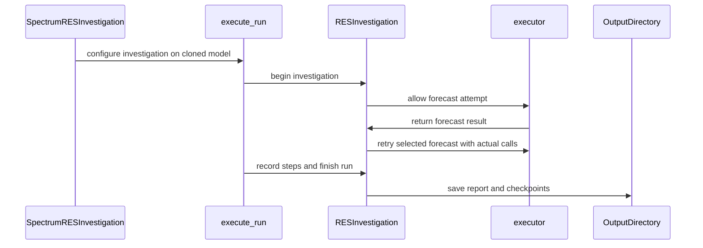

</dd>
</dl>
</details>

<!-- walkthrough_end -->
<details>
<summary><strong>Merge Risk:</strong> <strong>⚪ Minimal</strong> · up to <code>e3f6e</code></summary>
<dl>
<dd>

<!-- final_review_risk_start -->
<!-- final_review_risk_label
**Merge Risk:** **⚪ Minimal** · up to `e3f6e`
-->
<!-- final_review_risk_coverage:{"sourceCommitId":"e3f6e5f8ad5a6fa4fac5f7128a9e76dcc1be5d77","coveredCommitId":"e3f6e5f8ad5a6fa4fac5f7128a9e76dcc1be5d77","kind":"reviewed"} -->

The identified hook and cleanup concerns do not block merging; normal validation can proceed.
<!-- final_review_risk_end -->

</dd>
</dl>
</details>
<!-- pre_merge_checks_walkthrough_start -->

<details>
<summary><strong>Pre-merge checks: <sup><picture></picture></sup> 4 · <sup><picture></picture></sup> 1</strong></summary>
<dl>
<dd>

<strong><sup><picture></picture></sup> Failed checks: 1 warning</strong>

|     Check name     |                                              Status                                              | Explanation                                                                                                                                                                                               | Resolution                                                                         |
| :---------------- | :----------------------------------------------------------------------------------------------: | :-------------------------------------------------------------------------------------------------------------------------------------------------------------------------------------------------------- | :--------------------------------------------------------------------------------- |
| Docstring Coverage |  | Docstring coverage is 5.36% which is insufficient. The required threshold is 80.00%. Docstring coverage is scoped to functions touched by this diff. Analyzed 56 functions across 7 files. (3 skipped: 3… | Write docstrings for the functions missing them to satisfy the coverage threshold. |

<details>
<summary><strong><sup><picture></picture></sup> Passed checks: 4 passed</strong></summary>
<dl>
<dd>

|         Check name         |                                             Status                                             | Explanation                                                                                                                   |
| :------------------------ | :--------------------------------------------------------------------------------------------: | :---------------------------------------------------------------------------------------------------------------------------- |
|     Linked Issues check    |  | Check skipped because no linked issues were found for this pull request.                                                      |
| Out of Scope Changes check |  | Check skipped because no linked issues were found for this pull request.                                                      |
|      Description Check     |  | Check skipped - CodeRabbit’s high-level summary is enabled.                                                                   |
|         Title check        |  | The title clearly and concisely describes the main change: preparing a GPU investigation for native RES forecast propagation. |

</dd>
</dl>
</details>

<details>
<summary><strong>Full details: Docstring Coverage</strong></summary>
<dl>
<dd>

**Explanation**

Docstring coverage is 5.36% which is insufficient. The required threshold is 80.00%. Docstring coverage is scoped to functions touched by this diff. Analyzed 56 functions across 7 files. (3 skipped: 3 unsupported.)

</dd>
</dl>
</details>

</dd>
</dl>
</details>

<!-- pre_merge_checks_walkthrough_end -->
<!-- finishing_touch_checkbox_start -->

<details>
<summary><strong>✨ Finishing Touches: 💡 1</strong></summary>
<dl>
<dd>

<!-- finishing_touch_suggestion:docstrings -->
<details open>
<summary><strong>📝 Generate docstrings: 💡</strong></summary>
<dl>
<dd>

- [ ] <!-- {"checkboxId":"3e1879ae-f29b-4d0d-8e06-d12b7ba33d98"} --> Commit to this branch
- [ ] <!-- {"checkboxId":"7962f53c-55bc-4827-bfbf-6a18da830691"} --> Create a new PR

</dd>
</dl>
</details>
<details open>
<summary><strong>🧪 Generate unit tests (beta)</strong></summary>
<dl>
<dd>

- [ ] <!-- {"checkboxId": "6ba7b810-9dad-11d1-80b4-00c04fd430c8", "radioGroupId": "utg-output-choice-group-6161920111"} --> Commit to this branch
- [ ] <!-- {"checkboxId": "f47ac10b-58cc-4372-a567-0e02b2c3d479", "radioGroupId": "utg-output-choice-group-6161920111"} --> Create a new PR

</dd>
</dl>
</details>

</dd>
</dl>
</details>

<!-- finishing_touch_checkbox_end -->

<!-- autopilot:start -->
- [ ] <!-- {"checkboxId":"2708ad07-9f24-4260-9c11-7dc76a49f2e3"} --> <strong title="Keep fixing CodeRabbit findings and required CI, and resolving merge conflicts">Autofix</strong> · Keep fixing CodeRabbit findings and required CI, and resolving merge conflicts
<!-- autopilot:end -->
<!-- tips_start -->


Thanks for using [CodeRabbit](https://coderabbit.ai?utm_source=oss&utm_medium=github&utm_campaign=xmarre/ComfyUI-Spectrum-MiniMax-H3&utm_content=123)! It's free for OSS, and your support helps us grow. If you like it, consider giving us a shout-out.

<details>
<summary><strong>❤️ Share</strong></summary>
<dl>
<dd>

- [X](https://twitter.com/intent/tweet?text=I%20just%20used%20%40coderabbitai%20for%20my%20code%20review%2C%20and%20it%27s%20fantastic%21%20It%27s%20free%20for%20OSS%20and%20offers%20a%20free%20trial%20for%20the%20proprietary%20code.%20Check%20it%20out%3A&url=https%3A//coderabbit.ai)
- [Mastodon](https://mastodon.social/share?text=I%20just%20used%20%40coderabbitai%20for%20my%20code%20review%2C%20and%20it%27s%20fantastic%21%20It%27s%20free%20for%20OSS%20and%20offers%20a%20free%20trial%20for%20the%20proprietary%20code.%20Check%20it%20out%3A%20https%3A%2F%2Fcoderabbit.ai)
- [Reddit](https://www.reddit.com/submit?title=Great%20tool%20for%20code%20review%20-%20CodeRabbit&text=I%20just%20used%20CodeRabbit%20for%20my%20code%20review%2C%20and%20it%27s%20fantastic%21%20It%27s%20free%20for%20OSS%20and%20offers%20a%20free%20trial%20for%20proprietary%20code.%20Check%20it%20out%3A%20https%3A//coderabbit.ai)
- [LinkedIn](https://www.linkedin.com/sharing/share-offsite/?url=https%3A%2F%2Fcoderabbit.ai&mini=true&title=Great%20tool%20for%20code%20review%20-%20CodeRabbit&summary=I%20just%20used%20CodeRabbit%20for%20my%20code%20review%2C%20and%20it%27s%20fantastic%21%20It%27s%20free%20for%20OSS%20and%20offers%20a%20free%20trial%20for%20proprietary%20code)

</dd>
</dl>
</details>


<!-- poem_footer_start -->
<sub>A rabbit traced the sigma stream,<br>And noted each forecast in a beam.<br>One step got checked with care,<br>Then reports and tensors paired.<br>The hare hopped home through moonlit green.</sub>
<!-- poem_footer_end -->

<sub>Comment `@coderabbitai help` to get the list of available commands.</sub>

<!-- tips_end -->


> **Comment by xmarre (2026-10-16T16:23:44Z):**

## 16 Oct owner cold production run: fused Flow provider works; sampler remains 695.7s and high-stage VRAM margin 94MiB

Owner attached `Pasted text(20261016-161523).txt` (ComfyUI 0.41.0, RTX PRO 6000 Blackwell 96GB, H3 int8-convrot, VDN 50 blocks, Sol #41, Flow #107, Spectrum model-aware). Full prompt **15m43s=943s**. This was a *cold* run; do not confuse startup/profiling/residency with transformer or kernel throughput.

**Exact Spectrum stage walls**:
| Stage | wall s | actual H3 NFEs | Sol `grouped_kv_fused_calls` | VDN |
|---|---:|---:|---:|---|
| C1 low |158.391|6|2640|50/50 on each actual|
| C1 exact probe |21.959|1 outside Spectrum|0 (dense)|50/50|
| C1 high |189.851|4|2112|50/50|
| C2 low |120.291|6|3500|50/50|
| C2 exact probe |20.377|1 outside Spectrum|0 (dense)|50/50|
| C2 high |184.837|4|2100|50/50|
| **sum** |**695.706**|**20 Spectrum actual + 2 exact probes**|**10,352**|Full-Vdn|

**Flow wrapper defect FIX CONFIRMED IN REAL GPU:** C2 fused calls=3500 low and 2100 high, equal to sparse local calls; no missing capability. Native C1 also fused all local calls. Flow still runs intentional `partitioned_core_dense_calls=1314/1114` outside local sparse routes; not a universal dense fallback. `partitioned_kernel_compile_wall_s=1.145/0.0s` for C2. This is not a case of falling to dense for all blocks or reintroducing Core #17093. Original BSA/VDN bypass remains unresolved only in Core BSA, not this full-VDN Sol trace.

**Compare prior HOT Sol** in 20261016-134244 log (different prompt and reference hashes, same stage grid geometry and same H3 actual NFE counts): old stage sum **611.685s**, C1 **275.260s**, C2 **336.425s**; new cold C1 **370.201s**, C2 **325.505s**. Thus old/new C2 improved **10.920s** at comparable geometry, but cannot attribute it solely to fusion because conditioning and residency differ. Cold C1 is **94.941s slower**. Do not conclude a new high- or continuation regression based on full cold prompt wall.

**Cold and allocation:** Spectrum model-aware profile reports `cache=miss build_s=187.533158 lookup_s=93.778736`; earlier cold BSA 92.760305/46.383031. WARNING: these two reported times are **internally inconsistent** with Spectrum source (`get_model_forecastability_profile` times a call that contains `_build_profile`, so a build cannot last almost exactly twice its containing lookup). Avoid summing `build_s` and `lookup_s` as distinct costs or treating build_s as a reliable elapsed time until instrumented. Check deployed source and wall timestamps. This cold-only overhead is separate from the persistent 695s sampler deficit. VDN first low preparation `33.419s`; admission eviction times: C1 probe 3.214s, C1 high **36.733s**, C2 low 2.992s, C2 high **10.072s**. Admission wall/counters may overlap sampler and stage edges; don't naïvely sum with stage totals. C2 high requires **40,737.440 MiB**, available after reclaim **40,831.681 MiB** => **94.241 MiB budget margin**. There is no OOM in this completed prompt, but headroom is very fragile.

**Hot component limits:** arithmetic all-selected Sol gates C1 low/high = 5.554/11.689 s and C2 low/high 1.350/0.777s, combined **19.37s**; meaningful but <3% of 695.706s. Fused BF16 K/V microbenchmark saves 0.24–0.48ms/call, so not responsible for 100s+ deficits. Previous VDN profiling implicates learned linear, grouped CuTe attention and gather/window logic. Need a low-perturbation per-component GPU trace or representative grouped end-to-end benchmark with exact materialization and window layouts—not more QKV chunk-size retesting, Core bypass, or full dense reversion.

**Next implementation targets:** 1) isolate actual learned-linear readout and SM120 sparse kernel time including K/V summary and group scatter; 2) reduce repeated attention/gate work and memory without relaxing numeric/output equality; 3) separately fix Spectrum cold model-aware profile (document timer inconsistency); 4) VDN high-stage memory headroom/residency. Do not merge/release until a *same-input/seed/shape/NFE* warm sampled A/B demonstrates improvement and parity.


> **Comment by xmarre (2026-10-16T17:13:00Z):**

Taking over run 02150 lifecycle investigation. Confirmed timing root cause in external_patch_compat.py: adjustment_started receives the outer lookup start, so _external_profile_from_base adds the cold base build twice. Preparing correction and deterministic timer tests on mirror/lifecycle-20261016; checkpoint/pr123-before-lifecycle-20261016 preserves the existing head. No sampler math changes or GPU speed claim. Please flag concurrent changes before this PR head is updated.


> **Comment by xmarre (2026-10-16T17:46:48Z):**

## Run 02150 Spectrum timing-accounting handoff — patch and CI verified

Confirmed current one-commit head `b2f0c436f6d56cfb2e89a6c62acc8dcfe281a262` on **unchanged stacked base** `feature/res4lyf-sampler-support`; hosted CI [38938187478](https://github.com/xmarre/ComfyUI-Spectrum-MiniMax-H3/actions/runs/38938187478) completed successfully.

The external-patch wrapper's `adjustment_started` formerly included the duration of `_ORIGINAL_PROFILE_LOOKUP(model_patcher)`, which already performs the base build. Its `_external_profile_from_base` then added `base.build_seconds` *again*. The corrected code starts the external adjustment timer after the inclusive base lookup. For a cache miss, reported adjusted `build_seconds` is now base-build + external-only adjustment, while `lookup_seconds` is the actual inclusive outer call. This explains the prior ~2:1 inverted timings (e.g., run 02150 `5.730577s` build against `2.869081s` lookup) without interpreting 5.73 seconds as real elapsed build cost.

This changes **telemetry only**, not the profile cache key, LoRA/injection perturbation calculation, risk input, forecast schedule, or transformer workload. The previous assistant's focused 66 CPU tests passed; hosted CI has passed. Future owner logs should show the nested timing invariant restored. There is **no demonstrated wall-time speedup from this fix**.

Related independent lifecycle work: [Continuum #47](https://github.com/xmarre/ComfyUI-H3-Continuum-Plus/pull/47) (one-commit, CPU-CI green) pre-encodes only eligible adjacent Qwen chunks to avoid repeated TE loading. VDN [#41](https://github.com/xmarre/ComfyUI-VDN-H3-Plus/pull/41) now rechecks memory after successful zero-count idle scratch release. Run 02150 remains 728 s end-to-end until matched GPU acceptance. Draft, unmerged, unreleased.


### #122 [open] ISSUE: Pulsing visual noise with Spectrum + sample_res_multistep (v0.2.24+)
URL: https://github.com/xmarre/ComfyUI-Spectrum-MiniMax-H3/issues/122  by DuckyDuo 2026-10-10T23:27:48Z

## Summary

Pulsing visual noise is reported with Spectrum enabled and ComfyUI's `sample_res_multistep` sampler. The reporter reproduces it on Spectrum v0.2.24 and v0.2.29, but not on v0.2.23 with the same 25-step setup.

## Reported configuration

- Sampler: `sample_res_multistep`
- Sampling steps: 25
- Spectrum: enabled
- `tail_actual_steps`: `1` unless otherwise specified
- Versions compared: v0.2.23, v0.2.24, v0.2.29

## Observed results

| Spectrum version | `tail_actual_steps` | Actual / forecast calls | Visual result |
| --- | ---: | ---: | --- |
| v0.2.23 | 1 | 14 / 11 | No pulsing noise reported |
| v0.2.24 | 1 | 13 / 12 | Pulsing noise |
| v0.2.29 | 1 | 13 / 12 | Pulsing noise |
| v0.2.29 | 3 | 14 / 11 | No pulsing noise reported |

The reporter's v0.2.23 and v0.2.24 step traces are identical through step 21. The recorded final decisions differ:

| Step (zero-based) | v0.2.23 | v0.2.24 |
| ---: | --- | --- |
| 22 | Actual | Actual |
| 23 | Actual | Forecast |
| 24 | Actual | Actual |

## Expected behavior

Enabling Spectrum with `sample_res_multistep` should not introduce recurring visual noise.

## Current workaround

On v0.2.29, setting `tail_actual_steps=3` removes the reported artifact in the reporter's tested configuration.

## Scope of available evidence

- The artifact was observed with `sample_res_multistep` and Spectrum enabled.
- `sample_res_multistep_cfg_pp` was **not tested**.
- This report does not establish the cause of the artifact or the generality of the workaround across other schedules, prompts, or model configurations.

Technical investigation and proposed changes are tracked separately in a draft PR.

> **Comment by xmarre (2026-10-14T03:23:41Z):**

Previous investigative commentary withdrawn. Research and proposed changes are tracked in draft PR #123; issue #122 is reserved for reported reproduction facts.


### #121 [closed] PR: Remove Core BSA source gates and validate forecast history
URL: https://github.com/xmarre/ComfyUI-Spectrum-MiniMax-H3/pull/121  by xmarre 2026-10-07T19:59:02Z

Core ComfyUI BSA and Flow/Untwist source revisions could silently suppress Spectrum forecasts even when the live H3 backend chain was unchanged. The original Core BSA fix missed independent source-digest gates in the Flow and Untwist composition adapters. This change removes those gates and retains structural and actual-call receipt validation.

## Runtime compatibility

- Match every replacement and attention closure to the model block/index and a shared installed BSA patch.
- Bind settings, layout, conditioning UUIDs, sparse/dense routes, calibration owners, execution identity, live function code, defaults and numerical helper bindings to forecast history.
- Keep missing, malformed and stacked BSA chains actual-only.
- Retain whole-file source digests as identity/diagnostic data. No Core BSA source-digest allowlist controls ordinary forecasting.
- Recognize Flow attention/mixed-grid wrappers and Untwist preprocessors from their installed module paths, live closure/owner structure and execution identity, not frozen source hashes.
- Distinguish legacy mixed-grid carrier-layout behavior from newer propagated mixed-layout behavior by probing the live forwarding helper; bind its live helper identity to forecast history.
- Preserve independent Untwist and Flow composition and actual-call receipt contracts. 

## Cold-to-primed carry

The optional carry exception checks live calibration/dispatch code against an immutable validated recipe compiled for the running Python version. It also requires the exact adjacent post-cold tensor owners **and bytes**, including inference-mode tensors without version counters.

Unrelated file edits or an unavailable whole-file digest do not revoke this optimization. A changed calibration recipe takes an actual primed evaluation; ordinary forecast history can rebuild once receipts and route/calibration ownership are stable. This avoids carrying a cold anchor across changed numerical calibration behavior without disabling forecasting for the new BSA revision.

Optional snapshot/comparison allocation failures discard the carry proof and preserve the accepted actual evaluation. Debug preflight logs expose `cold_carry_compatible`. The shared code comparison also handles code objects without Python 3.11's `co_qualname`.

## Validation

- Six earlier regression cases cover stale code/default identity and in-place calibration carry.
- Additional Flow/Untwist cases exercise unlisted revision digests and reject invalid mixed-grid forwarding.
- ComfyUI 0.38.0 (`6b747c04`), comfy-kitchen 0.2.35 and comfy-aimdo 0.5.5: **124 focused checks passed**, plus the code-shape compatibility check.
- Combined PR #117/#121 runtime and BSA checks: **178 passed, 2 CUDA skips**.
- Both ComfyUI Patcher overlay orders apply cleanly and produce the same file tree.
- Ruff, compileall and whitespace checks pass.
- Previous revision `9148120`: all 10 compatibility CI lanes passed.
- Revised source-gate fix `0c6f976`: **all 10 hosted CI lanes passed** ([workflow run](https://github.com/xmarre/ComfyUI-Spectrum-MiniMax-H3/actions/runs/37699804003)). Includes live-code/source integrity checks and removes stale digest-gated test fixtures.

These CPU checks establish runtime tracking and overlay compatibility. Decoded H3 audio/video quality and GPU cost of the calibration checks remain unverified.

## Topology

One commit based directly on `main`; independent of PR #117. Use the **PR #121 overlay** in ComfyUI Patcher for this change.

Previous heads are retained on `checkpoint/pr121-before-owner-review-20261007` and `checkpoint/pr121-compat-repair-20261008`. The supplemental source-gate repair was staged on `review/pr121-compat-repair-20261008`.

## Release preparation

- Candidate version: **v0.2.29** (`pyproject.toml`, `RELEASE_NOTES.md`, and README updated on the same one-commit PR branch).
- Scope: Core BSA/Flow/Untwist source-revision compatibility and forecast-history safety. PR #117 remains separate and unreleased.
- After a successful merge, the repository's `tests` push workflow must pass on `main`; its `release` workflow then publishes the version-matched GitHub release ZIP plus `SHA256SUMS`. The `pyproject.toml` change also triggers the Comfy registry publisher.
- The previous 10-lane hosted CI pass applies to the implementation commit `0c6f976`; the versioned candidate `b49ce77` is being rechecked before merge.


> **Comment by coderabbitai[bot] (2026-10-07T19:59:13Z):**

<!-- This is an auto-generated comment: summarize by coderabbit.ai -->
<!-- review_stack_entry_start -->

<a href="https://app.coderabbit.ai/change-stack/xmarre/ComfyUI-Spectrum-MiniMax-H3/pull/121?scope=ghh_OusAJGA4HG8ljoOV0wJvVx8NmnZIjc2DdjmxOu0xZWA&amp;cs_source=review_comment"></a>

<!-- review_stack_entry_end -->
<!-- recent_review_start -->

No actionable comments were generated in the recent review. 🎉

<details>
<summary>ℹ️ Recent review info</summary>

<details>
<summary>⚙️ Run configuration</summary>

- **Configuration used**: Organization UI
- **Review profile**: CHILL
- **Plan**: Advanced
- **Run ID**: `960bf0af-70d9-4850-93ad-a861c8d34a8c`

</details>

<details>
<summary>📥 Commits</summary>

Reviewing files that changed from the base of the PR and between 5161f0457bc8c52535212d6783eee73f439e1537 and 1e17accdc002b6d0332aae700c9a7ba8e0a7be06.

</details>

<details>
<summary>📒 Files selected for processing (10)</summary>

* `comfyui_spectrum_h3/backend_history.py`
* `comfyui_spectrum_h3/core_bsa_compat.py`
* `comfyui_spectrum_h3/core_bsa_diagnostics.py`
* `comfyui_spectrum_h3/core_bsa_loader_compat.py`
* `comfyui_spectrum_h3/core_bsa_preprocess_compat.py`
* `tests/test_core_bsa_compat.py`
* `tests/test_core_bsa_flow_compat.py`
* `tests/test_core_bsa_loader_compat.py`
* `tests/test_core_bsa_preprocess_compat.py`
* `tests/test_reviewed_bsa_fixture_gate.py`

</details>

<details>
<summary>💤 Files with no reviewable changes (2)</summary>

* tests/test_core_bsa_loader_compat.py
* tests/test_core_bsa_flow_compat.py

</details>

**Included review availability:** This review used your included allowance. Your plan provides up to 4 included reviews per hour; 3 remain after this review.

</details>

---


<!-- recent_review_end -->
<!-- walkthrough_start -->

<details>
<summary>📝 Walkthrough</summary>

## Walkthrough

Core BSA compatibility now identifies runtime modules and patch chains by runtime API shape and structural checks. Source digests remain in audit results when available but no longer gate acceptance. Diagnostics, preflight reporting, and compatibility tests use `runtime_structure_unrecognized` for unrecognized runtime structure.

### Changes

**Core BSA Runtime Recognition**

|Layer / File(s)|Summary|
|:---|:---|
|**Resolve Core BSA at runtime** <br> `comfyui_spectrum_h3/core_bsa_compat.py`, `comfyui_spectrum_h3/core_bsa_loader_compat.py`, `tests/test_core_bsa_compat.py`, `tests/test_core_bsa_flow_compat.py`, `tests/test_core_bsa_loader_compat.py`, `tests/test_core_bsa_preprocess_compat.py`, `tests/test_reviewed_bsa_fixture_gate.py`|Module loading uses runtime API shape and fixed constants instead of an audited source-hash allowlist. Missing hashes use `"runtime"`. Tests no longer skip fixtures based on the source-hash allowlist.|
|**Recognize patch-chain structure** <br> `comfyui_spectrum_h3/core_bsa_compat.py`, `comfyui_spectrum_h3/core_bsa_diagnostics.py`, `comfyui_spectrum_h3/core_bsa_loader_compat.py`, `comfyui_spectrum_h3/core_bsa_preprocess_compat.py`, `comfyui_spectrum_h3/backend_history.py`, `tests/test_core_bsa_compat.py`, `tests/test_core_bsa_preprocess_compat.py`|Patch-chain checks use callable, closure, block, installation, and settings structure. Diagnostics and preflight reporting use `runtime_structure_unrecognized`, and tests assert the updated behavior.|

<!-- change_assessment_start -->
**Priority:** ➖ Normal


**Estimated code review effort:** 3 (Moderate) | ~25 minutes

<!-- change_assessment_commit:"1e17accdc002b6d0332aae700c9a7ba8e0a7be06" -->
**Change:** Bug fix
<!-- change_assessment_end -->

</details>

<!-- walkthrough_end -->
<!-- final_review_risk_start -->
**Merge Risk:** _⚪ Minimal_ · up to `1e17a`
<!-- final_review_risk_coverage:{"sourceCommitId":"1e17accdc002b6d0332aae700c9a7ba8e0a7be06","coveredCommitId":"1e17accdc002b6d0332aae700c9a7ba8e0a7be06","kind":"reviewed"} -->

The path-loaded Core BSA fallback retains the structural safeguards. No identified issue currently blocks merging.
<!-- final_review_risk_end -->
<!-- pre_merge_checks_walkthrough_start -->

<details>
<summary>🚥 Pre-merge checks | ✅ 4 | ❌ 1</summary>

### ❌ Failed checks (1 warning)

|     Check name     |                                              Status                                              | Explanation                                                                                                                                                                                 | Resolution                                                                         |
| :---------------- | :---------------------------------------------------------------------------------------------- | :------------------------------------------------------------------------------------------------------------------------------------------------------------------------------------------ | :--------------------------------------------------------------------------------- |
| Docstring Coverage |  | Docstring coverage is 30.77% which is insufficient. The required threshold is 80.00%. Docstring coverage is scoped to functions touched by this diff. Analyzed 26 functions across 8 files. | Write docstrings for the functions missing them to satisfy the coverage threshold. |

<details>
<summary>✅ Passed checks (4 passed)</summary>

|         Check name         |                                             Status                                             | Explanation                                                                                                                                                                      |
| :------------------------ | :-------------------------------------------------------------------------------------------- | :------------------------------------------------------------------------------------------------------------------------------------------------------------------------------- |
|     Linked Issues check    |  | Check skipped because no linked issues were found for this pull request.                                                                                                         |
| Out of Scope Changes check |  | Check skipped because no linked issues were found for this pull request.                                                                                                         |
|      Description Check     |  | Check skipped - CodeRabbit’s high-level summary is enabled.                                                                                                                      |
|         Title check        |  | The title clearly identifies the main change: removing Core BSA source gates and updating forecast-history validation. It is concise and related to the pull request objectives. |

</details>

</details>

<!-- pre_merge_checks_walkthrough_end -->

- [ ] <!-- {"checkboxId":"585bb3f6-faf5-4dbf-96d2-74e382adf19a"} --> Fix all pre-merge checks with AI
<!-- finishing_touch_checkbox_start -->

<details>
<summary>✨ Finishing Touches 💡 1</summary>

<!-- finishing_touch_suggestion:docstrings -->
<details open>
<summary>📝 Generate docstrings 💡</summary>

- [ ] <!-- {"checkboxId":"3e1879ae-f29b-4d0d-8e06-d12b7ba33d98"} --> Commit to this branch
- [ ] <!-- {"checkboxId":"7962f53c-55bc-4827-bfbf-6a18da830691"} --> Create a new PR

</details>
<details open>
<summary>🧪 Generate unit tests (beta)</summary>

- [ ] <!-- {"checkboxId": "6ba7b810-9dad-11d1-80b4-00c04fd430c8", "radioGroupId": "utg-output-choice-group-6045759309"} --> Commit to this branch
- [ ] <!-- {"checkboxId": "f47ac10b-58cc-4372-a567-0e02b2c3d479", "radioGroupId": "utg-output-choice-group-6045759309"} --> Create a new PR

</details>

</details>

<!-- finishing_touch_checkbox_end -->

<!-- autopilot:start -->
- [ ] <!-- {"checkboxId":"2708ad07-9f24-4260-9c11-7dc76a49f2e3"} --> <strong title="Keep fixing CodeRabbit findings and required CI, and resolving merge conflicts">Autopilot</strong> · Keep fixing CodeRabbit findings and required CI, and resolving merge conflicts
<!-- autopilot:end -->
<!-- tips_start -->

---

Thanks for using [CodeRabbit](https://coderabbit.ai?utm_source=oss&utm_medium=github&utm_campaign=xmarre/ComfyUI-Spectrum-MiniMax-H3&utm_content=121)! It's free for OSS, and your support helps us grow. If you like it, consider giving us a shout-out.

<details>
<summary>❤️ Share</summary>

- [X](https://twitter.com/intent/tweet?text=I%20just%20used%20%40coderabbitai%20for%20my%20code%20review%2C%20and%20it%27s%20fantastic%21%20It%27s%20free%20for%20OSS%20and%20offers%20a%20free%20trial%20for%20the%20proprietary%20code.%20Check%20it%20out%3A&url=https%3A//coderabbit.ai)
- [Mastodon](https://mastodon.social/share?text=I%20just%20used%20%40coderabbitai%20for%20my%20code%20review%2C%20and%20it%27s%20fantastic%21%20It%27s%20free%20for%20OSS%20and%20offers%20a%20free%20trial%20for%20the%20proprietary%20code.%20Check%20it%20out%3A%20https%3A%2F%2Fcoderabbit.ai)
- [Reddit](https://www.reddit.com/submit?title=Great%20tool%20for%20code%20review%20-%20CodeRabbit&text=I%20just%20used%20CodeRabbit%20for%20my%20code%20review%2C%20and%20it%27s%20fantastic%21%20It%27s%20free%20for%20OSS%20and%20offers%20a%20free%20trial%20for%20proprietary%20code.%20Check%20it%20out%3A%20https%3A//coderabbit.ai)
- [LinkedIn](https://www.linkedin.com/sharing/share-offsite/?url=https%3A%2F%2Fcoderabbit.ai&mini=true&title=Great%20tool%20for%20code%20review%20-%20CodeRabbit&summary=I%20just%20used%20CodeRabbit%20for%20my%20code%20review%2C%20and%20it%27s%20fantastic%21%20It%27s%20free%20for%20OSS%20and%20offers%20a%20free%20trial%20for%20proprietary%20code)

</details>


<!-- poem_footer_start -->
<sub>A rabbit checks the patch-chain trail,  <br>And finds the runtime without a hash.  <br>The closures match, the tests run on,  <br>New diagnostics name the unseen shape,  <br>Then I hop home, content and quick.</sub>
<!-- poem_footer_end -->

<sub>Comment `@coderabbitai help` to get the list of available commands.</sub>

<!-- tips_end -->


> **Comment by chatgpt-codex-connector[bot] (2026-10-07T20:02:04Z):**

<!-- codex-pull-request-review-summary -->

## Codex Review Summary

This comment shows the latest Codex review activity on this pull request.

| Review | Status | Commit | Review trigger |
| --- | --- | --- | --- |
| 📝 **Code Review** | ✅ **Completed** <relative-time datetime="2026-10-07T20:04:47.930522Z">2026-10-07T20:04:47.930522Z</relative-time> | `1e17acc` | Draft marked ready |


<details> <summary>ℹ️ About Codex in GitHub</summary>
<br/>

[Your team has set up Codex to review pull requests in this repo](https://chatgpt.com/codex/cloud/settings/general). Reviews are triggered when you
- Open a pull request for review
- Mark a draft as ready
- Comment "@codex review" or "@codex security review".

Codex reacts with 👀 while any review is running, comments if it has suggestions, and reacts with 👍 once all reviews finish with no findings.

</details>


> **Comment by xmarre (2026-10-07T23:03:57Z):**

### Remaining compatibility blocker corrected

The earlier PR revision removed the Core ComfyUI BSA source-digest allowlist but **missed the independent Flow and Untwist source gates**. In particular, `core_bsa_flow_compat.py` required fixed attention/mixed-grid Git blobs, which could produce `flow_wrapper_unreviewed` and silently turn an intended Core MSA + Flow `11 actual / 9 forecast` schedule into `20 actual / 0 forecast`.

The revised one-commit PR head `0c6f976` removes those static revision allowlists. Installed Flow/Untwist wrappers are resolved by their live module origins, closure/owner structure and source-to-live-code integrity (independent of *which* source revision was installed). Mixed-grid layout propagation is determined from the installed forwarding helper rather than a frozen file hash. Existing BSA settings/route checks, per-block actual-call receipts, unknown/foreign wrapper rejection, and the narrow cold-to-primed carry proof remain in place.

Tests were revised to stop skipping on outdated file hashes, cover unlisted source revisions, preserve the legacy mixed-grid routing mode, and reject invalid forwarding. **10/10 hosted CI lanes passed:** https://github.com/xmarre/ComfyUI-Spectrum-MiniMax-H3/actions/runs/37699804003

**GPU confirmation still required:** replay Core MSA + Flow with the PR #121 Patcher overlay and check both Flow stages for nonzero Spectrum forecasts, accepted receipts, and clean audiovisual output. CPU tests cannot establish real-video quality. PR remains unmerged pending that confirmation.


> **Comment by xmarre (2026-10-08T23:39:46Z):**

## Release complete — v0.2.29

PR #121 was squash-merged onto `main` as [`806fe498`](https://github.com/xmarre/ComfyUI-Spectrum-MiniMax-H3/commit/806fe498d574a726fecb8818917f00a4b993fd77).

- [GitHub release v0.2.29](https://github.com/xmarre/ComfyUI-Spectrum-MiniMax-H3/releases/tag/v0.2.29) is published. The tag points to the exact merge commit.
- Release artifacts: [versioned ZIP](https://github.com/xmarre/ComfyUI-Spectrum-MiniMax-H3/releases/download/v0.2.29/ComfyUI-Spectrum-MiniMax-H3-v0.2.29.zip) and [SHA256SUMS](https://github.com/xmarre/ComfyUI-Spectrum-MiniMax-H3/releases/download/v0.2.29/SHA256SUMS).
- ZIP SHA-256 (GitHub asset digest): `8984777338dce200b2173b863d2fe8fbcdecefb6b453b0729cb062e0363c365f`.
- [Versioned PR tests](https://github.com/xmarre/ComfyUI-Spectrum-MiniMax-H3/actions/runs/37860131073): **10/10 passed**.
- [Post-merge main tests](https://github.com/xmarre/ComfyUI-Spectrum-MiniMax-H3/actions/runs/37860364151): **10/10 passed**.
- [GitHub release publication](https://github.com/xmarre/ComfyUI-Spectrum-MiniMax-H3/actions/runs/37860594037): **success**.
- [Comfy registry publication](https://github.com/xmarre/ComfyUI-Spectrum-MiniMax-H3/actions/runs/37860364157): **success**.

Scope is limited to the Core BSA / Flow / Untwist revision-gate fix and forecast-history compatibility in this PR. PR #117 (RES4LYF samplers) remains separate, open and draft. Hosted tests verify structural/runtime behavior; no broader decoded AV-parity or calibration GPU-overhead claim is made.

Recovery checkpoint: `checkpoint/pr121-pre-release-20261009`. Release staging mirror: `review/pr121-release-20261009`.


### #120 [open] ISSUE: Compatibility
URL: https://github.com/xmarre/ComfyUI-Spectrum-MiniMax-H3/issues/120  by HewJazz123 2026-09-26T13:24:19Z

Just wanted to say you did a great job making this node.  I've tried every single turbo lora and they all stink. The cache nodes are even worse yet a lot of people praise them. Don't know why. They all have problems  and either mess up the audio or cause artifacts.  Your is the only one that works well on a consistent basis.  It may take a bit longer to generate then the others but its well worth it.

I am wondering though, do you have any plans to make it compatible with some more of the other schedulers?  Sometimes regular Euler and Res just won't give me what I am prompting.  ER-SDE is better at following all the prompt but still fails on occasion.  The only one that really gets the job done better then the rest is Euler Ancestral.  I can't count the amount of times I couldn't get the results I wanted with any of the others until I switched back to Ancestral.  This also applies to Wan and LTX.  It would be awesome if you could make it compatible with your node.  Is there any chance of this?  I am glad that you eventually added ER-SDE.  Its a lot better then res and regular euler for prompts.  Anyway, thought I would ask.  Again, great job.  Thank you for making this.


### #119 [closed] ISSUE: No longer works with Minimax H3 Low Vram node
URL: https://github.com/xmarre/ComfyUI-Spectrum-MiniMax-H3/issues/119  by deadman3000 2026-09-23T20:26:11Z

TypeError: minimax_block_lowmem_forward() got an unexpected keyword argument 'attention'

If I disable Spectrum Apply I don't get any errors.

> **Comment by xmarre (2026-09-24T17:41:11Z):**

Thanks for the report. I traced this one through the current ComfyUI/KJNodes call path.

This is an **outdated ComfyUI-KJNodes Low VRAM patch**, rather than a Spectrum forecasting regression.

Spectrum captures the final H3 transformer feature through ComfyUI's `patches_replace["dit"]` / `double_block` hook. Once that hook is active, current ComfyUI calls the block through its replacement wrapper and passes the block-level `attention=...` argument. An older version of KJNodes' `minimax_block_lowmem_forward` did not accept that argument, which produces exactly:

```
TypeError: minimax_block_lowmem_forward() got an unexpected keyword argument 'attention'
```

That also explains why disabling Spectrum appears to fix it: without Spectrum's final-block replacement, ComfyUI can take the direct block path, so the stale KJNodes function is not called through the replacement wrapper that supplies `attention`.

KJNodes already fixed this upstream in **kijai/ComfyUI-KJNodes@da90cca** ("Fix MiniMax H3 VRAM Attention", Sep 6). The fix adds `attention=None` to `minimax_block_lowmem_forward` and correctly composes an externally supplied attention implementation. The same failure was tracked and closed upstream as **kijai/ComfyUI-KJNodes#750**.

Please update **ComfyUI-KJNodes** to a revision containing `da90cca` or newer, restart ComfyUI, and retry. Current KJNodes `main` contains the corrected block signature.

I don't want to add a Spectrum-side shim that silently drops the `attention` argument: that would mask a stale third-party block contract and can break legitimate attention replacements such as Core BlockSparseAttention/SLA-style patches.

I'm closing this as resolved upstream. If it still reproduces after updating KJNodes, please reopen it and include the KJNodes commit/version plus the full traceback; then there is a separate compatibility issue to investigate.


### #118 [open] PR: WIP: patcher rollup for Keyless Spectrum compatibility
URL: https://github.com/xmarre/ComfyUI-Spectrum-MiniMax-H3/pull/118  by xmarre 2026-09-18T14:06:25Z

Patcher/deployment rollup for the current MiniMax-H3-Keyless Spectrum compatibility stack.

This is **not** a replacement for the constituent development/evidence PRs. It exists because the local ComfyUI patcher applies one PR overlay as a single `git apply --3way --index` patch; the existing stacked PRs contain multiple dependent commits that touch the same newly introduced files and are therefore not a safe deployment artifact for that application model.

Constituent source PRs preserved unchanged:
- #113 — Keyless semantic-contract compatibility
- #114 — Keyless Untwist routing compatibility
- #116 — Keyless-aware Core BSA + domain-aware Untwist reconciliation

The rollup takes the exact cumulative file state from #116 head `be1584124547e4978197701d227baa6c909ad156` and applies it as **one commit** on current main `5161f0457bc8c52535212d6783eee73f439e1537`. Current main's v0.2.28 CRLF audit release changes are preserved.

Deployment topology:
- base: `main`
- base SHA: `5161f0457bc8c52535212d6783eee73f439e1537`
- head: `mirror/keyless-patcher-rollup-20260918`
- head SHA: `4eddb763ea06c10e2c890189810c2c26868783e9`
- commits: 1

Use this PR as the **only Spectrum Keyless overlay** in patcher-managed installations. Do not additionally enable #113/#114/#116 in the same patcher stack.

This remains structural/reference compatibility work; it does not establish decoded Keyless AV parity, forecast quality on real GPU sparse execution, or no-global-route fused performance.

> **Comment by coderabbitai[bot] (2026-09-18T14:06:32Z):**

<!-- This is an auto-generated comment: summarize by coderabbit.ai -->
<!-- This is an auto-generated comment: skip review by coderabbit.ai -->

> [!IMPORTANT]
> ## Review skipped
> 
> Auto reviews are disabled on this repository. Please check the settings in the CodeRabbit UI or the `.coderabbit.yaml` file in this repository. To trigger a single review, invoke the `@coderabbitai review` command.
> 
> <details>
> <summary>⚙️ Run configuration</summary>
> 
> **Configuration used**: Organization UI
> 
> **Review profile**: CHILL
> 
> **Plan**: Advanced
> 
> **Run ID**: `b476dd38-18b2-4073-b003-11ee64c10213`
> 
> </details>
> 
> You can disable this status message by setting the `reviews.review_status` to `false` in the CodeRabbit configuration file.
> 
> Use the checkbox below for a quick retry:
> - [ ] <!-- {"checkboxId":"e9bb8d72-00e8-4f67-9cb2-caf3b22574fe"} --> 🔍 Trigger review

<!-- end of auto-generated comment: skip review by coderabbit.ai -->

<!-- tips_start -->

---

Thanks for using [CodeRabbit](https://coderabbit.ai?utm_source=oss&utm_medium=github&utm_campaign=xmarre/ComfyUI-Spectrum-MiniMax-H3&utm_content=118)! It's free for OSS, and your support helps us grow. If you like it, consider giving us a shout-out.

<details>
<summary>❤️ Share</summary>

- [X](https://twitter.com/intent/tweet?text=I%20just%20used%20%40coderabbitai%20for%20my%20code%20review%2C%20and%20it%27s%20fantastic%21%20It%27s%20free%20for%20OSS%20and%20offers%20a%20free%20trial%20for%20the%20proprietary%20code.%20Check%20it%20out%3A&url=https%3A//coderabbit.ai)
- [Mastodon](https://mastodon.social/share?text=I%20just%20used%20%40coderabbitai%20for%20my%20code%20review%2C%20and%20it%27s%20fantastic%21%20It%27s%20free%20for%20OSS%20and%20offers%20a%20free%20trial%20for%20the%20proprietary%20code.%20Check%20it%20out%3A%20https%3A%2F%2Fcoderabbit.ai)
- [Reddit](https://www.reddit.com/submit?title=Great%20tool%20for%20code%20review%20-%20CodeRabbit&text=I%20just%20used%20CodeRabbit%20for%20my%20code%20review%2C%20and%20it%27s%20fantastic%21%20It%27s%20free%20for%20OSS%20and%20offers%20a%20free%20trial%20for%20proprietary%20code.%20Check%20it%20out%3A%20https%3A//coderabbit.ai)
- [LinkedIn](https://www.linkedin.com/sharing/share-offsite/?url=https%3A%2F%2Fcoderabbit.ai&mini=true&title=Great%20tool%20for%20code%20review%20-%20CodeRabbit&summary=I%20just%20used%20CodeRabbit%20for%20my%20code%20review%2C%20and%20it%27s%20fantastic%21%20It%27s%20free%20for%20OSS%20and%20offers%20a%20free%20trial%20for%20proprietary%20code)

</details>


<sub>Comment `@coderabbitai help` to get the list of available commands.</sub>

<!-- tips_end -->


> **Comment by xmarre (2026-09-18T15:03:30Z):**

Local integration evidence after applying upstream ComfyUI Keyless overlays:

- Comfy-Org/ComfyUI#16401 sparse-attention blob present exactly: `3f508f899f5d5629d8a5b31d9ef2c26ccd7ae919`
- Comfy-Org/ComfyUI#16402 blobs present exactly:
  - `comfy/hooks.py` `fa2b9c2e338a48fd1b79c4f5cf6c90626385b2e5`
  - `comfy/lora.py` `ee6c57bf3a260dc7b65b489b31c0a53d522c283b`
  - `comfy/sd.py` `7b698b89dcd31235c141660da38c74805c9a3d85`

Comfy focused Keyless tests: **14 passed**.

Spectrum focused Keyless/Core-BSA/Untwist integration run with `SPECTRUM_REQUIRE_KEYLESS_BSA_FIXTURE=1`: **22 passed, 4 skipped**. The four skips are the intentional legacy audited-core-BSA fixture path, which does not accept the newer Keyless-aware source blob; the Keyless-aware fixture itself ran and passed.


> **Comment by xmarre (2026-09-18T15:16:30Z):**

Local post-overlay validation on 2026-09-18: focused Keyless/Core-BSA/Untwist suite with `SPECTRUM_REQUIRE_KEYLESS_BSA_FIXTURE=1` passed **22 passed / 4 skipped** (the four skips are the legacy audited-BSA source path). Full local Spectrum suite passed **1062 passed / 57 skipped / 5 warnings**. The remaining skips are fixture-conditioned lanes, including legacy BSA-source tests plus locally unavailable Flow/RefDelta imports; hosted pinned interop CI remains the authoritative coverage for those fixture lanes.


### #117 [open] PR: Add RES4LYF RES sampler support
URL: https://github.com/xmarre/ComfyUI-Spectrum-MiniMax-H3/pull/117  by xmarre 2026-09-18T13:53:14Z

## Summary

Adds Spectrum support for the 12 named RES4LYF beta RES wrappers requested in #103: `res_2m`, `res_3m`, `res_2s`, `res_3s`, `res_5s`, `res_6s` and their six `*_ode` variants.

**The RES4LYF source-revision whitelist has been removed.** Normal upstream updates no longer disable the adapter because a whole-file hash changed. Compatibility uses installed native API bindings and live stochastic-state ownership. Coverage includes RES4LYF 1.2.0 on ComfyUI 0.38.0 as well as the earlier September fixture.

Awaiting decoded H3 GPU validation. This PR remains draft; CPU/native test success is not a claim of accelerated audio/video quality. The generic option-driven `rk_beta`, dynamic RK swaps and implicit methods remain outside the named-wrapper adapter.

## Native solver behavior

- Fixed-stage wrappers retain native 2/3/5/6 model-call stages and keep stage 0 exact.
- Multistep wrappers keep startup exact and refresh each consumed recurrence slot after a forecast.
- Call mapping follows native `sigma_min` preprocessing and the built-in `h >= 1` RES/DDIM fallback. Fallback intervals and the final outer interval stay exact.
- ODE forecasting uses state-conditioned transformer residuals with stage-local histories. Offline smoothing replay is disabled for this family.

For SDE wrappers, a tracked subclass delegates native noise swaps, preserving RES4LYF's RNG order, packed AV noise generation, stream scaling and solver updates. The bridge associates the next model input with an owned copy of the stochastic state and matching sigma.

SDE forecast denoisers use exact H3 anchors: a hold after consecutive actuals, bounded half-log-SNR extrapolation for isolated forecasts, and a hold for Continuum continuation chunks. Both packed streams receive the replacement; `audio_blend_weight=0` does not make skipped-call SDE audio native.

Tracking failure discards the affected forecast, retries the same call exactly and disables later forecasts. An input mutation detected on an exact call retains its exact result and disables subsequent forecasting.

Debug RMS diagnostics retain float64 accumulation for native double-precision noise increments and use float32 accumulation for lower-precision inputs. Logging does not narrow native solver states.

## Live implementation and cleanup

Live callable checks compare the noise-sampler class with its installed source, without a frozen revision list. During a run, snapshots detect changes to code, defaults, closures, referenced global bindings and descriptors. Installation refuses an overlapping replacement, and cleanup preserves foreign replacements.

KSampler denoise masks and multi-GPU parallel calls retain all-actual SDE execution. Predict-noise transactions share association and consumption helpers.

## Validation

Earlier RES4LYF implementation validation (at `af3eda5`):

- Reproduced the float64 debug RMS failure both directly and through the imported RES4LYF `res_2m` packed AV path before the fix.
- **10 passed / 4 CUDA skips** for dtype diagnostics and all six packed AV SDE wrappers on ComfyUI 0.38.0 + RES4LYF 1.2.0 with **debug enabled**. Each wrapper retains bitwise tracked/native all-actual parity and completes forecasts with no bridge invalidation.
- **6 passed** for debug-enabled packed AV parity and forecasts on the earlier ComfyUI/RES4LYF fixture.
- Diagnostic coverage includes float16, bfloat16, float32, float64, empty inputs and float64 values outside float32 range.
- Ruff, compileall and `git diff --check` pass.
- **CI passed all 11 compatibility lanes** on the earlier reviewed head: [workflow run](https://github.com/xmarre/ComfyUI-Spectrum-MiniMax-H3/actions/runs/37425161927). The required ComfyUI 0.38.0 + RES4LYF 1.2.0 lane completed both suites: **398 passed / 3 skipped** and **806 passed / 7 skipped**, including debug-enabled packed AV native parity and completed forecasts. CUDA diagnostic tests are skipped on CPU runners.

These CPU tests use a synthetic denoiser. Accelerated H3 speech and video quality require GPU outputs.

A GPU run completed with **five low-pass actual calls, one exact probe and four high-pass actual calls, with zero forecasts and no stochastic bridge invalidation**. The user reported poor audio and moderate visual defects. This is negative quality evidence for the all-actual workflow; accelerated media quality remains untested. A matched native run is needed to separate native sampler/workflow behavior from any GPU integration effect.

## GPU validation

Update the **PR #117 overlay** through ComfyUI Patcher and rerun the workflow. The message `beta RK sampler source is not a reviewed revision` is removed.

For matched output comparisons, see [RES4LYF GPU validation](docs/RES4LYF_GPU_VALIDATION.md). Save workflows, logs and full decoded audio/video. Completed forecasts and clean tracking establish acceleration activity; they do not establish media quality.

Refs #103

## Compatibility with released v0.2.30 (2026-11-10)

- Rebased the **single-commit** RES4LYF implementation directly onto released `main` at `7df883bb2361b7884ad789e97effd1dc37c8963a`. The new PR head is `ada454ae3310fb609e80c3298d1338d185450ae9`, with **13 changed paths** and zero commits behind the release.
- Resolved the Patcher sequential-stack conflict in `.github/workflows/tests.yml` by retaining all v0.2.30 historical, PDD-grid and latest-Core matrix entries **plus** the RES4LYF 1.2.0/ComfyUI 0.38.0 fixture and associated tests. The independent additions to README and release notes are likewise preserved.
- Preserved the v0.2.30 core `PackedLayout` and `FinalLayer` PDD-grid compatibility changes; this draft does not include any replacement of or rollback from the released implementation.
- Safety checkpoint: `checkpoint/pr117-pre-v0230-reconcile-20261110`. Mirror candidate: `review/pr117-v0230-stack-reconcile-20261110`.
- [Current PR CI #771](https://github.com/xmarre/ComfyUI-Spectrum-MiniMax-H3/actions/runs/42885656458) **passed all 13/13 jobs**, including the pinned RES4LYF runtime fixture, historical ComfyUI, PDD grid introduction, and latest-core lanes. Accelerated RES4LYF decoded audio/video quality remains separately unverified, so this PR remains draft and unreleased.

Use **PR #117** as the independent RES4LYF overlay in ComfyUI Patcher on a checkout tracking the v0.2.30 release. PRs #126, #127, #129 and #130 are already on `main` and must not be stacked again.


> **Comment by coderabbitai[bot] (2026-09-18T13:53:20Z):**

<!-- coderabbit-ai-generated:v1 -->

<!-- This is an auto-generated comment: summarize by coderabbit.ai -->
<!-- review_stack_entry_start -->

<a href="https://app.coderabbit.ai/change-stack/xmarre/ComfyUI-Spectrum-MiniMax-H3/pull/117?scope=ghh_OusAJGA4HG8ljoOV0wJvVx8NmnZIjc2DdjmxOu0xZWA&amp;cs_source=review_comment"></a>

<!-- review_stack_entry_end -->
<!-- recent_review_status_start -->

No actionable comments were generated in the recent review.

<!-- recent_review_status_end -->
<!-- walkthrough_start -->

<details>
<summary><strong>Walkthrough</strong></summary>
<dl>
<dd>
<br>

The PR adds audited support for named RES4LYF ODE and SDE samplers. It validates sampler source revisions and sigma schedules, configures runtime call topology, and tracks SDE noise transitions and forecast results. It also adds tests, CI fixture checks, and documentation.

**Changes: RES4LYF sampler support**

|Layer / File(s)|Summary|
|:---|:---|
|**Sampler contracts and call topology** <br> `comfyui_spectrum_h3/sampling.py`, `tests/test_res4lyf_support.py`|The sampler allowlist, audited source hashes, sigma preprocessing, stage topology, fallback handling, replay restrictions, and refresh rules cover named RES4LYF variants.|
|**Runtime setup and stochastic tracking** <br> `comfyui_spectrum_h3/sampling.py`, `comfyui_spectrum_h3/res4lyf_stochastic.py`, `comfyui_spectrum_h3/runtime.py`, `comfyui_spectrum_h3/external_patch_compat.py`|The runtime configures stage-local histories and forced-actual calls. For tracked SDE runs, the bridge associates noise swaps with model calls, records exact results as anchors, and supplies causal dense output for forecast results.|
|**Tests, source fixtures, and CI wiring** <br> `tests/test_res4lyf_*`, `tests/test_external_patch_compat.py`, `.github/workflows/tests.yml`|Tests cover schedules, topology, bridge behavior, runtime integration, source hashes, and line endings. CI checks out the pinned RES4LYF source and runs the related checks.|
|**Sampler behavior documentation** <br> `README.md`|The README describes supported wrappers, schedule rules, forecast behavior, stochastic tracking, and diagnostic messages.|

<!-- change_assessment_start -->
<!-- change_assessment_priority:{"version":1,"urgency":"p3","manual":false} -->


**Estimated code review effort:** 4 (Complex) | ~45 minutes

<!-- change_assessment_commit:"59418b6d803b15468e9184a4222ae08bc25fdfb9" -->
**Change:** Feature
<!-- change_assessment_end -->

### Sequence Diagram(s)

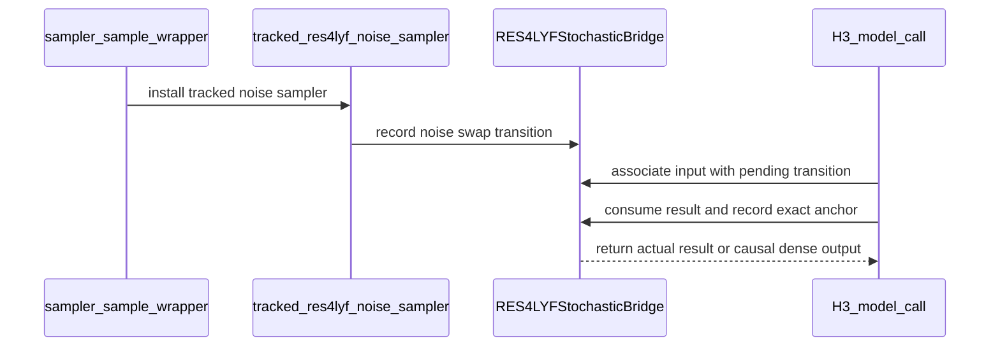

</dd>
</dl>
</details>

<!-- walkthrough_end -->
<details>
<summary><strong>Merge Risk:</strong> <strong><picture></picture> Minimal</strong> · up to <code>59418</code></summary>
<dl>
<dd>
<br>

<!-- final_review_risk_start -->
<!-- final_review_risk_label
**Merge Risk:** _⚪ Minimal_ · up to `59418`
-->
<!-- final_review_risk_coverage:{"sourceCommitId":"59418b6d803b15468e9184a4222ae08bc25fdfb9","coveredCommitId":"59418b6d803b15468e9184a4222ae08bc25fdfb9","kind":"reviewed"} -->

This change adds reviewed RES4LYF sampler support. Unsupported contracts fall back to native sampling. No outstanding code risk was found. The author notes that real H3 media validation of the SDE path is still pending.
<!-- final_review_risk_end -->

</dd>
</dl>
</details>
<!-- pre_merge_checks_walkthrough_start -->

<details>
<summary><strong>Pre-merge checks: <sup><picture></picture></sup> 4</strong></summary>
<dl>
<dd>
<br>

|         Check name         |                                             Status                                             | Explanation                                                                       |
| :------------------------ | :--------------------------------------------------------------------------------------------: | :-------------------------------------------------------------------------------- |
|     Linked Issues check    |  | Check skipped because no linked issues were found for this pull request.          |
| Out of Scope Changes check |  | Check skipped because no linked issues were found for this pull request.          |
|         Title check        |  | The title clearly summarizes the main change: adding RES4LYF RES sampler support. |
|      Description Check     |  | Check skipped - CodeRabbit’s high-level summary is enabled.                       |

</dd>
</dl>
</details>

<!-- pre_merge_checks_walkthrough_end -->
<!-- finishing_touch_checkbox_start -->

<details>
<summary><strong>Finishing Touches</strong></summary>
<dl>
<dd>
<br>

<!-- finishing_touch_suggestion:docstrings -->
<details open>
<summary><strong>Generate docstrings</strong></summary>
<dl>
<dd>
<br>

- [ ] <!-- {"checkboxId":"3e1879ae-f29b-4d0d-8e06-d12b7ba33d98"} --> Commit to this branch
- [ ] <!-- {"checkboxId":"7962f53c-55bc-4827-bfbf-6a18da830691"} --> Create a new PR

</dd>
</dl>
</details>
<details open>
<summary><strong>🧪 Generate unit tests (beta)</strong></summary>
<dl>
<dd>
<br>

- [ ] <!-- {"checkboxId": "6ba7b810-9dad-11d1-80b4-00c04fd430c8", "radioGroupId": "utg-output-choice-group-5730990423"} --> Commit to this branch
- [ ] <!-- {"checkboxId": "f47ac10b-58cc-4372-a567-0e02b2c3d479", "radioGroupId": "utg-output-choice-group-5730990423"} --> Create a new PR

</dd>
</dl>
</details>

</dd>
</dl>
</details>

<!-- finishing_touch_checkbox_end -->

<!-- autopilot:start -->
- [ ] <!-- {"checkboxId":"2708ad07-9f24-4260-9c11-7dc76a49f2e3"} --> <strong title="Keep fixing CodeRabbit findings and required CI, and resolving merge conflicts">Autofix</strong> · Keep fixing CodeRabbit findings and required CI, and resolving merge conflicts
<!-- autopilot:end -->
<!-- tips_start -->


Thanks for using [CodeRabbit](https://coderabbit.ai?utm_source=oss&utm_medium=github&utm_campaign=xmarre/ComfyUI-Spectrum-MiniMax-H3&utm_content=117)! It's free for OSS, and your support helps us grow. If you like it, consider giving us a shout-out.

<details>
<summary><strong>Share</strong></summary>
<dl>
<dd>
<br>

- [X](https://twitter.com/intent/tweet?text=I%20just%20used%20%40coderabbitai%20for%20my%20code%20review%2C%20and%20it%27s%20fantastic%21%20It%27s%20free%20for%20OSS%20and%20offers%20a%20free%20trial%20for%20the%20proprietary%20code.%20Check%20it%20out%3A&url=https%3A//coderabbit.ai)
- [Mastodon](https://mastodon.social/share?text=I%20just%20used%20%40coderabbitai%20for%20my%20code%20review%2C%20and%20it%27s%20fantastic%21%20It%27s%20free%20for%20OSS%20and%20offers%20a%20free%20trial%20for%20the%20proprietary%20code.%20Check%20it%20out%3A%20https%3A%2F%2Fcoderabbit.ai)
- [Reddit](https://www.reddit.com/submit?title=Great%20tool%20for%20code%20review%20-%20CodeRabbit&text=I%20just%20used%20CodeRabbit%20for%20my%20code%20review%2C%20and%20it%27s%20fantastic%21%20It%27s%20free%20for%20OSS%20and%20offers%20a%20free%20trial%20for%20proprietary%20code.%20Check%20it%20out%3A%20https%3A//coderabbit.ai)
- [LinkedIn](https://www.linkedin.com/sharing/share-offsite/?url=https%3A%2F%2Fcoderabbit.ai&mini=true&title=Great%20tool%20for%20code%20review%20-%20CodeRabbit&summary=I%20just%20used%20CodeRabbit%20for%20my%20code%20review%2C%20and%20it%27s%20fantastic%21%20It%27s%20free%20for%20OSS%20and%20offers%20a%20free%20trial%20for%20proprietary%20code)

</dd>
</dl>
</details>


<!-- poem_footer_start -->
<sub>I’m a rabbit by the sampler’s side,<br>I watch each sigma as it slides.<br>Exact anchors mark the trail,<br>Noise swaps leave a tracked detail.<br>Forecasts hold or gently roam,<br>Then I hop to README home.</sub>
<!-- poem_footer_end -->

<!-- tips_end -->
<!-- recent_review_start -->

<h6>
<details>
<summary><strong>ℹ️ Recent review info</strong></summary>
<dl>
<dd>
<br>

<details>
<summary><strong>⚙️ Run configuration</strong></summary>
<dl>
<dd>
<br>

- **Configuration used**: Organization UI
- **Review profile**: CHILL
- **Plan**: Advanced
- **Run ID**: `8c0e6fc7-7e4d-46d0-808d-6933d5814945`

</dd>
</dl>
</details>

<details>
<summary><strong>📥 Commits</strong></summary>
<dl>
<dd>
<br>

Reviewing files that changed from the base of the PR and between 3ddc616244664f7f0021d924fd2498e61946d571 and 59418b6d803b15468e9184a4222ae08bc25fdfb9.

</dd>
</dl>
</details>

<details>
<summary><strong>📒 Files selected for processing (10)</strong></summary>
<dl>
<dd>
<br>

* `.github/workflows/tests.yml`
* `README.md`
* `comfyui_spectrum_h3/external_patch_compat.py`
* `comfyui_spectrum_h3/res4lyf_stochastic.py`
* `comfyui_spectrum_h3/runtime.py`
* `comfyui_spectrum_h3/sampling.py`
* `tests/test_external_patch_compat.py`
* `tests/test_res4lyf_source_fixture.py`
* `tests/test_res4lyf_stochastic.py`
* `tests/test_res4lyf_support.py`

</dd>
</dl>
</details>

**Included review availability:** This review used your included allowance. Your plan provides up to 4 included reviews per hour; 3 remain after this review.

</dd>
</dl>
</details>
</h6>

<!-- recent_review_end -->


> **Comment by xmarre (2026-09-18T14:04:19Z):**

@coderabbitai review


> **Comment by coderabbitai[bot] (2026-09-18T14:04:23Z):**

<!-- This is an auto-generated reply by CodeRabbit -->
<!-- CodeRabbit review command invocation: v2:6c05f1b06c2a28310ef166b1ad56f5e7e7cc56fcc71fd7a2788fc4f7ee01cde0 -->
<details>
<summary>⚠️ Action not completed</summary>

Pull request base or head changed.

> Note: CodeRabbit is an incremental review system and does not re-review already reviewed commits. This command is applicable only when automatic reviews are paused.

</details>


> **Comment by xmarre (2026-09-18T14:20:59Z):**

@coderabbitai review


> **Comment by coderabbitai[bot] (2026-09-18T14:21:04Z):**

<!-- This is an auto-generated reply by CodeRabbit -->
<!-- CodeRabbit review command invocation: v2:868b60a418f528f4fb48c869bbc5c92b9dd4f8aefc59063ea38d464bee7ef6a1 -->
<details>
<summary>⚠️ Action not completed</summary>

Pull request base or head changed.

> Note: CodeRabbit is an incremental review system and does not re-review already reviewed commits. This command is applicable only when automatic reviews are paused.

</details>


> **Comment by xmarre (2026-09-18T15:04:47Z):**

@coderabbitai review


> **Comment by coderabbitai[bot] (2026-09-18T15:04:52Z):**

<!-- This is an auto-generated reply by CodeRabbit -->
<!-- CodeRabbit review command invocation: v2:0a902e5897a2532b7ba6c3719616a8207ad6b1cf0a16e8e16515d0eca0943357 -->
<details>
<summary>✅ Action performed</summary>

Review finished.

> Note: CodeRabbit is an incremental review system and does not re-review already reviewed commits. This command is applicable only when automatic reviews are paused.

</details>


> **Comment by xmarre (2026-09-19T15:57:08Z):**

@coderabbitai review


> **Comment by coderabbitai[bot] (2026-09-19T15:57:12Z):**

<!-- This is an auto-generated reply by CodeRabbit -->
<!-- CodeRabbit review command invocation: v2:5985ea343ca89050db945f086556340b578cf28190e643048d8942833b27aa99 -->
<details>
<summary>✅ Action performed</summary>

Review finished.

> Note: CodeRabbit is an incremental review system and does not re-review already reviewed commits. This command is applicable only when automatic reviews are paused.

</details>


> **Comment by xmarre (2026-10-06T05:18:34Z):**

Follow-up review in progress against `f2ce9d97f439564df5a6e2e475f83fdf746a1664`. I am checking the fixes for late invalidation, live callable provenance, install/restore ownership and swap/retry receipts, including independent adversarial reproductions through the production wrapper chain. I will post concrete findings and validation results here. Real H3 media acceptance remains a separate open gate.


> **Comment by xmarre (2026-10-06T05:21:41Z):**

Claude — follow-up review of `f2ce9d97f439564df5a6e2e475f83fdf746a1664`: the original late-invalidation, foreign function replacement, foreign-class restoration and missing-swap cases now pass. The focused existing suites passed **103 tests** against pinned ComfyUI `be92396` and RES4LYF `e8437ef`; CI-equivalent lint passed. Three independent mutation probes still fail:

1. **P2: mid-run integrity retains mutable function objects, not their implementation state.** `res4lyf_stochastic.py:674–710` compares dictionaries of the same function objects. Mutating `RK_NoiseSampler.swap_noise_substep.__code__` in place leaves those objects equal. Repro through `_spectrum_res4lyf`: at the first `res_2s` forecast, use the `inside_call` hook to replace the existing function's `__code__` with `code.replace(co_consts=...)` (change native `0.999` to `0.02`). The current call remains `forecast`, later forecasting continues, and `bridge.invalid_reason` remains `None`. Expected: discard/retry the current forecast exactly and disable subsequent forecasts. Capture immutable implementation state (code plus callable configuration) and verify it at both association and consumption; do not compare aliased function references alone.

2. **P2: the live source audit omits defaults.** `_res4lyf_live_noise_sampler_reason` verifies `__code__`, globals and closures, but accepts altered `__defaults__` / `__kwdefaults__`. A changed default is executable behaviour with unchanged bytecode. A minimal reproduction is `swap_noise_step.__defaults__ = (torch.tensor(0.7), None, None)` followed by `_res4lyf_reviewed_noise_sampler`: it returns `reason=None`. Validate defaults against the audited source and include their frozen state in the mid-run integrity check. I am additionally checking a default that changes the actual named wrapper's trajectory, rather than relying only on the provenance assertion.

3. **P2, isolated bridge contract: a same-object in-place edit is accepted as an unchanged retry.** `associate()` stores `_associated_input = x` and tests only `x is self._associated_input`. Associate a tracked noised tensor at sigma 0.8, run `x.add_(0.01)`, then associate that same object/step/sigma again with no swap. It returns successfully. The four new re-association tests do not cover this case. Verify input contents or a reliable mutation receipt, including inference tensors; audit the actual retry transaction as well, since its executor retry does not call `associate()` again.

Please keep these corrections narrow and on #117, with regression tests for each case. These are mutation/contract failures; I am not claiming they occur in an untouched RES4LYF run. The real H3 audio/video gate remains open independently. I will post the remaining verification results here.


> **Comment by xmarre (2026-10-06T05:22:11Z):**

Additional evidence for the defaults finding on `f2ce9d9`: changing the existing `RK_NoiseSampler.get_sde_step` function's last default (`VP_OVERRIDE`) from `None` to `False` changes the **same-seed native `res_2m` tensor output**, while `_res4lyf_reviewed_noise_sampler` still returns `reason=None`.

Reproduction using the existing pinned fixture helpers:
```python
beta, rk = _res4lyf_runtime_fixture()
denoise = _denoiser(*_manifold())
before = _native_res4lyf(beta, "res_2m", denoise)
f = rk.RK_NoiseSampler.get_sde_step
monkeypatch.setattr(f, "__defaults__", (*f.__defaults__[:-1], False))
after = _native_res4lyf(beta, "res_2m", denoise)
assert not torch.equal(before, after)  # passes: behaviour changed
sampler = SimpleNamespace(sampler_function=beta.sample_res_2m)
assert _res4lyf_reviewed_noise_sampler(sampler)[2] is not None  # FAILS
```
This establishes a changed numerical contract accepted as reviewed, independent of H3 quality. All three independent mutation probes failed as expected; the 103 existing focused tests passed.


> **Comment by xmarre (2026-10-06T05:23:00Z):**

Follow-up verification completed at `f2ce9d97f439564df5a6e2e475f83fdf746a1664`: **393 existing targeted tests passed, 2 CUDA tests skipped; all three independent mutation probes failed.** CI-equivalent Ruff, compileall and `git diff --check` passed. The late-invalidation regression now retries the same call exactly and disables future forecasts; the original replacement/restoration and missing-swap reproductions also pass.

Verdict remains **request changes** for the three cases detailed above: in-place callable-code mutation, unaudited callable defaults (confirmed to change native `res_2m` output), and same-object input mutation accepted as an unchanged retry. These findings concern the advertised external-patch and state-ownership contract; no ordinary-run H3 failure was established by these CPU tests. Same-seed real H3 SDE audio/video validation remains required before merge. I have left the implementation branch unchanged so you can apply the corrections on #117 without overlapping edits.


> **Comment by xmarre (2026-10-06T05:27:33Z):**

All three follow-up findings are addressed in c9f8d7a. Each has a regression test; on the f2ce9d9 library code all nine new tests fail. Some of those fail only because the new required `model_input` argument does not exist there; the code-mutation and defaults cases fail on behaviour.

1. **Mid-run integrity: aliased function objects.** The installation snapshot now records each `RK_NoiseSampler` callable's implementation state: code object, defaults, keyword defaults, closure contents and the module globals its code references. It compares these by identity, so a reassigned `__code__` or `__defaults__` on the same function object is detected. The check runs at every association and every result.
   - Regression (`test_in_place_function_mutation_during_the_run_fails_closed[code|defaults]`): through `_spectrum_res4lyf`, at the first `res_2s` forecast, swap `swap_noise_substep.__code__` for a copy with 0.999 → 0.02, or replace its defaults.
   - Result: that call completes as `actual` with the exact result, there are no later forecasts, `invalid_reason` reports the method change, and the runtime is disabled.

2. **Defaults are not audited.** `_res4lyf_live_noise_sampler_reason` now also calls a new `source_code_audit.matches_source_defaults`, which parses the audited source.
   - Literal defaults must match in exact type and value.
   - A dotted-name default (here only `__init__`'s `torch.float64`) must resolve, in the method's own globals, to the identical object of an allowed immutable type (`torch.dtype`).
   - Names resolving to mutable objects, and any other default expression, are rejected.
   - Regressions:
     - Your `swap_noise_step.__defaults__ = (torch.tensor(0.7), None, None)` makes `_res4lyf_reviewed_noise_sampler` and the contract reject the sampler, and the run stays all-actual.
     - Unit tests of the helper cover literal type and value mismatches, kwdefaults, and a mutable resolved name.

3. **Same-object in-place edit accepted as an unchanged retry.** Association now keeps an owned copy of the validated input; for stochastic calls this reuses the noised copy, so there is no second clone. Reusing an association for the same step requires the same object, identical contents (`torch.equal`), the same sigma and no swap since. This does not rely on the version counter, so inference tensors are covered.
   - **Retry transaction:** `res4lyf_consume_model_result` now receives `x`, and `bridge.consume` checks it against the same copy. This covers the executor's exact retry, which does not call `associate()` again.
   - Regressions:
     - Your sigma-0.8 `x.add_(0.01)` re-association case, in normal and inference mode.
     - Consume after an in-place edit: a forecast raises, while an exact result is kept and tracking is invalidated.
     - A wrapper-level case where the forecast attempt edits `x` and then forces the executor retry: the retry's result check catches it, and forecasting is disabled.

Validation (CPU, ComfyUI `be92396`, RES4LYF `e8437ef`): 1131 passed, 40 skipped. Ruff (CI file lists and flags) and compileall pass.

**Remaining limits:**
- The live-code and defaults audit covers `RK_NoiseSampler` only. The other audited RES4LYF modules are still checked by file blob.
- Module globals referenced by the methods are only checked for stability during the run, not for provenance. For example, `normalize_zscore` comes from the unaudited `latents` module.
- Real H3 audio/video acceptance remains open.

---
_Generated by [Claude Code](https://claude.ai/code)_


> **Comment by xmarre (2026-10-06T05:28:42Z):**

Your `get_sde_step` `VP_OVERRIDE` reproduction is now a regression test in 05cbd9f: `test_default_that_changes_native_output_is_rejected`.

It asserts two things on the pinned fixture. First, the altered default changes same-seed native `res_2m` output. Second, `_res4lyf_reviewed_noise_sampler` rejects it with `get_sde_step defaults are not the reviewed native defaults`. The test fails on the f2ce9d9 library code and passes with the defaults audit from c9f8d7a. The `False` vs `None` mismatch is caught by the exact-type literal comparison.

---
_Generated by [Claude Code](https://claude.ai/code)_


> **Comment by xmarre (2026-10-06T05:33:12Z):**

Claude — reviewing `05cbd9f1a12d39fa61f1d9fe1dbc79514fca0962` now. The head is checkpointed as `checkpoint/pr117-review3-20261006-05cbd9f`. I will rerun the three independent reproductions, inspect the input/retry and callable-state changes, and post the verified result here. The implementation branch will remain unchanged.


> **Comment by xmarre (2026-10-06T05:36:16Z):**

Claude — the three independent reproductions from the previous review now **pass** on `05cbd9f`; the existing targeted suites plus those probes passed **406 tests, 2 CUDA skips**. The fixes cover code/default mutation and the same-object input edit, including the wrapper retry path.

One additional **P2 live-contract gap** remains in `sampling.py:3820–3859`: the audit verifies underlying functions but does not require the reviewed callable inventory and descriptor kinds. Unwrapping `staticmethod`/`classmethod` loses binding semantics; replacing a non-required helper with a noncallable makes the loop skip it entirely.

Concrete pinned-fixture reproduction:
```python
beta, rk = _res4lyf_runtime_fixture()
cls = rk.RK_NoiseSampler
native = object.__new__(cls)
native.av_split, native.av_total = 2, 4
native.av_audio_noise_scale = 1.0
native.av_shift_video, native.av_shift_audio = 12.0, 8.0
native.scale_av_noise(torch.ones(1, 4), 0.8, 0.6)  # succeeds
original = vars(cls)["_av_renoise_var"]  # staticmethod
monkeypatch.setattr(cls, "_av_renoise_var", original.__func__)
# Code, globals and defaults are unchanged, but instance binding changed.
native.scale_av_noise(torch.ones(1, 4), 0.8, 0.6)  # TypeError: 3 arguments
sampler = SimpleNamespace(sampler_function=beta.sample_res_2m)
assert sampling._res4lyf_reviewed_noise_sampler(sampler)[2] is not None
# FAIL: reason is None, the modified class is accepted as reviewed.
```
The alternative replacement `cls._av_renoise_var = None` is also accepted and also makes `scale_av_noise` raise `TypeError`. This is the native AV noise-scaling branch, not an invented numerical surrogate. I am not claiming an untouched RES4LYF install has this failure.

Please compare the live class against the audited source's complete callable inventory **and binding kinds** (instance/static/class methods), rejecting removed/noncallable helpers and changed descriptors before installing tracking. Add regressions for both cases; preserve the existing all-actual fallback and mid-run checks. A full existing-suite run is in progress. Real H3 media acceptance remains open separately.


> **Comment by xmarre (2026-10-06T05:36:59Z):**

Third-round review completed at `05cbd9f1a12d39fa61f1d9fe1dbc79514fca0962`.

- **Previous three findings: resolved.** All three original independent reproductions pass; the new implementation tests pass, including inference-tensor input ownership and the production retry transaction.
- **Full existing local suite: 1132 passed, 40 skipped** (CUDA and unavailable optional external fixtures). The targeted run with the three original probes passed 406 tests, 2 CUDA skips. Ruff with the CI flags for changed files, compileall and `git diff --check` passed. GitHub's tests workflow succeeded for this head.
- **One remaining P2, two failing independent cases:** the preflight/install-time live class audit accepts `_av_renoise_var` changed from a static method to an instance method, or replaced with `None`; both break native `scale_av_noise` with `TypeError` for shifted AV streams. Details and reproduction are in the preceding comment. Require the complete reviewed callable inventory and descriptor kinds, not only the underlying code/defaults of callables that remain.

Verdict: **request changes for that live-contract gap**. These are externally altered-class cases, not an established failure in an untouched installation. CPU correctness tests do not establish real H3 speech/video quality; the same-seed SDE media gate should remain open and the PR draft until that validation is available. The implementation branch is unchanged and my local review mirror is clean.


> **Comment by xmarre (2026-10-06T05:39:37Z):**

The callable-inventory and binding-kind finding is addressed in 048a2d9.

The new `source_code_audit.class_callable_inventory_reason` derives the reviewed inventory from the audited class body. For `RK_NoiseSampler` that is 29 definitions, with `_av_renoise_var` as the only `staticmethod`; the body contains no other statements. The live class must match exactly:

- every source callable is present with the same binding kind (instance function, `staticmethod`, `classmethod` or `property`);
- no entry is removed or replaced by a non-callable;
- no extra callables or descriptors are added.

The check runs in `_res4lyf_live_noise_sampler_reason` before the per-function code, defaults, globals and closure checks. It therefore applies at preflight and immediately before installing tracking, and an unreviewed class keeps the run all-actual. The mid-run snapshot already records each descriptor object, so the same changes during a run fail closed. The existing fallback and mid-run checks are unchanged.

Regressions in `test_live_callable_inventory_and_binding_kinds_are_audited`:

- `unwrapped_staticmethod`: your reproduction. It also asserts that `scale_av_noise` then raises `TypeError` on the native AV branch.
- `noncallable`: `_av_renoise_var = None`, with the same `TypeError` assertion.
- `removed`: `linear_noise_init` deleted.
- `kind_flip`: `get_sde_coeff` wrapped as a `staticmethod`.
- `extra_callable`: an unreviewed lambda added to the class.

All five fail on the 05cbd9f library code. `test_descriptor_change_during_the_run_fails_closed` covers both descriptor changes made during a forecast: the same call is retried exactly and later forecasts are disabled. That test already passed on 05cbd9f because of the descriptor-object snapshot; it stays as a regression.

Validation: 1139 passed, 40 skipped (CPU, ComfyUI `be92396`, RES4LYF `e8437ef`). Ruff, compileall and `git diff --check` are clean. Real H3 media acceptance remains open.

---
_Generated by [Claude Code](https://claude.ai/code)_


> **Comment by xmarre (2026-10-06T05:44:13Z):**

Taking over the remaining work on #117. Current head `048a2d94da6d621e02f98b95392975d7ab945faf` is checkpointed on GitHub at `checkpoint/pr117-takeover-20261006-048a2d9`. I will verify the callable-inventory fix against the independent reproductions, complete any remaining corrections and GPU-test instructions on this PR, and keep media acceptance open until same-seed H3 validation is available.


> **Comment by xmarre (2026-10-06T05:55:52Z):**

GPU-test preparation is published on #117 at `7e978c69734117617285be38923fdaefefa4d101`, with checkpoint `checkpoint/pr117-gpu-ready-20261006-7e978c6`.

Claude's inventory/binding fix passes the five independent reproductions from earlier reviews. I completed the remaining corrections:

- Require exact built-in descriptor types. A `staticmethod` subclass can preserve the audited `__func__` while changing AV noise scaling through `__get__`; this is now rejected.
- Reject custom descriptors added before tracking and include descriptor objects in the mid-run snapshot, so additions during a forecast cause an exact retry and disable further forecasting.
- Apply fallback immediately when `bridge.consume` invalidates an exact result's input. Previously the early return kept the result but delayed runtime disablement until the next association.
- Extend bitwise tracked/native all-actual tests to active packed AV splitting with distinct audio/video shifts for all six SDE wrappers. Each case also verifies that the AV branch actually changes the native trajectory.

The descriptor-subclass and exact-result invalidation tests failed before these corrections and pass afterward. An added custom-descriptor inventory case also reproduced acceptance before correction. Latest targeted validation: **425 passed, 2 CUDA skips**, including the five independent probes. Ruff, compileall and `git diff --check` pass. GitHub CI is running on this head.

README and unreleased notes now state the empirical acceptance limit and explain that `audio_blend_weight=0` does not make skipped-call SDE audio native. The complete GPU test procedure is [docs/RES4LYF_GPU_VALIDATION.md](https://github.com/xmarre/ComfyUI-Spectrum-MiniMax-H3/blob/7e978c69734117617285be38923fdaefefa4d101/docs/RES4LYF_GPU_VALIDATION.md): matched native/Spectrum `res_2m` and `res_3s` outputs, fixed seeds/settings, completed forecasts and clean tracking, decoded audio/video/previews, and an all-actual control if a regression appears.

The PR remains draft pending real H3 media acceptance; no release or merge has been performed.


> **Comment by xmarre (2026-10-06T05:58:50Z):**

Final pre-GPU verification at `7e978c69734117617285be38923fdaefefa4d101`: **all 10 CI compatibility lanes passed** in [workflow run 37420916275](https://github.com/xmarre/ComfyUI-Spectrum-MiniMax-H3/actions/runs/37420916275). This includes Python 3.13 and the latest pinned ComfyUI/RES4LYF lane with `SPECTRUM_REQUIRE_RES4LYF_RUNTIME=1`; the required runtime tests were exercised. Local targeted validation remains 425 passed, 2 CUDA skips. Published and tested trees match exactly, the review checkout is clean, and the PR's existing base/history are preserved.

No reproduced code blocker remains in the reviewed scope. The remaining acceptance work is real H3 GPU media validation using [the checked-in procedure](https://github.com/xmarre/ComfyUI-Spectrum-MiniMax-H3/blob/7e978c69734117617285be38923fdaefefa4d101/docs/RES4LYF_GPU_VALIDATION.md): native versus Spectrum `res_2m` and `res_3s`, matched seeds and workflow, completed forecasts, clean tracking and full decoded audio/video comparison. A successful all-actual run does not satisfy this gate. The PR stays draft pending those results.


> **Comment by xmarre (2026-10-06T06:18:19Z):**

The first GPU attempt was blocked before Spectrum ran: both RES4LYF passes reported `RES4LYF beta RK sampler source is not a reviewed revision`. The whole-file whitelist pinned September 11 source and rejected current upstream changes. I am removing revision-whitelist gating from this adapter, retaining native API/live-binding checks and stochastic runtime validation, and adding current RES4LYF 1.2.0 coverage. Checkpoint: `checkpoint/pr117-source-gate-20261006-7e978c6`. The Flow exact-probe native bypass in the same log is unrelated.


> **Comment by xmarre (2026-10-06T06:26:05Z):**

Published the fix at f9b258c9e10df7f259b9c7152d650657bf59fcbc. Removed the entire RES4LYF whole-file revision whitelist; no new whitelist was substituted. The run-log blocker (`beta RK sampler source is not a reviewed revision`) is gone.

Validated ComfyUI 0.38.0 + RES4LYF 1.2.0: 138 passed, including all six SDE wrappers using the current PackedNoiseGenerator on 3D packed AV inputs, bitwise tracked/native all-actual parity, completed forecasts and no bridge invalidation. Earlier fixture regressions: 10 passed. Current source/shared sampler contracts: 55 passed. Ruff, compileall and diff checks pass. Added a required current-version CI lane.

The existing workflow can now be retried after refreshing the PR #117 overlay in ComfyUI Patcher. GPU media quality remains to be measured. The earlier whole-file whitelist was my mistake; it blocked a compatible upstream update.


> **Comment by xmarre (2026-10-06T06:29:33Z):**

CI is green at f9b258c: all 11 compatibility lanes passed. The required ComfyUI 0.38.0 + RES4LYF 1.2.0 lane ran 398 + 802 passing tests (3 skips in each suite), including the actual imported RES4LYF runtime, packed AV parity and completed forecasts.

https://github.com/xmarre/ComfyUI-Spectrum-MiniMax-H3/actions/runs/37423669017

The fix is ready through the PR #117 Patcher overlay. No RES4LYF source-revision whitelist remains.


> **Comment by xmarre (2026-10-06T06:41:39Z):**

Fixed the native float64 debug RMS crash at af3eda5068f90871307d3a1c089c9182edd21c32.

With Spectrum debug enabled, the first RES4LYF noise swap can return a float64 increment. `_rms()` requested `vector_norm(..., dtype=float32)`, which PyTorch rejects as narrowing. The helper now retains float64 accumulation for float64 input and float32 accumulation for lower-precision input; solver states are untouched.

Reproduced the exception through the actual imported `res_2m` packed AV sampler before fixing it. Updated all six packed AV SDE tests to enable debug for native parity and completed forecasts. Current fixture: 10 passed / 4 CUDA skips. Earlier fixture: 6 passed. Ruff, compileall and diff checks pass. The previous runtime tests had debug disabled and missed this branch. CI is running on the new head.


> **Comment by xmarre (2026-10-06T06:44:54Z):**

CI passed all 11 lanes at af3eda5. The required ComfyUI 0.38.0 + RES4LYF 1.2.0 runtime lane completed 398 passed / 3 skipped and 806 passed / 7 skipped, including debug-enabled packed AV native parity and completed forecasts for all six SDE wrappers. CUDA diagnostic tests are skipped on CPU runners.

https://github.com/xmarre/ComfyUI-Spectrum-MiniMax-H3/actions/runs/37425161927

The float64 debug RMS fix is available through PR #117. Debug logging can stay enabled. Actual H3 GPU output quality remains unvalidated.


> **Comment by xmarre (2026-10-06T07:02:15Z):**

GPU quality feedback: poor audio; visual defects reported as moderate. This run did not execute any Spectrum forecast: five actual low-pass calls, one exact probe and four actual high-pass calls. Both RES4LYF bridges completed with invalid_reason=None. The independent Flow counters confirm transformer_actual_nfe=10 and sampler_logical_calls=10.

The SDE dense-output replacement was never invoked. Traced the actual-result path: it retains the native denoiser result. Also checked the two short schedules with the existing synthetic-denoiser fixture, packed AV input and current ModelSamplingAV (video shift 12, audio shift 3, audio_scale=4): both produce bitwise native/tracked equality and zero forecasts. This CPU check does not establish GPU integration parity or media quality.

The native res_2m wrapper uses eta=0.5 and eta_substep=0.5. The high pass has only two outer intervals, including the native RES fallback on its final interval. Stochastic noise on this coarse schedule is a candidate explanation, not an established cause. A matched same-seed native control with Spectrum disabled is the next isolation check; res_2m_ode then isolates the added noise by setting both eta values to zero.

No code change is justified by this evidence yet. The PR remains draft; audio quality is not accepted and accelerated quality is still untested.


> **Comment by xmarre (2026-10-08T23:47:32Z):**

## v0.2.29 tracked-base conflict resolved

The earlier ComfyUI Patcher failure at `RELEASE_NOTES.md` came from attempting to apply PR #117's 11-commit, v0.2.28-based history after the v0.2.29 tracked base. The PR's README, workflow and shared `source_code_audit.py` also overlapped the released changes.

PR #117 now contains **one commit** ([`74c567a`](https://github.com/xmarre/ComfyUI-Spectrum-MiniMax-H3/commit/74c567a0be9c8063bca64f980e9ae92a18664bd1)) directly on [v0.2.29 main `806fe49`](https://github.com/xmarre/ComfyUI-Spectrum-MiniMax-H3/commit/806fe498d574a726fecb8818917f00a4b993fd77), with the same 13 intended changed paths and no commits behind main. GitHub confirms mergeable.

The release notes preserve v0.2.29's published section and track RES4LYF as unreleased. All new RES4LYF implementation paths and their unchanged source blobs were retained. The three other shared files were integrated with v0.2.29's Core BSA and code-semantics changes intact.

[Rebased CI run #37861086479](https://github.com/xmarre/ComfyUI-Spectrum-MiniMax-H3/actions/runs/37861086479): **11/11 jobs passed**, including the ComfyUI 0.38.0 / RES4LYF 1.2.0 runtime fixture lane.

The PR remains **draft/unmerged**, with accelerated H3 audio/video GPU validation still outstanding. It is a valid single PR overlay over current main; the merged PR #121 does not need to remain selected as a separate overlay in Patcher.

Checkpoint: `checkpoint/pr117-before-v029-rebase-20261009`. Mirror: `review/pr117-v029-integration-20261009`.


> **Comment by xmarre (2026-11-10T19:32:22Z):**

Sequential-stack conflict resolved against released v0.2.30 `main` (`7df883bb2361b7884ad789e97effd1dc37c8963a`). PR #117 is now a single commit (`ada454ae3310fb609e80c3298d1338d185450ae9`) atop that exact base, retaining the RES4LYF fixture and all new PDD CI matrix entries. [CI run #771](https://github.com/xmarre/ComfyUI-Spectrum-MiniMax-H3/actions/runs/42885656458) passed **13/13** jobs; GitHub reports the PR mergeable, 0 commits behind, and the unchanged 13-path feature diff. Use PR #117 alone as the pending Spectrum RES4LYF overlay in ComfyUI Patcher; PRs #126/#127/#129/#130 are already in `main`. This feature PR remains draft pending decoded audio/video GPU validation.


### #116 [open] PR: WIP: reconcile Keyless Core BSA with domain-aware Untwist
URL: https://github.com/xmarre/ComfyUI-Spectrum-MiniMax-H3/pull/116  by xmarre 2026-09-18T13:14:12Z

Stacked continuation on top of #114.

This promotes the reviewed Keyless-aware Core-BSA pass-through work and reconciles Spectrum's Keyless Untwist identity adapter with the domain-aware producer contract from xmarre/ComfyUI-Untwisting-RoPE#12.

### Core-BSA source gate

The reviewed ComfyUI companion is xmarre/ComfyUI#7 at `7c7affc4e07840930374b724b1f7e10981c8e9ae`, one commit on upstream `a8686f2b33fc540f137df50c0f0719953830a5e7`. Its exact `nodes_sparse_attention.py` blob remains `3f508f899f5d5629d8a5b31d9ef2c26ccd7ae919`.

Spectrum now recognizes only that exact Keyless-aware generic Core-BSA override, proves its closure ownership/settings and absence of the native QKV H3 block producer, preserves the materialized Q/route(V)/V override, and intentionally leaves the composition actual-only for forecast history. Unknown inherited attention owners, forged native-H3 block replacements, source drift and malformed ownership fail closed.

### Untwist #12 reconciliation

Untwist #12 changes the Keyless routing-preprocessor identity from v1 to v2 and adds `apply_domain(route, value_domain, routing_position_domain)` so selected/reordered sparse providers can map local route rows through original packed routing coordinates.

Spectrum now source-gates both reviewed producer versions:
- #11 blob `53079e70b7996b1a872d9ff1e5f219cc1f110c3e`, v1 full-domain identity;
- #12 blob `1de8f77d0c439ec073daad1a5a0928f2ad9a343e`, v2 domain-aware identity.

For #12, the adapter requires `apply_domain`, recomputes the exact v2 declared digest from the immutable snapshot, binds the live external-patch runtime descriptor, and continues to omit only smooth denoising progress from Spectrum history identity. All static numerical semantics remain identity-bearing.

### CI hardening

The workflow now pins Untwist #12 and adds an exact xmarre/ComfyUI#7 fixture lane using Comfy's current `comfy-kitchen==0.2.35` and `comfy-aimdo==0.5.5`. That lane sets `SPECTRUM_REQUIRE_KEYLESS_BSA_FIXTURE=1`, so the new Core-BSA tests cannot silently skip if the reviewed source is not actually checked out. Older pinned ComfyUI fixtures that predate `comfy_extras.nodes_sparse_attention` skip these additive tests; the mandatory current fixture fails instead of skipping on a missing/drifted module.

This is structural/reference compatibility work. It does not establish decoded Keyless audiovisual parity, forecast quality under real GPU sparse execution, no-global-route fused execution, or performance.

Topology:
- base: `mirror/keyless-untwist-route-compat-20260918` (#114 head)
- base SHA: `72e5056790abc5f98699b2d31e5bdf0b26287c6e`
- head: `mirror/keyless-aware-core-bsa-continue-20260918`
- head SHA: `be1584124547e4978197701d227baa6c909ad156`
- checkpoint: `checkpoint/keyless-aware-core-bsa-domain-aware-v2-20260918`
- hosted CI: Actions run `35349462879`, green


> **Comment by coderabbitai[bot] (2026-09-18T13:14:18Z):**

<!-- This is an auto-generated comment: summarize by coderabbit.ai -->
<!-- This is an auto-generated comment: skip review by coderabbit.ai -->

> [!IMPORTANT]
> ## Review skipped
> 
> Auto reviews are disabled on this repository. Please check the settings in the CodeRabbit UI or the `.coderabbit.yaml` file in this repository. To trigger a single review, invoke the `@coderabbitai review` command.
> 
> <details>
> <summary>⚙️ Run configuration</summary>
> 
> **Configuration used**: Organization UI
> 
> **Review profile**: CHILL
> 
> **Plan**: Advanced
> 
> **Run ID**: `92241bd2-7ee9-4b63-bd08-19044cd29571`
> 
> </details>
> 
> You can disable this status message by setting the `reviews.review_status` to `false` in the CodeRabbit configuration file.
> 
> Use the checkbox below for a quick retry:
> - [ ] <!-- {"checkboxId":"e9bb8d72-00e8-4f67-9cb2-caf3b22574fe"} --> 🔍 Trigger review

<!-- end of auto-generated comment: skip review by coderabbit.ai -->

<!-- tips_start -->

---

Thanks for using [CodeRabbit](https://coderabbit.ai?utm_source=oss&utm_medium=github&utm_campaign=xmarre/ComfyUI-Spectrum-MiniMax-H3&utm_content=116)! It's free for OSS, and your support helps us grow. If you like it, consider giving us a shout-out.

<details>
<summary>❤️ Share</summary>

- [X](https://twitter.com/intent/tweet?text=I%20just%20used%20%40coderabbitai%20for%20my%20code%20review%2C%20and%20it%27s%20fantastic%21%20It%27s%20free%20for%20OSS%20and%20offers%20a%20free%20trial%20for%20the%20proprietary%20code.%20Check%20it%20out%3A&url=https%3A//coderabbit.ai)
- [Mastodon](https://mastodon.social/share?text=I%20just%20used%20%40coderabbitai%20for%20my%20code%20review%2C%20and%20it%27s%20fantastic%21%20It%27s%20free%20for%20OSS%20and%20offers%20a%20free%20trial%20for%20the%20proprietary%20code.%20Check%20it%20out%3A%20https%3A%2F%2Fcoderabbit.ai)
- [Reddit](https://www.reddit.com/submit?title=Great%20tool%20for%20code%20review%20-%20CodeRabbit&text=I%20just%20used%20CodeRabbit%20for%20my%20code%20review%2C%20and%20it%27s%20fantastic%21%20It%27s%20free%20for%20OSS%20and%20offers%20a%20free%20trial%20for%20proprietary%20code.%20Check%20it%20out%3A%20https%3A//coderabbit.ai)
- [LinkedIn](https://www.linkedin.com/sharing/share-offsite/?url=https%3A%2F%2Fcoderabbit.ai&mini=true&title=Great%20tool%20for%20code%20review%20-%20CodeRabbit&summary=I%20just%20used%20CodeRabbit%20for%20my%20code%20review%2C%20and%20it%27s%20fantastic%21%20It%27s%20free%20for%20OSS%20and%20offers%20a%20free%20trial%20for%20proprietary%20code)

</details>


<sub>Comment `@coderabbitai help` to get the list of available commands.</sub>

<!-- tips_end -->


### #115 [closed] PR: Fix CRLF source audits on Windows
URL: https://github.com/xmarre/ComfyUI-Spectrum-MiniMax-H3/pull/115  by xmarre 2026-09-18T12:46:34Z

Fixes #112.

## Root cause

Spectrum's reviewed-source gates compare against canonical Git blob hashes, but `_hash_git_blob()` was hashing raw working-tree bytes. On Git-for-Windows checkouts with `core.autocrlf=true`, reviewed Python files can be materialized as CRLF even though the repository blob is LF-normalized. The same reviewed source therefore failed the pinned digest check and became `source_unreviewed`.

For Core BlockSparseAttention, that makes ownership unprovable and the backend-history preflight conservatively forces forecast-selected steps back to actual H3 evaluations.

The report is reproducible: Git's text-clean path hashes CRLF working-tree text to the LF repository blob, while the old direct byte hash produces a different object ID.

## Fix

- normalize only CRLF pairs to LF before constructing the audited Git blob payload;
- keep the raw working-tree size check before normalization;
- leave lone CR bytes and every substantive source modification significant;
- keep all existing source/ownership/receipt fail-closed behavior unchanged.

The fix is deliberately centralized in the existing source-blob helper. Core BSA, Flow attention/Mixed-Grid, Untwist preprocessing, loader checks and diagnostics all consume that helper, so no per-adapter exception is introduced.

## Regression coverage

A new regression:
- writes a CRLF working-tree copy of canonical LF source and verifies the audited hash matches the LF Git blob identity;
- changes actual source content separately and verifies the digest no longer matches.

The branch is exactly one commit over current `main` (`120d72e2f48b781235b34149e39bbdf0f1317d82`).

## Release

This is packaged as v0.2.28 with context-isolated release notes. No sampler equations, scheduling policy, BSA route semantics, backend receipt semantics, cold-to-primed recovery, Flow/Untwist behavior, or fallback policy are changed.

<!-- This is an auto-generated comment: release notes by coderabbit.ai -->

## Summary by CodeRabbit

- **Bug Fixes**
  - Fixed source verification for Windows checkouts using CRLF line endings.
  - Prevented unchanged, reviewed sources from being incorrectly flagged as unreviewed or producing unintended H3 forecast evaluations.
  - Continued detecting substantive source changes while preserving handling of lone carriage returns.

- **Release**
  - Updated the project to version 0.2.28.

<!-- end of auto-generated comment: release notes by coderabbit.ai -->

## Validation

GitHub Actions run `35346474039` / tests #713 passed all 10 ComfyUI/Python matrix jobs, including Ruff, compileall, focused external compatibility suites, the reviewed `be923968` Core-BSA fixture lane, Python 3.13, and the native MiniMax-H3 suite.

A standalone Git reproduction also confirms the reported mechanism: with `core.autocrlf=true`, `git hash-object` cleans a CRLF working-tree file back to the canonical LF blob while a raw byte-level Git-object hash differs.

> **Comment by coderabbitai[bot] (2026-09-18T12:46:41Z):**

<!-- This is an auto-generated comment: summarize by coderabbit.ai -->
<!-- review_stack_entry_start -->

<a href="https://app.coderabbit.ai/change-stack/xmarre/ComfyUI-Spectrum-MiniMax-H3/pull/115#gh-light-mode-only"></a><a href="https://app.coderabbit.ai/change-stack/xmarre/ComfyUI-Spectrum-MiniMax-H3/pull/115#gh-dark-mode-only"></a>

<!-- review_stack_entry_end -->
<!-- recent_review_start -->

No actionable comments were generated in the recent review. 🎉

<details>
<summary>ℹ️ Recent review info</summary>

<details>
<summary>⚙️ Run configuration</summary>

**Configuration used**: Organization UI

**Review profile**: CHILL

**Plan**: Advanced

**Run ID**: `7a163a1f-f1b1-4a32-8f84-40dfca48f720`

</details>

<details>
<summary>📥 Commits</summary>

Reviewing files that changed from the base of the PR and between 120d72e2f48b781235b34149e39bbdf0f1317d82 and 07a827288e9ca814f16a694a5e175bb9351c55b0.

</details>

<details>
<summary>📒 Files selected for processing (4)</summary>

* `RELEASE_NOTES.md`
* `comfyui_spectrum_h3/core_bsa_compat.py`
* `pyproject.toml`
* `tests/test_core_bsa_compat.py`

</details>

**Included review availability:** Your plan provides up to 4 included reviews per hour; 3 remain after this review.

</details>

---


<!-- recent_review_end -->
<!-- walkthrough_start -->

<details>
<summary>📝 Walkthrough</summary>

## Walkthrough

The shared Git blob hashing path now converts CRLF pairs to LF after checking raw file size. Regression tests verify canonical Git blob identity and rejection of changed content. The project version and release notes advance to v0.2.28.

### Changes

**CRLF Blob Audit Fix**

|Layer / File(s)|Summary|
|---|---|
|**Normalize audited source hashes and validate the result** <br> `comfyui_spectrum_h3/core_bsa_compat.py`, `tests/test_core_bsa_compat.py`, `RELEASE_NOTES.md`, `pyproject.toml`|`_hash_git_blob` normalizes CRLF pairs after the raw size check. Tests verify that CRLF content matches the LF Git blob hash and that changed content produces a different hash. Release metadata advances to v0.2.28.|

<!-- change_assessment_start -->
**Priority:** ➖ Normal


**Estimated code review effort:** 2 (Simple) | ~10 minutes

<!-- change_assessment_commit:"07a827288e9ca814f16a694a5e175bb9351c55b0" -->
**Change:** Bug fix · **Severity of issue fixed:** Medium
<!-- change_assessment_end -->

</details>

<!-- walkthrough_end -->
<!-- final_review_risk_start -->
**Merge Risk:** _⚪ Minimal_ · up to `07a82`
<!-- final_review_risk_coverage:{"sourceCommitId":"07a827288e9ca814f16a694a5e175bb9351c55b0","coveredCommitId":"07a827288e9ca814f16a694a5e175bb9351c55b0","kind":"reviewed"} -->

The change fixes Windows CRLF audit mismatches without weakening detection of actual source modifications, so no actionable merge-blocking risk remains.
<!-- final_review_risk_end -->
<!-- pre_merge_checks_walkthrough_start -->

<details>
<summary>🚥 Pre-merge checks | ✅ 4 | ❌ 1</summary>

### ❌ Failed checks (1 warning)

|     Check name     | Status     | Explanation                                                                                                                                                                                               | Resolution                                                                         |
| :----------------: | :--------- | :-------------------------------------------------------------------------------------------------------------------------------------------------------------------------------------------------------- | :--------------------------------------------------------------------------------- |
| Docstring Coverage | ⚠️ Warning | Docstring coverage is 25.00% which is insufficient. The required threshold is 80.00%. Docstring coverage is scoped to functions touched by this diff. Analyzed 4 functions across 2 files. (2 skipped: 2… | Write docstrings for the functions missing them to satisfy the coverage threshold. |

<details>
<summary>✅ Passed checks (4 passed)</summary>

|         Check name         | Status   | Explanation                                                                                                                                                                                               |
| :------------------------: | :------- | :-------------------------------------------------------------------------------------------------------------------------------------------------------------------------------------------------------- |
|     Linked Issues check    | ✅ Passed | Issue `#112` requires `_hash_git_blob()` to match LF-normalized Git blob identities for CRLF working trees while preserving substantive-change detection and fail-closed audits. The reviewed helper reads… |
| Out of Scope Changes check | ✅ Passed | The changes stay within Issue `#112`. The helper change implements the audit fix. The regression test covers the required behavior. The release note and version change package the fix as v0.2.28. No sam… |
|      Description Check     | ✅ Passed | Check skipped - CodeRabbit’s high-level summary is enabled.                                                                                                                                               |
|         Title check        | ✅ Passed | The title clearly and concisely describes the primary change: fixing CRLF source-audit behavior on Windows.                                                                                               |

</details>

<details>
<summary>Full details: Docstring Coverage</summary>

**Explanation**

Docstring coverage is 25.00% which is insufficient. The required threshold is 80.00%. Docstring coverage is scoped to functions touched by this diff. Analyzed 4 functions across 2 files. (2 skipped: 2 unsupported.)

</details>

</details>

<!-- pre_merge_checks_walkthrough_end -->

- [ ] <!-- {"checkboxId":"585bb3f6-faf5-4dbf-96d2-74e382adf19a"} --> Fix all pre-merge checks with AI
<!-- finishing_touch_checkbox_start -->

<details>
<summary>✨ Finishing Touches 💡 1</summary>

<!-- finishing_touch_suggestion:docstrings -->
<details open>
<summary>📝 Generate docstrings 💡</summary>

- [ ] <!-- {"checkboxId":"3e1879ae-f29b-4d0d-8e06-d12b7ba33d98"} --> Commit to this branch
- [ ] <!-- {"checkboxId":"7962f53c-55bc-4827-bfbf-6a18da830691"} --> Create a new PR

</details>
<details open>
<summary>🧪 Generate unit tests (beta)</summary>

- [ ] <!-- {"checkboxId": "6ba7b810-9dad-11d1-80b4-00c04fd430c8", "radioGroupId": "utg-output-choice-group-5730209327"} --> Commit to this branch
- [ ] <!-- {"checkboxId": "f47ac10b-58cc-4372-a567-0e02b2c3d479", "radioGroupId": "utg-output-choice-group-5730209327"} --> Create a new PR

</details>

</details>

<!-- finishing_touch_checkbox_end -->
<!-- tips_start -->

---

Thanks for using [CodeRabbit](https://coderabbit.ai?utm_source=oss&utm_medium=github&utm_campaign=xmarre/ComfyUI-Spectrum-MiniMax-H3&utm_content=115)! It's free for OSS, and your support helps us grow. If you like it, consider giving us a shout-out.

<details>
<summary>❤️ Share</summary>

- [X](https://twitter.com/intent/tweet?text=I%20just%20used%20%40coderabbitai%20for%20my%20code%20review%2C%20and%20it%27s%20fantastic%21%20It%27s%20free%20for%20OSS%20and%20offers%20a%20free%20trial%20for%20the%20proprietary%20code.%20Check%20it%20out%3A&url=https%3A//coderabbit.ai)
- [Mastodon](https://mastodon.social/share?text=I%20just%20used%20%40coderabbitai%20for%20my%20code%20review%2C%20and%20it%27s%20fantastic%21%20It%27s%20free%20for%20OSS%20and%20offers%20a%20free%20trial%20for%20the%20proprietary%20code.%20Check%20it%20out%3A%20https%3A%2F%2Fcoderabbit.ai)
- [Reddit](https://www.reddit.com/submit?title=Great%20tool%20for%20code%20review%20-%20CodeRabbit&text=I%20just%20used%20CodeRabbit%20for%20my%20code%20review%2C%20and%20it%27s%20fantastic%21%20It%27s%20free%20for%20OSS%20and%20offers%20a%20free%20trial%20for%20proprietary%20code.%20Check%20it%20out%3A%20https%3A//coderabbit.ai)
- [LinkedIn](https://www.linkedin.com/sharing/share-offsite/?url=https%3A%2F%2Fcoderabbit.ai&mini=true&title=Great%20tool%20for%20code%20review%20-%20CodeRabbit&summary=I%20just%20used%20CodeRabbit%20for%20my%20code%20review%2C%20and%20it%27s%20fantastic%21%20It%27s%20free%20for%20OSS%20and%20offers%20a%20free%20trial%20for%20proprietary%20code)

</details>


<!-- poem_footer_start -->
<sub>A rabbit reads each line,<br>The patch grows clear beneath the moon,<br>Small changes hop in place,<br>Tests guard the garden path,<br>Reviews bloom before the dawn.</sub>
<!-- poem_footer_end -->

<sub>Comment `@coderabbitai help` to get the list of available commands.</sub>

<!-- tips_end -->


> **Comment by xmarre (2026-09-18T12:48:19Z):**

@coderabbitai review


> **Comment by coderabbitai[bot] (2026-09-18T12:48:23Z):**

<!-- This is an auto-generated reply by CodeRabbit -->
<!-- CodeRabbit review command invocation: v2:de311b6e933159096552f46baf9c2f36a715479da4a5a2b5372da4da812fcb63 -->
<details>
<summary>✅ Action performed</summary>

Review finished.

> Note: CodeRabbit is an incremental review system and does not re-review already reviewed commits. This command is applicable only when automatic reviews are paused.

</details>


### #114 [open] PR: WIP: preserve Spectrum history across Keyless Untwist routing
URL: https://github.com/xmarre/ComfyUI-Spectrum-MiniMax-H3/pull/114  by xmarre 2026-09-17T22:12:03Z

Stacked validation on top of Keyless Spectrum PR #113.

Untwist PR xmarre/ComfyUI-Untwisting-RoPE#11 moves canonical `h3_keyless_core50_v1` from logical-K optimized-attention interception to the public `minimax_h3_keyless_routing_preprocessors_v1` chain. Its route preprocessor is intentionally a fresh immutable object per model call and its declared identity binds the current denoising progress.

Spectrum #113's generic Keyless preprocessor identity also binds callable-owner lifetime. Without a reviewed adapter, that fresh Untwist object would therefore change Spectrum topology/history on every denoiser call and effectively suppress forecasting even though smooth progress is already represented by Spectrum's visual-reference external-patch transaction.

This stack adds a source-gated adapter for the exact reviewed Untwist `keyless_h3.py` blob. It validates the immutable route snapshot against the active Spectrum runtime descriptor and independently recomputes the producer's canonical SHA-256 snapshot identity before accepting the stable route identity. All static numerical semantics remain binding: full packed row count, reference ranges/scope, RoPE geometry, high/low scales, beta, schedule window and temporal-axis policy. Only the smooth current-progress coordinate is omitted from Keyless backend-history identity; Spectrum's existing external-patch transaction validates exact per-call progress, repeated-call consistency and hard temporal transitions. Source-mismatched, digest-mismatched or runtime-inconsistent preprocessors retain the generic conservative lifetime identity.

The Core-BSA reference fallback was also hardened during hostile composition review. Source-proving and removing the incompatible native-QKV BSA producer is not sufficient to qualify whatever Keyless route remains. Bypass identity v2 therefore binds the complete post-BSA `keyless_runtime_identity`, invalidates on provider/preprocessor/domain/mask/measure/exact-block changes, keeps opaque Keyless providers and backend receipt-policy compositions actual-only, and revalidates any restored legacy Untwist optimized-attention override instead of trusting a stale marker. Canonical Untwist routing preprocessors remain untouched while the BSA QKV block replacements are removed from the invocation-local options copy.

CI is pinned to Untwist #11 green head `bf70deacc68603511dfd2e6148c267119b4aa3a3`. Hosted Spectrum CI is green at `72e5056790abc5f98699b2d31e5bdf0b26287c6e` (Actions run `35282930274`) across the full repository matrix, including the required reviewed native ComfyUI/BSA fixture, Python 3.13 coverage, Ruff/compileall, focused external-compatibility suites and native-H3 tests. Green checkpoint: `checkpoint/keyless-untwist-route-compat-green-20260918`.

The external-patch transaction was re-audited after the identity change: it consumes normalized runtime progress before the underlying Spectrum diffusion wrapper, fails safe on malformed/missing runtime state, requires repeated calls within one solver step to retain identical active/sigma state, and forces actual execution at declared hard transitions except for its separately proven exact same-outer PECE-corrector deferral. That supports treating smooth Untwist progress as trajectory evolution rather than a topology/history-identity change.

This remains draft and stacked on #113. Structural/CPU evidence establishes source/provenance checks, route identity, composition ordering, rollback-safe external-patch transition handling and fail-closed behavior. It does not establish decoded Keyless audiovisual parity, real-GPU forecast quality under Keyless+Untwist, native fused sparse/Sol execution, or production performance.

> **Comment by coderabbitai[bot] (2026-09-17T22:12:11Z):**

<!-- This is an auto-generated comment: summarize by coderabbit.ai -->
<!-- This is an auto-generated comment: skip review by coderabbit.ai -->

> [!IMPORTANT]
> ## Review skipped
> 
> Auto reviews are disabled on this repository. Please check the settings in the CodeRabbit UI or the `.coderabbit.yaml` file in this repository. To trigger a single review, invoke the `@coderabbitai review` command.
> 
> <details>
> <summary>⚙️ Run configuration</summary>
> 
> **Configuration used**: Organization UI
> 
> **Review profile**: CHILL
> 
> **Plan**: Advanced
> 
> **Run ID**: `5984eaac-5dff-416e-95df-46e3bd2ab6c4`
> 
> </details>
> 
> You can disable this status message by setting the `reviews.review_status` to `false` in the CodeRabbit configuration file.
> 
> Use the checkbox below for a quick retry:
> - [ ] <!-- {"checkboxId":"e9bb8d72-00e8-4f67-9cb2-caf3b22574fe"} --> 🔍 Trigger review

<!-- end of auto-generated comment: skip review by coderabbit.ai -->

<!-- tips_start -->

---

Thanks for using [CodeRabbit](https://coderabbit.ai?utm_source=oss&utm_medium=github&utm_campaign=xmarre/ComfyUI-Spectrum-MiniMax-H3&utm_content=114)! It's free for OSS, and your support helps us grow. If you like it, consider giving us a shout-out.

<details>
<summary>❤️ Share</summary>

- [X](https://twitter.com/intent/tweet?text=I%20just%20used%20%40coderabbitai%20for%20my%20code%20review%2C%20and%20it%27s%20fantastic%21%20It%27s%20free%20for%20OSS%20and%20offers%20a%20free%20trial%20for%20the%20proprietary%20code.%20Check%20it%20out%3A&url=https%3A//coderabbit.ai)
- [Mastodon](https://mastodon.social/share?text=I%20just%20used%20%40coderabbitai%20for%20my%20code%20review%2C%20and%20it%27s%20fantastic%21%20It%27s%20free%20for%20OSS%20and%20offers%20a%20free%20trial%20for%20the%20proprietary%20code.%20Check%20it%20out%3A%20https%3A%2F%2Fcoderabbit.ai)
- [Reddit](https://www.reddit.com/submit?title=Great%20tool%20for%20code%20review%20-%20CodeRabbit&text=I%20just%20used%20CodeRabbit%20for%20my%20code%20review%2C%20and%20it%27s%20fantastic%21%20It%27s%20free%20for%20OSS%20and%20offers%20a%20free%20trial%20for%20proprietary%20code.%20Check%20it%20out%3A%20https%3A//coderabbit.ai)
- [LinkedIn](https://www.linkedin.com/sharing/share-offsite/?url=https%3A%2F%2Fcoderabbit.ai&mini=true&title=Great%20tool%20for%20code%20review%20-%20CodeRabbit&summary=I%20just%20used%20CodeRabbit%20for%20my%20code%20review%2C%20and%20it%27s%20fantastic%21%20It%27s%20free%20for%20OSS%20and%20offers%20a%20free%20trial%20for%20proprietary%20code)

</details>


<sub>Comment `@coderabbitai help` to get the list of available commands.</sub>

<!-- tips_end -->


### #113 [open] PR: Add MiniMax H3 Keyless semantic-contract compatibility
URL: https://github.com/xmarre/ComfyUI-Spectrum-MiniMax-H3/pull/113  by xmarre 2026-09-17T18:21:00Z

Adds Spectrum compatibility for the MiniMax-H3-Keyless semantic contract without synthesizing a fake QKV/K path.

Current structural scope:
- strict duck-typed validation of `minimax_h3_keyless_contract_v1` and exact core50/QV/routing geometry;
- rejection of fake/dead `qkv_proj` compatibility aliases;
- Spectrum Apply accepts either native ComfyUI MiniMax H3 or the exact Keyless v1 contract;
- Keyless model-aware profiling selects the architecture-appropriate QV projection instead of native QKV keys;
- Spectrum topology/history binds Keyless artifact identity plus active provider, routing preprocessors, value/query/routing-position domains, masks, row measure and exact-block policy, so incompatible Keyless routes cannot reuse stale forecast anchors;
- object/callable/tensor identities in that Keyless history use Spectrum's process-lifetime generation allocator instead of recyclable CPython `id(...)` values. Tensor mutation still additionally binds PyTorch `_version`, so replacement and in-place edits invalidate history without false identity reuse;
- the built-in materialized Q/route/V Keyless route is self-qualified only after an actual call; opaque Keyless providers/optimized-attention overrides remain actual-only unless they publish the existing `attention_backend_history_v1` identity/receipt contract;
- current ComfyUI H3 Core BlockSparseAttention is still a QKV-specific producer. On a reviewed direct BSA composition Spectrum source/closure-proves that producer, removes only its per-call H3 QKV block replacements from a local transformer-options copy, and executes the Keyless materialized reference route. It does not claim sparse Keyless execution;
- reviewed Untwist H3 preprocessing is preserved exactly once across that BSA reference fallback when it is the sole inherited attention layer. The transform is applied to the materialized Keyless routing tensor while raw projected V remains unchanged. Unknown wrapper compositions fail closed rather than being silently discarded;
- native-QKV behavior remains on the existing path.

No shared ModelPatcher mutation is introduced. No persistent K, `k_norm`, or synthetic `qkv_proj` is added to Keyless blocks.

Hosted CI is green at `0954d7f3170ddaca1a89fbc0f7709728d5d5fdc8` (Actions run `35266780584`). The preceding failure was traced to a real identity-lifetime bug in the new Keyless history adapter: two short-lived provider instances could reuse the same CPython address. The current head fixes that invariant rather than weakening the test.

This remains draft. CPU/CI can establish contract, ordering and fail-closed behavior only; it does not establish decoded Keyless audiovisual parity, sparse/fused Keyless performance, real-GPU backend compatibility, or any Stage-A/Stage-B quality gate. A native fused Keyless Core-BSA/Sol executor remains separate work.

Based on Spectrum `main` `120d72e2f48b781235b34149e39bbdf0f1317d82` after re-auditing the live production topology. Historical Spectrum #110 / weighted Mixed-Grid work is not used as a production base.

> **Comment by coderabbitai[bot] (2026-09-17T18:21:07Z):**

<!-- This is an auto-generated comment: summarize by coderabbit.ai -->
<!-- This is an auto-generated comment: skip review by coderabbit.ai -->

> [!IMPORTANT]
> ## Review skipped
> 
> Auto reviews are disabled on this repository. Please check the settings in the CodeRabbit UI or the `.coderabbit.yaml` file in this repository. To trigger a single review, invoke the `@coderabbitai review` command.
> 
> <details>
> <summary>⚙️ Run configuration</summary>
> 
> **Configuration used**: Organization UI
> 
> **Review profile**: CHILL
> 
> **Plan**: Advanced
> 
> **Run ID**: `99e985e6-37b4-42c7-9f7e-e18d3f9e11f6`
> 
> </details>
> 
> You can disable this status message by setting the `reviews.review_status` to `false` in the CodeRabbit configuration file.
> 
> Use the checkbox below for a quick retry:
> - [ ] <!-- {"checkboxId":"e9bb8d72-00e8-4f67-9cb2-caf3b22574fe"} --> 🔍 Trigger review

<!-- end of auto-generated comment: skip review by coderabbit.ai -->

<!-- tips_start -->

---

Thanks for using [CodeRabbit](https://coderabbit.ai?utm_source=oss&utm_medium=github&utm_campaign=xmarre/ComfyUI-Spectrum-MiniMax-H3&utm_content=113)! It's free for OSS, and your support helps us grow. If you like it, consider giving us a shout-out.

<details>
<summary>❤️ Share</summary>

- [X](https://twitter.com/intent/tweet?text=I%20just%20used%20%40coderabbitai%20for%20my%20code%20review%2C%20and%20it%27s%20fantastic%21%20It%27s%20free%20for%20OSS%20and%20offers%20a%20free%20trial%20for%20the%20proprietary%20code.%20Check%20it%20out%3A&url=https%3A//coderabbit.ai)
- [Mastodon](https://mastodon.social/share?text=I%20just%20used%20%40coderabbitai%20for%20my%20code%20review%2C%20and%20it%27s%20fantastic%21%20It%27s%20free%20for%20OSS%20and%20offers%20a%20free%20trial%20for%20the%20proprietary%20code.%20Check%20it%20out%3A%20https%3A%2F%2Fcoderabbit.ai)
- [Reddit](https://www.reddit.com/submit?title=Great%20tool%20for%20code%20review%20-%20CodeRabbit&text=I%20just%20used%20CodeRabbit%20for%20my%20code%20review%2C%20and%20it%27s%20fantastic%21%20It%27s%20free%20for%20OSS%20and%20offers%20a%20free%20trial%20for%20proprietary%20code.%20Check%20it%20out%3A%20https%3A//coderabbit.ai)
- [LinkedIn](https://www.linkedin.com/sharing/share-offsite/?url=https%3A%2F%2Fcoderabbit.ai&mini=true&title=Great%20tool%20for%20code%20review%20-%20CodeRabbit&summary=I%20just%20used%20CodeRabbit%20for%20my%20code%20review%2C%20and%20it%27s%20fantastic%21%20It%27s%20free%20for%20OSS%20and%20offers%20a%20free%20trial%20for%20proprietary%20code)

</details>


<sub>Comment `@coderabbitai help` to get the list of available commands.</sub>

<!-- tips_end -->


### #112 [closed] ISSUE: Blob audit hashes working-tree bytes, so CRLF checkouts fail source_unreviewed and force all-actual steps
URL: https://github.com/xmarre/ComfyUI-Spectrum-MiniMax-H3/issues/112  by zzlol63 2026-09-16T01:08:36Z

## Summary

`_hash_git_blob()` hashes the **working-tree bytes** of an audited source file, but compares the result against **LF-normalized git blob hashes**. On any Windows clone with `core.autocrlf=true` (the Git-for-Windows default), every audited file is checked out with CRLF, so the computed hash never matches the pinned one.

The result is that core BlockSparseAttention is permanently rejected as `source_unreviewed`, every step is forced actual, and Spectrum silently delivers zero forecasts. Sparse attention appears to *disable* Spectrum rather than compose with it.

## Environment

- Spectrum MiniMax H3 `v0.2.27` (`120d72e2`)
- ComfyUI `0.35.0` (`36da3ff7`), portable Windows build
- Windows 11, Git for Windows, `core.autocrlf=true` on the ComfyUI clone
- `comfy_extras/nodes_sparse_attention.py` is the reviewed revision (`be923968`), unmodified

## Reproduction

```console
$ git -C ComfyUI config --get core.autocrlf
true

$ git -C ComfyUI hash-object comfy_extras/nodes_sparse_attention.py
006d1eb352f946a7c85595edf75d3cda9ac79194        # git applies its clean filter -> matches
```

But Spectrum does not go through git:

```python
import hashlib, pathlib
d = pathlib.Path('comfy_extras/nodes_sparse_attention.py').read_bytes()
print(len(d), d.count(b'\r\n'), d.count(b'\n') - d.count(b'\r\n'))
# 23450 439 0        <- fully CRLF on disk

print(hashlib.sha1(b'blob %d\0' % len(d) + d).hexdigest())
# d64c1db055c513d6741d535c59cbdf037135fe75      <- what _hash_git_blob computes

lf = d.replace(b'\r\n', b'\n')
print(hashlib.sha1(b'blob %d\0' % len(lf) + lf).hexdigest())
# 006d1eb352f946a7c85595edf75d3cda9ac79194      <- what AUDITED_BSA_GIT_BLOBS expects
```

The file content is byte-identical to the reviewed revision; `git diff` is empty. Only the line endings differ.

## Mechanism

`comfyui_spectrum_h3/core_bsa_compat.py:139-148` hashes raw on-disk bytes:

```python
@lru_cache(maxsize=8)
def _hash_git_blob(path: str, mtime_ns: int, size: int) -> str | None:
    data = Path(path).read_bytes()
    ...
    payload = f"blob {len(data)}\0".encode() + data
    return hashlib.sha1(payload, usedforsecurity=False).hexdigest()
```

`_load_audited_module()` then returns `(None, "source_unreviewed")`, `probe()` returns `ownership_unproven`, `backend_history._preflight` yields `safe=False`, and `runtime.prepare_backend_history` (`runtime.py:1668-1676`) forces `step.mode = "actual"`.

## Observed behaviour

Debug log, 20-step ER-SDE run with core BSA active — identical on every step:

```text
Spectrum H3 core-BSA preflight run_id=1 step=8 result=unreported safe=False
    reason=ownership_unproven detail=module:source_unreviewed
Spectrum H3 model call run_id=1 step=8 call=0 path=actual
Spectrum H3 core-BSA observe run_id=1 step=8 accepted=False reason=ownership_unproven receipts=0
Spectrum H3 step run_id=1 step=8 outer_step=8 stage=0 phase=model
    coordinate=0.815777 decision=forecast reason=adaptive forecast history=8 window=2.000
Spectrum H3 offline transition ... event=finalize_step_begin run_id=1 step=8 mode=actual
```

The scheduler chose `decision=forecast` on steps 8-18 (11 of 20), and the backend veto overrode every one into a full transformer evaluation. Net: 20/20 actual, no speedup.

## Scope

This affects every pinned-blob audit, not just core BSA:

- `core_bsa_compat.AUDITED_BSA_GIT_BLOBS`
- `core_bsa_flow_compat.AUDITED_FLOW_ATTENTION_GIT_BLOBS`, `AUDITED_FLOW_MIXED_GRID_GIT_BLOBS`
- `core_bsa_preprocess_compat.AUDITED_UNTWIST_GIT_BLOBS`

PR #110 would extend it further — `AUDITED_VDN_HYBRID_GIT_BLOBS` / `AUDITED_VDN_EPILOGUE_GIT_BLOBS`.

## Workaround

For anyone hitting this before a fix, converting the audited file to LF is sufficient:

```bash
cd ComfyUI
printf 'comfy_extras/nodes_sparse_attention.py -text\n' >> .git/info/attributes
python -c "import pathlib; p=pathlib.Path('comfy_extras/nodes_sparse_attention.py'); p.write_bytes(p.read_bytes().replace(b'\r\n', b'\n'))"
```

The `.git/info/attributes` entry is local-only and stops a later `git pull` from restoring CRLF.


> **Comment by xmarre (2026-09-18T12:58:55Z):**

Fixed in #115 and released as **v0.2.28**.

I reproduced the failure mode and confirmed the report: on a Windows checkout with `core.autocrlf=true`, the working-tree Python source can be CRLF while Git's canonical blob is LF. Spectrum was hashing the raw working-tree bytes, so an otherwise clean/reviewed source could fail the pinned source audit as `source_unreviewed`. For Core BSA that made backend ownership unprovable and correctly triggered the conservative all-actual fallback.

The fix is in the shared audited-source hash path: CRLF pairs are normalized to LF before constructing the Git blob payload. The raw file-size consistency check is retained, lone CR bytes are not normalized, and substantive source changes still produce a different digest and fail closed. This also fixes the same line-ending mismatch for the other reviewed-source gates that use the shared helper (Flow/Mixed-Grid, Untwist preprocessing, loader checks, and diagnostics), rather than special-casing Core BSA.

Regression coverage now explicitly verifies both sides:
- a CRLF working-tree copy hashes to the same canonical identity as the reviewed LF source;
- a real source-content change still does **not** match.

PR CI passed all 10 ComfyUI/Python matrix jobs. The rebased main commit then passed the full push matrix as well, and the v0.2.28 GitHub release and Comfy registry publish both completed successfully.

Thanks for the precise reproduction details — they identified the audit boundary directly.


### #111 [closed] ISSUE: Fused H3 block rejects ComfyUI 0.35.0 'attention' keyword with ComfyUI-sol-attn
URL: https://github.com/xmarre/ComfyUI-Spectrum-MiniMax-H3/issues/111  by huchukato 2026-09-14T23:50:30Z

## Summary

MiniMax H3 sampling fails when Spectrum H3 fusion and ComfyUI-sol-attn are enabled together on ComfyUI 0.35.0. The fused block replacement does not accept the `attention` keyword now passed by the native MiniMax H3 block wrapper.

## Error

```text
TypeError: _make_fused_h3_block_forward.<locals>.forward() got an unexpected keyword argument 'attention'
```

The relevant end of the traceback is:

```text
File "custom_nodes/ComfyUI-sol-attn/minimax.py", line 513, in forward
    return original_forward(x, timestep, context, transformer_options, minimax_payload=minimax_payload, **kwargs)

File "comfy/ldm/minimax/model.py", line 759, in _forward
    h = blocks_replace[("double_block", i)](...)

File "custom_nodes/ComfyUI-Spectrum-MiniMax-H3/comfyui_spectrum_h3/minimax_h3.py", line 510, in capture_replacement
    output = existing(args, replacement_context) if existing is not None else replacement_context["original_block"](args)

File "comfy/ldm/minimax/model.py", line 757, in block_wrap
    return {"img": block(args["img"], args["t_emb"], args["mod_segments"], args["rope_freqs"], ...)}

TypeError: _make_fused_h3_block_forward.<locals>.forward() got an unexpected keyword argument 'attention'
```

Immediately before the failure, the log reports:

```text
[MiniMax H3 Sol] patched 50 of 50 blocks
[MiniMax H3 fusion] patched 50 of 50 blocks
[MiniMax H3 FFN] patched 52 MLPs (chunks=2, min_tokens=8192)
[MiniMax H3 Sol] active (36499 tokens)
[MiniMax H3 FFN] active (36499 tokens, 2 chunks)
[MiniMax H3 fusion] active (36499 tokens, 6 modulation segments)
```

## Environment

- ComfyUI: 0.35.0
- Python: 3.12.3
- PyTorch: 2.10.0+cu130
- GPU: NVIDIA RTX PRO 6000 Blackwell Workstation Edition
- ComfyUI-sol-attn enabled for MiniMax H3
- Spectrum MiniMax H3 fusion and FFN patches enabled
- ComfyUI arguments include `--use-ck-attention`

## Expected behavior

Spectrum's fused H3 block forward should remain compatible with the native block call signature and coexist with other MiniMax H3 wrappers, or fail early with an explicit incompatibility message.

## Possible fix

Update the forward returned by `_make_fused_h3_block_forward` to accept the new `attention` argument (or compatible `**kwargs`) and handle or forward it appropriately.

## Workaround

Disabling either Spectrum H3 fusion or ComfyUI-sol-attn avoids applying both block patches simultaneously.

> **Comment by xmarre (2026-09-18T13:08:18Z):**

Thanks for the detailed report. I traced this through the current H3 block contract, and the failure is coming from the external **Saganaki22/ComfyUI-sol-attn** full-block fusion wrapper rather than Spectrum itself.

The important part is `_make_fused_h3_block_forward` / the `[MiniMax H3 fusion]` log. That implementation lives in `ComfyUI-sol-attn`. Spectrum's `capture_replacement` in the traceback is only composing the block replacement that was already installed on the model.

Current ComfyUI changed the native H3 block replacement contract when core **Model Sparse Attention** support was added. `DiTBlock.forward` now accepts an optional `attention` callable, and the native replacement wrapper forwards it with `attention=args.get("attention")`. Core BSA uses exactly that hook for H3.

`ComfyUI-sol-attn` v0.6.2's fused-modulation wrapper still has the older signature:

```python
forward(x, t_emb, mod_segments, rope_freqs, transformer_options={})
```

and directly calls `block.attn(...)`. So on current ComfyUI it has two problems:

1. it rejects the new `attention=` keyword, which is the exception shown here;
2. simply changing it to accept `**kwargs` would not be sufficient, because the wrapper also needs to **honor the supplied attention callable** rather than always calling `block.attn`, otherwise it would silently bypass core BSA's H3 attention injection.

That repository's current v0.6.2 predates the core BSA integration and its README still documents development/testing against ComfyUI 0.30.x. I would therefore not recommend that H3 fusion path on ComfyUI 0.35.0.

For a current H3 setup, the supported paths I recommend are:

- ComfyUI core **Model Sparse Attention** with method `sol-attn` (the upstream/comfy-kitchen BSA path). Spectrum v0.2.27+ has reviewed Core BSA compatibility; use the current Spectrum release.
- **ComfyUI-Sol-H3** on supported SM120 Linux/WSL2 systems if you need its H3-specific CuTe/Exact Runtime, rectangular-attention and VDN/Flow/Spectrum interoperability stack.

The immediate workaround for this particular exception is to bypass/remove `MiniMax H3 Fused Modulation` from the old `ComfyUI-sol-attn` stack. The Sol-attention and FFN patches are separate components, although I have not validated that old repository as a whole against ComfyUI 0.35.0.

If somebody wants to keep using that specific fusion node, the proper fix belongs in `Saganaki22/ComfyUI-sol-attn`: add the current `attention=None` block argument, invoke the supplied attention callable when present, and preserve it through the fallback path. I do not want to add a Spectrum-side shim around an external full-block wrapper with an obsolete native signature.

`--use-ck-attention` is unrelated to this TypeError.


### #110 [closed] PR: Audit weighted Mixed-Grid BSA history and VDN completion receipts
URL: https://github.com/xmarre/ComfyUI-Spectrum-MiniMax-H3/pull/110  by xmarre 2026-09-11T02:41:20Z

Companion for the Progressive Mixed-Grid attention-measure architecture. This PR extends Spectrum's existing reviewed ComfyUI BlockSparseAttention history path so the explicit weighted key-measure route can forecast only after completed, owner-matched execution evidence.

## What this adds

- source-gated reconstruction of the reviewed Flow Mixed-Grid request instead of trusting opaque wrapper state;
- explicit separation of legacy representative-K/V semantics from `weighted_measure_v1`; legacy serialized workflows are not reinterpreted as weighted;
- source-revision-aware Flow profile semantics: the earlier reviewed Flow blob keeps its historical boolean/profile rules, while current Flow PR #30 blob `41586100e74e43e2efbfc3ef30a9540647f1c8f6` treats an explicit profile as authoritative and uses the legacy boolean only when `measure_profile` is absent/`None`;
- weighted history identity covering the key-measure semantic digest, concrete provider/owner generation, numerical route/profile, exact K-block range and preprocessing identity;
- exact verification of the current actual's raw weighted receipts while excluding the dispatch-local `call_token` from stored numerical history identity, so equivalent successive actuals do not invalidate forecast history solely because preflight allocated a new call token;
- preservation of exact `kmean` / `vscale` object ownership across the accepted sparse-cold -> sparse-primed transition without contaminating their calibration values with the measure;
- preservation of the existing unweighted BSA pool key and the production behavior accepted in #106;
- owner-bound VDN integration: API-2 geometry alone does not imply VDN is installed, while a concrete reviewed VDN owner contributes owner/config/weight/external identity and must produce a completed gate/projection receipt;
- deferred VDN-layout proof for legitimate Spectrum -> VDN wrapper ordering, with live API-2 layout validation still required at actual execution;
- fail-closed handling for partial, stale, foreign or changed VDN ownership;
- no-VDN weighted execution remains legal and forecast-safe when the concrete attention owner is native;
- bound-method identity checks use function + bound owner rather than transient bound-method wrapper identity;
- the weighted Core-BSA source gate accepts the cache-hardened Core adapter only. The earlier adapter that could reuse a cached plan without revalidating live H3/API-2 geometry and capability ownership is not forecast-audited.

The authoritative weighted route retains all mixed Q/K/V rows. Spectrum does not implement key deletion or representative subsampling for this route, does not alter the unweighted calibration identity, and does not add a corrective H3 transformer evaluation.

## Flow profile synchronization

Flow PR #30 advanced from `a6bf395133c8ce496217ca9194f3ab3f2b9181ef` to `8dfb7a2e570458b5078734755b897c7e89ddac8c`. That changed the reviewed `mixed_grid.py` blob from `51b5bb068018f3336d1a036bd0065344788c3e6c` to `41586100e74e43e2efbfc3ef30a9540647f1c8f6` and changed profile authority semantics.

Spectrum now audits both source revisions explicitly instead of applying one interpretation to both:

- old reviewed blob: preserves the old compatibility rule (`attention_measure=True` can upgrade an `off` profile to legacy; incompatible legacy/boolean combinations still fail closed);
- current reviewed blob: `measure_profile=None` preserves legacy boolean semantics, while explicit `off`, `legacy_representative_v1`, or `weighted_measure_v1` is authoritative regardless of the legacy boolean.

Regression coverage proves both generations and directly exercises explicit `off` over `attention_measure=True` and explicit legacy over `attention_measure=False` using the current Flow source.

## Structural validation

The current clean head `78a9a5b36c185a55af59a44c073bc7f8e534bc97` is exactly one implementation commit over Spectrum `main` `455bd357cb45637c8e852f7f448dc57b52de94f8`; no temporary validation workflow files are present in the PR tree.

A targeted synchronization run against current Flow PR #30 head `8dfb7a2e570458b5078734755b897c7e89ddac8c`, Core `8406da920f9df19cbc14b76aef1bcd3dc4cf1119`, and VDN `d5f158a1c1750d79b37cb6ef22b0f14e6a8cbad6` completed **46 passed, 1 skipped** in run `34581322295`. The single skip is the separate Untwist-composition fixture because Untwist was intentionally not installed in that targeted harness.

The exact final one-commit PR head also passes normal CI run `34581917615` successfully across the full matrix, including forecaster smoke, Ruff/compile, focused external compatibility suites, and native MiniMax-H3 tests.

The weighted-receipt identity regression separately proves that changing only the actual dispatch call token does not change stored numerical receipt identity, while route and measure changes still do.

These are structural/CPU test evidence only. They do not establish weighted CUDA numerical correctness, decoded-media parity, or performance.

## Release gates still open

- **CUDA numerical behavior:** post-fix real weighted SM120 execution still required.
- **Compiled Kitchen `chunked_key_bias`:** real CUDA/HIP validation still required.
- **Decoded-media parity:** unvalidated.
- **Weighted performance:** unvalidated.
- Real weighted production execution must still prove the applicable `18 logical / 14 actual / 4 forecast` schedule with no hidden correction NFE.
- VDN and no-VDN production routes both require CUDA receipt/history validation.
- Audio, framing/composition, motion, boundary continuity and reference fidelity still require matched decoded-media A/B validation.

Authoritative architecture: https://github.com/xmarre/MiniMax-H3-Flow-Aligned-Regenerate/blob/3afc6c63063f410afec756c42811a8cf1ad2ed77/docs/MIXED_GRID_MEASURE_ARCHITECTURE.md

Design PR: https://github.com/xmarre/MiniMax-H3-Flow-Aligned-Regenerate/pull/29

Companions:
- Flow implementation: https://github.com/xmarre/MiniMax-H3-Flow-Aligned-Regenerate/pull/30
- ComfyUI core: https://github.com/Comfy-Org/ComfyUI/pull/16239
- comfy-kitchen key bias: https://github.com/Comfy-Org/comfy-kitchen/pull/171
- Sol-H3 provider: https://github.com/xmarre/ComfyUI-Sol-H3/pull/9
- VDN epilogue: https://github.com/xmarre/ComfyUI-VDN-H3-Plus/pull/14

> **Comment by coderabbitai[bot] (2026-09-11T02:41:29Z):**

<!-- This is an auto-generated comment: summarize by coderabbit.ai -->
<!-- This is an auto-generated comment: skip review by coderabbit.ai -->

> [!IMPORTANT]
> ## Review skipped
> 
> Auto reviews are disabled on this repository. Please check the settings in the CodeRabbit UI or the `.coderabbit.yaml` file in this repository. To trigger a single review, invoke the `@coderabbitai review` command.
> 
> <details>
> <summary>⚙️ Run configuration</summary>
> 
> **Configuration used**: Organization UI
> 
> **Review profile**: CHILL
> 
> **Plan**: Advanced
> 
> **Run ID**: `96fa3395-f3b4-48fc-9782-f091e69b290a`
> 
> </details>
> 
> You can disable this status message by setting the `reviews.review_status` to `false` in the CodeRabbit configuration file.
> 
> Use the checkbox below for a quick retry:
> - [ ] <!-- {"checkboxId":"e9bb8d72-00e8-4f67-9cb2-caf3b22574fe"} --> 🔍 Trigger review

<!-- end of auto-generated comment: skip review by coderabbit.ai -->

<!-- tips_start -->

---

Thanks for using [CodeRabbit](https://coderabbit.ai?utm_source=oss&utm_medium=github&utm_campaign=xmarre/ComfyUI-Spectrum-MiniMax-H3&utm_content=110)! It's free for OSS, and your support helps us grow. If you like it, consider giving us a shout-out.

<details>
<summary>❤️ Share</summary>

- [X](https://twitter.com/intent/tweet?text=I%20just%20used%20%40coderabbitai%20for%20my%20code%20review%2C%20and%20it%27s%20fantastic%21%20It%27s%20free%20for%20OSS%20and%20offers%20a%20free%20trial%20for%20the%20proprietary%20code.%20Check%20it%20out%3A&url=https%3A//coderabbit.ai)
- [Mastodon](https://mastodon.social/share?text=I%20just%20used%20%40coderabbitai%20for%20my%20code%20review%2C%20and%20it%27s%20fantastic%21%20It%27s%20free%20for%20OSS%20and%20offers%20a%20free%20trial%20for%20the%20proprietary%20code.%20Check%20it%20out%3A%20https%3A%2F%2Fcoderabbit.ai)
- [Reddit](https://www.reddit.com/submit?title=Great%20tool%20for%20code%20review%20-%20CodeRabbit&text=I%20just%20used%20CodeRabbit%20for%20my%20code%20review%2C%20and%20it%27s%20fantastic%21%20It%27s%20free%20for%20OSS%20and%20offers%20a%20free%20trial%20for%20proprietary%20code.%20Check%20it%20out%3A%20https%3A//coderabbit.ai)
- [LinkedIn](https://www.linkedin.com/sharing/share-offsite/?url=https%3A%2F%2Fcoderabbit.ai&mini=true&title=Great%20tool%20for%20code%20review%20-%20CodeRabbit&summary=I%20just%20used%20CodeRabbit%20for%20my%20code%20review%2C%20and%20it%27s%20fantastic%21%20It%27s%20free%20for%20OSS%20and%20offers%20a%20free%20trial%20for%20proprietary%20code)

</details>


<sub>Comment `@coderabbitai help` to get the list of available commands.</sub>

<!-- tips_end -->


> **Comment by xmarre (2026-09-16T21:04:44Z):**

Retiring this weighted Mixed-Grid history/receipt companion. Flow's later matched production evidence explicitly retired `mixed_grid_low_suffix` for exact Native Masked continuation, and the production Continuum path is now `H3ProgressiveTargetInputHandoff` with the conservative target-grid exact-prefix fallback.

The mapped-neighbor production stack has completed representative 2×7 s Spectrum-on/off full-trajectory validation on that Target Input path with expected NFE topology and perceptually seamless chunk boundaries. Weighted Mixed-Grid forecast/history acceptance is therefore no longer a production release gate.

The current head is preserved at `checkpoint/pre-mixed-grid-retirement-pr110-20260916`. Closing this PR as superseded/not planned.


### #109 [closed] PR: Recover core BSA forecasts across cold-to-primed transitions
URL: https://github.com/xmarre/ComfyUI-Spectrum-MiniMax-H3/pull/109  by xmarre 2026-09-10T05:14:14Z

## Purpose

This is a stacked production-candidate PR on top of PR #106. PR #106 remains untouched and keeps its existing one-commit topology. This PR contains the CUDA-evidence-backed recovery for Spectrum forecasts lost when ComfyUI core BlockSparseAttention transitions from `h3_chunked_sparse_cold` to `h3_chunked_sparse_primed`.

Base branch: `feature/core-bsa-spectrum-adapter` (PR #106)

Current validated head: `cc4d4c128d1d472c57563d7f1adb5fa6ec7efba9`

The real production NFE/safety acceptance run has now reached the required 14A/4F topology. This PR remains draft only until the generated video/audio is quality-checked against the safe 17A/1F control.

## CUDA evidence that authorized the implementation

The final schema-v4 diagnostic run used the exact normal production workflow and produced one generation-scoped JSONL for the complete ComfyUI prompt. It closed the remaining high-stage coverage gap.

Observed result:

- all four production cold -> primed transitions proved exact predecessor calibration-pool continuity;
- every candidate used the same `kmean` / `vscale` tensor owners produced by the immediately preceding accepted cold actual;
- both high-stage adjacent following-actual stale-calibration measurements completed despite the settings-only identity change;
- pool and Python/torch/CUDA RNG state were restored after every shadow measurement;
- diagnostic transformer-NFE delta remained zero;
- diagnostic forecast-counter delta remained zero;
- no diagnostic errors or false candidate skips occurred.

The stale-calibration shadow showed that refresh is numerically meaningful, so this implementation does **not** pretend a forecast refreshed BSA calibration. It only preserves Spectrum hidden-state history across the one structurally proven cold -> primed transition.

## Production recovery

### 1. Narrow one-way backend-history carry

`core_bsa_forecast_recovery.py` permits history carry only when all of the following are true:

- the current Spectrum step was already selected as a forecast;
- the previous accepted actual and current preflight are exactly adjacent in the same Spectrum run;
- both audits are accepted-safe core BSA;
- patch object, patch generation, reviewed source identity, packed sequence length and UUIDs are unchanged;
- all non-route/non-pool numerical identity remains unchanged;
- the predecessor sparse routes were `h3_chunked_sparse_cold`;
- the current sparse routes are `h3_chunked_sparse_primed`;
- every current sparse pool entry contains the exact same `kmean` and `vscale` tensor objects captured after the predecessor cold actual.

Only the backend policy identity is rebound. The predecessor accepted receipt stays as provenance until a later real actual supplies a new receipt. BSA calibration tensors are not mutated, synthesized or marked refreshed.

Dense -> sparse, reverse transitions, changed tensor owners, changed layouts/settings/source/patch state, unsafe audits and foreign/opaque backends retain the existing hard-reset behavior.

### 2. Deferred one-point bootstrap entitlement

The scheduler recovery is not a hard-coded `14 actual / 4 forecast` rule. Each Spectrum run gets one ordinary degree-1 bootstrap entitlement when `bootstrap_first_forecast` is enabled.

It can defer across exact-prefix/backend-veto calls and is eligible only when:

- the normal scheduler reason is `insufficient actual history`;
- degree is 1;
- the run is ordinary absolute-hidden forecasting, not state-conditioned residual, separate-stage history or offline replay;
- exactly one forecaster anchor exists;
- the immediately preceding completed step was an actual;
- that immediately preceding actual is itself the sole retained forecaster anchor.

The entitlement is consumed only by a successfully finalized forecast. Abort, retry-to-actual and backend veto do not consume it. Rollback restores it transactionally. A completed forecast consumes it even if that forecast originated from another ordinary eligible scheduler path.

## Expected topology

With the proved cold -> primed carry, the existing production workflow naturally becomes:

```text
native low:       A F A A A   = 4A/1F
Mixed-Grid low:  A A A F A   = 4A/1F
high stage #1:   A F A       = 2A/1F
high stage #2:   A F A       = 2A/1F
probes:           A A         = 2A/0F
------------------------------------
total:                       14A/4F
```

The topology is a consequence of the recovery semantics, not a count-specific special case.

## Diagnostic state

The expensive BSA shadow diagnostic is now manual-only. A normal production run on this head does not add diagnostic sparse-attention repeats. The diagnostic implementation and tests remain in the PR as the evidence/reproduction harness.

## Static / CI validation

GitHub Actions run `34508833420` validated exact head `cc4d4c128d1d472c57563d7f1adb5fa6ec7efba9` successfully across the full matrix, including the reviewed core-BSA fixture lane:

- ComfyUI reviewed fixture: `be92396834f9b6e3e361cfe30e7eed693137a448`
- comfy-kitchen `0.2.33`
- comfy-aimdo `0.5.3`
- RefDelta `21d0191d933fedf2885df082d33eb1bc2fffd529`
- Untwist `63c8d8df5e08dfdad4b397480d966b90f9b5a6c6`
- Flow `860f308cc4f84f920d0c1facd4ece028584a02a0`
- Ruff, compileall, focused compatibility suites and native MiniMax-H3 tests all green.

## Real production CUDA validation — `metrics_00367`

The production candidate was then run unchanged on the normal full stack:

- ComfyUI `v0.35.0-8-g86ed4ebc` on `patcher/stack`;
- Python 3.12.13 / PyTorch 2.10.0+cu130;
- comfy-kitchen 0.2.33 / comfy-aimdo 0.5.3;
- NVIDIA RTX PRO 6000 Blackwell Workstation Edition;
- VDN, DiffAid, Untwist, core BSA, Spectrum, Continuum, Progressive Mixed-Grid Flow handoff and learned latent upscaler all retained.

The global metrics hit the required topology exactly:

```text
sampler_logical_calls       18
transformer_actual_nfe      14
spectrum_forecast_calls      4

low                         10 logical = 8 actual + 2 forecast
high                         6 logical = 4 actual + 2 forecast
probe                        2 logical = 2 actual + 0 forecast
```

This is real H3 transformer accounting, not scheduler intent: the log contains four actual `path=forecast` model calls. The three recovered sparse-transition forecasts are accompanied by the narrow `cold->primed` carry proof, and the Mixed-Grid low recovery explicitly uses the deferred bootstrap entitlement at `run_id=1 step=3` from sole adjacent actual anchor `step=2`.

Safety remained intact:

- 16/16 Spectrum-tracked preflights were `result=audited safe=True`;
- all 12 Spectrum-tracked real actual calls were accepted with `receipts=50 expected=50`;
- the two exact Flow probes account for the remaining two transformer NFEs;
- zero Spectrum fallbacks;
- zero speculative transformer calls;
- zero discarded actual transformer calls;
- zero replayed transformer calls;
- real Mixed-Grid execution remained audited with `flow_mixed=True`;
- exact-prefix and final-tail behavior remained intact.

The controlled safe 17A/1F run (`metrics_00364`) took 179.745 s for the later Mixed-Grid sampler path. The recovered 14A/4F run took 132.611 s: **47.133 s lower / 26.2% lower wall time / 1.355x throughput speedup for that path**. Its Mixed-Grid high stage dropped from 82.362 s to 51.141 s, **31.221 s / 37.9% lower wall time**. The first low stage moved from 124.710 s to 116.562 s; that smaller difference is not used as the primary speed claim because first-stage runtime includes larger run-to-run setup effects.

The metrics also preserve `final_prefix_exact=true` and exact-mask canonicalization with no non-finite changes. Seam diagnostics do not substitute for perceptual validation.

### Remaining gate

NFE recovery, BSA ownership/receipt safety, real Mixed-Grid execution and wall-time recovery are now validated. The remaining gate is the controlled generated-video/audio comparison against the safe 17A/1F result for visible quality, motion, temporal stability, dialogue/audio, seams and calibration/clipping artifacts. No claim of perceptual quality parity is made from counters or seam metrics alone.

## Production handoff

The runnable unit remains **PR #109**.

```bash
cd /path/to/ComfyUI/custom_nodes/ComfyUI-Spectrum-MiniMax-H3
git status --short
gh pr checkout 109
git rev-parse HEAD
```

Expected head:

```text
cc4d4c128d1d472c57563d7f1adb5fa6ec7efba9
```

The required production NFE run has passed. No additional scheduler/BSA diagnostic run is required unless the quality comparison exposes a regression. Keep `SPECTRUM_H3_BSA_DIAGNOSTICS` disabled for ordinary production use.

Once the `00367` generated video/audio is compared with the controlled safe 17A/1F output and accepted, this PR can move out of draft and the final consolidation into PR #106 can be performed while preserving PR #106's one-commit topology. Do not merge either PR without explicit instruction.

> **Comment by coderabbitai[bot] (2026-09-10T05:14:53Z):**

<!-- This is an auto-generated comment: summarize by coderabbit.ai -->
<!-- This is an auto-generated comment: skip review by coderabbit.ai -->

> [!IMPORTANT]
> ## Review skipped
> 
> Auto reviews are disabled on this repository. Please check the settings in the CodeRabbit UI or the `.coderabbit.yaml` file in this repository. To trigger a single review, invoke the `@coderabbitai review` command.
> 
> <details>
> <summary>⚙️ Run configuration</summary>
> 
> **Configuration used**: Organization UI
> 
> **Review profile**: CHILL
> 
> **Plan**: Advanced
> 
> **Run ID**: `cb3f8db7-a390-4ded-9a2a-606d1004629b`
> 
> </details>
> 
> You can disable this status message by setting the `reviews.review_status` to `false` in the CodeRabbit configuration file.
> 
> Use the checkbox below for a quick retry:
> - [ ] <!-- {"checkboxId":"e9bb8d72-00e8-4f67-9cb2-caf3b22574fe"} --> 🔍 Trigger review

<!-- end of auto-generated comment: skip review by coderabbit.ai -->

<!-- tips_start -->

---

Thanks for using [CodeRabbit](https://coderabbit.ai?utm_source=oss&utm_medium=github&utm_campaign=xmarre/ComfyUI-Spectrum-MiniMax-H3&utm_content=109)! It's free for OSS, and your support helps us grow. If you like it, consider giving us a shout-out.

<details>
<summary>❤️ Share</summary>

- [X](https://twitter.com/intent/tweet?text=I%20just%20used%20%40coderabbitai%20for%20my%20code%20review%2C%20and%20it%27s%20fantastic%21%20It%27s%20free%20for%20OSS%20and%20offers%20a%20free%20trial%20for%20the%20proprietary%20code.%20Check%20it%20out%3A&url=https%3A//coderabbit.ai)
- [Mastodon](https://mastodon.social/share?text=I%20just%20used%20%40coderabbitai%20for%20my%20code%20review%2C%20and%20it%27s%20fantastic%21%20It%27s%20free%20for%20OSS%20and%20offers%20a%20free%20trial%20for%20the%20proprietary%20code.%20Check%20it%20out%3A%20https%3A%2F%2Fcoderabbit.ai)
- [Reddit](https://www.reddit.com/submit?title=Great%20tool%20for%20code%20review%20-%20CodeRabbit&text=I%20just%20used%20CodeRabbit%20for%20my%20code%20review%2C%20and%20it%27s%20fantastic%21%20It%27s%20free%20for%20OSS%20and%20offers%20a%20free%20trial%20for%20proprietary%20code.%20Check%20it%20out%3A%20https%3A//coderabbit.ai)
- [LinkedIn](https://www.linkedin.com/sharing/share-offsite/?url=https%3A%2F%2Fcoderabbit.ai&mini=true&title=Great%20tool%20for%20code%20review%20-%20CodeRabbit&summary=I%20just%20used%20CodeRabbit%20for%20my%20code%20review%2C%20and%20it%27s%20fantastic%21%20It%27s%20free%20for%20OSS%20and%20offers%20a%20free%20trial%20for%20proprietary%20code)

</details>


<sub>Comment `@coderabbitai help` to get the list of available commands.</sub>

<!-- tips_end -->


> **Comment by xmarre (2026-09-10T18:18:14Z):**

The production recovery and its validated tree have now been consolidated into PR #106 as its single implementation commit (`53af77b51e6d292d77ea8acc5a7e5bd280b44154`). The 14A/4F CUDA run passed the NFE/safety gate, and controlled visual comparison found no apparent quality degradation. Closing this stacked work PR to keep PR #106 as the sole handoff/merge unit.


### #108 [closed] PR: Temporary diagnostic validation branch
URL: https://github.com/xmarre/ComfyUI-Spectrum-MiniMax-H3/pull/108  by xmarre 2026-09-10T01:40:08Z

Temporary branch-only validation PR opened unintentionally during PR #106 development. Closed immediately; all work continues exclusively in PR #106.


### #107 [closed] PR: Stream H3 forecasts and fix retained CUDA target tensors
URL: https://github.com/xmarre/ComfyUI-Spectrum-MiniMax-H3/pull/107  by Pizzawookiee 2026-09-09T21:40:58Z

## Stream MiniMax H3 forecasts and fix retained actual-target VRAM

This PR substantially reduces Spectrum's GPU memory pressure on MiniMax H3, particularly on memory-constrained GPUs.

It addresses two separate sources of excessive VRAM use:

1. full forecast hidden states being materialized on CUDA
2. actual-step final hidden tensors remaining referenced on CUDA across later sampler steps

## 1. Stream forecast output projection from system RAM

Previously, Spectrum forecasting could require a full predicted hidden state to exist on CUDA before passing through the MiniMax H3 output head.

For large H3 video sequences, this hidden representation can be hundreds of MiB.

The forecast path now keeps predicted hidden features in system RAM and streams them through the H3 FinalLayer in bounded chunks.

### Bounded CUDA workspace

Forecast projection uses a fixed memory budget:

```python
_FORECAST_HEAD_CHUNK_BYTES = 16 * 1024 * 1024
```

The implementation determines the number of hidden rows that fit within that budget and transfers only that chunk to CUDA at a time.

A reusable hidden workspace is allocated for the forecast and reused across chunks instead of repeatedly allocating full-size forecast tensors.

Conceptually:

```text
CPU predicted hidden
        |
        | ~16 MiB chunk
        v
reusable CUDA workspace
        |
        v
MiniMax H3 FinalLayer
        |
        v
projected output
```

This avoids materializing the complete forecast hidden state on the GPU.

## CPU-side forecast prediction

When the H3 input is on CUDA, Spectrum now computes/materializes forecast hidden features on CPU.

The GPU is therefore used only for the bounded output-head projection rather than storing the complete predicted hidden trajectory.

This keeps Spectrum's large forecast history and prediction tensors out of scarce VRAM.

## Stream audio and video independently

The packed H3 target contains separate audio and video streams.

The output-head path projects those streams independently with `_project_cpu_forecast_stream()` while preserving MiniMax's exact row layout and timestep selectors.

Each stream is processed chunk-by-chunk and reconstructed into the normal model output after projection.

## Reusable state-conditioned residual workspace

State-conditioned residual forecasting is also compatible with the streamed path.

Exact H3 input-state rows can remain in system RAM and are transferred through their own bounded reusable CUDA workspace as needed.

This avoids reintroducing a full hidden-sized CUDA allocation when state-conditioned residual mode is enabled.

## H3-Optimizations / cube-order compatibility

The streaming implementation preserves compatibility with H3-Optimizations' cube-order path.

Spectrum resolves the underlying compatible FinalLayer when cube-order wrapping is active so chunked FinalLayer projection still uses the correct H3 output-head implementation.

The change does not disable or bypass H3 attention optimizations.

## FinalLayer chunk compatibility

The streamer also honors H3-Optimizations' FinalLayer memory/chunk constraints when available rather than assuming Spectrum's default chunk size is always appropriate.

This allows both projects' memory controls to cooperate.

## 2. Fix retained actual-target CUDA tensors

A separate VRAM issue was found in the actual H3 execution path.

Spectrum observes the final target hidden feature using a view into the final packed H3 hidden state:

```python
target = hidden[aa:vb].unsqueeze(0)
```

For the workload used to diagnose the issue, this tensor was:

```text
shape:        (1, 44541, 5376)
dtype:        bfloat16
tensor data:  ~456.7 MiB
CUDA storage: ~480 MiB
```

Spectrum correctly copied the history representation to system RAM, but the original CUDA view was also assigned unconditionally to `actual_target`.

Because `actual_target` is captured by the final-block replacement callback, that reference could outlive the immediate transformer call and pin the entire final-hidden CUDA storage.

Runtime diagnostics showed distinct ~480 MiB storages accumulating across actual steps.

For example, the number of retained target-hidden CUDA storages progressed from approximately:

```text
1 x ~480 MiB
2 x ~480 MiB
3 x ~480 MiB
4 x ~480 MiB
```

even though Spectrum history itself reported `retained_device=cpu`.

Eventually these live target tensors consumed enough VRAM that subsequent full H3 passes failed on large native allocations such as video patch projection or attention output buffers.

## Actual-target lifetime fix

The CUDA target view is now retained only when an active residual probe actually needs it:

```python
actual_target = target if residual_probe is not None else None
```

Normal actual steps therefore no longer keep an unnecessary reference to the final hidden CUDA storage.

When a residual probe does require the target, the same tensor is still available for the immediate comparison, preserving existing behavior.

The reference is explicitly cleared after that comparison:

```python
finally:
    actual_target = None
```

It is also cleared when the H3 executor raises, preventing an exception after target capture from leaving the large storage pinned.

## Why the target is not cloned

The target remains a view of the final H3 hidden state.

Cloning it would allocate another ~457 MiB CUDA tensor at peak memory usage, defeating the purpose of the fix.

Instead, this change corrects the lifetime of the existing view.

## Compatibility

These changes preserve the existing Spectrum functionality, including:

* streamed CPU forecast prediction
* bounded/reusable CUDA forecast workspaces
* streamed MiniMax H3 FinalLayer projection
* separate streamed audio and video projection
* state-conditioned residual forecasting
* exact H3 input-state reconstruction
* H3-Optimizations cube-order compatibility
* H3 FinalLayer chunk constraints
* model-aware forecasting and correction
* CPU-backed history
* ER-SDE integration
* residual probes

The actual-target fix is independent of the forecast streaming path: it controls the lifetime of an actual-step H3 hidden view, while the forecast streamer operates from CPU-predicted hidden features through its bounded CUDA workspace.

## Expected memory impact

The streaming changes eliminate the need to materialize a full forecast hidden representation on CUDA.

The actual-target fix additionally prevents old ~480 MiB final-hidden CUDA storages from accumulating across sampler steps.

Together, these changes significantly reduce Spectrum's peak and persistent VRAM requirements while preserving the existing H3 execution and forecasting behavior.

No model-quality change is intended.


> **Comment by coderabbitai[bot] (2026-09-09T21:41:06Z):**

<!-- This is an auto-generated comment: summarize by coderabbit.ai -->
<!-- This is an auto-generated comment: skip review by coderabbit.ai -->

> [!IMPORTANT]
> ## Review skipped
> 
> Auto reviews are disabled on this repository. Please check the settings in the CodeRabbit UI or the `.coderabbit.yaml` file in this repository. To trigger a single review, invoke the `@coderabbitai review` command.
> 
> <details>
> <summary>⚙️ Run configuration</summary>
> 
> **Configuration used**: Organization UI
> 
> **Review profile**: CHILL
> 
> **Plan**: Advanced
> 
> **Run ID**: `e298ec72-8b45-4e64-a163-4eba047e0af6`
> 
> </details>
> 
> You can disable this status message by setting the `reviews.review_status` to `false` in the CodeRabbit configuration file.
> 
> Use the checkbox below for a quick retry:
> - [ ] <!-- {"checkboxId":"e9bb8d72-00e8-4f67-9cb2-caf3b22574fe"} --> 🔍 Trigger review

<!-- end of auto-generated comment: skip review by coderabbit.ai -->

<!-- tips_start -->

---

Thanks for using [CodeRabbit](https://coderabbit.ai?utm_source=oss&utm_medium=github&utm_campaign=xmarre/ComfyUI-Spectrum-MiniMax-H3&utm_content=107)! It's free for OSS, and your support helps us grow. If you like it, consider giving us a shout-out.

<details>
<summary>❤️ Share</summary>

- [X](https://twitter.com/intent/tweet?text=I%20just%20used%20%40coderabbitai%20for%20my%20code%20review%2C%20and%20it%27s%20fantastic%21%20It%27s%20free%20for%20OSS%20and%20offers%20a%20free%20trial%20for%20the%20proprietary%20code.%20Check%20it%20out%3A&url=https%3A//coderabbit.ai)
- [Mastodon](https://mastodon.social/share?text=I%20just%20used%20%40coderabbitai%20for%20my%20code%20review%2C%20and%20it%27s%20fantastic%21%20It%27s%20free%20for%20OSS%20and%20offers%20a%20free%20trial%20for%20the%20proprietary%20code.%20Check%20it%20out%3A%20https%3A%2F%2Fcoderabbit.ai)
- [Reddit](https://www.reddit.com/submit?title=Great%20tool%20for%20code%20review%20-%20CodeRabbit&text=I%20just%20used%20CodeRabbit%20for%20my%20code%20review%2C%20and%20it%27s%20fantastic%21%20It%27s%20free%20for%20OSS%20and%20offers%20a%20free%20trial%20for%20proprietary%20code.%20Check%20it%20out%3A%20https%3A//coderabbit.ai)
- [LinkedIn](https://www.linkedin.com/sharing/share-offsite/?url=https%3A%2F%2Fcoderabbit.ai&mini=true&title=Great%20tool%20for%20code%20review%20-%20CodeRabbit&summary=I%20just%20used%20CodeRabbit%20for%20my%20code%20review%2C%20and%20it%27s%20fantastic%21%20It%27s%20free%20for%20OSS%20and%20offers%20a%20free%20trial%20for%20proprietary%20code)

</details>


<sub>Comment `@coderabbitai help` to get the list of available commands.</sub>

<!-- tips_end -->


> **Comment by Pizzawookiee (2026-09-11T20:56:34Z):**

<html><body>
<!--StartFragment--><html><head></head><body><p>I’d like to reopen this PR. I’ve reworked the implementation substantially based on the review feedback, rebased it onto current <code>main</code>, added the requested regression coverage, fixed the CI/lint issue called out in review, and added CUDA instrumentation so the memory/runtime effect can be measured directly.</p><p>For clarity, <strong>all runtime measurements below use the same 0.3 MP, 15-second generation workload</strong>. I am not mixing resolutions or durations between the before/after results.</p><p>The tested Spectrum configuration was:</p><ul><li><p>0.3 MP output</p></li><li><p>15 s video</p></li><li><p>20 sampling steps</p></li><li><p>ER-SDE / simple</p></li><li><p>Ref2V</p></li><li><p>one reference image</p></li><li><p>one empty reference-audio clip</p></li><li><p>RTX 4050 Laptop GPU, 6 GB VRAM</p></li><li><p>16 GB system RAM</p></li></ul><p>The 20-step runs use the expected Spectrum schedule of:</p><pre><code class="language-text">11 actual transformer evaluations
9 forecast evaluations
</code></pre><p>There are also two important execution variants in the successful post-change tests:</p><pre><code class="language-text">Streamed Run A:
H3 sparse attention: ON
Sparse implementation: H3-Optimizations
Video token order: H3-Optimizations cube order / reordered

Streamed Run B:
H3 sparse attention: OFF
Video token order: native MiniMax H3 order
</code></pre><p>That means the two successful runtime tests cover both the reordered H3-Optimizations sparse path and the ordinary native H3 token layout.</p><h2>Requested review changes addressed</h2><h3>1. Rebased onto current <code>main</code> without dropping the #106 BSA/receipt path</h3><p>The implementation is now based on the current upstream BSA/backend-history path rather than resolving the conflict back to the older <code>minimax_h3.py</code>.</p><p>The important ordering requested in review is preserved:</p><ul><li><p><code>backend_history.prepare(...)</code> remains before <code>begin_model_call</code></p></li><li><p><code>bsa_transition_probe.hidden(...)</code> remains in the final-block capture</p></li><li><p>the real executor remains inside <code>actual_scope(...)</code></p></li><li><p><code>diagnostic.complete(accepts_actual(...receipts...))</code> remains after execution</p></li></ul><p>The streaming changes were built around those hooks rather than replacing them.</p><p>This also keeps the PR source-disjoint from the #110 Mixed-Grid backend-history work as requested.</p><h3>2. FinalLayer streaming is now explicitly source/identity gated</h3><p>The first revision was too permissive because <code>_project_cpu_forecast_stream()</code> could slab-call an arbitrary installed FinalLayer wrapper.</p><p>That is no longer allowed.</p><p>The streamed CPU forecast path is enabled only when Spectrum can positively identify an audited slab-safe FinalLayer:</p><ol><li><p>the native MiniMax H3 FinalLayer, or</p></li><li><p>the explicitly supported H3-Optimizations FinalLayer contract.</p></li></ol><p>The H3-Optimizations compatibility handling here refers specifically to the H3 sparse / cube-order implementation from the H3-Optimizations repository.</p><p>Native callable matching uses:</p><pre><code class="language-text">bound owner identity + underlying function identity
</code></pre><p>rather than comparing transient bound-method objects.</p><p>If another extension installs an unknown/foreign FinalLayer wrapper, Spectrum now falls back to the historical one-shot projection path. It therefore keeps the old full-hidden CUDA cost for that unsupported combination rather than silently changing the extension’s calling contract.</p><p>There is now a regression test verifying that:</p><ul><li><p>an unknown FinalLayer is rejected from the streaming path, and</p></li><li><p>that wrapper receives exactly one complete projection call rather than multiple slab calls.</p></li></ul><h3>3. H3-Optimizations sparse attention / cube-order handling is explicit</h3><p>The first implementation did not sufficiently distinguish native H3 video-row order from the H3-Optimizations sparse-attention cube-order path.</p><p>This matters because enabling H3 sparse attention from H3-Optimizations changes the order of the video tokens seen by the patched execution path.</p><p>The revised implementation now:</p><ul><li><p>identifies the H3-Optimizations FinalLayer wrapper by its audited source contract</p></li><li><p>obtains the H3-Optimizations cube-order state</p></li><li><p>resolves the active topology for the exact number of video rows</p></li><li><p>verifies that <code>len(topology.forward) == video_rows</code></p></li><li><p>remaps per-token modulation/timestep selectors through <code>topology.forward</code></p></li><li><p>applies the same ordering to the corresponding hidden rows</p></li><li><p>projects those aligned slabs through the compatible FinalLayer</p></li><li><p>restores the projected video output to Spectrum/native coordinate order afterward</p></li><li><p>uses the underlying verified native FinalLayer where necessary instead of applying the H3-Optimizations whole-sequence cube wrapper independently to each streamed slab</p></li></ul><p>Conceptually:</p><pre><code class="language-text">Sparse OFF / native H3:

native Spectrum video rows
        |
        v
streamed FinalLayer
        |
        v
native Spectrum output order
</code></pre><p>versus:</p><pre><code class="language-text">H3-Optimizations sparse ON:

native Spectrum video rows
        |
        v
H3-Optimizations cube permutation
        |
        +--&gt; hidden rows reordered
        |
        +--&gt; per-token timestep/modulation selectors reordered
        |
        v
streamed FinalLayer slabs
        |
        v
restore output to native Spectrum row order
</code></pre><p>If the expected H3-Optimizations original FinalLayer or cube topology cannot be positively identified, the streaming optimization fails closed rather than guessing.</p><p>This is also now exercised end-to-end in Streamed Run A, described below, where H3 sparse attention from H3-Optimizations was enabled and therefore the video token order was actually changed at runtime.</p><h3>4. State-conditioned residual fallback restored</h3><p>The first revision regressed a pre-existing safety behavior: if state-conditioned reconstruction failed because a native helper or external patch was incompatible, that failure could escape instead of reverting the current forecast step to an actual transformer evaluation.</p><p>The scoped fallback is restored.</p><p>The test suite now explicitly injects reconstruction errors and verifies:</p><pre><code class="language-text">streamed/state reconstruction failure
        -&gt;
fallback_current_step()
        -&gt;
actual H3 model execution
</code></pre><p>rather than terminating the generation.</p><h3>5. Same-dtype forecast sanitization is now bounded</h3><p>The previous sanitizer could do:</p><pre><code class="language-text">BF16 prediction
    -&gt;
full FP32 copy
    -&gt;
full-size finite/range masks
    -&gt;
cast back
</code></pre><p>For this 0.3 MP / 15 s workload, one Spectrum target contains:</p><pre><code class="language-text">audio rows:      1,206
video rows:     31,993
total rows:     33,199
hidden width:    5,376
</code></pre><p>Total hidden elements:</p><pre><code class="language-text">33,199 × 5,376
= 178,465,824 elements
</code></pre><p>At BF16:</p><pre><code class="language-text">178,465,824 × 2 bytes
= 356,931,648 bytes
≈ 340.4 MiB
</code></pre><p>A full FP32 conversion would require:</p><pre><code class="language-text">178,465,824 × 4 bytes
= 713,863,296 bytes
≈ 680.8 MiB
</code></pre><p>before accounting for finite/range masks and other temporary tensors.</p><p>The common BF16/FP16 path now keeps the prediction in its native dtype and checks it in bounded 16 MiB chunks.</p><p>If the tensor is already finite, the sanitizer returns the original tensor.</p><p>If a chunk contains NaN/Inf values, only the affected chunk is repaired in place.</p><p>The full FP32 conversion remains only as an unexpected dtype-mismatch compatibility fallback.</p><p>Regression tests cover:</p><ul><li><p>finite same-dtype storage reuse</p></li><li><p>NaN/Inf repair</p></li><li><p>same-dtype nonfinite handling</p></li></ul><h3>6. Actual-target CUDA lifetime fix preserved</h3><p>A separate issue was retaining this final-hidden view:</p><pre><code class="language-python">target = hidden[aa:vb].unsqueeze(0)
</code></pre><p>after Spectrum had already copied the retained history representation to CPU.</p><p>For this workload, each target contains:</p><pre><code class="language-text">33,199 × 5,376 BF16 values
≈ 340.4 MiB of tensor data
</code></pre><p>Holding references to successive views can therefore pin hundreds of MiB of final-hidden CUDA storage per actual step.</p><p>The revised code retains the CUDA target only when a residual probe actually requires it:</p><pre><code class="language-python">actual_target = target if residual_probe is not None else None
</code></pre><p>and drops that reference:</p><ul><li><p>immediately after the residual comparison</p></li><li><p>on executor failure</p></li></ul><p>No clone is made, because cloning the target would itself allocate another ~340 MiB at peak memory.</p><p>The existing #106 diagnostic <code>hidden(...)</code> path remains intact and continues moving its retained representation to CPU.</p><h3>7. Ruff failure fixed</h3><p>The CI issue called out in review was:</p><pre><code class="language-text">TRY004 Prefer `TypeError` exception for invalid type
</code></pre><p>in the branch validating the recovered H3-Optimizations original FinalLayer.</p><p>That branch now raises <code>TypeError</code>.</p><h3>8. Requested regression coverage added</h3><p>A dedicated <code>tests/test_minimax_h3_streaming.py</code> suite was added covering:</p><ul><li><p>streamed vs monolithic FinalLayer equivalence</p></li><li><p>audio output</p></li><li><p>video output</p></li><li><p>scalar selectors</p></li><li><p>per-token selectors</p></li><li><p>native FinalLayer contract</p></li><li><p>PDD FinalLayer contract</p></li><li><p>H3-Optimizations cube-order selector permutation</p></li><li><p>H3-Optimizations cube-order video-output restoration</p></li><li><p>state-conditioned reconstruction</p></li><li><p>reconstruction failure -&gt; actual-step fallback</p></li><li><p>same-dtype sanitizer behavior</p></li><li><p>foreign FinalLayer rejection from streaming</p></li><li><p>unknown FinalLayer retaining one-shot projection</p></li><li><p>H3-Optimizations source gating</p></li></ul><p>The existing BSA/backend-history tests remain in place.</p><h1>Runtime results</h1><p>Again, <strong>every runtime result below is 0.3 MP / 15 s / 20 steps</strong>.</p><h2>Baseline: pre-change monolithic forecast path</h2><p>Sparse attention was not involved in this baseline comparison.</p><p>The run failed before completion:</p><pre><code class="language-text">completed:        7 / 20 steps
actual calls:     4
forecast calls:   3
result:           CUDA OOM
</code></pre><p>Completed forecast measurements:</p>
Step | Forecast latency | Allocated before | Peak allocated | Allocated after | Incremental peak
-- | -- | -- | -- | -- | --
1 | 30.029 ms | 1243.5 MiB | 1504.7 MiB | 568.6 MiB | +261.2 MiB
3 | 32.487 ms | 1648.1 MiB | 1909.3 MiB | 973.2 MiB | +261.2 MiB
5 | 31.456 ms | 2017.0 MiB | 2278.4 MiB | 1342.1 MiB | +261.4 MiB

<p>Aggregate:</p><pre><code class="language-text">mean forecast latency:             290.689 ms
median forecast latency:           301.916 ms
min forecast latency:              200.975 ms
max forecast latency:              386.865 ms

mean allocated before:             247.4 MiB
mean peak allocated:               339.4 MiB
mean allocated after:              253.3 MiB

mean incremental forecast peak:    92.1 MiB
mean persistent delta/call:         6.0 MiB
</code></pre><p>This gives a useful cross-check:</p><pre><code class="language-text">                     Run A                     Run B
---------------------------------------------------------------
Sparse attention     H3-Optimizations ON       OFF
Video token order    cube/reordered             native
Completed            20/20                      20/20
Actual calls         11                         11
Forecast calls       9                          9
Fallbacks            0                          0
Mean forecast peak   +92.1 MiB                  +92.1 MiB
Mean forecast time   289.264 ms                 290.689 ms
</code></pre><p>The forecast-head memory behavior is therefore essentially identical between the H3-Optimizations cube-order path and the native-order path.</p><p>Difference in mean incremental peak:</p><pre><code class="language-text">~0.08 MiB
</code></pre><p>Difference in mean forecast latency:</p><pre><code class="language-text">290.689 - 289.264
= 1.425 ms
≈ 0.49%
</code></pre><p>So within these tests, enabling H3-Optimizations sparse attention and changing the video token order did not materially change the streamed FinalLayer forecast memory footprint or output-head execution time.</p><p>The large difference in full generation wall time:</p><pre><code class="language-text">Run A, H3-Optimizations sparse ON:  710.648 s
Run B, sparse OFF:                 1760.477 s
</code></pre><p>is:</p><pre><code class="language-text">1760.477 / 710.648
≈ 2.48x
</code></pre><p>so the sparse-enabled run completed the entire sampling pass in about:</p><pre><code class="language-text">59.6% less wall time
</code></pre><p>than the dense/native-order run on this test workload.</p><p>That whole-run difference should be attributed primarily to H3-Optimizations sparse attention reducing transformer attention work, not to Spectrum’s streamed FinalLayer optimization, because the forecast-head timings themselves are almost identical between A and B.</p><h1>Direct old vs new memory comparison</h1><p>Using the same 0.3 MP / 15 s workload:</p><pre><code class="language-text">                           OLD MONOLITHIC     STREAMED A        STREAMED B
                                               H3 sparse ON      sparse OFF
--------------------------------------------------------------------------------
video token order          native             cube/reordered     native
completed generation       no                 yes                yes
completed steps            7/20               20/20              20/20
actual/forecast executed   4 / 3              11 / 9             11 / 9
forecast incremental peak  ~261.3 MiB          ~92.1 MiB          ~92.1 MiB
mean forecast latency      31.3 ms             289.3 ms           290.7 ms
</code></pre><p>Incremental forecast CUDA peak reduction:</p><pre><code class="language-text">261.3 MiB -&gt; 92.1 MiB

reduction:
169.2 MiB

percentage:
169.2 / 261.3
≈ 64.7%
</code></pre><p>So the streamed projection reduces the measured forecast-head incremental CUDA allocation by approximately:</p><pre><code class="language-text">64.7%
</code></pre><p>in both token-order modes.</p><p>The tradeoff is forecast-head latency:</p><pre><code class="language-text">old:
31.324 ms average

streamed sparse ON:
289.264 ms average
= 9.24x old output-head time

streamed sparse OFF:
290.689 ms average
= 9.28x old output-head time
</code></pre><p>This is an intentional memory-for-compute trade.</p><p>The forecast output head is much slower, but it is still only roughly:</p><pre><code class="language-text">0.29 seconds
</code></pre><p>per forecast call and replaces a full H3 transformer evaluation.</p><h1>Persistent-memory behavior</h1><p>The old path showed strong persistent CUDA growth across successive forecast/actual cycles.</p><p>Old:</p><pre><code class="language-text">after forecast step 1:   568.6 MiB
after forecast step 3:   973.2 MiB
after forecast step 5:  1342.1 MiB
</code></pre><p>Increase:</p><pre><code class="language-text">+773.5 MiB
</code></pre><p>Streamed Run A, H3-Optimizations sparse ON:</p><pre><code class="language-text">step 1: 208.4 MiB
step 3: 250.0 MiB
step 5: 256.0 MiB
</code></pre><p>Streamed Run B, sparse OFF:</p><pre><code class="language-text">step 1: 205.7 MiB
step 3: 247.3 MiB
step 5: 253.3 MiB
</code></pre><p>This is consistent with the actual-target lifetime fix preventing successive actual-step final-hidden CUDA storages from remaining pinned.</p><p>I would not attribute the entire reduction in absolute allocator state solely to forecast streaming; the result is the combination of:</p><ol><li><p>CPU-backed forecast prediction,</p></li><li><p>bounded FinalLayer projection,</p></li><li><p>bounded same-dtype sanitization, and</p></li><li><p>releasing the unnecessary actual-target CUDA view.</p></li></ol><h1>Validation summary</h1><p>There are now three relevant validation layers.</p><h3>Structural tests</h3><p>The regression suite covers:</p><pre><code class="language-text">native order
cube order
selector permutation
output restoration
scalar selectors
per-token selectors
PDD
non-PDD
state reconstruction
fallback-to-actual
sanitizer behavior
foreign FinalLayer gating
</code></pre><h3>End-to-end native-order CUDA run</h3><pre><code class="language-text">Sparse attention OFF
native MiniMax H3 token order
0.3 MP / 15 s
20/20 complete
11 actual / 9 forecast
</code></pre><h3>End-to-end H3-Optimizations reordered-token CUDA run</h3><pre><code class="language-text">H3 sparse attention ON
sparse implementation from H3-Optimizations
cube/reordered video-token path active
0.3 MP / 15 s
20/20 complete
11 actual / 9 forecast
</code></pre><p>So the cube-order handling is now validated in two ways:</p><pre><code class="language-text">1. deterministic structural/unit coverage of the permutation itself
2. a complete CUDA generation with H3-Optimizations sparse attention enabled
</code></pre><p>The second native-order run demonstrates that the same streamed implementation also completes correctly without any video-token reordering.</p><h2>Summary of changes since the original PR</h2><p>The reopened version now:</p><ol><li><p>rebases onto and preserves the current #106 BSA/receipt implementation,</p></li><li><p>keeps the required prepare/observe/actual-receipt ordering,</p></li><li><p>source/identity-gates FinalLayer streaming,</p></li><li><p>retains historical one-shot semantics for unknown FinalLayer patches,</p></li><li><p>explicitly supports the H3-Optimizations sparse/cube-order token mapping,</p></li><li><p>restores state-conditioned fallback-to-actual,</p></li><li><p>avoids the full BF16 -&gt; FP32 sanitizer allocation in the normal path,</p></li><li><p>fixes the retained actual-target CUDA lifetime,</p></li><li><p>adds the requested targeted regression coverage,</p></li><li><p>fixes the Ruff <code>TRY004</code> issue,</p></li><li><p>adds synchronized CUDA before/peak/after allocation and latency measurements,</p></li><li><p>completes the same 0.3 MP / 15 s workload twice where the old path OOMed at 7/20,</p></li><li><p>validates one complete run with H3-Optimizations sparse attention and reordered video tokens,</p></li><li><p>validates a second complete run with sparse attention disabled and native video-token order,</p></li><li><p>and shows a reproducible reduction in forecast-head incremental CUDA allocation from ~261 MiB to ~92 MiB (~64.7%).</p></li></ol><p>The intended model semantics remain unchanged. The streamed path is used only when its compatibility contract can be positively established; otherwise Spectrum falls back to the historical projection behavior.</p></body></html><!--EndFragment-->
</body>
</html>


> **Comment by Pizzawookiee (2026-09-11T21:03:33Z):**

Converted to draft while more tests are run ensuring quality is preserved.


> **Comment by Pizzawookiee (2026-09-11T22:53:31Z):**

I ran matched **0.1 MP / 15 s / 20-step** pre- vs post-update tests for both stock attention and H3-Optimizations sparse attention. All four runs completed **20/20 steps with 11 actual / 9 forecast and 0 fallbacks**.

| Configuration | Wall time, pre → post | Forecast-head latency, pre → post | Incremental CUDA peak, pre → post | Decoded MP4 comparison |
|---|---:|---:|---:|---:|
| Stock attention / native token order | 435.28 → 448.14 s (**+3.0%**) | 12.87 → 88.60 ms (**6.89×**) | 253.78 → 84.44 MiB (**−66.7%**) | **PSNR 21.38 dB, SSIM 0.709** |
| H3 sparse attention / altered cube order | 315.85 → 309.37 s (**−2.1%**) | 13.99 → 87.78 ms (**6.28×**) | 253.68 → 84.43 MiB (**−66.7%**) | **PSNR 20.48 dB, SSIM 0.733** |

The streamed FinalLayer therefore reduced measured forecast-head CUDA allocation by about **169 MiB / 66.7%** in both layouts. Local forecast-head execution became ~6–7× slower, but whole-run time remained effectively unchanged: **+3.0%** with stock attention and **−2.1%** with sparse attention / altered cube order.

For output validation, ComfyUI currently has an unrelated error preventing reliable latent saving, so I could not perform final-latent pre/post comparisons. I instead compared the **final decoded MP4s**. Both configurations preserve the same overall content and visual quality, but are not pixel-identical, so these should be treated as **decoded-output quality comparisons rather than strict end-to-end numerical-parity measurements**.

The stock-attention pre-update output also shows some intermittent flickering that is less apparent post-update.

Strict numerical equivalence of the changed FinalLayer path is covered separately by the direct streamed-vs-monolithic regression tests, including cube-order selector/output restoration.


### #106 [closed] PR: Audit core BlockSparseAttention and recover cold-to-primed forecasts
URL: https://github.com/xmarre/ComfyUI-Spectrum-MiniMax-H3/pull/106  by xmarre 2026-09-09T20:52:48Z

## Purpose

Make Spectrum interoperate safely with ComfyUI core `BlockSparseAttention` on MiniMax-H3, including Flow Mixed-Grid execution, while recovering the forecasts that were lost at the audited `h3_chunked_sparse_cold -> h3_chunked_sparse_primed` transition.

This PR is intentionally **one implementation commit** on top of `main`.

## Core-BSA audit

Spectrum proves the actual core-BSA owner, layout, settings, route and accepted per-block receipts before retaining forecasting history. Unknown source/ownership, malformed pool state, unexpected route changes or foreign/opaque backends remain fail-closed and execute actual H3 evaluations.

The audited composition includes the reviewed Untwist preprocess and Flow Mixed-Grid wrapper chain. Actual model execution still uses the original wrapper chain; Spectrum only unwraps copied metadata for proof.

## Cold -> primed recovery

CUDA diagnostics proved that a cold sparse actual creates the exact `kmean` / `vscale` tensor owners consumed by the immediately adjacent primed call. The production recovery therefore permits a one-way history carry only when all structural conditions remain true:

- current step was selected as a forecast;
- previous accepted actual and current preflight are exactly adjacent in the same Spectrum run;
- both core-BSA audits are accepted-safe;
- patch object/generation, source identity, sequence layout and UUIDs are unchanged;
- all non-route/non-pool numerical identity remains unchanged;
- predecessor sparse routes are `h3_chunked_sparse_cold`;
- current sparse routes are `h3_chunked_sparse_primed`;
- every current sparse pool entry still contains the exact same calibration tensor objects produced by the predecessor cold actual.

Only Spectrum backend-history identity is rebound. BSA calibration is not synthesized, mutated or marked refreshed. Dense -> sparse, reverse transitions, changed owners/layout/settings/source and every unproven transition retain the normal hard reset.

## Deferred one-point bootstrap entitlement

The scheduler change is not a hard-coded NFE target. Each ordinary degree-1 Spectrum run gets one bootstrap entitlement when `bootstrap_first_forecast` is enabled. It may survive exact-prefix/backend-veto steps and is consumed only by a successfully finalized forecast.

Deferred use requires exactly one retained forecaster anchor, and that anchor must be the immediately preceding completed actual step. Abort, retry-to-actual and backend veto do not consume the entitlement; rollback restores it transactionally. State-conditioned residual, separate-stage history and offline replay remain excluded from this rule.

## Production result

The full production workflow on RTX PRO 6000 Blackwell, Python 3.12 / PyTorch 2.10+cu130, ComfyUI 0.35 patcher stack, VDN, DiffAid, Untwist, core BSA, Spectrum, Continuum, Progressive Mixed-Grid Flow handoff and the learned latent upscaler reached exactly:

```text
sampler_logical_calls       18
transformer_actual_nfe      14
spectrum_forecast_calls      4

low                         10 logical = 8 actual + 2 forecast
high                         6 logical = 4 actual + 2 forecast
probe                        2 logical = 2 actual + 0 forecast
```

The log contains four real `path=forecast` calls. The three recovered sparse-transition forecasts are accompanied by the narrow cold->primed carry proof. All Spectrum-tracked preflights remained audited-safe; all real actual calls retained the expected 50/50 receipts; there were zero Spectrum fallbacks, zero speculative transformer calls, zero discarded actual transformer calls and zero replayed transformer calls.

Controlled timing versus the safe 17A/1F run:

- later Mixed-Grid sampler: `179.745 s -> 132.611 s` = **-47.133 s / -26.2%**, about **1.355x throughput**;
- Mixed-Grid high stage: `82.362 s -> 51.141 s` = **-31.221 s / -37.9%**.

The generated outputs differ slightly, as expected for the additional forecasts, but controlled visual inspection found **no apparent quality degradation and no clear winner** between the safe 17A/1F run and recovered 14A/4F run. This satisfies the production quality gate for this change.

A separate chunk-boundary frame-jump/frame-shift remains reproducible with Spectrum fully bypassed, so it is explicitly not attributed to this PR and is being investigated at the Flow/Continuum/VDN boundary instead.

## comfy-kitchen compatibility

The retained diagnostic/reproduction harness does not pin an exact comfy-kitchen wheel version or Python-source blob. Installed package/source identities are provenance only. The diagnostic checks only the required runtime API contract (`sol_attn_chunked` with `kmean` and `vscale`) and therefore does not reject current/source-built comfy-kitchen merely for being newer or having different package metadata.

The expensive BSA shadow diagnostic is manual-only in ordinary production runs.

## Validation

The pre-consolidation production-candidate tree was validated by GitHub Actions run `34508833420` across all 10 matrix jobs, including the reviewed core-BSA fixture lane, Ruff, compileall, focused external compatibility suites and native MiniMax-H3 tests.

The final consolidated PR head contains that exact validated tree, rewritten as one commit directly on current `main`:

```text
base:    be95adecec0b85c80d0c9fc5dd8d07386d50aaee
head:    53af77b51e6d292d77ea8acc5a7e5bd280b44154
tree:    4dae22b6eeb4ba4ba66ff226520ea7f635e8f39b
commits: 1
```

A fresh CI run on the consolidated head is the final mechanical merge gate.

> **Comment by coderabbitai[bot] (2026-09-09T20:52:55Z):**

<!-- This is an auto-generated comment: summarize by coderabbit.ai -->
<!-- review_stack_entry_start -->

<a href="https://app.coderabbit.ai/change-stack/xmarre/ComfyUI-Spectrum-MiniMax-H3/pull/106#gh-light-mode-only"></a><a href="https://app.coderabbit.ai/change-stack/xmarre/ComfyUI-Spectrum-MiniMax-H3/pull/106#gh-dark-mode-only"></a>

<!-- review_stack_entry_end -->
<!-- walkthrough_start -->

<details>
<summary>📝 Walkthrough</summary>

## Walkthrough

The change adds fail-closed auditing for ComfyUI core BSA, Flow wrappers, and Untwist preprocessors. Backend history instruments and validates execution receipts. Tests and CI cover source verification, ownership, route transitions, identity changes, and runtime mismatches.

### Changes

**Core BSA compatibility**

|Layer / File(s)|Summary|
|---|---|
|**Core BSA audit and route policy** <br> `comfyui_spectrum_h3/core_bsa_compat.py`|The adapter validates reviewed source, ownership, runtime state, pooled tensors, route identities, and actual-call receipts.|
|**Preprocess compatibility bridge** <br> `comfyui_spectrum_h3/core_bsa_preprocess_compat.py`|The bridge validates reviewed Untwist preprocessors, unwraps supported chains, stabilizes Flow identities, and restores call-time overrides.|
|**Flow wrapper compatibility** <br> `comfyui_spectrum_h3/core_bsa_flow_compat.py`|The adapter validates reviewed Flow wrappers, audits effective layouts, and records route receipts.|
|**Backend audit integration** <br> `comfyui_spectrum_h3/backend_history.py`|Backend history probes compatibility, instruments prepared options, validates receipts, and logs debug outcomes.|
|**Compatibility and receipt validation** <br> `tests/test_core_bsa_compat.py`, `tests/test_core_bsa_preprocess_compat.py`, `tests/test_core_bsa_flow_compat.py`, `tests/test_core_bsa_flow_identity.py`, `tests/test_reviewed_bsa_fixture_gate.py`|Tests cover fail-closed cases, route transitions, identity changes, receipt mismatches, preprocess handling, Flow wrappers, fixture provenance, and CUDA OOM propagation.|
|**Compatibility fixture and lint coverage** <br> `.github/workflows/tests.yml`|CI adds pinned compatibility fixtures, updates `PYTHONPATH`, enables the reviewed-fixture gate, restores the native-suite ignore flag, and expands Ruff coverage.|

<!-- change_assessment_start -->


**Estimated code review effort:** 4 (Complex) | ~60 minutes

<!-- change_assessment_commit:"dfaa3c3cb838bcfc5f2ce9c88b4b1fa82a774855" -->
**Severity of issue fixed:** Medium
<!-- change_assessment_end -->

### Sequence Diagram(s)

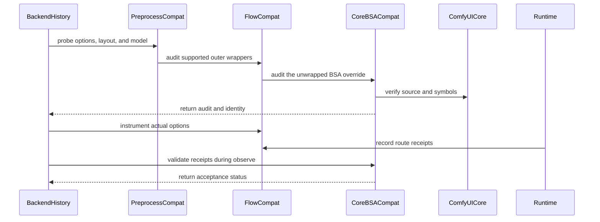

</details>

<!-- walkthrough_end -->
<!-- final_review_risk_start -->
**Merge Risk:** _🟡 Moderate_ · up to `dfaa3`
<!-- final_review_risk_coverage:{"sourceCommitId":"dfaa3c3cb838bcfc5f2ce9c88b4b1fa82a774855","coveredCommitId":"dfaa3c3cb838bcfc5f2ce9c88b4b1fa82a774855","kind":"reviewed"} -->

The inference-mode receipt regression is addressed, but unresolved identity, provenance, closure-validation, and rare deadlock risks remain in the compatibility audit and should be fixed or explicitly accepted before merge.
<!-- final_review_risk_end -->
<!-- pre_merge_checks_walkthrough_start -->

<details>
<summary>🚥 Pre-merge checks | ✅ 4 | ❌ 1</summary>

### ❌ Failed checks (1 warning)

|     Check name     | Status     | Explanation                                                                                                                                                                                               | Resolution                                                                         |
| :----------------: | :--------- | :-------------------------------------------------------------------------------------------------------------------------------------------------------------------------------------------------------- | :--------------------------------------------------------------------------------- |
| Docstring Coverage | ⚠️ Warning | Docstring coverage is 6.55% which is insufficient. The required threshold is 80.00%. Docstring coverage is scoped to functions touched by this diff. Analyzed 168 functions across 9 files. (1 skipped: … | Write docstrings for the functions missing them to satisfy the coverage threshold. |

<details>
<summary>✅ Passed checks (4 passed)</summary>

|         Check name         | Status   | Explanation                                                                                                                                                   |
| :------------------------: | :------- | :------------------------------------------------------------------------------------------------------------------------------------------------------------ |
|     Linked Issues check    | ✅ Passed | Check skipped because no linked issues were found for this pull request.                                                                                      |
| Out of Scope Changes check | ✅ Passed | Check skipped because no linked issues were found for this pull request.                                                                                      |
|      Description Check     | ✅ Passed | Check skipped - CodeRabbit’s high-level summary is enabled.                                                                                                   |
|         Title check        | ✅ Passed | The title clearly identifies the main changes: auditing core BlockSparseAttention and restoring cold-to-primed forecast handling. It is concise and specific. |

</details>

<details>
<summary>Full details: Docstring Coverage</summary>

**Explanation**

Docstring coverage is 6.55% which is insufficient. The required threshold is 80.00%. Docstring coverage is scoped to functions touched by this diff. Analyzed 168 functions across 9 files. (1 skipped: 1 unsupported.)

</details>

</details>

<!-- pre_merge_checks_walkthrough_end -->

- [ ] <!-- {"checkboxId":"585bb3f6-faf5-4dbf-96d2-74e382adf19a"} --> Fix all pre-merge checks with AI
<!-- finishing_touch_checkbox_start -->

<details>
<summary>✨ Finishing Touches 💡 1</summary>

<!-- finishing_touch_suggestion:docstrings -->
<details>
<summary>📝 Generate docstrings 💡</summary>

- [ ] <!-- {"checkboxId":"7962f53c-55bc-4827-bfbf-6a18da830691"} --> Create stacked PR
- [ ] <!-- {"checkboxId":"3e1879ae-f29b-4d0d-8e06-d12b7ba33d98"} --> Commit on current branch

</details>
<details>
<summary>🧪 Generate unit tests (beta)</summary>

- [ ] <!-- {"checkboxId": "f47ac10b-58cc-4372-a567-0e02b2c3d479", "radioGroupId": "utg-output-choice-group-5610770395"} -->   Create PR with unit tests
- [ ] <!-- {"checkboxId": "6ba7b810-9dad-11d1-80b4-00c04fd430c8", "radioGroupId": "utg-output-choice-group-5610770395"} -->   Commit unit tests in branch `feature/core-bsa-spectrum-adapter`

</details>

</details>

<!-- finishing_touch_checkbox_end -->
<!-- tips_start -->

---

Thanks for using [CodeRabbit](https://coderabbit.ai?utm_source=oss&utm_medium=github&utm_campaign=xmarre/ComfyUI-Spectrum-MiniMax-H3&utm_content=106)! It's free for OSS, and your support helps us grow. If you like it, consider giving us a shout-out.

<details>
<summary>❤️ Share</summary>

- [X](https://twitter.com/intent/tweet?text=I%20just%20used%20%40coderabbitai%20for%20my%20code%20review%2C%20and%20it%27s%20fantastic%21%20It%27s%20free%20for%20OSS%20and%20offers%20a%20free%20trial%20for%20the%20proprietary%20code.%20Check%20it%20out%3A&url=https%3A//coderabbit.ai)
- [Mastodon](https://mastodon.social/share?text=I%20just%20used%20%40coderabbitai%20for%20my%20code%20review%2C%20and%20it%27s%20fantastic%21%20It%27s%20free%20for%20OSS%20and%20offers%20a%20free%20trial%20for%20the%20proprietary%20code.%20Check%20it%20out%3A%20https%3A%2F%2Fcoderabbit.ai)
- [Reddit](https://www.reddit.com/submit?title=Great%20tool%20for%20code%20review%20-%20CodeRabbit&text=I%20just%20used%20CodeRabbit%20for%20my%20code%20review%2C%20and%20it%27s%20fantastic%21%20It%27s%20free%20for%20OSS%20and%20offers%20a%20free%20trial%20for%20proprietary%20code.%20Check%20it%20out%3A%20https%3A//coderabbit.ai)
- [LinkedIn](https://www.linkedin.com/sharing/share-offsite/?url=https%3A%2F%2Fcoderabbit.ai&mini=true&title=Great%20tool%20for%20code%20review%20-%20CodeRabbit&summary=I%20just%20used%20CodeRabbit%20for%20my%20code%20review%2C%20and%20it%27s%20fantastic%21%20It%27s%20free%20for%20OSS%20and%20offers%20a%20free%20trial%20for%20proprietary%20code)

</details>


<!-- poem_footer_start -->
<sub>A rabbit audits BSA today,<br>Reviewed wrappers lead the way,<br>Receipts record each route,<br>Tests keep unsafe paths out,<br>CI checks the fixture gate.</sub>
<!-- poem_footer_end -->

<sub>Comment `@coderabbitai help` to get the list of available commands.</sub>

<!-- tips_end -->


> **Comment by xmarre (2026-09-09T20:58:57Z):**

@coderabbitai review


> **Comment by coderabbitai[bot] (2026-09-09T20:59:08Z):**

<!-- This is an auto-generated reply by CodeRabbit -->
<!-- CodeRabbit review command invocation: v2:010ea166a0f3fef960f794b5a71270375eafde3c33ce691da40919e114b215d0 -->
<details>
<summary>✅ Action performed</summary>

Review finished.

> Note: CodeRabbit is an incremental review system and does not re-review already reviewed commits. This command is applicable only when automatic reviews are paused.

</details>


> **Comment by xmarre (2026-09-09T21:15:15Z):**

@coderabbitai review


> **Comment by coderabbitai[bot] (2026-09-09T21:15:20Z):**

<!-- This is an auto-generated reply by CodeRabbit -->
<!-- CodeRabbit review command invocation: v2:d89faffcf1afd820ea31f6a2fad2190beed8a975cc6774fd308683c9b6271fe1 -->
<details>
<summary>✅ Action performed</summary>

Review finished.

> Note: CodeRabbit is an incremental review system and does not re-review already reviewed commits. This command is applicable only when automatic reviews are paused.

</details>


> **Comment by xmarre (2026-09-09T21:48:02Z):**

@coderabbitai review


> **Comment by coderabbitai[bot] (2026-09-09T21:48:07Z):**

<!-- This is an auto-generated reply by CodeRabbit -->
<!-- CodeRabbit review command invocation: v2:ed7c4ad9173e4c501871f571fedde2374595c70067dd7959f6ff4cab45a2e6dc -->
<details>
<summary>✅ Action performed</summary>

Review finished.

> Note: CodeRabbit is an incremental review system and does not re-review already reviewed commits. This command is applicable only when automatic reviews are paused.

</details>


> **Comment by xmarre (2026-09-09T22:37:21Z):**

@coderabbitai review


> **Comment by coderabbitai[bot] (2026-09-09T22:37:28Z):**

<!-- This is an auto-generated reply by CodeRabbit -->
<!-- CodeRabbit review command invocation: v2:b0d1cb7c1e6c39ab2532223e09f375867fb278813a7fa925ec3bd9351b0a311d -->
<details>
<summary>✅ Action performed</summary>

Review finished.

> Note: CodeRabbit is an incremental review system and does not re-review already reviewed commits. This command is applicable only when automatic reviews are paused.

</details>


> **Comment by xmarre (2026-09-09T22:51:36Z):**

@coderabbitai review


> **Comment by coderabbitai[bot] (2026-09-09T22:51:42Z):**

<!-- This is an auto-generated reply by CodeRabbit -->
<!-- CodeRabbit review command invocation: v2:fc309f1f6c6c59e6981c6a47f31cfaa19843b601a13781ee373d12a767e13f86 -->
<details>
<summary>✅ Action performed</summary>

Review finished.

> Note: CodeRabbit is an incremental review system and does not re-review already reviewed commits. This command is applicable only when automatic reviews are paused.

</details>


> **Comment by xmarre (2026-09-09T23:53:18Z):**

@coderabbitai review

Please review the current one-commit head specifically for the new source-gated Flow v0.3.3 block-wrapper composition, mixed-grid effective BSA route proof, and pooled-version receipt classification. Treat fail-open behavior, stale identity, and wrapper/source spoofing as high-risk.


> **Comment by coderabbitai[bot] (2026-09-09T23:54:31Z):**

<!-- This is an auto-generated reply by CodeRabbit -->
<!-- CodeRabbit review command invocation: v2:b55f3326e61f6904d0328559094015835d93525155cc5d6d06a5f6755d653c48 -->
<details>
<summary>🧩 Analysis chain</summary>

🏁 Script executed:

```shell
#!/bin/bash
set -euo pipefail

printf '%s\n' '=== Current commit and changed files ==='
git show --no-ext-diff --format=fuller --stat HEAD
git diff --no-ext-diff --unified=80 HEAD^ HEAD -- \
  'comfyui_spectrum_h3/core_bsa_compat.py' \
  'comfyui_spectrum_h3/core_bsa_preprocess_compat.py' \
  'comfyui_spectrum_h3/backend_history.py' \
  'tests/test_core_bsa_compat.py' \
  'tests/test_core_bsa_preprocess_compat.py' || true

printf '%s\n' '=== Candidate files ==='
fd -t f . | rg -i '(flow|bsa|preprocess|backend_history|compat|test)'

printf '%s\n' '=== Focused symbols and terms ==='
rg -n -i -C 4 \
  '(flow|v0\.3\.3|block.wrapper|mixed.grid|effective.*(bsa|route)|pooled.*version|version.*pooled|receipt|source.*gate|git.blob|audit)' \
  comfyui_spectrum_h3 tests .github 2>/dev/null || true
```

Length of output: 182848

---

🏁 Script executed:

```shell
#!/bin/bash
set -euo pipefail

printf '%s\n' '=== Flow compatibility module ==='
nl -ba comfyui_spectrum_h3/core_bsa_flow_compat.py | sed -n '1,620p'

printf '%s\n' '=== Core pooled-state helpers and receipt acceptance ==='
nl -ba comfyui_spectrum_h3/core_bsa_compat.py | sed -n '300,470p;620,950p'

printf '%s\n' '=== Flow focused tests ==='
nl -ba tests/test_core_bsa_flow_compat.py | sed -n '1,520p'

printf '%s\n' '=== Current-head changed files ==='
git diff --name-status HEAD^ HEAD
printf '%s\n' '=== Current-head Flow patch only ==='
git diff --no-ext-diff --unified=25 HEAD^ HEAD -- \
  comfyui_spectrum_h3/core_bsa_flow_compat.py \
  comfyui_spectrum_h3/core_bsa_preprocess_compat.py \
  comfyui_spectrum_h3/backend_history.py \
  tests/test_core_bsa_flow_compat.py \
  tests/test_reviewed_bsa_fixture_gate.py

printf '%s\n' '=== Checked-out Flow source candidates ==='
fd -HI -t f '(attention|mixed_grid)\.py$' . | rg 'h3_flow_regenerate|FlowRegenerate' || true
```

Length of output: 117181

---

🏁 Script executed:

```shell
#!/bin/bash
set -euo pipefail

printf '%s\n' '=== Core pool helpers ==='
nl -ba comfyui_spectrum_h3/core_bsa_compat.py | sed -n '520,650p'

printf '%s\n' '=== Existing inference-mode pool receipt coverage ==='
rg -n -C 6 \
  '(inference.mode|_version|_pool_entry|classify_pool_transition|pooled)' \
  tests/test_core_bsa_compat.py tests/test_core_bsa_flow_compat.py \
  comfyui_spectrum_h3/core_bsa_compat.py

repo='xmarre/MiniMax-H3-Flow-Aligned-Regenerate'
ref='d876590674b27c4410ef415ff605bc7d316dcdd8'
for path in \
  'h3_flow_regenerate/attention.py' \
  'h3_flow_regenerate/mixed_grid.py'
do
  printf '\n=== %s at %s ===\n' "$path" "$ref"
  gh api \
    -H 'Accept: application/vnd.github.raw+json' \
    "repos/${repo}/contents/${path}?ref=${ref}" \
    || true
done
```

Length of output: 65921

---

</details>

`@xmarre` I found two high-risk issues in the Flow compatibility path.

1. **P1 — Flow receipt collection rejects valid inference-mode pooled tensors.**  
   `comfyui_spectrum_h3/core_bsa_flow_compat.py:414-415` reads `state[1]._version` and `state[2]._version`. PyTorch raises for inference-mode tensors without version counters. The exception sets `audit.failure` and prevents receipt acceptance. The direct core-BSA path already avoids version-counter reads for this case in `comfyui_spectrum_h3/core_bsa_compat.py:585-601`.

   Update the Flow wrapper to classify the route from the actual BSA attention selection, as the core path does. Do not use `_version` as the required receipt signal. Add a Flow wrapper test with inference-mode pooled tensors.

2. **P1 — The mixed-grid source gate does not validate the full numerical closure.**  
   `comfyui_spectrum_h3/core_bsa_flow_compat.py:142-199` verifies `layer`, `previous`, `plan`, and layouts. It does not verify closure values that the reviewed Flow wrapper uses to construct its actual call. These values include `inner`, `native`, `va`, `vb`, `old_prefix`, `positions`, and `measure_contract`.

   A wrapper can reuse the reviewed source code object and source file but provide altered closure state. The audit can then accept a stale `flow_identity` and derive the effective BSA route from values that differ from the executed composition. Validate each route-relevant closure value against the model, carrier layout, mixed layout, and `MixedGridPlan`. Reject the wrapper when any value differs. Add negative tests that construct reviewed-code wrappers with altered `inner`, boundaries, positions, and measure contract.

I used the existing Untwist source-gating learning when I reviewed the wrapper-composition checks.


---

<details>
<summary>🧠 Learnings used</summary>

```
Learnt from: xmarre
Repo: xmarre/ComfyUI-Spectrum-MiniMax-H3 PR: 106
File: comfyui_spectrum_h3/core_bsa_preprocess_compat.py:66-71
Timestamp: 2026-09-09T22:49:33.887Z
Learning: In `comfyui_spectrum_h3/core_bsa_preprocess_compat.py`, the preprocess compatibility path accepts only the source-gated Untwist v0.2.4 `flux_untwist.patches` preprocessor. `_audited_untwist_preprocess` requires the audited module Git blob, the exact nested `make_minimax_h3_attention_override.<locals>.preprocess` code object, and an empty closure. Unknown `attention_preprocess_v1` wrappers remain actual-only, so generic callable semantic fingerprints and callable defaults are not accepted route identity inputs.
```

</details>

<details>
<summary>✅ Action performed</summary>

Review finished.

> Note: CodeRabbit is an incremental review system and does not re-review already reviewed commits. This command is applicable only when automatic reviews are paused.

</details>


> **Comment by xmarre (2026-09-10T00:01:36Z):**

@coderabbitai review

Please review the current head `abfa7fd70e01458d5862a7275c97bfc3d0b1622d`. Focus on whether dynamic Mixed-Grid wrapper recreation can still churn retained backend identity, whether source-gated wrapper unwrapping can fail open, and whether pooled tensor version transitions are sufficient to distinguish dense vs sparse actual routes.


> **Comment by coderabbitai[bot] (2026-09-10T00:09:30Z):**

<!-- This is an auto-generated reply by CodeRabbit -->
<!-- CodeRabbit review command invocation: v2:90814c380e3c1728b0c936f969c37fae972a99e26fbc2aa6f5ea338712b4f8db -->
<details>
<summary>🧩 Analysis chain</summary>

🏁 Script executed:

```shell
#!/bin/bash
set -euo pipefail

commit='abfa7fd70e01458d5862a7275c97bfc3d0b1622d'

printf '%s\n' '=== Requested commit ==='
git show --no-ext-diff --format=fuller --stat "$commit"

printf '%s\n' '=== Changed paths ==='
git diff-tree --no-commit-id --name-status -r "$commit"

printf '%s\n' '=== Focused diff ==='
git diff --no-ext-diff --unified=55 "${commit}^" "$commit" -- \
  comfyui_spectrum_h3/core_bsa_flow_compat.py \
  comfyui_spectrum_h3/core_bsa_compat.py \
  comfyui_spectrum_h3/backend_history.py \
  tests/test_core_bsa_flow_compat.py \
  tests/test_core_bsa_compat.py

printf '%s\n' '=== Implementation outlines ==='
ast-grep outline comfyui_spectrum_h3/core_bsa_flow_compat.py --items all --type function,class --view expanded
ast-grep outline comfyui_spectrum_h3/core_bsa_compat.py --items all --type function,class --view expanded
ast-grep outline comfyui_spectrum_h3/backend_history.py --items all --type function,class --view expanded

printf '%s\n' '=== Test outline ==='
ast-grep outline tests/test_core_bsa_flow_compat.py --items all --type function --view expanded

printf '%s\n' '=== Focused terms and call sites ==='
rg -n -C 5 -P \
  '(flow_identity|identity|generation|MixedGridPlan|mixed.grid|_version|pool|receipt|instrument_actual_options|accepts_actual|audit\.failure|__closure__|co_freevars|source.*blob|git.*blob)' \
  comfyui_spectrum_h3/core_bsa_flow_compat.py \
  comfyui_spectrum_h3/core_bsa_compat.py \
  comfyui_spectrum_h3/backend_history.py \
  tests/test_core_bsa_flow_compat.py \
  tests/test_core_bsa_compat.py
```

Length of output: 233795

---

🏁 Script executed:

```shell
#!/bin/bash
set -euo pipefail

printf '%s\n' '=== Flow identity tests ==='
nl -ba tests/test_core_bsa_flow_identity.py | sed -n '1,260p'

printf '%s\n' '=== All Flow test references ==='
rg -n -C 5 -P \
  '(identity|recreat|wrapper|_version|inference_mode|pool|receipt|closure|inner|native|old_prefix|positions|measure_contract|va|vb)' \
  tests/test_core_bsa_flow_compat.py tests/test_core_bsa_flow_identity.py

printf '%s\n' '=== Reviewed Flow source ==='
repo='xmarre/MiniMax-H3-Flow-Aligned-Regenerate'
ref='d876590674b27c4410ef415ff605bc7d316dcdd8'
for path in h3_flow_regenerate/attention.py h3_flow_regenerate/mixed_grid.py; do
  printf '\n=== %s ===\n' "$path"
  gh api -H 'Accept: application/vnd.github.raw+json' \
    "repos/${repo}/contents/${path}?ref=${ref}"
done

printf '%s\n' '=== Flow compatibility source with line numbers ==='
nl -ba comfyui_spectrum_h3/core_bsa_flow_compat.py | sed -n '34,580p'
```

Length of output: 92749

---

🏁 Script executed:

```shell
#!/bin/bash
set -euo pipefail

printf '%s\n' '=== Preprocess compatibility outline ==='
ast-grep outline comfyui_spectrum_h3/core_bsa_preprocess_compat.py --items all --type function,class --view expanded

printf '%s\n' '=== Flow identity stabilization implementation and call sites ==='
rg -n -C 12 -P \
  '(_stabilize_flow_audit_identity|core_bsa_flow_compat\.probe|flow_identity|outer_block_wrappers)' \
  comfyui_spectrum_h3/core_bsa_preprocess_compat.py \
  comfyui_spectrum_h3/core_bsa_flow_compat.py \
  tests

printf '%s\n' '=== Preprocess compatibility source ==='
nl -ba comfyui_spectrum_h3/core_bsa_preprocess_compat.py | sed -n '1,360p'

printf '%s\n' '=== Missing-risk test search ==='
rg -n -C 4 -i \
  '(inference.mode|inference_mode|altered.*(inner|native|boundary|position|measure)|closure.*(inner|native|old_prefix|positions|measure_contract|va|vb)|_pool_snapshot|_classify_snapshot)' \
  tests comfyui_spectrum_h3
```

Length of output: 53252

---

</details>

`@xmarre` I found two P1 issues. The dynamic-wrapper identity stabilization is correct. `_stabilize_flow_audit_identity()` removes per-call generations and retains structural Flow data. I found no retained-identity churn issue in that path.

1. **P1 — Flow receipts still require pooled tensor version counters.**  
   `comfyui_spectrum_h3/core_bsa_flow_compat.py` Line 414 and Line 415 read `Tensor._version`. PyTorch raises when the pooled tensors were created in `torch.inference_mode()`. The wrapper then marks the audit as failed and cannot accept an otherwise valid sparse receipt.

   The direct BSA wrapper avoids this dependency. It observes whether the reviewed BSA attention callable was selected. The Flow wrapper should use the same direct selection signal. It should treat pooled state only as supporting evidence. Add a Flow test that uses inference-mode pooled tensors for a primed sparse route.

2. **P1 — Mixed-Grid unwrapping can accept altered reviewed-code closure state.**  
   `comfyui_spectrum_h3/core_bsa_flow_compat.py` Line 142 through Line 199 validates `layer`, `previous`, `plan`, and layouts. It does not validate the remaining values used by the reviewed `mixed_diffusion_wrapper()` inner `call`.

   The reviewed Flow source uses `inner`, `native`, `va`, `vb`, `old_prefix`, `positions`, and `measure_contract` to create the actual BSA block call. A recreated function can retain the audited code object and source blob but supply modified values in these closure cells. The audit can then accept a route and retained identity that do not describe the executed wrapper.

   Validate each of these closure values against the model, carrier layout, mixed layout, and `MixedGridPlan`. Reject the wrapper when a value differs. Add negative tests for altered `inner`, boundaries, `positions`, and `measure_contract`.

I used the existing Untwist source-gating learning when I assessed the Flow wrapper source gate.


---

<details>
<summary>🧠 Learnings used</summary>

```
Learnt from: xmarre
Repo: xmarre/ComfyUI-Spectrum-MiniMax-H3 PR: 106
File: comfyui_spectrum_h3/core_bsa_preprocess_compat.py:66-71
Timestamp: 2026-09-09T22:49:33.887Z
Learning: In `comfyui_spectrum_h3/core_bsa_preprocess_compat.py`, the preprocess compatibility path accepts only the source-gated Untwist v0.2.4 `flux_untwist.patches` preprocessor. `_audited_untwist_preprocess` requires the audited module Git blob, the exact nested `make_minimax_h3_attention_override.<locals>.preprocess` code object, and an empty closure. Unknown `attention_preprocess_v1` wrappers remain actual-only, so generic callable semantic fingerprints and callable defaults are not accepted route identity inputs.
```

</details>

<details>
<summary>✅ Action performed</summary>

Review finished.

> Note: CodeRabbit is an incremental review system and does not re-review already reviewed commits. This command is applicable only when automatic reviews are paused.

</details>


> **Comment by xmarre (2026-09-10T00:30:44Z):**

@coderabbitai review


> **Comment by coderabbitai[bot] (2026-09-10T00:30:49Z):**

<!-- This is an auto-generated reply by CodeRabbit -->
<!-- CodeRabbit review command invocation: v2:a926fb18b0267ad18f3e1686634d0a1e3a6c1d21bee06e36cfe4fb3eee5ddb15 -->
<details>
<summary>✅ Action performed</summary>

Review finished.

> Note: CodeRabbit is an incremental review system and does not re-review already reviewed commits. This command is applicable only when automatic reviews are paused.

</details>


> **Comment by xmarre (2026-09-10T02:11:43Z):**

@coderabbitai review

Please focus this pass on the current head's real-ComfyUI loader compatibility: path-stem-loaded `comfy_extras/nodes_sparse_attention.py`, preservation of the canonical audit, fail-closed alias/source ownership, reviewed defaults, and Flow -> path-loaded BSA composition. Also check for any fail-open path introduced by `core_bsa_loader_compat.py`.


> **Comment by coderabbitai[bot] (2026-09-10T02:12:55Z):**

<!-- This is an auto-generated reply by CodeRabbit -->
> [!TIP]
> For best results, initiate chat on the files or code changes.

<details>
<summary>🧩 Analysis chain</summary>

🏁 Script executed:

```shell
#!/bin/bash
set -euo pipefail

printf '%s\n' '=== HEAD and requested review paths ==='
git show --no-ext-diff --format=fuller --stat HEAD
git diff --no-ext-diff --name-status HEAD^ HEAD

printf '%s\n' '=== Locate loader and related compatibility modules ==='
fd -t f . comfyui_spectrum_h3 tests | rg '(core_bsa_loader_compat|core_bsa_(flow_)?compat|core_bsa_preprocess_compat|backend_history|loader.*compat|bsa.*loader)'

printf '%s\n' '=== Structural outlines ==='
for file in \
  comfyui_spectrum_h3/core_bsa_loader_compat.py \
  comfyui_spectrum_h3/core_bsa_compat.py \
  comfyui_spectrum_h3/core_bsa_flow_compat.py \
  comfyui_spectrum_h3/core_bsa_preprocess_compat.py \
  comfyui_spectrum_h3/backend_history.py
do
  if [ -f "$file" ]; then
    printf '\n=== %s ===\n' "$file"
    ast-grep outline "$file" --items all --type function,class --view expanded
  fi
done

printf '%s\n' '=== Focused diff ==='
git diff --no-ext-diff --unified=45 HEAD^ HEAD -- \
  comfyui_spectrum_h3/core_bsa_loader_compat.py \
  comfyui_spectrum_h3/core_bsa_compat.py \
  comfyui_spectrum_h3/core_bsa_flow_compat.py \
  comfyui_spectrum_h3/core_bsa_preprocess_compat.py \
  comfyui_spectrum_h3/backend_history.py \
  tests

printf '%s\n' '=== Loader, source, audit, defaults, and Flow call sites ==='
rg -n -C 6 -P \
  '(core_bsa_loader_compat|path.stem|spec_from_file_location|SourceFileLoader|nodes_sparse_attention|canonical|alias|module.*name|__file__|source.*(audit|blob|owner)|AUDITED|defaults?|Flow|flow|probe\(|instrument_actual_options|audit\.failure|fail.closed|fail.open)' \
  comfyui_spectrum_h3 tests .github
```

Length of output: 188345

---

🏁 Script executed:

```shell
#!/bin/bash
set -euo pipefail

printf '%s\n' '=== Loader compatibility files and symbols ==='
fd -t f . comfyui_spectrum_h3 tests | rg 'core_bsa_loader_compat|core_bsa_(compat|flow_compat|preprocess_compat)|test_core_bsa_loader_compat'
ast-grep outline comfyui_spectrum_h3/core_bsa_loader_compat.py --items all --type function,class --view expanded
ast-grep outline tests/test_core_bsa_loader_compat.py --items all --type function --view expanded

printf '%s\n' '=== Loader compatibility implementation ==='
nl -ba comfyui_spectrum_h3/core_bsa_loader_compat.py | sed -n '1,500p'

printf '%s\n' '=== Direct core audit source-gate and loader integration ==='
rg -n -C 10 -P \
  '(_module_blob_sha|_looks_like_core_bsa_callable|source_code_audit|loader_compat|module.*owner|__module__|__file__|_audited|SparseAttnPatch|make_h3_block_patch|make_attention_override|probe\()' \
  comfyui_spectrum_h3/core_bsa_compat.py \
  comfyui_spectrum_h3/core_bsa_flow_compat.py \
  comfyui_spectrum_h3/core_bsa_preprocess_compat.py \
  comfyui_spectrum_h3/backend_history.py

printf '%s\n' '=== Loader tests ==='
nl -ba tests/test_core_bsa_loader_compat.py | sed -n '1,420p'

printf '%s\n' '=== Exact PR diff for loader changes ==='
git diff --no-ext-diff --unified=80 HEAD^ HEAD -- \
  comfyui_spectrum_h3/core_bsa_loader_compat.py \
  comfyui_spectrum_h3/core_bsa_compat.py \
  comfyui_spectrum_h3/core_bsa_flow_compat.py \
  comfyui_spectrum_h3/core_bsa_preprocess_compat.py \
  comfyui_spectrum_h3/backend_history.py \
  tests/test_core_bsa_loader_compat.py

printf '%s\n' '=== Canonical module assumptions and alias lookup sites ==='
rg -n -C 5 -P \
  '(comfy_extras\.nodes_sparse_attention|sys\.modules|import_module|__name__|__spec__|__loader__|spec_from_file_location|resolve\(\)|samefile|Path\(.*__file__)' \
  comfyui_spectrum_h3 tests/test_core_bsa_loader_compat.py
```

Length of output: 249545

---

🏁 Script executed:

```shell
#!/bin/bash
set -euo pipefail

printf '%s\n' '=== Source-code audit implementation ==='
ast-grep outline comfyui_spectrum_h3/source_code_audit.py --items all --type function --view expanded
nl -ba comfyui_spectrum_h3/source_code_audit.py | sed -n '1,220p'

printf '%s\n' '=== Loader compatibility installation sites ==='
rg -n -C 8 -P \
  '(install_core_bsa_loader_compat\s*\(|core_bsa_loader_compat|install_.*compat\s*\()' \
  __init__.py nodes.py comfyui_spectrum_h3 tests

printf '%s\n' '=== Full core ownership and core callable instrumentation ==='
nl -ba comfyui_spectrum_h3/core_bsa_compat.py | sed -n '450,540p;720,850p'

printf '%s\n' '=== Existing spoofing tests and global-dictionary provenance checks ==='
rg -n -C 10 -P \
  '(spoof|forg|FunctionType|__globals__|globals.*module|source_hardening|rebind|module binding|sys\.modules)' \
  tests comfyui_spectrum_h3

printf '%s\n' '=== Current source line references for loader helper ==='
nl -ba comfyui_spectrum_h3/core_bsa_loader_compat.py | sed -n '77,190p'
```

Length of output: 127527

---

</details>

`@xmarre` I found two P1 source-ownership issues in `core_bsa_loader_compat.py`.

1. **P1 — The path-stem fallback does not prove the callable globals belong to the live module.**  
   `core_bsa_loader_compat.py` Line 123 through Line 128 proves only the nested code semantics. `source_code_audit.matches_nested_source_code()` does not inspect `base.__globals__`.

   A forged callable can reuse the reviewed nested code object, closure, source filename, and path-stem module name. It can use a different globals dictionary with changed bindings. The alias audit then accepts the callable, but execution can differ from the reviewed module.

   Before accepting the callable, require:

   ```python
   getattr(base, "__globals__", None) is vars(module)
   ```

   Add negative tests for both `block_patch` and `override` callables that reuse reviewed code and closure but use a copied or altered globals dictionary. The fallback must return `"ownership_unproven"`.

2. **P1 — `_replacement_ownership()` trusts mutable factory bindings to define nested `attention` and `override` identities.**  
   `core_bsa_loader_compat.py` Line 196 calls `core_bsa_compat._replacement_ownership(module, model, options)`. That function obtains `attention_code` and `override_code` from `module.make_h3_block_patch` and `module.make_attention_override`.

   The alias gate validates the outer `block_patch` and `override` callables. It does not prove that the module factory bindings remain the reviewed factories. A replacement factory can expose a reviewed `block_patch` code object with an altered nested `attention` code object. The existing identity checks then use the altered factory-derived reference and can accept the altered attention route.

   Derive every required nested callable proof from the audited on-disk source. Do not use mutable factory bindings as the reference. At minimum, source-validate the live nested `attention` callable with the lexical path `("make_h3_block_patch", "attention")`. Apply the same source-derived proof to all ownership-critical nested callables.

   Add a negative test that replaces `module.make_h3_block_patch` with a factory that retains reviewed `block_patch` code but injects a different nested `attention` callable. The path-stem audit and the Flow-to-path-loaded-BSA audit must both fail closed.

The path-stem support itself is correctly additive. `_runtime_probe()` runs the canonical audit first. The Flow composition test covers the intended direct wrapper chain. The reviewed-default checks are also present.

I used the existing Untwist source-gating learning for the mutable-factory-binding analysis.

---

<details>
<summary>🧠 Learnings used</summary>

```
Learnt from: xmarre
Repo: xmarre/ComfyUI-Spectrum-MiniMax-H3

Timestamp: 2026-09-10T00:53:52.627Z
Learning: In `comfyui_spectrum_h3/core_bsa_preprocess_compat.py`, `_audited_untwist_preprocess` validates the reviewed Untwist nested `make_minimax_h3_attention_override.<locals>.preprocess` callable with `source_code_audit.matches_nested_source_code`. This helper compiles the Git-blob-gated on-disk `flux_untwist.patches` source and compares code semantics, so mutable `sys.modules` factory bindings cannot establish the expected callable identity. `tests/test_core_bsa_source_hardening.py::test_untwist_code_proof_does_not_trust_replaced_factory_binding` covers coordinated factory-and-transform spoofing.
```

---

```
Learnt from: xmarre
Repo: xmarre/ComfyUI-Spectrum-MiniMax-H3 PR: 106
File: comfyui_spectrum_h3/core_bsa_preprocess_compat.py:66-71
Timestamp: 2026-09-09T22:49:33.887Z
Learning: In `comfyui_spectrum_h3/core_bsa_preprocess_compat.py`, the preprocess compatibility path accepts only the source-gated Untwist v0.2.4 `flux_untwist.patches` preprocessor. `_audited_untwist_preprocess` requires the audited module Git blob, the exact nested `make_minimax_h3_attention_override.<locals>.preprocess` code object, and an empty closure. Unknown `attention_preprocess_v1` wrappers remain actual-only, so generic callable semantic fingerprints and callable defaults are not accepted route identity inputs.
```

</details>

_You are interacting with an AI system._


### #105 [closed] PR: Release v0.2.25
URL: https://github.com/xmarre/ComfyUI-Spectrum-MiniMax-H3/pull/105  by xmarre 2026-09-08T17:49:28Z

## Release preparation

- bump package version to `0.2.25`;
- document the Comfy Compiler / DynamicVRAM compatibility fix from #102 / #99;
- record that Spectrum now bypasses Aimdo malloc-graph capture only during supported Spectrum H3 solver steps, while leaving DynamicVRAM and Comfy Compiler enabled elsewhere;
- document the lifecycle cleanup/recovery boundary and current-Core compatibility coverage;
- include the 9-lane CI result, CodeRabbit review, and accepted real CUDA/runtime retest;
- preserve all historical `RELEASE_NOTES.md` entries.

PR #102 is the only implementation change since v0.2.24. This release branch is exactly one release-only commit on top of merged `main` (`ee505d134dd0706f9f57417313c4cf49b92f8bc7`).

> **Comment by coderabbitai[bot] (2026-09-08T17:49:45Z):**

<!-- This is an auto-generated comment: summarize by coderabbit.ai -->
<!-- This is an auto-generated comment: skip review by coderabbit.ai -->

> [!IMPORTANT]
> ## Review skipped
> 
> Auto reviews are disabled on this repository. Please check the settings in the CodeRabbit UI or the `.coderabbit.yaml` file in this repository. To trigger a single review, invoke the `@coderabbitai review` command.
> 
> <details>
> <summary>⚙️ Run configuration</summary>
> 
> **Configuration used**: Organization UI
> 
> **Review profile**: CHILL
> 
> **Plan**: Advanced
> 
> **Run ID**: `cb7a8310-6635-45ff-8021-19efcab5acb6`
> 
> </details>
> 
> You can disable this status message by setting the `reviews.review_status` to `false` in the CodeRabbit configuration file.
> 
> Use the checkbox below for a quick retry:
> - [ ] <!-- {"checkboxId":"e9bb8d72-00e8-4f67-9cb2-caf3b22574fe"} --> 🔍 Trigger review

<!-- end of auto-generated comment: skip review by coderabbit.ai -->

<!-- tips_start -->

---

Thanks for using [CodeRabbit](https://coderabbit.ai?utm_source=oss&utm_medium=github&utm_campaign=xmarre/ComfyUI-Spectrum-MiniMax-H3&utm_content=105)! It's free for OSS, and your support helps us grow. If you like it, consider giving us a shout-out.

<details>
<summary>❤️ Share</summary>

- [X](https://twitter.com/intent/tweet?text=I%20just%20used%20%40coderabbitai%20for%20my%20code%20review%2C%20and%20it%27s%20fantastic%21%20It%27s%20free%20for%20OSS%20and%20offers%20a%20free%20trial%20for%20the%20proprietary%20code.%20Check%20it%20out%3A&url=https%3A//coderabbit.ai)
- [Mastodon](https://mastodon.social/share?text=I%20just%20used%20%40coderabbitai%20for%20my%20code%20review%2C%20and%20it%27s%20fantastic%21%20It%27s%20free%20for%20OSS%20and%20offers%20a%20free%20trial%20for%20the%20proprietary%20code.%20Check%20it%20out%3A%20https%3A%2F%2Fcoderabbit.ai)
- [Reddit](https://www.reddit.com/submit?title=Great%20tool%20for%20code%20review%20-%20CodeRabbit&text=I%20just%20used%20CodeRabbit%20for%20my%20code%20review%2C%20and%20it%27s%20fantastic%21%20It%27s%20free%20for%20OSS%20and%20offers%20a%20free%20trial%20for%20proprietary%20code.%20Check%20it%20out%3A%20https%3A//coderabbit.ai)
- [LinkedIn](https://www.linkedin.com/sharing/share-offsite/?url=https%3A%2F%2Fcoderabbit.ai&mini=true&title=Great%20tool%20for%20code%20review%20-%20CodeRabbit&summary=I%20just%20used%20CodeRabbit%20for%20my%20code%20review%2C%20and%20it%27s%20fantastic%21%20It%27s%20free%20for%20OSS%20and%20offers%20a%20free%20trial%20for%20proprietary%20code)

</details>


<sub>Comment `@coderabbitai help` to get the list of available commands.</sub>

<!-- tips_end -->


> **Comment by xmarre (2026-09-08T17:52:39Z):**

Release validation is complete: Actions run #593 passed all 9 reviewed ComfyUI/Python matrix jobs. This branch remains exactly one release-only commit over the #102 merge, with only the v0.2.25 version bump and release notes. Ready to merge and publish.


### #104 [closed] PR: Track numerical attention backends across forecasts
URL: https://github.com/xmarre/ComfyUI-Spectrum-MiniMax-H3/pull/104  by xmarre 2026-09-08T03:34:20Z

## Release candidate: v0.2.26

This PR adds Spectrum's provider-generic numerical-attention history/receipt contract and is now release-ready after the primary Sol-H3 GPU/runtime gate passed in the published [ComfyUI-Sol-H3 v0.1.0](https://github.com/xmarre/ComfyUI-Sol-H3/releases/tag/v0.1.0).

## Backend-history contract

`attention_backend_history_v1` providers publish a stable preflight identity for the next numerical route, or `None` when that route cannot be proven. Actual providers append `attention_backend_receipts_v1` receipts and qualify them through `accept_receipts(...)` before Spectrum retains the resulting H3 anchor as forecast-safe.

Policy/receipt changes, provider removal and late conflicting routing conservatively reset incompatible stage banks/controllers and offline evidence. Same-step conflicting receipts execute but are not retained as one mixed anchor. Backend identity is also included in rollback snapshots.

The consumer remains provider-generic: Spectrum contains no Sol-H3/Untwist/Diff-Aid/Flow allowlist.

## Failure policy

Backend-history callbacks are metadata hooks, not transformer execution. Failing preflight or receipt-qualification callbacks therefore make the affected route actual-only instead of aborting the sampler. CUDA OOM is propagated as a real resource failure.

The first provider identity may be established without resetting only while no backend-dependent evidence exists. Later provider appearance/removal or a real policy/receipt transition retains the full reset path.

## Production result

The released Sol-H3 stack on RTX PRO 6000 Blackwell, with VDN, Untwist, Diff-Aid and Flow, now settles at:

```text
sampler_logical_calls       18
transformer_actual_nfe      14
spectrum_forecast_calls      4

low:    8 actual / 2 forecast
high:   4 actual / 2 forecast
probe:  2 actual / 0 forecast
```

The Sol-bypassed control is `13 actual + 5 forecast`. The one extra Sol-enabled actual is the intentional first low-stage `dense -> sol` numerical-backend transition and remains a safety anchor.

This removes the earlier all-actual `18/0` history-opacity confound without weakening a real backend transition. Whole-workflow Sol timing is still not treated as a controlled percentage A/B because NFE count, sparse routing/content and cache state differ.

## Release documentation

- `docs/BACKEND_HISTORY.md` now points to the released Sol-H3 v0.1.0 production companion and records the 18/14/4 result.
- `RELEASE_NOTES.md` contains the v0.2.26 contract/result summary.
- Historical notes through v0.2.25 are preserved verbatim in `docs/RELEASE_NOTES_v0.2.25_AND_EARLIER.md`.
- `pyproject.toml` is bumped to `0.2.26`; existing release/registry automation will publish from tested `main`.

## Validation / topology

```text
head:    10d201415ac92b326bb375825cf5b66bbb331d4e
parent:  2482f52604da037c29e3f613e10057e8aaa83abb
tree:    240deda2bd39477cd882c433f851e96c3a224588
commits: 1
```

Final PR-head CI run `34310558359` passed all **9/9** reviewed ComfyUI/Python matrix jobs, including the current Comfy Compiler/Aimdo lane. Earlier CodeRabbit substantive findings were fixed and resolved. The real SM120 production gate is now satisfied by Sol-H3 v0.1.0.

Existing sampler equations, PECE/SEEDS/SA-Solver ownership, Continuum prefix semantics, external-patch exactness, generic correction, offline replay policy and the v0.2.25 Comfy Compiler compatibility boundary are unchanged outside numerical-backend history qualification.

> **Comment by coderabbitai[bot] (2026-09-08T03:34:34Z):**

<!-- This is an auto-generated comment: summarize by coderabbit.ai -->
<!-- review_stack_entry_start -->

<a href="https://app.coderabbit.ai/change-stack/xmarre/ComfyUI-Spectrum-MiniMax-H3/pull/104#gh-light-mode-only"></a><a href="https://app.coderabbit.ai/change-stack/xmarre/ComfyUI-Spectrum-MiniMax-H3/pull/104#gh-dark-mode-only"></a>

<!-- review_stack_entry_end -->
<!-- This is an auto-generated comment: skip review by coderabbit.ai -->

> [!IMPORTANT]
> ## Review skipped
> 
> Auto reviews are disabled on this repository. Please check the settings in the CodeRabbit UI or the `.coderabbit.yaml` file in this repository. To trigger a single review, invoke the `@coderabbitai review` command.
> 
> <details>
> <summary>⚙️ Run configuration</summary>
> 
> **Configuration used**: Organization UI
> 
> **Review profile**: CHILL
> 
> **Plan**: Advanced
> 
> **Run ID**: `ff69249e-3d3b-4499-b08c-a3bf8085a4d2`
> 
> </details>
> 
> You can disable this status message by setting the `reviews.review_status` to `false` in the CodeRabbit configuration file.
> 
> Use the checkbox below for a quick retry:
> - [ ] <!-- {"checkboxId":"e9bb8d72-00e8-4f67-9cb2-caf3b22574fe"} --> 🔍 Trigger review

<!-- end of auto-generated comment: skip review by coderabbit.ai -->

<!-- walkthrough_start -->

<details>
<summary>📝 Walkthrough</summary>

## Walkthrough

The change adds provider-based attention backend history tracking. The runtime records policies and receipts, resets forecast state when routing changes, supports rollback restoration, integrates the MiniMax H3 wrapper, and adds tests, documentation, and Ruff coverage.

### Changes

**Backend history tracking**

|Layer / File(s)|Summary|
|---|---|
|**Backend history contract and wrapper integration** <br> `comfyui_spectrum_h3/backend_history.py`, `comfyui_spectrum_h3/minimax_h3.py`|The provider contract computes backend identities, prepares runtime history, validates receipts, and integrates with model preparation and observation.|
|**Runtime state and invalidation** <br> `comfyui_spectrum_h3/runtime.py`|The runtime stores backend history, resets forecasting state on policy or receipt changes, tracks counters, and restores history through rollback snapshots.|
|**Validation and delivery coverage** <br> `tests/test_backend_history.py`, `docs/BACKEND_HISTORY.md`, `.github/workflows/tests.yml`|Tests cover backend transitions, opaque routing, callback failures, rollback, archive invalidation, and provider removal. Documentation describes the contract. Ruff checks the new module and tests.|

<!-- change_assessment_start -->
**Priority:** ⬇️ Low


**Estimated code review effort:** 4 (Complex) | ~45 minutes

<!-- change_assessment_commit:"9c682c07f4c5ea9de601cda234755a1561b59f59" -->

<!-- change_assessment_end -->

<!-- final_review_risk_start -->
**Merge Risk:** _🔵 Low_ · up to `9c682`
<!-- final_review_risk_coverage:{"sourceCommitId":"9c682c07f4c5ea9de601cda234755a1561b59f59","coveredCommitId":"9c682c07f4c5ea9de601cda234755a1561b59f59","kind":"reviewed"} -->

The backend-history change is covered broadly, but one reset test can pass even if stage-bank invalidation breaks. Seed the bank before the transition to make the regression coverage effective.
<!-- final_review_risk_end -->

### Sequence Diagram(s)

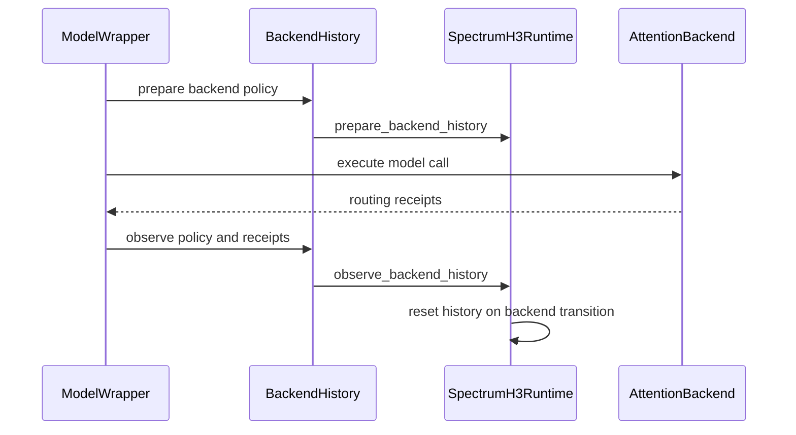

</details>

<!-- walkthrough_end -->
<!-- pre_merge_checks_walkthrough_start -->

<details>
<summary>🚥 Pre-merge checks | ✅ 4 | ❌ 1</summary>

### ❌ Failed checks (1 warning)

|     Check name     | Status     | Explanation                                                                                                                                                                                               | Resolution                                                                         |
| :----------------: | :--------- | :-------------------------------------------------------------------------------------------------------------------------------------------------------------------------------------------------------- | :--------------------------------------------------------------------------------- |
| Docstring Coverage | ⚠️ Warning | Docstring coverage is 0.00% which is insufficient. The required threshold is 80.00%. Docstring coverage is scoped to functions touched by this diff. Analyzed 33 functions across 4 files. (1 skipped: 1… | Write docstrings for the functions missing them to satisfy the coverage threshold. |

<details>
<summary>✅ Passed checks (4 passed)</summary>

|         Check name         | Status   | Explanation                                                                                                                       |
| :------------------------: | :------- | :-------------------------------------------------------------------------------------------------------------------------------- |
|     Linked Issues check    | ✅ Passed | Check skipped because no linked issues were found for this pull request.                                                          |
| Out of Scope Changes check | ✅ Passed | Check skipped because no linked issues were found for this pull request.                                                          |
|      Description Check     | ✅ Passed | Check skipped - CodeRabbit’s high-level summary is enabled.                                                                       |
|         Title check        | ✅ Passed | The title clearly and concisely describes the primary change: tracking numerical attention backend state across forecast history. |

</details>

<details>
<summary>Full details: Docstring Coverage</summary>

**Explanation**

Docstring coverage is 0.00% which is insufficient. The required threshold is 80.00%. Docstring coverage is scoped to functions touched by this diff. Analyzed 33 functions across 4 files. (1 skipped: 1 unsupported.)

</details>

</details>

<!-- pre_merge_checks_walkthrough_end -->
<!-- finishing_touch_checkbox_start -->

<details>
<summary>✨ Finishing Touches 💡 1</summary>

<!-- finishing_touch_suggestion:docstrings -->
<details>
<summary>📝 Generate docstrings 💡</summary>

- [ ] <!-- {"checkboxId":"7962f53c-55bc-4827-bfbf-6a18da830691"} --> Create stacked PR
- [ ] <!-- {"checkboxId":"3e1879ae-f29b-4d0d-8e06-d12b7ba33d98"} --> Commit on current branch

</details>
<details>
<summary>🧪 Generate unit tests (beta)</summary>

- [ ] <!-- {"checkboxId": "f47ac10b-58cc-4372-a567-0e02b2c3d479", "radioGroupId": "utg-output-choice-group-5591811119"} -->   Create PR with unit tests
- [ ] <!-- {"checkboxId": "6ba7b810-9dad-11d1-80b4-00c04fd430c8", "radioGroupId": "utg-output-choice-group-5591811119"} -->   Commit unit tests in branch `feature/attention-backend-history`

</details>

</details>

<!-- finishing_touch_checkbox_end -->
<!-- tips_start -->

---

Thanks for using [CodeRabbit](https://coderabbit.ai?utm_source=oss&utm_medium=github&utm_campaign=xmarre/ComfyUI-Spectrum-MiniMax-H3&utm_content=104)! It's free for OSS, and your support helps us grow. If you like it, consider giving us a shout-out.

<details>
<summary>❤️ Share</summary>

- [X](https://twitter.com/intent/tweet?text=I%20just%20used%20%40coderabbitai%20for%20my%20code%20review%2C%20and%20it%27s%20fantastic%21%20It%27s%20free%20for%20OSS%20and%20offers%20a%20free%20trial%20for%20the%20proprietary%20code.%20Check%20it%20out%3A&url=https%3A//coderabbit.ai)
- [Mastodon](https://mastodon.social/share?text=I%20just%20used%20%40coderabbitai%20for%20my%20code%20review%2C%20and%20it%27s%20fantastic%21%20It%27s%20free%20for%20OSS%20and%20offers%20a%20free%20trial%20for%20the%20proprietary%20code.%20Check%20it%20out%3A%20https%3A%2F%2Fcoderabbit.ai)
- [Reddit](https://www.reddit.com/submit?title=Great%20tool%20for%20code%20review%20-%20CodeRabbit&text=I%20just%20used%20CodeRabbit%20for%20my%20code%20review%2C%20and%20it%27s%20fantastic%21%20It%27s%20free%20for%20OSS%20and%20offers%20a%20free%20trial%20for%20proprietary%20code.%20Check%20it%20out%3A%20https%3A//coderabbit.ai)
- [LinkedIn](https://www.linkedin.com/sharing/share-offsite/?url=https%3A%2F%2Fcoderabbit.ai&mini=true&title=Great%20tool%20for%20code%20review%20-%20CodeRabbit&summary=I%20just%20used%20CodeRabbit%20for%20my%20code%20review%2C%20and%20it%27s%20fantastic%21%20It%27s%20free%20for%20OSS%20and%20offers%20a%20free%20trial%20for%20proprietary%20code)

</details>


<!-- poem_footer_start -->
<sub>I hop through policies, tidy and bright  <br>Receipts find their place after each flight  <br>Old trails are cleared when backends change  <br>Rollbacks restore the history range  <br>Tests guard the path through day and night  <br>A small bunny cheers the runtime right</sub>
<!-- poem_footer_end -->

<sub>Comment `@coderabbitai help` to get the list of available commands.</sub>

<!-- tips_end -->


> **Comment by xmarre (2026-09-08T20:30:19Z):**

@coderabbitai review


> **Comment by coderabbitai[bot] (2026-09-08T20:30:38Z):**

<!-- This is an auto-generated reply by CodeRabbit -->
<!-- CodeRabbit review command invocation: v2:48b6343a8f990c3d04f39e805a2b59f699673cfbcd13c65ef5c326ba1ef7cc33 -->
<details>
<summary>✅ Action performed</summary>

Review finished.

> Note: CodeRabbit is an incremental review system and does not re-review already reviewed commits. This command is applicable only when automatic reviews are paused.

</details>


> **Comment by xmarre (2026-09-08T21:01:35Z):**

@coderabbitai review


> **Comment by coderabbitai[bot] (2026-09-08T21:01:41Z):**

<!-- This is an auto-generated reply by CodeRabbit -->
<!-- CodeRabbit review command invocation: v2:4afc55779e733ff543e0817f50e37aef547c134fe1d39852251a79e1ada69394 -->
<details>
<summary>✅ Action performed</summary>

Review finished.

> Note: CodeRabbit is an incremental review system and does not re-review already reviewed commits. This command is applicable only when automatic reviews are paused.

</details>


> **Comment by xmarre (2026-09-08T21:12:59Z):**

Final reviewed Spectrum head is ready for the primary GPU/runtime gate.

- head: `9c682c07f4c5ea9de601cda234755a1561b59f59`
- parent: v0.2.25/current `main` `2482f52604da037c29e3f613e10057e8aaa83abb`
- topology: exactly one implementation commit / six files
- final CI #597 (`34278002378`): 9/9 green, including current Comfy Compiler/Aimdo
- both substantive CodeRabbit findings are verified and resolved
- final Sol companion: `f47ba453ba35325271949d0187b78b99d1c2d704`
- Sol final CI #172 (`34278964850`): CPU-contract + native-interop green

PR remains draft pending the production SOL-enabled run. Compare the actual/forecast NFE schedule first; the previous 18-actual vs 13-actual+5-forecast mismatch invalidated the raw wall-time comparison.


### #103 [open] ISSUE: Support for the res4lyf samplers (res_2m, res_2s etc.)
URL: https://github.com/xmarre/ComfyUI-Spectrum-MiniMax-H3/issues/103  by thrnz 2026-09-06T20:40:53Z

They seem to be quite popular, so support might be worth adding if possible.

`res_2m`/`res_3m` has 2/3 NFEs for the first 2/3 steps, whereas `res_2s`/`res_3s` etc. has multiple NFEs for every step. They come in both SDE and ODE variants.

https://github.com/ClownsharkBatwing/RES4LYF


> **Comment by xmarre (2026-09-06T22:09:58Z):**

Right, been wanting to add support for them for some time now but other things have leapfrogged it. I'll try to do it soonish


> **Comment by xmarre (2026-09-18T15:32:30Z):**

I’ve now got a draft implementation for this in #117.

It adds Spectrum support for the named RES4LYF RES samplers:

res_2m, res_3m
res_2s, res_3s, res_5s, res_6s
their corresponding *_ode variants

The implementation now accounts for RES4LYF’s actual call topology, including the multistep startup/history behavior, sigma_min handling, and the h >= 1 RES/DDIM fallback paths. CI is green, but I’m deliberately keeping the PR in draft until it has been tested on real H3 generations.

If you have some time, I’d appreciate it if you could test the PR with the RES4LYF samplers you normally use and report back with the output and console log, especially if you notice any quality regression, unexpected actual/forecast pattern, crash, or fallback to native execution.

For the cleanest initial test, please use:

offline smoothing replay: off
model-aware mode: off
rollback/residual experimental options: off

A res_2m run would be particularly useful, and a fixed-stage variant such as res_3s_ode would cover a different path.

I’ll test it myself as well, but I’m currently occupied with a few other things, so additional real-world testing in the meantime would be very useful.


> **Comment by thrnz (2026-09-19T05:11:19Z):**

Thanks for this.

I found I had to comment out the checks that triggered the following warnings to get it to work with my setup:

```
[WARNING] Spectrum H3 disabled for this RES4LYF run; running the untouched external sampler because its reviewed RK contract is unavailable: RES4LYF beta wrapper source is not a reviewed revision
[WARNING] Spectrum H3 disabled for this RES4LYF run; running the untouched external sampler because its reviewed RK contract is unavailable: RES4LYF beta noise/sigma preprocessing source is not reviewed
[WARNING] Spectrum H3 disabled for this RES4LYF run; running the untouched external sampler because its reviewed RK contract is unavailable: RES4LYF beta RK method source is not a reviewed revision
[WARNING] Spectrum H3 disabled for this RES4LYF run; running the untouched external sampler because its reviewed RK contract is unavailable: RES4LYF beta RK coefficient source is not a reviewed revision
```

That was using ClownsharkBatwing/RES4LYF@e8437ef mentioned in the PR, and initially with the default t2v workflow with the Spectrum node wired in.

Once they were commented out, initial impressions are that it is otherwise working and skipping model calls without excessive quality losses.

Here's the output+console for two 20 step runs using `res_2m` and `res_3s_ode` with debug toggled on. `warmup_steps` was set to 3, and `offline_smoothing_replay` disabled, otherwise defaults. It also included comfy kitchen attention, and the native sparse attention node with default settings.

[res_2m.txt](https://github.com/user-attachments/files/32409904/res_2m.txt)
[res_2m_20step.mp4](https://github.com/user-attachments/assets/ad094843-925f-42a4-aa27-d6c08e7a57fb)

[res_3s_ode.txt](https://github.com/user-attachments/files/32409905/res_3s_ode.txt)
[res_3s_ode_20step.mp4](https://github.com/user-attachments/assets/c7217f2b-4a3d-4d97-a524-f14aa0a0c35a)

And a baseline without spectrum enabled:
[res_2m_no-spectrum_20step.mp4](https://github.com/user-attachments/assets/a5a6f8d6-826a-4f20-aa59-7d0d4588ad32)


> **Comment by thrnz (2026-09-19T09:10:14Z):**

I hadn't listened to the audio before, but it sounds like the `res_2m` run is significantly degraded compared to base and the `res_3s_ode` one. `res_2m_ode` seems to maintain audio quality, so it perhaps its issue with the sde samplers?


> **Comment by xmarre (2026-09-19T15:57:02Z):**

Thanks — this caught two separate issues, and both were worth fixing rather than treating the runs as "good enough".

The source-revision warnings were a bug in my provenance check. You were in fact on the exact reviewed `e8437ef` revision. Several of the audited RES4LYF files are committed upstream with CRLF line endings, while Spectrum's shared source-audit helper intentionally normalizes CRLF to LF before calculating its Git blob ID. I had mistakenly populated the allowlist with GitHub's raw CRLF blob IDs for those files. That is why the wrapper / noise / RK method / coefficient checks rejected the exact revision while the LF files did not.

I've fixed those hashes and, more importantly, added the pinned RES4LYF revision itself as a CI fixture. CI now checks out `e8437efef69cacf3f08fbd9f90fcc517868c5cb8` and runs all seven audited source files through the same normalization/hash path used at runtime, so this particular mismatch should not be able to slip through again. CI is green across all 10 lanes. You should no longer need to comment out any checks.

The audio result is more important. I agree that the evidence points at the stochastic path rather than RES4LYF generally: your `res_2m` SDE run degrades badly, while `res_2m_ode` and `res_3s_ode` retain the audio much better. RES4LYF's non-ODE wrappers inject stochastic latent transitions inside the RK process, and the current adapter does not yet own/compensate that external stochastic state in the way Spectrum's reviewed ER-SDE path does. Forecasting through it and hoping a more conservative schedule hides the problem would not be a satisfactory fix.

So I changed the draft accordingly. For now the six `*_ode` variants remain accelerated, while the six SDE variants (`res_2m`, `res_3m`, `res_2s`, `res_3s`, `res_5s`, `res_6s`) explicitly fail closed to the untouched RES4LYF sampler. I'll treat proper SDE acceleration as a separate stochastic-state problem rather than claiming support while there is a known audio regression.

If you have time for one more check, please update #117 and try `res_2m_ode` and/or `res_3s_ode` again **without modifying any of the provenance checks**. It would also be useful to confirm that selecting plain `res_2m` now logs the intentional SDE fallback and runs natively instead of being forecast by Spectrum.

Thanks for the logs, media and especially for catching the audio difference — that changed the implementation rather than just the documentation.


> **Comment by xmarre (2026-09-19T16:09:01Z):**

Small correction to my previous reply: the SDE native fallback is only a temporary safety guard on the draft while the known-bad stochastic path is being fixed. I do **not** consider that proper RES4LYF SDE support or a resolution of this issue.

The actual SDE work now stays in scope for #117. The next implementation step is a dedicated stochastic-state bridge for RES4LYF itself: preserve the exact native RNG/noise path, track the outer-step and internal substep state transitions that RES4LYF applies, associate each transition with the exact following H3 model call, and compensate forecasted results before they are allowed back into the RK/Adams history. Actual calls must remain native/state-aware, and any stale/missing/reordered stochastic increment must force an actual retry rather than silently approximate it.

The acceptance bar is native-equivalent all-actual execution plus real H3 SDE media that no longer shows the audio regression you found. I have updated the PR description accordingly and am keeping it draft; the ODE-only state is partial progress, not the endpoint.


> **Comment by thrnz (2026-09-19T22:15:09Z):**

The ODE samplers are now working and the SDE ones throw the following and don't skip steps as expected:

```
[WARNING] Spectrum H3 disabled for this RES4LYF run; running the untouched external sampler because its reviewed RK contract is unavailable: stochastic RES4LYF SDE forecasting is temporarily disabled after real H3 audio regression; use an *_ode variant or the untouched sampler
```

Something else I forgot to mention with the previous testing was that the live preview in the workflow was actually showing visible noise appearing whenever a step was skipped for the SDE samplers - it would become visibly more pixelated after each skipped step, and then clearer again after a full step. The ODE samplers didn't show this behavior.

> RES4LYF's non-ODE wrappers inject stochastic latent transitions inside the RK process, and the current adapter does not yet own/compensate that external stochastic state in the way

That would probably explain it. It just wasn't as noticeable visually in the final output itself, unlike the audio which was obviously degraded.


### #102 [closed] PR: Bypass Comfy Compiler malloc graphs during Spectrum H3 steps
URL: https://github.com/xmarre/ComfyUI-Spectrum-MiniMax-H3/pull/102  by xmarre 2026-09-06T07:44:22Z

## Scope

Fix #99 without disabling DynamicVRAM or Comfy Compiler for the rest of ComfyUI. The branch remains exactly one commit directly on the published v0.2.24 release commit `a360f64fbfa54681ded100a64ded86a5713ddf17` and remains **draft** until the affected CUDA workflow is reproduced successfully.

## What the first CUDA retest disproved

The first candidate only moved Spectrum's retained CUDA history allocation outside the active Aimdo malloc graph. That was too narrow.

The reporter's retest completed the first prompt, then the **second prompt still segfaulted** in:

```text
comfy_aimdo/malloc_graph.py -> MallocGraph.pop
comfy/model_prefetch.py -> malloc_graph_end
comfy/ldm/minimax/model.py -> MiniMaxH3Model.forward
```

That result rejects the earlier assumption that the retained-history clone was the whole failure. The first prompt also reported `Comfy model compiler graph breaks: 21`, so the allocator was still seeing a non-stable Spectrum execution trace before the later native crash.

## Root integration problem

Current native MiniMax H3 starts a persistent Comfy Compiler/Aimdo allocation graph **before** invoking diffusion-model wrappers and only pops it after the wrapped `_forward` returns. Spectrum therefore executes inside that graph.

Spectrum does not preserve native H3's allocation/control topology across calls:

- an **actual** Spectrum call executes the transformer and observes the final hidden state;
- a **forecast/replay** call skips the transformer and evaluates Spectrum's predictor plus the native output head instead;
- state-conditioned paths can also create Spectrum-owned buffers whose lifetime spans native block scopes.

Aimdo can recover some divergent allocations as graph breaks/rogue allocations, but repeatedly presenting one persistent model graph with materially different traces is not a contract Spectrum can safely rely on. The reporter's second-prompt crash in `MallocGraph.pop` is the real-media evidence that the history-only ownership fix did not restore that invariant.

This is also consistent with current upstream work. ComfyUI master `a99d1f9c14f4594fe1e9d7e17c1997bf104d89fb` merged #16148, which added `pause_malloc_graph()` specifically because long-lived H3 sparse-attention allocations crossing block/step lifetimes caused graph breaks and retained-VRAM problems. That upstream fix addresses sparse attention; it does not make Spectrum's alternate actual/forecast execution topology graph-stable.

## Fix

Make Comfy Compiler opt-out **step-scoped and Spectrum-scoped** instead of globally disabled:

- install a lazy wrapper around `comfy.model_prefetch.malloc_graph_enabled`;
- enter a thread-local bypass immediately after a supported Spectrum solver step begins, before `predict_noise` reaches native MiniMax H3;
- while that Spectrum step is active, `malloc_graph_enabled(...)` returns `False`, so native H3 never calls `malloc_graph_begin()` and consequently never reaches the failing `malloc_graph_end()/MallocGraph.pop()` path for that call;
- clear the bypass in `finalize_step` with `finally` semantics;
- also clear it from `end_run`, covering aborted runs that never finalize their current step;
- clear any stale thread-local scope at the next `start_run` as a second recovery boundary;
- preserve the original `malloc_graph_enabled` behavior everywhere outside an active Spectrum step.

This leaves **DynamicVRAM enabled**. It also leaves Comfy Compiler enabled for non-Spectrum work. The compatibility cost is limited to Spectrum-managed H3 denoiser calls, which no longer receive the new allocation-graph optimization.

The previous `observe_actual` pause/ownership monkeypatch is removed; once the entire Spectrum H3 forward is outside the malloc graph, special-casing one retained tensor is unnecessary and would add another allocator-state interaction without benefit.

## Lifecycle ordering

The compatibility layer is installed **last/outermost** after Spectrum's existing runtime wrappers. This is required because generic-correction, post-run safety, external-patch compatibility, ER-SDE policy, and related layers also wrap `start_run`, `begin_step`, `finalize_step`, or `end_run`. Installing the compiler boundary earlier would let later wrappers replace its cleanup hooks and make stale thread-local state possible after errors.

## Why this boundary is intentionally broader

`--disable-comfy-compiler` is already a confirmed workaround for #99. This patch applies the same proven safety boundary only where Spectrum changes the native execution contract. It avoids allocator resets, synchronization, graph aborts, or hand-edited Aimdo state.

The relevant invariant is now structural: **no Spectrum-managed native H3 forward enters an Aimdo malloc graph**. Therefore the observed `MallocGraph.pop` crash path is unreachable for Spectrum calls by construction, rather than merely hoping all escaping allocations were individually identified.

## Compatibility work

The CI matrix contains current ComfyUI `15eb748b3ec5f8a0a2d470b7fb280e2d7579f916` with:

- `comfy-kitchen==0.2.33`
- `comfy-aimdo==0.5.2`
- Python 3.12

The tiny native fixtures also retain the current-Core compatibility updates discovered while building that lane:

- native MiniMax replacement blocks accept the current `attention` keyword;
- the options-equivalence test preserves pre-existing caller values rather than incorrectly requiring native Core not to append its own transient H3 metadata.

Current ComfyUI master was additionally source-audited at `a99d1f9c14f4594fe1e9d7e17c1997bf104d89fb`; its requirements remain `comfy-kitchen==0.2.33` / `comfy-aimdo==0.5.2`, and its MiniMax compiler entry point still uses the same `malloc_graph_enabled()` gate this compatibility layer intercepts.

Older reviewed ComfyUI revisions in the matrix predate the compiler gate. The contract test now explicitly skips that assertion on those revisions rather than treating absence of a not-yet-existing API as a regression.

## Validation

GitHub Actions run **#589** (`34057236214`) is green across all **9** matrix jobs, including the current-ComfyUI/Aimdo lane.

The test coverage includes:

- compiler behavior remains unchanged outside Spectrum;
- an active Spectrum step forces the malloc-graph gate off before model execution;
- the original gate is not invoked while the bypass is active;
- normal finalization restores compiler behavior;
- `end_run` clears an unfinalized scope;
- `start_run` clears stale scope left by an earlier aborted workflow;
- nested scope accounting cannot re-enable the compiler early;
- lazy hook installation is idempotent;
- older ComfyUI revisions without the compiler API remain supported;
- the reviewed current compiler begin/end contract remains present, with the newer upstream `pause_malloc_graph` API accepted when available;
- the existing native/external compatibility and full native test suites remain green across the matrix.

Current candidate head: `be607cf485dc720cf2557c45e01f21404d75e871`.

CPU CI establishes structural/API compatibility; it does **not** prove a native CUDA allocator crash is gone.

## Required CUDA gate before merge

Retest on current ComfyUI with **no** `--disable-comfy-compiler` and **no** `--highvram` workaround:

1. run the same Spectrum workflow that previously crashed;
2. let it complete fully;
3. run another prompt/workflow immediately in the same ComfyUI process — the first candidate specifically failed on the second prompt;
4. preferably run a third consecutive generation.

Comfy Compiler should remain globally enabled, but Spectrum's H3 sampling calls themselves should no longer create/pop an Aimdo malloc graph. Keep this PR draft until that consecutive-prompt CUDA gate passes.

<!-- This is an auto-generated comment: release notes by coderabbit.ai -->

## Summary by CodeRabbit

- **Compatibility**
  - Improved compatibility with newer ComfyUI and Python 3.12 environments.
  - Prevented compiler memory-graph handling from interfering with Spectrum H3 execution.
  - Added safer cleanup and recovery when execution ends unexpectedly.

- **Bug Fixes**
  - Improved consistency of native H3 wrapper behavior across supported execution paths.

- **Tests**
  - Expanded coverage for compiler compatibility, nested execution scopes, cleanup, and repeated setup.

<!-- end of auto-generated comment: release notes by coderabbit.ai -->

> **Comment by coderabbitai[bot] (2026-09-06T07:44:28Z):**

<!-- This is an auto-generated comment: summarize by coderabbit.ai -->
<!-- review_stack_entry_start -->

[](https://app.coderabbit.ai/change-stack/xmarre/ComfyUI-Spectrum-MiniMax-H3/pull/102)

<!-- review_stack_entry_end -->
<!-- recent_review_start -->

No actionable comments were generated in the recent review. 🎉

<details>
<summary>ℹ️ Recent review info</summary>

<details>
<summary>⚙️ Run configuration</summary>

**Configuration used**: Organization UI

**Review profile**: CHILL

**Plan**: Team

**Run ID**: `6d862576-2e76-4869-af83-9034e8dca6ed`

</details>

<details>
<summary>📥 Commits</summary>

Reviewing files that changed from the base of the PR and between a360f64fbfa54681ded100a64ded86a5713ddf17 and be607cf485dc720cf2557c45e01f21404d75e871.

</details>

<details>
<summary>📒 Files selected for processing (6)</summary>

* `.github/workflows/tests.yml`
* `comfyui_spectrum_h3/__init__.py`
* `comfyui_spectrum_h3/comfy_compiler_compat.py`
* `tests/test_comfy_compiler_compat.py`
* `tests/test_h3_masked_native_wrapper.py`
* `tests/test_native_equivalence.py`

</details>

**Included review availability:** Your plan provides up to 4 included reviews per hour; 3 remain after this review.

</details>

---


<!-- recent_review_end -->
<!-- walkthrough_start -->

<details>
<summary>📝 Walkthrough</summary>

## Walkthrough

The change adds a Comfy Compiler compatibility layer for Spectrum H3. It suppresses malloc graphs during runtime steps, clears stale thread-local state, integrates installation during package initialization, and adds tests and CI coverage for updated ComfyUI interfaces.

### Changes

**Compiler compatibility**

|Layer / File(s)|Summary|
|---|---|
|**Runtime bypass and installation** <br> `comfyui_spectrum_h3/comfy_compiler_compat.py`, `comfyui_spectrum_h3/__init__.py`|Adds thread-local bypass state, lazy `malloc_graph_enabled` wrapping, runtime boundary wrappers, cleanup paths, and package initialization wiring.|
|**Compatibility tests and CI coverage** <br> `tests/test_comfy_compiler_compat.py`, `.github/workflows/tests.yml`|Tests active, nested, stale, and cleared bypass scopes, hook availability, and idempotent installation. Adds the updated ComfyUI matrix entry and Ruff targets.|
|**Native wrapper test alignment** <br> `tests/test_h3_masked_native_wrapper.py`, `tests/test_native_equivalence.py`|Updates mock block signatures for the native `attention` argument and narrows an options-preservation assertion.|

**Estimated code review effort:** 3 (Moderate) | ~25 minutes

<!-- final_review_risk_start -->
**Merge Risk:** _⚪ Minimal_ · up to `be607`
<!-- final_review_risk_coverage:{"sourceCommitId":"be607cf485dc720cf2557c45e01f21404d75e871","coveredCommitId":"be607cf485dc720cf2557c45e01f21404d75e871","kind":"reviewed"} -->

The compiler bypass is covered for the intended Spectrum lifecycle and restores normal compiler behavior outside Spectrum steps. No actionable merge-blocking risk remains.
<!-- final_review_risk_end -->

### Sequence Diagram(s)

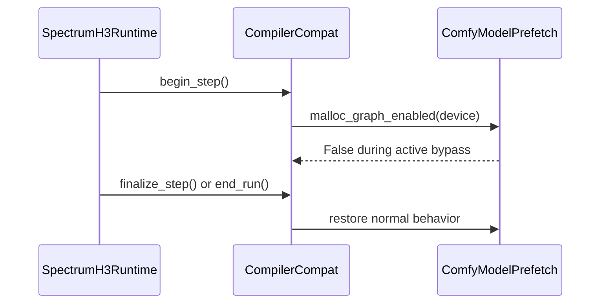

</details>

<!-- walkthrough_end -->
<!-- pre_merge_checks_walkthrough_start -->

<details>
<summary>🚥 Pre-merge checks | ✅ 4 | ❌ 1</summary>

### ❌ Failed checks (1 warning)

|     Check name     | Status     | Explanation                                                                                                                                                                                               | Resolution                                                                         |
| :----------------: | :--------- | :-------------------------------------------------------------------------------------------------------------------------------------------------------------------------------------------------------- | :--------------------------------------------------------------------------------- |
| Docstring Coverage | ⚠️ Warning | Docstring coverage is 5.88% which is insufficient. The required threshold is 80.00%. Docstring coverage is scoped to functions touched by this diff. Analyzed 34 functions across 5 files. (1 skipped: 1… | Write docstrings for the functions missing them to satisfy the coverage threshold. |

<details>
<summary>✅ Passed checks (4 passed)</summary>

|         Check name         | Status   | Explanation                                                                                                                                                                                               |
| :------------------------: | :------- | :-------------------------------------------------------------------------------------------------------------------------------------------------------------------------------------------------------- |
|     Linked Issues check    | ✅ Passed | The changes address issue [`#99`] by disabling Comfy Compiler malloc graphs only during Spectrum-managed H3 steps while preserving compiler behavior elsewhere. Cleanup paths and compatibility tests cove… |
| Out of Scope Changes check | ✅ Passed | The workflow updates, compatibility tests, native wrapper test adjustments, and package initialization changes support the stated compatibility fix and do not introduce unrelated scope.                 |
|      Description Check     | ✅ Passed | Check skipped - CodeRabbit’s high-level summary is enabled.                                                                                                                                               |
|         Title check        | ✅ Passed | The title clearly and concisely describes the primary change: bypassing Comfy Compiler malloc graphs during Spectrum H3 steps.                                                                            |

</details>

<details>
<summary>Full details: Docstring Coverage</summary>

**Explanation**

Docstring coverage is 5.88% which is insufficient. The required threshold is 80.00%. Docstring coverage is scoped to functions touched by this diff. Analyzed 34 functions across 5 files. (1 skipped: 1 unsupported.)

</details>

</details>

<!-- pre_merge_checks_walkthrough_end -->

- [ ] <!-- {"checkboxId":"585bb3f6-faf5-4dbf-96d2-74e382adf19a"} --> Fix all pre-merge checks with AI
<!-- finishing_touch_checkbox_start -->

<details>
<summary>✨ Finishing Touches 💡 1</summary>

<!-- finishing_touch_suggestion:docstrings -->
<details>
<summary>📝 Generate docstrings 💡</summary>

- [ ] <!-- {"checkboxId":"7962f53c-55bc-4827-bfbf-6a18da830691"} --> Create stacked PR
- [ ] <!-- {"checkboxId":"3e1879ae-f29b-4d0d-8e06-d12b7ba33d98"} --> Commit on current branch

</details>
<details>
<summary>🧪 Generate unit tests (beta)</summary>

- [ ] <!-- {"checkboxId": "f47ac10b-58cc-4372-a567-0e02b2c3d479", "radioGroupId": "utg-output-choice-group-5561882920"} -->   Create PR with unit tests
- [ ] <!-- {"checkboxId": "6ba7b810-9dad-11d1-80b4-00c04fd430c8", "radioGroupId": "utg-output-choice-group-5561882920"} -->   Commit unit tests in branch `fix/comfy-compiler-history-lifetime`

</details>

</details>

<!-- finishing_touch_checkbox_end -->
<!-- tips_start -->

---

Thanks for using [CodeRabbit](https://coderabbit.ai?utm_source=oss&utm_medium=github&utm_campaign=xmarre/ComfyUI-Spectrum-MiniMax-H3&utm_content=102)! It's free for OSS, and your support helps us grow. If you like it, consider giving us a shout-out.

<details>
<summary>❤️ Share</summary>

- [X](https://twitter.com/intent/tweet?text=I%20just%20used%20%40coderabbitai%20for%20my%20code%20review%2C%20and%20it%27s%20fantastic%21%20It%27s%20free%20for%20OSS%20and%20offers%20a%20free%20trial%20for%20the%20proprietary%20code.%20Check%20it%20out%3A&url=https%3A//coderabbit.ai)
- [Mastodon](https://mastodon.social/share?text=I%20just%20used%20%40coderabbitai%20for%20my%20code%20review%2C%20and%20it%27s%20fantastic%21%20It%27s%20free%20for%20OSS%20and%20offers%20a%20free%20trial%20for%20the%20proprietary%20code.%20Check%20it%20out%3A%20https%3A%2F%2Fcoderabbit.ai)
- [Reddit](https://www.reddit.com/submit?title=Great%20tool%20for%20code%20review%20-%20CodeRabbit&text=I%20just%20used%20CodeRabbit%20for%20my%20code%20review%2C%20and%20it%27s%20fantastic%21%20It%27s%20free%20for%20OSS%20and%20offers%20a%20free%20trial%20for%20proprietary%20code.%20Check%20it%20out%3A%20https%3A//coderabbit.ai)
- [LinkedIn](https://www.linkedin.com/sharing/share-offsite/?url=https%3A%2F%2Fcoderabbit.ai&mini=true&title=Great%20tool%20for%20code%20review%20-%20CodeRabbit&summary=I%20just%20used%20CodeRabbit%20for%20my%20code%20review%2C%20and%20it%27s%20fantastic%21%20It%27s%20free%20for%20OSS%20and%20offers%20a%20free%20trial%20for%20proprietary%20code)

</details>


<!-- poem_footer_start -->
<sub>A rabbit reads each line,<br>The patch grows clear beneath the moon,<br>Small changes hop in place,<br>Tests guard the garden path,<br>Reviews bloom before the dawn.</sub>
<!-- poem_footer_end -->

<sub>Comment `@coderabbitai help` to get the list of available commands.</sub>

<!-- tips_end -->


> **Comment by xmarre (2026-09-06T20:14:48Z):**

@coderabbitai review


> **Comment by coderabbitai[bot] (2026-09-06T20:14:56Z):**

<!-- This is an auto-generated reply by CodeRabbit -->
<!-- CodeRabbit review command invocation: v2:ccc8a49dbca4870fbab0fe2ccb8accae578f8ea9b051efae545078b6d7cc6e5e -->
<details>
<summary>✅ Action performed</summary>

Review finished.

> Note: CodeRabbit is an incremental review system and does not re-review already reviewed commits. This command is applicable only when automatic reviews are paused.

</details>


> **Comment by blepping (2026-09-07T01:06:53Z):**

I applied this to v0.2.22 (don't have time to update and bypass all the heuristics that make Spectrum self disable with my sampler wrappers, etc) and it seems to have fixed the crash issue. I have not done any performance testing but it feels about the same as before.


> **Comment by xmarre (2026-09-08T17:44:21Z):**

CUDA/runtime validation is now accepted. @blepping applied the revised compatibility boundary and reported that it fixed the crash, with no obvious performance regression. CodeRabbit also found no actionable review comments, and Actions run #589 is green across all 9 lanes.

The real-runtime gate for #99 is therefore satisfied. Marking this ready and merging the final one-commit implementation.


### #101 [closed] PR: Release v0.2.24
URL: https://github.com/xmarre/ComfyUI-Spectrum-MiniMax-H3/pull/101  by xmarre 2026-09-06T07:33:09Z

## Release preparation

- bump package version to `0.2.24`;
- document the terminal Untwist PECE deferral and short-`max_speed` bootstrap fix from #98;
- include the RES final-tail optimization and progressive `A F A` validation from #100;
- include the documentation/release-process changes from #95, which are the only other merged changes after v0.2.23;
- preserve the historical `RELEASE_NOTES.md` entries;
- keep the repository release heading for version/history purposes while stripping it from the GitHub release body so the release title is not duplicated in the description.

Combined `main` after #100 + #98 already passed Actions run 578. This branch is one release-only commit on top of that tested head.

> **Comment by coderabbitai[bot] (2026-09-06T07:33:16Z):**

<!-- This is an auto-generated comment: summarize by coderabbit.ai -->
<!-- This is an auto-generated comment: skip review by coderabbit.ai -->

> [!IMPORTANT]
> ## Review skipped
> 
> Auto reviews are disabled on this repository. Please check the settings in the CodeRabbit UI or the `.coderabbit.yaml` file in this repository. To trigger a single review, invoke the `@coderabbitai review` command.
> 
> <details>
> <summary>⚙️ Run configuration</summary>
> 
> **Configuration used**: Organization UI
> 
> **Review profile**: CHILL
> 
> **Plan**: Team
> 
> **Run ID**: `e2c121a0-13c9-499f-b448-0a40f6bfbb42`
> 
> </details>
> 
> You can disable this status message by setting the `reviews.review_status` to `false` in the CodeRabbit configuration file.
> 
> Use the checkbox below for a quick retry:
> - [ ] <!-- {"checkboxId":"e9bb8d72-00e8-4f67-9cb2-caf3b22574fe"} --> 🔍 Trigger review

<!-- end of auto-generated comment: skip review by coderabbit.ai -->

<!-- tips_start -->

---

Thanks for using [CodeRabbit](https://coderabbit.ai?utm_source=oss&utm_medium=github&utm_campaign=xmarre/ComfyUI-Spectrum-MiniMax-H3&utm_content=101)! It's free for OSS, and your support helps us grow. If you like it, consider giving us a shout-out.

<details>
<summary>❤️ Share</summary>

- [X](https://twitter.com/intent/tweet?text=I%20just%20used%20%40coderabbitai%20for%20my%20code%20review%2C%20and%20it%27s%20fantastic%21%20It%27s%20free%20for%20OSS%20and%20offers%20a%20free%20trial%20for%20the%20proprietary%20code.%20Check%20it%20out%3A&url=https%3A//coderabbit.ai)
- [Mastodon](https://mastodon.social/share?text=I%20just%20used%20%40coderabbitai%20for%20my%20code%20review%2C%20and%20it%27s%20fantastic%21%20It%27s%20free%20for%20OSS%20and%20offers%20a%20free%20trial%20for%20the%20proprietary%20code.%20Check%20it%20out%3A%20https%3A%2F%2Fcoderabbit.ai)
- [Reddit](https://www.reddit.com/submit?title=Great%20tool%20for%20code%20review%20-%20CodeRabbit&text=I%20just%20used%20CodeRabbit%20for%20my%20code%20review%2C%20and%20it%27s%20fantastic%21%20It%27s%20free%20for%20OSS%20and%20offers%20a%20free%20trial%20for%20proprietary%20code.%20Check%20it%20out%3A%20https%3A//coderabbit.ai)
- [LinkedIn](https://www.linkedin.com/sharing/share-offsite/?url=https%3A%2F%2Fcoderabbit.ai&mini=true&title=Great%20tool%20for%20code%20review%20-%20CodeRabbit&summary=I%20just%20used%20CodeRabbit%20for%20my%20code%20review%2C%20and%20it%27s%20fantastic%21%20It%27s%20free%20for%20OSS%20and%20offers%20a%20free%20trial%20for%20proprietary%20code)

</details>


<sub>Comment `@coderabbitai help` to get the list of available commands.</sub>

<!-- tips_end -->


### #100 [closed] PR: Remove obsolete RES three-step tail floor
URL: https://github.com/xmarre/ComfyUI-Spectrum-MiniMax-H3/pull/100  by xmarre 2026-09-06T06:01:47Z

## Problem

Spectrum still carries a RES-specific `min_tail_actual_steps=3` floor introduced in v0.1.3 as an empirical quality safeguard for the old monolithic 20-step RES path. It is not a native RES solver requirement.

That absolute floor is now actively counterproductive for few-step and progressive workflows. In particular, a fresh 3-step progressive high-resolution suffix is forced entirely actual (`A A A`) even when the user configured `tail_actual_steps=1`, leaving no forecast opportunity at the expensive target grid.

The separate RES recurrence safeguard remains justified: after a forecast, one exact model evaluation must refresh native `old_denoised` before another forecast can occur. This PR keeps that rule unchanged.

## Change

- remove the RES-only `min_tail_actual_steps()` helper and hardcoded floor of 3;
- stop injecting a sampler-specific final-tail minimum into `SpectrumH3Runtime.start_run`;
- keep `min_actual_steps_after_forecast=1` for `sample_res_multistep` and `sample_res_multistep_cfg_pp`;
- leave the generic runtime tail-floor mechanism intact for callers that explicitly need it;
- make the user-configured `tail_actual_steps` authoritative for RES;
- preserve independent exactness constraints from Continuum prefixes, warmup, external-patch transitions, fallbacks, force-actual mode, and other sampler/runtime contracts;
- update the node tooltip and README so the UI no longer claims RES has a hidden three-step tail.

No native RES equations, sigma ordering, `old_denoised` update ordering, CFG++ behavior, exact-mask handling, or model-wrapper topology are changed.

## Regression coverage

- the existing 20-step RES scheduling test now verifies the one-refresh cadence without a hidden tail floor: with `tail_actual_steps=0`, forecasts may continue through the final eligible alternating position rather than being cut off by the old 3-step floor;
- a new 3-step progressive-style regression uses a one-step Continuum exact prefix plus `tail_actual_steps=1` and verifies the intended `A F A` topology:
  - step 0: exact Continuum prefix;
  - step 1: one-point bootstrap forecast;
  - step 2: configured final exact tail.

## Real progressive RES validation

A full production-stack RES rerun exercises the changed path successfully with VDN-H3, RuntimeBypass DoRA/LoRA, DiffAid, Untwist RoPE, Flow Mixed-Grid, Continuum, and Spectrum enabled.

Observed Spectrum topology:

- standalone low stage, 5 RES steps: `A F A F A` -> 3 actual + 2 forecast;
- standalone high stage, 3 RES steps with Continuum prefix 1: `A F A` -> 2 actual + 1 forecast;
- continuation low/mixed-grid stage, 5 RES steps with Continuum prefix 2: `A A F A A` -> 4 actual + 1 forecast;
- continuation high stage, 3 RES steps with Continuum prefix 1: `A F A` -> 2 actual + 1 forecast.

Across the four RES stages this is 16 logical calls -> 11 actual H3 evaluations + 5 Spectrum forecasts. The two exact handoff probes add 2 actual H3 evaluations, for 13 total actual transformer NFEs across the progressive workflow. This matches the successful Euler control's aggregate `13 actual + 5 forecast + 2 probe` topology.

Critically, both expensive 3-step high-resolution RES stages now use the intended `A F A` schedule. The removed tail floor no longer converts them into `A A A`.

All four RES runs report `fallbacks=0`. The workflow completed normally in 537.36 s; `H3ContinuumSamplerV34` accounted for 423.12 s. The first RES high stage completed in 65.230 s and the continuation high stage in 77.122 s.

Perceptual validation also passed: the maintainer reviewed the decoded result and reported both video quality and audio as excellent, with overall quality better than the matched Euler control. This closes the original empirical-quality rationale for retaining the RES-specific three-step tail floor in the current progressive/VDN workflow.

## Supporting Euler control

The matched Euler progressive control also exercised the intended short-stage topology successfully. Across that workflow it reported 18 logical sampler calls, 13 actual transformer NFEs, 5 Spectrum forecasts, and 2 exact handoff-probe NFEs. The two 3-step high-resolution stages each ran `A F A`, giving 4 actual + 2 forecast high-stage calls in total, with zero Spectrum fallbacks. The decoded output was manually reviewed as excellent.

## Validation status

- temporary edit runner: `compileall` passed;
- `git diff --check` passed;
- GitHub Actions run **576** passed the full eight-lane reviewed ComfyUI/Python matrix, including Ruff, compileall, focused compatibility suites, wheel build, forecaster smoke test, and native MiniMax-H3 tests;
- real production-stack progressive RES rerun passed with the intended schedule and zero Spectrum fallbacks;
- decoded video and audio passed maintainer perceptual validation, with the RES output judged better than the matched Euler control;
- branch is exactly one focused commit over current `main`.


> **Comment by coderabbitai[bot] (2026-09-06T06:01:54Z):**

<!-- This is an auto-generated comment: summarize by coderabbit.ai -->
<!-- This is an auto-generated comment: skip review by coderabbit.ai -->

> [!IMPORTANT]
> ## Review skipped
> 
> Auto reviews are disabled on this repository. Please check the settings in the CodeRabbit UI or the `.coderabbit.yaml` file in this repository. To trigger a single review, invoke the `@coderabbitai review` command.
> 
> <details>
> <summary>⚙️ Run configuration</summary>
> 
> **Configuration used**: Organization UI
> 
> **Review profile**: CHILL
> 
> **Plan**: Team
> 
> **Run ID**: `9c68501a-858d-4230-b8de-02d459b29c49`
> 
> </details>
> 
> You can disable this status message by setting the `reviews.review_status` to `false` in the CodeRabbit configuration file.
> 
> Use the checkbox below for a quick retry:
> - [ ] <!-- {"checkboxId":"e9bb8d72-00e8-4f67-9cb2-caf3b22574fe"} --> 🔍 Trigger review

<!-- end of auto-generated comment: skip review by coderabbit.ai -->

<!-- tips_start -->

---

Thanks for using [CodeRabbit](https://coderabbit.ai?utm_source=oss&utm_medium=github&utm_campaign=xmarre/ComfyUI-Spectrum-MiniMax-H3&utm_content=100)! It's free for OSS, and your support helps us grow. If you like it, consider giving us a shout-out.

<details>
<summary>❤️ Share</summary>

- [X](https://twitter.com/intent/tweet?text=I%20just%20used%20%40coderabbitai%20for%20my%20code%20review%2C%20and%20it%27s%20fantastic%21%20It%27s%20free%20for%20OSS%20and%20offers%20a%20free%20trial%20for%20the%20proprietary%20code.%20Check%20it%20out%3A&url=https%3A//coderabbit.ai)
- [Mastodon](https://mastodon.social/share?text=I%20just%20used%20%40coderabbitai%20for%20my%20code%20review%2C%20and%20it%27s%20fantastic%21%20It%27s%20free%20for%20OSS%20and%20offers%20a%20free%20trial%20for%20the%20proprietary%20code.%20Check%20it%20out%3A%20https%3A%2F%2Fcoderabbit.ai)
- [Reddit](https://www.reddit.com/submit?title=Great%20tool%20for%20code%20review%20-%20CodeRabbit&text=I%20just%20used%20CodeRabbit%20for%20my%20code%20review%2C%20and%20it%27s%20fantastic%21%20It%27s%20free%20for%20OSS%20and%20offers%20a%20free%20trial%20for%20proprietary%20code.%20Check%20it%20out%3A%20https%3A//coderabbit.ai)
- [LinkedIn](https://www.linkedin.com/sharing/share-offsite/?url=https%3A%2F%2Fcoderabbit.ai&mini=true&title=Great%20tool%20for%20code%20review%20-%20CodeRabbit&summary=I%20just%20used%20CodeRabbit%20for%20my%20code%20review%2C%20and%20it%27s%20fantastic%21%20It%27s%20free%20for%20OSS%20and%20offers%20a%20free%20trial%20for%20proprietary%20code)

</details>


<sub>Comment `@coderabbitai help` to get the list of available commands.</sub>

<!-- tips_end -->


### #99 [closed] ISSUE: Since ComfyUI update today, using Spectrum results in "Segmentation fault" error and crash
URL: https://github.com/xmarre/ComfyUI-Spectrum-MiniMax-H3/issues/99  by driqeks 2026-09-05T01:50:10Z

After I today updated ComfyUI to latest version, Spectrum no longer works. When I use Spectrum I every time get "Segmentation Error" during Minimax H3 processing. Usually the error appears after Step 7, but sometimes also slightly later or earlier. When I disable the Spectrum node, ComfyUI works fine and does not crash.

Previously I used ComfyUI updated 2 days ago, that was working fine with Spectrum. The ComfyUI version from today does not work fine with Spectrum.

When that "Segmentation Error" happens I see in the terminal where I launched ComfyUI that the callstack contains Spectrum code. But the whole PC (using latest Ubuntu) then freezes and I can no longer save the log and I have to hard reset the PC.

I now did ComfyUI "git checkout ec803fc" to go back to older ComfyUI version from 2-3 days ago, and that fixed the issue. Now Spectrum works without crash again.

> **Comment by blepping (2026-09-06T05:25:54Z):**

It seems incompatible with the recently merged "Comfy Compiler" (https://github.com/Comfy-Org/ComfyUI/pull/15861). Disabling it with `--disable-comfy-compiler` allows the workflow to run normally.


> **Comment by xmarre (2026-09-06T07:41:20Z):**

Ah right, I use highvram (disables those dynamic vram shenanigans) so this issue never surfaced for me. I'm on it


> **Comment by xmarre (2026-09-06T08:13:15Z):**

Candidate fix is now in #102 and the full 9-lane CI matrix is green, including current ComfyUI + `comfy-aimdo==0.5.2`. It keeps Spectrum's retained CUDA history outside the new per-forward Aimdo malloc graph instead of disabling Comfy Compiler globally.

Could you test #102 on the same affected workflow with **current ComfyUI and without `--disable-comfy-compiler` / `--highvram`**? Please run through and beyond the previous failure region (usually around step 7), ideally twice because the original crash timing varied. If it still crashes, report the last Spectrum/Comfy Compiler lines you can capture before the native failure.

I'm keeping the PR draft until this CUDA reproduction passes; CPU CI cannot establish that the native allocator crash itself is fixed.


> **Comment by xiaohongai (2026-09-06T12:15:53Z):**

[INFO] got prompt
[INFO] VAE load device: cuda:0, offload device: cpu, dtype: torch.float32
[INFO] VAE load device: cuda:0, offload device: cpu, dtype: torch.float16
[INFO] Found quantization metadata version 1
[INFO] Using MixedPrecisionOps for text encoder
[INFO] CLIP/text encoder model load device: cuda:0, offload device: cpu, current: cpu, dtype: torch.float16
[INFO] Requested to load MiniMaxH3VideoVAE
[INFO] Model MiniMaxH3VideoVAE prepared for dynamic VRAM loading. 4965MB Staged. 0 patches attached. Force pre-loaded 128 weights: 348 KB.
[INFO] Model MiniMaxH3VideoVAE prepared for dynamic VRAM loading. 4965MB Staged. 0 patches attached. Force pre-loaded 128 weights: 348 KB.
[INFO] Requested to load MiniMaxH3TEModel_
[INFO] Model MiniMaxH3TEModel_ prepared for dynamic VRAM loading. 25882MB Staged. 0 patches attached. Force pre-loaded 310 weights: 1272 KB.
[INFO] model weight dtype torch.bfloat16, manual cast: None
[INFO] model_type FLOW_AV
[MiniMaxH3TurboLoRA] pruned base [bypass]: lora=minimax_h3_turbo_v4_step600_ema.safetensors strength=1.0 | 208 backbone modules, 208 bypass adapters, 1 injections + 51 adaln injected at run time | model=MiniMaxH3 weight_dtype=torch.bfloat16 weight_dev=cpu
[INFO] Using sage attention mode: auto
[INFO] Requested to load MiniMaxH3
[INFO] Model MiniMaxH3 prepared for dynamic VRAM loading. 38444MB Staged. 0 patches attached. Force pre-loaded 210 weights: 1175 KB.
[H3TURBO sampler] native ModelSamplingAV -> single-schedule Euler  sigmas=[1.0, 0.9882, 0.973, 0.9524, 0.9231, 0.878, 0.8, 0.6316, 0.0]  x.shape=(1, 1, 5002560) dtype=torch.float32
  0%|                                                     | 0/8 [00:00<?, ?it/s][H3TURBO fwd pruned/bypass] call#1  qkv_proj.forward_owner=BypassForwardHook (BypassForwardHook => lora ACTIVE; else => BASE ONLY!)  is_injected=False  timestep=1000.00  video_rms=1.0001 audio_rms=1.0006 dtype=torch.bfloat16
[H3TURBO step 0] sv=1.0000->0.9882  denoised_rms=2.1581 x_rms=0.9890 d_rms=2.3652
 12%|█████▋                                       | 1/8 [01:27<10:12, 87.53s/it][H3TURBO fwd pruned/bypass] call#2  qkv_proj.forward_owner=BypassForwardHook (BypassForwardHook => lora ACTIVE; else => BASE ONLY!)  is_injected=False  timestep=988.24  video_rms=0.9890 audio_rms=0.9541 dtype=torch.bfloat16
[H3TURBO step 1] sv=0.9882->0.9730  denoised_rms=2.1289 x_rms=0.9757 d_rms=2.3375
 25%|███████████▎                                 | 2/8 [01:27<03:36, 36.15s/it][H3TURBO fwd pruned/bypass] call#3  qkv_proj.forward_owner=BypassForwardHook (BypassForwardHook => lora ACTIVE; else => BASE ONLY!)  is_injected=False  timestep=972.97  video_rms=0.9757 audio_rms=0.9034 dtype=torch.bfloat16
[H3TURBO step 2] sv=0.9730->0.9524  denoised_rms=1.2540 x_rms=0.9556 d_rms=1.6253
 38%|████████████████▉                            | 3/8 [02:44<04:32, 54.48s/it][H3TURBO fwd pruned/bypass] call#4  qkv_proj.forward_owner=BypassForwardHook (BypassForwardHook => lora ACTIVE; else => BASE ONLY!)  is_injected=False  timestep=952.38  video_rms=0.9556 audio_rms=0.8413 dtype=torch.bfloat16
[H3TURBO step 3] sv=0.9524->0.9231  denoised_rms=1.3137 x_rms=0.9360 d_rms=1.5168
 50%|██████████████████████▌                      | 4/8 [02:44<02:12, 33.05s/it][H3TURBO fwd pruned/bypass] call#5  qkv_proj.forward_owner=BypassForwardHook (BypassForwardHook => lora ACTIVE; else => BASE ONLY!)  is_injected=False  timestep=923.08  video_rms=0.9359 audio_rms=0.7699 dtype=torch.bfloat16
[H3TURBO step 4] sv=0.9231->0.8780  denoised_rms=1.0800 x_rms=0.8950 d_rms=1.5017
 62%|████████████████████████████▏                | 5/8 [04:03<02:29, 49.67s/it][H3TURBO fwd pruned/bypass] call#6  qkv_proj.forward_owner=BypassForwardHook (BypassForwardHook => lora ACTIVE; else => BASE ONLY!)  is_injected=False  timestep=878.05  video_rms=0.8948 audio_rms=0.6815 dtype=torch.bfloat16
[H3TURBO step 5] sv=0.8780->0.8000  denoised_rms=1.0811 x_rms=0.8501 d_rms=1.3332
 75%|█████████████████████████████████▊           | 6/8 [04:03<01:05, 32.85s/it][H3TURBO step 6] sv=0.8000->0.6316  denoised_rms=0.9819 x_rms=0.7461 d_rms=1.4277
 88%|███████████████████████████████████████▍     | 7/8 [05:22<00:47, 47.91s/it][H3TURBO step 7] sv=0.6316->0.0000  denoised_rms=0.9657 x_rms=0.9657 d_rms=1.3912
100%|█████████████████████████████████████████████| 8/8 [06:43<00:00, 50.41s/it]
[INFO] 0 models unloaded.
[INFO] Model MiniMaxH3 prepared for dynamic VRAM loading. 38444MB Staged. 0 patches attached. Force pre-loaded 210 weights: 1175 KB.
[H3TURBO sampler] native ModelSamplingAV -> single-schedule Euler  sigmas=[1.0, 0.9882, 0.973, 0.9524, 0.9231, 0.878, 0.8, 0.6316, 0.0]  x.shape=(1, 1, 5002560) dtype=torch.float32
[H3TURBO step 0] sv=1.0000->0.9882  denoised_rms=2.1581 x_rms=0.9890 d_rms=2.3652
[H3TURBO step 1] sv=0.9882->0.9730  denoised_rms=1.6502 x_rms=0.9718 d_rms=2.0222
[H3TURBO step 2] sv=0.9730->0.9524  denoised_rms=1.2584 x_rms=0.9519 d_rms=1.6254
[H3TURBO step 3] sv=0.9524->0.9231  denoised_rms=1.2914 x_rms=0.9206 d_rms=1.7406
[H3TURBO step 4] sv=0.9231->0.8780  denoised_rms=1.1040 x_rms=0.8812 d_rms=1.5018
[H3TURBO step 5] sv=0.8780->0.8000  denoised_rms=1.1649 x_rms=0.8148 d_rms=1.6220
[H3TURBO step 6] sv=0.8000->0.6316  denoised_rms=1.0325 x_rms=0.7292 d_rms=1.4278
[H3TURBO step 7] sv=0.6316->0.0000  denoised_rms=1.0141 x_rms=1.0141 d_rms=1.3912
[INFO] Comfy model compiler graph breaks: 21
[INFO] Requested to load MiniMaxH3AudioVAE
[INFO] Model MiniMaxH3AudioVAE prepared for dynamic VRAM loading. 576MB Staged. 0 patches attached. Force pre-loaded 401 weights: 539 KB.
[INFO] Model MiniMaxH3VideoVAE prepared for dynamic VRAM loading. 4965MB Staged. 0 patches attached. Force pre-loaded 128 weights: 348 KB.
[INFO] Prompt executed in 548.20 seconds
[INFO] got prompt
[INFO] Model MiniMaxH3VideoVAE prepared for dynamic VRAM loading. 4965MB Staged. 0 patches attached. Force pre-loaded 128 weights: 348 KB.
[INFO] Model MiniMaxH3VideoVAE prepared for dynamic VRAM loading. 4965MB Staged. 0 patches attached. Force pre-loaded 128 weights: 348 KB.
[INFO] Model MiniMaxH3TEModel_ prepared for dynamic VRAM loading. 25882MB Staged. 0 patches attached. Force pre-loaded 310 weights: 1272 KB.
[INFO] 0 models unloaded.
[INFO] Model MiniMaxH3 prepared for dynamic VRAM loading. 38444MB Staged. 0 patches attached. Force pre-loaded 210 weights: 1175 KB.
[H3TURBO sampler] native ModelSamplingAV -> single-schedule Euler  sigmas=[1.0, 0.9882, 0.973, 0.9524, 0.9231, 0.878, 0.8, 0.6316, 0.0]  x.shape=(1, 1, 5002560) dtype=torch.float32
  0%|                                                     | 0/8 [00:00<?, ?it/s][H3TURBO step 0] sv=1.0000->0.9882  denoised_rms=1.8450 x_rms=0.9887 d_rms=2.0711
 12%|█████▋                                       | 1/8 [01:28<10:21, 88.84s/it][H3TURBO step 1] sv=0.9882->0.9730  denoised_rms=1.8193 x_rms=0.9754 d_rms=2.0472
 25%|███████████▎                                 | 2/8 [01:29<03:40, 36.70s/it]Fatal Python error: Segmentation fault

Stack (most recent call first):
  File "/home/redaigc/comfyui-env/lib/python3.12/site-packages/comfy_aimdo/malloc_graph.py", line 14 in _call
  File "/home/redaigc/comfyui-env/lib/python3.12/site-packages/comfy_aimdo/malloc_graph.py", line 25 in pop
  File "/home/redaigc/ComfyUI/comfy/model_prefetch.py", line 51 in malloc_graph_end
  File "/home/redaigc/ComfyUI/comfy/ldm/minimax/model.py", line 587 in forward
  File "/home/redaigc/comfyui-env/lib/python3.12/site-packages/torch/nn/modules/module.py", line 1789 in _call_impl
  File "/home/redaigc/comfyui-env/lib/python3.12/site-packages/torch/nn/modules/module.py", line 1778 in _wrapped_call_impl
  File "/home/redaigc/ComfyUI/comfy/model_base.py", line 252 in _apply_model
  File "/home/redaigc/ComfyUI/comfy/patcher_extension.py", line 113 in execute
  File "/home/redaigc/ComfyUI/comfy/model_base.py", line 208 in apply_model
  File "/home/redaigc/ComfyUI/comfy/samplers.py", line 335 in _calc_cond_batch
  File "/home/redaigc/ComfyUI/comfy/patcher_extension.py", line 113 in execute
  File "/home/redaigc/ComfyUI/comfy/samplers.py", line 219 in _calc_cond_batch_outer
  File "/home/redaigc/ComfyUI/comfy/samplers.py", line 211 in calc_cond_batch
  File "/home/redaigc/ComfyUI/comfy/samplers.py", line 620 in sampling_function
  File "/home/redaigc/ComfyUI/comfy/samplers.py", line 1218 in predict_noise
  File "/home/redaigc/ComfyUI/comfy/patcher_extension.py", line 113 in execute
  File "/home/redaigc/ComfyUI/comfy/patcher_extension.py", line 106 in __call__
  File "/home/redaigc/ComfyUI/custom_nodes/ComfyUI-Spectrum-MiniMax-H3/comfyui_spectrum_h3/external_patch_compat.py", line 1106 in execute_attempt
  File "/home/redaigc/ComfyUI/custom_nodes/ComfyUI-Spectrum-MiniMax-H3/comfyui_spectrum_h3/external_patch_compat.py", line 1144 in _predict_noise_wrapper
  File "/home/redaigc/ComfyUI/comfy/patcher_extension.py", line 114 in execute
  File "/home/redaigc/ComfyUI/comfy/samplers.py", line 1215 in outer_predict_noise
  File "/home/redaigc/ComfyUI/comfy/samplers.py", line 1208 in __call__
  File "/home/redaigc/ComfyUI/comfy/samplers.py", line 640 in __call__
  File "/home/redaigc/ComfyUI/custom_nodes/ComfyUI-MiniMax-H3-Turbo/__init__.py", line 123 in _turbo_sampler
  File "/home/redaigc/comfyui-env/lib/python3.12/site-packages/torch/utils/_contextlib.py", line 124 in decorate_context
  File "/home/redaigc/ComfyUI/comfy/samplers.py", line 1005 in sample
  File "/home/redaigc/ComfyUI/comfy/patcher_extension.py", line 113 in execute
  File "/home/redaigc/ComfyUI/comfy/patcher_extension.py", line 106 in __call__
  File "/home/redaigc/ComfyUI/custom_nodes/ComfyUI-Spectrum-MiniMax-H3/comfyui_spectrum_h3/sampling.py", line 3244 in sampler_sample_wrapper
  File "/home/redaigc/ComfyUI/comfy/patcher_extension.py", line 114 in execute
  File "/home/redaigc/ComfyUI/comfy/samplers.py", line 1237 in inner_sample
  File "/home/redaigc/ComfyUI/comfy/samplers.py", line 1262 in outer_sample
  File "/home/redaigc/ComfyUI/comfy/patcher_extension.py", line 113 in execute
  File "/home/redaigc/ComfyUI/comfy/patcher_extension.py", line 106 in __call__
  File "/home/redaigc/ComfyUI/custom_nodes/ComfyUI-Spectrum-MiniMax-H3/comfyui_spectrum_h3/sampling.py", line 2554 in execute_run
  File "/home/redaigc/ComfyUI/custom_nodes/ComfyUI-Spectrum-MiniMax-H3/comfyui_spectrum_h3/sampling.py", line 2714 in outer_sample_wrapper
  File "/home/redaigc/ComfyUI/custom_nodes/ComfyUI-Spectrum-MiniMax-H3/comfyui_spectrum_h3/replay_calibration_provenance.py", line 51 in _outer_sample_with_provenance
  File "/home/redaigc/ComfyUI/custom_nodes/ComfyUI-Spectrum-MiniMax-H3/comfyui_spectrum_h3/external_patch_compat.py", line 1002 in _outer_sample_wrapper
  File "/home/redaigc/ComfyUI/comfy/patcher_extension.py", line 114 in execute
  File "/home/redaigc/ComfyUI/comfy/samplers.py", line 1335 in sample
  File "/home/redaigc/ComfyUI/comfy_extras/nodes_custom_sampler.py", line 1055 in execute
  File "/home/redaigc/ComfyUI/comfy_api/latest/_io.py", line 2046 in EXECUTE_NORMALIZED
  File "/home/redaigc/ComfyUI/comfy_api/internal/__init__.py", line 149 in wrapped_func
  File "/home/redaigc/ComfyUI/execution.py", line 306 in process_inputs
  File "/home/redaigc/ComfyUI/execution.py", line 318 in _async_map_node_over_list
  File "/home/redaigc/ComfyUI/execution.py", line 344 in get_output_data
  File "/home/redaigc/ComfyUI/execution.py", line 545 in execute
  File "/home/redaigc/ComfyUI/execution.py", line 789 in execute_async
  File "/usr/lib/python3.12/asyncio/events.py", line 88 in _run
  File "/usr/lib/python3.12/asyncio/base_events.py", line 1987 in _run_once
  File "/usr/lib/python3.12/asyncio/base_events.py", line 641 in run_forever
  File "/usr/lib/python3.12/asyncio/base_events.py", line 674 in run_until_complete
  File "/usr/lib/python3.12/asyncio/runners.py", line 118 in run
  File "/usr/lib/python3.12/asyncio/runners.py", line 194 in run
  File "/home/redaigc/ComfyUI/execution.py", line 728 in execute
  File "/home/redaigc/ComfyUI/main.py", line 394 in prompt_worker
  File "/usr/lib/python3.12/threading.py", line 1010 in run
  File "/usr/lib/python3.12/threading.py", line 1073 in _bootstrap_inner
  File "/usr/lib/python3.12/threading.py", line 1030 in _bootstrap

Extension modules: sqlalchemy.cyextension.collections, sqlalchemy.cyextension.immutabledict, sqlalchemy.cyextension.processors, sqlalchemy.cyextension.resultproxy, sqlalchemy.cyextension.util, greenlet._greenlet, markupsafe._speedups, yaml._yaml, PIL._imaging, numpy._core._multiarray_umath, numpy.linalg._umath_linalg, torch._C, torch._C._dynamo.autograd_compiler, torch._C._dynamo.eval_frame, torch._C._dynamo.guards, torch._C._dynamo.utils, torch._C._fft, torch._C._linalg, torch._C._nested, torch._C._nn, torch._C._sparse, torch._C._special, cuda.bindings._bindings.cydriver, cuda.bindings.cydriver, cuda.bindings.driver, cuda.bindings._bindings.cyruntime_ptds, cuda.bindings._bindings.cyruntime, cuda.bindings.cyruntime, cuda.bindings.runtime, numpy.random._common, numpy.random.bit_generator, numpy.random._bounded_integers, numpy.random._pcg64, numpy.random._generator, numpy.random._mt19937, numpy.random._philox, numpy.random._sfc64, numpy.random.mtrand, psutil._psutil_linux, PIL._imagingft, _cyutility, scipy._cyutility, scipy._lib._ccallback_c, charset_normalizer.md, charset_normalizer.cd, scipy.ndimage._nd_image, scipy.ndimage._rank_filter_1d, scipy.special._ufuncs_cxx, scipy.special._ellip_harm_2, scipy.special._special_ufuncs, scipy.special._gufuncs, scipy.special._ufuncs, scipy.special._specfun, scipy.special._comb, _ni_label, scipy.ndimage._ni_label, regex._regex, scipy.integrate._odepack, scipy.integrate._quadpack, scipy.integrate._vode, scipy.integrate._dop, scipy.sparse._sparsetools, _csparsetools, scipy.sparse._csparsetools, scipy.linalg._fblas, scipy.linalg._flapack, scipy.linalg.cython_lapack, scipy.linalg._cythonized_array_utils, scipy.linalg._solve_toeplitz, scipy.linalg._batched_linalg, scipy.linalg._decomp_lu_cython, scipy.linalg._matfuncs_schur_sqrtm, scipy.linalg._matfuncs_expm, scipy.linalg._linalg_pythran, scipy.linalg.cython_blas, scipy.linalg._decomp_update, scipy.sparse.linalg._dsolve._superlu, scipy.sparse.linalg._eigen.arpack._arpacklib, scipy.sparse.linalg._propack, scipy.optimize._group_columns, scipy._lib.messagestream, scipy.optimize._trlib._trlib, scipy.optimize._lbfgsb, _moduleTNC, scipy.optimize._moduleTNC, scipy.optimize._slsqplib, scipy.optimize._minpack, scipy.optimize._lsq.givens_elimination, scipy.optimize._zeros, scipy._lib._uarray._uarray, scipy.linalg._decomp_interpolative, scipy.optimize._bglu_dense, scipy.optimize._lsap, scipy.spatial._ckdtree, scipy.spatial._qhull, scipy.spatial._voronoi, scipy.spatial._hausdorff, scipy.spatial._distance_wrap, scipy.spatial.transform._rotation_cy, scipy.spatial.transform._rigid_transform_cy, scipy.optimize._direct, scipy.interpolate._fitpack, scipy.interpolate._dfitpack, scipy.interpolate._dierckx, scipy.interpolate._ppoly, scipy.interpolate._interpnd, scipy.interpolate._rbfinterp_pythran, scipy.interpolate._rgi_cython, scipy.special.cython_special, scipy.stats._stats, scipy.stats._biasedurn, scipy.stats._stats_pythran, scipy.stats._levy_stable.levyst, scipy.stats._ansari_swilk_statistics, scipy.sparse.csgraph._tools, scipy.sparse.csgraph._shortest_path, scipy.sparse.csgraph._traversal, scipy.sparse.csgraph._min_spanning_tree, scipy.sparse.csgraph._flow, scipy.sparse.csgraph._matching, scipy.sparse.csgraph._reordering, scipy.stats._sobol, scipy.stats._qmc_cy, scipy.stats._rcont.rcont, scipy.stats._qmvnt_cy, av._core, av.logging, av.buffer, av.audio.format, av.error, av.dictionary, av.container.pyio, av.option, av.descriptor, av.format, av.index, av.utils, av.stream, av.container.streams, av.sidedata.encparams, av.sidedata.motionvectors, av.sidedata.sidedata, av.opaque, av.packet, av.container.input, av.container.output, av.container.core, av.codec.context, av.video.format, av.video.reformatter, av.plane, av.video.plane, av.video.frame, av.video.stream, av.codec.hwaccel, av.codec.codec, av.frame, av.audio.layout, av.audio.plane, av.audio.frame, av.audio.stream, av.filter.link, av.filter.context, av.filter.graph, av.filter.filter, av.filter.loudnorm, av.audio.resampler, av.audio.codeccontext, av.audio.fifo, av.bitstream, av.device, av.video.codeccontext, av.subtitles.stream, multidict._multidict, yarl._quoting_c, propcache._helpers_c, aiohttp._http_writer, aiohttp._http_parser, aiohttp._websocket.mask, aiohttp._websocket.reader_c, frozenlist._frozenlist, chardet.models, chardet.pipeline.ascii, chardet.pipeline.confusion, chardet.pipeline.escape, chardet.pipeline.magic, chardet.pipeline.statistical, chardet.pipeline.structural, chardet.pipeline.utf8, chardet.pipeline.utf1632, chardet.pipeline.validity, chardet.pipeline.orchestrator, requests.packages.chardet.models, requests.packages.chardet.pipeline.ascii, requests.packages.chardet.pipeline.confusion, requests.packages.chardet.pipeline.escape, requests.packages.chardet.pipeline.magic, requests.packages.chardet.pipeline.statistical, requests.packages.chardet.pipeline.structural, requests.packages.chardet.pipeline.utf8, requests.packages.chardet.pipeline.utf1632, requests.packages.chardet.pipeline.validity, requests.packages.chardet.pipeline.orchestrator, numba.core.typeconv._typeconv, numba._helperlib, numba._dynfunc, numba._dispatcher, numba.core.runtime._nrt_python, numba.np.ufunc._internal, numba.experimental.jitclass._box, scipy.signal._sigtools, scipy.signal._max_len_seq_inner, scipy.signal._upfirdn_apply, scipy.signal._spline, scipy.signal._sosfilt, scipy.signal._peak_finding_utils, skimage.measure._ccomp, skimage.measure._moments_cy, skimage.measure._find_contours_cy, skimage.measure._marching_cubes_lewiner_cy, sentencepiece._sentencepiece, sklearn.__check_build._check_build, sklearn._cyutility, sklearn.utils._isfinite, sklearn.utils.sparsefuncs_fast, sklearn.utils.murmurhash, sklearn.utils._openmp_helpers, sklearn.metrics.cluster._expected_mutual_info_fast, sklearn.metrics._dist_metrics, sklearn.metrics._pairwise_distances_reduction._datasets_pair, sklearn.utils._cython_blas, sklearn.metrics._pairwise_distances_reduction._base, sklearn.metrics._pairwise_distances_reduction._middle_term_computer, sklearn.utils._heap, sklearn.utils._sorting, sklearn.metrics._pairwise_distances_reduction._argkmin, sklearn.metrics._pairwise_distances_reduction._argkmin_classmode, sklearn.utils._vector_sentinel, sklearn.metrics._pairwise_distances_reduction._radius_neighbors, sklearn.metrics._pairwise_distances_reduction._radius_neighbors_classmode, sklearn.metrics._pairwise_fast, sklearn.preprocessing._csr_polynomial_expansion, sklearn.preprocessing._target_encoder_fast (total: 243)
Segmentation fault (core dumped)


> **Comment by xmarre (2026-09-06T20:14:42Z):**

Thanks — that retest was useful. It disproved the first #102 candidate: moving only Spectrum's retained history allocation out of the Aimdo graph was not sufficient, since the second prompt still died in `MallocGraph.pop()`.

I rewrote #102 around the broader invariant exposed by your log. Spectrum's actual and forecast calls have different allocation/control topology, so current H3 malloc-graph compilation is now bypassed **only while a supported Spectrum H3 solver step is active**. DynamicVRAM and Comfy Compiler stay enabled everywhere else. The old history-only pause workaround is gone.

The revised head is `be607cf485dc720cf2557c45e01f21404d75e871`, and the full 9-lane CI matrix is green, including current ComfyUI with `comfy-aimdo==0.5.2`.

Could you retest that new head on current ComfyUI with neither `--disable-comfy-compiler` nor `--highvram`? The important gate now is **multiple consecutive prompts in the same ComfyUI process**: please run at least two, preferably three. The previous candidate specifically survived the first prompt and crashed on the second, so one successful generation is not enough. I am keeping #102 draft until that CUDA gate passes.


> **Comment by xmarre (2026-09-08T14:05:55Z):**

@driqeks @blepping @xiaohongai 

Managed to test out the new revision of the PR?


> **Comment by blepping (2026-09-08T14:45:16Z):**

@xmarre I posted a comment in the PR. You might not have seen it? https://github.com/xmarre/ComfyUI-Spectrum-MiniMax-H3/pull/102#issuecomment-5563599629


> **Comment by xmarre (2026-09-08T17:41:38Z):**

> [@xmarre](https://github.com/xmarre) I posted a comment in the PR. You might not have seen it? [#102 (comment)](https://github.com/xmarre/ComfyUI-Spectrum-MiniMax-H3/pull/102#issuecomment-5563599629)

oh my bad. Yes, that looks good, thanks for the test!


> **Comment by xmarre (2026-09-08T17:44:41Z):**

Fixed by #102 and merged as `ee505d134dd0706f9f57417313c4cf49b92f8bc7`.

The accepted fix bypasses Aimdo/Comfy Compiler malloc-graph capture only during Spectrum-managed MiniMax H3 solver steps; DynamicVRAM and Comfy Compiler remain enabled elsewhere. The final head passed the 9-lane CI matrix, CodeRabbit reported no actionable findings, and the real CUDA retest reported that the crash was fixed without an obvious performance regression.

Closing as completed.


> **Comment by xmarre (2026-09-08T17:55:45Z):**

The fix is now published in **v0.2.25**: https://github.com/xmarre/ComfyUI-Spectrum-MiniMax-H3/releases/tag/v0.2.25

The release is built from tested main commit `2482f52604da037c29e3f613e10057e8aaa83abb` and includes the packaged ZIP plus `SHA256SUMS`.


### #98 [closed] PR: Defer qualified terminal PECE external-patch transitions
URL: https://github.com/xmarre/ComfyUI-Spectrum-MiniMax-H3/pull/98  by xmarre 2026-09-02T16:15:28Z

## Problem

Spectrum treats hard external-patch windows as piecewise H3 model regimes. The first forecast candidate after a hard transition is normally promoted to an actual transformer call because its feature history belongs to the previous regime.

That invariant remains the default. Under active SA-Solver PECE, a weak Untwist hard end can land on the terminal predicted phase immediately before the mandatory exact corrected phase, making both calls actual. This PR removes only that redundant terminal predictor NFE when the provider contract and Spectrum's explicit PECE topology jointly prove the narrow safe envelope.

## Design

A hard transition may remain forecasted only when all of these are true:

1. every transitioning descriptor carries a validated v2 terminal-PECE capability;
2. Spectrum's explicit logical-call topology identifies the current call as the final predicted phase;
3. the immediate next call is the corrected phase for the same outer step;
4. that corrected call is excluded from forecastable stages, included in persistent endpoint history, and guaranteed actual;
5. the predicted transaction finalizes and the corrected call arrives with the same committed external regime.

Missing/malformed metadata, schema mismatch, PEC, `corrector_order=0`, unknown topology, an interior transition, replay, or any stacked unsafe transition keeps the existing `external patch hard sigma transition` actual promotion.

The runtime records the deferred transaction, confirms the exact corrected call after successful finalization, preserves abort/retry/rollback behavior, and exposes deferred/confirmed/fail-safe counters. PECE dense endpoint history is restarted at the exact corrected anchor for both promoted and deferred hard transitions. Native Adams history remains intact.

### Short `max_speed` PECE lifetime regression

A later real progressive-refine run exposed a distinct short-lifetime interaction that the original regression set did not cover. The fresh high-stage sampler had only 2 PECE outer steps / 3 logical H3 calls, Continuum required one exact prefix outer step, and `max_speed` therefore made P1 a valid solver-owned one-point bootstrap forecast with exactly one Spectrum feature-history anchor.

When the terminal Untwist transition was qualified for deferral, `_set_effective_forecast_reason()` correctly retained the forecast decision but incorrectly cleared `bootstrap_forecast`. That converted the valid one-point hold into the ordinary multi-point spectral predictor, which then failed with `Spectrum forecaster does not have enough actual history` before the exact same-outer corrected phase could run.

The fix is deliberately smaller than a force-actual fallback: terminal deferral now changes the external-patch reason without changing the forecast execution mechanism already selected by `begin_step()`. A pre-existing `bootstrap_forecast=True` remains true; ordinary forecasts remain ordinary forecasts. The active PECE adapter still ignores the raw hidden-feature forecast for solver integration and uses its causal exact-endpoint dense-output path, while the corrected phase remains an actual H3 evaluation.

## Why this is narrow

The exact corrector does not erase predictor error: the predictor still changes the state on which the corrector is evaluated. The exception is therefore limited to a provider-declared weak terminal transition plus a runtime-proven exact same-outer corrector.

The strong DiffAid boundary stays exact. Its current profile has `strength=0.5`, affects multiple blocks including the final block, switches abruptly at an interior coordinate, and influences later trajectory. DiffAid already has an optional nonzero `sigma_ramp`; the current hard window remains protected.

Untwist's normalized-sigma `0.05` lower boundary is the transformed `end_percent=0.95` schedule choice. Source review found no sigma-zero singularity. Widening the window to `0.0..1.0` would change provider semantics and decoded output, so the configured window is preserved. Eligibility comes from the versioned provider contract in [ComfyUI-Untwisting-RoPE#5](https://github.com/xmarre/ComfyUI-Untwisting-RoPE/pull/5).

## Unchanged behavior

- all samplers outside proven active terminal PECE;
- all corrected PECE calls remain exact;
- strong/interior/unknown hard-transition handling;
- current DiffAid hard-window and optional smooth-ramp behavior;
- native SA-Solver predictor/corrector equations and sigma/tau/noise/RNG ordering;
- persistent Adams history;
- Continuum prefix/reference semantics;
- native/all-actual fallback;
- contract rejection and cache fingerprinting;
- no new transformer verification call.

## Regression coverage

Coverage includes:

- interior, PEC/non-PECE, missing-corrector, unknown/malformed-topology fail-closed paths;
- terminal predicted -> exact same-outer corrected confirmation;
- corrected phase exactness;
- retries, aborts, rollback restore, and failed confirmation;
- stacked eligible/ineligible transitions and two transitions on one call;
- smooth ramps and full windows;
- v1 conservative behavior and strict v2 profile/runtime matching;
- PECE dense-history reset with native Adams history preserved;
- stochastic noise/RNG parity;
- telemetry counters;
- 19 logical calls with synthetic accounting changing from 13 actual / 6 forecast to 12 actual / 7 forecast;
- the real `max_speed` short-lifetime shape: one exact prefix anchor, P1 solver-owned bootstrap, schema-v2 Untwist terminal transition, deferred predictor, and preserved one-point-bootstrap execution mode.

## Validation

### Automated

- Spectrum local suite from the original implementation pass: `909 passed, 6 skipped` (CUDA-only skips)
- focused external/runtime/sampling suites from the original implementation pass: `338 passed, 2 skipped`
- Ruff passed
- `compileall` passed
- forecaster smoke test passed
- wheel build passed
- GitHub Actions run 572 passed all eight ComfyUI/Python matrix jobs on the original implementation head
- GitHub Actions run **575** passed all eight ComfyUI/Python matrix jobs on the final bootstrap-fix head
- CodeRabbit status is green; there are no unresolved review threads
- the final head remains exactly one squashed commit over `main`

### Matched decoded-media A/B

A real MiniMax H3 A/B used the same Spectrum implementation and changed only the Untwist contract path:

- candidate: Untwist schema v2 capability -> qualified terminal predictor forecast;
- baseline: Untwist schema v1 -> existing conservative terminal `force_actual`.

The matched baseline restored exactly one extra real predictor NFE per qualifying Continuum chunk. In the tested 8-outer-step base schedule the candidate produced 10 actual / 5 forecast and the baseline 11 actual / 4 forecast per chunk.

Decoded-media review found no discernible quality regression; the maintainer could not identify either side as better. This passes the perceptual non-regression gate for the semantic change introduced by this PR: deferring the narrowly qualified terminal predictor.

### Follow-up real workflows

A later two-chunk workflow with corrected H3-safe even/even upscale geometry and 6-step PECE refinement exercised the deferred terminal path across all four sampling passes with:

- exact corrected-phase confirmation on every deferral;
- zero terminal fail-safe events;
- DiffAid's interior hard transition still forced actual;
- clean decoded media.

A subsequent **0.5 MP base** run kept the same surrounding settings:

- base latent `50x38` -> 800x608 (~0.486 MP);
- learned 1.2x upscale/refine -> latent `60x46` -> 960x736 (~0.707 MP);
- no H3 spatial padding mismatch;
- base chunks: 9 actual / 4 forecast each;
- refine chunks: 7 actual / 4 forecast each;
- total: **32 actual / 16 forecast** across the four passes.

Under the old terminal policy the same logical-call topology would require **36 actual / 12 forecast**, so this workflow saves **four real H3 transformer evaluations**.

Observed candidate wall time for that 0.5 MP workflow was **495.73 s total** (`H3ContinuumSamplerV34` 234.38 s; `MinimaxH3LatentUpscaler3DRefineHandoff` 233.26 s). This is a real production timing, not a matched old-vs-new timing delta, so no unsupported wall-time speedup percentage is claimed.

The previously observed flashing bottom border was traced to an old latent-upscaler alignment implementation that produced an odd spatial latent dimension and native H3 circular padding. Syncing the already-fixed upscaler path removed the border; it was independent of this PR.

### Corrected real `max_speed` short-lifetime rerun

The corrected head was exercised in the exact failure topology that originally exposed the bootstrap bug: two progressive high-stage Continuum invocations, each with **2 SA-PECE outer steps / 3 logical H3 calls** and `continuum_prefix_steps=1` under `max_speed`.

Both high-stage runs completed successfully:

- P0: exact Continuum prefix anchor;
- P1: Untwist terminal transition deferred while remaining the solver-owned one-point bootstrap forecast;
- C1: exact same-outer corrected H3 evaluation;
- terminal deferral confirmed after the corrected call;
- `external_patch_terminal_pece_failed_safe=0`;
- `fallbacks=0`, Spectrum remained enabled, and the previous `not enough actual history` exception did not recur.

Each high-stage pass therefore used **2 actual / 1 forecast** H3 calls. Across the two high-stage passes the metrics report **6 logical calls = 4 actual + 2 forecast**. The complete progressive workflow reports **22 sampler logical calls, 17 transformer actual NFEs, 5 Spectrum forecasts, and 2 exact handoff-probe NFEs**. The two short high-stage Spectrum runtimes were **41.330 s** and **49.278 s**.

This closes the real-runtime reproduction gate for the bootstrap-state fix. A second decoded-media A/B is not a distinct promotion requirement for this follow-up fix: the terminal-deferral semantic change already passed matched decoded-media A/B, while the bootstrap correction only preserves the one-point forecast mechanism that `begin_step()` had already selected. Active PECE continues to ignore the raw hidden-feature forecast for solver integration and uses the same causal exact-endpoint path before the mandatory exact same-outer corrector. The corrected rerun proves that intended path now executes end-to-end instead of crashing.

## Research answers

1. The guard exists to anchor the first feature history in a discontinuous transformer regime.
2. DiffAid remains exact because its current transition is strong, hard, interior, and trajectory-relevant.
3. The Untwist case is weak, terminal, provider-declared, and immediately followed by a topology-proven exact corrected phase.
4. Matched decoded-media A/B found no discernible quality regression on the validated terminal-deferral path.
5. The `0.05` boundary is an intentional transformed schedule cutoff, not a singularity threshold.
6. A `0.0` lower boundary is mathematically executable and semantically output-changing, so this PR does not impose it.
7. A versioned provider declaration plus a topology-owned Spectrum decision avoids guessing provider intent.
8. DiffAid's smooth ramp remains valid and optional; its current hard profile is preserved.
9. Unit coverage confirms stochastic draw/order and RNG parity.
10. Native Adams history is preserved.
11. Spectrum dense endpoint history restarts at the exact corrected anchor.
12. Two-chunk Continuum testing passed on the exercised schedules.
13. Any unsafe stacked transition wins.
14. Real NFE accounting confirms one saved transformer evaluation per qualifying sampler pass on the validated schedules.
15. Production wall times were captured without claiming an unmatched speedup percentage.
16. Decoded video/audio perceptual non-regression passed for the terminal-deferral semantic change.
17. Terminal deferral must preserve any one-point bootstrap execution mode already selected for a short `max_speed` PECE lifetime; the external-patch layer owns the reason change, not the forecaster mechanism.
18. The corrected real 2-outer-step topology completes twice with one deferred predictor and one exact confirmed corrector per high-stage pass, without fallback or under-history failure.

## Promotion gate

- [x] Research and source review
- [x] Unit/regression suite
- [x] Local packaging checks
- [x] GitHub Actions matrix on the final head
- [x] Matched old-policy vs candidate NFE accounting
- [x] Matched decoded-media A/B for the terminal-deferral semantic change
- [x] Two-chunk Continuum decoded-media review
- [x] Motion, prompt/reference fidelity, tone, seam, audio, and terminal-artifact review on the validated schedules
- [x] Real production NFE and wall-time capture
- [x] `max_speed` one-anchor bootstrap/terminal-deferral regression coverage
- [x] Corrected real 2-outer-step `max_speed` high-stage runtime rerun
- [x] Bootstrap-only follow-up shown not to introduce a separate PECE solver-output semantic path

All promotion gates are satisfied. This PR is ready for review together with the companion Untwist contract PR.

> **Comment by coderabbitai[bot] (2026-09-02T16:16:09Z):**

<!-- This is an auto-generated comment: summarize by coderabbit.ai -->
<!-- review_stack_entry_start -->

[](https://app.coderabbit.ai/change-stack/xmarre/ComfyUI-Spectrum-MiniMax-H3/pull/98)

<!-- review_stack_entry_end -->
<!-- This is an auto-generated comment: skip review by coderabbit.ai -->

> [!IMPORTANT]
> ## Review skipped
> 
> Auto reviews are disabled on this repository. Please check the settings in the CodeRabbit UI or the `.coderabbit.yaml` file in this repository. To trigger a single review, invoke the `@coderabbitai review` command.
> 
> <details>
> <summary>⚙️ Run configuration</summary>
> 
> **Configuration used**: Organization UI
> 
> **Review profile**: CHILL
> 
> **Plan**: Team
> 
> **Run ID**: `b476bd2e-ea38-44b4-a15b-8bb616fe186c`
> 
> </details>
> 
> You can disable this status message by setting the `reviews.review_status` to `false` in the CodeRabbit configuration file.
> 
> Use the checkbox below for a quick retry:
> - [ ] <!-- {"checkboxId":"e9bb8d72-00e8-4f67-9cb2-caf3b22574fe"} --> 🔍 Trigger review

<!-- end of auto-generated comment: skip review by coderabbit.ai -->

<!-- walkthrough_start -->

<details>
<summary>📝 Walkthrough</summary>

## Walkthrough

The change adds schema-v2 capability validation, runtime proof of an exact terminal PECE corrector, fail-closed deferral and confirmation state, rollback handling, sampler history resets, diagnostics, and coverage for valid and invalid topologies.

### Changes

**Terminal PECE Deferral**

|Layer / File(s)|Summary|
|---|---|
|**Visual profile schema contract** <br> `comfyui_spectrum_h3/external_patch_visual_reference.py`, `tests/test_external_patch_visual_reference.py`|Schema versions 1 and 2 are supported. Schema 2 validates `terminal_pece_exact_corrector_safe` against a weak, spatial-only, late hard-end envelope. Runtime entries preserve provider schema versions and require profile agreement.|
|**Exact corrector topology proof** <br> `comfyui_spectrum_h3/runtime.py`, `tests/test_runtime.py`|`ExactCorrectorGuarantee` and `terminal_pece_exact_corrector_after_current_step()` identify only validated terminal two-stage PECE predicted-to-corrected pairs.|
|**Deferral and confirmation state flow** <br> `comfyui_spectrum_h3/external_patch_compat.py`, `tests/test_external_patch_compat.py`|Approved transitions remain forecasted when the topology proof matches. The runtime validates the corrected arrival, handles failure, abort, finalization, and rollback, and records transition counters.|
|**Sampler accounting and documentation** <br> `comfyui_spectrum_h3/sampling.py`, `tests/test_sa_solver_state_conditioning.py`, `README.md`|Deferred transitions reset dense history while preserving native Adams history. Tests verify accounting parity, and the README documents capability, conservative fallback, and diagnostics.|

**Estimated code review effort:** 4 (Complex) | ~60 minutes

<!-- final_review_risk_start -->
**Merge Risk:** _⚪ Minimal_ · up to `71558`
<!-- final_review_risk_coverage:{"sourceCommitId":"71558996ece52f6cea686acc56e07a82d950ce57","coveredCommitId":"71558996ece52f6cea686acc56e07a82d950ce57","kind":"reviewed"} -->

The PR narrowly enables terminal PECE deferral with conservative fallback behavior and preserves exact corrected calls and recovery paths. No actionable merge-blocking risk remains after normal review; a trivial follow-up test is still warranted for the alternate finalization path.
<!-- final_review_risk_end -->

### Sequence Diagram(s)

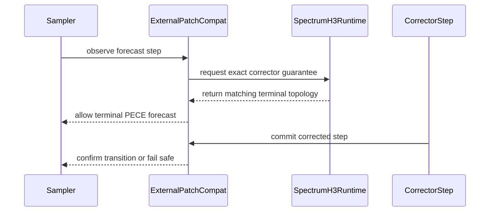

**Poem**

> A rabbit checks each phase,
> Exact correctors follow close,
> Safe forecasts wait their turn,
> Rollbacks restore the trail,
> Counters mark each success,
> Dense history resets clean.

</details>

<!-- walkthrough_end -->
<!-- pre_merge_checks_walkthrough_start -->

<details>
<summary>🚥 Pre-merge checks | ✅ 4 | ❌ 1</summary>

### ❌ Failed checks (1 warning)

|     Check name     | Status     | Explanation                                                                                                                                                                                               | Resolution                                                                         |
| :----------------: | :--------- | :-------------------------------------------------------------------------------------------------------------------------------------------------------------------------------------------------------- | :--------------------------------------------------------------------------------- |
| Docstring Coverage | ⚠️ Warning | Docstring coverage is 3.23% which is insufficient. The required threshold is 80.00%. Docstring coverage is scoped to functions touched by this diff. Analyzed 62 functions across 8 files. (1 skipped: 1… | Write docstrings for the functions missing them to satisfy the coverage threshold. |

<details>
<summary>✅ Passed checks (4 passed)</summary>

|         Check name         | Status   | Explanation                                                                                                              |
| :------------------------: | :------- | :----------------------------------------------------------------------------------------------------------------------- |
|     Linked Issues check    | ✅ Passed | Check skipped because no linked issues were found for this pull request.                                                 |
| Out of Scope Changes check | ✅ Passed | Check skipped because no linked issues were found for this pull request.                                                 |
|      Description Check     | ✅ Passed | Check skipped - CodeRabbit’s high-level summary is enabled.                                                              |
|         Title check        | ✅ Passed | The title clearly and concisely describes the main change: deferring qualified terminal PECE external-patch transitions. |

</details>

<details>
<summary>Full details: Docstring Coverage</summary>

**Explanation**

Docstring coverage is 3.23% which is insufficient. The required threshold is 80.00%. Docstring coverage is scoped to functions touched by this diff. Analyzed 62 functions across 8 files. (1 skipped: 1 unsupported.)

</details>

</details>

<!-- pre_merge_checks_walkthrough_end -->
<!-- finishing_touch_checkbox_start -->

<details>
<summary>✨ Finishing Touches 💡 1</summary>

<!-- finishing_touch_suggestion:docstrings -->
<details>
<summary>📝 Generate docstrings 💡</summary>

- [ ] <!-- {"checkboxId":"7962f53c-55bc-4827-bfbf-6a18da830691"} --> Create stacked PR
- [ ] <!-- {"checkboxId":"3e1879ae-f29b-4d0d-8e06-d12b7ba33d98"} --> Commit on current branch

</details>
<details>
<summary>🧪 Generate unit tests (beta)</summary>

- [ ] <!-- {"checkboxId": "f47ac10b-58cc-4372-a567-0e02b2c3d479", "radioGroupId": "utg-output-choice-group-5515330105"} -->   Create PR with unit tests
- [ ] <!-- {"checkboxId": "6ba7b810-9dad-11d1-80b4-00c04fd430c8", "radioGroupId": "utg-output-choice-group-5515330105"} -->   Commit unit tests in branch `feat/terminal-pece-external-transition`

</details>

</details>

<!-- finishing_touch_checkbox_end -->
<!-- tips_start -->

---

Thanks for using [CodeRabbit](https://coderabbit.ai?utm_source=oss&utm_medium=github&utm_campaign=xmarre/ComfyUI-Spectrum-MiniMax-H3&utm_content=98)! It's free for OSS, and your support helps us grow. If you like it, consider giving us a shout-out.

<details>
<summary>❤️ Share</summary>

- [X](https://twitter.com/intent/tweet?text=I%20just%20used%20%40coderabbitai%20for%20my%20code%20review%2C%20and%20it%27s%20fantastic%21%20It%27s%20free%20for%20OSS%20and%20offers%20a%20free%20trial%20for%20the%20proprietary%20code.%20Check%20it%20out%3A&url=https%3A//coderabbit.ai)
- [Mastodon](https://mastodon.social/share?text=I%20just%20used%20%40coderabbitai%20for%20my%20code%20review%2C%20and%20it%27s%20fantastic%21%20It%27s%20free%20for%20OSS%20and%20offers%20a%20free%20trial%20for%20the%20proprietary%20code.%20Check%20it%20out%3A%20https%3A%2F%2Fcoderabbit.ai)
- [Reddit](https://www.reddit.com/submit?title=Great%20tool%20for%20code%20review%20-%20CodeRabbit&text=I%20just%20used%20CodeRabbit%20for%20my%20code%20review%2C%20and%20it%27s%20fantastic%21%20It%27s%20free%20for%20OSS%20and%20offers%20a%20free%20trial%20for%20proprietary%20code.%20Check%20it%20out%3A%20https%3A//coderabbit.ai)
- [LinkedIn](https://www.linkedin.com/sharing/share-offsite/?url=https%3A%2F%2Fcoderabbit.ai&mini=true&title=Great%20tool%20for%20code%20review%20-%20CodeRabbit&summary=I%20just%20used%20CodeRabbit%20for%20my%20code%20review%2C%20and%20it%27s%20fantastic%21%20It%27s%20free%20for%20OSS%20and%20offers%20a%20free%20trial%20for%20proprietary%20code)

</details>


<sub>Comment `@coderabbitai help` to get the list of available commands.</sub>

<!-- tips_end -->


> **Comment by xmarre (2026-09-02T19:42:22Z):**

@coderabbitai review


> **Comment by coderabbitai[bot] (2026-09-02T19:42:28Z):**

<!-- This is an auto-generated reply by CodeRabbit -->
<!-- CodeRabbit review command invocation: v2:cff56bf1bcb84d9f5486d4d99bd63989b7ac40d949706e91a9b5157516815a82 -->
<details>
<summary>✅ Action performed</summary>

Review finished.

> Note: CodeRabbit is an incremental review system and does not re-review already reviewed commits. This command is applicable only when automatic reviews are paused.

</details>


### #97 [open] ISSUE: Feature request: Split into Simple & Advanced nodes
URL: https://github.com/xmarre/ComfyUI-Spectrum-MiniMax-H3/issues/97  by wywywywy 2026-08-31T19:42:06Z

It's great to see the active development and so many features being implemented.

But the node is getting complex, and I think a large portion of the users just go with the default. So I propose splitting the node into two - Simple and Advanced.

Simple just mostly use defaults with 1 or 2 settings, whereas Advanced will be like the current node.

> **Comment by SveSop (2026-08-31T23:58:31Z):**

I went here to post EXACTLY this. Thank you.. 

The main node is for extremely interested tech-guru/latent experts and whatever. I would happily use the Simple node with 2-3 options.. like "Storage" setting, and "Forecast policy", you know.. for ppl like me 😏 


> **Comment by TheVisitorXX (2026-09-07T08:18:25Z):**

Unfortunately, it’s not just the node that has become too complex by now, but the project in general. I don’t know how you guys feel about it, but when I read through the project, the comments, and the changelog, I have a really hard time understanding what is actually happening and how any of it works.

And this isn’t just a problem here. With AI being used so extensively nowadays, it has become a real problem in general. Nobody can really keep track of what these projects are actually doing anymore.

Spectrum worked in the past, and that’s what mattered. But when I read the changelogs now, sometimes I don’t even know whether I should update anymore or just leave it alone. I simply want it to “work,” and with 90% of the stuff, you have no idea what it actually does or what benefit it provides.

Maybe it’s time to adjust the prompts a little: “Explain it like I’m five.” 😄


> **Comment by SveSop (2026-09-07T11:36:57Z):**

The whole H3 scene is a mess if you ask me.. New nodes popping up every day, each catering to the various variants of H3 (fast/vsa/blablabla).. So, i dunno how to improve the situation.


> **Comment by xmarre (2026-09-09T20:37:56Z):**

I considered this, but I don't think splitting the node into Simple and Advanced is the right direction.

The node has become more complex because Spectrum itself now has several materially different execution paths and sampler-specific behaviors. A "Simple" node would either duplicate the same configuration surface in another form or hide decisions that actually matter.

The current node already has supported defaults. If you do not want to tune Spectrum, the intended usage is to leave those settings at their defaults. The additional controls are there for users who need to change behavior, reproduce specific configurations, or work with particular sampler/runtime combinations.

On the question of whether you should update: yes, keeping Spectrum up to date is recommended. I put substantial effort into making changes without regressing existing behavior, including regression tests, compatibility checks, controlled comparisons where behavior can change, and fail-closed handling for unsupported contracts.

New releases are not intended to make users decide from scratch whether Spectrum still "works." If a release introduces a meaningful tradeoff, changes a recommendation, or has a known limitation, it will be stated explicitly. Otherwise, the latest release is the supported and recommended version.

The changelog is detailed because it also acts as a technical record of fixes, compatibility work, sampler support, and research findings. You do not need to understand every entry in order to use Spectrum or keep it updated.

I may improve the organization of the documentation so the normal/default usage path is easier to identify, but I don't currently plan to introduce a second simplified node.


> **Comment by SveSop (2026-09-10T01:11:46Z):**

I can see the extra upkeep on having a "simple node" is a chore that should not be needed.

Due to how comfyui does things when you load nodes in a saved workflow, it is sadly not always easy. As you are aware, if you add options, or move options around in the node, loading a workflow with an existing node tends to NOT update the settings correctly.

Example:

```
Option1 - Float value = 0.5432
Option2 - Int value = 12
```

Adding a third option inbetween here will mess with the node..

New version:

```
Option1 - Float value = 0.5432
Option2 - Int value = 88
Option3 - Int value = 12
```

What HAPPENS is usually this:

```
Option1 - Float value = 0.5432
Option2 - Int value = 12
Option3 - Int value = 12
```

So, if we are LUCKY, the worfklow crashes with a 500 line python error, and we figure out to load the node fresh/reset widgets to get the new (working) defaults... That is NOT how most ppl use this i think. Most ppl run a "comfy manager update" (important to keep up-to-date with new schtuff) -> load workflow

If the "int value" of Option2 in my example SHOULD have the default value of 88, but loading the saved workflow tends to give it 12 (previous 2nd slot value saved), i have NO idea that the value should NOT be 12, or have ANY idea why my generations are super-fast but look like a vhs tape from 1988 😏 

It is not "your fault", since this is how comfy saved .json workflows seems to work when nodes are updated. I am aware of this node is "cutting edge", but having a massive amount of values moving around, that only a handful of people know what actually means, makes the node itself kind of hard to use 😄
Hopefully the "max schpeeds" will settle down eventually, and it won't be needed to add tweaks 5 times a day 👍 


### #96 [closed] ISSUE: FinalLayer.forward() problem
URL: https://github.com/xmarre/ComfyUI-Spectrum-MiniMax-H3/issues/96  by lycos2019 2026-08-31T10:33:46Z

Node threw an error during execution.


# ComfyUI Error Report
## Error Details
- **Node ID:** 297
- **Node Type:** SamplerCustomAdvanced
- **Exception Type:** TypeError
- **Exception Message:** TypeError: FinalLayer.forward() missing 3 required positional arguments: 'sigma', 'sample_sigmas', and 'shifts'

## Stack Trace
```
  File "C:\Users\miggu\Desktop\AI\ComfyUI\ComfyUI\execution.py", line 545, in execute
    output_data, output_ui, has_subgraph, has_pending_tasks = await get_output_data(prompt_id, unique_id, obj, input_data_all, execution_block_cb=execution_block_cb, pre_execute_cb=pre_execute_cb, v3_data=v3_data)
                                                              ^^^^^^^^^^^^^^^^^^^^^^^^^^^^^^^^^^^^^^^^^^^^^^^^^^^^^^^^^^^^^^^^^^^^^^^^^^^^^^^^^^^^^^^^^^^^^^^^^^^^^^^^^^^^^^^^^^^^^^^^^^^^^^^^^^^^^^^^^^^^^^^^^^^^^^^

  File "C:\Users\miggu\Desktop\AI\ComfyUI\ComfyUI\execution.py", line 344, in get_output_data
    return_values = await _async_map_node_over_list(prompt_id, unique_id, obj, input_data_all, obj.FUNCTION, allow_interrupt=True, execution_block_cb=execution_block_cb, pre_execute_cb=pre_execute_cb, v3_data=v3_data)
                    ^^^^^^^^^^^^^^^^^^^^^^^^^^^^^^^^^^^^^^^^^^^^^^^^^^^^^^^^^^^^^^^^^^^^^^^^^^^^^^^^^^^^^^^^^^^^^^^^^^^^^^^^^^^^^^^^^^^^^^^^^^^^^^^^^^^^^^^^^^^^^^^^^^^^^^^^^^^^^^^^^^^^^^^^^^^^^^^^^^^^^^^^^^^^^^^^^^^^^

  File "C:\Users\miggu\Desktop\AI\ComfyUI\ComfyUI\custom_nodes\comfyui-lora-manager\py\metadata_collector\metadata_hook.py", line 177, in async_map_node_over_list_with_metadata
    results = await original_map_node_over_list(
              ^^^^^^^^^^^^^^^^^^^^^^^^^^^^^^^^^^
    ...<2 lines>...
    )
    ^

  File "C:\Users\miggu\Desktop\AI\ComfyUI\ComfyUI\execution.py", line 318, in _async_map_node_over_list
    await process_inputs(input_dict, i)

  File "C:\Users\miggu\Desktop\AI\ComfyUI\ComfyUI\execution.py", line 306, in process_inputs
    result = f(**inputs)

  File "C:\Users\miggu\Desktop\AI\ComfyUI\ComfyUI\comfy_api\internal\__init__.py", line 149, in wrapped_func
    return method(locked_class, **inputs)

  File "C:\Users\miggu\Desktop\AI\ComfyUI\ComfyUI\comfy_api\latest\_io.py", line 2025, in EXECUTE_NORMALIZED
    to_return = cls.execute(*args, **kwargs)

  File "C:\Users\miggu\Desktop\AI\ComfyUI\ComfyUI\comfy_extras\nodes_custom_sampler.py", line 1055, in execute
    samples = guider.sample(noise.generate_noise(latent), latent_image, sampler, sigmas, denoise_mask=noise_mask, callback=callback, disable_pbar=disable_pbar, seed=noise.seed)

  File "C:\Users\miggu\Desktop\AI\ComfyUI\ComfyUI\comfy\samplers.py", line 1335, in sample
    output = executor.execute(noise, latent_image, sampler, sigmas, denoise_mask, callback, disable_pbar, seed, latent_shapes=latent_shapes)

  File "C:\Users\miggu\Desktop\AI\ComfyUI\ComfyUI\comfy\patcher_extension.py", line 114, in execute
    return self.wrappers[self.idx](self, *args, **kwargs)
           ~~~~~~~~~~~~~~~~~~~~~~~^^^^^^^^^^^^^^^^^^^^^^^

  File "C:\Users\miggu\Desktop\AI\ComfyUI\ComfyUI\custom_nodes\comfyui-spectrum-minimax-h3\comfyui_spectrum_h3\sampling.py", line 377, in outer_sample_wrapper
    first_result, capture_complete = execute_run(
                                     ~~~~~~~~~~~^
        noise,
        ^^^^^^
    ...<6 lines>...
        complete_offline_capture=True,
        ^^^^^^^^^^^^^^^^^^^^^^^^^^^^^^
    )
    ^

  File "C:\Users\miggu\Desktop\AI\ComfyUI\ComfyUI\custom_nodes\comfyui-spectrum-minimax-h3\comfyui_spectrum_h3\sampling.py", line 272, in execute_run
    result = executor(
        run_noise,
    ...<7 lines>...
        latent_shapes=latent_shapes,
    )

  File "C:\Users\miggu\Desktop\AI\ComfyUI\ComfyUI\comfy\patcher_extension.py", line 106, in __call__
    return new_executor.execute(*args, **kwargs)
           ~~~~~~~~~~~~~~~~~~~~^^^^^^^^^^^^^^^^^

  File "C:\Users\miggu\Desktop\AI\ComfyUI\ComfyUI\comfy\patcher_extension.py", line 113, in execute
    return self.original(*args, **kwargs)
           ~~~~~~~~~~~~~^^^^^^^^^^^^^^^^^

  File "C:\Users\miggu\Desktop\AI\ComfyUI\ComfyUI\comfy\samplers.py", line 1262, in outer_sample
    output = self.inner_sample(noise, latent_image, device, sampler, sigmas, denoise_mask, callback, disable_pbar, seed, latent_shapes=latent_shapes)

  File "C:\Users\miggu\Desktop\AI\ComfyUI\ComfyUI\comfy\samplers.py", line 1237, in inner_sample
    samples = executor.execute(self, sigmas, extra_args, callback, noise, latent_image, denoise_mask, disable_pbar)

  File "C:\Users\miggu\Desktop\AI\ComfyUI\ComfyUI\comfy\patcher_extension.py", line 114, in execute
    return self.wrappers[self.idx](self, *args, **kwargs)
           ~~~~~~~~~~~~~~~~~~~~~~~^^^^^^^^^^^^^^^^^^^^^^^

  File "C:\Users\miggu\Desktop\AI\ComfyUI\ComfyUI\custom_nodes\comfyui-spectrum-minimax-h3\comfyui_spectrum_h3\sampling.py", line 559, in sampler_sample_wrapper
    return executor(
        model_wrap,
    ...<6 lines>...
        disable_pbar,
    )

  File "C:\Users\miggu\Desktop\AI\ComfyUI\ComfyUI\comfy\patcher_extension.py", line 106, in __call__
    return new_executor.execute(*args, **kwargs)
           ~~~~~~~~~~~~~~~~~~~~^^^^^^^^^^^^^^^^^

  File "C:\Users\miggu\Desktop\AI\ComfyUI\ComfyUI\comfy\patcher_extension.py", line 113, in execute
    return self.original(*args, **kwargs)
           ~~~~~~~~~~~~~^^^^^^^^^^^^^^^^^

  File "C:\Users\miggu\Desktop\AI\ComfyUI\ComfyUI\comfy\samplers.py", line 1005, in sample
    samples = self.sampler_function(model_k, noise, sigmas, extra_args=extra_args, callback=k_callback, disable=disable_pbar, **self.extra_options)

  File "C:\Users\miggu\Desktop\AI\ComfyUI\python_embeded\Lib\site-packages\torch\utils\_contextlib.py", line 124, in decorate_context
    return func(*args, **kwargs)

  File "C:\Users\miggu\Desktop\AI\ComfyUI\ComfyUI\comfy\k_diffusion\sampling.py", line 1528, in sample_res_multistep
    return res_multistep(model, x, sigmas, extra_args=extra_args, callback=callback, disable=disable, s_noise=s_noise, noise_sampler=noise_sampler, eta=0., cfg_pp=False)

  File "C:\Users\miggu\Desktop\AI\ComfyUI\python_embeded\Lib\site-packages\torch\utils\_contextlib.py", line 124, in decorate_context
    return func(*args, **kwargs)

  File "C:\Users\miggu\Desktop\AI\ComfyUI\ComfyUI\comfy\k_diffusion\sampling.py", line 1486, in res_multistep
    denoised = model(x, sigmas[i] * s_in, **extra_args)

  File "C:\Users\miggu\Desktop\AI\ComfyUI\ComfyUI\comfy\samplers.py", line 640, in __call__
    out = self.inner_model(x, sigma, model_options=model_options, seed=seed)

  File "C:\Users\miggu\Desktop\AI\ComfyUI\ComfyUI\comfy\samplers.py", line 1208, in __call__
    return self.outer_predict_noise(*args, **kwargs)
           ~~~~~~~~~~~~~~~~~~~~~~~~^^^^^^^^^^^^^^^^^

  File "C:\Users\miggu\Desktop\AI\ComfyUI\ComfyUI\comfy\samplers.py", line 1215, in outer_predict_noise
    ).execute(x, timestep, model_options, seed)
      ~~~~~~~^^^^^^^^^^^^^^^^^^^^^^^^^^^^^^^^^^

  File "C:\Users\miggu\Desktop\AI\ComfyUI\ComfyUI\comfy\patcher_extension.py", line 114, in execute
    return self.wrappers[self.idx](self, *args, **kwargs)
           ~~~~~~~~~~~~~~~~~~~~~~~^^^^^^^^^^^^^^^^^^^^^^^

  File "C:\Users\miggu\Desktop\AI\ComfyUI\ComfyUI\custom_nodes\comfyui-spectrum-minimax-h3\comfyui_spectrum_h3\sampling.py", line 503, in predict_noise_wrapper
    result = execute_attempt(decision)

  File "C:\Users\miggu\Desktop\AI\ComfyUI\ComfyUI\custom_nodes\comfyui-spectrum-minimax-h3\comfyui_spectrum_h3\sampling.py", line 499, in execute_attempt
    return executor(x, timestep, patched, seed)

  File "C:\Users\miggu\Desktop\AI\ComfyUI\ComfyUI\comfy\patcher_extension.py", line 106, in __call__
    return new_executor.execute(*args, **kwargs)
           ~~~~~~~~~~~~~~~~~~~~^^^^^^^^^^^^^^^^^

  File "C:\Users\miggu\Desktop\AI\ComfyUI\ComfyUI\comfy\patcher_extension.py", line 113, in execute
    return self.original(*args, **kwargs)
           ~~~~~~~~~~~~~^^^^^^^^^^^^^^^^^

  File "C:\Users\miggu\Desktop\AI\ComfyUI\ComfyUI\comfy\samplers.py", line 1218, in predict_noise
    return sampling_function(self.inner_model, x, timestep, self.conds.get("negative", None), self.conds.get("positive", None), self.cfg, model_options=model_options, seed=seed)

  File "C:\Users\miggu\Desktop\AI\ComfyUI\ComfyUI\comfy\samplers.py", line 620, in sampling_function
    out = calc_cond_batch(model, conds, x, timestep, model_options)

  File "C:\Users\miggu\Desktop\AI\ComfyUI\ComfyUI\comfy\samplers.py", line 211, in calc_cond_batch
    return _calc_cond_batch_outer(model, conds, x_in, timestep, model_options)

  File "C:\Users\miggu\Desktop\AI\ComfyUI\ComfyUI\comfy\samplers.py", line 219, in _calc_cond_batch_outer
    return executor.execute(model, conds, x_in, timestep, model_options)
           ~~~~~~~~~~~~~~~~^^^^^^^^^^^^^^^^^^^^^^^^^^^^^^^^^^^^^^^^^^^^^

  File "C:\Users\miggu\Desktop\AI\ComfyUI\ComfyUI\comfy\patcher_extension.py", line 113, in execute
    return self.original(*args, **kwargs)
           ~~~~~~~~~~~~~^^^^^^^^^^^^^^^^^

  File "C:\Users\miggu\Desktop\AI\ComfyUI\ComfyUI\comfy\samplers.py", line 335, in _calc_cond_batch
    output = model.apply_model(input_x, timestep_, **c).chunk(batch_chunks)
             ~~~~~~~~~~~~~~~~~^^^^^^^^^^^^^^^^^^^^^^^^^

  File "C:\Users\miggu\Desktop\AI\ComfyUI\ComfyUI\comfy\model_base.py", line 205, in apply_model
    return comfy.patcher_extension.WrapperExecutor.new_class_executor(
           ~~~~~~~~~~~~~~~~~~~~~~~~~~~~~~~~~~~~~~~~~~~~~~~~~~~~~~~~~~~
    ...<2 lines>...
        comfy.patcher_extension.get_all_wrappers(comfy.patcher_extension.WrappersMP.APPLY_MODEL, transformer_options)
        ~~~~~~~~~~~~~~~~~~~~~~~~~~~~~~~~~~~~~~~~~~~~~~~~~~~~~~~~~~~~~~~~~~~~~~~~~~~~~~~~~~~~~~~~~~~~~~~~~~~~~~~~~~~~~
    ).execute(x, t, c_concat, c_crossattn, control, transformer_options, **kwargs)
    ~~~~~~~~~^^^^^^^^^^^^^^^^^^^^^^^^^^^^^^^^^^^^^^^^^^^^^^^^^^^^^^^^^^^^^^^^^^^^^

  File "C:\Users\miggu\Desktop\AI\ComfyUI\ComfyUI\comfy\patcher_extension.py", line 113, in execute
    return self.original(*args, **kwargs)
           ~~~~~~~~~~~~~^^^^^^^^^^^^^^^^^

  File "C:\Users\miggu\Desktop\AI\ComfyUI\ComfyUI\comfy\model_base.py", line 249, in _apply_model
    model_output = self.diffusion_model(xc, t, context=context, control=control, transformer_options=transformer_options, **extra_conds)

  File "C:\Users\miggu\Desktop\AI\ComfyUI\python_embeded\Lib\site-packages\torch\nn\modules\module.py", line 1779, in _wrapped_call_impl
    return self._call_impl(*args, **kwargs)
           ~~~~~~~~~~~~~~~^^^^^^^^^^^^^^^^^

  File "C:\Users\miggu\Desktop\AI\ComfyUI\python_embeded\Lib\site-packages\torch\nn\modules\module.py", line 1790, in _call_impl
    return forward_call(*args, **kwargs)

  File "C:\Users\miggu\Desktop\AI\ComfyUI\ComfyUI\comfy\ldm\minimax\model.py", line 566, in forward
    out = comfy.patcher_extension.WrapperExecutor.new_class_executor(
    ...<2 lines>...
        comfy.patcher_extension.get_all_wrappers(comfy.patcher_extension.WrappersMP.DIFFUSION_MODEL, transformer_options)
    ).execute(x, timestep, context, transformer_options, minimax_payload=minimax_payload,
              denoise_mask=denoise_mask, audio_denoise_mask=audio_denoise_mask, **kwargs)

  File "C:\Users\miggu\Desktop\AI\ComfyUI\ComfyUI\comfy\patcher_extension.py", line 114, in execute
    return self.wrappers[self.idx](self, *args, **kwargs)
           ~~~~~~~~~~~~~~~~~~~~~~~^^^^^^^^^^^^^^^^^^^^^^^

  File "C:\Users\miggu\Desktop\AI\ComfyUI\ComfyUI\custom_nodes\comfyui-h3studio\turbo_compat.py", line 153, in wrap
    return executor(*args, **kwargs)

  File "C:\Users\miggu\Desktop\AI\ComfyUI\ComfyUI\comfy\patcher_extension.py", line 106, in __call__
    return new_executor.execute(*args, **kwargs)
           ~~~~~~~~~~~~~~~~~~~~^^^^^^^^^^^^^^^^^

  File "C:\Users\miggu\Desktop\AI\ComfyUI\ComfyUI\comfy\patcher_extension.py", line 114, in execute
    return self.wrappers[self.idx](self, *args, **kwargs)
           ~~~~~~~~~~~~~~~~~~~~~~~^^^^^^^^^^^^^^^^^^^^^^^

  File "C:\Users\miggu\Desktop\AI\ComfyUI\ComfyUI\custom_nodes\comfyui-minimax-h3-turbo\__init__.py", line 461, in wrap
    return executor(*args, **kwargs)

  File "C:\Users\miggu\Desktop\AI\ComfyUI\ComfyUI\comfy\patcher_extension.py", line 106, in __call__
    return new_executor.execute(*args, **kwargs)
           ~~~~~~~~~~~~~~~~~~~~^^^^^^^^^^^^^^^^^

  File "C:\Users\miggu\Desktop\AI\ComfyUI\ComfyUI\comfy\patcher_extension.py", line 114, in execute
    return self.wrappers[self.idx](self, *args, **kwargs)
           ~~~~~~~~~~~~~~~~~~~~~~~^^^^^^^^^^^^^^^^^^^^^^^

  File "C:\Users\miggu\Desktop\AI\ComfyUI\ComfyUI\custom_nodes\comfyui-spectrum-minimax-h3\comfyui_spectrum_h3\minimax_h3.py", line 543, in diffusion_model_wrapper
    output = _execute_forecast(inner, sanitized, state, video_x, audio_x)

  File "C:\Users\miggu\Desktop\AI\ComfyUI\ComfyUI\custom_nodes\comfyui-spectrum-minimax-h3\comfyui_spectrum_h3\minimax_h3.py", line 375, in _execute_forecast
    video_projected, audio_projected = inner.final_layer(
                                       ~~~~~~~~~~~~~~~~~^
        compact,
        ^^^^^^^^
    ...<2 lines>...
        audio_segment,
        ^^^^^^^^^^^^^^
    )
    ^

  File "C:\Users\miggu\Desktop\AI\ComfyUI\python_embeded\Lib\site-packages\torch\nn\modules\module.py", line 1779, in _wrapped_call_impl
    return self._call_impl(*args, **kwargs)
           ~~~~~~~~~~~~~~~^^^^^^^^^^^^^^^^^

  File "C:\Users\miggu\Desktop\AI\ComfyUI\python_embeded\Lib\site-packages\torch\nn\modules\module.py", line 1790, in _call_impl
    return forward_call(*args, **kwargs)

```
## System Information
- **ComfyUI Version:** 0.34.0
- **Arguments:** ComfyUI\main.py --use-sage-attention
- **OS:** win32
- **Python Version:** 3.13.12 (tags/v3.13.12:1cbe481, Feb  3 2026, 18:22:25) [MSC v.1944 64 bit (AMD64)]
- **Embedded Python:** true
- **PyTorch Version:** 2.11.0+cu130
## Devices

- **Name:** cuda:0 NVIDIA GeForce RTX 4080 SUPER : cudaMallocAsync
  - **Type:** cuda
  - **VRAM Total:** 17170956288
  - **VRAM Free:** 15752626176
  - **Torch VRAM Total:** 33554432
  - **Torch VRAM Free:** 25034752

## Logs
```
2026-08-31T19:23:47.617816 - Initializing ControlAltAI Nodes2026-08-31T19:23:47.617888 - 
2026-08-31T19:23:47.677700 - 
2026-08-31T19:23:47.677755 - Efficiency Nodes:2026-08-31T19:23:47.677825 -  Attempting to add Control Net options to the 'HiRes-Fix Script' Node (comfyui_controlnet_aux add-on)...2026-08-31T19:23:47.677866 - Success!2026-08-31T19:23:47.677897 - 
2026-08-31T19:23:48.162121 - ^[[1m^[[33m[WARNING]^[[0m Traceback (most recent call last):
  File "C:\Users\miggu\Desktop\AI\ComfyUI\ComfyUI\nodes.py", line 2263, in load_custom_node
    module_spec.loader.exec_module(module)
    ~~~~~~~~~~~~~~~~~~~~~~~~~~~~~~^^^^^^^^
  File "<frozen importlib._bootstrap_external>", line 1019, in exec_module
  File "<frozen importlib._bootstrap_external>", line 1156, in get_code
  File "<frozen importlib._bootstrap_external>", line 1214, in get_data
FileNotFoundError: [Errno 2] No such file or directory: 'C:\\Users\\miggu\\Desktop\\AI\\ComfyUI\\ComfyUI\\custom_nodes\\MiniMax-H3-NativeAudio-MusicVideo-Workflow\\__init__.py'

2026-08-31T19:23:48.162369 - ^[[1m^[[33m[WARNING]^[[0m Cannot import C:\Users\miggu\Desktop\AI\ComfyUI\ComfyUI\custom_nodes\MiniMax-H3-NativeAudio-MusicVideo-Workflow module for custom nodes: [Errno 2] No such file or directory: 'C:\\Users\\miggu\\Desktop\\AI\\ComfyUI\\ComfyUI\\custom_nodes\\MiniMax-H3-NativeAudio-MusicVideo-Workflow\\__init__.py'
2026-08-31T19:23:48.168318 - ^[[32m[INFO]^[[0m [minimax_h3_rewriter] routes registered
2026-08-31T19:23:48.309454 - [PromptManager] Nodes registered: Prompt Manager, Prompt Composer, Prompt Generator, Prompt Generator Kill Switch, Prompt Extractor, Recipe Extractor, Recipe Builder, Recipe Renderer, Recipe Relay, Recipe Manager2026-08-31T19:23:48.309558 - 
2026-08-31T19:23:48.343236 - 
2026-08-31T19:23:48.343338 - [rgthree-comfy] Loaded 48 extraordinary nodes. 🎉2026-08-31T19:23:48.343395 - 
2026-08-31T19:23:48.343467 - 
2026-08-31T19:23:48.343563 - [rgthree-comfy] ComfyUI's new Node 2.0 rendering may be incompatible with some rgthree-comfy nodes and features, breaking some rendering as well as losing the ability to access a node's properties (a vital part of many nodes). It also appears to run MUCH more slowly spiking CPU usage and causing jankiness and unresponsiveness, especially with large workflows. Personally I am not planning to use the new Nodes 2.0 and, unfortunately, am not able to invest the time to investigate and overhaul rgthree-comfy where needed. If you have issues when Nodes 2.0 is enabled, I'd urge you to switch it off as well and join me in hoping ComfyUI is not planning to deprecate the existing, stable canvas rendering all together.
2026-08-31T19:23:48.343659 - 
2026-08-31T19:23:48.462924 - 📊 Initial CUDA memory: 14.65GB free / 15.99GB total2026-08-31T19:23:48.463036 - 
2026-08-31T19:23:48.613633 - [TripleKSampler] ✓ WanVideo wrapper available - TripleWVSampler nodes registered2026-08-31T19:23:48.613724 - 
2026-08-31T19:23:48.842381 - ^[[1m^[[33m[WARNING]^[[0m Traceback (most recent call last):
  File "C:\Users\miggu\Desktop\AI\ComfyUI\ComfyUI\nodes.py", line 2263, in load_custom_node
    module_spec.loader.exec_module(module)
    ~~~~~~~~~~~~~~~~~~~~~~~~~~~~~~^^^^^^^^
  File "<frozen importlib._bootstrap_external>", line 1023, in exec_module
  File "<frozen importlib._bootstrap>", line 488, in _call_with_frames_removed
  File "C:\Users\miggu\Desktop\AI\ComfyUI\ComfyUI\custom_nodes\was-ns\__init__.py", line 1, in <module>
    from .WAS_Node_Suite import NODE_CLASS_MAPPINGS
  File "C:\Users\miggu\Desktop\AI\ComfyUI\ComfyUI\custom_nodes\was-ns\WAS_Node_Suite.py", line 44, in <module>
    from numba import jit
  File "C:\Users\miggu\Desktop\AI\ComfyUI\python_embeded\Lib\site-packages\numba\__init__.py", line 59, in <module>
    _ensure_critical_deps()
    ~~~~~~~~~~~~~~~~~~~~~^^
  File "C:\Users\miggu\Desktop\AI\ComfyUI\python_embeded\Lib\site-packages\numba\__init__.py", line 45, in _ensure_critical_deps
    raise ImportError(msg)
ImportError: Numba needs NumPy 2.4 or less. Got NumPy 2.5.

2026-08-31T19:23:48.842574 - ^[[1m^[[33m[WARNING]^[[0m Cannot import C:\Users\miggu\Desktop\AI\ComfyUI\ComfyUI\custom_nodes\was-ns module for custom nodes: Numba needs NumPy 2.4 or less. Got NumPy 2.5.
2026-08-31T19:23:48.875682 - ^[[1m^[[33m[WARNING]^[[0m Logger already set up. Skipping setup_logger().
2026-08-31T19:23:48.917194 - [⚡2026-08-31T19:23:48.922215 - ZI_POWER2026-08-31T19:23:48.927193 -  2026-08-31T19:23:48.932120 - INFO2026-08-31T19:23:48.936983 - ] Version: 2.1.0
2026-08-31T19:23:48.942863 - [⚡2026-08-31T19:23:48.947636 - ZI_POWER2026-08-31T19:23:48.952332 -  2026-08-31T19:23:48.957033 - INFO2026-08-31T19:23:48.961948 - ] This package includes 21 active nodes and 10 deprecated ones.
2026-08-31T19:23:48.967087 - [⚡2026-08-31T19:23:48.971741 - ZI_POWER2026-08-31T19:23:48.976776 -  2026-08-31T19:23:48.981778 - INFO2026-08-31T19:23:48.986463 - ] It also features 123 predefined visual styles,
2026-08-31T19:23:48.991154 - [⚡2026-08-31T19:23:48.996522 - ZI_POWER2026-08-31T19:23:49.001527 -  2026-08-31T19:23:49.006272 - INFO2026-08-31T19:23:49.011034 - ] and 18 predefined palettes.
2026-08-31T19:23:49.017819 - ^[[32m[INFO]^[[0m 
Import times for custom nodes:
2026-08-31T19:23:49.017952 - ^[[32m[INFO]^[[0m    0.0 seconds: C:\Users\miggu\Desktop\AI\ComfyUI\ComfyUI\custom_nodes\ComfyUI-WanResolutionSelector
2026-08-31T19:23:49.018063 - ^[[32m[INFO]^[[0m    0.0 seconds: C:\Users\miggu\Desktop\AI\ComfyUI\ComfyUI\custom_nodes\ComfyUI-H3-NativeAudioLock
2026-08-31T19:23:49.018134 - ^[[32m[INFO]^[[0m    0.0 seconds (IMPORT FAILED): C:\Users\miggu\Desktop\AI\ComfyUI\ComfyUI\custom_nodes\MiniMax-H3-NativeAudio-MusicVideo-Workflow
2026-08-31T19:23:49.018197 - ^[[32m[INFO]^[[0m    0.0 seconds: C:\Users\miggu\Desktop\AI\ComfyUI\ComfyUI\custom_nodes\websocket_image_save.py
2026-08-31T19:23:49.018247 - ^[[32m[INFO]^[[0m    0.0 seconds: C:\Users\miggu\Desktop\AI\ComfyUI\ComfyUI\custom_nodes\ComfyUI-WanMoeKSampler
2026-08-31T19:23:49.018296 - ^[[32m[INFO]^[[0m    0.0 seconds: C:\Users\miggu\Desktop\AI\ComfyUI\ComfyUI\custom_nodes\ComfyUI-Path-Helper
2026-08-31T19:23:49.018339 - ^[[32m[INFO]^[[0m    0.0 seconds: C:\Users\miggu\Desktop\AI\ComfyUI\ComfyUI\custom_nodes\ComfyUI-Video-Prompt-Architect
2026-08-31T19:23:49.018382 - ^[[32m[INFO]^[[0m    0.0 seconds: C:\Users\miggu\Desktop\AI\ComfyUI\ComfyUI\custom_nodes\load-image-and-display-prompt-metadata
2026-08-31T19:23:49.018417 - ^[[32m[INFO]^[[0m    0.0 seconds: C:\Users\miggu\Desktop\AI\ComfyUI\ComfyUI\custom_nodes\comfyui-minimax-h3-turbo
2026-08-31T19:23:49.018448 - ^[[32m[INFO]^[[0m    0.0 seconds: C:\Users\miggu\Desktop\AI\ComfyUI\ComfyUI\custom_nodes\comfyui-mxtoolkit
2026-08-31T19:23:49.018477 - ^[[32m[INFO]^[[0m    0.0 seconds: C:\Users\miggu\Desktop\AI\ComfyUI\ComfyUI\custom_nodes\comfyui-logic
2026-08-31T19:23:49.018507 - ^[[32m[INFO]^[[0m    0.0 seconds: C:\Users\miggu\Desktop\AI\ComfyUI\ComfyUI\custom_nodes\ComfyUI-PainterI2Vadvanced
2026-08-31T19:23:49.018537 - ^[[32m[INFO]^[[0m    0.0 seconds: C:\Users\miggu\Desktop\AI\ComfyUI\ComfyUI\custom_nodes\comfyui-obvpm
2026-08-31T19:23:49.018566 - ^[[32m[INFO]^[[0m    0.0 seconds: C:\Users\miggu\Desktop\AI\ComfyUI\ComfyUI\custom_nodes\comfyui-krea2edit
2026-08-31T19:23:49.018596 - ^[[32m[INFO]^[[0m    0.0 seconds: C:\Users\miggu\Desktop\AI\ComfyUI\ComfyUI\custom_nodes\comfyui-inpaint-cropandstitch
2026-08-31T19:23:49.018626 - ^[[32m[INFO]^[[0m    0.0 seconds: C:\Users\miggu\Desktop\AI\ComfyUI\ComfyUI\custom_nodes\editutils
2026-08-31T19:23:49.018656 - ^[[32m[INFO]^[[0m    0.0 seconds: C:\Users\miggu\Desktop\AI\ComfyUI\ComfyUI\custom_nodes\masquerade-nodes-comfyui
2026-08-31T19:23:49.018687 - ^[[32m[INFO]^[[0m    0.0 seconds: C:\Users\miggu\Desktop\AI\ComfyUI\ComfyUI\custom_nodes\cg-use-everywhere
2026-08-31T19:23:49.018717 - ^[[32m[INFO]^[[0m    0.0 seconds: C:\Users\miggu\Desktop\AI\ComfyUI\ComfyUI\custom_nodes\ComfyUI-Dynamic-Lora-Scheduler
2026-08-31T19:23:49.018746 - ^[[32m[INFO]^[[0m    0.0 seconds: C:\Users\miggu\Desktop\AI\ComfyUI\ComfyUI\custom_nodes\comfyui-h3-facerefine
2026-08-31T19:23:49.018775 - ^[[32m[INFO]^[[0m    0.0 seconds: C:\Users\miggu\Desktop\AI\ComfyUI\ComfyUI\custom_nodes\comfyui-superbeasts
2026-08-31T19:23:49.018804 - ^[[32m[INFO]^[[0m    0.0 seconds: C:\Users\miggu\Desktop\AI\ComfyUI\ComfyUI\custom_nodes\comfyui-lora-auto-trigger-words
2026-08-31T19:23:49.018833 - ^[[32m[INFO]^[[0m    0.0 seconds: C:\Users\miggu\Desktop\AI\ComfyUI\ComfyUI\custom_nodes\comfyui-sa2va
2026-08-31T19:23:49.018861 - ^[[32m[INFO]^[[0m    0.0 seconds: C:\Users\miggu\Desktop\AI\ComfyUI\ComfyUI\custom_nodes\mikey_nodes
2026-08-31T19:23:49.018889 - ^[[32m[INFO]^[[0m    0.0 seconds: C:\Users\miggu\Desktop\AI\ComfyUI\ComfyUI\custom_nodes\ComfyUI-H3-Multishot
2026-08-31T19:23:49.018918 - ^[[32m[INFO]^[[0m    0.0 seconds: C:\Users\miggu\Desktop\AI\ComfyUI\ComfyUI\custom_nodes\ComfyUI-GGUF
2026-08-31T19:23:49.018946 - ^[[32m[INFO]^[[0m    0.0 seconds: C:\Users\miggu\Desktop\AI\ComfyUI\ComfyUI\custom_nodes\ComfyUI-SuperUltimateVaceTools
2026-08-31T19:23:49.018975 - ^[[32m[INFO]^[[0m    0.0 seconds: C:\Users\miggu\Desktop\AI\ComfyUI\ComfyUI\custom_nodes\comfyui_stringessentials
2026-08-31T19:23:49.019005 - ^[[32m[INFO]^[[0m    0.0 seconds: C:\Users\miggu\Desktop\AI\ComfyUI\ComfyUI\custom_nodes\bfsnodes
2026-08-31T19:23:49.019077 - ^[[32m[INFO]^[[0m    0.0 seconds: C:\Users\miggu\Desktop\AI\ComfyUI\ComfyUI\custom_nodes\ComfyUI-WanAnimatePreprocess
2026-08-31T19:23:49.019114 - ^[[32m[INFO]^[[0m    0.0 seconds: C:\Users\miggu\Desktop\AI\ComfyUI\ComfyUI\custom_nodes\ComfyUI-SCAIL-Pose
2026-08-31T19:23:49.019144 - ^[[32m[INFO]^[[0m    0.0 seconds: C:\Users\miggu\Desktop\AI\ComfyUI\ComfyUI\custom_nodes\Anomalous_Model_Browser
2026-08-31T19:23:49.019173 - ^[[32m[INFO]^[[0m    0.0 seconds: C:\Users\miggu\Desktop\AI\ComfyUI\ComfyUI\custom_nodes\comfyui-minimax-h3-latent-upscaler
2026-08-31T19:23:49.019203 - ^[[32m[INFO]^[[0m    0.0 seconds: C:\Users\miggu\Desktop\AI\ComfyUI\ComfyUI\custom_nodes\comfyui_essentials
2026-08-31T19:23:49.019232 - ^[[32m[INFO]^[[0m    0.0 seconds: C:\Users\miggu\Desktop\AI\ComfyUI\ComfyUI\custom_nodes\comfyui-wan-vace-prep
2026-08-31T19:23:49.019262 - ^[[32m[INFO]^[[0m    0.0 seconds: C:\Users\miggu\Desktop\AI\ComfyUI\ComfyUI\custom_nodes\comfyui_patches_ll
2026-08-31T19:23:49.019290 - ^[[32m[INFO]^[[0m    0.0 seconds: C:\Users\miggu\Desktop\AI\ComfyUI\ComfyUI\custom_nodes\comfyui-lora-optimizer
2026-08-31T19:23:49.019320 - ^[[32m[INFO]^[[0m    0.0 seconds: C:\Users\miggu\Desktop\AI\ComfyUI\ComfyUI\custom_nodes\ComfyMath
2026-08-31T19:23:49.019351 - ^[[32m[INFO]^[[0m    0.0 seconds: C:\Users\miggu\Desktop\AI\ComfyUI\ComfyUI\custom_nodes\minimax-h3-tools
2026-08-31T19:23:49.019380 - ^[[32m[INFO]^[[0m    0.0 seconds: C:\Users\miggu\Desktop\AI\ComfyUI\ComfyUI\custom_nodes\ComfyUI_UltimateSDUpscaleGuider_H3
2026-08-31T19:23:49.019409 - ^[[32m[INFO]^[[0m    0.0 seconds: C:\Users\miggu\Desktop\AI\ComfyUI\ComfyUI\custom_nodes\comfyui-image-saver
2026-08-31T19:23:49.019437 - ^[[32m[INFO]^[[0m    0.0 seconds: C:\Users\miggu\Desktop\AI\ComfyUI\ComfyUI\custom_nodes\comfyui-portrait-master
2026-08-31T19:23:49.019464 - ^[[32m[INFO]^[[0m    0.0 seconds: C:\Users\miggu\Desktop\AI\ComfyUI\ComfyUI\custom_nodes\comfyui-custom-scripts
2026-08-31T19:23:49.019492 - ^[[32m[INFO]^[[0m    0.0 seconds: C:\Users\miggu\Desktop\AI\ComfyUI\ComfyUI\custom_nodes\ComfyUI-Zlycoris
2026-08-31T19:23:49.019521 - ^[[32m[INFO]^[[0m    0.0 seconds: C:\Users\miggu\Desktop\AI\ComfyUI\ComfyUI\custom_nodes\comfyUI-Realtime-Lora
2026-08-31T19:23:49.019550 - ^[[32m[INFO]^[[0m    0.0 seconds: C:\Users\miggu\Desktop\AI\ComfyUI\ComfyUI\custom_nodes\comfyui_ultimatesdupscale
2026-08-31T19:23:49.019579 - ^[[32m[INFO]^[[0m    0.0 seconds: C:\Users\miggu\Desktop\AI\ComfyUI\ComfyUI\custom_nodes\controlaltai-nodes
2026-08-31T19:23:49.019607 - ^[[32m[INFO]^[[0m    0.0 seconds: C:\Users\miggu\Desktop\AI\ComfyUI\ComfyUI\custom_nodes\MiniMaxH3-Prompt-Writer
2026-08-31T19:23:49.019636 - ^[[32m[INFO]^[[0m    0.0 seconds: C:\Users\miggu\Desktop\AI\ComfyUI\ComfyUI\custom_nodes\plaguekind-nodes
2026-08-31T19:23:49.019665 - ^[[32m[INFO]^[[0m    0.0 seconds: C:\Users\miggu\Desktop\AI\ComfyUI\ComfyUI\custom_nodes\layerforge
2026-08-31T19:23:49.019695 - ^[[32m[INFO]^[[0m    0.0 seconds: C:\Users\miggu\Desktop\AI\ComfyUI\ComfyUI\custom_nodes\comfyui-logicutils
2026-08-31T19:23:49.019724 - ^[[32m[INFO]^[[0m    0.0 seconds: C:\Users\miggu\Desktop\AI\ComfyUI\ComfyUI\custom_nodes\comfyui-frame-interpolation
2026-08-31T19:23:49.019754 - ^[[32m[INFO]^[[0m    0.0 seconds: C:\Users\miggu\Desktop\AI\ComfyUI\ComfyUI\custom_nodes\flashvsr_ultra_fast
2026-08-31T19:23:49.019784 - ^[[32m[INFO]^[[0m    0.0 seconds: C:\Users\miggu\Desktop\AI\ComfyUI\ComfyUI\custom_nodes\tripleksampler
2026-08-31T19:23:49.019813 - ^[[32m[INFO]^[[0m    0.0 seconds: C:\Users\miggu\Desktop\AI\ComfyUI\ComfyUI\custom_nodes\comfyui-h3studio
2026-08-31T19:23:49.019842 - ^[[32m[INFO]^[[0m    0.0 seconds: C:\Users\miggu\Desktop\AI\ComfyUI\ComfyUI\custom_nodes\comfyui-jakeupgrade
2026-08-31T19:23:49.019871 - ^[[32m[INFO]^[[0m    0.0 seconds: C:\Users\miggu\Desktop\AI\ComfyUI\ComfyUI\custom_nodes\comfyui-ic-light
2026-08-31T19:23:49.019900 - ^[[32m[INFO]^[[0m    0.0 seconds: C:\Users\miggu\Desktop\AI\ComfyUI\ComfyUI\custom_nodes\minimax-h3-prompt-rewriter
2026-08-31T19:23:49.019930 - ^[[32m[INFO]^[[0m    0.0 seconds: C:\Users\miggu\Desktop\AI\ComfyUI\ComfyUI\custom_nodes\ComfyUI-FlashVSR_Stable
2026-08-31T19:23:49.019959 - ^[[32m[INFO]^[[0m    0.0 seconds: C:\Users\miggu\Desktop\AI\ComfyUI\ComfyUI\custom_nodes\comfyui-minimaxh3-contex-loop
2026-08-31T19:23:49.019988 - ^[[32m[INFO]^[[0m    0.0 seconds: C:\Users\miggu\Desktop\AI\ComfyUI\ComfyUI\custom_nodes\rgthree-comfy
2026-08-31T19:23:49.020016 - ^[[32m[INFO]^[[0m    0.0 seconds: C:\Users\miggu\Desktop\AI\ComfyUI\ComfyUI\custom_nodes\comfyui-kjnodes
2026-08-31T19:23:49.020044 - ^[[32m[INFO]^[[0m    0.0 seconds: C:\Users\miggu\Desktop\AI\ComfyUI\ComfyUI\custom_nodes\comfyui-inspire-pack
2026-08-31T19:23:49.020072 - ^[[32m[INFO]^[[0m    0.0 seconds: C:\Users\miggu\Desktop\AI\ComfyUI\ComfyUI\custom_nodes\universaltoolkit
2026-08-31T19:23:49.020120 - ^[[32m[INFO]^[[0m    0.0 seconds: C:\Users\miggu\Desktop\AI\ComfyUI\ComfyUI\custom_nodes\efficiency-nodes-comfyui
2026-08-31T19:23:49.020153 - ^[[32m[INFO]^[[0m    0.0 seconds: C:\Users\miggu\Desktop\AI\ComfyUI\ComfyUI\custom_nodes\comfyui-videohelpersuite
2026-08-31T19:23:49.020183 - ^[[32m[INFO]^[[0m    0.1 seconds: C:\Users\miggu\Desktop\AI\ComfyUI\ComfyUI\custom_nodes\comfyui-multigpu
2026-08-31T19:23:49.020213 - ^[[32m[INFO]^[[0m    0.1 seconds: C:\Users\miggu\Desktop\AI\ComfyUI\ComfyUI\custom_nodes\comfyui-speech-bubble-detector
2026-08-31T19:23:49.020243 - ^[[32m[INFO]^[[0m    0.1 seconds: C:\Users\miggu\Desktop\AI\ComfyUI\ComfyUI\custom_nodes\comfyui_controlnet_aux
2026-08-31T19:23:49.020271 - ^[[32m[INFO]^[[0m    0.1 seconds: C:\Users\miggu\Desktop\AI\ComfyUI\ComfyUI\custom_nodes\prompt-manager
2026-08-31T19:23:49.020300 - ^[[32m[INFO]^[[0m    0.1 seconds: C:\Users\miggu\Desktop\AI\ComfyUI\ComfyUI\custom_nodes\comfyui-all-on-one-image-generation-node
2026-08-31T19:23:49.020328 - ^[[32m[INFO]^[[0m    0.1 seconds: C:\Users\miggu\Desktop\AI\ComfyUI\ComfyUI\custom_nodes\comfyui_segment_anything
2026-08-31T19:23:49.020357 - ^[[32m[INFO]^[[0m    0.1 seconds: C:\Users\miggu\Desktop\AI\ComfyUI\ComfyUI\custom_nodes\comfyui_soze
2026-08-31T19:23:49.020385 - ^[[32m[INFO]^[[0m    0.2 seconds: C:\Users\miggu\Desktop\AI\ComfyUI\ComfyUI\custom_nodes\comfyui_layerstyle
2026-08-31T19:23:49.020414 - ^[[32m[INFO]^[[0m    0.2 seconds: C:\Users\miggu\Desktop\AI\ComfyUI\ComfyUI\custom_nodes\comfyui-spectrum-minimax-h3
2026-08-31T19:23:49.020443 - ^[[32m[INFO]^[[0m    0.2 seconds: C:\Users\miggu\Desktop\AI\ComfyUI\ComfyUI\custom_nodes\z-image-power-nodes
2026-08-31T19:23:49.020472 - ^[[32m[INFO]^[[0m    0.2 seconds (IMPORT FAILED): C:\Users\miggu\Desktop\AI\ComfyUI\ComfyUI\custom_nodes\was-ns
2026-08-31T19:23:49.020503 - ^[[32m[INFO]^[[0m    0.2 seconds: C:\Users\miggu\Desktop\AI\ComfyUI\ComfyUI\custom_nodes\comfyui-impact-pack
2026-08-31T19:23:49.020533 - ^[[32m[INFO]^[[0m    0.2 seconds: C:\Users\miggu\Desktop\AI\ComfyUI\ComfyUI\custom_nodes\seedvr2_videoupscaler
2026-08-31T19:23:49.020564 - ^[[32m[INFO]^[[0m    0.3 seconds: C:\Users\miggu\Desktop\AI\ComfyUI\ComfyUI\custom_nodes\ComfyUI-WanVideoWrapper
2026-08-31T19:23:49.020609 - ^[[32m[INFO]^[[0m    0.3 seconds: C:\Users\miggu\Desktop\AI\ComfyUI\ComfyUI\custom_nodes\comfyui-itools
2026-08-31T19:23:49.020665 - ^[[32m[INFO]^[[0m    0.3 seconds: C:\Users\miggu\Desktop\AI\ComfyUI\ComfyUI\custom_nodes\comfyui-lora-manager
2026-08-31T19:23:49.020709 - ^[[32m[INFO]^[[0m    0.4 seconds: C:\Users\miggu\Desktop\AI\ComfyUI\ComfyUI\custom_nodes\ComfyUI-Crystools
2026-08-31T19:23:49.020744 - ^[[32m[INFO]^[[0m    0.4 seconds: C:\Users\miggu\Desktop\AI\ComfyUI\ComfyUI\custom_nodes\LanPaint
2026-08-31T19:23:49.020777 - ^[[32m[INFO]^[[0m    0.5 seconds: C:\Users\miggu\Desktop\AI\ComfyUI\ComfyUI\custom_nodes\ComfyUI-S3-IO
2026-08-31T19:23:49.020811 - ^[[32m[INFO]^[[0m    0.5 seconds: C:\Users\miggu\Desktop\AI\ComfyUI\ComfyUI\custom_nodes\comfyui-vrgamedevgirl
2026-08-31T19:23:49.020843 - ^[[32m[INFO]^[[0m    0.5 seconds: C:\Users\miggu\Desktop\AI\ComfyUI\ComfyUI\custom_nodes\ComfyUI_Comfyroll_CustomNodes
2026-08-31T19:23:49.020876 - ^[[32m[INFO]^[[0m    0.7 seconds: C:\Users\miggu\Desktop\AI\ComfyUI\ComfyUI\custom_nodes\comfyui-rmbg
2026-08-31T19:23:49.020907 - ^[[32m[INFO]^[[0m    1.3 seconds: C:\Users\miggu\Desktop\AI\ComfyUI\ComfyUI\custom_nodes\comfyui-manager
2026-08-31T19:23:49.020938 - ^[[32m[INFO]^[[0m    1.6 seconds: C:\Users\miggu\Desktop\AI\ComfyUI\ComfyUI\custom_nodes\comfyui-sam3
2026-08-31T19:23:49.020968 - ^[[32m[INFO]^[[0m    1.9 seconds: C:\Users\miggu\Desktop\AI\ComfyUI\ComfyUI\custom_nodes\comfyui_starnodes
2026-08-31T19:23:49.020998 - ^[[32m[INFO]^[[0m    4.8 seconds: C:\Users\miggu\Desktop\AI\ComfyUI\ComfyUI\custom_nodes\comfyui-easy-use
2026-08-31T19:23:49.021088 - ^[[32m[INFO]^[[0m 
2026-08-31T19:23:49.058023 - ^[[32m[INFO]^[[0m Context impl SQLiteImpl.
2026-08-31T19:23:49.058155 - ^[[32m[INFO]^[[0m Will assume non-transactional DDL.
2026-08-31T19:23:49.201190 - ^[[32m[INFO]^[[0m Using RAM pressure cache.
2026-08-31T19:23:49.240425 - ^[[32m[INFO]^[[0m [LoRA-Manager] Deduplicate: removed 0 history rows, 0 queue rows, 0 orphaned queue rows
2026-08-31T19:23:49.367405 - ^[[32m[INFO]^[[0m Starting server

2026-08-31T19:23:49.405549 - ^[[32m[INFO]^[[0m To see the GUI go to: http://127.0.0.1:8188
2026-08-31T19:23:49.415676 - ^[[32m[INFO]^[[0m [LoRA-Manager] Recipe cache miss: performing full directory scan
2026-08-31T19:23:49.418884 - ^[[32m[INFO]^[[0m [LoRA-Manager] Recipe cache initialized in 0.01 seconds. Found 0 recipes
2026-08-31T19:23:49.437661 - ^[[32m[INFO]^[[0m [LoRA-Manager] FTS index validated, reusing existing index with 0 recipes
2026-08-31T19:23:49.956570 - ^[[1m^[[33m[WARNING]^[[0m [LoRA-Manager] Duplicate filename conflict detected: 17 lora filename(s) are shared by 36 files total, causing ambiguity in Lora resolution. Open the Doctor panel to resolve one-click.
2026-08-31T19:23:50.041486 - ^[[32m[INFO]^[[0m [LoRA-Manager] Lora cache hydrated from persisted snapshot with 14042 models
2026-08-31T19:23:50.048615 - ^[[32m[INFO]^[[0m [LoRA-Manager] Checkpoint cache hydrated from persisted snapshot with 61 models
2026-08-31T19:23:50.094714 - ^[[32m[INFO]^[[0m [LoRA-Manager] Embedding cache initialized in 0.01 seconds. Found 0 models
2026-08-31T19:23:51.341353 - FETCH ComfyRegistry Data: 10/1802026-08-31T19:23:51.341455 - 
2026-08-31T19:23:56.173018 - FETCH ComfyRegistry Data: 15/1802026-08-31T19:23:56.173122 - 
2026-08-31T19:24:00.200384 - ^[[1m^[[33m[WARNING]^[[0m [DEPRECATION WARNING] Detected import of deprecated legacy API: /scripts/ui/components/buttonGroup.js. This is likely caused by a custom node extension using outdated APIs. Please update your extensions or contact the extension author for an updated version.
2026-08-31T19:24:00.200737 - ^[[1m^[[33m[WARNING]^[[0m [DEPRECATION WARNING] Detected import of deprecated legacy API: /scripts/ui.js. This is likely caused by a custom node extension using outdated APIs. Please update your extensions or contact the extension author for an updated version.
2026-08-31T19:24:00.209238 - ^[[1m^[[33m[WARNING]^[[0m [DEPRECATION WARNING] Detected import of deprecated legacy API: /extensions/core/clipspace.js. This is likely caused by a custom node extension using outdated APIs. Please update your extensions or contact the extension author for an updated version.
2026-08-31T19:24:00.209784 - ^[[1m^[[33m[WARNING]^[[0m [DEPRECATION WARNING] Detected import of deprecated legacy API: /extensions/core/groupNode.js. This is likely caused by a custom node extension using outdated APIs. Please update your extensions or contact the extension author for an updated version.
2026-08-31T19:24:00.210217 - ^[[1m^[[33m[WARNING]^[[0m [DEPRECATION WARNING] Detected import of deprecated legacy API: /extensions/core/widgetInputs.js. This is likely caused by a custom node extension using outdated APIs. Please update your extensions or contact the extension author for an updated version.
2026-08-31T19:24:00.876176 - FETCH ComfyRegistry Data: 20/1802026-08-31T19:24:00.876275 - 
2026-08-31T19:24:05.454180 - FETCH ComfyRegistry Data: 25/1802026-08-31T19:24:05.454285 - 
2026-08-31T19:24:06.004514 - ^[[1m^[[31m[ERROR]^[[0m [Inspire Pack] IPAdapterPlus is not installed.
2026-08-31T19:24:06.049117 - SAM3D From Video JK node may not function correctly: [SAM3D Check] SAM3D node path not found. Please ensure that the ComfyUI-SAM3DBody node is installed.2026-08-31T19:24:06.049225 - 
2026-08-31T19:24:06.049323 - SAM3D From Video JK node may not function correctly: [SAM3D Check] SAM3D node path not found. Please ensure that the ComfyUI-SAM3DBody node is installed.2026-08-31T19:24:06.049365 - 
2026-08-31T19:24:10.448641 - FETCH ComfyRegistry Data: 30/1802026-08-31T19:24:10.448747 - 
2026-08-31T19:24:13.663798 - ^[[1m^[[33m[WARNING]^[[0m [DEPRECATION WARNING] Detected import of deprecated legacy API: /scripts/ui/components/button.js. This is likely caused by a custom node extension using outdated APIs. Please update your extensions or contact the extension author for an updated version.
2026-08-31T19:24:19.803622 - FETCH ComfyRegistry Data: 35/1802026-08-31T19:24:19.803695 - 
2026-08-31T19:24:24.347232 - FETCH ComfyRegistry Data: 40/1802026-08-31T19:24:24.347341 - 
2026-08-31T19:24:29.257147 - FETCH ComfyRegistry Data: 45/1802026-08-31T19:24:29.257249 - 
2026-08-31T19:24:33.774860 - FETCH ComfyRegistry Data: 50/1802026-08-31T19:24:33.774966 - 
2026-08-31T19:24:38.732101 - FETCH ComfyRegistry Data: 55/1802026-08-31T19:24:38.732204 - 
2026-08-31T19:24:47.478664 - FETCH ComfyRegistry Data: 60/1802026-08-31T19:24:47.478772 - 
2026-08-31T19:24:51.832345 - FETCH ComfyRegistry Data: 65/1802026-08-31T19:24:51.832418 - 
2026-08-31T19:24:56.146161 - FETCH ComfyRegistry Data: 70/1802026-08-31T19:24:56.146232 - 
2026-08-31T19:25:01.040505 - FETCH ComfyRegistry Data: 75/1802026-08-31T19:25:01.040604 - 
2026-08-31T19:25:05.609436 - FETCH ComfyRegistry Data: 80/1802026-08-31T19:25:05.609509 - 
2026-08-31T19:25:11.515925 - FETCH ComfyRegistry Data: 85/1802026-08-31T19:25:11.515996 - 
2026-08-31T19:25:16.211160 - FETCH ComfyRegistry Data: 90/1802026-08-31T19:25:16.211231 - 
2026-08-31T19:25:21.023463 - FETCH ComfyRegistry Data: 95/1802026-08-31T19:25:21.023536 - 
2026-08-31T19:25:25.849238 - FETCH ComfyRegistry Data: 100/1802026-08-31T19:25:25.849311 - 
2026-08-31T19:25:37.656462 - FETCH ComfyRegistry Data: 105/1802026-08-31T19:25:37.656555 - 
2026-08-31T19:25:42.669456 - FETCH ComfyRegistry Data: 110/1802026-08-31T19:25:42.669554 - 
2026-08-31T19:25:47.492841 - FETCH ComfyRegistry Data: 115/1802026-08-31T19:25:47.492944 - 
2026-08-31T19:25:52.641100 - FETCH ComfyRegistry Data: 120/1802026-08-31T19:25:52.641206 - 
2026-08-31T19:25:57.691597 - FETCH ComfyRegistry Data: 125/1802026-08-31T19:25:57.691703 - 
2026-08-31T19:26:02.456445 - FETCH ComfyRegistry Data: 130/1802026-08-31T19:26:02.456553 - 
2026-08-31T19:26:07.308703 - FETCH ComfyRegistry Data: 135/1802026-08-31T19:26:07.308796 - 
2026-08-31T19:26:12.370519 - FETCH ComfyRegistry Data: 140/1802026-08-31T19:26:12.370630 - 
2026-08-31T19:26:17.278872 - FETCH ComfyRegistry Data: 145/1802026-08-31T19:26:17.278977 - 
2026-08-31T19:26:23.197372 - FETCH ComfyRegistry Data: 150/1802026-08-31T19:26:23.198060 - 
2026-08-31T19:26:27.901453 - FETCH ComfyRegistry Data: 155/1802026-08-31T19:26:27.901524 - 
2026-08-31T19:26:32.629228 - FETCH ComfyRegistry Data: 160/1802026-08-31T19:26:32.629329 - 
2026-08-31T19:26:38.066872 - FETCH ComfyRegistry Data: 165/1802026-08-31T19:26:38.066977 - 
2026-08-31T19:26:43.247191 - FETCH ComfyRegistry Data: 170/1802026-08-31T19:26:43.247294 - 
2026-08-31T19:26:48.889354 - FETCH ComfyRegistry Data: 175/1802026-08-31T19:26:48.889460 - 
2026-08-31T19:26:53.964691 - FETCH ComfyRegistry Data: 180/1802026-08-31T19:26:53.964766 - 
2026-08-31T19:26:54.465083 - FETCH ComfyRegistry Data [DONE]2026-08-31T19:26:54.465186 - 
2026-08-31T19:26:54.636008 - ^[[32m[INFO]^[[0m [ComfyUI-Manager] default cache updated: https://api.comfy.org/nodes
2026-08-31T19:26:54.695649 - nightly_channel: https://raw.githubusercontent.com/ltdrdata/ComfyUI-Manager/main/remote
2026-08-31T19:26:54.696114 - FETCH DATA from: https://raw.githubusercontent.com/ltdrdata/ComfyUI-Manager/main/custom-node-list.json2026-08-31T19:26:55.263753 -  [DONE]2026-08-31T19:26:55.263861 - 
2026-08-31T19:26:55.329275 - ^[[32m[INFO]^[[0m [ComfyUI-Manager] All startup tasks have been completed.
2026-08-31T19:27:28.268700 - FETCH DATA from: https://raw.githubusercontent.com/ltdrdata/ComfyUI-Manager/main/extension-node-map.json2026-08-31T19:27:28.819557 -  [DONE]2026-08-31T19:27:28.819660 - 
2026-08-31T19:27:28.927413 - [ComfyUI-Manager] The ComfyRegistry cache update is still in progress, so an outdated cache is being used.2026-08-31T19:27:28.927528 - 
2026-08-31T19:27:29.036375 - nightly_channel: https://raw.githubusercontent.com/ltdrdata/ComfyUI-Manager/main/cache
2026-08-31T19:27:29.036532 - FETCH DATA from: https://raw.githubusercontent.com/ltdrdata/ComfyUI-Manager/main/custom-node-list.json2026-08-31T19:27:29.640003 -  [DONE]2026-08-31T19:27:29.640127 - 
2026-08-31T19:27:29.723911 - FETCH DATA from: https://raw.githubusercontent.com/ltdrdata/ComfyUI-Manager/main/github-stats.json2026-08-31T19:27:30.227702 -  [DONE]2026-08-31T19:27:30.227801 - 
2026-08-31T19:27:30.250004 - FETCH DATA from: https://raw.githubusercontent.com/ltdrdata/ComfyUI-Manager/main/extras.json2026-08-31T19:27:30.561304 -  [DONE]2026-08-31T19:27:30.561395 - 
2026-08-31T19:27:45.361818 - ^[[32m[INFO]^[[0m got prompt
2026-08-31T19:27:46.783096 - ^[[32m[INFO]^[[0m H3Studio: patched ComfyUI-MiniMax-H3-Turbo so audio conditioning works with the turbo LoRA (its adaln row table ignored ref_audio).
2026-08-31T19:27:47.279051 - ^[[32m[INFO]^[[0m VAE load device: cuda:0, offload device: cpu, dtype: torch.float32
2026-08-31T19:27:52.081400 - ^[[32m[INFO]^[[0m VAE load device: cuda:0, offload device: cpu, dtype: torch.float16
2026-08-31T19:27:52.105523 - ^[[32m[INFO]^[[0m Found quantization metadata version 1
2026-08-31T19:27:52.106211 - [MultiGPU Core Patching] text_encoder_device_patched returning device: cuda:0 (current_text_encoder_device=cuda:0)
2026-08-31T19:27:52.106534 - ^[[32m[INFO]^[[0m Using MixedPrecisionOps for text encoder
2026-08-31T19:27:52.566340 - ^[[32m[INFO]^[[0m CLIP/text encoder model load device: cuda:0, offload device: cpu, current: cpu, dtype: torch.float16
2026-08-31T19:27:52.615834 - ^[[32m[INFO]^[[0m Requested to load MiniMaxH3VideoVAE
2026-08-31T19:27:52.672619 - ^[[32m[INFO]^[[0m Model MiniMaxH3VideoVAE prepared for dynamic VRAM loading. 4965MB Staged. 0 patches attached. Force pre-loaded 128 weights: 348 KB.
2026-08-31T19:27:53.245596 - ^[[32m[INFO]^[[0m Model MiniMaxH3VideoVAE prepared for dynamic VRAM loading. 4965MB Staged. 0 patches attached. Force pre-loaded 128 weights: 348 KB.
2026-08-31T19:28:00.550397 - ^[[32m[INFO]^[[0m Model MiniMaxH3VideoVAE prepared for dynamic VRAM loading. 4965MB Staged. 0 patches attached. Force pre-loaded 128 weights: 348 KB.
2026-08-31T19:28:35.862070 - ^[[32m[INFO]^[[0m Requested to load MiniMaxH3AudioVAE
2026-08-31T19:28:35.912065 - ^[[32m[INFO]^[[0m Model MiniMaxH3AudioVAE prepared for dynamic VRAM loading. 576MB Staged. 0 patches attached. Force pre-loaded 401 weights: 539 KB.
2026-08-31T19:28:36.447741 - ^[[32m[INFO]^[[0m Requested to load MiniMaxH3TEModel_
2026-08-31T19:28:36.514162 - ^[[32m[INFO]^[[0m Model MiniMaxH3TEModel_ prepared for dynamic VRAM loading. 14956MB Staged. 0 patches attached. Force pre-loaded 410 weights: 4572 KB.
2026-08-31T19:28:51.323823 - ^[[32m[INFO]^[[0m Found quantization metadata version 1
2026-08-31T19:28:51.324006 - ^[[32m[INFO]^[[0m Detected mixed precision quantization
2026-08-31T19:28:51.324210 - ^[[32m[INFO]^[[0m Using mixed precision operations
2026-08-31T19:28:51.324269 - ^[[32m[INFO]^[[0m Native ops: float8_e5m2, float8_e4m3fn, int8_tensorwise, convrot_w4a4, asym_w4a8_int8 , emulated ops: mxfp8, nvfp4
2026-08-31T19:28:51.334253 - ^[[32m[INFO]^[[0m model weight dtype torch.bfloat16, manual cast: torch.bfloat16
2026-08-31T19:28:51.336084 - ^[[32m[INFO]^[[0m model_type FLOW_AV
2026-08-31T19:28:51.696714 - [MiniMaxH3TurboLoRA] pruned base [bypass]: lora=MiniMax H3\turbo lora\minimax_h3_turbo_v4_step600_ema(for most work).safetensors strength=0.85 | 208 backbone modules, 158 bypass adapters, 1 injections, 50 int8 fc2 via merge + 51 adaln injected at run time | model=MiniMaxH3 weight_dtype=torch.bfloat16 weight_dev=cpu2026-08-31T19:28:51.696830 - 
2026-08-31T19:28:51.865727 - ^[[32m[INFO]^[[0m [H3AdaLN] AdaLN LoRA fix: no mismatched AdaLN patches
2026-08-31T19:28:51.872355 - ^[[32m[INFO]^[[0m [H3Utils] SLA installed | sparsity=0.90 | BLK=64x64 | min_seq_len=8192 | dense_last_steps=0 | protect_audio=True
2026-08-31T19:28:51.911927 - ^[[32m[INFO]^[[0m Requested to load MiniMaxH3
2026-08-31T19:28:51.913651 - ^[[32m[INFO]^[[0m 0 models unloaded.
2026-08-31T19:28:51.969648 - ^[[32m[INFO]^[[0m Model MiniMaxH3 prepared for dynamic VRAM loading. 19995MB Staged. 200 patches attached. Force pre-loaded 210 weights: 1175 KB.
2026-08-31T19:28:52.686642 - ^[[32m[INFO]^[[0m Patching torch settings: torch.backends.cuda.matmul.allow_fp16_accumulation = True
2026-08-31T19:28:53.592283 - 
  0%|                                                                | 0/8 [00:00<?, ?it/s,   Model Initializing ...  ]2026-08-31T19:28:53.642413 - [H3TURBO fwd pruned/bypass] call#1  qkv_proj.forward_owner=BypassForwardHook (BypassForwardHook => lora ACTIVE; else => BASE ONLY!)  is_injected=False  timestep=1000.00  video_rms=1.0006 audio_rms=1.0006 dtype=torch.bfloat162026-08-31T19:28:53.642476 - 
2026-08-31T19:30:21.456763 - 
 12%|██████▏                                          | 1/8 [01:27<10:15, 87.86s/it,  Model Initialization complete!  ]2026-08-31T19:30:21.461029 - [H3TURBO fwd pruned/bypass] call#2  qkv_proj.forward_owner=BypassForwardHook (BypassForwardHook => lora ACTIVE; else => BASE ONLY!)  is_injected=False  timestep=988.24  video_rms=0.9896 audio_rms=0.9546 dtype=torch.bfloat162026-08-31T19:30:21.461099 - 
2026-08-31T19:30:21.623912 - 
 12%|██████▏                                          | 1/8 [01:28<10:16, 88.03s/it,  Model Initialization complete!  ]2026-08-31T19:30:21.624061 - 
2026-08-31T19:30:21.626481 - ^[[32m[INFO]^[[0m Patching torch settings: torch.backends.cuda.matmul.allow_fp16_accumulation = False
2026-08-31T19:30:21.785597 - ^[[1m^[[31m[ERROR]^[[0m !!! Exception during processing !!! FinalLayer.forward() missing 3 required positional arguments: 'sigma', 'sample_sigmas', and 'shifts'
2026-08-31T19:30:21.798977 - ^[[1m^[[31m[ERROR]^[[0m Traceback (most recent call last):
  File "C:\Users\miggu\Desktop\AI\ComfyUI\ComfyUI\execution.py", line 545, in execute
    output_data, output_ui, has_subgraph, has_pending_tasks = await get_output_data(prompt_id, unique_id, obj, input_data_all, execution_block_cb=execution_block_cb, pre_execute_cb=pre_execute_cb, v3_data=v3_data)
                                                              ^^^^^^^^^^^^^^^^^^^^^^^^^^^^^^^^^^^^^^^^^^^^^^^^^^^^^^^^^^^^^^^^^^^^^^^^^^^^^^^^^^^^^^^^^^^^^^^^^^^^^^^^^^^^^^^^^^^^^^^^^^^^^^^^^^^^^^^^^^^^^^^^^^^^^^^
  File "C:\Users\miggu\Desktop\AI\ComfyUI\ComfyUI\execution.py", line 344, in get_output_data
    return_values = await _async_map_node_over_list(prompt_id, unique_id, obj, input_data_all, obj.FUNCTION, allow_interrupt=True, execution_block_cb=execution_block_cb, pre_execute_cb=pre_execute_cb, v3_data=v3_data)
                    ^^^^^^^^^^^^^^^^^^^^^^^^^^^^^^^^^^^^^^^^^^^^^^^^^^^^^^^^^^^^^^^^^^^^^^^^^^^^^^^^^^^^^^^^^^^^^^^^^^^^^^^^^^^^^^^^^^^^^^^^^^^^^^^^^^^^^^^^^^^^^^^^^^^^^^^^^^^^^^^^^^^^^^^^^^^^^^^^^^^^^^^^^^^^^^^^^^^^^
  File "C:\Users\miggu\Desktop\AI\ComfyUI\ComfyUI\custom_nodes\comfyui-lora-manager\py\metadata_collector\metadata_hook.py", line 177, in async_map_node_over_list_with_metadata
    results = await original_map_node_over_list(
              ^^^^^^^^^^^^^^^^^^^^^^^^^^^^^^^^^^
    ...<2 lines>...
    )
    ^
  File "C:\Users\miggu\Desktop\AI\ComfyUI\ComfyUI\execution.py", line 318, in _async_map_node_over_list
    await process_inputs(input_dict, i)
  File "C:\Users\miggu\Desktop\AI\ComfyUI\ComfyUI\execution.py", line 306, in process_inputs
    result = f(**inputs)
  File "C:\Users\miggu\Desktop\AI\ComfyUI\ComfyUI\comfy_api\internal\__init__.py", line 149, in wrapped_func
    return method(locked_class, **inputs)
  File "C:\Users\miggu\Desktop\AI\ComfyUI\ComfyUI\comfy_api\latest\_io.py", line 2025, in EXECUTE_NORMALIZED
    to_return = cls.execute(*args, **kwargs)
  File "C:\Users\miggu\Desktop\AI\ComfyUI\ComfyUI\comfy_extras\nodes_custom_sampler.py", line 1055, in execute
    samples = guider.sample(noise.generate_noise(latent), latent_image, sampler, sigmas, denoise_mask=noise_mask, callback=callback, disable_pbar=disable_pbar, seed=noise.seed)
  File "C:\Users\miggu\Desktop\AI\ComfyUI\ComfyUI\comfy\samplers.py", line 1335, in sample
    output = executor.execute(noise, latent_image, sampler, sigmas, denoise_mask, callback, disable_pbar, seed, latent_shapes=latent_shapes)
  File "C:\Users\miggu\Desktop\AI\ComfyUI\ComfyUI\comfy\patcher_extension.py", line 114, in execute
    return self.wrappers[self.idx](self, *args, **kwargs)
           ~~~~~~~~~~~~~~~~~~~~~~~^^^^^^^^^^^^^^^^^^^^^^^
  File "C:\Users\miggu\Desktop\AI\ComfyUI\ComfyUI\custom_nodes\comfyui-spectrum-minimax-h3\comfyui_spectrum_h3\sampling.py", line 377, in outer_sample_wrapper
    first_result, capture_complete = execute_run(
                                     ~~~~~~~~~~~^
        noise,
        ^^^^^^
    ...<6 lines>...
        complete_offline_capture=True,
        ^^^^^^^^^^^^^^^^^^^^^^^^^^^^^^
    )
    ^
  File "C:\Users\miggu\Desktop\AI\ComfyUI\ComfyUI\custom_nodes\comfyui-spectrum-minimax-h3\comfyui_spectrum_h3\sampling.py", line 272, in execute_run
    result = executor(
        run_noise,
    ...<7 lines>...
        latent_shapes=latent_shapes,
    )
  File "C:\Users\miggu\Desktop\AI\ComfyUI\ComfyUI\comfy\patcher_extension.py", line 106, in __call__
    return new_executor.execute(*args, **kwargs)
           ~~~~~~~~~~~~~~~~~~~~^^^^^^^^^^^^^^^^^
  File "C:\Users\miggu\Desktop\AI\ComfyUI\ComfyUI\comfy\patcher_extension.py", line 113, in execute
    return self.original(*args, **kwargs)
           ~~~~~~~~~~~~~^^^^^^^^^^^^^^^^^
  File "C:\Users\miggu\Desktop\AI\ComfyUI\ComfyUI\comfy\samplers.py", line 1262, in outer_sample
    output = self.inner_sample(noise, latent_image, device, sampler, sigmas, denoise_mask, callback, disable_pbar, seed, latent_shapes=latent_shapes)
  File "C:\Users\miggu\Desktop\AI\ComfyUI\ComfyUI\comfy\samplers.py", line 1237, in inner_sample
    samples = executor.execute(self, sigmas, extra_args, callback, noise, latent_image, denoise_mask, disable_pbar)
  File "C:\Users\miggu\Desktop\AI\ComfyUI\ComfyUI\comfy\patcher_extension.py", line 114, in execute
    return self.wrappers[self.idx](self, *args, **kwargs)
           ~~~~~~~~~~~~~~~~~~~~~~~^^^^^^^^^^^^^^^^^^^^^^^
  File "C:\Users\miggu\Desktop\AI\ComfyUI\ComfyUI\custom_nodes\comfyui-spectrum-minimax-h3\comfyui_spectrum_h3\sampling.py", line 559, in sampler_sample_wrapper
    return executor(
        model_wrap,
    ...<6 lines>...
        disable_pbar,
    )
  File "C:\Users\miggu\Desktop\AI\ComfyUI\ComfyUI\comfy\patcher_extension.py", line 106, in __call__
    return new_executor.execute(*args, **kwargs)
           ~~~~~~~~~~~~~~~~~~~~^^^^^^^^^^^^^^^^^
  File "C:\Users\miggu\Desktop\AI\ComfyUI\ComfyUI\comfy\patcher_extension.py", line 113, in execute
    return self.original(*args, **kwargs)
           ~~~~~~~~~~~~~^^^^^^^^^^^^^^^^^
  File "C:\Users\miggu\Desktop\AI\ComfyUI\ComfyUI\comfy\samplers.py", line 1005, in sample
    samples = self.sampler_function(model_k, noise, sigmas, extra_args=extra_args, callback=k_callback, disable=disable_pbar, **self.extra_options)
  File "C:\Users\miggu\Desktop\AI\ComfyUI\python_embeded\Lib\site-packages\torch\utils\_contextlib.py", line 124, in decorate_context
    return func(*args, **kwargs)
  File "C:\Users\miggu\Desktop\AI\ComfyUI\ComfyUI\comfy\k_diffusion\sampling.py", line 1528, in sample_res_multistep
    return res_multistep(model, x, sigmas, extra_args=extra_args, callback=callback, disable=disable, s_noise=s_noise, noise_sampler=noise_sampler, eta=0., cfg_pp=False)
  File "C:\Users\miggu\Desktop\AI\ComfyUI\python_embeded\Lib\site-packages\torch\utils\_contextlib.py", line 124, in decorate_context
    return func(*args, **kwargs)
  File "C:\Users\miggu\Desktop\AI\ComfyUI\ComfyUI\comfy\k_diffusion\sampling.py", line 1486, in res_multistep
    denoised = model(x, sigmas[i] * s_in, **extra_args)
  File "C:\Users\miggu\Desktop\AI\ComfyUI\ComfyUI\comfy\samplers.py", line 640, in __call__
    out = self.inner_model(x, sigma, model_options=model_options, seed=seed)
  File "C:\Users\miggu\Desktop\AI\ComfyUI\ComfyUI\comfy\samplers.py", line 1208, in __call__
    return self.outer_predict_noise(*args, **kwargs)
           ~~~~~~~~~~~~~~~~~~~~~~~~^^^^^^^^^^^^^^^^^
  File "C:\Users\miggu\Desktop\AI\ComfyUI\ComfyUI\comfy\samplers.py", line 1215, in outer_predict_noise
    ).execute(x, timestep, model_options, seed)
      ~~~~~~~^^^^^^^^^^^^^^^^^^^^^^^^^^^^^^^^^^
  File "C:\Users\miggu\Desktop\AI\ComfyUI\ComfyUI\comfy\patcher_extension.py", line 114, in execute
    return self.wrappers[self.idx](self, *args, **kwargs)
           ~~~~~~~~~~~~~~~~~~~~~~~^^^^^^^^^^^^^^^^^^^^^^^
  File "C:\Users\miggu\Desktop\AI\ComfyUI\ComfyUI\custom_nodes\comfyui-spectrum-minimax-h3\comfyui_spectrum_h3\sampling.py", line 503, in predict_noise_wrapper
    result = execute_attempt(decision)
  File "C:\Users\miggu\Desktop\AI\ComfyUI\ComfyUI\custom_nodes\comfyui-spectrum-minimax-h3\comfyui_spectrum_h3\sampling.py", line 499, in execute_attempt
    return executor(x, timestep, patched, seed)
  File "C:\Users\miggu\Desktop\AI\ComfyUI\ComfyUI\comfy\patcher_extension.py", line 106, in __call__
    return new_executor.execute(*args, **kwargs)
           ~~~~~~~~~~~~~~~~~~~~^^^^^^^^^^^^^^^^^
  File "C:\Users\miggu\Desktop\AI\ComfyUI\ComfyUI\comfy\patcher_extension.py", line 113, in execute
    return self.original(*args, **kwargs)
           ~~~~~~~~~~~~~^^^^^^^^^^^^^^^^^
  File "C:\Users\miggu\Desktop\AI\ComfyUI\ComfyUI\comfy\samplers.py", line 1218, in predict_noise
    return sampling_function(self.inner_model, x, timestep, self.conds.get("negative", None), self.conds.get("positive", None), self.cfg, model_options=model_options, seed=seed)
  File "C:\Users\miggu\Desktop\AI\ComfyUI\ComfyUI\comfy\samplers.py", line 620, in sampling_function
    out = calc_cond_batch(model, conds, x, timestep, model_options)
  File "C:\Users\miggu\Desktop\AI\ComfyUI\ComfyUI\comfy\samplers.py", line 211, in calc_cond_batch
    return _calc_cond_batch_outer(model, conds, x_in, timestep, model_options)
  File "C:\Users\miggu\Desktop\AI\ComfyUI\ComfyUI\comfy\samplers.py", line 219, in _calc_cond_batch_outer
    return executor.execute(model, conds, x_in, timestep, model_options)
           ~~~~~~~~~~~~~~~~^^^^^^^^^^^^^^^^^^^^^^^^^^^^^^^^^^^^^^^^^^^^^
  File "C:\Users\miggu\Desktop\AI\ComfyUI\ComfyUI\comfy\patcher_extension.py", line 113, in execute
    return self.original(*args, **kwargs)
           ~~~~~~~~~~~~~^^^^^^^^^^^^^^^^^
  File "C:\Users\miggu\Desktop\AI\ComfyUI\ComfyUI\comfy\samplers.py", line 335, in _calc_cond_batch
    output = model.apply_model(input_x, timestep_, **c).chunk(batch_chunks)
             ~~~~~~~~~~~~~~~~~^^^^^^^^^^^^^^^^^^^^^^^^^
  File "C:\Users\miggu\Desktop\AI\ComfyUI\ComfyUI\comfy\model_base.py", line 205, in apply_model
    return comfy.patcher_extension.WrapperExecutor.new_class_executor(
           ~~~~~~~~~~~~~~~~~~~~~~~~~~~~~~~~~~~~~~~~~~~~~~~~~~~~~~~~~~~
    ...<2 lines>...
        comfy.patcher_extension.get_all_wrappers(comfy.patcher_extension.WrappersMP.APPLY_MODEL, transformer_options)
        ~~~~~~~~~~~~~~~~~~~~~~~~~~~~~~~~~~~~~~~~~~~~~~~~~~~~~~~~~~~~~~~~~~~~~~~~~~~~~~~~~~~~~~~~~~~~~~~~~~~~~~~~~~~~~
    ).execute(x, t, c_concat, c_crossattn, control, transformer_options, **kwargs)
    ~~~~~~~~~^^^^^^^^^^^^^^^^^^^^^^^^^^^^^^^^^^^^^^^^^^^^^^^^^^^^^^^^^^^^^^^^^^^^^
  File "C:\Users\miggu\Desktop\AI\ComfyUI\ComfyUI\comfy\patcher_extension.py", line 113, in execute
    return self.original(*args, **kwargs)
           ~~~~~~~~~~~~~^^^^^^^^^^^^^^^^^
  File "C:\Users\miggu\Desktop\AI\ComfyUI\ComfyUI\comfy\model_base.py", line 249, in _apply_model
    model_output = self.diffusion_model(xc, t, context=context, control=control, transformer_options=transformer_options, **extra_conds)
  File "C:\Users\miggu\Desktop\AI\ComfyUI\python_embeded\Lib\site-packages\torch\nn\modules\module.py", line 1779, in _wrapped_call_impl
    return self._call_impl(*args, **kwargs)
           ~~~~~~~~~~~~~~~^^^^^^^^^^^^^^^^^
  File "C:\Users\miggu\Desktop\AI\ComfyUI\python_embeded\Lib\site-packages\torch\nn\modules\module.py", line 1790, in _call_impl
    return forward_call(*args, **kwargs)
  File "C:\Users\miggu\Desktop\AI\ComfyUI\ComfyUI\comfy\ldm\minimax\model.py", line 566, in forward
    out = comfy.patcher_extension.WrapperExecutor.new_class_executor(
    ...<2 lines>...
        comfy.patcher_extension.get_all_wrappers(comfy.patcher_extension.WrappersMP.DIFFUSION_MODEL, transformer_options)
    ).execute(x, timestep, context, transformer_options, minimax_payload=minimax_payload,
              denoise_mask=denoise_mask, audio_denoise_mask=audio_denoise_mask, **kwargs)
  File "C:\Users\miggu\Desktop\AI\ComfyUI\ComfyUI\comfy\patcher_extension.py", line 114, in execute
    return self.wrappers[self.idx](self, *args, **kwargs)
           ~~~~~~~~~~~~~~~~~~~~~~~^^^^^^^^^^^^^^^^^^^^^^^
  File "C:\Users\miggu\Desktop\AI\ComfyUI\ComfyUI\custom_nodes\comfyui-h3studio\turbo_compat.py", line 153, in wrap
    return executor(*args, **kwargs)
  File "C:\Users\miggu\Desktop\AI\ComfyUI\ComfyUI\comfy\patcher_extension.py", line 106, in __call__
    return new_executor.execute(*args, **kwargs)
           ~~~~~~~~~~~~~~~~~~~~^^^^^^^^^^^^^^^^^
  File "C:\Users\miggu\Desktop\AI\ComfyUI\ComfyUI\comfy\patcher_extension.py", line 114, in execute
    return self.wrappers[self.idx](self, *args, **kwargs)
           ~~~~~~~~~~~~~~~~~~~~~~~^^^^^^^^^^^^^^^^^^^^^^^
  File "C:\Users\miggu\Desktop\AI\ComfyUI\ComfyUI\custom_nodes\comfyui-minimax-h3-turbo\__init__.py", line 461, in wrap
    return executor(*args, **kwargs)
  File "C:\Users\miggu\Desktop\AI\ComfyUI\ComfyUI\comfy\patcher_extension.py", line 106, in __call__
    return new_executor.execute(*args, **kwargs)
           ~~~~~~~~~~~~~~~~~~~~^^^^^^^^^^^^^^^^^
  File "C:\Users\miggu\Desktop\AI\ComfyUI\ComfyUI\comfy\patcher_extension.py", line 114, in execute
    return self.wrappers[self.idx](self, *args, **kwargs)
           ~~~~~~~~~~~~~~~~~~~~~~~^^^^^^^^^^^^^^^^^^^^^^^
  File "C:\Users\miggu\Desktop\AI\ComfyUI\ComfyUI\custom_nodes\comfyui-spectrum-minimax-h3\comfyui_spectrum_h3\minimax_h3.py", line 543, in diffusion_model_wrapper
    output = _execute_forecast(inner, sanitized, state, video_x, audio_x)
  File "C:\Users\miggu\Desktop\AI\ComfyUI\ComfyUI\custom_nodes\comfyui-spectrum-minimax-h3\comfyui_spectrum_h3\minimax_h3.py", line 375, in _execute_forecast
    video_projected, audio_projected = inner.final_layer(
                                       ~~~~~~~~~~~~~~~~~^
        compact,
        ^^^^^^^^
    ...<2 lines>...
        audio_segment,
        ^^^^^^^^^^^^^^
    )
    ^
  File "C:\Users\miggu\Desktop\AI\ComfyUI\python_embeded\Lib\site-packages\torch\nn\modules\module.py", line 1779, in _wrapped_call_impl
    return self._call_impl(*args, **kwargs)
           ~~~~~~~~~~~~~~~^^^^^^^^^^^^^^^^^
  File "C:\Users\miggu\Desktop\AI\ComfyUI\python_embeded\Lib\site-packages\torch\nn\modules\module.py", line 1790, in _call_impl
    return forward_call(*args, **kwargs)
TypeError: FinalLayer.forward() missing 3 required positional arguments: 'sigma', 'sample_sigmas', and 'shifts'

2026-08-31T19:30:21.804557 - ^[[32m[INFO]^[[0m ^[[32mPrompt executed in 155.03 seconds^[[0m
2026-08-31T19:30:22.349187 - [MultiGPU_Memory_Monitor] CPU usage (93.3%) exceeds threshold (85.0%)
2026-08-31T19:30:22.350395 - [MultiGPU_Memory_Management] Triggering PromptExecutor cache reset. Reason: cpu_threshold_exceeded

```
## Attached Workflow
Please make sure that workflow does not contain any sensitive information such as API keys or passwords.
```
Workflow too large. Please manually upload the workflow from local file system.
```

## Additional Context
(Please add any additional context or steps to reproduce the error here)


> **Comment by xmarre (2026-08-31T10:48:14Z):**

Thanks for the report. This exact error was caused by the MiniMax H3 `FinalLayer` contract change in newer ComfyUI 0.34/PDD-capable Core versions:

```text
FinalLayer.forward() missing 3 required positional arguments:
'sigma', 'sample_sigmas', and 'shifts'
```

Spectrum support for that Core change was already fixed in #84 and released in **v0.2.21**. The current release is **v0.2.23**, which includes the fix.

Please update **ComfyUI-Spectrum-MiniMax-H3 to v0.2.23 or newer** and fully restart ComfyUI. The current Spectrum implementation detects the new native `FinalLayer` contract and forwards the current sigma, sampler sigma schedule, and video/audio sigma shifts required by ComfyUI 0.34, while retaining the older contract for compatible historical Core versions.

Your traceback shows Spectrum still executing the old four-argument forecast output-head call, so the installed Spectrum copy does not appear to be the current release.

If ComfyUI Manager reports Spectrum as already up to date, please check:

```text
custom_nodes/comfyui-spectrum-minimax-h3/pyproject.toml
```

It should currently contain:

```toml
version = "0.2.23"
```

If this exact exception still occurs on v0.2.23, please reopen the issue and include the Spectrum version/commit from the installed folder so I can investigate the installed state further.

The `Numba needs NumPy 2.4 or less` warning and the missing `MiniMax-H3-NativeAudio-MusicVideo-Workflow/__init__.py` warning in the log are separate installation issues and are not the cause of this Spectrum failure.


> **Comment by Gavr728 (2026-09-19T18:09:06Z):**

I updated the node to 0.2.7 and still getting this error on v0.36 of comfy


### #95 [closed] PR: Clarify multistage sampler step and NFE accounting
URL: https://github.com/xmarre/ComfyUI-Spectrum-MiniMax-H3/pull/95  by xmarre 2026-08-30T22:45:30Z

## Summary

Clarify the distinction between **outer scheduler steps** and actual MiniMax-H3 model-evaluation opportunities for the newly supported sampler families.

The README and v0.2.23 release notes now state the normal terminal-zero counts explicitly:

| Sampler | H3 model-call opportunities for N outer steps |
| --- | ---: |
| Euler / RES multistep / ER-SDE | N |
| SA-Solver PEC | N |
| SEEDS-2 | 2N - 1 |
| SEEDS-3 | 3N - 2 |
| active SA-Solver PECE | 2N - 1 |

This also explains that a 10-outer-step PECE run has 19 logical H3 opportunities, so a nominal balanced 11 actual / 8 forecast split is over those 19 calls, not 19 scheduler steps.

The release workflow is hardened to allow **release-note-only refreshes** after an already-published version when every change since the release target is limited to README.md, RELEASE_NOTES.md, or the release workflow itself. It preserves the existing tag target and release assets and still refuses to mutate an existing release after any code/package change.

No sampler/runtime behavior changes.

<!-- This is an auto-generated comment: release notes by coderabbit.ai -->
## Summary by CodeRabbit

* **Documentation**
  * Clarified that sampler step counts represent outer sigma intervals, not individual H3 model evaluations.
  * Added evaluation-count tables for supported sampler topologies, including examples for 10 and 19 outer steps.
  * Documented how Spectrum’s actual/forecast ratios are calculated from logical H3 evaluation opportunities.
* **Release Process**
  * Improved handling of documentation-only release updates while preventing refreshes when source changes cannot be safely verified.
<!-- end of auto-generated comment: release notes by coderabbit.ai -->

## Release-refresh race safety

The release-note refresh path serializes main-branch release jobs in one repository-level main release group and, before editing an existing release, verifies that the tested SHA is still the current `main` head. That prevents an older completed workflow from overwriting notes produced by a newer documentation commit. Existing tag targets and assets remain unchanged.

> **Comment by coderabbitai[bot] (2026-08-30T22:45:40Z):**

<!-- This is an auto-generated comment: summarize by coderabbit.ai -->
<!-- review_stack_entry_start -->

[](https://app.coderabbit.ai/change-stack/xmarre/ComfyUI-Spectrum-MiniMax-H3/pull/95)

<!-- review_stack_entry_end -->
<!-- recent_review_start -->

No actionable comments were generated in the recent review. 🎉

<details>
<summary>ℹ️ Recent review info</summary>

<details>
<summary>⚙️ Run configuration</summary>

**Configuration used**: Organization UI

**Review profile**: CHILL

**Plan**: Pro Plus

**Run ID**: `e039da0c-732b-43cb-9ecc-9215ce3923d1`

</details>

<details>
<summary>📥 Commits</summary>

Reviewing files that changed from the base of the PR and between f3e2b43a4a0ef6141833b44b89e542c7ecadfba3 and 4ac70ad98c44bf3b2eb054b4cbf664313cb24841.

</details>

<details>
<summary>📒 Files selected for processing (3)</summary>

* `.github/workflows/release.yml`
* `README.md`
* `RELEASE_NOTES.md`

</details>

<details>
<summary>🚧 Files skipped from review as they are similar to previous changes (1)</summary>

* RELEASE_NOTES.md

</details>

**Included review availability:** Your plan provides up to 4 included reviews per hour; 2 remain after this review.

</details>

---


<!-- recent_review_end -->
<!-- walkthrough_start -->

<details>
<summary>📝 Walkthrough</summary>

## Walkthrough

The release workflow now refreshes existing releases only after safe commit and path checks. README.md and RELEASE_NOTES.md document how outer sampler steps map to H3 model-evaluation opportunities.

### Changes

**Release handling and evaluation documentation**

|Layer / File(s)|Summary|
|---|---|
|**Conditional GitHub release refresh** <br> `.github/workflows/release.yml`|The workflow uses repository and branch concurrency keys. It checks commit freshness, tag resolution, and changed paths before it refreshes an existing release.|
|**Outer steps and H3 evaluation counts** <br> `README.md`, `RELEASE_NOTES.md`|The documentation lists H3 evaluation opportunities for sampler topologies and explains Spectrum actual/forecast accounting over logical H3 opportunities.|

**Estimated code review effort:** 3 (Moderate) | ~20 minutes

<!-- final_review_risk_start -->
**Merge Risk:** _⚪ Minimal_ · up to `4ac70`

This PR clarifies sampler step accounting and hardens release-note refresh handling without changing sampler or runtime behavior; no actionable merge-blocking risk remains after normal checks and review.
<!-- final_review_risk_end -->

### Sequence Diagram(s)

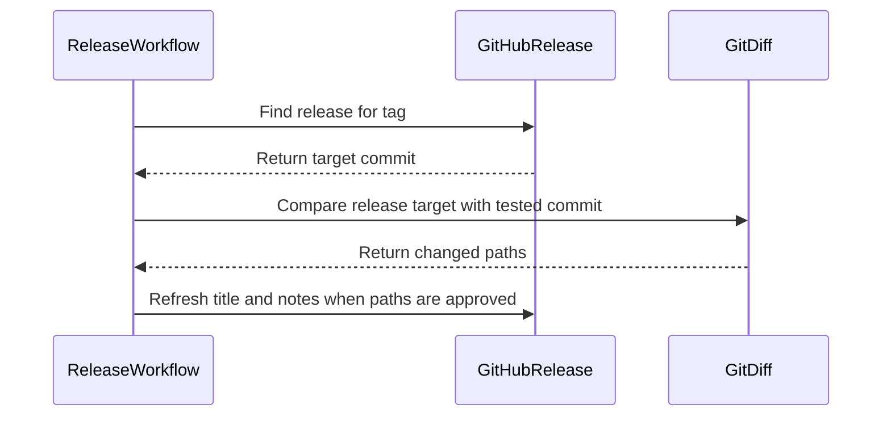

**Poem**

> A rabbit checks the release gate,  
> > Safe paths let fresh notes update.  
> > Stale commits stop at the door,  
> > Outer steps hide H3 calls galore.  
> > Tables count the calls with care.

</details>

<!-- walkthrough_end -->
<!-- pre_merge_checks_walkthrough_start -->

<details>
<summary>🚥 Pre-merge checks | ✅ 5</summary>

<details>
<summary>✅ Passed checks (5 passed)</summary>

|         Check name         | Status   | Explanation                                                                                                                                                                                               |
| :------------------------: | :------- | :-------------------------------------------------------------------------------------------------------------------------------------------------------------------------------------------------------- |
|      Description Check     | ✅ Passed | Check skipped - CodeRabbit’s high-level summary is enabled.                                                                                                                                               |
|         Title check        | ✅ Passed | The title clearly summarizes the primary documentation change: clarifying multistage sampler step counts and NFE accounting. It does not mention the secondary release workflow changes, but it remains … |
|     Docstring Coverage     | ✅ Passed | No functions found in the changed files to evaluate docstring coverage. Skipping docstring coverage check. Docstring coverage is scoped to functions touched by this diff. Analyzed 0 functions across 0… |
|     Linked Issues check    | ✅ Passed | Check skipped because no linked issues were found for this pull request.                                                                                                                                  |
| Out of Scope Changes check | ✅ Passed | Check skipped because no linked issues were found for this pull request.                                                                                                                                  |

</details>

<details>
<summary>Full details: Title check</summary>

**Explanation**

The title clearly summarizes the primary documentation change: clarifying multistage sampler step counts and NFE accounting. It does not mention the secondary release workflow changes, but it remains specific and relevant to the main objective.

</details>

<details>
<summary>Full details: Docstring Coverage</summary>

**Explanation**

No functions found in the changed files to evaluate docstring coverage. Skipping docstring coverage check. Docstring coverage is scoped to functions touched by this diff. Analyzed 0 functions across 0 files. (3 skipped: 3 unsupported.)

</details>

</details>

<!-- pre_merge_checks_walkthrough_end -->
<!-- finishing_touch_checkbox_start -->

<details>
<summary>✨ Finishing Touches</summary>

<details>
<summary>🧪 Generate unit tests (beta)</summary>

- [ ] <!-- {"checkboxId": "f47ac10b-58cc-4372-a567-0e02b2c3d479", "radioGroupId": "utg-output-choice-group-5471783977"} -->   Create PR with unit tests
- [ ] <!-- {"checkboxId": "6ba7b810-9dad-11d1-80b4-00c04fd430c8", "radioGroupId": "utg-output-choice-group-5471783977"} -->   Commit unit tests in branch `docs/clarify-multistage-step-counts`

</details>

</details>

<!-- finishing_touch_checkbox_end -->
<!-- tips_start -->

---

Thanks for using [CodeRabbit](https://coderabbit.ai?utm_source=oss&utm_medium=github&utm_campaign=xmarre/ComfyUI-Spectrum-MiniMax-H3&utm_content=95)! It's free for OSS, and your support helps us grow. If you like it, consider giving us a shout-out.

<details>
<summary>❤️ Share</summary>

- [X](https://twitter.com/intent/tweet?text=I%20just%20used%20%40coderabbitai%20for%20my%20code%20review%2C%20and%20it%27s%20fantastic%21%20It%27s%20free%20for%20OSS%20and%20offers%20a%20free%20trial%20for%20the%20proprietary%20code.%20Check%20it%20out%3A&url=https%3A//coderabbit.ai)
- [Mastodon](https://mastodon.social/share?text=I%20just%20used%20%40coderabbitai%20for%20my%20code%20review%2C%20and%20it%27s%20fantastic%21%20It%27s%20free%20for%20OSS%20and%20offers%20a%20free%20trial%20for%20the%20proprietary%20code.%20Check%20it%20out%3A%20https%3A%2F%2Fcoderabbit.ai)
- [Reddit](https://www.reddit.com/submit?title=Great%20tool%20for%20code%20review%20-%20CodeRabbit&text=I%20just%20used%20CodeRabbit%20for%20my%20code%20review%2C%20and%20it%27s%20fantastic%21%20It%27s%20free%20for%20OSS%20and%20offers%20a%20free%20trial%20for%20proprietary%20code.%20Check%20it%20out%3A%20https%3A//coderabbit.ai)
- [LinkedIn](https://www.linkedin.com/sharing/share-offsite/?url=https%3A%2F%2Fcoderabbit.ai&mini=true&title=Great%20tool%20for%20code%20review%20-%20CodeRabbit&summary=I%20just%20used%20CodeRabbit%20for%20my%20code%20review%2C%20and%20it%27s%20fantastic%21%20It%27s%20free%20for%20OSS%20and%20offers%20a%20free%20trial%20for%20proprietary%20code)

</details>


<sub>Comment `@coderabbitai help` to get the list of available commands.</sub>

<!-- tips_end -->


> **Comment by xmarre (2026-08-30T22:46:18Z):**

@coderabbitai review


> **Comment by coderabbitai[bot] (2026-08-30T22:46:25Z):**

<!-- This is an auto-generated reply by CodeRabbit -->
<!-- CodeRabbit review command invocation: v2:51967e613b85d6b83ddbf2680a537218b5ad75d61b98fe0338df497e1de77acd -->
<details>
<summary>✅ Action performed</summary>

Review finished.

> Note: CodeRabbit is an incremental review system and does not re-review already reviewed commits. This command is applicable only when automatic reviews are paused.

</details>


> **Comment by xmarre (2026-08-30T22:57:06Z):**

@coderabbitai Addressed all three findings on rewritten one-commit head `4ac70ad98c44bf3b2eb054b4cbf664313cb24841`: the existing release is compared against the resolved `refs/tags/${TAG}` commit rather than `targetCommitish`; changed paths are collected through a checked temporary-file `git diff` so failures cannot fall through as docs-only; and the documentation now distinguishes inactive PECE (`use_pece=false` or `corrector_order=0` -> `N`) from active PECE (`use_pece=true` and `corrector_order>0` -> `2N-1`). The release refresh remains serialized and refuses stale non-current-main workflow runs.


> **Comment by coderabbitai[bot] (2026-08-30T22:57:32Z):**

<!-- This is an auto-generated reply by CodeRabbit -->
> [!TIP]
> For best results, initiate chat on the files or code changes.

<details>
<summary>🧩 Analysis chain</summary>

🏁 Script executed:

```shell
#!/bin/bash
set -euo pipefail

git status --short
git show --stat --oneline --decorate --no-renames 4ac70ad98c44bf3b2eb054b4cbf664313cb24841
git diff --no-ext-diff --unified=80 \
  4ac70ad98c44bf3b2eb054b4cbf664313cb24841^ \
  4ac70ad98c44bf3b2eb054b4cbf664313cb24841 \
  -- .github/workflows/release.yml README.md RELEASE_NOTES.md
```

Length of output: 22407

---

</details>

`@xmarre` Verified on `4ac70ad98c44bf3b2eb054b4cbf664313cb24841`.

The release workflow now compares `RELEASE_SHA` with the resolved existing tag commit. It fails closed if `git diff` cannot collect the changed paths. It also serializes `main` release processing and rejects stale workflow runs.

The documentation now distinguishes inactive PECE (`N`) from active PECE (`2N - 1`) with the stated `use_pece` and `corrector_order` conditions.

<!-- <review_comment_addressed> -->

---

<!-- This is an auto-generated comment: tweet message by coderabbit.ai -->

If you found this review helpful, would you consider giving us a shout-out on [X](https://twitter.com/intent/tweet?related=CodeRabbitAI&text=%40coderabbitai%20caught%20three%20release%20bugs%3A%20tag-resolved%20comparisons%2C%20fail-safe%20changed-path%20detection%2C%20and%20accurate%20PECE%20docs%E2%80%94plus%20stale%20workflow%20protection.%20Try%20it%20on%20your%20next%20PR!%20%F0%9F%94%8D&url=https%3A%2F%2Fgithub.com%2Fxmarre%2FComfyUI-Spectrum-MiniMax-H3%2Fpull%2F95)?

Thank you for using CodeRabbit!

<!-- end of auto-generated comment: tweet message by coderabbit.ai -->

<sub>You are interacting with an AI system.</sub>


> **Comment by xmarre (2026-08-30T22:57:57Z):**

@coderabbitai review


> **Comment by coderabbitai[bot] (2026-08-30T22:58:19Z):**

<!-- This is an auto-generated reply by CodeRabbit -->
<!-- CodeRabbit review command invocation: v2:3e21f412d0db097923e05c5e2e0dc50d8186b003f08cacae8293ad92fa550b8f -->
<details>
<summary>✅ Action performed</summary>

Review finished.

> Note: CodeRabbit is an incremental review system and does not re-review already reviewed commits. This command is applicable only when automatic reviews are paused.

</details>


### #94 [open] ISSUE: Feature request: Force enabled mode
URL: https://github.com/xmarre/ComfyUI-Spectrum-MiniMax-H3/issues/94  by blepping 2026-08-30T16:42:49Z

Would it be possible to add a mode (possibly even enabled by an environment variable so people have to very deliberately turn it on) where Spectrum remains enabled even if it doesn't recognize the sampler, model patches, etc?

I'm not entitled to anything and I don't want this to sound like there's "tone", but the way it actually decompiles the code and searches through the AST feels like it's trying very hard to find a reason to disable itself to protect me from myself, which I don't need.

Would you ever accept a pull adding some way to enable a mode like that?

> **Comment by xmarre (2026-09-12T01:56:03Z):**

Sorry for not replying sooner.

I think the core of this request is reasonable, and yes, I would accept a PR for an explicit expert/unsafe compatibility override.

You're also basically right about why the current checks feel strict. Spectrum does a fair amount of source/provenance/contract validation because some sampler integrations depend on assumptions that aren't visible from the sampler name alone. In particular, SEEDS, SA-Solver and ER-SDE have different model-call/state semantics, and getting those wrong can make Spectrum forecast against the wrong logical evaluations rather than merely produce slightly worse quality.

That said, I agree there is a useful distinction between **“this implementation/revision has not been reviewed”** and **“Spectrum cannot establish the execution topology it needs to function.”** The former is something an experienced user should be able to override deliberately.

What I would be comfortable accepting is an environment-variable-only unsafe mode along these lines:

- bypass revision/provenance/allowlist checks where Spectrum can still establish the required execution contract;
- turn those failures into explicit warnings instead of silently falling back;
- keep genuinely structural failures non-bypassable—for example unknown multistage model-call topology, invalid sigma schedules, incompatible concurrent caching, broken transactional ordering, or replay semantics that cannot be reproduced;
- don't force offline smoothing replay when replay correctness itself is unproven.

So I would **not** want a switch that literally means “ignore every check and mark every sampler supported,” because for an arbitrary sampler Spectrum doesn't necessarily know whether one outer step corresponds to one, two, three, or state-dependent H3 evaluations. But an explicit **unsafe compatibility/provenance override** is something I'd be happy to have.

An environment variable is probably the right interface as well, since it makes the opt-in deliberate and keeps it out of normal workflows. It should also print a clear warning stating which checks were overridden, and runs using it would naturally be unsupported unless the same problem reproduces without the override.

If that's roughly the scope you had in mind, then yes, I'd accept a PR for it.


### #93 [closed] PR: Validate RefDelta composition on active PECE base
URL: https://github.com/xmarre/ComfyUI-Spectrum-MiniMax-H3/pull/93  by xmarre 2026-08-30T09:46:46Z

Temporary validation PR for rebasing #91 onto #92.

This branch is one commit directly on `feature/active-sa-solver-pece-spectrum`.

Key composition boundary:
- #92 remains authoritative for native active PECE predicted/corrected endpoint topology.
- RefDelta SEEDS uses the existing backend classification bridge.
- RefDelta `sample_refdelta_sa_solver` remains PEC-only because reviewed RefDelta PR #6 hard-codes `use_pece=False`.
- The final RefDelta PR #6 head `2d980cc42a8fa8f9c476c96200b6dab377ec526a` is pinned in CI.
- Adds an explicit regression test proving the RefDelta SA identity remains a three-predicted-call PEC topology rather than entering active PECE.

This PR is validation-only; after CI passes, #91 will be rewritten to this tree and based directly on #92.

> **Comment by coderabbitai[bot] (2026-08-30T09:47:11Z):**

<!-- This is an auto-generated comment: summarize by coderabbit.ai -->
<!-- This is an auto-generated comment: skip review by coderabbit.ai -->

> [!IMPORTANT]
> ## Review skipped
> 
> Auto reviews are disabled on this repository. Please check the settings in the CodeRabbit UI or the `.coderabbit.yaml` file in this repository. To trigger a single review, invoke the `@coderabbitai review` command.
> 
> <details>
> <summary>⚙️ Run configuration</summary>
> 
> **Configuration used**: Organization UI
> 
> **Review profile**: CHILL
> 
> **Plan**: Pro Plus
> 
> **Run ID**: `44f926b8-de03-4b1b-a141-b6ccc79361b5`
> 
> </details>
> 
> You can disable this status message by setting the `reviews.review_status` to `false` in the CodeRabbit configuration file.
> 
> Use the checkbox below for a quick retry:
> - [ ] <!-- {"checkboxId":"e9bb8d72-00e8-4f67-9cb2-caf3b22574fe"} --> 🔍 Trigger review

<!-- end of auto-generated comment: skip review by coderabbit.ai -->

<!-- tips_start -->

---

Thanks for using [CodeRabbit](https://coderabbit.ai?utm_source=oss&utm_medium=github&utm_campaign=xmarre/ComfyUI-Spectrum-MiniMax-H3&utm_content=93)! It's free for OSS, and your support helps us grow. If you like it, consider giving us a shout-out.

<details>
<summary>❤️ Share</summary>

- [X](https://twitter.com/intent/tweet?text=I%20just%20used%20%40coderabbitai%20for%20my%20code%20review%2C%20and%20it%27s%20fantastic%21%20It%27s%20free%20for%20OSS%20and%20offers%20a%20free%20trial%20for%20the%20proprietary%20code.%20Check%20it%20out%3A&url=https%3A//coderabbit.ai)
- [Mastodon](https://mastodon.social/share?text=I%20just%20used%20%40coderabbitai%20for%20my%20code%20review%2C%20and%20it%27s%20fantastic%21%20It%27s%20free%20for%20OSS%20and%20offers%20a%20free%20trial%20for%20the%20proprietary%20code.%20Check%20it%20out%3A%20https%3A%2F%2Fcoderabbit.ai)
- [Reddit](https://www.reddit.com/submit?title=Great%20tool%20for%20code%20review%20-%20CodeRabbit&text=I%20just%20used%20CodeRabbit%20for%20my%20code%20review%2C%20and%20it%27s%20fantastic%21%20It%27s%20free%20for%20OSS%20and%20offers%20a%20free%20trial%20for%20proprietary%20code.%20Check%20it%20out%3A%20https%3A//coderabbit.ai)
- [LinkedIn](https://www.linkedin.com/sharing/share-offsite/?url=https%3A%2F%2Fcoderabbit.ai&mini=true&title=Great%20tool%20for%20code%20review%20-%20CodeRabbit&summary=I%20just%20used%20CodeRabbit%20for%20my%20code%20review%2C%20and%20it%27s%20fantastic%21%20It%27s%20free%20for%20OSS%20and%20offers%20a%20free%20trial%20for%20proprietary%20code)

</details>


<sub>Comment `@coderabbitai help` to get the list of available commands.</sub>

<!-- tips_end -->


### #92 [closed] PR: Add full Spectrum acceleration for active SA-Solver PECE
URL: https://github.com/xmarre/ComfyUI-Spectrum-MiniMax-H3/pull/92  by xmarre 2026-08-30T00:15:48Z

## Summary

Add full Spectrum acceleration for active native ComfyUI SA-Solver PECE:

- `sa_solver_pece` with `corrector_order > 0`;
- `sa_solver` with `use_pece=True` and `corrector_order > 0`.

Active PECE is represented as the native predicted/corrected topology rather than a generic two-stage approximation. Predicted and corrected H3 evaluations at the same sigma remain distinct latent states, corrected endpoints remain exact, and persistent solver/Spectrum history contains actual endpoint observations only.

## Final ownership model

For `N` outer intervals, native active PECE executes:

```text
P0
P1 C1
P2 C2
...
P(N-1) C(N-1)
```

Spectrum persistent feature/Adams ownership is:

```text
P0, C1, C2, C3, ...
```

A forecasted `P_i` is ephemeral to the current corrector and is never promoted into persistent Adams evidence. Every `C_i` is an actual H3 evaluation and replaces the ephemeral predicted endpoint before the next predictor.

For a forecasted predicted phase, Spectrum's cheap hidden forecast is retained for runtime/accounting continuity but is not passed to SA as its denoised value. SA consumes causal solver-space dense output derived only from exact persistent endpoints:

- one endpoint: latest-exact hold;
- two endpoints: bounded two-anchor lambda-space extrapolation;
- invalid/nonfinite/reversed/excessive geometry: latest-exact hold;
- H3 Continuum: latest-exact hold for every forecast coordinate.

Native sigma placement, tau, stochastic variance, noise draws/RNG order, predictor/corrector equations, PECE endpoint replacement, callbacks, and terminal semantics remain authoritative.

## Active-PECE forecast policy

The user-facing `sa_pece_forecast_policy` selector is append-only in the node's optional widgets so existing saved workflow positions retain their meaning.

| Policy | Protected predicted phases | Clean 10-outer topology | Role |
|---|---:|---:|---|
| `max_speed` | P0 | 10 actual / 9 forecast | Higher-speed option |
| `balanced` **default** | P0, P1 | 11 actual / 8 forecast | Released quality/speed default |
| `stable_start` | P0, P1, P2 | 12 actual / 7 forecast | More conservative start |

A larger user `warmup_steps`, H3 Continuum prefixes, hard external-patch transitions, fallbacks, force-actual conditions, and final correctness boundaries always take precedence over these nominal counts.

The release default is now **`balanced`**. Matched production testing found both `max_speed` and `balanced` structurally clean and capable of acceptable decoded output, while `balanced` was perceptually better in the tested MiniMax-H3 workflow. The early coarse/colored-shape previews seen during the first few denoising steps also occur with other MiniMax-H3 samplers and are not treated as an SA-PECE correctness failure.

## Production media evidence

The final 10-outer production stack included runtime LoRA/DoRA hooks, DiffAid, Untwist-RoPE, Spectrum full/model-aware mode, RefDelta SA-Solver PECE, and H3 Continuum.

The maximum-speed run produced the expected conservative production accounting after hard boundaries:

- initial chunk: **12 actual / 7 forecast**;
- Continuum chunk: **13 actual / 6 forecast**;
- corrected phases: **9 actual / 0 forecast**;
- zero fallbacks, bypasses, rollbacks, speculative calls, discarded actual calls, or external-patch contract failures.

The matched balanced run was perceptually preferable. Both remained within the same reviewed endpoint-ownership architecture.

The dedicated RefDelta SA scheduler comparison also finished its media gate: exact `simple_control` was slightly preferred over `simple_adams_bounded`, while both produced acceptable output. That result does not change Spectrum's PECE ownership; Spectrum remains the sole owner of forecast cadence.

## Safety and compatibility

- H3 Continuum protects both phases inside its requested outer-step prefix.
- DiffAid/Untwist hard transitions promote a predicted forecast to actual before the corrector consumes it.
- Dense interpolation anchors reset after hard transitions while native Adams history is preserved.
- Active PECE uses one shared endpoint history, avoiding duplicate same-coordinate feature anchors.
- Ordinary SA-Solver PEC, SEEDS-2/3, ER-SDE, replay/rollback, and non-SA samplers remain isolated from the PECE policy selector.
- All-actual PECE remains parity-tested against native ComfyUI for call order/output, callbacks, predictor/corrector orders, `simple_order_2`, tau variants, stochastic and deterministic paths, model noise scale, RNG/noise ordering, and terminal/nonterminal schedules.

## Final implementation / CI

Implementation head:

```text
01224bd4f640c60a9da9e0cca677453f48ab33ed
```

Parent/base:

```text
c7942d1308d4bdec2fc078f34c3afb3cfce534fd
```

Final Actions run:

https://github.com/xmarre/ComfyUI-Spectrum-MiniMax-H3/actions/runs/33337115081

All **eight** reviewed ComfyUI/Python matrix lanes pass, including Ruff, compileall, native H3/SA fixtures, and the current reviewed ComfyUI authority `8a33128f2f8c5585c57486c07de481241e70a39c`.

## Stacked RefDelta composition

PR #91 remains the one-commit downstream composition layer. Its current head is:

```text
562b25809f89e101e290203e0f015c5f72132552
```

directly parented by this PR's head. PR #91 adds Spectrum interoperability for RefDelta SEEDS-2/3, SA-Solver PEC, and SA-Solver PECE, and will carry the final Spectrum v0.2.23 release preparation after this PR lands.

## Final merge status

Completed on 2026-08-30.

- merged head: `01224bd4f640c60a9da9e0cca677453f48ab33ed`;
- final eight-lane PR CI: https://github.com/xmarre/ComfyUI-Spectrum-MiniMax-H3/actions/runs/33337115081 — green;
- post-merge `main` CI: https://github.com/xmarre/ComfyUI-Spectrum-MiniMax-H3/actions/runs/33337247780 — green;
- the stacked RefDelta composition/release layer landed immediately afterward through PR #91;
- the combined result is released as Spectrum v0.2.23.


> **Comment by coderabbitai[bot] (2026-08-30T00:15:55Z):**

<!-- This is an auto-generated comment: summarize by coderabbit.ai -->
<!-- review_stack_entry_start -->

[](https://app.coderabbit.ai/change-stack/xmarre/ComfyUI-Spectrum-MiniMax-H3/pull/92)

<!-- review_stack_entry_end -->
<!-- walkthrough_start -->

<details>
<summary>📝 Walkthrough</summary>

## Walkthrough

The PR adds active SA-Solver PECE support. It defines predicted and corrected call topology, phase-aware runtime history and statistics, isolated predicted forecasting, exact corrected evaluations, expanded tests, updated documentation, and CI coverage.

### Changes

**Active PECE support**

|Layer / File(s)|Summary|
|---|---|
|**Runtime topology and phase accounting** <br> `comfyui_spectrum_h3/runtime.py`|The runtime validates solver-call descriptors. It tracks phase identity, policy steps, history retention, per-phase counts, and rollback state.|
|**SA-Solver active PECE execution** <br> `comfyui_spectrum_h3/sampling.py`, `comfyui_spectrum_h3/external_patch_compat.py`|The sampler builds predicted and corrected phases. Predicted phases can forecast. Corrected phases remain exact and re-anchor persistent history. Logs include phase metadata.|
|**Runtime and solver behavior validation** <br> `tests/test_runtime.py`, `tests/test_sa_solver_state_conditioning.py`, `tests/test_sampling.py`, `tests/test_external_patch_compat.py`|Tests cover topology, history isolation, native parity, transition handling, forecast constraints, RNG behavior, and scheduling.|
|**Compatibility documentation and test environment** <br> `.github/workflows/tests.yml`, `README.md`|The README documents active-PECE policy and scheduling. CI adds a ComfyUI reference and CPU test dependencies.|

**Estimated code review effort:** 4 (Complex) | ~60 minutes

<!-- final_review_risk_start -->
**Merge Risk:** _🔵 Low_ · up to `1e6b7`

The PR is mergeable with explicit owner follow-up for a bounded runtime-state issue: completion-reason reporting can fail before the first run or retain stale data after a run, and malformed externally reused phase ordering is not fully rejected. These should be addressed or explicitly accepted before relying on the new acceleration path.
<!-- final_review_risk_end -->

### Sequence Diagram(s)

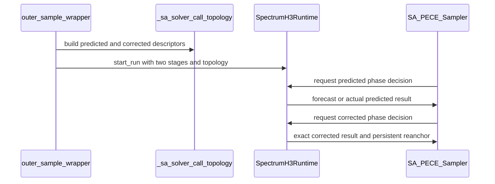

**Poem**

> I’m a rabbit with topology tucked under my ear  
> Predicted hops may forecast, corrected steps stay clear  
> History lanes keep every phase in place  
> Exact reanchors finish the race  
> Tests bloom like carrots in a tidy trace

</details>

<!-- walkthrough_end -->
<!-- pre_merge_checks_walkthrough_start -->

<details>
<summary>🚥 Pre-merge checks | ✅ 4 | ❌ 1</summary>

### ❌ Failed checks (1 warning)

|     Check name     | Status     | Explanation                                                                                                                                                                                               | Resolution                                                                         |
| :----------------: | :--------- | :-------------------------------------------------------------------------------------------------------------------------------------------------------------------------------------------------------- | :--------------------------------------------------------------------------------- |
| Docstring Coverage | ⚠️ Warning | Docstring coverage is 13.98% which is insufficient. The required threshold is 80.00%. Docstring coverage is scoped to functions touched by this diff. Analyzed 93 functions across 7 files. (1 skipped: … | Write docstrings for the functions missing them to satisfy the coverage threshold. |

<details>
<summary>✅ Passed checks (4 passed)</summary>

|         Check name         | Status   | Explanation                                                                                                             |
| :------------------------: | :------- | :---------------------------------------------------------------------------------------------------------------------- |
|     Linked Issues check    | ✅ Passed | Check skipped because no linked issues were found for this pull request.                                                |
| Out of Scope Changes check | ✅ Passed | Check skipped because no linked issues were found for this pull request.                                                |
|      Description Check     | ✅ Passed | Check skipped - CodeRabbit’s high-level summary is enabled.                                                             |
|         Title check        | ✅ Passed | The title clearly and concisely describes the main change: adding full Spectrum acceleration for active SA-Solver PECE. |

</details>

<details>
<summary>Full details: Docstring Coverage</summary>

**Explanation**

Docstring coverage is 13.98% which is insufficient. The required threshold is 80.00%. Docstring coverage is scoped to functions touched by this diff. Analyzed 93 functions across 7 files. (1 skipped: 1 unsupported.)

</details>

</details>

<!-- pre_merge_checks_walkthrough_end -->

- [ ] <!-- {"checkboxId":"585bb3f6-faf5-4dbf-96d2-74e382adf19a"} --> Fix all pre-merge checks with AI
<!-- finishing_touch_checkbox_start -->

<details>
<summary>✨ Finishing Touches 💡 1</summary>

<!-- finishing_touch_suggestion:docstrings -->
<details>
<summary>📝 Generate docstrings 💡</summary>

- [ ] <!-- {"checkboxId":"7962f53c-55bc-4827-bfbf-6a18da830691"} --> Create stacked PR
- [ ] <!-- {"checkboxId":"3e1879ae-f29b-4d0d-8e06-d12b7ba33d98"} --> Commit on current branch

</details>
<details>
<summary>🧪 Generate unit tests (beta)</summary>

- [ ] <!-- {"checkboxId": "f47ac10b-58cc-4372-a567-0e02b2c3d479", "radioGroupId": "utg-output-choice-group-5466373056"} -->   Create PR with unit tests
- [ ] <!-- {"checkboxId": "6ba7b810-9dad-11d1-80b4-00c04fd430c8", "radioGroupId": "utg-output-choice-group-5466373056"} -->   Commit unit tests in branch `feature/active-sa-solver-pece-spectrum`

</details>

</details>

<!-- finishing_touch_checkbox_end -->
<!-- tips_start -->

---

Thanks for using [CodeRabbit](https://coderabbit.ai?utm_source=oss&utm_medium=github&utm_campaign=xmarre/ComfyUI-Spectrum-MiniMax-H3&utm_content=92)! It's free for OSS, and your support helps us grow. If you like it, consider giving us a shout-out.

<details>
<summary>❤️ Share</summary>

- [X](https://twitter.com/intent/tweet?text=I%20just%20used%20%40coderabbitai%20for%20my%20code%20review%2C%20and%20it%27s%20fantastic%21%20It%27s%20free%20for%20OSS%20and%20offers%20a%20free%20trial%20for%20the%20proprietary%20code.%20Check%20it%20out%3A&url=https%3A//coderabbit.ai)
- [Mastodon](https://mastodon.social/share?text=I%20just%20used%20%40coderabbitai%20for%20my%20code%20review%2C%20and%20it%27s%20fantastic%21%20It%27s%20free%20for%20OSS%20and%20offers%20a%20free%20trial%20for%20the%20proprietary%20code.%20Check%20it%20out%3A%20https%3A%2F%2Fcoderabbit.ai)
- [Reddit](https://www.reddit.com/submit?title=Great%20tool%20for%20code%20review%20-%20CodeRabbit&text=I%20just%20used%20CodeRabbit%20for%20my%20code%20review%2C%20and%20it%27s%20fantastic%21%20It%27s%20free%20for%20OSS%20and%20offers%20a%20free%20trial%20for%20proprietary%20code.%20Check%20it%20out%3A%20https%3A//coderabbit.ai)
- [LinkedIn](https://www.linkedin.com/sharing/share-offsite/?url=https%3A%2F%2Fcoderabbit.ai&mini=true&title=Great%20tool%20for%20code%20review%20-%20CodeRabbit&summary=I%20just%20used%20CodeRabbit%20for%20my%20code%20review%2C%20and%20it%27s%20fantastic%21%20It%27s%20free%20for%20OSS%20and%20offers%20a%20free%20trial%20for%20proprietary%20code)

</details>


<sub>Comment `@coderabbitai help` to get the list of available commands.</sub>

<!-- tips_end -->


> **Comment by xmarre (2026-08-30T01:15:31Z):**

@coderabbitai review


> **Comment by coderabbitai[bot] (2026-08-30T01:15:58Z):**

<!-- This is an auto-generated reply by CodeRabbit -->
<!-- CodeRabbit review command invocation: v2:d2f2dc1cf1741b9038014ba4245085577754305f2b5d4e5fd7b4859bcca24fab -->
<details>
<summary>✅ Action performed</summary>

Review finished.

> Note: CodeRabbit is an incremental review system and does not re-review already reviewed commits. This command is applicable only when automatic reviews are paused.

</details>


> **Comment by xmarre (2026-08-30T01:25:30Z):**

@coderabbitai review


> **Comment by coderabbitai[bot] (2026-08-30T01:26:13Z):**

<!-- This is an auto-generated reply by CodeRabbit -->
<!-- CodeRabbit review command invocation: v2:d41557c3befdd275f4bf9dbc415a087b147f3a559d3c48661541df7f06804814 -->
<details>
<summary>⚠️ Action not completed</summary>

Review rate limited.

> Note: CodeRabbit is an incremental review system and does not re-review already reviewed commits. This command is applicable only when automatic reviews are paused.

</details>


> **Comment by xmarre (2026-08-30T01:26:46Z):**

@coderabbitai review


> **Comment by coderabbitai[bot] (2026-08-30T01:26:51Z):**

<!-- This is an auto-generated reply by CodeRabbit -->
<!-- CodeRabbit review command invocation: v2:4558d3faa2d4da3faf1ea3c192ce9fc463d936830c38c47db583307be8cec500 -->
<details>
<summary>⚠️ Action not completed</summary>

Review rate limited.

> Note: CodeRabbit is an incremental review system and does not re-review already reviewed commits. This command is applicable only when automatic reviews are paused.

</details>


> **Comment by xmarre (2026-08-30T03:03:20Z):**

@coderabbitai review


> **Comment by coderabbitai[bot] (2026-08-30T03:03:32Z):**

<!-- This is an auto-generated reply by CodeRabbit -->
<!-- CodeRabbit review command invocation: v2:60d20fc10d1cca2779b8536cbb83d82d8dd3384e150f98b767600fc08d3047c5 -->
<details>
<summary>✅ Action performed</summary>

Review finished.

> Note: CodeRabbit is an incremental review system and does not re-review already reviewed commits. This command is applicable only when automatic reviews are paused.

</details>


### #91 [closed] PR: Compose Spectrum with RefDelta SEEDS and SA-Solver backends
URL: https://github.com/xmarre/ComfyUI-Spectrum-MiniMax-H3/pull/91  by xmarre 2026-08-29T23:57:08Z

## Summary

Compose Spectrum with the released RefDelta Solver v0.6.0 multi-backend sampler family:

- `sample_refdelta_seeds_2`;
- `sample_refdelta_seeds_3`;
- `sample_refdelta_sa_solver`;
- `sample_refdelta_sa_solver_pece`.

This PR is the one-commit release layer on top of the now-merged active-PECE implementation from PR #92. It also prepares **Spectrum v0.2.23**, updates the cross-repository fixture to the final RefDelta v0.6.0 commit, and documents the completed real-media gate.

## Final dependency state

Spectrum base / merged PR #92:

```text
01224bd4f640c60a9da9e0cca677453f48ab33ed
```

Released RefDelta Solver v0.6.0:

```text
21d0191d933fedf2885df082d33eb1bc2fffd529
```

https://github.com/xmarre/ComfyUI-MiniMax-H3-RefDelta-Solver/releases/tag/v0.6.0

The Spectrum CI checkout is pinned to that exact released RefDelta commit.

## Backend ownership

### RefDelta SEEDS-2 / SEEDS-3

Spectrum retains the reviewed state-conditioned residual forecasting architecture for native SEEDS stages. RefDelta retains actual-only outer trajectory/stability evidence and resolves one stochastic gate per outer interval, reusing that gate across the native correlated stochastic segments.

Native stochastic geometry, stage equations, noise draws, callback order, and RNG order remain untouched.

### RefDelta SA-Solver PEC

Spectrum's isolated-history SA adapter remains the solver-side forecast owner. Only actual H3 observations become persistent Adams history; eligible forecast values remain solver-local/ephemeral.

RefDelta trajectory/stochastic evidence remains actual-only and endpoint-owned.

### RefDelta SA-Solver PECE

PR #92's active-PECE architecture remains authoritative:

```text
P0
P1 C1
P2 C2
...
```

Persistent ownership is aligned across both systems:

```text
Spectrum persistent endpoint history = P0, C1, C2, ...
RefDelta persistent evidence         = P0, C1, C2, ...
ephemeral predicted evaluations      = P1, P2, P3, ...
```

Spectrum owns whether an eligible `P_i` is actual or forecast. RefDelta never persists a later predicted `P_i`, even when a safety boundary promoted it to an actual H3 evaluation. Every persistent corrected endpoint must be actual; a forecasted persistent endpoint fails closed.

The native predictor noise is gated from the current persistent RefDelta endpoint evidence without changing native SA noise topology.

## PECE policy / released default

The same `sa_pece_forecast_policy` selector from PR #92 applies to native and RefDelta PECE:

| Policy | Clean 10-outer topology | Role |
|---|---:|---|
| `max_speed` | 10 actual / 9 forecast | Higher-speed option |
| `balanced` **default** | 11 actual / 8 forecast | Released quality/speed default |
| `stable_start` | 12 actual / 7 forecast | More conservative start |

Matched production testing found both max-speed and balanced paths structurally clean and capable of acceptable decoded output. **Balanced was perceptually better in the tested workflow**, so v0.2.23 ships `balanced` as the default.

Continuum prefixes, DiffAid/Untwist hard transitions, user warmup, fallbacks, and force-actual boundaries remain stronger than the selected nominal cadence.

## Final production evidence

The final 10-outer RefDelta SA-Solver PECE stack included runtime LoRA/DoRA hooks, DiffAid, Untwist-RoPE, Spectrum full/model-aware mode, and H3 Continuum.

The reviewed max-speed trace completed with:

- initial chunk: **12 actual / 7 forecast**;
- Continuum chunk: **13 actual / 6 forecast**;
- corrected phases: **9 actual / 0 forecast**;
- zero fallbacks, bypasses, rollbacks, speculative calls, discarded actual calls, or external-patch contract failures.

Balanced produced the perceptually better output in the matched workflow. The early coarse/colored-shape previews seen during the first few denoising steps also occur with other MiniMax-H3 samplers and are not treated as a RefDelta/PECE correctness failure.

The companion RefDelta scheduler gate likewise completed: `simple_control` was slightly preferred over `simple_adams_bounded`, with both producing acceptable output.

## Replay / multi-GPU boundaries

RefDelta SEEDS/SA composition is causal-only under Spectrum because its evidence contract belongs to the live native solver trajectory. Offline-smoothing requests therefore fall back to one causal pass rather than replaying a changed multistage/Adams trajectory.

All RefDelta sampler-family paths fail closed/bypass Spectrum when unsupported `multigpu_clones` state is active. Existing ER-SDE exact-gated-increment interoperability remains unchanged.

## Release preparation

This PR bumps Spectrum:

```text
0.2.22 -> 0.2.23
```

and adds current-version-only v0.2.23 release notes covering:

- active SA-Solver PECE;
- `balanced` as the released default;
- RefDelta SEEDS/SA composition;
- final media evidence;
- the exact RefDelta v0.6.0 CI pin.

Current implementation head:

```text
987be556bb2a580ce20fab20c159a6e9ece4111b
```

Parent / main:

```text
01224bd4f640c60a9da9e0cca677453f48ab33ed
```

Final PR-head CI is green across all eight reviewed ComfyUI/Python lanes:

https://github.com/xmarre/ComfyUI-Spectrum-MiniMax-H3/actions/runs/33337304852

All eight matrix jobs passed. The final commit remains one direct commit on the merged PR #92 base. The main push will run the repository's normal tests, Comfy Registry publication, and release workflow for v0.2.23.


<!-- This is an auto-generated comment: release notes by coderabbit.ai -->

## Summary by CodeRabbit

* **New Features**
  * Added RefDelta SEEDS and SA-Solver sampler support, including PECE workflows.
  * Added configurable active-PECE forecast policies: `balanced` (default), `max_speed`, and `stable_start`.
  * Improved multi-GPU compatibility and solver interoperability.
* **Documentation**
  * Updated usage guidance for sampler choices, forecasting behavior, scheduling, and RefDelta composition.
* **Release**
  * Published version 0.2.23 with expanded validation coverage and scheduler guidance.

<!-- end of auto-generated comment: release notes by coderabbit.ai -->

## Final merge / release status

Completed on 2026-08-30.

- merged head / current `main`: `987be556bb2a580ce20fab20c159a6e9ece4111b`;
- final PR-head eight-lane CI: https://github.com/xmarre/ComfyUI-Spectrum-MiniMax-H3/actions/runs/33337304852 — green;
- final `main` eight-lane CI: https://github.com/xmarre/ComfyUI-Spectrum-MiniMax-H3/actions/runs/33337529093 — green;
- Comfy Registry publication: https://github.com/xmarre/ComfyUI-Spectrum-MiniMax-H3/actions/runs/33337529088 — green;
- release workflow: https://github.com/xmarre/ComfyUI-Spectrum-MiniMax-H3/actions/runs/33337612339 — green;
- released: https://github.com/xmarre/ComfyUI-Spectrum-MiniMax-H3/releases/tag/v0.2.23;
- release target is the exact merged head above.


> **Comment by coderabbitai[bot] (2026-08-29T23:57:15Z):**

<!-- This is an auto-generated comment: summarize by coderabbit.ai -->
<!-- review_stack_entry_start -->

[](https://app.coderabbit.ai/change-stack/xmarre/ComfyUI-Spectrum-MiniMax-H3/pull/91)

<!-- review_stack_entry_end -->
<!-- recent_review_start -->

No actionable comments were generated in the recent review. 🎉

<details>
<summary>ℹ️ Recent review info</summary>

<details>
<summary>⚙️ Run configuration</summary>

**Configuration used**: Organization UI

**Review profile**: CHILL

**Plan**: Pro Plus

**Run ID**: `484c34fb-7a4b-4e56-ac00-98882fbb0f72`

</details>

<details>
<summary>📥 Commits</summary>

Reviewing files that changed from the base of the PR and between 961d81997ea37ad2fc08e09e39092b6f4e38c590 and 987be556bb2a580ce20fab20c159a6e9ece4111b.

</details>

<details>
<summary>📒 Files selected for processing (4)</summary>

* `.github/workflows/tests.yml`
* `README.md`
* `RELEASE_NOTES.md`
* `pyproject.toml`

</details>

**Included review availability:** Your plan provides up to 4 included reviews per hour; 3 remain after this review.

</details>

---


<!-- recent_review_end -->
<!-- walkthrough_start -->

<details>
<summary>📝 Walkthrough</summary>

## Walkthrough

The change adds RefDelta SEEDS and SA-Solver support through a versioned backend bridge. It updates active SA-Solver PECE behavior, sampler contracts, execution paths, replay behavior, tests, documentation, release metadata, and CI fixtures.

### Changes

**RefDelta backend integration**

|Layer / File(s)|Summary|
|---|---|
|**Backend interop contract** <br> `comfyui_spectrum_h3/refdelta_interop.py`, `comfyui_spectrum_h3/sampling.py`, `tests/test_refdelta_interop.py`|Adds a versioned backend contract and a bridge that classifies completed Spectrum steps as actual or forecast.|
|**Sampler registration and contracts** <br> `comfyui_spectrum_h3/sampling.py`, `tests/test_refdelta_interop.py`|Registers RefDelta SEEDS and SA-Solver samplers, validates backend contracts and configuration, maps native stage options, and injects the bridge during dispatch.|
|**SEEDS replay and SA-Solver execution** <br> `comfyui_spectrum_h3/sampling.py`, `tests/test_sampling.py`|Disables seeded replay for RefDelta SEEDS and runs a causal fallback. RefDelta SA-Solver uses adapted isolated history and noise handling. Multi-GPU runs bypass Spectrum H3 and bridge injection.|
|**Validation, documentation, and release support** <br> `tests/test_sampling.py`, `tests/test_sa_solver_state_conditioning.py`, `README.md`, `RELEASE_NOTES.md`, `.github/workflows/tests.yml`, `pyproject.toml`|Adds sampler topology, replay, multi-GPU, and state-conditioning tests. Documents active PECE and RefDelta composition. Updates release version, CI fixtures, and test dependencies.|

**Estimated code review effort:** 4 (Complex) | ~45 minutes

<!-- final_review_risk_start -->
**Merge Risk:** _⚪ Minimal_ · up to `987be`

The PR adds the RefDelta sampler backends and prepares the v0.2.23 release without a supported current-head correctness, security, availability, or deployment issue. No actionable merge-blocking risk remains beyond normal checks and review.
<!-- final_review_risk_end -->

### Sequence Diagram(s)

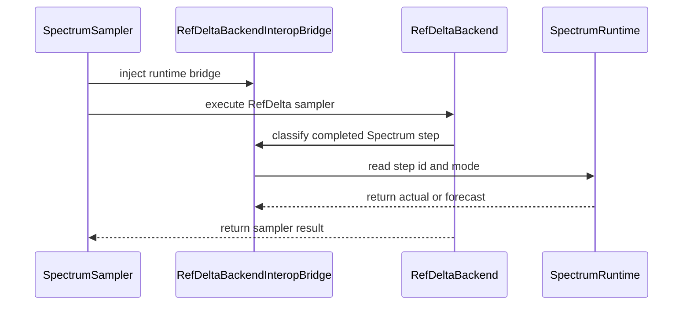

**Poem**

> A rabbit checks the sampler gate,  
> RefDelta hops through steps in state.  
> Actual tracks and forecasts glide,  
> Causal replay stays outside.  
> SA history keeps its course,  
> Tests confirm each hopping source.

</details>

<!-- walkthrough_end -->
<!-- pre_merge_checks_walkthrough_start -->

<details>
<summary>🚥 Pre-merge checks | ✅ 4 | ❌ 1</summary>

### ❌ Failed checks (1 warning)

|     Check name     | Status     | Explanation                                                                                                                                                                                               | Resolution                                                                         |
| :----------------: | :--------- | :-------------------------------------------------------------------------------------------------------------------------------------------------------------------------------------------------------- | :--------------------------------------------------------------------------------- |
| Docstring Coverage | ⚠️ Warning | Docstring coverage is 26.19% which is insufficient. The required threshold is 80.00%. Docstring coverage is scoped to functions touched by this diff. Analyzed 42 functions across 5 files. (4 skipped: … | Write docstrings for the functions missing them to satisfy the coverage threshold. |

<details>
<summary>✅ Passed checks (4 passed)</summary>

|         Check name         | Status   | Explanation                                                                                                       |
| :------------------------: | :------- | :---------------------------------------------------------------------------------------------------------------- |
|     Linked Issues check    | ✅ Passed | Check skipped because no linked issues were found for this pull request.                                          |
| Out of Scope Changes check | ✅ Passed | Check skipped because no linked issues were found for this pull request.                                          |
|      Description Check     | ✅ Passed | Check skipped - CodeRabbit’s high-level summary is enabled.                                                       |
|         Title check        | ✅ Passed | The title clearly summarizes the primary change: integrating Spectrum with RefDelta SEEDS and SA-Solver backends. |

</details>

<details>
<summary>Full details: Docstring Coverage</summary>

**Explanation**

Docstring coverage is 26.19% which is insufficient. The required threshold is 80.00%. Docstring coverage is scoped to functions touched by this diff. Analyzed 42 functions across 5 files. (4 skipped: 4 unsupported.)

</details>

</details>

<!-- pre_merge_checks_walkthrough_end -->

- [ ] <!-- {"checkboxId":"585bb3f6-faf5-4dbf-96d2-74e382adf19a"} --> Fix all pre-merge checks with AI
<!-- finishing_touch_checkbox_start -->

<details>
<summary>✨ Finishing Touches</summary>

<details>
<summary>🧪 Generate unit tests (beta)</summary>

- [ ] <!-- {"checkboxId": "f47ac10b-58cc-4372-a567-0e02b2c3d479", "radioGroupId": "utg-output-choice-group-5471451686"} -->   Create PR with unit tests
- [ ] <!-- {"checkboxId": "6ba7b810-9dad-11d1-80b4-00c04fd430c8", "radioGroupId": "utg-output-choice-group-5471451686"} -->   Commit unit tests in branch `feature/refdelta-multi-backend-interop`

</details>

</details>

<!-- finishing_touch_checkbox_end -->
<!-- tips_start -->

---

Thanks for using [CodeRabbit](https://coderabbit.ai?utm_source=oss&utm_medium=github&utm_campaign=xmarre/ComfyUI-Spectrum-MiniMax-H3&utm_content=91)! It's free for OSS, and your support helps us grow. If you like it, consider giving us a shout-out.

<details>
<summary>❤️ Share</summary>

- [X](https://twitter.com/intent/tweet?text=I%20just%20used%20%40coderabbitai%20for%20my%20code%20review%2C%20and%20it%27s%20fantastic%21%20It%27s%20free%20for%20OSS%20and%20offers%20a%20free%20trial%20for%20the%20proprietary%20code.%20Check%20it%20out%3A&url=https%3A//coderabbit.ai)
- [Mastodon](https://mastodon.social/share?text=I%20just%20used%20%40coderabbitai%20for%20my%20code%20review%2C%20and%20it%27s%20fantastic%21%20It%27s%20free%20for%20OSS%20and%20offers%20a%20free%20trial%20for%20the%20proprietary%20code.%20Check%20it%20out%3A%20https%3A%2F%2Fcoderabbit.ai)
- [Reddit](https://www.reddit.com/submit?title=Great%20tool%20for%20code%20review%20-%20CodeRabbit&text=I%20just%20used%20CodeRabbit%20for%20my%20code%20review%2C%20and%20it%27s%20fantastic%21%20It%27s%20free%20for%20OSS%20and%20offers%20a%20free%20trial%20for%20proprietary%20code.%20Check%20it%20out%3A%20https%3A//coderabbit.ai)
- [LinkedIn](https://www.linkedin.com/sharing/share-offsite/?url=https%3A%2F%2Fcoderabbit.ai&mini=true&title=Great%20tool%20for%20code%20review%20-%20CodeRabbit&summary=I%20just%20used%20CodeRabbit%20for%20my%20code%20review%2C%20and%20it%27s%20fantastic%21%20It%27s%20free%20for%20OSS%20and%20offers%20a%20free%20trial%20for%20proprietary%20code)

</details>


<sub>Comment `@coderabbitai help` to get the list of available commands.</sub>

<!-- tips_end -->


> **Comment by xmarre (2026-08-30T00:39:00Z):**

@coderabbitai review


> **Comment by coderabbitai[bot] (2026-08-30T00:39:06Z):**

<!-- This is an auto-generated reply by CodeRabbit -->
<!-- CodeRabbit review command invocation: v2:98715d8e2e6e3b04fff5c6aa7ec25a4b0f1c220f814eecad63f108eeafde583c -->
<details>
<summary>✅ Action performed</summary>

Review finished.

> Note: CodeRabbit is an incremental review system and does not re-review already reviewed commits. This command is applicable only when automatic reviews are paused.

</details>


> **Comment by xmarre (2026-08-30T00:54:21Z):**

@coderabbitai review


> **Comment by coderabbitai[bot] (2026-08-30T00:54:26Z):**

<!-- This is an auto-generated reply by CodeRabbit -->
<!-- CodeRabbit review command invocation: v2:0131c659bd7bcdc5460d48783b9cf761801f1b0fecfa7c70687d0ab11b5e96c0 -->
<details>
<summary>✅ Action performed</summary>

Review finished.

> Note: CodeRabbit is an incremental review system and does not re-review already reviewed commits. This command is applicable only when automatic reviews are paused.

</details>


> **Comment by xmarre (2026-08-30T01:15:53Z):**

Dependency update: PR #92 now implements the native phase-aware active `sa_solver_pece` path and is the upstream contract for PECE. Keep #91 downstream/draft. Do not finalize its current active-PECE fail-closed behavior; after #92 passes the mandatory real MiniMax-H3 media gate, rebase #91 onto that result and adapt the RefDelta SA backend to the finalized predicted/corrected phase contract.


> **Comment by xmarre (2026-08-30T01:20:56Z):**

@coderabbitai review


> **Comment by coderabbitai[bot] (2026-08-30T01:21:03Z):**

<!-- This is an auto-generated reply by CodeRabbit -->
<!-- CodeRabbit review command invocation: v2:03f730c5f312c9c6e645b35492615aa5acf5df1429868967b40fd8ce865f3127 -->
<details>
<summary>✅ Action performed</summary>

Review finished.

> Note: CodeRabbit is an incremental review system and does not re-review already reviewed commits. This command is applicable only when automatic reviews are paused.

</details>


> **Comment by xmarre (2026-08-30T11:13:36Z):**

@coderabbitai review


> **Comment by coderabbitai[bot] (2026-08-30T11:13:43Z):**

<!-- This is an auto-generated reply by CodeRabbit -->
<!-- CodeRabbit review command invocation: v2:6a883d927e64a553f631fc2caaf8c9c5aa951d7e8d76d815edc6791edd0f636c -->
<details>
<summary>✅ Action performed</summary>

Review finished.

> Note: CodeRabbit is an incremental review system and does not re-review already reviewed commits. This command is applicable only when automatic reviews are paused.

</details>


> **Comment by xmarre (2026-08-30T21:46:21Z):**

@coderabbitai review


> **Comment by coderabbitai[bot] (2026-08-30T21:46:27Z):**

<!-- This is an auto-generated reply by CodeRabbit -->
<!-- CodeRabbit review command invocation: v2:c21f674a715b0b4d5c79ff4cfe7bddaf9979f1024b6a1ac604b6891b7d091e27 -->
<details>
<summary>✅ Action performed</summary>

Review finished.

> Note: CodeRabbit is an incremental review system and does not re-review already reviewed commits. This command is applicable only when automatic reviews are paused.

</details>


### #90 [closed] PR: Release Spectrum MiniMax H3 v0.2.22
URL: https://github.com/xmarre/ComfyUI-Spectrum-MiniMax-H3/pull/90  by xmarre 2026-08-29T22:43:00Z

Release the native SEEDS-2/SEEDS-3 and SA-Solver support from #86 and #87.

Changes:
- bump the package version to 0.2.22;
- add current v0.2.22 release notes covering the final sampler-specific architectures, fail-closed boundaries, and real-media validation;
- update the README so the permanent sampler documentation matches the final implementation rather than the discarded intermediate SA/SEEDS experiments;
- document the validated production behavior: SEEDS-2 at 11/8 on the initial chunk and 12/7 on the Continuum chunk, and SA-Solver at 11/8 in both chunks, all with zero fallbacks and clean decoded output.

Validation already completed on the runtime heads:
- #86 / Actions #495: green across all seven supported ComfyUI/Python lanes;
- #87 / Actions #511: green on the final stacked one-commit head;
- final real MiniMax H3 media passed with DiffAid, Untwist-RoPE and H3 Continuum.

The release workflow will publish only the new top v0.2.22 section after the tested release commit reaches main.

<!-- This is an auto-generated comment: release notes by coderabbit.ai -->

## Summary by CodeRabbit

- **New Features**
  - Added native Spectrum support for ComfyUI SEEDS-2, SEEDS-3, and SA-Solver samplers.
  - Added sampler-specific state handling for stochastic Mini H3 paths.
  - SEEDS-2/3 now support residual forecasting with shared history and exact stage anchoring.
  - SA-Solver now supports persistent Adams history with controlled forecast behavior.

- **Documentation**
  - Updated compatibility details, supported sampler descriptions, validation results, and release notes for version 0.2.22.

<!-- end of auto-generated comment: release notes by coderabbit.ai -->

> **Comment by coderabbitai[bot] (2026-08-29T22:43:10Z):**

<!-- This is an auto-generated comment: summarize by coderabbit.ai -->
<!-- review_stack_entry_start -->

[](https://app.coderabbit.ai/change-stack/xmarre/ComfyUI-Spectrum-MiniMax-H3/pull/90)

<!-- review_stack_entry_end -->
<!-- walkthrough_start -->

<details>
<summary>📝 Walkthrough</summary>

## Walkthrough

The release updates document native SEEDS-2/3 and SA-Solver support, describe sampler-specific state handling and validation, record compatibility details, and increment the project version to 0.2.22.

### Changes

**Sampler support documentation**

|Layer / File(s)|Summary|
|---|---|
|**Release metadata** <br> `README.md`, `RELEASE_NOTES.md`, `pyproject.toml`|The release materials announce v0.2.22 and native SEEDS-2/3 and SA-Solver support.|
|**SEEDS-2/3 compatibility details** <br> `README.md`, `RELEASE_NOTES.md`|The documentation describes current-state reconstruction, residual history, exact stages, sampler constraints, and validation results.|
|**SA-Solver compatibility details** <br> `README.md`, `RELEASE_NOTES.md`|The documentation describes persistent Adams history, solver-space dense output, PECE behavior, Continuum handling, validation, and compatibility.|
 
**Estimated code review effort:** 2 (Simple) | ~10 minutes

<!-- final_review_risk_start -->
**Merge Risk:** _🔵 Low_ · up to `b2a6d`

The release documentation currently misstates the validated SEEDS-2 Continuum-chunk split as 11/8 instead of 12/7, which could misrepresent published behavior; the PR is otherwise mergeable with this bounded documentation correction as explicit follow-up.
<!-- final_review_risk_end -->

**Poem**

> A rabbit marks the release with cheer  
> > SEEDS and SA paths now appear  
> > Exact anchors guide the flow  
> > Adams histories stay in tow  
> > Version twenty-two is here

</details>

<!-- walkthrough_end -->
<!-- pre_merge_checks_walkthrough_start -->

<details>
<summary>🚥 Pre-merge checks | ✅ 5</summary>

<details>
<summary>✅ Passed checks (5 passed)</summary>

|         Check name         | Status   | Explanation                                                                                                                                                                                               |
| :------------------------: | :------- | :-------------------------------------------------------------------------------------------------------------------------------------------------------------------------------------------------------- |
|      Description Check     | ✅ Passed | Check skipped - CodeRabbit’s high-level summary is enabled.                                                                                                                                               |
|         Title check        | ✅ Passed | The title clearly identifies the v0.2.22 release for Spectrum MiniMax H3, which matches the primary changes.                                                                                              |
|     Docstring Coverage     | ✅ Passed | No functions found in the changed files to evaluate docstring coverage. Skipping docstring coverage check. Docstring coverage is scoped to functions touched by this diff. Analyzed 0 functions across 0… |
|     Linked Issues check    | ✅ Passed | Check skipped because no linked issues were found for this pull request.                                                                                                                                  |
| Out of Scope Changes check | ✅ Passed | Check skipped because no linked issues were found for this pull request.                                                                                                                                  |

</details>

<details>
<summary>Full details: Docstring Coverage</summary>

**Explanation**

No functions found in the changed files to evaluate docstring coverage. Skipping docstring coverage check. Docstring coverage is scoped to functions touched by this diff. Analyzed 0 functions across 0 files. (3 skipped: 3 unsupported.)

</details>

</details>

<!-- pre_merge_checks_walkthrough_end -->
<!-- finishing_touch_checkbox_start -->

<details>
<summary>✨ Finishing Touches</summary>

<details>
<summary>🧪 Generate unit tests (beta)</summary>

- [ ] <!-- {"checkboxId": "f47ac10b-58cc-4372-a567-0e02b2c3d479", "radioGroupId": "utg-output-choice-group-5465309671"} -->   Create PR with unit tests
- [ ] <!-- {"checkboxId": "6ba7b810-9dad-11d1-80b4-00c04fd430c8", "radioGroupId": "utg-output-choice-group-5465309671"} -->   Commit unit tests in branch `release/v0.2.22`

</details>

</details>

<!-- finishing_touch_checkbox_end -->
<!-- tips_start -->

---

Thanks for using [CodeRabbit](https://coderabbit.ai?utm_source=oss&utm_medium=github&utm_campaign=xmarre/ComfyUI-Spectrum-MiniMax-H3&utm_content=90)! It's free for OSS, and your support helps us grow. If you like it, consider giving us a shout-out.

<details>
<summary>❤️ Share</summary>

- [X](https://twitter.com/intent/tweet?text=I%20just%20used%20%40coderabbitai%20for%20my%20code%20review%2C%20and%20it%27s%20fantastic%21%20It%27s%20free%20for%20OSS%20and%20offers%20a%20free%20trial%20for%20the%20proprietary%20code.%20Check%20it%20out%3A&url=https%3A//coderabbit.ai)
- [Mastodon](https://mastodon.social/share?text=I%20just%20used%20%40coderabbitai%20for%20my%20code%20review%2C%20and%20it%27s%20fantastic%21%20It%27s%20free%20for%20OSS%20and%20offers%20a%20free%20trial%20for%20the%20proprietary%20code.%20Check%20it%20out%3A%20https%3A%2F%2Fcoderabbit.ai)
- [Reddit](https://www.reddit.com/submit?title=Great%20tool%20for%20code%20review%20-%20CodeRabbit&text=I%20just%20used%20CodeRabbit%20for%20my%20code%20review%2C%20and%20it%27s%20fantastic%21%20It%27s%20free%20for%20OSS%20and%20offers%20a%20free%20trial%20for%20proprietary%20code.%20Check%20it%20out%3A%20https%3A//coderabbit.ai)
- [LinkedIn](https://www.linkedin.com/sharing/share-offsite/?url=https%3A%2F%2Fcoderabbit.ai&mini=true&title=Great%20tool%20for%20code%20review%20-%20CodeRabbit&summary=I%20just%20used%20CodeRabbit%20for%20my%20code%20review%2C%20and%20it%27s%20fantastic%21%20It%27s%20free%20for%20OSS%20and%20offers%20a%20free%20trial%20for%20proprietary%20code)

</details>


<sub>Comment `@coderabbitai help` to get the list of available commands.</sub>

<!-- tips_end -->


> **Comment by xmarre (2026-08-29T22:43:19Z):**

@coderabbitai review


> **Comment by coderabbitai[bot] (2026-08-29T22:43:33Z):**

<!-- This is an auto-generated reply by CodeRabbit -->
<!-- CodeRabbit review command invocation: v2:d414fa6a2275511995b8c9be9414367a239274891cefe9d5c278aad961427999 -->
<details>
<summary>✅ Action performed</summary>

Review finished.

> Note: CodeRabbit is an incremental review system and does not re-review already reviewed commits. This command is applicable only when automatic reviews are paused.

</details>


> **Comment by xmarre (2026-08-29T22:46:28Z):**

CodeRabbit's late documentation finding is not applicable to the merged head. I checked `RELEASE_NOTES.md` on `main`: the SEEDS-2 section already states **11 actual / 8 forecast** for the initial chunk and **12 actual / 7 forecast** for the Continuum chunk. The SA-Solver section separately states **11/8** for both chunks. No corrective commit is needed.


### #87 [closed] PR: Add Spectrum support for native SA-Solver
URL: https://github.com/xmarre/ComfyUI-Spectrum-MiniMax-H3/pull/87  by xmarre 2026-08-29T13:22:16Z

## Summary

Add fail-closed, native-contract-validated Spectrum support for ComfyUI's SA-Solver family, stacked cleanly on the current #86 SEEDS implementation.

This revision incorporates the stochastic-state lesson from #86: Spectrum must not replace SA-Solver's data prediction after the model call or attempt to algebraically correct the solver's stochastic state. Instead, stochastic SA PEC uses the same generalized **state-conditioned transformer-residual forecasting** geometry as stochastic SEEDS while retaining its own one-call-per-outer-step solver topology.

## Native topology

For `N = len(sigmas) - 1` in reviewed ComfyUI:

- PEC (`sample_sa_solver(..., use_pece=false)`) performs exactly **N H3 evaluations** and **N native callbacks**.
- Active PECE performs the predicted-state evaluation and, from the second outer interval onward, a corrected-state evaluation at the same sigma but a different latent: **2N - 1 H3 evaluations**, while callbacks remain N.
- `corrector_order=0` suppresses the second PECE evaluation and returns both PECE entry points to the reviewed N-call topology.
- Native noise is drawn after a nonterminal predictor when `tau > 0` and `s_noise > 0`; the next H3 call therefore sees the exact stochastic `x_pred` produced by SA-Solver.
- Adams history remains entirely native and stores the normal ComfyUI data-prediction outputs.

These assumptions are pinned to the reviewed native sampler/helper ASTs, `KSAMPLER.sample`, `KSamplerX0Inpaint`, and `default_noise_sampler`.

## State-conditioned SA forecasting and stochastic protection

SA PEC no longer uses the previous `SASolverOutputTracker` / sampler-space two-anchor extrapolation. That approach has been removed completely.

Outside native stochastic-input steps, Spectrum may forecast H3 in feature space as:

```text
final target hidden
  = exact current-state target input hidden
  + forecasted transformer residual
```

On an actual H3 call Spectrum captures the exact target hidden immediately before the first transformer block and the final target hidden after the last block, retaining only `final_hidden - input_hidden`. On a forecast call it reconstructs H3's exact current target input embedding from the current SA latent, forecasts the transformer residual, adds the exact input term back, and executes the ordinary native H3 final layer.

A real default-SA H3 trace exposed the remaining stochastic failure directly. The run was already past the old one-point-bootstrap bug: steps 0 and 1 were actual, then Spectrum forecast steps 2, 4, 6, 9, 11, 13, 15, and 17. The delayed heavy-noise previews followed those callback-visible forecast evaluations.

Native SA explains the pattern. Noise is injected into `x_pred` after a predictor when `tau > 0`; the **next** outer model call and callback consume that freshly perturbed `x_pred`. Keeping its input embedding exact is necessary but insufficient: the skipped H3 transformer is itself the nonlinear denoising response to that particular random realization. A transformer residual forecast learned from older states cannot be assumed to reproduce that response.

The runtime now resolves the reviewed native SA stochastic interval and forces every H3 evaluation whose input contains a fresh stochastic increment to be actual. For `tau_func=None`, Spectrum uses the same native bounds as ComfyUI: `model_sampling.percent_to_sigma(0.2)` through `percent_to_sigma(0.8)`. For a reviewed native `get_tau_interval_func` closure, the captured `start_sigma`, `end_sigma`, and `eta` values are inspected without executing the callback. Effective `s_noise` also includes the model's native `noise_scale`.

A follow-up real H3 trace showed that the first safety revision over-expanded this constraint. The native stochastic inputs were steps 6 through 13, but the Adams pre-roll widened the forced mask to steps 2 through 13 and the four-call post-forecast debt then forced steps 16 and 17 actual. The result was **18 actual / 1 forecast** out of 19 H3 calls. That loss of acceleration came from Spectrum's fixed scheduling rules, not from model-aware gating.

Forecasted denoisers do enter native `pred_list`, but their mere presence is not a native solver correctness violation: supplying an approximate denoiser is the acceleration mechanism itself. The hard stochastic invariant is narrower. Spectrum must leave native SA noise/state/history operations untouched and must not forecast the H3 transformer evaluation whose **current** `x_pred` contains a fresh stochastic increment.

The revised stochastic PEC policy therefore:
- forces exactly the tau-derived fresh-noise input calls actual, with no Adams-memory pre-roll;
- leaves native `pred_list`, coefficients, predictor/corrector updates, and RNG untouched;
- gives those mandatory exact stochastic calls normal credit as fresh Spectrum history, allowing the adaptive forecast window to widen instead of treating the exact block as dead scheduling time;
- removes fixed post-forecast actual debt for stochastic SA and caps a forecast burst at `min(4, max(predictor_order, corrector_order))`.

For the observed default 19-call geometry with stochastic-input steps 6 through 13, the model-aware-free schedule is now expected to be:

```text
A A F A F A A A A A A A A A F F F F A
```

That is **13 actual / 6 forecast**. The four-call tail burst begins only after eight consecutive exact stochastic-region H3 anchors and after native tau has become inactive. External-patch boundaries, Continuum prefixes, model-aware risk, or fallback conditions may still add actual calls.

Deterministic SA (`s_noise=0` or reviewed `eta=0`) does not receive stochastic exact-block credit and retains the conservative full-Adams-memory refresh until an independent aggressive deterministic cadence is validated.

The native SA noise sampler, tau evaluation, Adams coefficients, `pred_list`, predictor/corrector updates, callbacks, and model-output conversion remain untouched. There is no sampler-space denoised/x0 replacement and no extra transformer NFE.

## Separation from SEEDS

The shared runtime abstraction separates three concerns:

- **state-conditioned residual geometry** — whether a forecast must retain the exact current latent-state input contribution;
- **multistage topology** — whether the sampler has explicit internal stage identity for accounting and stage masks;
- **history ownership** — whether those stages require independent forecast histories.

The current stacked design is:

```text
stochastic SEEDS-2  -> state-conditioned residual + 2-stage topology + shared residual history
stochastic SEEDS-3  -> state-conditioned residual + 3-stage topology + shared residual history
stochastic SA PEC   -> state-conditioned residual + single-stage topology + one residual history
ordinary samplers   -> absolute hidden + single-stage topology
```

SEEDS keeps stage identity because its native outer stage must remain exact, but #86 now intentionally shares actual residual anchors across the interleaved SEEDS call trajectory. SA does not inherit the SEEDS stage mask and instead uses its tau-derived fresh-noise exact-step mask plus a bounded deterministic-tail forecast burst after that exact region. Runtime teardown tests keep SA and SEEDS state isolated across sequential runs.

No SA-specific post-output hook is added to `external_patch_compat.py`; Diff-Aid/external-patch compatibility continues through the existing generic runtime/minimax transaction.

## Scheduling safety

State-conditioned stochastic samplers do not use Spectrum's degree-1 one-point bootstrap.

Stochastic SEEDS inherits #86's shared-history policy: exact outer-stage H3 evaluations continuously refresh the one residual trajectory, so SEEDS-2 no longer requires a redundant same-internal-stage actual after each internal forecast. The ordinary global no-back-to-back forecast guard remains active.

SA is single-stage from Spectrum's model-call perspective. Stochastic SA keeps every fresh-noise input exact, lets those mandatory actual calls grow Spectrum's adaptive window, and permits a bounded burst only after the exact stochastic region has ended. Deterministic SA retains the older full-Adams-memory refresh pending separate validation.

## SEEDS outer-stage protection inherited from #86

The latest default SEEDS-2 media trace isolated the remaining delayed heavy-noise preview artifact to stage-0 forecasts exactly. #87 is rebased on the corrected #86 head and preserves the new sampler-aware stage mask: stochastic SEEDS keeps the native outer stage (stage 0) exact on every interval and forecasts only internal stages. SA-Solver remains a separate single-lane path and does not inherit this SEEDS-only stage mask.

## Support/fallback policy

- `sample_sa_solver`, `use_pece=false`: reviewed Spectrum support.
- `sample_sa_solver`, `use_pece=true`, `corrector_order=0`: reviewed N-call support.
- `sample_sa_solver_pece`, `corrector_order=0`: reviewed N-call support.
- Active PECE correction: untouched native fallback before Spectrum run state is created.
- `tau_func=None`: supported native default.
- Exact closure returned by native `get_tau_interval_func`: supported after provenance/freevar/value validation without executing it.
- Arbitrary tau callable: untouched native fallback; never speculatively invoked.
- Custom callable `noise_sampler`: supported without inspection or extra draws.
- `simple_order_2`: supported; it changes Adams coefficients, not the reviewed call topology.

## Offline replay

True offline smoothing replay remains disabled for SA-Solver because replaying changed denoiser values would change the native Adams history even with a reproducible RNG stream.

With Spectrum's normal `offline_smoothing_replay=true` default, reviewed SA-Solver now runs **one causal Spectrum pass** instead of falling back to untouched native sampling. Stochastic SA therefore still receives acceleration under the default Spectrum node configuration.

## Regression coverage

- Native SA PEC/PECE model-call and callback topology.
- Same-sigma/different-latent PECE corrected-state identity.
- Tau transition and native noise-draw ordering.
- `simple_order_2` topology invariance.
- Exact native tau-closure provenance and eta extraction without executing user callbacks.
- Custom noise-sampler non-interference.
- PEC/inert-PECE native sampler-contract acceptance and active-PECE rejection.
- SA logical model-call and Continuum-prefix accounting.
- Stochastic/deterministic SA state-conditioning classification.
- Exact stochastic-input-step resolution from native tau bounds and effective noise scale.
- Fresh-noise exact-step resolution without Adams-history mask expansion.
- Stochastic-SA exact-region window credit and bounded post-region forecast streak.
- Regression for the observed 19-call default geometry: 13 actual / 6 forecast with steps 6 through 13 exact.
- Deterministic-SA retention of the conservative full-Adams-memory refresh.
- Runtime forced-actual step validation and scheduling.
- Synthetic native proof that SA noise injected by a predictor is consumed by the next callback-visible model call.
- Outer-wrapper entry into one-lane state-conditioned Spectrum.
- Default offline-replay request -> one causal Spectrum pass.
- Active PECE -> pre-runtime untouched native fallback.
- Native MiniMax-H3 integration proving a state-conditioned SA forecast skips transformer blocks while reconstructing from the exact current latent.
- Runtime one-lane SA vs multi-lane SEEDS isolation and SA -> SEEDS -> SA teardown.
- Existing SEEDS, ER-SDE, RefDelta, RES, external-patch, Continuum, masked-H3, model-aware, Ruff and compileall suites.

The next real stochastic-SA validation resolved the remaining ambiguity decisively. The attempted **13 actual / 6 forecast** cadence completed mechanically with no fallbacks but produced a completely corrupted decoded result. The failure is not evidence that SA needs 15 actual calls. It is evidence that the integration model was wrong.

Native SA appends every denoised result to `pred_list` and reuses that list in later corrector and predictor equations. The previous Spectrum integration treated a forecasted denoiser exactly like a measured SA observation. That makes approximation error recursive: once forecasts enter persistent Adams history, later states are solved from a mixture of real and invented observations, and a consecutive tail can become forecast-only. The rejected run exposed exactly that mechanism.

PR #87 now changes the solver integration rather than adding more forced-actual masks:

- persistent Adams history contains **actual H3 denoisers only**;
- a Spectrum forecast is **ephemeral across steps**;
- the current forecast still participates in the native PEC corrector and predictor for its own interval;
- the forecast is discarded before the next step's persistent Adams stencil is formed;
- the next actual H3 evaluation re-anchors both Spectrum and the Adams stencil;
- exact observations keep their real lambda coordinates, so after a skipped step the next corrector uses an irregular-time actual-only stencil instead of pretending the skipped forecast was measured data;
- the native SA coefficient routine, stochastic noise draw, tau schedule, predictor/corrector equations, callback order, sigma schedule, and final denoising semantics remain the reviewed equations.

This removes the blanket fresh-noise exact block. `sa_stochastic_input_steps` remains telemetry, but stochastic-input calls are no longer automatically forced actual. The old 15/4 direction was fundamentally incompatible with the acceleration goal.

Stochastic SA is scheduled with isolated forecasts (`max_consecutive_forecasts=1`). For the default 19-call geometry the model-aware-free target is now **11 actual / 8 forecast**:

`A A F A F A F A F A F A F A F A F A A`

with forecast IDs **2, 4, 6, 8, 10, 12, 14, 16** before hard runtime transitions. In the current DiffAid workflow, if the step-8 forecast candidate is converted to actual at the hard sigma boundary, the zero-debt alternating policy naturally resumes with a forecast at step 9, so the target remains eight forecasts rather than collapsing to 12/7 or 15/4.

The 11/8 real-media run then provided a second, much narrower finding. The NFE target was reached cleanly in both chunks with no fallbacks: the first chunk forecasted steps **2, 4, 6, 9, 11, 13, 15, 17** after DiffAid converted step 8 to actual, and the Continuum chunk followed the same effective cadence. The decoded result was broadly acceptable, but visible delayed-noise artifacts remained at least on actual steps **10, 12, 14, and 16**.

Restoring the current PEC corrector was then tested in real media and **did not remove those delayed-noise artifacts**. The follow-up log positively confirms that the new path was active — `forecast_use=current_corrector+predictor_ephemeral` and `forecast_corrector=ephemeral_current_only` — while the same one-step-late failure remained. That falsifies the missing-current-corrector hypothesis.

The next real-media run then falsified the simple output-space ownership fix as well. The log confirms that `stochastic_ownership=exact_pending_increment` was active and that exact increment compensation executed on the stochastic forecasts at steps **4, 6, 9, 11, 13, and 15**, yet the delayed-noise artifacts remained. The raw `+q` contribution in `denoised = model_input - sigma * model_output` is therefore not sufficient to explain the failure.

The surviving mismatch is inside the **feature forecast's response to stochastic state**. Spectrum reconstructs MiniMax H3's forecast feature as `exact current-state input embedding + forecasted transformer residual`. With native SA, the actual model sees `x_pred = x_base + q` and the transformer can respond to the fresh random increment `q`. A Spectrum forecast rebuilds the exact input embedding of that noisy state but skips the transformer blocks, so it injects the state perturbation without the nonlinear transformer response that should accompany it. Subtracting `q` only after the output cannot remove that hidden-space partial response.

The split-input experiment has been removed completely. Multiple real runs showed that the adapter could announce split ownership while the intended `q` handoff never reached the actual PREDICT_NOISE call path, and CI #507/#508 rejected the focused transport tests as well. Repeating that experiment would only burn more media-validation time.

The current revision uses **solver-space causal dense output** during active stochastic SA intervals. Spectrum still performs its cheap feature forecast so the normal runtime transaction, telemetry, and scheduling semantics remain intact, but that raw hidden-feature forecast is **ignored for SA's corrector/predictor whenever the current model input contains fresh stochastic predictor noise**. SA consumes a denoised estimate built only from exact H3 actual anchors:

- one actual anchor -> latest-exact hold;
- consecutive actual anchors -> latest-exact hold;
- otherwise -> two-anchor lambda-space extrapolation;
- extrapolation is bounded to one prior anchor interval and invalid/reversed/overlong geometry collapses to a hold.

The first full real-media run of this design removed the delayed heavy-noise corruption at 11/8. It exposed a separate Continuum-only artifact in chunk 2: brief whole-frame vertical oscillation and flashing.

The next run tested a Continuum-specific latest-actual hold on every **stochastic** forecast. The requested breadcrumb was present on steps 4, 6, 9, 11, 13, and 15, yet the decoded artifact was unchanged. That cleanly falsifies stochastic secant extrapolation as the cause. The same trace also shows the remaining hole in that experiment: Continuum step 2 and step 17 were still raw Spectrum hidden-feature forecasts because tau was zero there, so those values still entered SA.

Current head closes that hole. When Continuum interop is active, **every forecast coordinate** uses solver-space latest-actual hold, including non-stochastic steps 2 and 17. Spectrum still executes the cheap hidden-feature forecast for its normal transaction/telemetry, but its denoised value is ignored by SA for the whole continuation chunk. The 11/8 schedule and zero-extra-NFE budget are unchanged.

Outside Continuum, bounded lambda-space dense output remains restricted to stochastic forecasts. Native SA still owns the untouched stochastic `x_pred`, exact noise draw, tau, corrector, predictor equations, callback order, and RNG order. Persistent Adams history remains actual-only.

The ordinary model-aware scheduler veto is advisory on stochastic SA. Risk/confidence telemetry, adaptive fit/blend, and generic correction remain active, but NFE reduction is part of the sampler contract rather than something the generic controller may silently destroy. The rejected 13/6 result is retained as negative evidence against **persistent forecast history**, not as justification for a high-NFE exact mask.

The SA implementation remains one commit on the unchanged #86 head `282d9c3cfce5081b6700aa21bf795ac7a97e155d`. The final #87 head is `707bdf348eb4d24973ed1c3c3105355df7e8bdbd`. CI #511 passes on that exact head. No release/version bump is included.

## Real-media validation

The final default stochastic-SA workflow passed the real-media gate at **11 actual / 8 forecast** in both the initial and Continuum chunks with **0 fallbacks**.

Initial chunk:
- forecasts: **2, 4, 6, 9, 11, 13, 15, 17**;
- active stochastic forecasts used bounded solver-space dense output from exact H3 anchors;
- the previously observed delayed heavy-noise corruption is gone.

Continuum chunk:
- `accepted H3 Continuum API v1, actual prefix=2`;
- the same **11/8** cadence completed with **0 fallbacks**;
- all eight forecast coordinates **2, 4, 6, 9, 11, 13, 15, 17** emitted `scope=continuum_all_forecasts mode=latest_actual_hold_continuum`;
- raw Spectrum feature-derived denoised values were ignored by SA at every forecast coordinate;
- the previously observed whole-frame vertical shake/flashing is gone.

This final run confirms the intended invariant: forecasted H3 values are never persistent Adams observations, stochastic SA consumes solver-space causal dense output instead of the raw hidden-feature forecast, and Continuum continuation chunks isolate every forecast coordinate with a latest-exact hold while retaining the target 11/8 NFE budget.

A separate Euler + simple-scheduler Continuum check produced a clean second chunk, so the earlier shake/flashing is not attributed to the reported upstream MiniMax-H3 masking regression.

Active PECE remains intentionally fail-closed/native for configurations with a live corrector.


<!-- This is an auto-generated comment: release notes by coderabbit.ai -->

## Summary by CodeRabbit

- **New Features**
  - Added support for SA-Solver and SA-Solver PECE sampling.
  - Improved state-conditioned residual forecasting across stochastic samplers.
  - Added safeguards for exact actual-step refreshes and unsupported SA-Solver configurations.
  - Disabled seeded replay and offline smoothing replay where sampler history could become invalid.
  - Added fail-safe fallback to native sampling when compatibility checks fail.

- **Documentation**
  - Documented SA-Solver compatibility, scheduling behavior, constraints, and stochastic SEEDS handling.

- **Tests**
  - Expanded coverage for SA-Solver behavior, forecasting, validation, callbacks, and fallback scenarios.

<!-- end of auto-generated comment: release notes by coderabbit.ai -->

> **Comment by coderabbitai[bot] (2026-08-29T13:22:36Z):**

<!-- This is an auto-generated comment: summarize by coderabbit.ai -->
<!-- review_stack_entry_start -->

[](https://app.coderabbit.ai/change-stack/xmarre/ComfyUI-Spectrum-MiniMax-H3/pull/87)

<!-- review_stack_entry_end -->
<!-- recent_review_start -->

No actionable comments were generated in the recent review. 🎉

<details>
<summary>ℹ️ Recent review info</summary>

<details>
<summary>⚙️ Run configuration</summary>

**Configuration used**: Organization UI

**Review profile**: CHILL

**Plan**: Pro Plus

**Run ID**: `289374bf-c3b8-4ae7-88e6-721870ff07cf`

</details>

<details>
<summary>📥 Commits</summary>

Reviewing files that changed from the base of the PR and between 6b1f07788c70a216210b7b3ee98ccf6eb4296b03 and 617b4ffd8085035718eae84604889c5cfe4caf79.

</details>

<details>
<summary>📒 Files selected for processing (5)</summary>

* `README.md`
* `comfyui_spectrum_h3/runtime.py`
* `comfyui_spectrum_h3/sampling.py`
* `tests/test_runtime.py`
* `tests/test_sampling.py`

</details>

**Included review availability:** Your plan provides up to 4 included reviews per hour; 0 remain after this review.

</details>

---


<!-- recent_review_end -->
<!-- walkthrough_start -->

<details>
<summary>📝 Walkthrough</summary>

## Walkthrough

The change adds native SA-Solver support with contract validation, state-conditioned residual forecasting, causal offline execution, and fail-closed fallback. It generalizes runtime state handling, preserves legacy compatibility, updates documentation, and adds extensive tests.

### Changes

**SA-Solver state-conditioned support**

|Layer / File(s)|Summary|
|---|---|
|**Generalized runtime state conditioning** <br> `comfyui_spectrum_h3/runtime.py`, `comfyui_spectrum_h3/minimax_h3.py`|Runtime state now uses `state_conditioned_residual`, forced actual steps, and compatibility views. MiniMax guards and diagnostics use the new naming.|
|**SA-Solver contract and execution** <br> `comfyui_spectrum_h3/sampling.py`|SA-Solver variants use native provenance, option, topology, tau, and callback checks. Unsupported configurations fall back to the native sampler.|
|**SA-Solver validation coverage** <br> `tests/test_sa_solver_state_conditioning.py`, `tests/test_sampler_contract.py`, `tests/test_runtime.py`, `tests/test_native_equivalence.py`, `tests/test_sampling.py`|Tests cover solver topology, stochastic behavior, runtime state, forecast accounting, replay restrictions, digest validation, native equivalence, and fallback behavior.|
|**Documentation and CI coverage** <br> `README.md`, `.github/workflows/tests.yml`|The README documents SA-Solver compatibility rules. CI lints and runs the dedicated compatibility tests while excluding them from the native MiniMax H3 suite.|

**Estimated code review effort:** 4 (Complex) | ~45 minutes

<!-- final_review_risk_start -->
**Merge Risk:** _🟡 Moderate_ · up to `617b4`

This PR adds native SA-Solver forecasting and stochastic scheduling, but merge readiness is reduced by an unresolved simple_order_2 test fixture that may not validate the intended Adams path, plus a rollback contract that can restore only the active history when separate stage histories are used; owner follow-up is needed before merge.
<!-- final_review_risk_end -->

### Sequence Diagram(s)

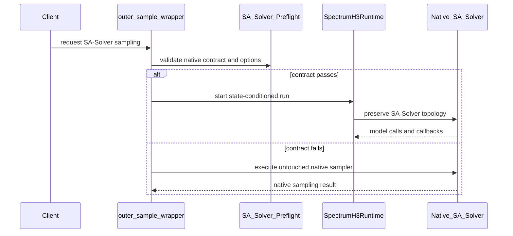

**Poem**

> A rabbit checks the solver’s track  
> State-conditioned steps guide it back  
> Native calls keep their refrain  
> Failed contracts hop to plain  
> Tests record each careful act  
> Docs mark every lane in fact

</details>

<!-- walkthrough_end -->
<!-- pre_merge_checks_walkthrough_start -->

<details>
<summary>🚥 Pre-merge checks | ✅ 4 | ❌ 1</summary>

### ❌ Failed checks (1 warning)

|     Check name     | Status     | Explanation                                                                                                                                                                                               | Resolution                                                                         |
| :----------------: | :--------- | :-------------------------------------------------------------------------------------------------------------------------------------------------------------------------------------------------------- | :--------------------------------------------------------------------------------- |
| Docstring Coverage | ⚠️ Warning | Docstring coverage is 13.21% which is insufficient. The required threshold is 80.00%. Docstring coverage is scoped to functions touched by this diff. Analyzed 106 functions across 8 files. (1 skipped:… | Write docstrings for the functions missing them to satisfy the coverage threshold. |

<details>
<summary>✅ Passed checks (4 passed)</summary>

|         Check name         | Status   | Explanation                                                                                                       |
| :------------------------: | :------- | :---------------------------------------------------------------------------------------------------------------- |
|     Linked Issues check    | ✅ Passed | Check skipped because no linked issues were found for this pull request.                                          |
| Out of Scope Changes check | ✅ Passed | Check skipped because no linked issues were found for this pull request.                                          |
|      Description Check     | ✅ Passed | Check skipped - CodeRabbit’s high-level summary is enabled.                                                       |
|         Title check        | ✅ Passed | The title clearly and concisely describes the main change: adding Spectrum support for native SA-Solver samplers. |

</details>

<details>
<summary>Full details: Docstring Coverage</summary>

**Explanation**

Docstring coverage is 13.21% which is insufficient. The required threshold is 80.00%. Docstring coverage is scoped to functions touched by this diff. Analyzed 106 functions across 8 files. (1 skipped: 1 unsupported.)

</details>

</details>

<!-- pre_merge_checks_walkthrough_end -->

- [ ] <!-- {"checkboxId":"585bb3f6-faf5-4dbf-96d2-74e382adf19a"} --> Fix all pre-merge checks with AI
<!-- finishing_touch_checkbox_start -->

<details>
<summary>✨ Finishing Touches 💡 1</summary>

<!-- finishing_touch_suggestion:docstrings -->
<details>
<summary>📝 Generate docstrings 💡</summary>

- [ ] <!-- {"checkboxId":"7962f53c-55bc-4827-bfbf-6a18da830691"} --> Create stacked PR
- [ ] <!-- {"checkboxId":"3e1879ae-f29b-4d0d-8e06-d12b7ba33d98"} --> Commit on current branch

</details>
<details>
<summary>🧪 Generate unit tests (beta)</summary>

- [ ] <!-- {"checkboxId": "f47ac10b-58cc-4372-a567-0e02b2c3d479", "radioGroupId": "utg-output-choice-group-5463643470"} -->   Create PR with unit tests
- [ ] <!-- {"checkboxId": "6ba7b810-9dad-11d1-80b4-00c04fd430c8", "radioGroupId": "utg-output-choice-group-5463643470"} -->   Commit unit tests in branch `feature/sa-solver-support`

</details>

</details>

<!-- finishing_touch_checkbox_end -->
<!-- tips_start -->

---

Thanks for using [CodeRabbit](https://coderabbit.ai?utm_source=oss&utm_medium=github&utm_campaign=xmarre/ComfyUI-Spectrum-MiniMax-H3&utm_content=87)! It's free for OSS, and your support helps us grow. If you like it, consider giving us a shout-out.

<details>
<summary>❤️ Share</summary>

- [X](https://twitter.com/intent/tweet?text=I%20just%20used%20%40coderabbitai%20for%20my%20code%20review%2C%20and%20it%27s%20fantastic%21%20It%27s%20free%20for%20OSS%20and%20offers%20a%20free%20trial%20for%20the%20proprietary%20code.%20Check%20it%20out%3A&url=https%3A//coderabbit.ai)
- [Mastodon](https://mastodon.social/share?text=I%20just%20used%20%40coderabbitai%20for%20my%20code%20review%2C%20and%20it%27s%20fantastic%21%20It%27s%20free%20for%20OSS%20and%20offers%20a%20free%20trial%20for%20the%20proprietary%20code.%20Check%20it%20out%3A%20https%3A%2F%2Fcoderabbit.ai)
- [Reddit](https://www.reddit.com/submit?title=Great%20tool%20for%20code%20review%20-%20CodeRabbit&text=I%20just%20used%20CodeRabbit%20for%20my%20code%20review%2C%20and%20it%27s%20fantastic%21%20It%27s%20free%20for%20OSS%20and%20offers%20a%20free%20trial%20for%20proprietary%20code.%20Check%20it%20out%3A%20https%3A//coderabbit.ai)
- [LinkedIn](https://www.linkedin.com/sharing/share-offsite/?url=https%3A%2F%2Fcoderabbit.ai&mini=true&title=Great%20tool%20for%20code%20review%20-%20CodeRabbit&summary=I%20just%20used%20CodeRabbit%20for%20my%20code%20review%2C%20and%20it%27s%20fantastic%21%20It%27s%20free%20for%20OSS%20and%20offers%20a%20free%20trial%20for%20proprietary%20code)

</details>


<sub>Comment `@coderabbitai help` to get the list of available commands.</sub>

<!-- tips_end -->


> **Comment by xmarre (2026-08-29T14:30:43Z):**

@coderabbitai review


> **Comment by coderabbitai[bot] (2026-08-29T14:30:49Z):**

<!-- This is an auto-generated reply by CodeRabbit -->
<!-- CodeRabbit review command invocation: v2:ec0607cebf66eebf4b33333e8cc2b0122f0cdb7f258fb7b1f3df167c9dd676cd -->
<details>
<summary>✅ Action performed</summary>

Review finished.

> Note: CodeRabbit is an incremental review system and does not re-review already reviewed commits. This command is applicable only when automatic reviews are paused.

</details>


> **Comment by xmarre (2026-08-29T15:29:53Z):**

@coderabbitai review


> **Comment by coderabbitai[bot] (2026-08-29T15:29:58Z):**

<!-- This is an auto-generated reply by CodeRabbit -->
<!-- CodeRabbit review command invocation: v2:7b5615da31471f73e00144f6b5fd2379420ad11cc9c3a408eaf4f21d8484af7b -->
<details>
<summary>✅ Action performed</summary>

Review finished.

> Note: CodeRabbit is an incremental review system and does not re-review already reviewed commits. This command is applicable only when automatic reviews are paused.

</details>


> **Comment by xmarre (2026-08-29T16:22:14Z):**

@coderabbitai review


> **Comment by coderabbitai[bot] (2026-08-29T16:22:20Z):**

<!-- This is an auto-generated reply by CodeRabbit -->
<!-- CodeRabbit review command invocation: v2:1beadb1a5d130bdf7e9ee1080dcff397333526fc69af9b2979df9a584acd41db -->
<details>
<summary>✅ Action performed</summary>

Review finished.

> Note: CodeRabbit is an incremental review system and does not re-review already reviewed commits. This command is applicable only when automatic reviews are paused.

</details>


> **Comment by xmarre (2026-08-29T16:45:50Z):**

@coderabbitai review


> **Comment by coderabbitai[bot] (2026-08-29T16:46:15Z):**

<!-- This is an auto-generated reply by CodeRabbit -->
<!-- CodeRabbit review command invocation: v2:d0407c96d5669ba129514175429c33000995c09094b1d1159470ef25519a8e06 -->
<details>
<summary>⚠️ Action not completed</summary>

Head commit changed.

> Note: CodeRabbit is an incremental review system and does not re-review already reviewed commits. This command is applicable only when automatic reviews are paused.

</details>


> **Comment by xmarre (2026-08-29T16:49:16Z):**

@coderabbitai review


> **Comment by coderabbitai[bot] (2026-08-29T16:49:35Z):**

<!-- This is an auto-generated reply by CodeRabbit -->
<!-- CodeRabbit review command invocation: v2:1b2f32268a34d10d24c6d7fc36eb1394755ed5c11ad5bcd9e9330041e0493461 -->
<details>
<summary>✅ Action performed</summary>

Review finished.

> Note: CodeRabbit is an incremental review system and does not re-review already reviewed commits. This command is applicable only when automatic reviews are paused.

</details>


### #86 [closed] PR: Add Spectrum support for native SEEDS-2 and SEEDS-3
URL: https://github.com/xmarre/ComfyUI-Spectrum-MiniMax-H3/pull/86  by xmarre 2026-08-29T10:21:09Z

## Summary

Add reviewed Spectrum support for native ComfyUI SEEDS-2 and SEEDS-3, including the default stochastic solver path.

The implementation follows the actual higher-stage SEEDS construction rather than treating the sampler as a sequence of ordinary one-call diffusion steps. In SEEDS-2/3, intermediate denoiser calls are evaluated after correlated stochastic increments have changed the latent. The NeurIPS 2023 SEEDS paper treats that Markov-preserving noise decomposition as a core part of the solver, and its ablation shows that naive noise substitutions materially degrade sampling quality.

Earlier revisions of this PR tried sampler-space stochastic correction / denoised extrapolation. Real MiniMax H3 tests rejected both: they caused propagated noise, quality loss, and a start-frame distortion. Those approaches are removed.

## Stochastic SEEDS architecture

Spectrum now leaves the native SEEDS stochastic process completely untouched:

- no subtraction or rescaling of SEEDS noise;
- no replacement/reordering of the native noise sampler;
- no denoised/x0 extrapolation;
- no additional transformer NFE.

Instead, stochastic SEEDS uses **state-conditioned residual forecasting**.

For every H3 model call:

```text
final target hidden
  = exact current-state target input embedding
  + transformer residual
```

On an actual call, Spectrum captures the exact target input hidden state immediately before the first native H3 transformer block, captures the final target hidden at the last block, and stores only:

```text
transformer_residual = final_hidden - input_hidden
```

On a forecast call, Spectrum:

1. starts from the exact current SEEDS latent produced by the native solver/noise path;
2. runs only the native H3 target audio/video input projections, chunked to bound temporary output memory;
3. forecasts the transformer residual;
4. adds the exact current-state input embedding back;
5. feeds the reconstructed hidden state through the ordinary native H3 final layer.

This directly preserves the stochastic state information that the previous absolute-hidden forecast lost.

Stochastic SEEDS uses one shared forecast/model-aware residual history over the true interleaved model-call coordinates. The exact outer stage therefore becomes a fresh anchor for the following internal-stage forecast instead of being discarded from an isolated stage lane.

## Solver accounting and contracts

- SEEDS-2 terminal-zero schedule: `2N - 1` H3 model-call opportunities.
- SEEDS-3 terminal-zero schedule: `3N - 2`.
- Exact native function ASTs and `KSAMPLER.sample` semantics are pinned fail-closed.
- Stochastic stage-lane mapping requires a finite, strictly descending schedule with no pre-terminal zero.
- Continuum's actual prefix remains an outer-step contract for stochastic SEEDS.
- Deterministic SEEDS retains expanded logical-call behavior.
- SEEDS-2 requires `0 < r < 1`; the native `r=1` exponential-Heun alias remains fail-closed because it creates duplicate timestep coordinates for distinct solver states.
- SEEDS-3 requires `0 < r_1 < r_2 < 1`.

## Offline replay

Deterministic SEEDS can use the existing seeded offline replay path.

Stochastic SEEDS intentionally does not use offline smoothing replay: replaying the model-call sequence independently of the native noise-conditioned stage trajectory would violate the solver geometry this integration is designed to preserve. If replay is enabled in the Spectrum node, stochastic SEEDS performs one causal state-residual Spectrum pass instead of bypassing Spectrum.

## Stochastic scheduling and forecast efficiency

A real default `KSamplerSelect -> seeds_2` run first exposed two safety problems in the original multistage scheduler: one-point bootstrap was possible inside a stage lane, and global refresh bookkeeping could allow one stage to satisfy another stage's refresh requirement. Those issues were fixed, but the conservative lane design then exposed a different practical problem: with stage 0 protected, a 19-call SEEDS-2 trajectory completed with **16 actual / 3 forecast** H3 evaluations.

That ratio is not an acceptable steady-state policy. The cause was structural rather than model-aware gating: stage 1 had its own isolated residual history, so every stage-1 forecast forced the next stage-1 occurrence actual even though the exact stage-0 evaluation in between had already produced a fresh H3 residual anchor at the nearest trajectory coordinate.

The revised stochastic policy keeps the safety boundary that eliminated the delayed heavy-noise artifact while removing that redundant refresh:

- the native **outer stage (stage 0) remains exact on every outer interval**;
- stochastic SEEDS still disables one-point bootstrap;
- internal stages remain forecast-only candidates;
- all actual stochastic-SEEDS residuals now feed one shared history ordered by their true model-call coordinates;
- the ordinary global no-back-to-back forecast guard remains active;
- an internal SEEDS-2 forecast is therefore naturally refreshed by the next exact outer-stage H3 evaluation instead of requiring another internal-stage actual call.

This is specifically appropriate for the state-conditioned residual geometry. The exact current-state input embedding is recomputed from the native latent on every call, so the shared history models only the transformer residual along the continuous SEEDS trajectory. The exact outer call is the closest available fresh anchor and should contribute to that trajectory fit rather than being ignored because of solver-stage identity.

The outer-stage protection itself is unchanged. Real H3 testing isolated the delayed heavy-noise preview pattern exactly to stage-0 forecasts. Native SEEDS-2 calls its callback immediately after stage 0, and the forecasted callback-visible stage-0 calls matched the artifact cadence. Keeping stage 0 exact preserves every preview/callback denoiser evaluation and avoids asking a time-only transformer-residual forecast to reproduce H3's nonlinear response to a freshly sampled stochastic realization.

For a 10-outer-step terminal-zero SEEDS-2 run there are 19 logical H3 evaluations: 10 outer-stage calls and 9 internal calls. With no additional hard transition or Continuum prefix, the revised shared-history policy needs one initial internal actual anchor and can make the remaining internal calls forecast-eligible, giving a practical ceiling near **11 actual / 8 forecast**.

A subsequent real run on the shared-history head isolated the remaining runtime loss. The first chunk completed at **15 actual / 4 forecast**; the Continuum chunk completed at **16 / 3**. Stage 0 was behaving as intended and there were no redundant same-lane refreshes. The missing forecasts were internal steps 11 and 15, both rejected only by the ordinary model-aware risk veto at combined risks around 0.66, just above the default 0.65 threshold. The hard external-patch transitions at steps 9 and 17 and the Continuum prefix were separate expected actual boundaries.

That model-aware veto is now advisory for stochastic SEEDS internal stages. The controller still computes risk, confidence, adaptive degree/ridge, blend scaling, and generic correction; it simply cannot spend an extra transformer NFE there. The reason is architectural rather than threshold tuning: its scheduler risk was designed for ordinary one-lane trajectories, while stochastic SEEDS deliberately uses a shared interleaved outer/internal residual trajectory. The protected exact outer stage already supplies the fresh anchor and is the sampler-specific safety boundary. Raising the global threshold would weaken ordinary samplers; bypassing only this veto preserves their behavior.

The follow-up real run on this head now hits that scheduling target exactly. The first chunk completed at **13 actual / 6 forecast** in **202.352 s** with internal forecasts at steps 3, 5, 7, 11, 13, and 15. The Continuum chunk completed at **14 / 5** in **223.781 s** with internal forecasts at 5, 7, 11, 13, and 15. There were no fallbacks or stage-lane refreshes. The model-aware controller remained active and reported `model_aware_veto_suppressed=4` and `3`, respectively, confirming that the generic risk veto no longer spends extra transformer NFEs on this sampler-specific path.

The remaining actual boundaries are exactly the intended ones for this workflow: every stochastic outer stage, the Diff-Aid hard transition, the Untwist-RoPE hard transition, the Continuum prefix where present, warmup/readiness, and the final actual tail. Runtime scheduling is therefore no longer the blocker for this SEEDS-2 configuration. Decoded-media quality still requires the separate real-output gate; the log alone cannot establish perceptual parity.

SEEDS-3 remains more conservative because two internal stages occur consecutively between exact outer anchors; its global forecast-refresh guard still prevents unchecked multi-stage forecast streaks.

## Regression coverage

Coverage includes:

- native SEEDS-2/3 AST and model/noise-call topology across the compatibility matrix;
- exact `2N - 1` / `3N - 2` accounting;
- stochastic vs deterministic native noise-draw behavior;
- deterministic output independence from unused noise sampler values;
- native stage indexing, shared stochastic residual history, and protected stage-0 scheduling;
- regression coverage proving exact outer anchors refresh the shared SEEDS-2 history without a redundant same-stage actual;
- exact current-state input-embedding add/subtract round trip;
- native MiniMax H3 integration proving a stochastic SEEDS residual forecast skips transformer blocks while reconstructing from the current latent;
- stochastic replay-request fallback to one causal Spectrum pass;
- deterministic replay behavior;
- invalid schedule/stage/option fail-closed paths;
- existing external-patch, masked-H3, ER-SDE, Continuum, model-aware, Ruff and compileall coverage.

The latest one-commit head is `282d9c3cfce5081b6700aa21bf795ac7a97e155d`. Actions run #495 is green across all seven supported ComfyUI/Python lanes. On the pinned PDD-capable lane the focused suite reports 243 passed / 4 skipped and the remaining native suite 497 passed / 3 skipped; Ruff and compileall are green.


## Final real-media validation

A final native `seeds_2` run on the one-commit head completed cleanly with the full stacked workflow, including DiffAid, Untwist-RoPE, and H3 Continuum.

- Initial chunk: **11 actual / 8 forecast**, **0 fallbacks**, forecasts at steps **3, 5, 7, 9, 11, 13, 15, 17**.
- Continuum chunk: **12 actual / 7 forecast**, **0 fallbacks**. The additional exact call is the expected Continuum actual-prefix/readiness boundary; forecasts then resume at **5, 7, 9, 11, 13, 15, 17**.
- Stage 0 remains exact throughout; only internal stage 1 is forecasted.
- DiffAid and Untwist hard transitions land on already-actual coordinates and add no compatibility NFE.
- The decoded result was manually reviewed and reported clean, with no recurrence of the delayed heavy-noise pattern.

This closes the real-media gate for SEEDS-2. The final head remains `282d9c3cfce5081b6700aa21bf795ac7a97e155d`, with Actions #495 green across all seven supported ComfyUI/Python lanes.

No version/release bump is included.


<!-- This is an auto-generated comment: release notes by coderabbit.ai -->

## Summary by CodeRabbit

- **New Features**
  - Added support for SEEDS-2 and SEEDS-3 samplers.
  - Added deterministic and stochastic replay modes with improved multistage forecasting.
  - Improved state-residual forecasting for supported H3 workflows.
  - Added validation for sampler options, schedules, and stage configurations.

- **Bug Fixes**
  - Invalid or unsupported stochastic configurations now safely fall back to native sampling.
  - Improved handling of actual-versus-forecast steps for reliable replay.

- **Documentation**
  - Documented SEEDS behavior, stage mapping, endpoint constraints, and replay differences.

<!-- end of auto-generated comment: release notes by coderabbit.ai -->

> **Comment by coderabbitai[bot] (2026-08-29T10:21:16Z):**

<!-- This is an auto-generated comment: summarize by coderabbit.ai -->
<!-- review_stack_entry_start -->

[](https://app.coderabbit.ai/change-stack/xmarre/ComfyUI-Spectrum-MiniMax-H3/pull/86)

<!-- review_stack_entry_end -->
<!-- recent_review_start -->

No actionable comments were generated in the recent review. 🎉

<details>
<summary>ℹ️ Recent review info</summary>

<details>
<summary>⚙️ Run configuration</summary>

**Configuration used**: Organization UI

**Review profile**: CHILL

**Plan**: Pro Plus

**Run ID**: `2797c942-5a86-40fd-ab2e-03f95534bbf1`

</details>

<details>
<summary>📥 Commits</summary>

Reviewing files that changed from the base of the PR and between 8f22a1d3e535825e51150be9d984ad58fda96e30 and 948c5a0e591e82c892d41331958726a9d8b46e88.

</details>

<details>
<summary>📒 Files selected for processing (5)</summary>

* `README.md`
* `comfyui_spectrum_h3/runtime.py`
* `comfyui_spectrum_h3/sampling.py`
* `tests/test_runtime.py`
* `tests/test_sampling.py`

</details>

**Included review availability:** Your plan provides up to 4 included reviews per hour; 1 remains after this review.

</details>

---


<!-- recent_review_end -->
<!-- walkthrough_start -->

<details>
<summary>📝 Walkthrough</summary>

## Walkthrough

The PR adds reviewed native support for SEEDS-2 and SEEDS-3. It validates sampler contracts and options, tracks expanded model calls, supports staged state-residual forecasting, preserves native stochastic execution, and adds deterministic, fallback, runtime, and embedding coverage.

### Changes

**SEEDS sampler support**

|Layer / File(s)|Summary|
|---|---|
|**SEEDS contracts and native validation** <br> `comfyui_spectrum_h3/sampling.py`, `tests/test_sampling.py`, `tests/test_sampler_contract.py`, `tests/test_seeds_deterministic_contract.py`, `.github/workflows/tests.yml`|Adds SEEDS metadata, native implementation checks, stage and option validation, model-call accounting, replay rules, stochastic detection, fallback handling, and contract tests.|
|**Staged runtime and sampling flow** <br> `comfyui_spectrum_h3/runtime.py`, `comfyui_spectrum_h3/sampling.py`, `tests/test_runtime.py`|Adds per-stage forecasters and controllers, expanded model-call totals, outer-step policy indexing, prefix translation, ownership-aware capture, lifecycle cleanup, and diagnostic telemetry.|
|**State-residual H3 execution** <br> `comfyui_spectrum_h3/minimax_h3.py`, `tests/test_h3_wrapper.py`, `tests/test_native_equivalence.py`|Adds exact chunked input-embedding reconstruction, residual capture, forecast reconstruction, fallback execution, and tests for embedding round trips and block-skipping forecasts.|
|**SEEDS contract documentation** <br> `README.md`|Documents reviewed contracts, stage constraints, expanded model-call accounting, deterministic replay, stochastic native increments, state-residual geometry, and endpoint handling.|

**Estimated code review effort:** 4 (Complex) | ~60 minutes

<!-- final_review_risk_start -->
**Merge Risk:** _🟡 Moderate_ · up to `948c5`

This PR adds staged SEEDS-2/3 forecasting while preserving the native stochastic path, but the current head still has a conditional completion-path failure that can abort a generation when tracking is skipped, along with bounded forecasting and rollback risks in supported runtime modes. Merge should wait for fixes or explicit owner acceptance of these risks.
<!-- final_review_risk_end -->

### Sequence Diagram(s)

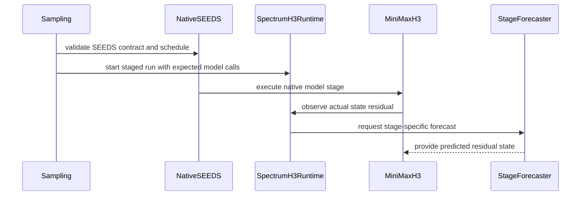

**Poem**

> I hop through SEEDS with a checked little chart  
> Stage lanes keep each forecast part  
> Exact embeddings fold states anew  
> Native noise follows its path true  
> The runtime counts every call in view

</details>

<!-- walkthrough_end -->
<!-- pre_merge_checks_walkthrough_start -->

<details>
<summary>🚥 Pre-merge checks | ✅ 4 | ❌ 1</summary>

### ❌ Failed checks (1 warning)

|     Check name     | Status     | Explanation                                                                                                                                                                                               | Resolution                                                                         |
| :----------------: | :--------- | :-------------------------------------------------------------------------------------------------------------------------------------------------------------------------------------------------------- | :--------------------------------------------------------------------------------- |
| Docstring Coverage | ⚠️ Warning | Docstring coverage is 10.40% which is insufficient. The required threshold is 80.00%. Docstring coverage is scoped to functions touched by this diff. Analyzed 125 functions across 13 files. (1 skipped… | Write docstrings for the functions missing them to satisfy the coverage threshold. |

<details>
<summary>✅ Passed checks (4 passed)</summary>

|         Check name         | Status   | Explanation                                                                                                                    |
| :------------------------: | :------- | :----------------------------------------------------------------------------------------------------------------------------- |
|     Linked Issues check    | ✅ Passed | Check skipped because no linked issues were found for this pull request.                                                       |
| Out of Scope Changes check | ✅ Passed | Check skipped because no linked issues were found for this pull request.                                                       |
|      Description Check     | ✅ Passed | Check skipped - CodeRabbit’s high-level summary is enabled.                                                                    |
|         Title check        | ✅ Passed | The title clearly and concisely describes the primary change: adding Spectrum support for native SEEDS-2 and SEEDS-3 samplers. |

</details>

<details>
<summary>Full details: Docstring Coverage</summary>

**Explanation**

Docstring coverage is 10.40% which is insufficient. The required threshold is 80.00%. Docstring coverage is scoped to functions touched by this diff. Analyzed 125 functions across 13 files. (1 skipped: 1 unsupported.)

</details>

</details>

<!-- pre_merge_checks_walkthrough_end -->

- [ ] <!-- {"checkboxId":"585bb3f6-faf5-4dbf-96d2-74e382adf19a"} --> Fix all pre-merge checks with AI
<!-- finishing_touch_checkbox_start -->

<details>
<summary>✨ Finishing Touches 💡 1</summary>

<!-- finishing_touch_suggestion:docstrings -->
<details>
<summary>📝 Generate docstrings 💡</summary>

- [ ] <!-- {"checkboxId":"7962f53c-55bc-4827-bfbf-6a18da830691"} --> Create stacked PR
- [ ] <!-- {"checkboxId":"3e1879ae-f29b-4d0d-8e06-d12b7ba33d98"} --> Commit on current branch

</details>
<details>
<summary>🧪 Generate unit tests (beta)</summary>

- [ ] <!-- {"checkboxId": "f47ac10b-58cc-4372-a567-0e02b2c3d479", "radioGroupId": "utg-output-choice-group-5463596611"} -->   Create PR with unit tests
- [ ] <!-- {"checkboxId": "6ba7b810-9dad-11d1-80b4-00c04fd430c8", "radioGroupId": "utg-output-choice-group-5463596611"} -->   Commit unit tests in branch `feature/seeds-2-3-support`

</details>

</details>

<!-- finishing_touch_checkbox_end -->
<!-- tips_start -->

---

Thanks for using [CodeRabbit](https://coderabbit.ai?utm_source=oss&utm_medium=github&utm_campaign=xmarre/ComfyUI-Spectrum-MiniMax-H3&utm_content=86)! It's free for OSS, and your support helps us grow. If you like it, consider giving us a shout-out.

<details>
<summary>❤️ Share</summary>

- [X](https://twitter.com/intent/tweet?text=I%20just%20used%20%40coderabbitai%20for%20my%20code%20review%2C%20and%20it%27s%20fantastic%21%20It%27s%20free%20for%20OSS%20and%20offers%20a%20free%20trial%20for%20the%20proprietary%20code.%20Check%20it%20out%3A&url=https%3A//coderabbit.ai)
- [Mastodon](https://mastodon.social/share?text=I%20just%20used%20%40coderabbitai%20for%20my%20code%20review%2C%20and%20it%27s%20fantastic%21%20It%27s%20free%20for%20OSS%20and%20offers%20a%20free%20trial%20for%20the%20proprietary%20code.%20Check%20it%20out%3A%20https%3A%2F%2Fcoderabbit.ai)
- [Reddit](https://www.reddit.com/submit?title=Great%20tool%20for%20code%20review%20-%20CodeRabbit&text=I%20just%20used%20CodeRabbit%20for%20my%20code%20review%2C%20and%20it%27s%20fantastic%21%20It%27s%20free%20for%20OSS%20and%20offers%20a%20free%20trial%20for%20proprietary%20code.%20Check%20it%20out%3A%20https%3A//coderabbit.ai)
- [LinkedIn](https://www.linkedin.com/sharing/share-offsite/?url=https%3A%2F%2Fcoderabbit.ai&mini=true&title=Great%20tool%20for%20code%20review%20-%20CodeRabbit&summary=I%20just%20used%20CodeRabbit%20for%20my%20code%20review%2C%20and%20it%27s%20fantastic%21%20It%27s%20free%20for%20OSS%20and%20offers%20a%20free%20trial%20for%20proprietary%20code)

</details>


<sub>Comment `@coderabbitai help` to get the list of available commands.</sub>

<!-- tips_end -->


> **Comment by xmarre (2026-08-29T10:22:19Z):**

@coderabbitai review


> **Comment by coderabbitai[bot] (2026-08-29T10:22:24Z):**

<!-- This is an auto-generated reply by CodeRabbit -->
<!-- CodeRabbit review command invocation: v2:066631d43cf45a9677a12725fb84aa9149a92906b6dd9e624d13d0740f7fa73d -->
<details>
<summary>⚠️ Action not completed</summary>

Head commit changed.

> Note: CodeRabbit is an incremental review system and does not re-review already reviewed commits. This command is applicable only when automatic reviews are paused.

</details>


> **Comment by xmarre (2026-08-29T10:23:00Z):**

@coderabbitai review


> **Comment by coderabbitai[bot] (2026-08-29T10:23:54Z):**

<!-- This is an auto-generated reply by CodeRabbit -->
<!-- CodeRabbit review command invocation: v2:aacbf901677588bfcabfe59879cd924b19a9af6b7e9ca3b54ac3c03fa10a799e -->
<details>
<summary>✅ Action performed</summary>

Review finished.

> Note: CodeRabbit is an incremental review system and does not re-review already reviewed commits. This command is applicable only when automatic reviews are paused.

</details>


> **Comment by xmarre (2026-08-29T10:27:30Z):**

@coderabbitai review


> **Comment by coderabbitai[bot] (2026-08-29T10:28:27Z):**

<!-- This is an auto-generated reply by CodeRabbit -->
<!-- CodeRabbit review command invocation: v2:fee5fcb95880fc4e3ad47170f8969ee7ce7a042acbcb09be3734fc1dc7a25474 -->
<details>
<summary>⚠️ Action not completed</summary>

Review rate limited.

> Note: CodeRabbit is an incremental review system and does not re-review already reviewed commits. This command is applicable only when automatic reviews are paused.

</details>


> **Comment by xmarre (2026-08-29T11:40:41Z):**

@coderabbitai review


> **Comment by coderabbitai[bot] (2026-08-29T11:40:46Z):**

<!-- This is an auto-generated reply by CodeRabbit -->
<!-- CodeRabbit review command invocation: v2:b1c7a48a7c9003c864d8cb47bc491248d38442f077da9c3d874608fdf584405b -->
<details>
<summary>✅ Action performed</summary>

Review finished.

> Note: CodeRabbit is an incremental review system and does not re-review already reviewed commits. This command is applicable only when automatic reviews are paused.

</details>


> **Comment by xmarre (2026-08-29T12:20:21Z):**

@coderabbitai review


> **Comment by coderabbitai[bot] (2026-08-29T12:20:48Z):**

<!-- This is an auto-generated reply by CodeRabbit -->
<!-- CodeRabbit review command invocation: v2:c388ce98501f7e692206c10185477ceb1ba26b7258eed482fafada9499b010bb -->
<details>
<summary>✅ Action performed</summary>

Review finished.

> Note: CodeRabbit is an incremental review system and does not re-review already reviewed commits. This command is applicable only when automatic reviews are paused.

</details>


> **Comment by xmarre (2026-08-29T13:02:45Z):**

@coderabbitai review


> **Comment by coderabbitai[bot] (2026-08-29T13:02:50Z):**

<!-- This is an auto-generated reply by CodeRabbit -->
<!-- CodeRabbit review command invocation: v2:ec0c2e3e6b6b47321787ff48ae97f111adfa14fb22c788f17022dba0b16049fd -->
<details>
<summary>✅ Action performed</summary>

Review finished.

> Note: CodeRabbit is an incremental review system and does not re-review already reviewed commits. This command is applicable only when automatic reviews are paused.

</details>


> **Comment by xmarre (2026-08-29T13:46:00Z):**

@coderabbitai review


> **Comment by coderabbitai[bot] (2026-08-29T13:46:09Z):**

<!-- This is an auto-generated reply by CodeRabbit -->
<!-- CodeRabbit review command invocation: v2:8de393a39b8d7fbe62d713570143a783a38d7f729ed02a58e8147cd48e70ef8b -->
<details>
<summary>✅ Action performed</summary>

Review finished.

> Note: CodeRabbit is an incremental review system and does not re-review already reviewed commits. This command is applicable only when automatic reviews are paused.

</details>


> **Comment by xmarre (2026-08-29T15:28:54Z):**

@coderabbitai review


> **Comment by coderabbitai[bot] (2026-08-29T15:29:00Z):**

<!-- This is an auto-generated reply by CodeRabbit -->
<!-- CodeRabbit review command invocation: v2:7d1f6119103b2307a9adc7445177d8a1f80fdb3b5482f209bf7cd49d6d5f09a9 -->
<details>
<summary>✅ Action performed</summary>

Review finished.

> Note: CodeRabbit is an incremental review system and does not re-review already reviewed commits. This command is applicable only when automatic reviews are paused.

</details>


> **Comment by xmarre (2026-08-29T16:01:24Z):**

@coderabbitai review


> **Comment by coderabbitai[bot] (2026-08-29T16:01:31Z):**

<!-- This is an auto-generated reply by CodeRabbit -->
<!-- CodeRabbit review command invocation: v2:b2997692c90053fd888535bb9bdb667b654517fc4c58b0cc4cb65f5dccc38ed4 -->
<details>
<summary>✅ Action performed</summary>

Review finished.

> Note: CodeRabbit is an incremental review system and does not re-review already reviewed commits. This command is applicable only when automatic reviews are paused.

</details>


> **Comment by xmarre (2026-08-29T16:39:29Z):**

@coderabbitai review


> **Comment by coderabbitai[bot] (2026-08-29T16:39:50Z):**

<!-- This is an auto-generated reply by CodeRabbit -->
<!-- CodeRabbit review command invocation: v2:e6f03f7d44bc39d80fe8c45badada645fe39c90e66a43c41b6b4e456132a26fb -->
<details>
<summary>✅ Action performed</summary>

Review finished.

> Note: CodeRabbit is an incremental review system and does not re-review already reviewed commits. This command is applicable only when automatic reviews are paused.

</details>


### #85 [closed] PR: Release Spectrum MiniMax H3 v0.2.21
URL: https://github.com/xmarre/ComfyUI-Spectrum-MiniMax-H3/pull/85  by xmarre 2026-08-29T10:17:01Z

Release the ComfyUI 0.34 / MiniMax H3 PDD FinalLayer compatibility fix from #84.

Changes:
- bump package version to 0.2.21 so Comfy Registry/Manager can receive the fix;
- add the v0.2.21 release notes for the FinalLayer contract break and validation;
- make the GitHub release workflow publish only the current top release-note section, avoiding historical changelogs in each new release description.

The runtime fix itself was already validated in #84 across the seven-lane ComfyUI/Python matrix, including the exact PDD-introducing Core commit.

<!-- This is an auto-generated comment: release notes by coderabbit.ai -->

## Summary by CodeRabbit

* **New Release**
  * Released Spectrum MiniMax H3 v0.2.21.
  * Added compatibility with ComfyUI 0.34+ PDD FinalLayer contracts.
  * Improved handling of legacy contracts and incomplete contract failures.
  * Added regression validation for these compatibility updates.

* **Release Process**
  * GitHub releases now use only the current release notes section.

<!-- end of auto-generated comment: release notes by coderabbit.ai -->

> **Comment by xmarre (2026-08-29T10:17:06Z):**

@coderabbitai review


> **Comment by coderabbitai[bot] (2026-08-29T10:17:11Z):**

<!-- This is an auto-generated comment: summarize by coderabbit.ai -->
<!-- review_stack_entry_start -->

[](https://app.coderabbit.ai/change-stack/xmarre/ComfyUI-Spectrum-MiniMax-H3/pull/85)

<!-- review_stack_entry_end -->
<!-- recent_review_start -->

No actionable comments were generated in the recent review. 🎉

<details>
<summary>ℹ️ Recent review info</summary>

<details>
<summary>⚙️ Run configuration</summary>

**Configuration used**: Organization UI

**Review profile**: CHILL

**Plan**: Pro Plus

**Run ID**: `cf5d8763-9d02-4a43-a7a3-30880122b33f`

</details>

<details>
<summary>📥 Commits</summary>

Reviewing files that changed from the base of the PR and between c7ea4b77bb056a95055084049d74975abbd54ac2 and 69f08324fb7cb76b95b55a23b4894560dcb1552e.

</details>

<details>
<summary>📒 Files selected for processing (3)</summary>

* `.github/workflows/release.yml`
* `RELEASE_NOTES.md`
* `pyproject.toml`

</details>

**Included review availability:** Your plan provides up to 4 included reviews per hour; 1 remains after this review.

</details>

---


<!-- recent_review_end -->
<!-- walkthrough_start -->

<details>
<summary>📝 Walkthrough</summary>

## Walkthrough

The project version and release notes now target v0.2.21. The release workflow extracts the current release section before creating the GitHub release.

### Changes

**Release publishing**

|Layer / File(s)|Summary|
|---|---|
|**Version and release notes** <br> `RELEASE_NOTES.md`, `pyproject.toml`|The project version and release notes were updated from v0.2.20 to v0.2.21.|
|**Current release notes extraction** <br> `.github/workflows/release.yml`|The workflow writes content before the first `---` separator to `CURRENT_RELEASE_NOTES.md`, rejects empty output, and uses that file for release creation.|

**Estimated code review effort:** 2 (Simple) | ~10 minutes

<!-- final_review_risk_start -->
**Merge Risk:** _⚪ Minimal_ · up to `69f08`

This PR updates the package version, release notes, and release-note extraction for publishing. No actionable merge-blocking risk remains beyond normal checks and review.
<!-- final_review_risk_end -->

### Sequence Diagram(s)

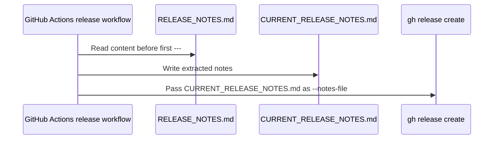

**Poem**

> A rabbit checks the notes with care  
> The newest release waits in there  
> Old sections pause beyond the line  
> Version two point twenty-one will shine  
> The workflow hops and ships on time

</details>

<!-- walkthrough_end -->
<!-- pre_merge_checks_walkthrough_start -->

<details>
<summary>🚥 Pre-merge checks | ✅ 5</summary>

<details>
<summary>✅ Passed checks (5 passed)</summary>

|         Check name         | Status   | Explanation                                                                                                                                                                                               |
| :------------------------: | :------- | :-------------------------------------------------------------------------------------------------------------------------------------------------------------------------------------------------------- |
|      Description Check     | ✅ Passed | Check skipped - CodeRabbit’s high-level summary is enabled.                                                                                                                                               |
|         Title check        | ✅ Passed | The title clearly identifies the primary change: releasing Spectrum MiniMax H3 version 0.2.21. This matches the version bump, release notes, and publishing workflow updates.                             |
|     Docstring Coverage     | ✅ Passed | No functions found in the changed files to evaluate docstring coverage. Skipping docstring coverage check. Docstring coverage is scoped to functions touched by this diff. Analyzed 0 functions across 0… |
|     Linked Issues check    | ✅ Passed | Check skipped because no linked issues were found for this pull request.                                                                                                                                  |
| Out of Scope Changes check | ✅ Passed | Check skipped because no linked issues were found for this pull request.                                                                                                                                  |

</details>

<details>
<summary>Full details: Docstring Coverage</summary>

**Explanation**

No functions found in the changed files to evaluate docstring coverage. Skipping docstring coverage check. Docstring coverage is scoped to functions touched by this diff. Analyzed 0 functions across 0 files. (3 skipped: 3 unsupported.)

</details>

</details>

<!-- pre_merge_checks_walkthrough_end -->
<!-- finishing_touch_checkbox_start -->

<details>
<summary>✨ Finishing Touches</summary>

<details>
<summary>🧪 Generate unit tests (beta)</summary>

- [ ] <!-- {"checkboxId": "f47ac10b-58cc-4372-a567-0e02b2c3d479", "radioGroupId": "utg-output-choice-group-5461752772"} -->   Create PR with unit tests
- [ ] <!-- {"checkboxId": "6ba7b810-9dad-11d1-80b4-00c04fd430c8", "radioGroupId": "utg-output-choice-group-5461752772"} -->   Commit unit tests in branch `release/v0.2.21`

</details>

</details>

<!-- finishing_touch_checkbox_end -->
<!-- tips_start -->

---

Thanks for using [CodeRabbit](https://coderabbit.ai?utm_source=oss&utm_medium=github&utm_campaign=xmarre/ComfyUI-Spectrum-MiniMax-H3&utm_content=85)! It's free for OSS, and your support helps us grow. If you like it, consider giving us a shout-out.

<details>
<summary>❤️ Share</summary>

- [X](https://twitter.com/intent/tweet?text=I%20just%20used%20%40coderabbitai%20for%20my%20code%20review%2C%20and%20it%27s%20fantastic%21%20It%27s%20free%20for%20OSS%20and%20offers%20a%20free%20trial%20for%20the%20proprietary%20code.%20Check%20it%20out%3A&url=https%3A//coderabbit.ai)
- [Mastodon](https://mastodon.social/share?text=I%20just%20used%20%40coderabbitai%20for%20my%20code%20review%2C%20and%20it%27s%20fantastic%21%20It%27s%20free%20for%20OSS%20and%20offers%20a%20free%20trial%20for%20the%20proprietary%20code.%20Check%20it%20out%3A%20https%3A%2F%2Fcoderabbit.ai)
- [Reddit](https://www.reddit.com/submit?title=Great%20tool%20for%20code%20review%20-%20CodeRabbit&text=I%20just%20used%20CodeRabbit%20for%20my%20code%20review%2C%20and%20it%27s%20fantastic%21%20It%27s%20free%20for%20OSS%20and%20offers%20a%20free%20trial%20for%20proprietary%20code.%20Check%20it%20out%3A%20https%3A//coderabbit.ai)
- [LinkedIn](https://www.linkedin.com/sharing/share-offsite/?url=https%3A%2F%2Fcoderabbit.ai&mini=true&title=Great%20tool%20for%20code%20review%20-%20CodeRabbit&summary=I%20just%20used%20CodeRabbit%20for%20my%20code%20review%2C%20and%20it%27s%20fantastic%21%20It%27s%20free%20for%20OSS%20and%20offers%20a%20free%20trial%20for%20proprietary%20code)

</details>


<sub>Comment `@coderabbitai help` to get the list of available commands.</sub>

<!-- tips_end -->


> **Comment by coderabbitai[bot] (2026-08-29T10:17:42Z):**

<!-- This is an auto-generated reply by CodeRabbit -->
<!-- CodeRabbit review command invocation: v2:1d8bc6768e31ab63b83bba4e4ffcf63a248b26cacd7fa9145a175a298a413c0a -->
<details>
<summary>✅ Action performed</summary>

Review finished.

> Note: CodeRabbit is an incremental review system and does not re-review already reviewed commits. This command is applicable only when automatic reviews are paused.

</details>


### #84 [closed] PR: Fix MiniMax H3 PDD final-layer forecast compatibility
URL: https://github.com/xmarre/ComfyUI-Spectrum-MiniMax-H3/pull/84  by xmarre 2026-08-29T10:07:36Z

Fixes #82.

Supersedes #83. Thanks @bun-dev for independently identifying the same ComfyUI PDD `FinalLayer` contract break and proposing the compatible call shape; this maintainer PR adds the regression test and pinned Core CI coverage.

## Root cause

ComfyUI commit `2504e68d4d9dedb514e172692f13436623f25aed` (MiniMax-H3 PDD LoRA support) extended native `FinalLayer.forward` from:

```python
forward(x, t_emb, video_seg, audio_seg)
```

to:

```python
forward(x, t_emb, video_seg, audio_seg, sigma, sample_sigmas, shifts)
```

Spectrum reconstructs the native H3 output head on forecast steps. Its forecast path still called the old four-argument contract, so the first eligible forecast now fails with:

```text
FinalLayer.forward() missing 3 required positional arguments: 'sigma', 'sample_sigmas', and 'shifts'
```

A real Continuum + Spectrum run exposed this after one successful actual transformer step.

## Fix

- Preserve the existing four-argument path for reviewed older ComfyUI revisions.
- Detect the native Core `FinalLayer.forward` contract from the Core class signature instead of probing by execution.
- For the PDD-capable contract, forward the same values native H3 uses:
  - current video sigma;
  - the sampler's exact `transformer_options["sample_sigmas"]` schedule;
  - the active video/audio sigma shifts.
- Keep masked scalar/per-row output-head modulation unchanged.
- Fail explicitly if Core ever exposes only a partial PDD argument contract.

## Regression coverage

- Add a focused projection test proving the PDD call receives the exact sigma schedule and stream shifts.
- Add ComfyUI `2504e68d` to the compatibility matrix with the dependency versions required by that Core revision.
- Retain all existing historical Core lanes, including the legacy four-argument FinalLayer contract.

No Continuum-side workaround is needed; the failure is in Spectrum's native output-head reconstruction boundary.

<!-- This is an auto-generated comment: release notes by coderabbit.ai -->

## Summary by CodeRabbit

* **New Features**
  * Added compatibility for ComfyUI versions using the PDD final-layer projection contract.
  * Forecast execution now supports sigma schedules and stream shifts with compatible configurations.

* **Bug Fixes**
  * Improved compatibility across supported ComfyUI, Python, and package-version combinations.

* **Tests**
  * Added coverage verifying that sigma schedules and shifts are passed correctly to compatible final layers.

<!-- end of auto-generated comment: release notes by coderabbit.ai -->

> **Comment by coderabbitai[bot] (2026-08-29T10:07:45Z):**

<!-- This is an auto-generated comment: summarize by coderabbit.ai -->
<!-- review_stack_entry_start -->

[](https://app.coderabbit.ai/change-stack/xmarre/ComfyUI-Spectrum-MiniMax-H3/pull/84)

<!-- review_stack_entry_end -->
<!-- recent_review_start -->

No actionable comments were generated in the recent review. 🎉

<details>
<summary>ℹ️ Recent review info</summary>

<details>
<summary>⚙️ Run configuration</summary>

**Configuration used**: Organization UI

**Review profile**: CHILL

**Plan**: Pro Plus

**Run ID**: `8d830c4b-be0f-4475-902a-2f36f8627e47`

</details>

<details>
<summary>📥 Commits</summary>

Reviewing files that changed from the base of the PR and between ce9d35e8f5f6d93495d1d9cfc12183f2bfa4afc0 and 2c6e63772f6e60ded0280dd09a35a07e609a1cd6.

</details>

<details>
<summary>📒 Files selected for processing (3)</summary>

* `.github/workflows/tests.yml`
* `comfyui_spectrum_h3/minimax_h3.py`
* `tests/test_h3_masked_forecast.py`

</details>

**Included review availability:** Your plan provides up to 4 included reviews per hour; 3 remain after this review.

</details>

---


<!-- recent_review_end -->
<!-- walkthrough_start -->

<details>
<summary>📝 Walkthrough</summary>

## Walkthrough

### Changes

The forecast state now stores `sample_sigmas`. Final-layer signature inspection selects PDD keyword arguments when supported and preserves the existing call otherwise. Tests verify the forwarded values. CI adds a pinned dependency matrix entry.

**PDD Forecast Support**

|Layer / File(s)|Summary|
|---|---|
|**State and final-layer contract** <br> `comfyui_spectrum_h3/minimax_h3.py`|The output state stores `sample_sigmas`. Signature inspection detects complete and partial PDD contracts.|
|**Conditional forecast dispatch** <br> `comfyui_spectrum_h3/minimax_h3.py`|`_execute_forecast` passes `sigma`, `sample_sigmas`, and `shifts` for PDD final layers. Other final layers keep the positional call.|
|**PDD forecast validation** <br> `tests/test_h3_masked_forecast.py`|The tests add a PDD final-layer fake and verify sigma, sample sigma, and stream shift forwarding.|
|**Compatibility test matrix** <br> `.github/workflows/tests.yml`|The workflow adds a pinned ComfyUI entry and reads dependency versions from matrix variables with defaults.|

**Estimated code review effort:** 3 (Moderate) | ~20 minutes

<!-- final_review_risk_start -->
**Merge Risk:** _⚪ Minimal_ · up to `2c6e6`

This PR updates MiniMax H3 forecast output-head calls for both legacy and PDD-capable ComfyUI contracts, forwards the required sampling state, and adds focused regression and compatibility coverage. No actionable merge-blocking risk remains beyond normal checks and review.
<!-- final_review_risk_end -->

### Sequence Diagram(s)

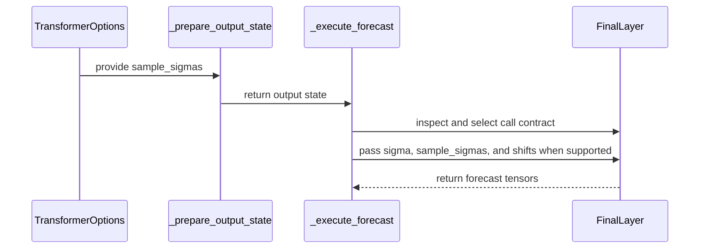

**Poem**

> A rabbit checks the sigma trail  
> > PDD arguments hop without fail  
> > Shifts ride softly through the stream  
> > Tests record each forwarded beam  
> > CI pins the path beneath the moon

</details>

<!-- walkthrough_end -->
<!-- pre_merge_checks_walkthrough_start -->

<details>
<summary>🚥 Pre-merge checks | ✅ 4 | ❌ 1</summary>

### ❌ Failed checks (1 warning)

|     Check name     | Status     | Explanation                                                                                                                                                                                               | Resolution                                                                         |
| :----------------: | :--------- | :-------------------------------------------------------------------------------------------------------------------------------------------------------------------------------------------------------- | :--------------------------------------------------------------------------------- |
| Docstring Coverage | ⚠️ Warning | Docstring coverage is 7.69% which is insufficient. The required threshold is 80.00%. Docstring coverage is scoped to functions touched by this diff. Analyzed 13 functions across 2 files. (1 skipped: 1… | Write docstrings for the functions missing them to satisfy the coverage threshold. |

<details>
<summary>✅ Passed checks (4 passed)</summary>

|         Check name         | Status   | Explanation                                                                                                          |
| :------------------------: | :------- | :------------------------------------------------------------------------------------------------------------------- |
|     Linked Issues check    | ✅ Passed | Check skipped because no linked issues were found for this pull request.                                             |
| Out of Scope Changes check | ✅ Passed | Check skipped because no linked issues were found for this pull request.                                             |
|      Description Check     | ✅ Passed | Check skipped - CodeRabbit’s high-level summary is enabled.                                                          |
|         Title check        | ✅ Passed | The title clearly and concisely describes the main change: fixing MiniMax H3 PDD final-layer forecast compatibility. |

</details>

<details>
<summary>Full details: Docstring Coverage</summary>

**Explanation**

Docstring coverage is 7.69% which is insufficient. The required threshold is 80.00%. Docstring coverage is scoped to functions touched by this diff. Analyzed 13 functions across 2 files. (1 skipped: 1 unsupported.)

</details>

</details>

<!-- pre_merge_checks_walkthrough_end -->

- [ ] <!-- {"checkboxId":"585bb3f6-faf5-4dbf-96d2-74e382adf19a"} --> Fix all pre-merge checks with AI
<!-- finishing_touch_checkbox_start -->

<details>
<summary>✨ Finishing Touches 💡 1</summary>

<!-- finishing_touch_suggestion:docstrings -->
<details>
<summary>📝 Generate docstrings 💡</summary>

- [ ] <!-- {"checkboxId":"7962f53c-55bc-4827-bfbf-6a18da830691"} --> Create stacked PR
- [ ] <!-- {"checkboxId":"3e1879ae-f29b-4d0d-8e06-d12b7ba33d98"} --> Commit on current branch

</details>
<details>
<summary>🧪 Generate unit tests (beta)</summary>

- [ ] <!-- {"checkboxId": "f47ac10b-58cc-4372-a567-0e02b2c3d479", "radioGroupId": "utg-output-choice-group-5461714936"} -->   Create PR with unit tests
- [ ] <!-- {"checkboxId": "6ba7b810-9dad-11d1-80b4-00c04fd430c8", "radioGroupId": "utg-output-choice-group-5461714936"} -->   Commit unit tests in branch `fix/core-pdd-final-layer-contract`

</details>

</details>

<!-- finishing_touch_checkbox_end -->
<!-- tips_start -->

---

Thanks for using [CodeRabbit](https://coderabbit.ai?utm_source=oss&utm_medium=github&utm_campaign=xmarre/ComfyUI-Spectrum-MiniMax-H3&utm_content=84)! It's free for OSS, and your support helps us grow. If you like it, consider giving us a shout-out.

<details>
<summary>❤️ Share</summary>

- [X](https://twitter.com/intent/tweet?text=I%20just%20used%20%40coderabbitai%20for%20my%20code%20review%2C%20and%20it%27s%20fantastic%21%20It%27s%20free%20for%20OSS%20and%20offers%20a%20free%20trial%20for%20the%20proprietary%20code.%20Check%20it%20out%3A&url=https%3A//coderabbit.ai)
- [Mastodon](https://mastodon.social/share?text=I%20just%20used%20%40coderabbitai%20for%20my%20code%20review%2C%20and%20it%27s%20fantastic%21%20It%27s%20free%20for%20OSS%20and%20offers%20a%20free%20trial%20for%20the%20proprietary%20code.%20Check%20it%20out%3A%20https%3A%2F%2Fcoderabbit.ai)
- [Reddit](https://www.reddit.com/submit?title=Great%20tool%20for%20code%20review%20-%20CodeRabbit&text=I%20just%20used%20CodeRabbit%20for%20my%20code%20review%2C%20and%20it%27s%20fantastic%21%20It%27s%20free%20for%20OSS%20and%20offers%20a%20free%20trial%20for%20proprietary%20code.%20Check%20it%20out%3A%20https%3A//coderabbit.ai)
- [LinkedIn](https://www.linkedin.com/sharing/share-offsite/?url=https%3A%2F%2Fcoderabbit.ai&mini=true&title=Great%20tool%20for%20code%20review%20-%20CodeRabbit&summary=I%20just%20used%20CodeRabbit%20for%20my%20code%20review%2C%20and%20it%27s%20fantastic%21%20It%27s%20free%20for%20OSS%20and%20offers%20a%20free%20trial%20for%20proprietary%20code)

</details>


<sub>Comment `@coderabbitai help` to get the list of available commands.</sub>

<!-- tips_end -->


> **Comment by xmarre (2026-08-29T10:08:11Z):**

@coderabbitai review


> **Comment by coderabbitai[bot] (2026-08-29T10:08:20Z):**

<!-- This is an auto-generated reply by CodeRabbit -->
<!-- CodeRabbit review command invocation: v2:385fc44efd93d408851594b846507a9978f676f1d406deb5181221986b02e0db -->
<details>
<summary>✅ Action performed</summary>

Review finished.

> Note: CodeRabbit is an incremental review system and does not re-review already reviewed commits. This command is applicable only when automatic reviews are paused.

</details>


### #83 [closed] PR: Fix FinalLayer.forward() call for ComfyUI 0.34 (PDD LoRA signature)
URL: https://github.com/xmarre/ComfyUI-Spectrum-MiniMax-H3/pull/83  by bun-dev 2026-08-29T00:00:25Z

Fixes #82.

ComfyUI comfyanonymous/ComfyUI@2504e68d4d9dedb514e172692f13436623f25aed ("MiniMax-H3: Support PDD LoRA", comfyanonymous/ComfyUI#15908, in 0.34.0) added three required positional arguments to `FinalLayer.forward`: `sigma`, `sample_sigmas`, and `shifts`. The residual output-head forecast path (`_execute_forecast`) still calls it with the old four arguments, so every sampling run through Spectrum now fails immediately with:

```
TypeError: FinalLayer.forward() missing 3 required positional arguments: 'sigma', 'sample_sigmas', and 'shifts'
```

## Changes

- `_OutputState` gains a `sample_sigmas` field (defaulted to `None`), populated from `transformer_options.get("sample_sigmas")` in `_prepare_output_state` — the same source the core forward uses.
- `_execute_forecast` passes `state.sigma_v`, `state.sample_sigmas`, and `(state.shift_v, state.shift_a)` to `final_layer`, mirroring the core call site (`comfy/ldm/minimax/model.py`) exactly. `sigma_v`, `shift_v`, and `shift_a` were already tracked in `_OutputState`, so the values are the real ones, not stubs.
- The call is signature-detected (`inspect.signature` on `FinalLayer.forward`), so older ComfyUI cores keep working unchanged.

On a plain (non-PDD) checkpoint the new arguments are ignored by core (`n == 1` head path), so behavior there is identical to before the ComfyUI change. With a PDD head bank the forecast path now feeds the head-bank interpolation the same schedule the core forward does.

Written and tested against ComfyUI 0.34.0 (2504e68d4): the new call mirrors the core `final_layer` call site argument-for-argument, and the file compiles clean. Without the patch, any MiniMax H3 workflow with Spectrum active fails at the first sampling step with the `TypeError` above.

🤖 Generated with [Claude Code](https://claude.com/claude-code)


<!-- This is an auto-generated comment: release notes by coderabbit.ai -->

## Summary by CodeRabbit

* **Bug Fixes**
  * Added compatibility with newer ComfyUI model-layer interfaces.
  * Improved support for PDD LoRA workflows by passing sampling and shift settings when available.
  * Maintained compatibility with older interfaces through automatic fallback behavior.

<!-- end of auto-generated comment: release notes by coderabbit.ai -->

> **Comment by coderabbitai[bot] (2026-08-29T00:00:36Z):**

<!-- This is an auto-generated comment: summarize by coderabbit.ai -->
<!-- review_stack_entry_start -->

[](https://app.coderabbit.ai/change-stack/xmarre/ComfyUI-Spectrum-MiniMax-H3/pull/83)

<!-- review_stack_entry_end -->
<!-- walkthrough_start -->

<details>
<summary>📝 Walkthrough</summary>

## Walkthrough

This change adds runtime compatibility for old and new ComfyUI `FinalLayer.forward` signatures. It stores `sample_sigmas` from `transformer_options` and passes the new sigma and shift arguments when the signature supports them.

### Changes

**FinalLayer signature compatibility**

|Layer / File(s)|Summary|
|---|---|
|**Capture sampler sigma schedule** <br> `comfyui_spectrum_h3/minimax_h3.py`|`_OutputState` now stores `sample_sigmas`. `_prepare_output_state` reads the value from `transformer_options`.|
|**Dispatch compatible FinalLayer calls** <br> `comfyui_spectrum_h3/minimax_h3.py`|`_execute_forecast` inspects `FinalLayer.forward` and selects the new or legacy argument set.|

**Estimated code review effort:** 2 (Simple) | ~10 minutes

<!-- final_review_risk_start -->
**Merge Risk:** _🔵 Low_ · up to `a194b`

The change restores Spectrum sampling compatibility with ComfyUI 0.34, but the compatibility path can still fail for output-head implementations that provide `__call__` without `forward`; merge is reasonable with explicit owner follow-up to handle that fallback.
<!-- final_review_risk_end -->

**Suggested reviewers:** `xmarre`

**Poem**

> A rabbit checks the sigma trail  
> > And carries shifts through Comfy's rail  
> > Old calls stay where they belong  
> > New calls gain their arguments strong  
> > The forecast hops along.

</details>

<!-- walkthrough_end -->
<!-- pre_merge_checks_walkthrough_start -->

<details>
<summary>🚥 Pre-merge checks | ✅ 4 | ❌ 1</summary>

### ❌ Failed checks (1 warning)

|     Check name     | Status     | Explanation                                                                                                                                                                               | Resolution                                                                         |
| :----------------: | :--------- | :---------------------------------------------------------------------------------------------------------------------------------------------------------------------------------------- | :--------------------------------------------------------------------------------- |
| Docstring Coverage | ⚠️ Warning | Docstring coverage is 0.00% which is insufficient. The required threshold is 80.00%. Docstring coverage is scoped to functions touched by this diff. Analyzed 2 functions across 1 files. | Write docstrings for the functions missing them to satisfy the coverage threshold. |

<details>
<summary>✅ Passed checks (4 passed)</summary>

|         Check name         | Status   | Explanation                                                                                                                                                                            |
| :------------------------: | :------- | :------------------------------------------------------------------------------------------------------------------------------------------------------------------------------------- |
|      Description Check     | ✅ Passed | Check skipped - CodeRabbit’s high-level summary is enabled.                                                                                                                            |
|         Title check        | ✅ Passed | The title clearly identifies the main change: fixing the FinalLayer.forward() call for the ComfyUI 0.34 PDD LoRA signature.                                                            |
|     Linked Issues check    | ✅ Passed | The changes address issue `#82` by supplying sigma, sample_sigmas, and shifts to the expanded FinalLayer.forward() signature while preserving compatibility with older ComfyUI versions. |
| Out of Scope Changes check | ✅ Passed | The changes are limited to the MiniMax H3 forecast output path and directly support the linked ComfyUI compatibility objective. No unrelated changes are described.                    |

</details>

</details>

<!-- pre_merge_checks_walkthrough_end -->

- [ ] <!-- {"checkboxId":"585bb3f6-faf5-4dbf-96d2-74e382adf19a"} --> Fix all pre-merge checks with AI
<!-- finishing_touch_checkbox_start -->

<details>
<summary>✨ Finishing Touches</summary>

<details>
<summary>🧪 Generate unit tests (beta)</summary>

- [ ] <!-- {"checkboxId": "f47ac10b-58cc-4372-a567-0e02b2c3d479", "radioGroupId": "utg-output-choice-group-5461739479"} -->   Create PR with unit tests

</details>

</details>

<!-- finishing_touch_checkbox_end -->
<!-- tips_start -->

---

Thanks for using [CodeRabbit](https://coderabbit.ai?utm_source=oss&utm_medium=github&utm_campaign=xmarre/ComfyUI-Spectrum-MiniMax-H3&utm_content=83)! It's free for OSS, and your support helps us grow. If you like it, consider giving us a shout-out.

<details>
<summary>❤️ Share</summary>

- [X](https://twitter.com/intent/tweet?text=I%20just%20used%20%40coderabbitai%20for%20my%20code%20review%2C%20and%20it%27s%20fantastic%21%20It%27s%20free%20for%20OSS%20and%20offers%20a%20free%20trial%20for%20the%20proprietary%20code.%20Check%20it%20out%3A&url=https%3A//coderabbit.ai)
- [Mastodon](https://mastodon.social/share?text=I%20just%20used%20%40coderabbitai%20for%20my%20code%20review%2C%20and%20it%27s%20fantastic%21%20It%27s%20free%20for%20OSS%20and%20offers%20a%20free%20trial%20for%20the%20proprietary%20code.%20Check%20it%20out%3A%20https%3A%2F%2Fcoderabbit.ai)
- [Reddit](https://www.reddit.com/submit?title=Great%20tool%20for%20code%20review%20-%20CodeRabbit&text=I%20just%20used%20CodeRabbit%20for%20my%20code%20review%2C%20and%20it%27s%20fantastic%21%20It%27s%20free%20for%20OSS%20and%20offers%20a%20free%20trial%20for%20proprietary%20code.%20Check%20it%20out%3A%20https%3A//coderabbit.ai)
- [LinkedIn](https://www.linkedin.com/sharing/share-offsite/?url=https%3A%2F%2Fcoderabbit.ai&mini=true&title=Great%20tool%20for%20code%20review%20-%20CodeRabbit&summary=I%20just%20used%20CodeRabbit%20for%20my%20code%20review%2C%20and%20it%27s%20fantastic%21%20It%27s%20free%20for%20OSS%20and%20offers%20a%20free%20trial%20for%20proprietary%20code)

</details>


<sub>Comment `@coderabbitai help` to get the list of available commands.</sub>

<!-- tips_end -->


> **Comment by xmarre (2026-08-29T10:13:52Z):**

@coderabbitai review


> **Comment by coderabbitai[bot] (2026-08-29T10:13:57Z):**

<!-- This is an auto-generated reply by CodeRabbit -->
<!-- CodeRabbit review command invocation: v2:245cda322a013f687042105b81ff8b7b346cb7d6a2ab8e7208cb0ec0fbca727a -->
<details>
<summary>✅ Action performed</summary>

Review finished.

> Note: CodeRabbit is an incremental review system and does not re-review already reviewed commits. This command is applicable only when automatic reviews are paused.

</details>


> **Comment by xmarre (2026-08-29T10:15:44Z):**

Thanks for the fix. The same Core contract break has now been resolved in #84, which keeps the legacy four-argument path, adds the PDD call state, adds focused regression coverage, and pins the introducing ComfyUI commit in CI. I credited your independent fix in #84. Closing this one as superseded.


### #82 [closed] ISSUE: Latest comfyui update broke spectrum with this error:
URL: https://github.com/xmarre/ComfyUI-Spectrum-MiniMax-H3/issues/82  by simplyexperimental 2026-08-28T22:53:45Z

I none the wiser hit upate comfyui.bat and got this error. I tried to fix it with dependancy update and a new template workflow but same error. Turns out its a spectrum error:

[ERROR] !!! Exception during processing !!! FinalLayer.forward() missing 3 required positional arguments: 'sigma', 'sample_sigmas', and 'shifts'
and the error goes on and on.
Bypassing Spectrum resolves the issue but damn are renders slower.
Apparently comfyui internally changed somethings.


### #81 [closed] ISSUE: sa_solver  Sampler ??
URL: https://github.com/xmarre/ComfyUI-Spectrum-MiniMax-H3/issues/81  by davoodkharmanzar 2026-08-25T16:02:46Z

it would be great if support for **sa_solver  Sampler** :]


> **Comment by xmarre (2026-08-29T23:18:23Z):**

Implemented and released in **v0.2.22**.

SA-Solver is now supported through the reviewed native Stochastic Adams path:

- native `sample_sa_solver` PEC is supported;
- stochastic SA uses actual-only persistent Adams history so Spectrum forecasts cannot recursively contaminate later solver steps;
- skipped stochastic H3 evaluations use causal solver-space dense output from exact H3 anchors rather than feeding the raw hidden-feature forecast directly into SA;
- native tau/noise draws, predictor/corrector equations, callback order, sigma schedule, and RNG order remain unchanged;
- H3 Continuum continuation chunks use latest-exact solver-space output on every forecast coordinate;
- active PECE configurations that require a second corrected-state H3 evaluation remain fail-closed to native execution; `corrector_order=0` is supported.

The final real MiniMax H3 validation completed at **11 actual / 8 forecast** in both the initial and H3 Continuum chunks with **0 fallbacks**, and the decoded output passed the final media check.

Implementation: #87  
Release: https://github.com/xmarre/ComfyUI-Spectrum-MiniMax-H3/releases/tag/v0.2.22

Thanks for the request.


### #80 [closed] PR: Keep GitHub release notes scoped to the current release
URL: https://github.com/xmarre/ComfyUI-Spectrum-MiniMax-H3/pull/80  by xmarre 2026-08-25T00:03:17Z

Closed because this was the wrong fix scope. Repository files and release workflow must remain unchanged; the intended correction is to edit the published GitHub release description(s) only.

> **Comment by coderabbitai[bot] (2026-08-25T00:03:28Z):**

<!-- This is an auto-generated comment: summarize by coderabbit.ai -->
<!-- This is an auto-generated comment: skip review by coderabbit.ai -->

> [!IMPORTANT]
> ## Review skipped
> 
> Auto reviews are disabled on this repository. Please check the settings in the CodeRabbit UI or the `.coderabbit.yaml` file in this repository. To trigger a single review, invoke the `@coderabbitai review` command.
> 
> <details>
> <summary>⚙️ Run configuration</summary>
> 
> **Configuration used**: Organization UI
> 
> **Review profile**: CHILL
> 
> **Plan**: Pro Plus
> 
> **Run ID**: `3e16558d-3b20-4760-b859-de4cd9e654b6`
> 
> </details>
> 
> You can disable this status message by setting the `reviews.review_status` to `false` in the CodeRabbit configuration file.
> 
> Use the checkbox below for a quick retry:
> - [ ] <!-- {"checkboxId":"e9bb8d72-00e8-4f67-9cb2-caf3b22574fe"} --> 🔍 Trigger review

<!-- end of auto-generated comment: skip review by coderabbit.ai -->

<!-- tips_start -->

---

Thanks for using [CodeRabbit](https://coderabbit.ai?utm_source=oss&utm_medium=github&utm_campaign=xmarre/ComfyUI-Spectrum-MiniMax-H3&utm_content=80)! It's free for OSS, and your support helps us grow. If you like it, consider giving us a shout-out.

<details>
<summary>❤️ Share</summary>

- [X](https://twitter.com/intent/tweet?text=I%20just%20used%20%40coderabbitai%20for%20my%20code%20review%2C%20and%20it%27s%20fantastic%21%20It%27s%20free%20for%20OSS%20and%20offers%20a%20free%20trial%20for%20the%20proprietary%20code.%20Check%20it%20out%3A&url=https%3A//coderabbit.ai)
- [Mastodon](https://mastodon.social/share?text=I%20just%20used%20%40coderabbitai%20for%20my%20code%20review%2C%20and%20it%27s%20fantastic%21%20It%27s%20free%20for%20OSS%20and%20offers%20a%20free%20trial%20for%20the%20proprietary%20code.%20Check%20it%20out%3A%20https%3A%2F%2Fcoderabbit.ai)
- [Reddit](https://www.reddit.com/submit?title=Great%20tool%20for%20code%20review%20-%20CodeRabbit&text=I%20just%20used%20CodeRabbit%20for%20my%20code%20review%2C%20and%20it%27s%20fantastic%21%20It%27s%20free%20for%20OSS%20and%20offers%20a%20free%20trial%20for%20proprietary%20code.%20Check%20it%20out%3A%20https%3A//coderabbit.ai)
- [LinkedIn](https://www.linkedin.com/sharing/share-offsite/?url=https%3A%2F%2Fcoderabbit.ai&mini=true&title=Great%20tool%20for%20code%20review%20-%20CodeRabbit&summary=I%20just%20used%20CodeRabbit%20for%20my%20code%20review%2C%20and%20it%27s%20fantastic%21%20It%27s%20free%20for%20OSS%20and%20offers%20a%20free%20trial%20for%20proprietary%20code)

</details>


<sub>Comment `@coderabbitai help` to get the list of available commands.</sub>

<!-- tips_end -->


### #79 [closed] PR: Release Spectrum MiniMax H3 v0.2.20
URL: https://github.com/xmarre/ComfyUI-Spectrum-MiniMax-H3/pull/79  by xmarre 2026-08-24T21:48:38Z

## Summary

Release Spectrum MiniMax H3 v0.2.20 with the RefDelta tracked-step provenance fix merged in #78.

## Included fix

After v0.2.19 fixed RefDelta package discovery, a real Spectrum + RefDelta + Continuum run exposed a second API-v1 handoff issue immediately after the first successful model call:

```text
RefDelta requested a model-result classification for the wrong step
```

The stochastic tracker had already consumed Spectrum's authoritative step-0 descriptor, but RefDelta still depended on a separate bridge-local descriptor update. #78 binds RefDelta provenance directly to the exact descriptor successfully consumed by the stochastic tracker while preserving deterministic behavior and all stale-step / increment-source validation.

## Release changes

- bump package version from `0.2.19` to `0.2.20`;
- document the tracked-step provenance fix and exact failure mode;
- no additional runtime changes beyond the already-reviewed and merged #78 implementation.

## Validation

- #78 passed the complete six-lane Spectrum ComfyUI/Python matrix;
- Ruff and compileall passed;
- focused external compatibility suites passed;
- native MiniMax H3 fixture suites passed;
- regression coverage reproduces tracker-consumed step provenance without a separate bridge update;
- CodeRabbit reported no actionable merge-blocking finding and rated the runtime change minimal risk.

After this PR merges, the existing release workflow can publish `v0.2.20` from the tested `main` commit.

<!-- This is an auto-generated comment: release notes by coderabbit.ai -->

## Summary by CodeRabbit

- **Bug Fixes**
  - Fixed RefDelta API-v1 step-provenance handoff after tracked ER-SDE model calls.
  - Improved provenance consistency for both stochastic and deterministic runs.
  - Added regression coverage and validation for the updated behavior.

- **Release**
  - Updated the project version to 0.2.20.

<!-- end of auto-generated comment: release notes by coderabbit.ai -->

> **Comment by xmarre (2026-08-24T21:48:50Z):**

@coderabbitai review


> **Comment by coderabbitai[bot] (2026-08-24T21:48:59Z):**

<!-- This is an auto-generated reply by CodeRabbit -->
<!-- CodeRabbit review command invocation: v2:5b8fa7fc40755ec4f09599c483f6c25e0bd46e45690516ea799a1400641defe7 -->
<details>
<summary>✅ Action performed</summary>

Review finished.

> Note: CodeRabbit is an incremental review system and does not re-review already reviewed commits. This command is applicable only when automatic reviews are paused.

</details>


> **Comment by coderabbitai[bot] (2026-08-24T21:49:12Z):**

<!-- This is an auto-generated comment: summarize by coderabbit.ai -->
<!-- review_stack_entry_start -->

[](https://app.coderabbit.ai/change-stack/xmarre/ComfyUI-Spectrum-MiniMax-H3/pull/79?utm_source=github_walkthrough&utm_medium=github&utm_campaign=change_stack)

<!-- review_stack_entry_end -->
<!-- recent_review_start -->

No actionable comments were generated in the recent review. 🎉

<details>
<summary>ℹ️ Recent review info</summary>

<details>
<summary>⚙️ Run configuration</summary>

**Configuration used**: Organization UI

**Review profile**: CHILL

**Plan**: Pro Plus

**Run ID**: `508f480d-d6cd-439f-bdea-1692dcfc7340`

</details>

<details>
<summary>📥 Commits</summary>

Reviewing files that changed from the base of the PR and between 6ad05b686d44cca2844d2bd20cde30fa40711641 and 93683faaa86ad3b8c013a7392303d1ca37325c88.

</details>

<details>
<summary>📒 Files selected for processing (2)</summary>

* `RELEASE_NOTES.md`
* `pyproject.toml`

</details>

**Included review availability:** Your plan provides up to 4 included reviews per hour; 0 remain after this review.

</details>

---


<!-- recent_review_end -->
<!-- walkthrough_start -->

<details>
<summary>📝 Walkthrough</summary>

## Walkthrough

The package version changes from 0.2.19 to 0.2.20. The release notes document the RefDelta API-v1 provenance fix, deterministic behavior, regression coverage, and validation results.

### Changes

**Release update**

|Layer / File(s)|Summary|
|---|---|
|**Version and release notes** <br> `pyproject.toml`, `RELEASE_NOTES.md`|The package version is set to `0.2.20`. The release notes document the RefDelta provenance fix and validation coverage.|

**Estimated code review effort:** 1 (Trivial) | ~3 minutes

<!-- final_review_risk_start -->
**Merge Risk:** _⚪ Minimal_ · up to `93683`

This release updates documentation and the package version without additional runtime changes; no actionable merge-blocking risk remains after normal checks and review.
<!-- final_review_risk_end -->

**Poem**

> A rabbit stamps the version bright  
>  
> Provenance hops into the light  
>  
> Tests march neatly, six lanes wide  
>  
> Release notes fluff with pride  
>  
> “0.2.20!” the burrow sings  
>  
> While tidy metadata grows wings

</details>

<!-- walkthrough_end -->
<!-- pre_merge_checks_walkthrough_start -->

<details>
<summary>🚥 Pre-merge checks | ✅ 5</summary>

<details>
<summary>✅ Passed checks (5 passed)</summary>

|         Check name         | Status   | Explanation                                                                                                                                                                                                                                 |
| :------------------------: | :------- | :------------------------------------------------------------------------------------------------------------------------------------------------------------------------------------------------------------------------------------------ |
|      Description Check     | ✅ Passed | Check skipped - CodeRabbit’s high-level summary is enabled.                                                                                                                                                                                 |
|         Title check        | ✅ Passed | The title clearly identifies the Spectrum MiniMax H3 v0.2.20 release, which matches the version bump and documented fix.                                                                                                                    |
|     Docstring Coverage     | ✅ Passed | No functions found in the changed files to evaluate docstring coverage. Skipping docstring coverage check. Docstring coverage is scoped to functions touched by this diff. Analyzed 0 functions across 0 files. (2 skipped: 2 unsupported.) |
|     Linked Issues check    | ✅ Passed | Check skipped because no linked issues were found for this pull request.                                                                                                                                                                    |
| Out of Scope Changes check | ✅ Passed | Check skipped because no linked issues were found for this pull request.                                                                                                                                                                    |

</details>

</details>

<!-- pre_merge_checks_walkthrough_end -->
<!-- finishing_touch_checkbox_start -->

<details>
<summary>✨ Finishing Touches</summary>

<details>
<summary>🧪 Generate unit tests (beta)</summary>

- [ ] <!-- {"checkboxId": "f47ac10b-58cc-4372-a567-0e02b2c3d479", "radioGroupId": "utg-output-choice-group-5401817853"} -->   Create PR with unit tests
- [ ] <!-- {"checkboxId": "6ba7b810-9dad-11d1-80b4-00c04fd430c8", "radioGroupId": "utg-output-choice-group-5401817853"} -->   Commit unit tests in branch `release/v0.2.20-refdelta-step-provenance`

</details>

</details>

<!-- finishing_touch_checkbox_end -->
<!-- tips_start -->

---

Thanks for using [CodeRabbit](https://coderabbit.ai?utm_source=oss&utm_medium=github&utm_campaign=xmarre/ComfyUI-Spectrum-MiniMax-H3&utm_content=79)! It's free for OSS, and your support helps us grow. If you like it, consider giving us a shout-out.

<details>
<summary>❤️ Share</summary>

- [X](https://twitter.com/intent/tweet?text=I%20just%20used%20%40coderabbitai%20for%20my%20code%20review%2C%20and%20it%27s%20fantastic%21%20It%27s%20free%20for%20OSS%20and%20offers%20a%20free%20trial%20for%20the%20proprietary%20code.%20Check%20it%20out%3A&url=https%3A//coderabbit.ai)
- [Mastodon](https://mastodon.social/share?text=I%20just%20used%20%40coderabbitai%20for%20my%20code%20review%2C%20and%20it%27s%20fantastic%21%20It%27s%20free%20for%20OSS%20and%20offers%20a%20free%20trial%20for%20the%20proprietary%20code.%20Check%20it%20out%3A%20https%3A%2F%2Fcoderabbit.ai)
- [Reddit](https://www.reddit.com/submit?title=Great%20tool%20for%20code%20review%20-%20CodeRabbit&text=I%20just%20used%20CodeRabbit%20for%20my%20code%20review%2C%20and%20it%27s%20fantastic%21%20It%27s%20free%20for%20OSS%20and%20offers%20a%20free%20trial%20for%20proprietary%20code.%20Check%20it%20out%3A%20https%3A//coderabbit.ai)
- [LinkedIn](https://www.linkedin.com/sharing/share-offsite/?url=https%3A%2F%2Fcoderabbit.ai&mini=true&title=Great%20tool%20for%20code%20review%20-%20CodeRabbit&summary=I%20just%20used%20CodeRabbit%20for%20my%20code%20review%2C%20and%20it%27s%20fantastic%21%20It%27s%20free%20for%20OSS%20and%20offers%20a%20free%20trial%20for%20proprietary%20code)

</details>


<sub>Comment `@coderabbitai help` to get the list of available commands.</sub>

<!-- tips_end -->


### #78 [closed] PR: Fix RefDelta step provenance after tracked model calls
URL: https://github.com/xmarre/ComfyUI-Spectrum-MiniMax-H3/pull/78  by xmarre 2026-08-24T21:41:50Z

## Root cause

With Spectrum v0.2.19 + RefDelta Solver, the namespace discovery issue is fixed, but the first real tracked model call can still fail immediately afterward with:

```text
RefDelta requested a model-result classification for the wrong step
```

The runtime log proves Spectrum's stochastic tracker successfully consumed the step-0 descriptor (`ER-SDE compensation step=0` and dense-anchor step 0), while RefDelta's separate bridge-local descriptor remained unset by the time the sampler queried `model_result_is_actual(0)`.

The API-v1 implementation therefore had two independently timed provenance updates for stochastic RefDelta runs: the stochastic tracker consumed the authoritative descriptor, then a separate model-options bridge lookup attempted to mirror that descriptor. In the real ComfyUI/Continuum wrapper stack, relying on the second lookup is not safe.

## Fix

- Bind each stochastic `RefDeltaInteropBridge` directly to the exact `ERSDEStochasticTracker.consume` operation for that run.
- Only after tracker consumption succeeds, record that same `ERSDEStepDescriptor` on the bridge.
- Keep the existing post-model `bridge.note_model_result()` path as a redundant consistency path; RefDelta no longer depends on it being the only provenance update.
- Preserve the direct bridge descriptor path for deterministic `s_noise=0` RefDelta runs where no stochastic tracker exists.
- Keep strict stale-step validation. Error messages now include requested/source vs observed step ids.
- Refuse accidentally binding one tracker instance to multiple RefDelta bridges.

This does **not** weaken the interop contract and does not infer step ids. The classification is sourced from the exact descriptor already accepted by Spectrum's stochastic-state tracker.

## Regression coverage

New tests reproduce the observed asymmetry by calling `tracker.consume(step 0)` without any separate `bridge.note_model_result()` call, then verify:

- RefDelta classifies step 0 correctly;
- stale step queries still fail;
- external stochastic increment publication remains source-step checked;
- replay source-actual/source-forecast provenance survives;
- deterministic no-tracker bridge behavior remains unchanged.

No RefDelta Solver workflow changes are required.

<!-- This is an auto-generated comment: release notes by coderabbit.ai -->

## Summary by CodeRabbit

* **Bug Fixes**
  * Improved provenance tracking for stochastic model results.
  * Added clearer errors for mismatched or stale step IDs.
  * Prevented conflicting tracker-to-bridge bindings.
  * Improved classification of actual, replay, and externally published results.

* **Tests**
  * Added coverage for tracker-based provenance, replay handling, external increments, stale steps, and deterministic operation.

<!-- end of auto-generated comment: release notes by coderabbit.ai -->

> **Comment by coderabbitai[bot] (2026-08-24T21:41:58Z):**

<!-- This is an auto-generated comment: summarize by coderabbit.ai -->
<!-- review_stack_entry_start -->

[](https://app.coderabbit.ai/change-stack/xmarre/ComfyUI-Spectrum-MiniMax-H3/pull/78?utm_source=github_walkthrough&utm_medium=github&utm_campaign=change_stack)

<!-- review_stack_entry_end -->
<!-- walkthrough_start -->

<details>
<summary>📝 Walkthrough</summary>

## Walkthrough

`RefDeltaInteropBridge` now binds tracker consumption to provenance recording, detects conflicting bindings, and reports step mismatches with identifiers. New tests cover actual, replay, forecast, increment, and tracker-free paths.

### Changes

**RefDelta provenance integration**

|Layer / File(s)|Summary|
|---|---|
|**Bind tracker consumption to provenance** <br> `comfyui_spectrum_h3/refdelta_interop.py`|The bridge wraps tracker `consume` calls, records successful descriptors, rejects conflicting bridge bindings, and includes requested and observed step IDs in errors.|
|**Validate provenance classifications** <br> `tests/test_refdelta_tracker_provenance.py`|Tests verify actual and replay classification, stale-step errors, increment progression, descriptor construction, and direct provenance recording without a tracker.|

**Estimated code review effort:** 3 (Moderate) | ~20 minutes

<!-- final_review_risk_start -->
**Merge Risk:** _⚪ Minimal_ · up to `5c3e6`

The PR makes RefDelta use the descriptor accepted by the stochastic tracker while preserving deterministic behavior and stale-step validation. The remaining risks are limited to optional edge-case test follow-up, so no actionable merge-blocking risk remains after normal checks and review.
<!-- final_review_risk_end -->

**Poem**

> A rabbit watched the tracker hop,  
> As provenance flowed without a stop.  
> Actual steps wore badges bright,  
> Replay steps stayed out of sight.  
> “Step IDs help,” the rabbit said,  
> Then nibbled tests before bed.

</details>

<!-- walkthrough_end -->
<!-- pre_merge_checks_walkthrough_start -->

<details>
<summary>🚥 Pre-merge checks | ✅ 4 | ❌ 1</summary>

### ❌ Failed checks (1 warning)

|     Check name     | Status     | Explanation                                                                                                                                                                                | Resolution                                                                         |
| :----------------: | :--------- | :----------------------------------------------------------------------------------------------------------------------------------------------------------------------------------------- | :--------------------------------------------------------------------------------- |
| Docstring Coverage | ⚠️ Warning | Docstring coverage is 8.33% which is insufficient. The required threshold is 80.00%. Docstring coverage is scoped to functions touched by this diff. Analyzed 12 functions across 2 files. | Write docstrings for the functions missing them to satisfy the coverage threshold. |

<details>
<summary>✅ Passed checks (4 passed)</summary>

|         Check name         | Status   | Explanation                                                                                                           |
| :------------------------: | :------- | :-------------------------------------------------------------------------------------------------------------------- |
|      Description Check     | ✅ Passed | Check skipped - CodeRabbit’s high-level summary is enabled.                                                           |
|         Title check        | ✅ Passed | The title clearly and concisely describes the main change: fixing RefDelta step provenance after tracked model calls. |
|     Linked Issues check    | ✅ Passed | Check skipped because no linked issues were found for this pull request.                                              |
| Out of Scope Changes check | ✅ Passed | Check skipped because no linked issues were found for this pull request.                                              |

</details>

</details>

<!-- pre_merge_checks_walkthrough_end -->
<!-- finishing_touch_checkbox_start -->

<details>
<summary>✨ Finishing Touches 💡 1</summary>

<!-- finishing_touch_suggestion:docstrings -->
<details>
<summary>📝 Generate docstrings 💡</summary>

- [ ] <!-- {"checkboxId":"7962f53c-55bc-4827-bfbf-6a18da830691"} --> Create stacked PR
- [ ] <!-- {"checkboxId":"3e1879ae-f29b-4d0d-8e06-d12b7ba33d98"} --> Commit on current branch

</details>
<details>
<summary>🧪 Generate unit tests (beta)</summary>

- [ ] <!-- {"checkboxId": "f47ac10b-58cc-4372-a567-0e02b2c3d479", "radioGroupId": "utg-output-choice-group-5401749663"} -->   Create PR with unit tests
- [ ] <!-- {"checkboxId": "6ba7b810-9dad-11d1-80b4-00c04fd430c8", "radioGroupId": "utg-output-choice-group-5401749663"} -->   Commit unit tests in branch `fix/refdelta-step-provenance`

</details>

</details>

<!-- finishing_touch_checkbox_end -->
<!-- tips_start -->

---

Thanks for using [CodeRabbit](https://coderabbit.ai?utm_source=oss&utm_medium=github&utm_campaign=xmarre/ComfyUI-Spectrum-MiniMax-H3&utm_content=78)! It's free for OSS, and your support helps us grow. If you like it, consider giving us a shout-out.

<details>
<summary>❤️ Share</summary>

- [X](https://twitter.com/intent/tweet?text=I%20just%20used%20%40coderabbitai%20for%20my%20code%20review%2C%20and%20it%27s%20fantastic%21%20It%27s%20free%20for%20OSS%20and%20offers%20a%20free%20trial%20for%20the%20proprietary%20code.%20Check%20it%20out%3A&url=https%3A//coderabbit.ai)
- [Mastodon](https://mastodon.social/share?text=I%20just%20used%20%40coderabbitai%20for%20my%20code%20review%2C%20and%20it%27s%20fantastic%21%20It%27s%20free%20for%20OSS%20and%20offers%20a%20free%20trial%20for%20the%20proprietary%20code.%20Check%20it%20out%3A%20https%3A%2F%2Fcoderabbit.ai)
- [Reddit](https://www.reddit.com/submit?title=Great%20tool%20for%20code%20review%20-%20CodeRabbit&text=I%20just%20used%20CodeRabbit%20for%20my%20code%20review%2C%20and%20it%27s%20fantastic%21%20It%27s%20free%20for%20OSS%20and%20offers%20a%20free%20trial%20for%20proprietary%20code.%20Check%20it%20out%3A%20https%3A//coderabbit.ai)
- [LinkedIn](https://www.linkedin.com/sharing/share-offsite/?url=https%3A%2F%2Fcoderabbit.ai&mini=true&title=Great%20tool%20for%20code%20review%20-%20CodeRabbit&summary=I%20just%20used%20CodeRabbit%20for%20my%20code%20review%2C%20and%20it%27s%20fantastic%21%20It%27s%20free%20for%20OSS%20and%20offers%20a%20free%20trial%20for%20proprietary%20code)

</details>


<sub>Comment `@coderabbitai help` to get the list of available commands.</sub>

<!-- tips_end -->


> **Comment by xmarre (2026-08-24T21:42:17Z):**

@coderabbitai review


> **Comment by coderabbitai[bot] (2026-08-24T21:42:23Z):**

<!-- This is an auto-generated reply by CodeRabbit -->
<!-- CodeRabbit review command invocation: v2:23c4659753814cb821571d1555b3a52dc7e6e4cf65c6f29486d9b6ce826a074c -->
<details>
<summary>✅ Action performed</summary>

Review finished.

> Note: CodeRabbit is an incremental review system and does not re-review already reviewed commits. This command is applicable only when automatic reviews are paused.

</details>


### #77 [closed] PR: Release Spectrum MiniMax H3 v0.2.19
URL: https://github.com/xmarre/ComfyUI-Spectrum-MiniMax-H3/pull/77  by xmarre 2026-08-24T21:19:56Z

## Summary

Release Spectrum MiniMax H3 v0.2.19 with the RefDelta custom-node namespace discovery fix merged in #76.

## Included fix

A normal ComfyUI load can place RefDelta Solver under a package-relative custom-node namespace without exposing `comfyui_refdelta_solver` as a top-level module. Spectrum v0.2.18 incorrectly assumed the top-level import existed and could therefore disable forecasting with:

```
RefDelta interop API is unavailable: No module named 'comfyui_refdelta_solver'
```

PR #76 fixes that discovery path while retaining the existing strict RefDelta API-v1 provenance and stochastic-ownership checks.

## Release changes

- bump package version from `0.2.18` to `0.2.19`;
- document the RefDelta namespace-discovery fix and its validation;
- no additional runtime changes beyond the already-reviewed and merged #76 implementation.

## Validation

- #76 passed the complete six-lane Spectrum ComfyUI/Python matrix;
- Ruff and compileall passed;
- focused external compatibility suites passed;
- native MiniMax H3 fixture suites passed;
- CodeRabbit reported no actionable findings on the substantive compatibility change.

After this PR merges, the existing release workflow should publish tag/release `v0.2.19` from the tested `main` commit.

<!-- This is an auto-generated comment: release notes by coderabbit.ai -->

## Summary by CodeRabbit

* **New Features**
  * Improved RefDelta Solver discovery for nested custom-node namespaces.
  * Reuses canonical live API objects during discovery.
  * Maintains strict API v1 validation behavior.

* **Documentation**
  * Added release notes covering the discovery updates and validation results.
  * Clarified the v0.2.18 release boundary.

* **Chores**
  * Updated the project version to 0.2.19.

<!-- end of auto-generated comment: release notes by coderabbit.ai -->

> **Comment by xmarre (2026-08-24T21:20:01Z):**

@coderabbitai review


> **Comment by coderabbitai[bot] (2026-08-24T21:20:05Z):**

<!-- This is an auto-generated comment: summarize by coderabbit.ai -->
<!-- review_stack_entry_start -->

[](https://app.coderabbit.ai/change-stack/xmarre/ComfyUI-Spectrum-MiniMax-H3/pull/77?utm_source=github_walkthrough&utm_medium=github&utm_campaign=change_stack)

<!-- review_stack_entry_end -->
<!-- This is an auto-generated comment: skip review by coderabbit.ai -->

> [!IMPORTANT]
> ## Review skipped
> 
> No new commits to review since the last review.
> 
> <details>
> <summary>⚙️ Run configuration</summary>
> 
> **Configuration used**: Organization UI
> 
> **Review profile**: CHILL
> 
> **Plan**: Pro Plus
> 
> **Run ID**: `0c59c316-1cbf-4abe-aeec-6352c785636b`
> 
> </details>
> 
> You can disable this status message by setting the `reviews.review_status` to `false` in the CodeRabbit configuration file.
> 
> Use the checkbox below for a quick retry:
> - [ ] <!-- {"checkboxId":"e9bb8d72-00e8-4f67-9cb2-caf3b22574fe"} --> 🔍 Trigger review

<!-- end of auto-generated comment: skip review by coderabbit.ai -->

<!-- walkthrough_start -->

<details>
<summary>📝 Walkthrough</summary>

## Walkthrough

The project version changed from 0.2.18 to 0.2.19. Release notes document RefDelta Solver discovery fixes, validation results, unchanged runtime behavior, and the clarified v0.2.18 release boundary.

### Changes

**Release metadata**

|Layer / File(s)|Summary|
|---|---|
|**Version and release notes** <br> `pyproject.toml`, `RELEASE_NOTES.md`|The project version is `0.2.19`. Release notes describe nested ComfyUI namespace discovery fixes, validation results, and unchanged runtime behavior.|

**Estimated code review effort:** 1 (Trivial) | ~2 minutes

<!-- final_review_risk_start -->
**Merge Risk:** _⚪ Minimal_ · up to `2427a`

The PR only updates the release version and notes, with no additional runtime changes; the remaining risk is limited to removing internal review wording from the public release notes, so no actionable merge-blocking risk remains.
<!-- final_review_risk_end -->

**Poem**

> A rabbit stamps the version bright  
> v0.2.19 takes flight  
> Notes describe the namespace trail  
> Six matrix lanes confirm the tale  
> The solver rests, unchanged and sound  
> New release markers now abound

</details>

<!-- walkthrough_end -->
<!-- pre_merge_checks_walkthrough_start -->

<details>
<summary>🚥 Pre-merge checks | ✅ 5</summary>

<details>
<summary>✅ Passed checks (5 passed)</summary>

|         Check name         | Status   | Explanation                                                                                                                                                                                                                                 |
| :------------------------: | :------- | :------------------------------------------------------------------------------------------------------------------------------------------------------------------------------------------------------------------------------------------ |
|     Docstring Coverage     | ✅ Passed | No functions found in the changed files to evaluate docstring coverage. Skipping docstring coverage check. Docstring coverage is scoped to functions touched by this diff. Analyzed 0 functions across 0 files. (2 skipped: 2 unsupported.) |
|     Linked Issues check    | ✅ Passed | Check skipped because no linked issues were found for this pull request.                                                                                                                                                                    |
| Out of Scope Changes check | ✅ Passed | Check skipped because no linked issues were found for this pull request.                                                                                                                                                                    |
|      Description Check     | ✅ Passed | Check skipped - CodeRabbit’s high-level summary is enabled.                                                                                                                                                                                 |
|         Title check        | ✅ Passed | The title clearly identifies the Spectrum MiniMax H3 v0.2.19 release, which matches the primary version and release-notes changes.                                                                                                          |

</details>

</details>

<!-- pre_merge_checks_walkthrough_end -->
<!-- finishing_touch_checkbox_start -->

<details>
<summary>✨ Finishing Touches</summary>

<details>
<summary>🧪 Generate unit tests (beta)</summary>

- [ ] <!-- {"checkboxId": "f47ac10b-58cc-4372-a567-0e02b2c3d479", "radioGroupId": "utg-output-choice-group-5401519510"} -->   Create PR with unit tests
- [ ] <!-- {"checkboxId": "6ba7b810-9dad-11d1-80b4-00c04fd430c8", "radioGroupId": "utg-output-choice-group-5401519510"} -->   Commit unit tests in branch `release/v0.2.19-refdelta-namespace`

</details>

</details>

<!-- finishing_touch_checkbox_end -->
<!-- tips_start -->

---

Thanks for using [CodeRabbit](https://coderabbit.ai?utm_source=oss&utm_medium=github&utm_campaign=xmarre/ComfyUI-Spectrum-MiniMax-H3&utm_content=77)! It's free for OSS, and your support helps us grow. If you like it, consider giving us a shout-out.

<details>
<summary>❤️ Share</summary>

- [X](https://twitter.com/intent/tweet?text=I%20just%20used%20%40coderabbitai%20for%20my%20code%20review%2C%20and%20it%27s%20fantastic%21%20It%27s%20free%20for%20OSS%20and%20offers%20a%20free%20trial%20for%20the%20proprietary%20code.%20Check%20it%20out%3A&url=https%3A//coderabbit.ai)
- [Mastodon](https://mastodon.social/share?text=I%20just%20used%20%40coderabbitai%20for%20my%20code%20review%2C%20and%20it%27s%20fantastic%21%20It%27s%20free%20for%20OSS%20and%20offers%20a%20free%20trial%20for%20the%20proprietary%20code.%20Check%20it%20out%3A%20https%3A%2F%2Fcoderabbit.ai)
- [Reddit](https://www.reddit.com/submit?title=Great%20tool%20for%20code%20review%20-%20CodeRabbit&text=I%20just%20used%20CodeRabbit%20for%20my%20code%20review%2C%20and%20it%27s%20fantastic%21%20It%27s%20free%20for%20OSS%20and%20offers%20a%20free%20trial%20for%20proprietary%20code.%20Check%20it%20out%3A%20https%3A//coderabbit.ai)
- [LinkedIn](https://www.linkedin.com/sharing/share-offsite/?url=https%3A%2F%2Fcoderabbit.ai&mini=true&title=Great%20tool%20for%20code%20review%20-%20CodeRabbit&summary=I%20just%20used%20CodeRabbit%20for%20my%20code%20review%2C%20and%20it%27s%20fantastic%21%20It%27s%20free%20for%20OSS%20and%20offers%20a%20free%20trial%20for%20proprietary%20code)

</details>


<sub>Comment `@coderabbitai help` to get the list of available commands.</sub>

<!-- tips_end -->


> **Comment by xmarre (2026-08-24T21:20:20Z):**

@coderabbitai review


> **Comment by coderabbitai[bot] (2026-08-24T21:20:21Z):**

<!-- This is an auto-generated reply by CodeRabbit -->
<!-- CodeRabbit review command invocation: v2:6c86bb90a311acfa85fa5cc2192defc2571ea50831ccd5347aeb48b3a3fad3e2 -->
<details>
<summary>✅ Action performed</summary>

Review finished.

> Note: CodeRabbit is an incremental review system and does not re-review already reviewed commits. This command is applicable only when automatic reviews are paused.

</details>


> **Comment by coderabbitai[bot] (2026-08-24T21:24:29Z):**

<!-- This is an auto-generated reply by CodeRabbit -->
<!-- CodeRabbit review command invocation: v2:a931f28e103e607cf66249e80e20350170b6f6954764c8de7be40f6b1dbd97e3 -->
<details>
<summary>⚠️ Action not completed</summary>

Already reviewed the last commit. Use `@coderabbitai full review` to rerun a review of the entire changeset.

> Note: CodeRabbit is an incremental review system and does not re-review already reviewed commits. This command is applicable only when automatic reviews are paused.

</details>


### #76 [closed] PR: Fix RefDelta discovery under ComfyUI custom-node namespaces
URL: https://github.com/xmarre/ComfyUI-Spectrum-MiniMax-H3/pull/76  by xmarre 2026-08-24T21:13:42Z

## Root cause

Spectrum v0.2.18 validates the RefDelta API by importing `comfyui_refdelta_solver` as a top-level Python package. After RefDelta Solver PR #3 fixed ComfyUI package-relative imports, a normal ComfyUI load can instead place the implementation under the custom-node package namespace (for example `custom_nodes.<node>.comfyui_refdelta_solver`) without creating a top-level `comfyui_refdelta_solver` module.

That makes the reviewed sampler visible and runnable to ComfyUI while Spectrum's preflight fails with:

```
RefDelta interop API is unavailable: No module named 'comfyui_refdelta_solver'
```

and disables forecasting for the whole ER-SDE run.

## Fix

- Add a narrow import fallback for the canonical `comfyui_refdelta_solver` namespace.
- When RefDelta is already loaded package-relatively by ComfyUI, canonical imports are represented as lightweight alias modules that reuse the exact already-loaded classes/functions/constants rather than re-importing the files under a second module identity.
- Put the fallback ahead of `PathFinder` so the sampler currently wired into the workflow remains the provenance source if a second top-level checkout also happens to be importable.
- Fail closed when zero or multiple nested RefDelta module candidates exist.
- Preserve the existing strict object-identity, interop-contract, config-type, stochastic-ownership, and wrapper validation in `sampling.py` unchanged.

## Regression coverage

Adds coverage for the actual failing layout: RefDelta exists only under a nested ComfyUI custom-node namespace and no top-level package is present. The test verifies that Spectrum's existing `_refdelta_sampler_contract` accepts the same function/config objects and that canonical alias imports retain object identity.

This is intentionally a Spectrum-side compatibility fix; users should not need to alter `PYTHONPATH` or install the Solver as a pip package.

<!-- This is an auto-generated comment: release notes by coderabbit.ai -->

## Summary by CodeRabbit

* **Bug Fixes**
  * Improved compatibility with RefDelta installations nested within custom node namespaces.
  * Preserved the active sampler and configuration objects when accessed through the canonical RefDelta package name.
  * Prevented unnecessary module reloading during RefDelta integration.

* **Tests**
  * Added coverage for nested namespace discovery, canonical imports, and object identity preservation.

<!-- end of auto-generated comment: release notes by coderabbit.ai -->

> **Comment by coderabbitai[bot] (2026-08-24T21:13:51Z):**

<!-- This is an auto-generated comment: summarize by coderabbit.ai -->
<!-- review_stack_entry_start -->

[](https://app.coderabbit.ai/change-stack/xmarre/ComfyUI-Spectrum-MiniMax-H3/pull/76?utm_source=github_walkthrough&utm_medium=github&utm_campaign=change_stack)

<!-- review_stack_entry_end -->
<!-- This is an auto-generated comment: skip review by coderabbit.ai -->

> [!IMPORTANT]
> ## Review skipped
> 
> Auto reviews are disabled on this repository. Please check the settings in the CodeRabbit UI or the `.coderabbit.yaml` file in this repository. To trigger a single review, invoke the `@coderabbitai review` command.
> 
> <details>
> <summary>⚙️ Run configuration</summary>
> 
> **Configuration used**: Organization UI
> 
> **Review profile**: CHILL
> 
> **Plan**: Pro Plus
> 
> **Run ID**: `f00f90c1-4914-492c-ad05-f0c1b92695a1`
> 
> </details>
> 
> You can disable this status message by setting the `reviews.review_status` to `false` in the CodeRabbit configuration file.
> 
> Use the checkbox below for a quick retry:
> - [ ] <!-- {"checkboxId":"e9bb8d72-00e8-4f67-9cb2-caf3b22574fe"} --> 🔍 Trigger review

<!-- end of auto-generated comment: skip review by coderabbit.ai -->

<!-- recent_review_start -->

No actionable comments were generated in the recent review. 🎉

<details>
<summary>ℹ️ Recent review info</summary>

<details>
<summary>⚙️ Run configuration</summary>

**Configuration used**: Organization UI

**Review profile**: CHILL

**Plan**: Pro Plus

**Run ID**: `29cf7a40-6858-49d2-b040-2e00a143ea3d`

</details>

<details>
<summary>📥 Commits</summary>

Reviewing files that changed from the base of the PR and between 7bea0f18e4a22de55a23e3e8c40f94d6ee9907be and cf9fb67a18d08167cd19eb51334116b4952a4dbb.

</details>

<details>
<summary>📒 Files selected for processing (3)</summary>

* `comfyui_spectrum_h3/refdelta_interop.py`
* `tests/test_refdelta_interop.py`
* `tests/test_refdelta_namespace_import_smoke.py`

</details>

**Included review availability:** Your plan provides up to 4 included reviews per hour; 3 remain after this review.

</details>

---


<!-- recent_review_end -->
<!-- walkthrough_start -->

<details>
<summary>📝 Walkthrough</summary>

## Walkthrough

The interop module now installs an import-hook finder that exposes a nested, already-loaded RefDelta package under its canonical name. Tests validate module identity, sampler contract recognition, and cleanup of synthetic module registrations.

### Changes

**RefDelta namespace aliasing**

|Layer / File(s)|Summary|
|---|---|
|**Canonical alias finder and loader** <br> `comfyui_spectrum_h3/refdelta_interop.py`|The import hook finds exactly one nested RefDelta package, creates the canonical module spec, and copies live module attributes without re-importing the package.|
|**Alias integration validation** <br> `tests/test_refdelta_interop.py`, `tests/test_refdelta_namespace_import_smoke.py`|Tests verify nested namespace resolution, sampler contract recognition, canonical module identity, and cleanup of synthetic `sys.modules` entries.|

**Estimated code review effort:** 3 (Moderate) | ~20 minutes

<!-- final_review_risk_start -->
**Merge Risk:** _⚪ Minimal_ · up to `cf9fb`

This localized compatibility change is merge-ready after normal checks and review; no actionable merge-blocking risk remains.
<!-- final_review_risk_end -->

### Sequence Diagram(s)

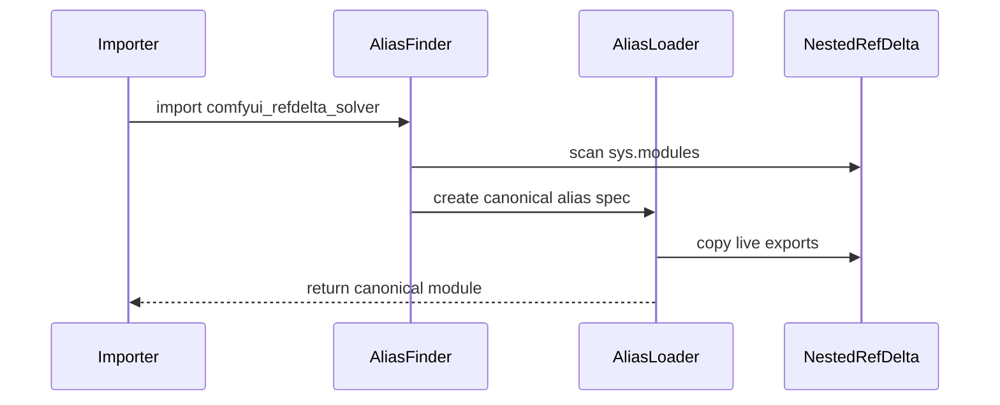

**Poem**

> A rabbit found a namespace trail  
> > And copied modules without a veil  
> > The sampler stayed the source of truth  
> > Tests checked identity, clean and smooth  
> > Canonical imports now hop the rail

</details>

<!-- walkthrough_end -->
<!-- pre_merge_checks_walkthrough_start -->

<details>
<summary>🚥 Pre-merge checks | ✅ 4 | ❌ 1</summary>

### ❌ Failed checks (1 warning)

|     Check name     | Status     | Explanation                                                                                                                                                                                | Resolution                                                                         |
| :----------------: | :--------- | :----------------------------------------------------------------------------------------------------------------------------------------------------------------------------------------- | :--------------------------------------------------------------------------------- |
| Docstring Coverage | ⚠️ Warning | Docstring coverage is 8.33% which is insufficient. The required threshold is 80.00%. Docstring coverage is scoped to functions touched by this diff. Analyzed 12 functions across 3 files. | Write docstrings for the functions missing them to satisfy the coverage threshold. |

<details>
<summary>✅ Passed checks (4 passed)</summary>

|         Check name         | Status   | Explanation                                                                                                                |
| :------------------------: | :------- | :------------------------------------------------------------------------------------------------------------------------- |
|      Description Check     | ✅ Passed | Check skipped - CodeRabbit’s high-level summary is enabled.                                                                |
|         Title check        | ✅ Passed | The title clearly and concisely describes the main change: fixing RefDelta discovery under ComfyUI custom-node namespaces. |
|     Linked Issues check    | ✅ Passed | Check skipped because no linked issues were found for this pull request.                                                   |
| Out of Scope Changes check | ✅ Passed | Check skipped because no linked issues were found for this pull request.                                                   |

</details>

</details>

<!-- pre_merge_checks_walkthrough_end -->
<!-- finishing_touch_checkbox_start -->

<details>
<summary>✨ Finishing Touches 💡 1</summary>

<!-- finishing_touch_suggestion:docstrings -->
<details>
<summary>📝 Generate docstrings 💡</summary>

- [ ] <!-- {"checkboxId":"7962f53c-55bc-4827-bfbf-6a18da830691"} --> Create stacked PR
- [ ] <!-- {"checkboxId":"3e1879ae-f29b-4d0d-8e06-d12b7ba33d98"} --> Commit on current branch

</details>
<details>
<summary>🧪 Generate unit tests (beta)</summary>

- [ ] <!-- {"checkboxId": "f47ac10b-58cc-4372-a567-0e02b2c3d479", "radioGroupId": "utg-output-choice-group-5401459193"} -->   Create PR with unit tests
- [ ] <!-- {"checkboxId": "6ba7b810-9dad-11d1-80b4-00c04fd430c8", "radioGroupId": "utg-output-choice-group-5401459193"} -->   Commit unit tests in branch `fix/refdelta-comfyui-package-discovery`

</details>

</details>

<!-- finishing_touch_checkbox_end -->
<!-- tips_start -->

---

Thanks for using [CodeRabbit](https://coderabbit.ai?utm_source=oss&utm_medium=github&utm_campaign=xmarre/ComfyUI-Spectrum-MiniMax-H3&utm_content=76)! It's free for OSS, and your support helps us grow. If you like it, consider giving us a shout-out.

<details>
<summary>❤️ Share</summary>

- [X](https://twitter.com/intent/tweet?text=I%20just%20used%20%40coderabbitai%20for%20my%20code%20review%2C%20and%20it%27s%20fantastic%21%20It%27s%20free%20for%20OSS%20and%20offers%20a%20free%20trial%20for%20the%20proprietary%20code.%20Check%20it%20out%3A&url=https%3A//coderabbit.ai)
- [Mastodon](https://mastodon.social/share?text=I%20just%20used%20%40coderabbitai%20for%20my%20code%20review%2C%20and%20it%27s%20fantastic%21%20It%27s%20free%20for%20OSS%20and%20offers%20a%20free%20trial%20for%20the%20proprietary%20code.%20Check%20it%20out%3A%20https%3A%2F%2Fcoderabbit.ai)
- [Reddit](https://www.reddit.com/submit?title=Great%20tool%20for%20code%20review%20-%20CodeRabbit&text=I%20just%20used%20CodeRabbit%20for%20my%20code%20review%2C%20and%20it%27s%20fantastic%21%20It%27s%20free%20for%20OSS%20and%20offers%20a%20free%20trial%20for%20proprietary%20code.%20Check%20it%20out%3A%20https%3A//coderabbit.ai)
- [LinkedIn](https://www.linkedin.com/sharing/share-offsite/?url=https%3A%2F%2Fcoderabbit.ai&mini=true&title=Great%20tool%20for%20code%20review%20-%20CodeRabbit&summary=I%20just%20used%20CodeRabbit%20for%20my%20code%20review%2C%20and%20it%27s%20fantastic%21%20It%27s%20free%20for%20OSS%20and%20offers%20a%20free%20trial%20for%20proprietary%20code)

</details>


<sub>Comment `@coderabbitai help` to get the list of available commands.</sub>

<!-- tips_end -->


> **Comment by xmarre (2026-08-24T21:13:55Z):**

@coderabbitai review


> **Comment by coderabbitai[bot] (2026-08-24T21:14:01Z):**

<!-- This is an auto-generated reply by CodeRabbit -->
<!-- CodeRabbit review command invocation: v2:2e14dcebe0c0b36875b1e0e0af9ee41c13dcf2754477c2eb9bb8a44192cd4260 -->
<details>
<summary>✅ Action performed</summary>

Review finished.

> Note: CodeRabbit is an incremental review system and does not re-review already reviewed commits. This command is applicable only when automatic reviews are paused.

</details>


### #75 [closed] PR: Validate RefDelta Solver compatibility
URL: https://github.com/xmarre/ComfyUI-Spectrum-MiniMax-H3/pull/75  by xmarre 2026-08-24T14:25:34Z

Runs Spectrum's full ComfyUI compatibility matrix against the exact reviewed RefDelta API-v1 commit and records the cross-repository pin.

> **Comment by coderabbitai[bot] (2026-08-24T14:25:43Z):**

<!-- This is an auto-generated comment: summarize by coderabbit.ai -->
<!-- This is an auto-generated comment: skip review by coderabbit.ai -->

> [!IMPORTANT]
> ## Review skipped
> 
> Auto reviews are disabled on this repository. Please check the settings in the CodeRabbit UI or the `.coderabbit.yaml` file in this repository. To trigger a single review, invoke the `@coderabbitai review` command.
> 
> <details>
> <summary>⚙️ Run configuration</summary>
> 
> **Configuration used**: Organization UI
> 
> **Review profile**: CHILL
> 
> **Plan**: Pro Plus
> 
> **Run ID**: `ae7d1de8-b849-4a6b-ac37-04a9b6689c09`
> 
> </details>
> 
> You can disable this status message by setting the `reviews.review_status` to `false` in the CodeRabbit configuration file.
> 
> Use the checkbox below for a quick retry:
> - [ ] <!-- {"checkboxId":"e9bb8d72-00e8-4f67-9cb2-caf3b22574fe"} --> 🔍 Trigger review

<!-- end of auto-generated comment: skip review by coderabbit.ai -->

<!-- tips_start -->

---

Thanks for using [CodeRabbit](https://coderabbit.ai?utm_source=oss&utm_medium=github&utm_campaign=xmarre/ComfyUI-Spectrum-MiniMax-H3&utm_content=75)! It's free for OSS, and your support helps us grow. If you like it, consider giving us a shout-out.

<details>
<summary>❤️ Share</summary>

- [X](https://twitter.com/intent/tweet?text=I%20just%20used%20%40coderabbitai%20for%20my%20code%20review%2C%20and%20it%27s%20fantastic%21%20It%27s%20free%20for%20OSS%20and%20offers%20a%20free%20trial%20for%20the%20proprietary%20code.%20Check%20it%20out%3A&url=https%3A//coderabbit.ai)
- [Mastodon](https://mastodon.social/share?text=I%20just%20used%20%40coderabbitai%20for%20my%20code%20review%2C%20and%20it%27s%20fantastic%21%20It%27s%20free%20for%20OSS%20and%20offers%20a%20free%20trial%20for%20the%20proprietary%20code.%20Check%20it%20out%3A%20https%3A%2F%2Fcoderabbit.ai)
- [Reddit](https://www.reddit.com/submit?title=Great%20tool%20for%20code%20review%20-%20CodeRabbit&text=I%20just%20used%20CodeRabbit%20for%20my%20code%20review%2C%20and%20it%27s%20fantastic%21%20It%27s%20free%20for%20OSS%20and%20offers%20a%20free%20trial%20for%20proprietary%20code.%20Check%20it%20out%3A%20https%3A//coderabbit.ai)
- [LinkedIn](https://www.linkedin.com/sharing/share-offsite/?url=https%3A%2F%2Fcoderabbit.ai&mini=true&title=Great%20tool%20for%20code%20review%20-%20CodeRabbit&summary=I%20just%20used%20CodeRabbit%20for%20my%20code%20review%2C%20and%20it%27s%20fantastic%21%20It%27s%20free%20for%20OSS%20and%20offers%20a%20free%20trial%20for%20proprietary%20code)

</details>


<sub>Comment `@coderabbitai help` to get the list of available commands.</sub>

<!-- tips_end -->


### #74 [open] ISSUE: Log says it's done sampling, while the sampler keeps going
URL: https://github.com/xmarre/ComfyUI-Spectrum-MiniMax-H3/issues/74  by Davikar 2026-08-23T22:19:11Z

Not sure if a bug or part of how the node works, but when I look at the log it says it's performed all sampling steps, but the progress bar on the sampler itself keeps going for a while longer.  This is on latest Comfy, no turbo lora, 25 steps, no settings changed on the node.

> **Comment by SveSop (2026-09-01T00:10:28Z):**

It is probably the audio part... The node does a audio re-doing thingy AFTER the regular sampling.. So you will see 25 steps running -> another (much quicker) 25 steps for audio. How the comfyui cli/nodes interpret this is.. lottery i guess.

TLDR: Part of how this node works 😄 


> **Comment by Davikar (2026-09-01T00:34:00Z):**

I guess that could be it, but I thought sampling the audio would be much quicker. The extra steps afterwards adds like +50% to the generation time.


> **Comment by SveSop (2026-09-01T11:01:00Z):**

You can try to set "offline_smoothing_replay" to "false".


### #73 [closed] PR: Support native H3 masked forecasting and short refinement
URL: https://github.com/xmarre/ComfyUI-Spectrum-MiniMax-H3/pull/73  by xmarre 2026-08-20T02:08:24Z

## Scope

This PR completes two MiniMax H3 interoperability paths while preserving native H3 semantics:

1. **Native Masked continuation** — forecast output-head reconstruction now supports Core's per-row VIDEO/AUDIO timestep selections produced by H3 denoise masks.
2. **Learned-latent sampler-2 refinement** — a valid explicit `h3_refinement` API-v1 contract can override sampler-1's generation-only Continuum actual prefix without weakening normal generation or external-patch safety.

## Native Masked forecasting

- Reconstruct native H3 FinalLayer modulation with scalar or per-row VIDEO/AUDIO timestep indices.
- Preserve the scalar fully-generating fast path.
- Use the same reconstruction for residual/shadow output-head evaluation.
- Place per-row timestep indices on the target latent device.
- On older reviewed Core revisions without `mask_row_values`, fail closed to one native actual transformer evaluation instead of raising on a masked forecast.
- Keep malformed AUDIO mask layouts explicit failures.

## Short refinement

The integrated latent upscaler/refiner marks only its sampler-2 MODEL clone with:

```text
h3_refinement API v1
```

A complete valid contract is authoritative for sampler 2. Normal Continuum generation still keeps its two-step actual prefix. With the normal warmup/final-tail rules, a stable three-step refinement is eligible for:

```text
actual -> forecast -> actual
```

Real external-patch hard transitions remain hard barriers. DiffAid PR #11 removes the artificial partial-denoise transition at its source; Spectrum does not bypass genuine model-function changes.

## Coordinated runtime validation

Validated on a real CUDA MiniMax H3 workflow with:

- H3 Continuum exact `refine_state`;
- learned latent upscale + internal sampler-2 refinement;
- DiffAid marked-refinement sigma semantics;
- Untwisting RoPE external-patch metadata;
- native ER-SDE;
- Spectrum on both the normal Continuum generation and sampler 2.

The three-step high-resolution refinement reported `2 actual + 1 forecast` per refined chunk, with no inherited Continuum-prefix force-actual and no artificial DiffAid middle-step transition. The resulting media quality was user-validated as impeccable.

In the compared 0.7 MP native -> 1.75x workflow, the Refine node dropped from roughly 302.5 s with three target-resolution native NFEs to roughly 212.7 s with the middle NFE forecast.

## Regression coverage

Coverage includes mixed VIDEO/AUDIO masks, native per-row FinalLayer equivalence, legacy-Core masked fallback, target-device row indices, complete/malformed refinement contracts, unchanged normal Continuum prefix behavior, external-patch transitions, and three-step middle-forecast eligibility.

## Release

This PR is the v0.2.17 release head. `pyproject.toml` and `RELEASE_NOTES.md` are updated; after merge, the existing tested-main release workflow will publish the GitHub release and the existing registry workflow will publish the versioned node package.

Final squashed release commit: `79fdfe7c0ad53b4dce4e6b449e5fe92beb839067`.

> **Comment by coderabbitai[bot] (2026-08-20T02:08:32Z):**

<!-- This is an auto-generated comment: summarize by coderabbit.ai -->
<!-- review_stack_entry_start -->

[](https://app.coderabbit.ai/change-stack/xmarre/ComfyUI-Spectrum-MiniMax-H3/pull/73?utm_source=github_walkthrough&utm_medium=github&utm_campaign=change_stack)

<!-- review_stack_entry_end -->
<!-- walkthrough_start -->

<details>
<summary>📝 Walkthrough</summary>

## Walkthrough

### Changes

**Masked MiniMax H3 forecast support**

|Layer / File(s)|Summary|
|---|---|
|**Masked timestep state preparation** <br> `comfyui_spectrum_h3/minimax_h3.py`|`_prepare_output_state` accepts video and audio denoise masks and creates validated scalar or per-row timestep indices.|
|**Masked native execution** <br> `comfyui_spectrum_h3/minimax_h3.py`|Residual and forecast paths pass masks to native evaluation and no longer bypass native evaluation when masks are present.|
|**Masked forecast validation and CI wiring** <br> `tests/test_h3_masked_forecast.py`, `tests/test_h3_masked_native_equivalence.py`, `tests/test_h3_masked_native_wrapper.py`, `.github/workflows/tests.yml`|Tests cover timestep rows, native modulation, forecast equivalence, invalid mask sizes, and compatibility workflow execution.|

**Estimated code review effort:** 4 (Complex) | ~45 minutes

<!-- final_review_risk_start -->
**Merge Risk:** _🟡 Moderate_ · up to `56271`

Masked forecasting can fail at runtime on older supported Core revisions that lack the required helper, rather than falling back to native execution. Merge should wait for an explicit compatibility fix or owner acceptance of this bounded support risk.
<!-- final_review_risk_end -->

### Sequence Diagram(s)

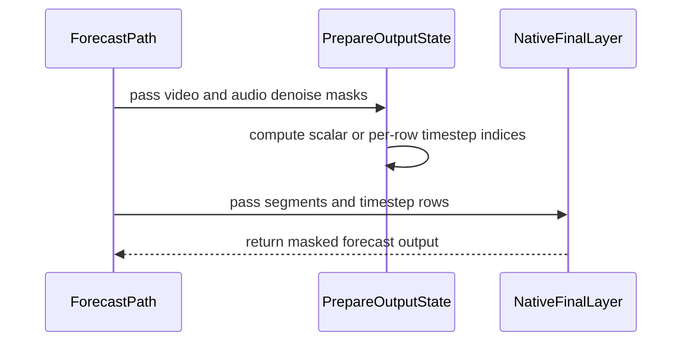

**Poem**

> I’m a rabbit with masks in my den,  
> Timestep rows hop from token to token again.  
> Native layers follow each trace,  
> Forecasts retain their shape and place.  
> Tests guard every burrowed case.

</details>

<!-- walkthrough_end -->
<!-- pre_merge_checks_walkthrough_start -->

<details>
<summary>🚥 Pre-merge checks | ✅ 5</summary>

<details>
<summary>✅ Passed checks (5 passed)</summary>

|         Check name         | Status   | Explanation                                                                                                                                            |
| :------------------------: | :------- | :----------------------------------------------------------------------------------------------------------------------------------------------------- |
|     Docstring Coverage     | ✅ Passed | No functions found in the changed files to evaluate docstring coverage. Skipping docstring coverage check.                                             |
|     Linked Issues check    | ✅ Passed | Check skipped because no linked issues were found for this pull request.                                                                               |
| Out of Scope Changes check | ✅ Passed | Check skipped because no linked issues were found for this pull request.                                                                               |
|      Description Check     | ✅ Passed | Check skipped - CodeRabbit’s high-level summary is enabled.                                                                                            |
|         Title check        | ✅ Passed | The title clearly identifies the main change: native H3 masked forecasting; the additional refinement detail remains related to the stated objectives. |

</details>

</details>

<!-- pre_merge_checks_walkthrough_end -->
<!-- finishing_touch_checkbox_start -->

<details>
<summary>✨ Finishing Touches</summary>

<details>
<summary>📝 Generate docstrings</summary>

- [ ] <!-- {"checkboxId":"7962f53c-55bc-4827-bfbf-6a18da830691"} --> Create stacked PR
- [ ] <!-- {"checkboxId":"3e1879ae-f29b-4d0d-8e06-d12b7ba33d98"} --> Commit on current branch

</details>
<details>
<summary>🧪 Generate unit tests (beta)</summary>

- [ ] <!-- {"checkboxId": "f47ac10b-58cc-4372-a567-0e02b2c3d479", "radioGroupId": "utg-output-choice-group-5350330050"} -->   Create PR with unit tests
- [ ] <!-- {"checkboxId": "6ba7b810-9dad-11d1-80b4-00c04fd430c8", "radioGroupId": "utg-output-choice-group-5350330050"} -->   Commit unit tests in branch `fix/h3-native-mask-forecasting`

</details>

</details>

<!-- finishing_touch_checkbox_end -->
<!-- tips_start -->

---

Thanks for using [CodeRabbit](https://coderabbit.ai?utm_source=oss&utm_medium=github&utm_campaign=xmarre/ComfyUI-Spectrum-MiniMax-H3&utm_content=73)! It's free for OSS, and your support helps us grow. If you like it, consider giving us a shout-out.

<details>
<summary>❤️ Share</summary>

- [X](https://twitter.com/intent/tweet?text=I%20just%20used%20%40coderabbitai%20for%20my%20code%20review%2C%20and%20it%27s%20fantastic%21%20It%27s%20free%20for%20OSS%20and%20offers%20a%20free%20trial%20for%20the%20proprietary%20code.%20Check%20it%20out%3A&url=https%3A//coderabbit.ai)
- [Mastodon](https://mastodon.social/share?text=I%20just%20used%20%40coderabbitai%20for%20my%20code%20review%2C%20and%20it%27s%20fantastic%21%20It%27s%20free%20for%20OSS%20and%20offers%20a%20free%20trial%20for%20the%20proprietary%20code.%20Check%20it%20out%3A%20https%3A%2F%2Fcoderabbit.ai)
- [Reddit](https://www.reddit.com/submit?title=Great%20tool%20for%20code%20review%20-%20CodeRabbit&text=I%20just%20used%20CodeRabbit%20for%20my%20code%20review%2C%20and%20it%27s%20fantastic%21%20It%27s%20free%20for%20OSS%20and%20offers%20a%20free%20trial%20for%20proprietary%20code.%20Check%20it%20out%3A%20https%3A//coderabbit.ai)
- [LinkedIn](https://www.linkedin.com/sharing/share-offsite/?url=https%3A%2F%2Fcoderabbit.ai&mini=true&title=Great%20tool%20for%20code%20review%20-%20CodeRabbit&summary=I%20just%20used%20CodeRabbit%20for%20my%20code%20review%2C%20and%20it%27s%20fantastic%21%20It%27s%20free%20for%20OSS%20and%20offers%20a%20free%20trial%20for%20proprietary%20code)

</details>


<sub>Comment `@coderabbitai help` to get the list of available commands.</sub>

<!-- tips_end -->


> **Comment by xmarre (2026-08-20T08:59:37Z):**

## Production runtime validation — passed

Retested the original failing production stack with Continuum V3.4 Native Masked + Spectrum PR #73 + DiffAid PR #11 + Untwisting RoPE on ComfyUI 0.33.0 / ER-SDE.

The masked continuation path now behaves as intended:

- Continuum interop is accepted: `accepted H3 Continuum API v1, actual prefix=2`;
- steps 0 and 1 are actual specifically because of the Continuum prefix request;
- later masked steps do enter `decision=forecast` / `path=forecast`;
- no `per-token denoise masks require native MiniMax H3 evaluation` fallback occurs;
- no Spectrum fallback or contract failure occurs;
- final masked-chunk summary: `actual_steps=12 forecast_steps=7 actual_transformer_calls=12 forecast_calls=7 fallbacks=0 bypassed_steps=0 disabled=False`;
- DiffAid's hard sigma transition is handled normally (`action=force_actual` at step 8), and model-aware risk intentionally promotes a few later steps to actual rather than disabling the run;
- the full workflow proceeds through VAE video/audio decode, Continuum seam assembly, RTX video super-resolution, and video combine successfully.

For comparison, the unmasked first chunk in the same run was `actual_steps=10 forecast_steps=9 disabled=False`; the Native Masked chunk is larger (`target_video_rows=37752`, `target_audio_rows=584` vs `34122` / `526`) and also contains the required two-step Continuum actual prefix plus conservative actual refreshes, so its 191.079 s Spectrum wall time versus 155.523 s for chunk 1 is expected and is no longer the old all-native regression.

This validates the production GPU compatibility bug fixed by this PR. Perceptual output/seam quality remains a separate Continuum validation question; no merge or release is implied by this comment.


> **Comment by xmarre (2026-08-22T09:13:05Z):**

Review follow-up on the final one-commit head `79fdfe7c0ad53b4dce4e6b449e5fe92beb839067`:

- The older-Core `mask_row_values` finding is fixed in the wrapper before forecast reconstruction: masked calls on those reviewed Core revisions are promoted to one native actual evaluation instead of entering `_prepare_output_state` and raising.
- Per-row timestep indices are now materialized on the target latent device, including the `searchsorted` positions used to index the lookup tensor.
- I also rechecked the row-count nitpick. `_resolve_layout()` builds the native `PackedLayout` from the same padded VIDEO geometry and AUDIO grid used by the current call, and `target_segments(layout)` therefore derives the same target counts for a valid native layout. AUDIO still has an explicit external-mask row-count check. Adding a second layout-derived VIDEO/AUDIO count assertion here would duplicate that established native-layout invariant without covering a distinct valid-input failure mode, so I left the runtime path unchanged.

The two inline threads are resolved and the current head's `tests` workflow is green.


### #72 [closed] PR: Update Untwisting RoPE repository references
URL: https://github.com/xmarre/ComfyUI-Spectrum-MiniMax-H3/pull/72  by xmarre 2026-08-19T11:53:45Z

Update the README after the companion Untwisting RoPE repository rename.

- replace the old `ComfyUI-Flux.2-Untwisting-RoPE` display name with `ComfyUI-Untwisting-RoPE`;
- link both README references directly to `xmarre/ComfyUI-Untwisting-RoPE`;
- leave the Spectrum compatibility protocol/provider identifier unchanged. The renamed producer still publishes `comfyui-flux2-untwisting-rope`, so changing that identifier would be an unnecessary compatibility break rather than a repository-name cleanup.

README-only. No runtime, protocol, defaults, version, release tag, or workflow changes.

<!-- This is an auto-generated comment: release notes by coderabbit.ai -->

## Summary by CodeRabbit

* **Documentation**
  * Updated the documented Untwisting RoPE integration name and link.
  * Corrected references in the release notes and external patch list.

<!-- end of auto-generated comment: release notes by coderabbit.ai -->

> **Comment by xmarre (2026-08-19T11:53:54Z):**

@coderabbitai review


> **Comment by coderabbitai[bot] (2026-08-19T11:54:00Z):**

<!-- This is an auto-generated reply by CodeRabbit -->
<!-- CodeRabbit review command invocation: b4e4ca29-26db-4d88-b9ba-f2928a748e96 -->
<details>
<summary>✅ Action performed</summary>

Review finished.

> Note: CodeRabbit is an incremental review system and does not re-review already reviewed commits. This command is applicable only when automatic reviews are paused.

</details>


> **Comment by coderabbitai[bot] (2026-08-19T11:54:13Z):**

<!-- This is an auto-generated comment: summarize by coderabbit.ai -->
<!-- review_stack_entry_start -->

[](https://app.coderabbit.ai/change-stack/xmarre/ComfyUI-Spectrum-MiniMax-H3/pull/72?utm_source=github_walkthrough&utm_medium=github&utm_campaign=change_stack)

<!-- review_stack_entry_end -->
<!-- recent_review_start -->

No actionable comments were generated in the recent review. 🎉

<details>
<summary>ℹ️ Recent review info</summary>

<details>
<summary>⚙️ Run configuration</summary>

**Configuration used**: Organization UI

**Review profile**: CHILL

**Plan**: Pro Plus

**Run ID**: `11d2f5d3-a4c4-4b85-86a3-4d46e0039f7e`

</details>

<details>
<summary>📥 Commits</summary>

Reviewing files that changed from the base of the PR and between df5a56e40b3233a79e6d0c78108fcf9e8bbe37d7 and 6a3b9fcdd8877a25fb3eb4b56d3b328b5361eb07.

</details>

<details>
<summary>📒 Files selected for processing (1)</summary>

* `README.md`

</details>

**Included review availability:** Your plan provides up to 4 included reviews per hour; 3 remain after this review.

</details>

---


<!-- recent_review_end -->
<!-- walkthrough_start -->

<details>
<summary>📝 Walkthrough</summary>

## Walkthrough

The README now uses the updated ComfyUI-Untwisting-RoPE name and repository link in two references. The license notice remains unchanged.

### Changes

**README reference update**

|Layer / File(s)|Summary|
|---|---|
|**Update Untwisting RoPE references** <br> `README.md`|The release note and external patch listing now use `ComfyUI-Untwisting-RoPE`. The GPL-3.0-or-later license notice remains unchanged.|

**Estimated code review effort:** 1 (Trivial) | ~2 minutes

<!-- final_review_risk_start -->
**Merge Risk:** _⚪ Minimal_ · up to `6a3b9`

This PR only updates README repository references while preserving the compatibility identifier, with no runtime or protocol changes; no actionable merge-blocking risk remains.
<!-- final_review_risk_end -->

**Poem**

> I’m a rabbit with a README tune,  
> New RoPE names now land just right.  
> Old links hop away beneath the moon,  
> The license stays in sight.  
> Three small lines, then I’m out of sight!

</details>

<!-- walkthrough_end -->
<!-- pre_merge_checks_walkthrough_start -->

<details>
<summary>🚥 Pre-merge checks | ✅ 5</summary>

<details>
<summary>✅ Passed checks (5 passed)</summary>

|         Check name         | Status   | Explanation                                                                                                |
| :------------------------: | :------- | :--------------------------------------------------------------------------------------------------------- |
|     Docstring Coverage     | ✅ Passed | No functions found in the changed files to evaluate docstring coverage. Skipping docstring coverage check. |
|     Linked Issues check    | ✅ Passed | Check skipped because no linked issues were found for this pull request.                                   |
| Out of Scope Changes check | ✅ Passed | Check skipped because no linked issues were found for this pull request.                                   |
|      Description Check     | ✅ Passed | Check skipped - CodeRabbit’s high-level summary is enabled.                                                |
|         Title check        | ✅ Passed | The title clearly and concisely describes the README changes to the Untwisting RoPE repository references. |

</details>

</details>

<!-- pre_merge_checks_walkthrough_end -->
<!-- finishing_touch_checkbox_start -->

<details>
<summary>✨ Finishing Touches</summary>

<details>
<summary>🧪 Generate unit tests (beta)</summary>

- [ ] <!-- {"checkboxId": "f47ac10b-58cc-4372-a567-0e02b2c3d479", "radioGroupId": "utg-output-choice-group-5341743559"} -->   Create PR with unit tests
- [ ] <!-- {"checkboxId": "6ba7b810-9dad-11d1-80b4-00c04fd430c8", "radioGroupId": "utg-output-choice-group-5341743559"} -->   Commit unit tests in branch `docs/untwisting-rope-rename`

</details>

</details>

<!-- finishing_touch_checkbox_end -->
<!-- tips_start -->

---

Thanks for using [CodeRabbit](https://coderabbit.ai?utm_source=oss&utm_medium=github&utm_campaign=xmarre/ComfyUI-Spectrum-MiniMax-H3&utm_content=72)! It's free for OSS, and your support helps us grow. If you like it, consider giving us a shout-out.

<details>
<summary>❤️ Share</summary>

- [X](https://twitter.com/intent/tweet?text=I%20just%20used%20%40coderabbitai%20for%20my%20code%20review%2C%20and%20it%27s%20fantastic%21%20It%27s%20free%20for%20OSS%20and%20offers%20a%20free%20trial%20for%20the%20proprietary%20code.%20Check%20it%20out%3A&url=https%3A//coderabbit.ai)
- [Mastodon](https://mastodon.social/share?text=I%20just%20used%20%40coderabbitai%20for%20my%20code%20review%2C%20and%20it%27s%20fantastic%21%20It%27s%20free%20for%20OSS%20and%20offers%20a%20free%20trial%20for%20the%20proprietary%20code.%20Check%20it%20out%3A%20https%3A%2F%2Fcoderabbit.ai)
- [Reddit](https://www.reddit.com/submit?title=Great%20tool%20for%20code%20review%20-%20CodeRabbit&text=I%20just%20used%20CodeRabbit%20for%20my%20code%20review%2C%20and%20it%27s%20fantastic%21%20It%27s%20free%20for%20OSS%20and%20offers%20a%20free%20trial%20for%20proprietary%20code.%20Check%20it%20out%3A%20https%3A//coderabbit.ai)
- [LinkedIn](https://www.linkedin.com/sharing/share-offsite/?url=https%3A%2F%2Fcoderabbit.ai&mini=true&title=Great%20tool%20for%20code%20review%20-%20CodeRabbit&summary=I%20just%20used%20CodeRabbit%20for%20my%20code%20review%2C%20and%20it%27s%20fantastic%21%20It%27s%20free%20for%20OSS%20and%20offers%20a%20free%20trial%20for%20proprietary%20code)

</details>


<sub>Comment `@coderabbitai help` to get the list of available commands.</sub>

<!-- tips_end -->

